# Claude Code 泄露源码架构与核心链路分析

> **阅读结论：** Claude Code 是 Anthropic 官方的终端 AI 编程助手，使用 TypeScript + Bun + React + Ink 构建。核心是一个 `QueryEngine` 类驱动的 LLM 查询循环，配合 50+ 斜杠命令、40+ 工具、MCP 协议、IDE 桥接、记忆系统等模块。相比 Hermes Agent，它更偏向 IDE 集成和用户体验打磨。

## 一、项目定位

**Claude Code** 是 Anthropic 官方推出的终端 AI 编程助手，让开发者直接在命令行中与 Claude 交互，执行文件编辑、命令运行、代码库搜索、Git 工作流管理等任务。

**项目背景**：2026年3月31日，Claude Code 的完整源码通过 npm 包中的 `.map` 文件泄露，包含约 1900 个文件、51万+ 行 TypeScript 代码。

| 维度 | 说明 |
|-|-|
| 语言 | TypeScript |
| 运行时 | Bun 1.2+ |
| 终端 UI | React + Ink（React for CLI） |
| 规模 | \~1900 文件，512,000+ 行代码 |
| 核心依赖 | @anthropic-ai/sdk, @modelcontextprotocol/sdk, ink, react |

---

## 二、总体架构

整体架构可以分为六层：入口与命令层、查询引擎层、工具与命令系统、服务集成层、状态与桥接层、基础设施层。

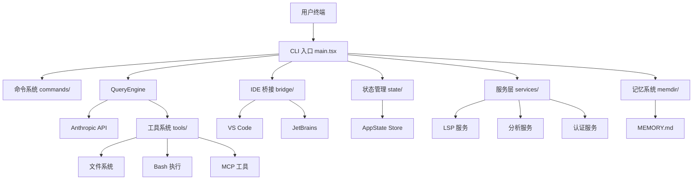

| 层级 | 职责 | 重点源码 |
|-|-|-|
| 入口与命令层 | CLI 参数解析、命令分发、REPL 循环 | `main.tsx`, `commands/`, `screens/REPL.tsx` |
| 查询引擎层 | LLM 请求、消息管理、工具调用循环 | `QueryEngine.ts`, `query.ts` |
| 工具与命令系统 | 40+ 工具、50+ 斜杠命令实现 | `tools/`, `commands/`, `Tool.ts` |
| 服务集成层 | MCP、LSP、认证、分析等外部服务 | `services/mcp/`, `services/lsp/`, `services/api/` |
| 状态与桥接层 | 全局状态管理、IDE 桥接通信 | `state/`, `bridge/` |
| 基础设施层 | Ink 渲染、快捷键、配置、迁移 | `ink/`, `keybindings/`, `migrations/` |

---

## 三、目录与功能模块

### 3.1 顶层目录速览

| 目录 | 职责 | 学习重点 |
|-|-|-|
| `src/main.tsx` | CLI 入口，Commander.js 参数解析，启动流程 | 理解 CLI 启动和初始化链路 |
| `src/QueryEngine.ts` | 核心查询引擎，LLM 交互的核心循环 | 理解 Agent 主循环实现 |
| `src/tools/` | 40+ 工具实现（Bash、FileEdit、Glob、Grep 等） | 理解工具定义和执行模式 |
| `src/commands/` | 50+ 斜杠命令实现 | 理解命令系统和扩展机制 |
| `src/bridge/` | IDE 桥接层，与 VS Code、JetBrains 通信 | 理解 IDE 集成架构 |
| `src/services/mcp/` | MCP 协议客户端实现 | 理解 Model Context Protocol 集成 |
| `src/services/lsp/` | LSP 服务管理 | 理解语言服务器集成 |
| `src/services/api/` | Anthropic API 客户端 | 理解 API 调用和错误处理 |
| `src/memdir/` | 记忆系统，持久化存储 | 理解 Agent 记忆机制 |
| `src/state/` | 全局状态管理（AppState） | 理解 React 状态管理模式 |
| `src/ink/` | Ink 渲染器封装 | 理解终端 UI 渲染 |
| `src/keybindings/` | 快捷键系统 | 理解快捷键配置和解析 |
| `src/components/` | Ink UI 组件 | 理解终端 UI 组件设计 |
| `src/hooks/` | React Hooks | 理解状态管理和副作用处理 |
| `src/skills/` | 技能系统 | 理解可复用技能封装 |
| `src/plugins/` | 插件系统 | 理解插件加载和管理 |

### 3.2 核心入口文件

| 文件 | 职责 |
|-|-|
| `src/main.tsx` | 主入口，CLI 参数解析，初始化所有模块 |
| `src/entrypoints/cli.tsx` | CLI 模式入口 |
| `src/entrypoints/init.ts` | 初始化逻辑 |
| `src/entrypoints/mcp.ts` | MCP 服务入口 |

---

## 四、核心对象与职责边界

### 4.1 QueryEngine：查询引擎中枢

`QueryEngine` 是 Claude Code 的核心类，负责管理整个对话生命周期。

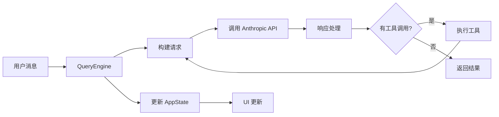

**核心职责**：

- 管理对话消息历史
- 构建 API 请求（系统提示词 + 用户消息 + 工具定义）
- 处理 API 响应和工具调用
- 跟踪 token 使用量和成本
- 处理错误重试和恢复

### 4.2 Tool 系统

工具系统采用统一的 `Tool` 接口，每个工具定义了名称、描述、参数 schema 和执行逻辑。

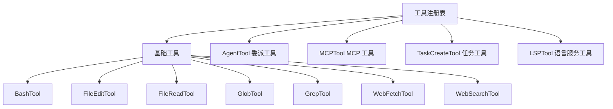

**工具分类**：

| 类型 | 工具示例 | 说明 |
|-|-|-|
| 文件操作 | FileRead, FileEdit, FileWrite, Glob, Grep | 读写搜索文件 |
| 命令执行 | Bash, PowerShell | 执行 shell 命令 |
| 网络请求 | WebFetch, WebSearch | 获取网络内容 |
| 任务管理 | TaskCreate, TaskGet, TaskList, TaskUpdate | 管理异步任务 |
| 委派 | Agent | 创建子 Agent |
| MCP | MCPTool | 调用 MCP 服务器工具 |
| LSP | LSPTool | 语言服务器功能 |

### 4.3 Command 系统

斜杠命令系统提供了丰富的用户交互入口。

**命令分类**：

| 类型 | 命令示例 | 说明 |
|-|-|-|
| 会话管理 | /resume, /clear, /compact | 管理对话会话 |
| 配置 | /config, /model, /theme | 配置设置 |
| Git | /commit, /pr, /review | Git 工作流 |
| 工具 | /mcp, /plugins, /skills | 管理扩展 |
| 诊断 | /doctor, /cost, /usage | 诊断和统计 |

### 4.4 Bridge：IDE 桥接层

Bridge 模块实现了与 IDE 的双向通信，支持 VS Code 和 JetBrains。

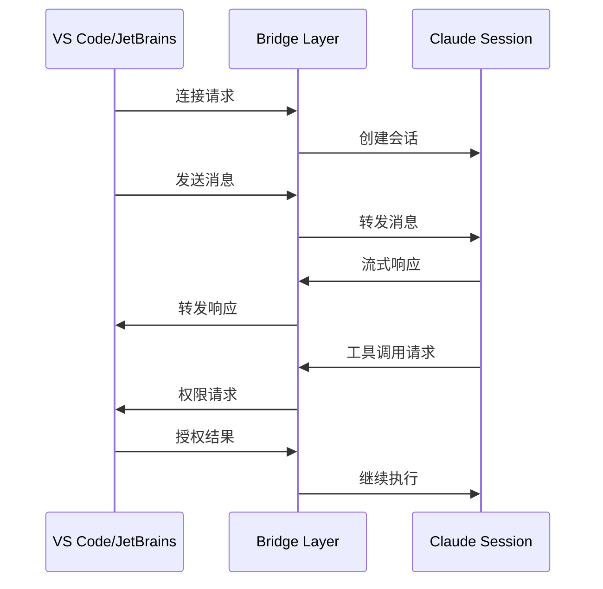

**核心功能**：

- 会话管理和持久化
- 消息双向转发
- 权限请求和审批
- 多环境支持

### 4.5 MCP：Model Context Protocol

MCP 模块实现了与外部工具和服务器的协议通信。

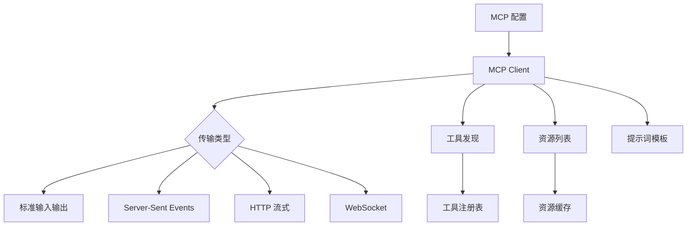

**MCP 能力**：

- 工具发现和调用
- 资源读取和订阅
- 提示词模板
- OAuth 认证

---

## 五、核心链路一：CLI 启动流程

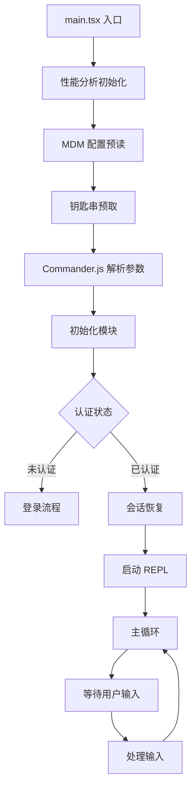

**启动阶段关键操作**：

1. **性能分析**：`profileCheckpoint` 标记启动各阶段
2. **并行预取**：MDM 配置、钥匙串、OAuth token 并行读取
3. **模块初始化**：GrowthBook、遥测、LSP、插件系统
4. **会话恢复**：检查是否有可恢复的会话
5. **REPL 启动**：进入交互式主循环

---

## 六、核心链路二：消息处理流程

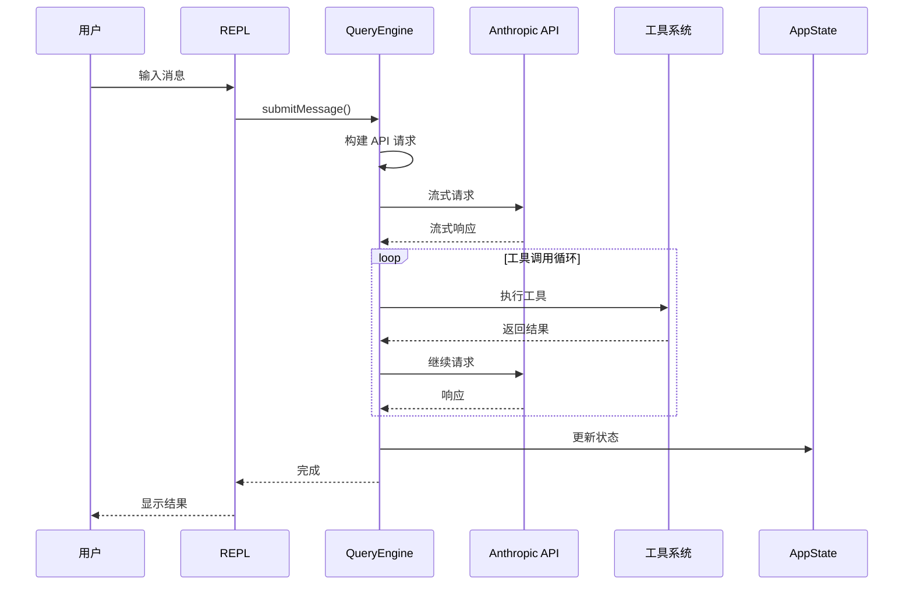

**消息处理关键步骤**：

1. **输入处理**：解析用户输入，处理特殊命令
2. **上下文构建**：加载记忆、技能、项目上下文
3. **API 请求**：构建消息数组，发送流式请求
4. **响应处理**：处理文本块和工具调用块
5. **工具执行**：执行工具调用，收集结果
6. **状态更新**：更新 UI 状态和会话存储

---

## 七、核心链路三：工具执行流程

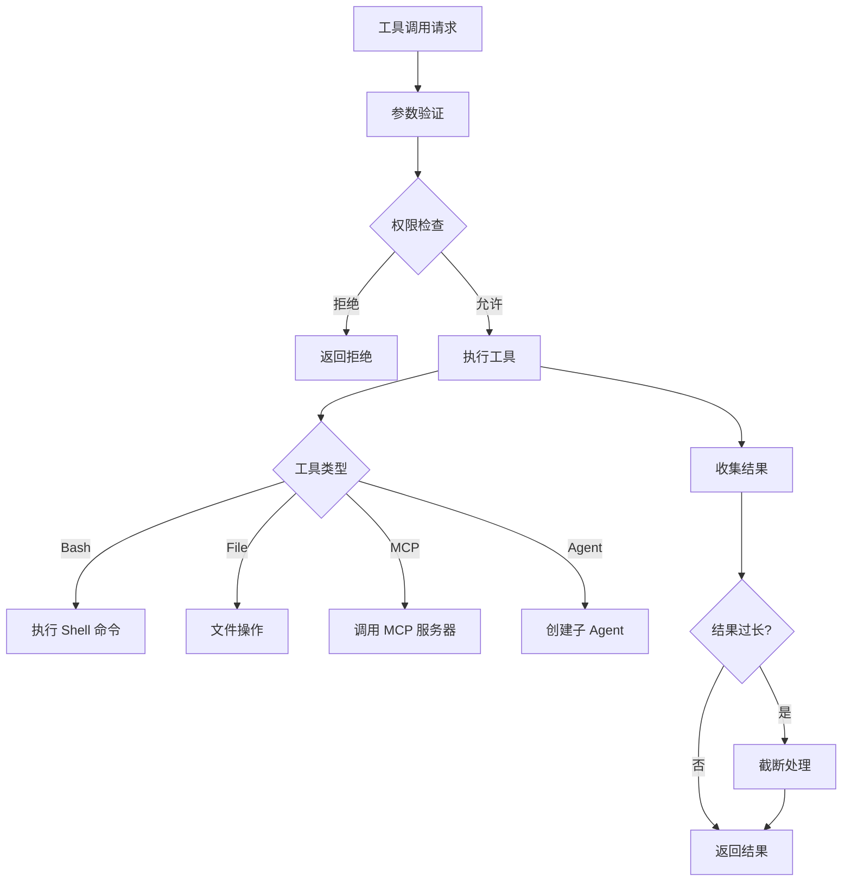

**工具执行保护机制**：

- 参数 schema 验证
- 权限模式检查（auto/plan/default）
- 危险操作确认
- 输出截断和持久化
- 错误处理和重试

---

## 八、核心链路四：记忆系统

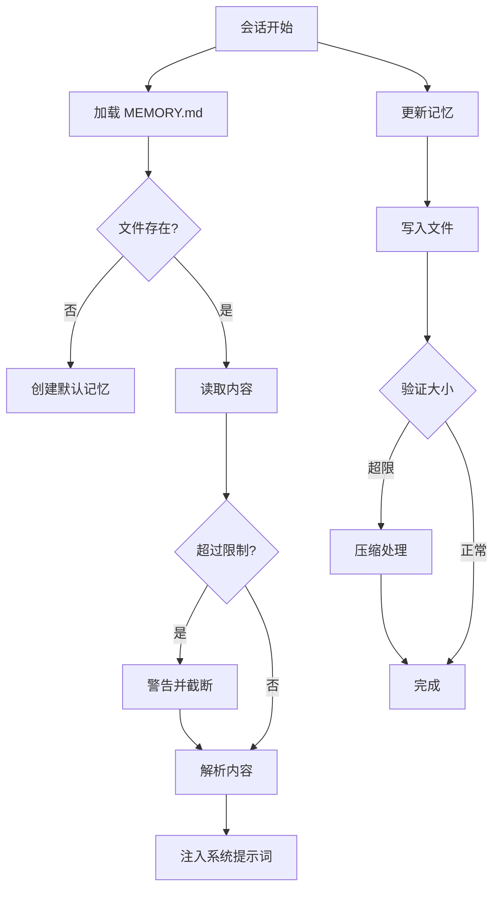

**记忆系统特点**：

- 项目级持久化存储
- 自动加载和注入
- 大小限制和警告
- 支持团队共享记忆

---

## 九、状态管理

Claude Code 使用 React 状态管理模式，通过 `AppState` 集中管理所有 UI 状态。

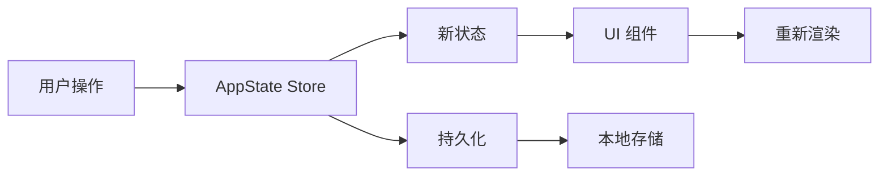

**AppState 主要字段**：

| 字段 | 说明 |
|-|-|
| `messages` | 对话消息列表 |
| `status` | 当前状态（idle/thinking/tool_use） |
| `toolPermissionContext` | 工具权限上下文 |
| `mainLoopModel` | 当前使用的模型 |
| `settings` | 用户设置 |
| `tasks` | 任务列表 |
| `replBridgeEnabled` | IDE 桥接状态 |

---

## 十、扩展点

| 扩展类型 | 如何扩展 | 适用场景 |
|-|-|-|
| 新增工具 | 在 `tools/` 中实现 Tool 接口 | 添加新的 Agent 能力 |
| 新增命令 | 在 `commands/` 中注册命令 | 添加用户交互入口 |
| MCP 服务器 | 配置 MCP 服务器连接 | 集成外部工具和服务 |
| 插件 | 开发插件并安装 | 扩展功能 |
| 技能 | 编写技能文件 | 封装可复用工作流 |
| 快捷键 | 配置快捷键绑定 | 自定义操作快捷方式 |

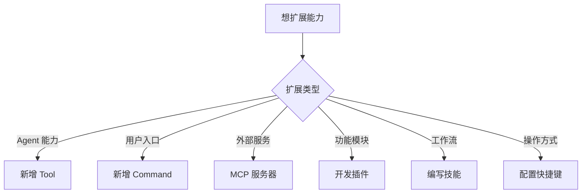

---

## 十一、技术亮点

### 11.1 性能优化

- **并行初始化**：MDM、钥匙串、OAuth 并行预取
- **懒加载**：大模块按需加载（insights.ts 113KB）
- **缓存策略**：工具结果、MCP 资源缓存
- **死代码消除**：通过 `feature()` 条件编译

### 11.2 用户体验

- **流式输出**：实时显示 AI 响应
- **进度指示**：工具执行进度可视化
- **错误恢复**：自动重试和降级
- **多模态支持**：图片、语音输入

### 11.3 安全性

- **权限系统**：细粒度工具权限控制
- **沙箱模式**：可选的隔离执行环境
- **敏感信息保护**：自动检测和过滤

---

## 十二、建议阅读路线

1. **先读 README 和 package.json**：确认项目定位、依赖、技术栈
2. **再读 `main.tsx`**：理解 CLI 启动和初始化流程
3. **再读 `QueryEngine.ts`**：理解核心查询循环
4. **再读 `tools.ts` 和 `Tool.ts`**：理解工具系统设计
5. **再读 `commands.ts`**：理解命令系统设计
6. **最后读服务层**：`services/mcp/`、`services/lsp/`、`bridge/`

---

## 十三、核心文件索引

| 文件 | 为什么重要 |
|-|-|
| `src/main.tsx` | CLI 入口，所有初始化逻辑的起点 |
| `src/QueryEngine.ts` | 核心 LLM 查询引擎 |
| `src/tools.ts` | 工具注册中心 |
| `src/commands.ts` | 命令注册中心 |
| `src/Tool.ts` | 工具类型定义和接口 |
| `src/bridge/bridgeMain.ts` | IDE 桥接主逻辑 |
| `src/services/mcp/client.ts` | MCP 客户端实现 |
| `src/memdir/memdir.ts` | 记忆系统实现 |
| `src/state/AppStateStore.ts` | 全局状态定义 |
| `src/screens/REPL.tsx` | REPL 主界面 |

---

> **一句话总结：** Claude Code 是一个高度工程化的终端 AI 编程助手，以 `QueryEngine` 为核心，通过工具、命令、MCP、桥接等模块构建了完整的 Agent 能力矩阵。其架构设计注重性能优化、用户体验和扩展性，是学习现代 AI Agent 工程实现的优秀范例。