<title>Claude Code 3月底源码架构与核心链路分析</title>

<callout emoji="💡">
本文基于仓库快照做只读技术分析，目标是帮助快速理解 Claude Code 的工程架构、模块职责与核心执行链路。
源码定位：以 Claude Code 仓库根目录为起点，后文使用仓库相对路径。
分析范围：entrypoints/commands/tools/query/services/context/memdir/bridge 等核心模块。
</callout>

# 目录

1. 工程总览与技术栈
2. 架构分层与模块地图
3. 核心链路：从输入到响应
4. 工具系统（Tool Use）机制
5. 权限与安全控制链路
6. 上下文、记忆与压缩机制
7. MCP 与 Bridge 扩展能力
8. 关键源码索引与阅读路径
9. 学习建议与可复用设计

---

# 1. 工程总览与技术栈

<callout emoji="💡">
结论：这是一个以 Bun 运行时、TypeScript 代码为主体的 CLI Agent 工程。核心不是单纯命令行工具，而是一个包含交互式 TUI、非交互 SDK、工具执行、权限控制、MCP 扩展、Bridge 远控和上下文压缩的 Agent Runtime。
</callout>

| 维度 | 识别结果 | 关键文件 |
|-|-|-|
| 运行时 | Bun 1.2，ESM，目标 ES2022 | package.json、tsconfig.json |
| CLI 框架 | Commander.js 负责命令解析和 option 定义 | src/main.tsx |
| 终端 UI | React + Ink，并内置了定制 ink 渲染层 | src/screens/REPL.tsx、src/ink/ |
| 模型访问 | @anthropic-ai/sdk，支持 streaming、fallback、beta headers、token/cost 统计 | src/services/api/claude.ts |
| 工具系统 | 统一 Tool 抽象，内置 Bash、Read、Edit、Write、Grep、Glob、Web、Agent、Skill、MCP 等工具 | src/Tool.ts、src/tools.ts、src/tools/ |
| 扩展生态 | Slash commands、plugins、skills、MCP servers、IDE bridge、remote sessions | src/commands.ts、src/skills/、src/plugins/、src/services/mcp/、src/bridge/ |

## 1.1 目录结构速览

| 目录 | 职责 | 阅读优先级 |
|-|-|-|
| src/main.tsx | 完整 CLI 入口，完成初始化、参数解析、配置加载、交互/非交互分流 | 高 |
| src/entrypoints/cli.tsx | 轻量启动入口和 fast path，包括 version、bridge、daemon、特殊子命令 | 高 |
| src/screens/REPL.tsx | 交互式主界面，管理输入、消息、权限弹窗、spinner、query 调用 | 高 |
| src/query.ts | 核心 Agent Loop，负责模型请求、工具调用、自动压缩、错误恢复和多轮续跑 | 最高 |
| src/QueryEngine.ts | 非交互/SDK 模式的会话引擎，复用 query.ts 的核心能力 | 高 |
| src/tools/ | 所有模型可调用工具的实现 | 高 |
| src/services/ | API、MCP、OAuth、LSP、analytics、compact 等外部服务或基础服务 | 中高 |
| src/context.ts、src/memdir/ | 用户上下文、系统上下文、CLAUDE.md、MEMORY.md 与记忆机制 | 中高 |
| src/bridge/、src/remote/、src/server/ | IDE/远控/远程会话相关能力 | 中 |

<callout emoji="💡">
**本文标注约定（参照源码 vs 参照官网）**
本文章绝大部分结论来自对 leak 仓 `src/` 的源码核对（含具体文件与行号），属于 **实现层细节**，可能与 Anthropic 公开的 Claude Code 文档（[code.claude.com/docs](https://code.claude.com/docs/en/overview)、[support.claude.com](https://support.claude.com)）的措辞或粒度不一致。当遇到差异时：
- **带源码路径与行号的段落 / 表格 / 画板**：以本仓代码为准（仅反映该 leak 版本，非 Anthropic 当前线上版本）。
- **明确标注"官方文档"或带 code.claude.com / support.claude.com 链接的段落**：以官网为准。
- 个别能力（如 Session Memory Extraction、AutoDream）**仅在 leak 仓中出现，官网未公开**，且默认关闭，请勿据此推断 Anthropic 已正式发布。
</callout>

# 2. 架构分层与模块地图

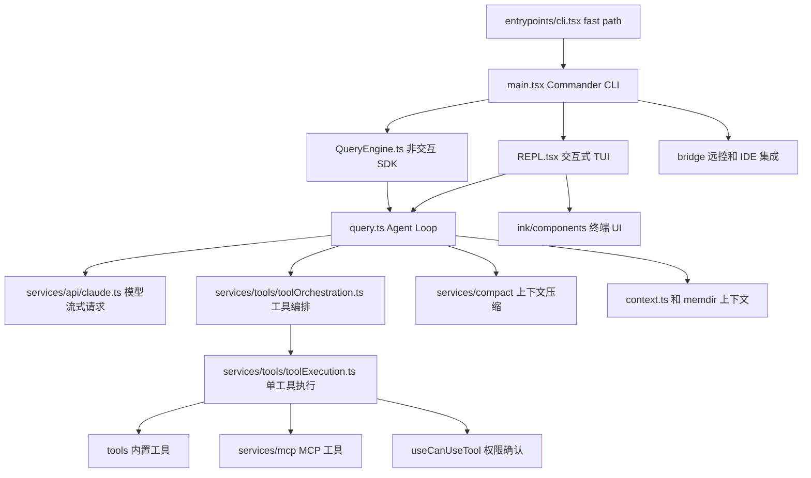

## 2.1 分层理解

| 层级 | 代表模块 | 核心职责 |
|-|-|-|
| 启动层 | entrypoints/cli.tsx、main.tsx | 处理快速路径、初始化配置、解析 CLI 参数、选择运行模式 |
| 交互层 | REPL.tsx、components/、ink/、hooks/ | 终端 UI、输入队列、消息渲染、权限弹窗、IDE 选择、状态提示 |
| 会话层 | QueryEngine.ts、sessionStorage、AppState | 会话状态、历史记录、transcript、恢复和 SDK 事件输出 |
| Agent Loop 层 | query.ts | 系统提示词、上下文、模型请求、工具结果、错误恢复、自动续跑 |
| 工具层 | Tool.ts、tools.ts、tools/\* | 工具 schema、权限、执行、结果格式化、并发安全判定 |
| 服务层 | services/api、services/mcp、services/compact、services/lsp | 模型、MCP、上下文压缩、LSP、OAuth、遥测等外部能力 |
| 扩展层 | commands、skills、plugins、bridge | Slash command、Skill、Plugin、IDE/Remote Control 扩展入口 |

## 2.2 两条主要运行路径

<grid>
<column width-ratio="0.500000">
### 交互式路径
- 用户直接运行 claude 进入 TUI。
- main.tsx 完成初始化后调用 launchRepl。
- REPL.tsx 管理输入框、消息列表、权限弹窗、spinner 与 query 流。
- 适合真实终端协作和长会话。
</column>
<column width-ratio="0.500000">
### 非交互/SDK 路径
- 用户通过 -p/--print、SDK 或远程入口提交 prompt。
- QueryEngine 封装会话生命周期。
- 输出 SDKMessage/SystemInit/流式 assistant/tool_result。
- 适合脚本、自动化和外部客户端集成。
</column>
</grid>

---

# 3. 核心链路：从输入到响应

<callout emoji="✅">
核心主链路可以概括为：CLI 参数解析 → 构建会话上下文 → 处理用户输入和 slash command → 构造系统提示词和工具 schema → 流式调用 Claude → 发现 tool_use → 权限检查和工具执行 → tool_result 回填 → 继续模型循环或结束。
</callout>

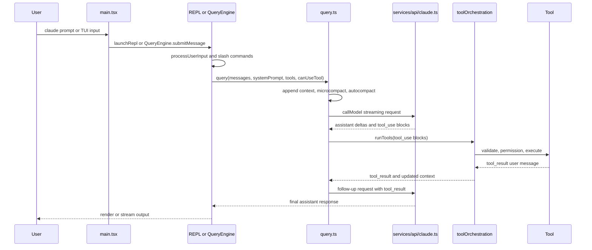

## 3.1 CLI 启动与模式分发

| 步骤 | 源码位置 | 说明 |
|-|-|-|
| 启动 fast path | src/entrypoints/cli.tsx | 先处理 --version、bridge、daemon、background session 等特殊路径，减少启动成本。 |
| 主 CLI 初始化 | src/main.tsx | 加载配置、telemetry、settings、MCP、skills、plugins、权限模式、模型设置。 |
| Commander 解析 | src/main.tsx | 定义 -p/--print、--model、--tools、--mcp-config、--permission-mode、--resume 等大量参数。 |
| 运行模式选择 | src/main.tsx | 交互式进入 REPL；非交互进入打印/SDK流程；远控进入 bridge 或 server。 |

## 3.2 交互式 REPL 的职责

- 维护 messages、AppState、工具池、MCP 客户端、命令集合、权限上下文。
- 通过 handlePromptSubmit 和 processUserInput 处理普通输入、粘贴内容、@文件引用和 slash command。
- 在 query.ts 产出事件时更新 UI：assistant message、progress message、tool_result、compact boundary、tombstone。
- 将 canUseTool 与 PermissionRequest UI 绑定，实现模型工具调用前的人机确认。

## 3.3 query.ts 的循环状态机

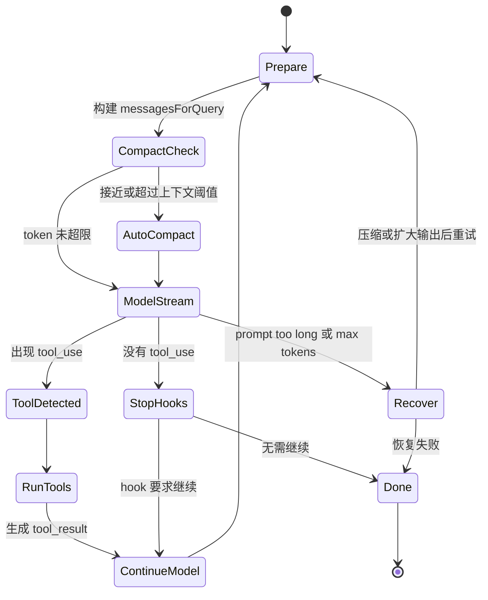

### 关键设计点

- query.ts 是 async generator，会不断 yield stream event、assistant message、tool result、compact boundary 等事件。
- 每轮进入模型前先做 tool result budget、snip、microcompact、context collapse、autocompact。
- 模型流中一旦发现 tool_use，会记录 toolUseBlocks，并可启用 StreamingToolExecutor 边流式接收边执行工具。
- 如果工具结果产生新的 user message，会把 tool_result 回填到 messages，再继续下一轮模型请求。
- 如果没有 tool_use，则进入 stop hooks；hook 可以阻止结束或追加消息触发续跑。

---

# 4. 主线控制权分层图

<callout emoji="💡">
如果只看主线，Claude Code 更像是“Runtime 搭好轨道和护栏，模型在轨道内驾驶”。Runtime 不替模型做任务规划，但持续决定上下文快照、可见工具、执行约束和状态更新；模型则主导每一轮的下一步动作选择。
</callout>

## 4.1 控制权分层

| 层级 | 谁更主导 | 职责 |
|-|-|-|
| 任务推进方向 | 模型 | 决定当前回合是直接回答、调用工具、还是先找 Meta Tool。 |
| 上下文装配 | Runtime | 决定系统提示、附件、已发现工具、压缩边界和当前消息快照。 |
| 工具可见性 | Runtime | 决定哪些工具 inline，哪些 defer，哪些 discovered 后再暴露。 |
| 工具执行合法性 | Runtime | 负责 schema 校验、权限确认、并发控制、错误包装。 |
| 下一轮反馈 | 共同形成闭环 | Runtime 写回 tool_result，模型据此继续推理。 |

## 4.2 主线最小闭环

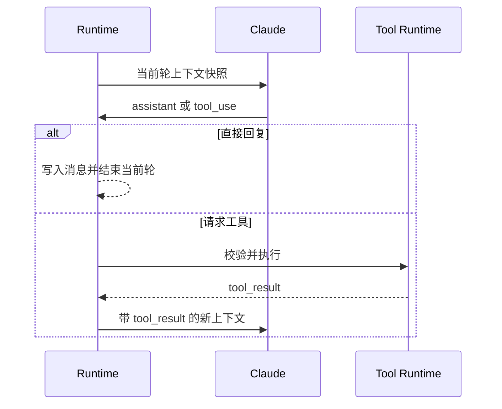

---

# 5. Meta Tool 与模型/Agent 的协作边界

<callout emoji="✅">
结论：在工具调用这块，Claude Code 是“模型主导决策，Agent Runtime 主导执行与约束”的混合架构。模型决定是否要用工具、优先用哪个工具、何时先调用 Meta Tool 再加载真实工具；Agent Runtime 决定哪些工具可见、何时真正允许执行、如何校验参数、如何并发、如何恢复和如何把结果写回会话。
</callout>

## 5.1 谁主导什么

| 环节 | 主导方 | 说明 |
|-|-|-|
| 是否需要工具 | 模型 | Claude 在回复流中主动生成 tool_use。 |
| 先找哪个工具 | 模型 | 当工具 schema 未加载时，模型会先调用 ToolSearchTool 之类的 Meta Tool。 |
| 哪些工具一开始可见 | Agent Runtime | 客户端根据 defer_loading、feature、模型能力、工具池状态决定初始可见工具。 |
| 工具是否真的能执行 | Agent Runtime | 执行前必须经过 schema 校验、validateInput、权限判定和用户确认。 |
| 工具并发/串行 | Agent Runtime | 由 isConcurrencySafe 和 orchestration 决定。 |
| 结果如何反馈给模型 | Agent Runtime | 统一转换成 tool_result user message，再进入下一轮模型推理。 |
| 错误恢复与上下文压缩 | Agent Runtime | prompt too long、max_output_tokens、compact、reactive compact 都在客户端控制。 |

## 5.2 为什么说“模型主导”

## 5.3 为什么又不是“纯模型主导”

## 5.4 更准确的表述

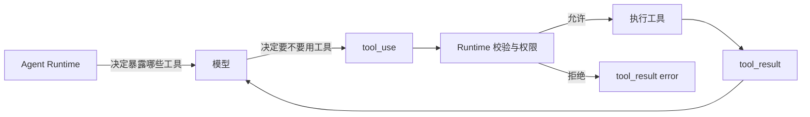

<callout emoji="💡">
一句话：策略层偏模型主导，执行层偏 Agent Runtime 主导。Claude 决定“做什么”，客户端决定“能不能做、怎么做、做到什么程度”。
</callout>

## 5.5 Meta Tool 为什么有用

---

# 6. Meta Tool / Deferred Tool 时序图

<callout emoji="✅">
ToolSearch 的本质不是“帮用户搜索工具”，而是“让模型按需拉取完整工具 schema”。真正的关键是：工具发现结果会被写入会话历史，后续回合再把这些已发现工具并入工具池。
</callout>

## 6.1 时序图

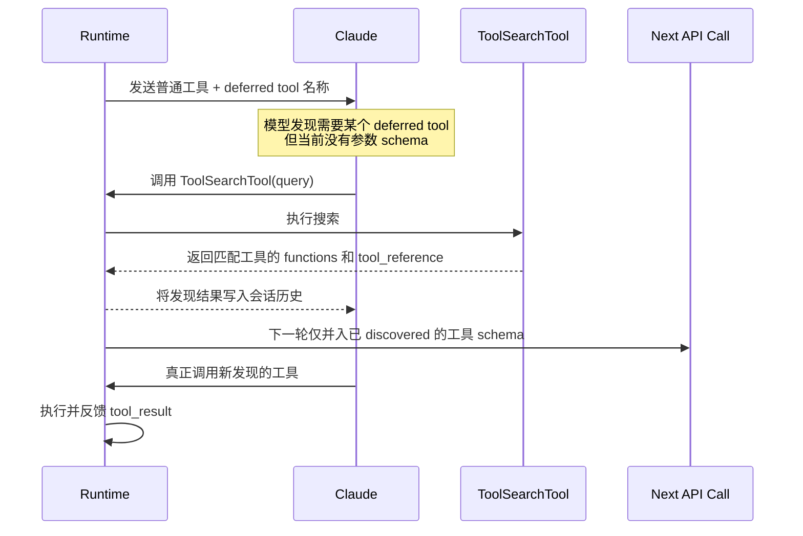

## 6.2 为什么这套设计成立

---

# 7. 工具系统（Tool Use）机制

<callout emoji="💡">
工具系统是 Claude Code 的执行核心。模型只负责生成 tool_use；客户端负责 schema 校验、权限确认、工具执行、结果标准化和回填。这个边界让模型具备“会做事”的能力，同时把真实副作用留在本地可控范围内。
</callout>

## 7.1 Tool 抽象

| 字段/方法 | 作用 | 设计意义 |
|-|-|-|
| name / aliases | 工具名和兼容别名 | 支持工具重命名后的旧 transcript 回放 |
| inputSchema | Zod schema | 客户端侧校验模型生成的参数 |
| call() | 工具执行入口 | 返回 ToolResult 和可选上下文变更 |
| description() | 面向用户的执行说明 | 权限弹窗展示可读解释 |
| isReadOnly() | 是否只读 | 权限策略和并发执行的基础 |
| isConcurrencySafe() | 是否可并发 | 多个只读工具可批量并发执行 |
| checkPermissions() | 工具自身权限判断 | 与全局权限规则结合，形成最终决策 |
| validateInput() | 语义校验 | schema 之外的路径、命令、业务规则校验 |
| maxResultSizeChars | 工具结果大小上限 | 超大结果可落盘并只回传预览，保护上下文窗口 |

## 7.2 工具注册与工具池

- src/tools.ts 的 getAllBaseTools() 是内置工具集合的主要入口。
- 工具池会根据 feature flag、环境变量、用户类型、权限模式、MCP 连接和 agent 限制动态过滤。
- 基础工具包括 AgentTool、BashTool、FileReadTool、FileEditTool、FileWriteTool、GlobTool、GrepTool、WebFetchTool、WebSearchTool、TodoWriteTool、SkillTool、Plan/Worktree/Task/MCP/LSP 等。
- ToolSearchTool 支持“延迟加载工具 schema”，减少系统提示词和工具 schema 的上下文占用。

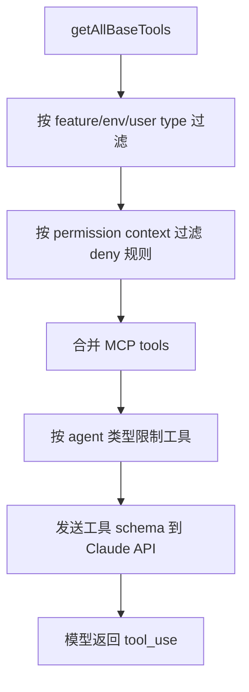

## 7.3 工具执行流程

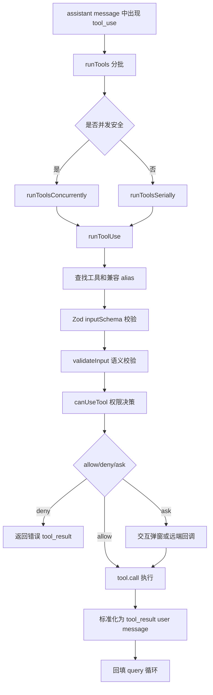

### 并发策略

- services/tools/toolOrchestration.ts 会把连续的并发安全工具合并成一个 batch。
- 只读且 isConcurrencySafe 为 true 的工具可以并发执行，默认最大并发来自 CLAUDE_CODE_MAX_TOOL_USE_CONCURRENCY，未配置时为 10。
- 非只读或会修改上下文的工具串行执行，避免写文件、shell 命令、上下文变更相互踩踏。

**常用工具的 wire name、aliases 与关键阈值（源码核对）**

| 工具类 | wire name | aliases | 关键阈值 / 入口 |
|-|-|-|-|
| AgentTool | Agent | Task | 同进程 async generator，runAgent (src/tools/AgentTool/runAgent.ts:248) |
| BashTool | Bash | — | maxResultSizeChars=30,000 (BashTool.tsx:424)；dangerouslyDisableSandbox 仅在 areUnsandboxedCommandsAllowed=true 时生效 (shouldUseSandbox.ts:135) |
| ToolSearchTool | ToolSearch | — | 关键词权重打分，非 LLM (ToolSearchTool.ts:186-302)；select:<name> 直选 (ToolSearchTool.ts:363-405) |

**并发与限速：**默认并发数定义在 `src/services/tools/toolOrchestration.ts:8-12` 的 `getMaxToolUseConcurrency()`，未设置 `CLAUDE_CODE_MAX_TOOL_USE_CONCURRENCY` 时返回 10；`runToolsConcurrently` 在 `toolOrchestration.ts:152-177`，`runToolsSerially` 在 `toolOrchestration.ts:118-150`。

## 7.4 典型工具设计

| 工具 | 能力 | 值得关注的设计 |
|-|-|-|
| BashTool | 执行 shell 命令 | 命令语义识别、读写区分、后台任务、sandbox、危险命令提示、sed edit 预览 |
| FileReadTool | 读取文本、图片、PDF、notebook | 设备文件黑名单、token 上限、offset/limit、图片压缩、PDF 页范围 |
| FileEditTool / FileWriteTool | 编辑和写入文件 | 权限前置、file history、IDE 通知、变更可追踪 |
| GlobTool / GrepTool | 文件发现和内容检索 | 读操作可折叠展示，可作为上下文收集基础工具 |
| AgentTool | 启动子 agent | 隔离上下文、并行任务、子任务结果回传 |
| SkillTool | 执行 Skill | 把外部能力封装成模型可调用工具 |
| MCPTool | 调用 MCP server 工具 | 动态 schema、OAuth、远端资源、超大输出截断和持久化 |

---

# 8. Skill Discovery 与 ToolSearch 的区别

<callout emoji="💡">
这两套机制看上去都像“先发现，再调用”，但它们服务的对象不同：ToolSearch 解决的是“工具 schema 太多、需要按需加载”的问题；Skill discovery 解决的是“有哪些项目或任务约定值得先提示给模型”的问题。
</callout>

## 8.1 对比表

| 维度 | ToolSearch | Skill Discovery |
|-|-|-|
| 目标对象 | Deferred tools、MCP tools、部分延迟工具 | Skills，任务规范、项目约定、最佳实践包 |
| 核心问题 | schema 太多，不能一开始全量塞进 prompt | 模型不知道当前任务有哪些可复用技能和规范 |
| 触发方式 | 模型主动调用 ToolSearchTool | 系统通过附件或提醒预注入，也可由模型后续调用 SkillTool |
| 返回结果 | 完整工具 schema、tool_reference、functions 块 | 技能名称、描述、相关性提示，或最终展开的 SKILL.md 内容 |
| 会话状态 | 形成 discovered tools 集合，影响后续工具池 | 形成 discovered skills 或 skill listing，影响模型接下来是否调用 Skill |
| 调用后的效果 | 工具变得真正可调用 | 模型获得一段任务规范、操作流程或领域知识 |
| 本质 | 能力加载机制 | 任务提示与工作流加载机制 |

## 8.2 机制差异

<grid>
<column width-ratio="0.500000">
### ToolSearch 更像
- 延迟加载工具定义。
- 让模型在需要时补齐参数 schema。
- 偏向执行能力的按需解锁。
</column>
<column width-ratio="0.500000">
### Skill Discovery 更像
- 给模型推荐任务相关的套路和规范。
- 通过 skill_listing 或 skill_discovery 先暴露候选。
- 偏向认知和工作流提示的按需注入。
</column>
</grid>

## 8.3 两者如何配合

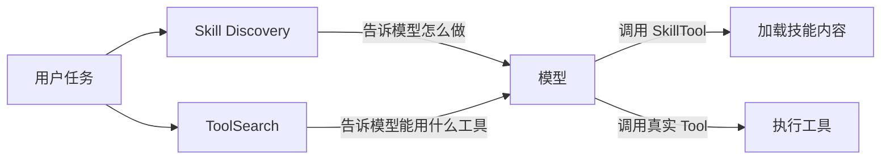

## 8.4 一句话总结

<callout emoji="✅">
ToolSearch 解决“能做什么”的 schema 暴露问题；Skill discovery 解决“应该怎么做”的任务知识和流程提示问题。一个偏执行能力加载，一个偏认知工作流加载。
</callout>

**补充：ToolSearch 源码实现（src/tools/ToolSearchTool/）**

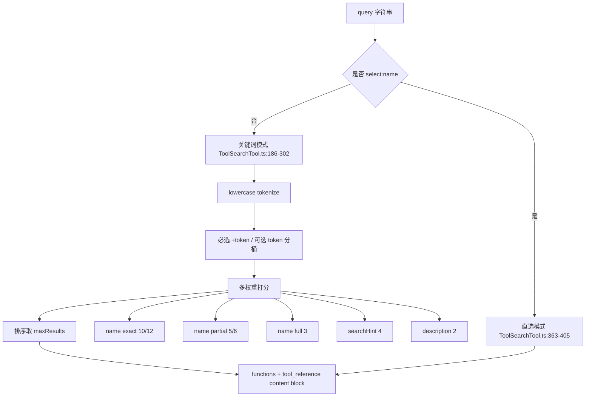

<callout emoji="❗">
**注意：**ToolSearch 是**关键词权重打分**，不是向量检索也不是 LLM-based 推理。tool_reference 是 Anthropic API 的 content block 类型（type: 'tool_reference'），由服务端把它展开成 <functions> 内容；不支持 tool_reference 的链路里，src/utils/messages.ts 会做剥离/迁移（行 1536/1577/1673/2099）。
</callout>

---

# 9. 多 Agent 协作、Agent Type 与任务分配

<callout emoji="✅">
**结论：**Claude 当前没有 schema 化的“角色-任务匹配”层。**Agent Type 决定能力边界**，而**任务是否派给正确队友**主要依赖 Lead 的 LLM 判断、任务 `owner` 字段与 mailbox `task_assignment` 消息三者配合。
</callout>

---

## 9.1 三层协作模型

| 模式 | 实现 | 生命周期 | 适用场景 |
|-|-|-|-|
| Bash background | 单条命令转后台，输出写文件 | 命令级 | 长时间 build、watch、dev server |
| AgentTool / LocalAgentTask | 同 Node 进程内的 async 任务 | 单次任务 | 问完即走的子任务、上下文隔离 |
| Teammate / Swarm | 默认 tmux 多进程；无 tmux 时 in-process fallback | 长生命周期 | 多角色持续协作、权限冒泡、任务接力 |

## 9.2 Agent Type 的真实作用

## 9.3 任务分配的两条通道

<grid>
<column width-ratio="0.500000">
<callout emoji="💡">
**Auto-claim：**队友空闲时主动轮询 task list，先到先得认领 `owner 为空` 的 pending 任务。
适合同质化团队，例如多个 backend teammate 水平扩容。
</callout>
</column>
<column width-ratio="0.500000">
<callout emoji="✅">
**Task Assignment：**Lead 先判断该派给谁，再通过 `TaskUpdate(owner=...)` 与 mailbox `task_assignment` 主动投递。
适合 frontend / backend / test-runner 这类异质角色团队。
</callout>
</column>
</grid>

## 9.4 代码实锤：为什么不是 schema 路由

```ts
if (task.status !== 'pending') return false
if (task.owner) return false
return task.blockedBy.every(id =&gt; !unresolvedTaskIds.has(id))
```

**补充：Task schema 与认领判定（src/utils/tasks.ts:76-89, 541-612；src/utils/swarm/inProcessRunner.ts:595-605）**

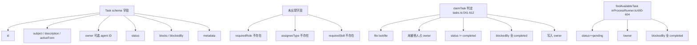

<callout emoji="❗">
核心论据已与源码对齐：Task schema 没有 requiredRole / assigneeType / requiredSkill（grep 全仓 0 处）；auto-claim 路径只看 status / owner / blockedBy，不看 agent type，所以确实不存在 schema 路由。
</callout>

## 9.5 错派的影响与当前 TODO

<callout emoji="❗">
**当前高置信结论：**如果 Lead 把任务派错给工具不足或 prompt 不匹配的 teammate，框架不会在派发前拦截；通常只能依赖队友反馈、Lead 重派，或 terminate/shutdown 后自动 unassign 兜底。
**TODO（待继续 review，仅 leak 仓内部协议，官网未公开）：**显式写入 `owner` 后，队友在非 auto-claim 路径下如何稳定"接单"并开始执行，当前判断是还需要 mailbox `task_assignment` 主动投递。这里建议后续继续对照 `spawn / mailbox / query 注入链路` 再做一次源码级复核。
</callout>

# 10. 权限与安全控制链路

<callout emoji="💡">
权限体系不是单点判断，而是由工具自身权限、全局权限模式、用户/项目配置、hook、classifier、交互确认、远程回调共同组成的多层决策链。
</callout>

## 10.1 权限决策入口

- REPL 侧通过 useCanUseTool 生成 canUseTool 函数，并传入 query.ts。
- 工具执行阶段先调用 hasPermissionsToUseTool，得到 allow、deny 或 ask。
- allow 直接执行；deny 生成错误 tool_result；ask 则进入交互弹窗、swarm worker、coordinator 或 bridge callback。
- Bash 工具还可结合 classifier 做自动允许或自动拒绝，例如 auto mode、bash_allow 规则。

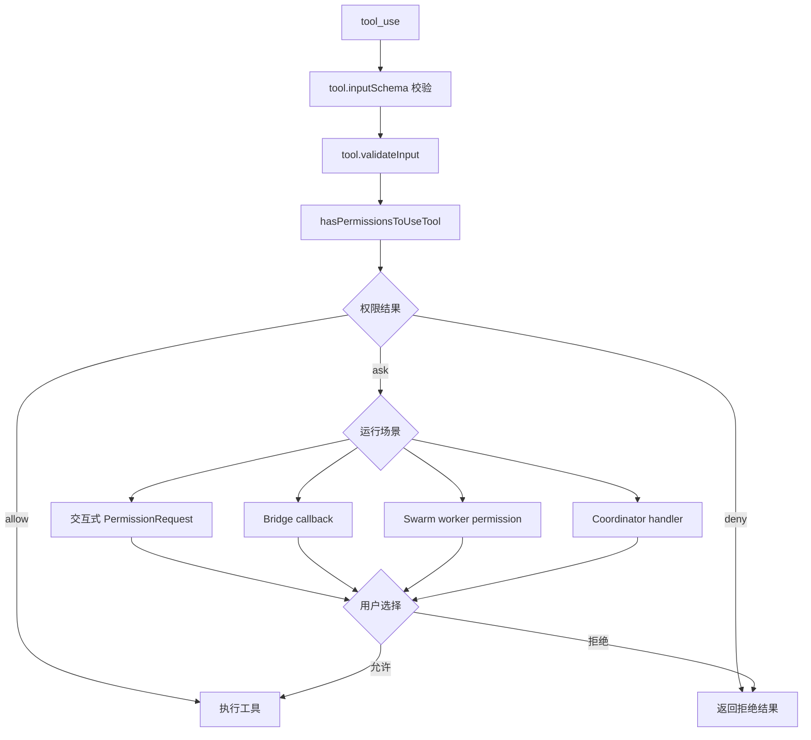

## 10.2 权限模式与规则来源

| 来源 | 说明 | 影响 |
|-|-|-|
| CLI 参数 | --permission-mode、--allowedTools、--disallowedTools、--dangerously-skip-permissions | 会话级别立即生效 |
| 用户/项目配置 | settings、managed settings、policy limits | 持久化或组织策略约束 |
| 工具规则 | 工具的 checkPermissions、isReadOnly、isDestructive | 区分读写、副作用和危险动作 |
| Hook | PreToolUse、PostToolUse、Stop hooks 等 | 可阻止、修改或审计工具调用 |
| Classifier | Bash/Auto mode 分类器 | 自动识别低风险命令或拒绝高风险动作 |
| 交互确认 | PermissionRequest UI 或远端 callback | 最终由用户批准或拒绝 |

## 10.3 BashTool 的安全关注点

- 命令按 search/read/list/silent 等语义分类，用于 UI 折叠和权限判断。
- 支持 sandbox，并允许通过 dangerouslyDisableSandbox 做显式绕过，但 schema 里对内部字段做了隐藏处理。
- 对 sed edit、破坏性命令、后台任务和超时都有额外控制。
- 命令输出较大时可落盘，只把预览回传给模型，避免污染上下文。

---

# 11. Slash Commands、MCP 与 Bridge 扩展能力

## 11.1 Slash Commands

<callout emoji="💡">
Slash command 是用户面向 CLI 的显式控制面，和模型工具调用不同：命令由用户输入触发，通常用于会话管理、配置、诊断、压缩、登录、MCP、插件、任务、diff、review、memory 等操作。
</callout>

| 命令类别 | 代表命令 | 职责 |
|-|-|-|
| 会话管理 | /clear、/compact、/resume、/rewind、/session、/export | 清理、压缩、恢复、回放和导出会话 |
| 工程协作 | /diff、/review、/commit、/branch、/status | 围绕 git 和代码评审工作流 |
| 配置和权限 | /config、/permissions、/model、/effort、/fast、/theme | 调整模型、权限、UI 和运行模式 |
| 扩展生态 | /mcp、/plugin、/skills、/agents、/hooks | 管理 MCP、插件、技能、agent 和 hook |
| 环境诊断 | /doctor、/ide、/login、/logout、/usage、/cost | 认证、IDE、环境和费用状态 |

## 11.2 MCP 扩展

<callout emoji="✅">
**结论：**MCP 不是“给 HTTP API 换个壳”，而是面向 LLM 的会话化协议层。它可以跑在 `stdio`、HTTP/SSE、Streamable HTTP、WebSocket 等传输之上，但协议语义本身强调 **工具发现、双向通知、会话初始化和结构化错误**。
</callout>

### 11.2.1 MCP 与普通 HTTP API 的区别

| 维度 | 普通 HTTP API | MCP Server |
|-|-|-|
| 调用语义 | 资源访问 / REST / 自定义 JSON | JSON-RPC 2.0 + Tool / Resource / Prompt 三类能力 |
| 发现方式 | 依赖文档或 OpenAPI | 运行时 `tools/list`、`resources/list`、`prompts/list` 动态发现 |
| 通信方向 | 典型是 client -> server | 协议层原生支持 server -> client notifications |
| 状态 | 偏无状态 | 有 initialize / capabilities 协商的会话化模型 |
| 目标消费方 | 程序员写的客户端代码 | LLM Agent 与工具编排层 |

### 11.2.2 MCP 的标准反向能力与“server -> agent 推送”

**MCP client 实际声明的反向能力（`src/services/mcp/client.ts:995-1001`）**

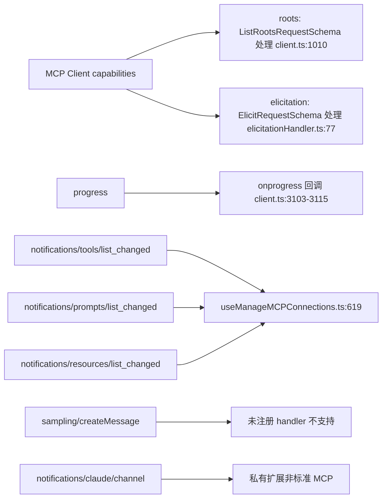

<callout emoji="❗">
**勘误：**原 7.2.2 把 `sampling` 列入"标准能力"，与本仓实际不符——客户端 capabilities 只声明 `{ roots: {}, elicitation: {} }`，未注册 `sampling/createMessage` 的 RequestHandler，因此本实现不支持 sampling 这条反向能力。MCP 协议层定义不等于本客户端已实现。
</callout>

### 11.2.3 MCP 认证：TLS 与业务授权不是一回事

<grid>
<column width-ratio="0.500000">
<callout emoji="💡">
**传输层：**TLS / HTTPS 解决的是链路加密与完整性，和 REST API 一样，属于部署层问题。
</callout>
</column>
<column width-ratio="0.500000">
<callout emoji="✅">
**应用层：**MCP 里的“认证 / login”主要指谁有权调用这个 server 的 tool / resource，也就是业务授权。
</callout>
</column>
</grid>

| 场景 | 常见做法 | 是否需要用户登录 |
|-|-|-|
| 本地 stdio MCP | 不额外认证，依赖本机进程身份 | 否 |
| 远程 SaaS MCP | OAuth 2.1 + PKCE / Bearer Token | 通常首次需要 |
| S -> S 调用 MCP | Client Credentials、静态 token、云原生身份 | 否，纯机器认证 |

### 11.2.4 自建 Authorization Server 与企业落地

## 11.3 Bridge 与远控模式

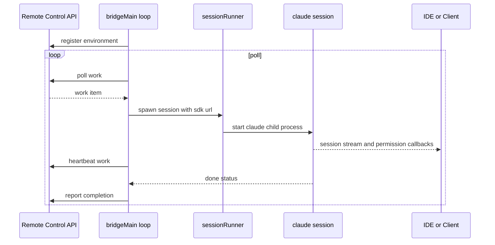

---

# 12. 上下文、记忆与压缩机制

<callout emoji="💡">
Claude Code 的上下文工程非常重：它不仅拼接系统提示词，还动态注入 git 状态、CLAUDE.md、MEMORY.md、MCP 说明、工具 schema、文件附件、技能发现结果，并在每轮模型请求前做多级压缩和恢复。
</callout>

## 12.1 上下文来源

| 上下文类型 | 来源 | 说明 |
|-|-|-|
| 系统提示词 | constants/prompts.ts、utils/systemPrompt.ts | 基础行为约束、工具说明、模型能力相关提示 |
| 系统上下文 | context.ts getSystemContext | git status、当前分支、主分支、最近提交、可选 cache breaker |
| 用户上下文 | context.ts getUserContext | CLAUDE.md 内容、当前日期 |
| 记忆目录 | memdir/memdir.ts | MEMORY.md 索引和基于文件的长期记忆机制 |
| 工具结果 | tool_result user messages | 工具执行输出，是 Agent 多轮推理的反馈通道 |
| 附件和技能发现 | utils/attachments、skills | 文件、图片、PDF、skill listing、dynamic skill triggers |
| MCP 指令 | services/mcp | MCP server instructions、resources、tools schema |

## 12.2 压缩与恢复链路

<callout emoji="💡">
**说明：** 这里不再展开真实执行顺序，只保留概念层理解：Claude Code 的 compact 不是单点摘要，而是多层上下文压力控制。真实顺序、调用位置和前后依赖关系见 **14.2 query.ts 内的真实执行顺序**。
</callout>

| 层级 | 主要职责 | 典型代价 |
|-|-|-|
| 轻量整理层 | 裁剪过大的 tool result、做 snip / microcompact，尽量不进入正式摘要 | 信息损失较低，但可能需要后续重取细节 |
| 决策层 | 判断当前是否真的需要 compact | 主要是阈值判断，不新增语义 |
| 复用层 | 若 session memory 可用，则优先复用已有摘要文件 | 依赖后台 memory 的新鲜度 |
| 正式摘要层 | 当便宜路径都不够时，才走 full compact / reactive compact | 成本最高，也最容易抹平原始结构 |

### 压缩机制要点

- query.ts 在每轮模型请求前都会统一处理压缩，而不是等 API 报错后才处理。
- microcompact、context collapse、autocompact、reactive compact 是不同层级的策略，分别应对工具结果过大、历史过长、上下文临界和 API 413。
- compact.ts 通过 forked agent 生成摘要，并在压缩后尽量恢复关键文件、技能、MCP 指令和 hook 结果。
- max_output_tokens 也有恢复逻辑：可先提升输出上限，再通过 meta user message 要求模型继续。

## 12.3 记忆机制

<grid>
<column width-ratio="0.500000">
### CLAUDE.md
- 由 context.ts 的 getUserContext 加载。
- 用于项目级即时上下文。
- 支持通过 --add-dir 扩展扫描目录。
- bare 模式默认跳过自动发现。
</column>
<column width-ratio="0.500000">
### MEMORY.md
- 由 memdir 管理，是文件化长期记忆入口。
- MEMORY.md 是索引，具体记忆写入独立文件。
- 有行数和字节上限，避免记忆膨胀。
- 强调 user、feedback、project、reference 等分类。
</column>
</grid>

<callout emoji="✅">
**补充：CLAUDE.md / MEMORY.md 的具体规则与上限（来自 src/utils/claudemd.ts 和 src/memdir/）**
<grid>
<column width-ratio="0.500000">
### CLAUDE.md 完整规则
- `MAX_MEMORY_CHARACTER_COUNT = 40,000` 字符上限（claudemd.ts:92）
- `MAX_INCLUDE_DEPTH = 5`，支持 `@path/to/file` 嵌套引用（claudemd.ts:537、:451）
- 同目录会同时尝试加载 `CLAUDE.local.md`（gitignored，私有覆盖）（:922、:1280）
- 嵌套子目录由 `getMemoryFilesForNestedDirectory` 按需加载（:1249）
- @import 解析支持 `~/...`、相对路径、绝对路径，循环引用按已访问集合短路
</column>
<column width-ratio="0.500000">
### MEMORY.md 完整规则
- 入口文件名 `AUTO_MEM_ENTRYPOINT_NAME = "MEMORY.md"`（paths.ts:93）
- `MAX_ENTRYPOINT_LINES = 200` 行上限（memdir.ts:35）
- `MAX_ENTRYPOINT_BYTES = 25,000` 字节上限（memdir.ts:38）
- 超限时按行 / 字节双轨截断；超字节会回退到最近一个换行
- 分类 `user / feedback / project / reference`（memoryTypes.ts:14-19）
</column>
</grid>
</callout>

---

## 12.4 Memory 全景：短期、长期与按需召回

<callout emoji="✅">
**推荐：** 当前实现的 memory 不是单一机制，而是四条链路并存：**session memory** 管当前会话续接，**relevant memory recall** 管本轮按需读取，**extract memories** 管长期写入，**Dream** 管长期整理。
</callout>

<callout emoji="💡">
**说明：** 从执行顺序看，memory 相关动作分成四段：turn 开始做 recall，turn 进行中仅可能影响后续 iteration，turn 结束后写 durable memory，compact 时再读取 session memory。
</callout>

| 链路 | 处理对象 | 触发时机 | 是否异步 | 生命周期 | 默认状态 |
|-|-|-|-|-|-|
| Relevant Memory Prefetch | 长期 memory 中与当前 query 相关的条目 | 每个 user turn 开始 | 是 | 仅当前 turn | 受 gate 控制；zero-wait |
| Session Memory Extraction | 当前 session 的 memory 文件 | post-sampling hook 达到阈值后 | 是 | 单 session | 默认关闭（受 `tengu_session_memory` 控制） |
| Extract Memories | durable / auto memory | 每个 turn 结束后 stopHooks fire-and-forget | 是 | 跨 session | 默认通常关闭（feature + runtime gate） |
| Dream / AutoDream | 已有长期 memory 集合 | 每个 turn 结束后检查 gate，满足条件才运行 | 是 | 跨 session | 默认不一定开启，受 setting / GB gate 控制 |

<callout emoji="✅">
**补充：relevant memory recall 不是向量检索**
`src/memdir/findRelevantMemories.ts` 走的是**用 Sonnet 模型做 selection 的 side-query**：把当前 query / 最近 tool 调用作为输入，让 LLM 从 memory 文件清单里挑出"本轮可能相关"的条目，然后只把命中文件 attach 进来。
- **不是 embedding / 向量召回**，所以新增 memory 后无须重建索引；
- **每个 user turn 重新选择**，不缓存上一轮的 relevant 集合；
- **zero-wait**：side-query 不阻塞主请求，本轮只有后续 iteration 才有机会消费；
- **turn 级 handle**：side-query 返回过晚则直接 abort，不顺延到下一轮。
</callout>

<grid>
<column width-ratio="0.500000">
<callout emoji="💡">
**说明：** **session memory** 解决的是“当前会话 compact 后如何续接”；它不承担跨 session 的长期知识积累。
</callout>
</column>
<column width-ratio="0.500000">
<callout emoji="❗">
**注意：** **relevant memory recall** 是按 turn 重新判断 relevance，不是 session 级缓存；设计偏向简单和稳，而不是最优复用。
</callout>
</column>
</grid>

如果只从职责看，可以把这四条链路压缩成一句话：**session memory 管短期连续性，relevant recall 管当前 turn 的按需读取，extract memories 管长期写入，Dream 管长期整理。**

<callout emoji="✅">
**补充 1：Session Memory Extraction 默认关闭（src/services/SessionMemory/sessionMemory.ts:80-82）**
该能力由 GrowthBook flag `tengu_session_memory` 控制，**默认值为 false**。post-sampling hook 在达到上下文阈值后才会 fire-and-forget 异步抽取当前 session 的 memory 文件，给下一轮 compact / 接续做衔接；未开启时本路径不执行，对外表现等同于"不存在"。
</callout>

<callout emoji="✅">
**补充 2：AutoDream / Dream 默认关闭（src/services/autoDream/config.ts:13-21）**
解析顺序为 settings 优先（`settings.autoDreamEnabled`），settings 未设置时再读 GrowthBook flag `tengu_onyx_plover.enabled`，flag **默认 null → 视为 false**。Dream 旨在对长期 memory 做整理与重写，但默认状态下不会自动触发；启用后才会在 turn 结束后检查 gate 并异步执行。
</callout>

<callout emoji="💡">
**补充 3：与 Claude.app（2026 版）三 Tab 架构的关系**
2026 初 Anthropic 把 Claude Desktop App 重构成统一容器，含 **Chat / Cowork / Code 三个 Tab**：Chat Tab 是原 claude.ai 客户端；Code Tab 与 CLI 共享 `~/.claude/`，本文档剖析的 memory 四链路属于 **Code Tab + CLI 共有的本地实现**。Anthropic 在 support.claude.com 公开的 "Memory" 设置项（toggle）控制的是 **Chat Tab 服务端**的对话 memory，**不**等同于本文档讨论的 session memory / extract memories / Dream，这是两个独立体系，请勿混用。
</callout>

# 13. Context Compact 分层全景

<callout emoji="💡">
这一节不要把 compact 理解成“一个摘要按钮”。Claude Code 实际上维护的是一条按成本递增的上下文治理流水线：先处理单条过肥的结果，再做结构性折叠与缓存友好的减重，最后才进入真正的 LLM 摘要压缩。核心目标不是总结历史，而是以最小信息损失把当前轮请求重新压回安全 token 区间。
</callout>

## 13.1 分层目标与总体图

<grid>
<column width-ratio="0.500000">
<callout emoji="✅">
**推荐理解：** 这是多级“上下文压力控制系统”，不是单级 summary。
</callout>
- 越靠前的层越便宜、越局部、越偏结构治理。
- 越靠后的层越昂贵、越全局、越可能引入语义损失。
- 只要前面的层已经把 token 压回阈值以下，后面的重压缩就不再触发。
</column>
<column width-ratio="0.500000">
| 层级位置 | 主要优化对象 |
|-|-|
| budget / snip | 局部超大内容、旧片段 |
| microcompact / collapse | 结构性减重、缓存友好性 |
| autocompact | 是否真的需要进入正式压缩 |
| session memory / full compact | 跨轮长期连续性与整体超限 |
</column>
</grid>


这张图的关键点是：**前四层都在尝试避免直接进入 full compact**。越早解决，保留的原始结构越多，缓存命中也越稳定。

---

## 13.2 query.ts 内的真实执行顺序

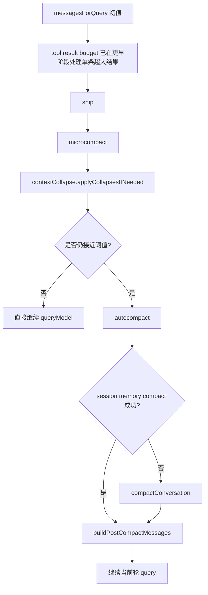

<callout emoji="❗">
**三个顺序结论：** 第一，**contextCollapse 在 autocompact 前**；第二，**session memory compact 在 full compact 前**；第三，只有前面的便宜路径都不够，才会触发真正的 LLM summary。
</callout>

---

## 13.3 各层做什么：对象、位置、代价

| 层 | 改动位置 | 主要对象 | 是否用 LLM | 代价 / 风险 | 结论强度 |
|-|-|-|-|-|-|
| tool result budget | 本地消息 + 磁盘 | 单条超大 tool_result | 否 | 几乎无语义损失，主要是替身化 | 源码明确 |
| snip | 本地历史视图 | 旧长内容 / 可裁剪片段 | 当前快照无法直接确认 | 低成本，但实现缺口较大 | 弱 |
| microcompact | 本地消息或 API 层 | 旧 tool_result | 否 | 可能让模型丢失细粒度结果，需要重取 | 源码明确 |
| contextCollapse | collapsed view / collapse store | 整体上下文视图 | 当前 leak 无法确认 | 职责边界能确认，实现原理不能下死结论 | 中 |
| autocompact | 决策层 | 整轮 token 状态 | 否 | 只负责判断，不直接压缩语义 | 源码明确 |
| session memory compact | compact 重组层 | memory 文件 + 新近消息 | 读阶段否；写阶段是 | 依赖后台 extraction 的新鲜度 | 源码明确 |
| compactConversation | 整段历史 | 旧历史整体 | 是 | 成本最高，也最容易抹平原始结构 | 源码明确 |
| buildPostCompactMessages | 结果拼装层 | boundary / summary / attachments | 否 | 纯重组，不新增语义 | 源码明确 |

最容易混淆的是 `contextCollapse` 和 `compactConversation`：前者更像“细粒度折叠视图”，后者才是“正式摘要重写”。

---

## 13.4 tool result budget 与 snip 的角色

<grid><column width-ratio="0.500000"><callout emoji="✅"><p><b>tool result budget</b> 解决的是“单条太肥”，不是“全局太长”。</p></callout><whiteboard type="mermaid">flowchart LR
      A[tool_result 很大] --&gt; B[写入 session/tool-results 文件]
      B --&gt; C[生成 preview / file reference]
      C --&gt; D[替换原始 content]
      D --&gt; E[后续轮次复用 replacement]</whiteboard></column><column width-ratio="0.500000"><table><colgroup><col/><col/></colgroup><thead><tr><th vertical-align="top">问题</th><th vertical-align="top">它如何处理</th></tr></thead><tbody><tr><td vertical-align="top">一条 Read / Bash 结果过大</td><td vertical-align="top">外置原文，只留下可继续工作的预览</td></tr><tr><td vertical-align="top">是否需要模型理解?</td><td vertical-align="top">不需要，它不做“总结”，只做“替身化”</td></tr><tr><td vertical-align="top">收益</td><td vertical-align="top">立刻瘦身，且不必重写整段历史</td></tr></tbody></table><p><b>snip</b> 在概念上比 budget 更偏“旧片段裁剪”，但这份 leak 中实现不全，因此这里只把它放在分层位置上，不扩展具体算法细节。</p><callout emoji="✅"><p><b>补充：tool result budget 的真实阈值（src/constants/toolLimits.ts）</b></p></callout><table><colgroup><col/><col/><col/></colgroup><thead><tr><th vertical-align="top">常量</th><th vertical-align="top">值</th><th vertical-align="top">作用</th></tr></thead><tbody><tr><td vertical-align="top">DEFAULT_MAX_RESULT_SIZE_CHARS</td><td vertical-align="top">50,000</td><td vertical-align="top">单条 tool_result 字符上限，超出走 persisted-output 替身</td></tr><tr><td vertical-align="top">MAX_TOOL_RESULT_TOKENS</td><td vertical-align="top">100,000</td><td vertical-align="top">单条结果 token 估算上限（BYTES_PER_TOKEN=4）</td></tr><tr><td vertical-align="top">MAX_TOOL_RESULTS_PER_MESSAGE_CHARS</td><td vertical-align="top">200,000</td><td vertical-align="top">单条 user message 内多条 tool_result 总和上限，避免 N×40K=400K</td></tr></tbody></table><p>具体写盘动作：<code>applyToolResultBudget</code> (src/utils/toolResultStorage.ts:924) 把超限内容落到 session/tool-results/，原 content 替换成带 <code>&lt;persisted-output&gt;</code> 标签的预览块。</p></column></grid>

---

## 13.5 microcompact 的两条路径

| 路径 | 触发条件 | 改哪里 | 直接收益 | 代价 |
|-|-|-|-|-|
| time-based microcompact | 距离上次 assistant 已很久，cache 大概率冷了 | 直接改本地 messages | 下次发请求前就把旧 tool_result 压扁 | 本地历史真的变瘦，旧细节只能重取 |
| cached microcompact | cache 仍热，且模型支持 cache editing | 不改本地 messages，在 API 层插入 cache_edits | 保住 prefix cache 命中，同时让 effective context 变小 | client 侧历史不变，理解门槛更高 |

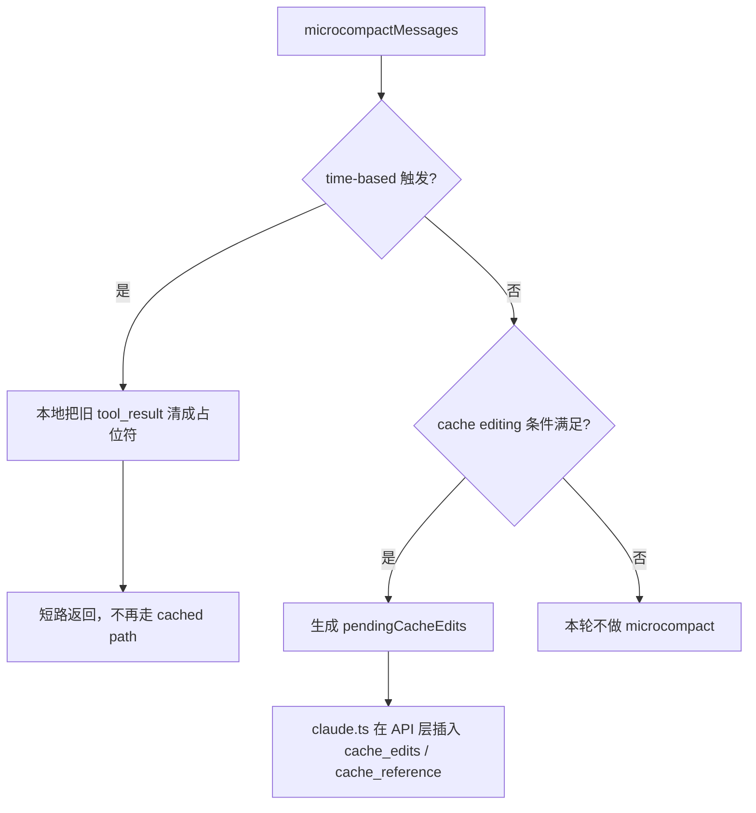

<callout emoji="❗">
**为什么不是同时跑?** 因为 **time-based 触发本身就意味着缓存大概率已冷**。这时 cached microcompact 的前提不成立，再做 cache editing 没意义，所以直接短路。
</callout>

从理解上可以把 cached microcompact 想成：**client 保留全量历史，server 端只让模型“看见更短的有效前缀”**。它减少的不是本地数组长度，而是服务端真正参与 attention 的有效上下文。

<callout emoji="✅">
**补充：time-based microcompact 的默认 gap = 60 分钟**
- 默认配置在 `src/services/compact/timeBasedMCConfig.ts:32`：`gapThresholdMinutes: 60`。
- 由 `tengu_slate_heron` feature flag 控制是否启用，未开启时 time-based 路径直接跳过。
- 触发条件：距离上一条 main-loop assistant message 的 gap ≥ 60 min（按 timestamp 计算），意味着 prefix cache 大概率已冷。
- 触发后短路 cached path（见 `microCompact.ts:267`），不再尝试 cache editing。
</callout>

---

## 13.6 contextCollapse 当前能确认到什么程度

<callout emoji="❗">
**当前最稳的结论：** `contextCollapse` 是独立层，且在 `autocompact` 之前执行；但由于 `src/services/contextCollapse/index.js` 在这份 leak 中缺失，无法仅凭源码确认它是否调用 LLM、如何生成 `<collapsed>` summary、collapse store 的具体数据结构。
</callout>

<table><colgroup><col/><col/><col/></colgroup><thead><tr><th vertical-align="top">能确认</th><th vertical-align="top">依据</th><th vertical-align="top">不能确认</th></tr></thead><tbody><tr><td vertical-align="top"><ul><li>它是独立 feature：<code>CONTEXT_COLLAPSE</code></li><li>它有 <code>applyCollapsesIfNeeded</code> 与 <code>recoverFromOverflow</code></li><li>它产出的是 collapsed view，不直接把 REPL 原数组整体改写</li><li>它有 collapse store / commit log / overflow drain 概念</li></ul></td><td vertical-align="top">来自 <code>query.ts</code> 的调用点和注释</td><td vertical-align="top"><ul><li>是否调用 LLM</li><li>如何选择要折叠的跨度</li><li><code>&lt;collapsed&gt;</code> summary 的生成策略</li><li>collapse store 的具体落盘格式</li></ul></td></tr></tbody></table>

比较靠谱的外部二手分析普遍把它描述成“**比 full compact 更细粒度的折叠视图**”：如果 collapse 后已经回到阈值以内，就不再触发 autocompact，从而保留更多原始结构。可参考 [Inside Claude Code: Context Compaction](https://y-agent.github.io/inside-claude-code/04-context-compaction.html) 与 [Claude Code Source Analysis: Context Management](https://dev.to/lien_jp_db54b8b7fd9fa0118/claude-code-source-analysis-series-chapter-4-context-management-blm)。这两篇可当“学习材料”，但不应替代缺失源码本身。

---

## 13.7 autocompact、session memory 与 full compact 的分工

<grid>
<column width-ratio="0.500000">
<callout emoji="✅">
**autocompact 只是决策层：** 它负责判断“现在要不要进入正式 compact”，本身不负责写摘要。
</callout>
- 先看经过前面几层处理后的 token 状态。
- 若已回到安全区，则当前轮继续，不做大摘要。
- 若仍超阈值，再尝试 session memory compact 或 full compact。
</column>
<column width-ratio="0.500000">
| 路径 | 含义 |
|-|-|
| session memory compact 成功 | 复用后台记忆文件，避免 full compact |
| session memory compact 失败/不足 | 进入 compactConversation 做正式摘要 |
</column>
</grid>

<callout emoji="✅">
**补充：autocompact 阈值公式（src/services/compact/autoCompact.ts）**
</callout>

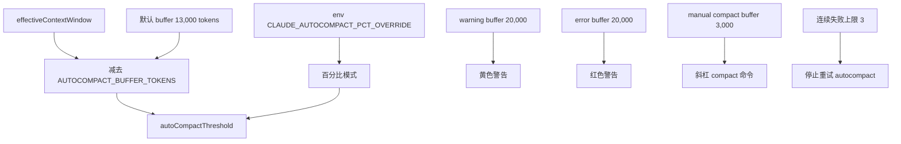

<callout emoji="❗">
**注意：**当前实现里没有"92%"或任何固定百分比阈值。默认路径只用 `effectiveContextWindow − 13,000` 这个绝对差值，外部介绍中流传的 92% 实际只是 env override 的可选行为。
</callout>

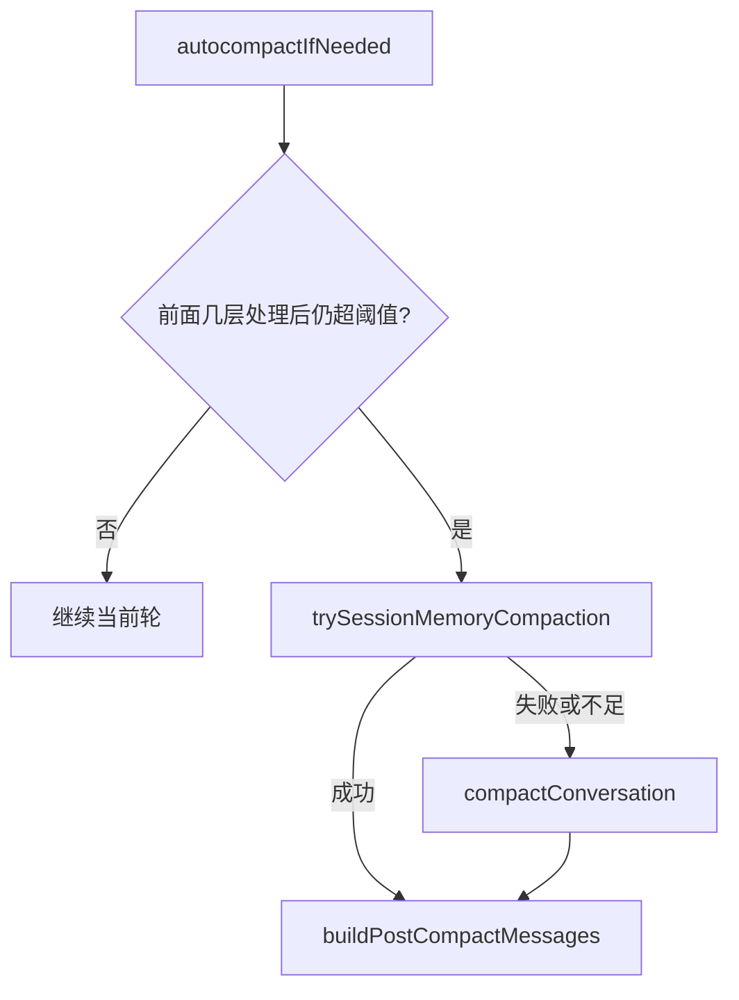

---

## 13.8 session memory 写入-读取时序

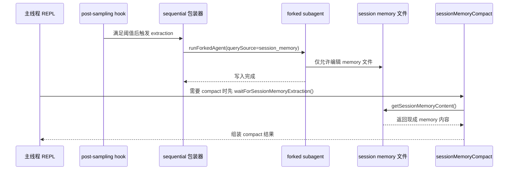

| 协调点 | 作用 |
|-|-|
| `sequential(...)` | 保证同进程内一次只跑一个 extraction，避免并发写文件 |
| `extractionStartedAt` | 让读取侧知道是否已有写入正在进行，需要等待 |
| `lastMemoryMessageUuid` | 标记 memory 文件已覆盖到哪条消息 |
| `lastSummarizedMessageId` | 标记下一次 extraction 从哪里继续增量总结 |

所以 **session memory compact 当前这一步本身不再额外调模型**；它读的是后台已经维护好的 memory 文件。真正的 LLM 成本被前置到了 extraction 写入链路里。

### 13.8.1 Relevant Memory Recall 时序

<callout emoji="💡">
**说明：** relevant memory recall 不是 session 级缓存，而是 **per-turn 的 opportunistic prefetch**。每个 user turn 只发 1 次 side-query，来得及就影响本轮后续 iteration，来不及就直接失效。
</callout>

```mermaid
sequenceDiagram
  participant Q as query.ts
  participant P as Memory Prefetch
  participant S as side-query
  participant M as 主模型 loop
  Q->>P: startRelevantMemoryPrefetch()
  Q->>M: 主流程先开始本轮推理
  P->>S: 选择 relevant memories
  S-->>P: 返回文件列表
  alt 在消费点前 ready
    P-->>Q: attachment 注入
    Q->>M: 后续 iteration 带上 memories
  else 返回过晚
    P--xQ: 本轮 abort / 作废
  end
```

### 13.8.2 Durable Memory 写入与 Dream

| 链路 | 什么时候跑 | 主要动作 | 和 compact 的关系 |
|-|-|-|-|
| Session Memory Extraction | post-sampling hook 达到阈值后 | 后台维护当前 session 的 memory 文件 | 供 session memory compact 读取；它本身不等于 compact |
| Extract Memories | 每个 turn 结束后 stopHooks fire-and-forget | 从本轮对话中提取值得长期保存的信息，增量写 durable memory | 和 compact 无直接同步依赖，服务跨 session 长期记忆 |
| Dream / AutoDream | 每个 turn 结束后做 gate 检查，满足条件才执行 | 合并、去重、整理长期 memory，重写索引 | 不是 compact；它整理的是长期 memory 库本身 |

### 13.8.3 当前实现的取舍

<grid>
<column width-ratio="0.500000">
<callout emoji="✅">
**推荐：** 当前设计优先保证主线程响应延迟。memory recall 走 zero-wait，不阻塞首轮主请求；持续对话里只要本轮还有后续 iteration，就仍有机会消费。
</callout>
</column>
<column width-ratio="0.500000">
<callout emoji="❗">
**注意：** 这也意味着 recall 不是强一致的。如果本轮是单轮直答，且 side-query 返回偏慢，那么这轮回答可能完全拿不到那批 detailed relevant memories。
</callout>
</column>
</grid>

| 问题 | 当前答案 |
|-|-|
| relevant memory 为什么每轮都重新选？ | 因为 relevance 取决于当前 query、recent tools、memory 仓库最新状态，而不是 session 常量。 |
| 为什么不 wait side-query？ | 因为当前实现优化的是 **latency**，不是首轮强一致 recall。 |
| side-query 晚返回会不会跨 turn 生效？ | 不会。它是 turn 级 handle，错过本轮就 abort，不会顺延到下一轮补用。 |

---

## 13.9 compactConversation 总时序图

```mermaid
sequenceDiagram
  participant Main as 主线程 compactConversation
  participant Hook as Pre/Post hooks
  participant Fork as forkedAgent / streaming path
  participant API as Claude API
  participant Rehydrate as post-compact rehydrate
  Hook->>Main: pre_compact hooks + customInstructions 合并
  Main->>Main: 构造 compactPrompt / summaryRequest
  Main->>Fork: streamCompactSummary(messages, summaryRequest)
  alt cache-sharing fork 成功
    Fork->>API: runForkedAgent(querySource=compact,maxTurns=1)
    API-->>Fork: summary assistant message
  else 回退到普通流式请求
    Fork->>API: queryModelWithStreaming(TEXT ONLY, thinking disabled)
    API-->>Fork: summary assistant message
  end
  Fork-->>Main: summaryResponse
  Main->>Main: 解析 summary / 失败则重试或报错
  Main->>Rehydrate: 清 readFileState, 生成 file/plan/skill/tool/MCP attachments
  Rehydrate-->>Main: boundaryMarker + summaryMessages + hookMessages
  Main->>Hook: post_compact hooks
  Main-->>Main: buildPostCompactMessages() 后继续当前轮 query
```

<grid>
<column width-ratio="0.500000">
<callout emoji="✅">
**最巧的点：** compact 不是单纯“调模型做摘要”，而是一条专门的压缩子查询链路。
</callout>
- 优先走 forkedAgent 路径，尽量复用主线程 cached prefix。
- 摘要结束后，不是只留一段文字，而是重建一套可续跑的最小上下文。
- pre/post hooks 也被纳入 compact 生命周期，而不是绕开。
</column>
<column width-ratio="0.500000">
| 阶段 | 真正产物 |
|-|-|
| 摘要请求 | summary assistant message |
| 重建阶段 | boundary + summary + attachments + hooks |
| 继续执行 | 新的 messagesForQuery |
</column>
</grid>

<callout emoji="✅">
**补充：compactConversation 摘要 prompt 的 9 段结构（src/services/compact/prompt.ts:61-143）**
1. **Primary Request and Intent** — 完整记录用户每条显式请求和意图
2. **Key Technical Concepts** — 涉及到的技术概念、技术栈、框架
3. **Files and Code Sections** — 读过/改过/创建过的文件，连同关键 code snippet 和原因
4. **Errors and fixes** — 遇到的错误和修复方式，重点保留用户的纠正性反馈
5. **Problem Solving** — 已解决问题与正在排查的问题
6. **All user messages** — 列出所有非 tool result 的用户消息（关键）
7. **Pending Tasks** — 用户明确要求但未完成的任务
8. **Current Work** — 摘要请求发起前正在做的具体工作
9. **Optional Next Step** — 下一步动作，要求"必须直接对应最近一次明确请求"，并需要原文引用避免漂移
结尾还允许通过 CLAUDE.md 的 `# Summary instructions` / `## Compact Instructions` 注入额外侧重点（如"重点保留 typescript 修改"或"重点保留测试输出"）。
</callout>

---

## 13.10 compactConversation 自身 PTL 重试图

```mermaid
flowchart TD
  A[compactConversation 发起摘要请求] --> B{compact 请求自己 PTL?}
  B -->|否| C[直接使用 summary]
  B -->|是| D[truncateHeadForPTLRetry]
  D --> E[groupMessagesByApiRound]
  E --> F[从最老 API-round 开始裁]
  F --> G{至少还剩一组可摘要消息?}
  G -->|否| H[抛出 Conversation too long]
  G -->|是| I[必要时补 synthetic user marker<br>避免 assistant-first 被 API 拒绝]
  I --> J[重试 streamCompactSummary]
  J --> B
```

<callout emoji="❗">
**这里的工程巧点：** 系统承认“因为上下文本来就过长，所以连 compact 自己都可能过长”。它没有把这种情况当致命错误，而是做了一轮自举式自救：先裁最老几组，再尝试摘要剩余部分。
</callout>

| 问题 | 解法 |
|-|-|
| compact 请求自己也 prompt-too-long | 按 API-round 分组，从最老组开始丢 |
| 丢掉 group 0 后可能 assistant-first | 补一个 synthetic user marker |
| 裁太多导致无内容可摘要 | 明确报错，不假装成功 |

<callout emoji="✅">
**补充：PTL 重试与 post-compact 恢复的真实预算**
</callout>

| 常量 | 值 | 说明 |
|-|-|-|
| MAX_PTL_RETRIES (compact.ts:227) | 3 | compact 自身 prompt-too-long 时的重试上限，超过则报 Conversation too long |
| POST_COMPACT_MAX_FILES_TO_RESTORE | 5 | 摘要后最多重新 attach 几个文件 |
| POST_COMPACT_TOKEN_BUDGET | 50,000 | post-compact attachments 的总 token 预算 |
| POST_COMPACT_MAX_TOKENS_PER_FILE | 5,000 | 单个文件在 attachments 里的最大 token 占用 |

```mermaid
flowchart LR
  A[compactConversation 输出] --> B[boundaryMarker]
  A --> C[summaryMessages]
  A --> D[messagesToKeep 可选]
  A --> E[post-compact attachments]
  A --> F[hookResults]
  B --> G[buildPostCompactMessages]
  C --> G
  D --> G
  E --> G
  F --> G
  G --> H[新的 messagesForQuery]
```

<callout emoji="✅">
**关键理解：** full compact 并不是“把旧消息删了就结束”，而是要重新构造一套最小但可继续工作的 query 输入：summary 之外，还要补回 boundary、plan/skill/工具增量、必要附件和 hook 结果。
</callout>

---

## 13.11 各手段的工程取舍对比

| 手段 | 是否调 LLM | 是否改本地 messages | 是否影响远端 cache | 信息损失风险 | 典型使用时机 |
|-|-|-|-|-|-|
| tool result budget | 否 | 是 | 低 | 低 | 单条结果过大 |
| snip | 当前无法确认 | 大概率是 | 中 | 中 | 旧片段裁剪 |
| time-based microcompact | 否 | 是 | 高，等价于接受 cache 已冷 | 中 | 长时间 gap 后 |
| cached microcompact | 否 | 否 | 是，主动编辑 prefix cache | 中 | cache 仍热时优先走 |
| contextCollapse | 当前无法确认 | 不一定，至少有独立 collapsed view | 未知 | 未知 | 希望比 full compact 更细粒度地压下 token |
| session memory compact | 读阶段否，写阶段是 | 重组后体现为新视图 | 中 | 中 | 后台 memory 已足够新鲜 |
| compactConversation | 是 | 是 | 高 | 高 | 整体超限的最后手段 |

## 13.12 延伸阅读与可信度标注

<callout emoji="💡">
**官方：** [Automatic context compaction](https://platform.claude.com/cookbook/tool-use-automatic-context-compaction)；[Effective Context Engineering for AI Agents](https://www.anthropic.com/engineering/effective-context-engineering-for-ai-agents)
**源码二手分析：** [Inside Claude Code](https://y-agent.github.io/inside-claude-code/04-context-compaction.html)；[Claude Code Source Analysis](https://dev.to/lien_jp_db54b8b7fd9fa0118/claude-code-source-analysis-series-chapter-4-context-management-blm)
**阅读原则：** 能在本仓库源码中直接验证的，按“确定”；只存在调用点而实现缺失的，按“边界明确、原理待证”；纯外部推测性的模型架构或服务端细节，只作学习参考，不作为定论。
</callout>

<callout emoji="✅">
**一页话总结：** Claude Code 的 compact 体系不是“一个摘要功能”，而是“多级上下文压力控制系统”。越靠前的层越便宜、越保结构；越靠后的层越昂贵、越偏语义改写。真正难得的地方不在于它会 summary，而在于它尽量把 summary 推迟到最后一刻。
</callout>

- **标准能力：**`notifications/*`、`progress`、`sampling`、`elicitation`、`roots` 都属于 MCP 协议层定义的反向能力。
- **因此：**“MCP server 可以反向通知 agent”这件事本身是标准能力，不是 Claude 私有协议。
- **非标准部分：**某个厂商自定义的方法名、payload 扩展、重连策略、鉴权接法，才属于各家实现差异。
- **OAuth/OIDC 可以完全自建：**Keycloak、Ory Hydra、Authentik 这类成熟方案都可作为 MCP server 的授权中心。
- **这意味着：**MCP 并不限定只能接 Anthropic 或公网 SaaS 的认证体系，企业内网完全可以用自建 OAuth / OIDC 给内部 MCP server 发 token。
- **实践边界：**MCP 的本质区别不在“是否需要登录”，而在于它是为 LLM 定义的工具协议；认证只是在不同部署形态下选不同实现。
- entrypoints/cli.tsx 对 remote-control、rc、remote、sync、bridge 做 fast path 分发。
- bridgeMain.ts 负责注册本地环境、轮询远端 work、spawn 会话、heartbeat、超时和清理。
- Bridge 会使用 JWT/可信设备/token refresh，并能为每个远端任务创建独立 session 或 worktree。
- REPL 与 IDE 的连接通过 bridge/replBridge、hooks/useReplBridge、IDE selection、permission callback 等模块协同。

# 14. 关键源码索引与推荐阅读路径

## 14.1 推荐阅读顺序

| 顺序 | 文件 | 阅读目标 |
|-|-|-|
| 1 | package.json、README.md | 确认工程定位、依赖、构建方式和目录说明 |
| 2 | src/entrypoints/cli.tsx | 理解启动 fast path 和特殊模式分发 |
| 3 | src/main.tsx | 理解 CLI 初始化、Commander 参数、交互/非交互入口 |
| 4 | src/screens/REPL.tsx | 理解 TUI 会话管理、输入处理和 query 调用 |
| 5 | src/query.ts | 理解 Agent Loop 主状态机 |
| 6 | src/Tool.ts、src/tools.ts | 理解工具抽象和工具注册 |
| 7 | src/services/tools/toolOrchestration.ts、toolExecution.ts | 理解工具并发、校验、权限和执行 |
| 8 | src/hooks/useCanUseTool.tsx、utils/permissions | 理解权限判断和交互确认 |
| 9 | src/services/api/claude.ts | 理解 API 请求、streaming、tool schema、beta headers、fallback |
| 10 | src/context.ts、src/services/compact、src/memdir | 理解上下文工程、记忆和压缩 |

## 14.2 核心文件地图

| 主题 | 关键文件 | 一句话说明 |
|-|-|-|
| CLI 入口 | src/main.tsx | 最大入口文件，负责大多数启动和运行模式组装。 |
| 轻量启动 | src/entrypoints/cli.tsx | 在加载主 CLI 前处理 version、bridge、daemon 等快速路径。 |
| 交互 TUI | src/screens/REPL.tsx | React/Ink 主界面，集成输入、消息、权限和 query 流。 |
| 非交互引擎 | src/QueryEngine.ts | SDK/headless 对话引擎，封装 submitMessage。 |
| Agent Loop | src/query.ts | 模型请求、工具调用、压缩、恢复和终止逻辑。 |
| Tool 类型 | src/Tool.ts | 工具接口和 ToolUseContext 的核心类型定义。 |
| Tool 注册 | src/tools.ts | 内置工具集合、feature gate、工具过滤。 |
| 工具编排 | src/services/tools/toolOrchestration.ts | 按并发安全性分批执行工具。 |
| 工具执行 | src/services/tools/toolExecution.ts | schema 校验、权限、hook、call、错误结果。 |
| 模型 API | src/services/api/claude.ts | 调用 Anthropic SDK、构造参数、处理 streaming 和 fallback。 |
| 上下文 | src/context.ts | 加载 git status、CLAUDE.md、当前日期等上下文。 |
| 记忆 | src/memdir/memdir.ts | MEMORY.md 文件化长期记忆机制。 |
| 压缩 | src/services/compact/compact.ts | 上下文摘要、压缩边界、post-compact 恢复。 |
| MCP | src/services/mcp/client.ts | MCP 连接、工具包装、资源读取和认证处理。 |
| Bridge | src/bridge/bridgeMain.ts | 远控模式的环境注册、任务轮询和会话 spawn。 |

---

# 15. 学习总结与可复用设计

<grid>
<column width-ratio="0.500000">
## 值得借鉴
- 将 Agent Loop 抽成 async generator，天然适配 TUI、SDK 和远程流式消费。
- Tool 抽象同时包含 schema、权限、执行、展示和并发属性，边界清晰。
- 工具结果统一变成 user message 的 tool_result，符合 Claude tool-use 协议。
- 权限系统分层清晰，支持配置、hook、classifier 和人工确认共同决策。
- 上下文压缩前置在每轮请求前，降低大上下文失败概率。
- 通过 feature flag 和动态 import 控制复杂能力，降低外部构建负担。
</column>
<column width-ratio="0.500000">
## 复杂度来源
- REPL.tsx 和 main.tsx 体量很大，交互、状态、远程、插件、权限逻辑耦合度较高。
- feature flag 和 ant-only 分支较多，阅读时需要区分外部构建和内部构建。
- 上下文压缩策略很多，理解 query.ts 需要结合 compact、reactive compact、context collapse 一起看。
- 工具执行链路横跨 Tool.ts、toolOrchestration、toolExecution、useCanUseTool、具体工具实现。
- MCP、Bridge、Agent swarm、Skill、Plugin 等扩展点会显著增加状态空间。
</column>
</grid>

## 15.1 如果要复刻一个简化版 Claude Code

| 阶段 | 最小实现 | 下一步增强 |
|-|-|-|
| L1 | CLI + messages + Claude streaming | 支持 transcript 和 resume |
| L2 | Tool 抽象 + Read/Grep/Bash 三个工具 | 增加 FileEdit 和权限弹窗 |
| L3 | Agent Loop 支持 tool_use/tool_result 多轮循环 | 加入并发只读工具执行 |
| L4 | CLAUDE.md、git status、系统提示词拼接 | 加入 memory 和 @文件引用 |
| L5 | 上下文长度预警和手动 compact | 加入自动 compact、reactive compact |
| L6 | MCP 工具接入 | 加入 OAuth、资源读取、远控 Bridge |

## 15.2 一句话总览

<callout emoji="✅">
Claude Code 的核心价值不只是“把模型接到命令行”，而是围绕软件工程场景构建了一套本地 Agent Runtime：它把模型、工具、权限、上下文、长期记忆、UI、远程控制和扩展生态都纳入同一个可恢复、可审计、可流式消费的会话循环。
</callout>

---

- 在 query 主循环里，客户端并不会自己决定“现在该跑哪个工具”，而是等待模型流式返回 tool_use。
- ToolSearchTool 的设计也是给模型一个“先发现、后调用”的能力：模型感知到 schema 不在手边时，会先调用 Meta Tool 拉取完整工具定义。
- 已发现工具集合会通过 tool_reference 留在会话历史里，下一轮继续影响模型可调用工具集。
- 模型只能提议 tool_use，不能直接执行本地动作。
- toolExecution 会做 Zod schema 校验、validateInput、权限判断、hook 和错误包装；任何一步失败都会返回 tool_result 错误，而不是放行。
- 是否 defer_loading、哪些工具发送给 API、哪些只在发现后再加载，都是客户端在发请求前决定的。
- 工具执行顺序、并发度、超大输出落盘、权限弹窗、stop hooks、恢复重试都由 runtime 控制。
- 不把所有 MCP/延迟工具 schema 一次性塞进 prompt，减少上下文体积。
- 让模型按任务需要逐步扩展工具能力，而不是预装全部能力。
- 把“工具发现”本身也做成一个可审计、可恢复、可回放的会话动作。
- 第一次请求不需要携带所有 MCP 或延迟工具的完整 schema，节省大量上下文。
- 模型遇到“能力存在但参数未知”的情况，可以先调用 Meta Tool，拿到精确 schema 后再调用真实工具。
- discovered tool set 留在消息历史中，成为后续轮次的状态，而不是只在当前函数调用里生效。
- **System Prompt：**不同 agent type 会拼接不同的系统提示词，决定工作风格、领域偏好和行为约束。
- **工具与权限：**不同 agent type 可以带不同工具集和权限边界，因此“同样的任务”在不同角色上可执行性不同。
- **运行身份：**team config 与运行期日志都会记录 agentType，便于 Lead 区分“谁适合做什么”。
- **Task schema 只有 owner，没有 requiredRole / requiredSkill / assigneeType 之类字段。**
- **Auto-claim 只看 status / owner / blockedBy**，不看 agent type。
- **claimTask 只校验 owner 是否已被别人占用**，不做“你这个角色能不能领”判断。
- 因此框架层没有“先算匹配，再路由”的硬编码调度器；**真正的匹配发生在 Lead 的 LLM 推理里**。