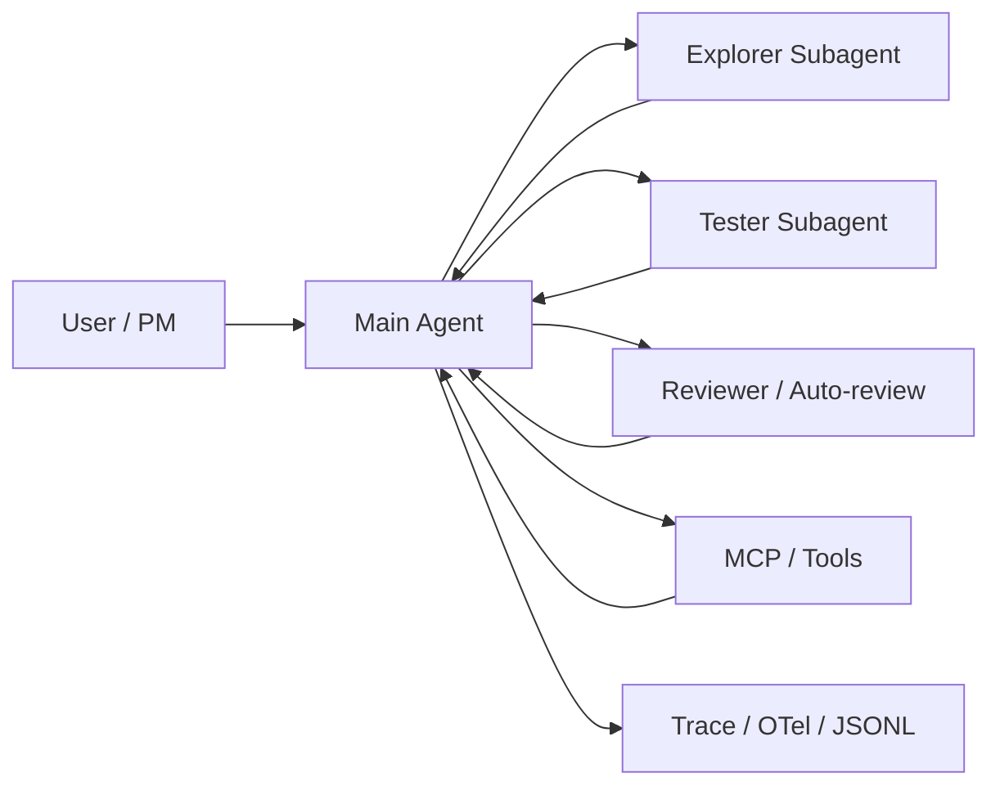

<title>榨干 Codex 官方文档：开发者最佳实践与 Agent 架构范式</title>

<callout emoji="📌">
**结论：**Codex 官方文档最值得直接借鉴的，不是零散 prompt 技巧，而是一整套工程化工作方式：**上下文分层**、**先规划后执行**、**权限最小化**、**并行子代理**、**可复用技能**、**可观察执行**。
**面向开发者：**最值得直接照搬的是 Goal / Context / Constraints / Done when 的任务描述法，复杂任务先 plan，稳定规则写进 AGENTS.md，强制测试和 review 闭环，每个任务一条线程，并行任务配 worktree。
**面向 Agent 开发者：**最值得借鉴的是主代理 + 专用子代理分工、Reviewer 代理守住权限边界、Skills 渐进加载、MCP 只接高价值外部系统、基于 traces 和 OTel 的可观测性，以及 permission profiles / sandbox / approval 的最小权限设计。
</callout>

# 1. 我重点榨出的官方信息面

| 关注面 | 我重点读取的官方文档 | 最终可转化的价值 |
|-|-|-|
| 开发者日常使用 | Best practices、Prompting、Workflows、AGENTS.md、Non-interactive、Review、Worktrees | 整理成可直接执行的提示模板、线程管理规则、验证闭环和团队协作范式 |
| Agent 架构与平台能力 | Subagents、Customization、Agent approvals & security、MCP、Skills、SDK、Rules、Permissions、Auto-review | 整理成可迁移的多代理架构、权限边界、工具接入、可观测性和分发体系 |
| 执行与治理 | Config basics、Permissions、Speed、Memories、Cloud environments、Agents SDK guide | 抽出可落地的环境配置、运行模式、记忆策略和治理建议 |

# 2. 一页结论：哪些东西最值得直接拿去用

<grid>
<column width-ratio="0.500000">
<callout emoji="✅">
## 给使用 Codex 编程的开发者
- 任务描述固定四件套：目标、上下文、约束、完成标准
- 复杂任务强制先规划，再编码
- 把稳定规则沉淀到 AGENTS.md，而不是每次重写 prompt
- 把“写代码”升级成“改代码 + 跑测试 + review diff”完整闭环
- 一条线程只做一个任务；并行修改用 worktree 隔离
</callout>
</column>
<column width-ratio="0.500000">
<callout emoji="💡">
## 给 Agent / 平台开发者
- 主代理负责需求、约束、最终汇总；子代理处理探索、测试、审查等噪声工作
- 把权限控制做成架构的一部分，而不是补丁：sandbox、approval、rules、profiles
- Skills 负责方法复用，MCP 负责外部能力接入，Plugins 负责分发
- 把 traces / OTel / JSONL 输出当成调试和治理基础设施
- 对子代理按角色配置模型、推理强度、工具面和权限
</callout>
</column>
</grid>

---

# 3. 面向开发者：可直接照搬的最佳实践

<callout emoji="✅">
**这一章的核心判断：**Codex 官方最佳实践的本质，是把“写一个 prompt”升级成“定义任务、分配上下文、设定边界、验证结果”的完整软件工程流程。
</callout>

## 3.1 任务描述的最佳默认模板

| 要素 | 你该怎么写 | 为什么有效 |
|-|-|-|
| Goal | 明确说清要改什么、产出什么 | 减少代理在目标层面的猜测 |
| Context | 给文件、目录、报错、设计稿、相关文档 | 减少无关探索，缩短进入问题的时间 |
| Constraints | 说明技术栈、架构边界、不能动的接口、安全要求 | 把“不要做什么”前置到执行前 |
| Done when | 写清测试通过、行为变化、bug 不再复现等完成标准 | 让 Codex 能自检，而不是只产出代码 |

```text
目标：
把 settings 页面保存后不持久化的问题修掉。

上下文：
相关文件：@src/pages/settings.tsx @src/api/user.ts
复现步骤：1) 打开 /settings 2) 修改开关 3) 点击 Save 4) 刷新后状态丢失

约束：
- 不改 API shape
- 修复尽量小
- 能补回归测试就补

完成标准：
- 本地可复现并修复
- 跑最小相关测试集和 lint
- 输出修复点、验证命令、风险点
```

## 3.2 复杂任务必须先 plan，不要直接冲实现

1. 需求模糊、改动跨模块、需要重构、需要协调多个约束时，先让 Codex 规划。
2. 规划阶段让它先问你问题，必要时挑战你的假设，把模糊目标收敛成可执行目标。
3. 确认 plan 后再进入实现；这能显著降低大仓库里“方向正确但落点错误”的概率。

<callout emoji="❗">
**直接可执行规则：**复杂度一旦超过“单文件小改”，就优先进入 Plan mode 或者显式要求它先输出计划，再开始编码。
</callout>

## 3.3 把稳定规则写进 AGENTS.md，而不是反复写在 prompt 里

- 个人偏好放在全局 `~/.codex/AGENTS.md`。
- 团队约定放在仓库根目录 `AGENTS.md`。
- 子目录有专门规则时，再放目录级 `AGENTS.md` 或 `AGENTS.override.md`。
- 离当前工作目录越近的规则优先级越高。
- 当 Codex 连续犯同一个错，最优解不是继续提醒，而是更新 AGENTS.md。

```md
# AGENTS.md

## Repo conventions
- Run `pnpm test` after modifying frontend files.
- Run `pnpm lint` before finishing.
- Do not change public API shape without explicit confirmation.
- Prefer existing utilities over adding new abstractions.
- Done means: code changed, tests passed, diff reviewed.
```

## 3.4 把线程、工作区和权限当成使用习惯的一部分

| 场景 | 推荐做法 | 原因 |
|-|-|-|
| 一个独立任务 | 一条线程处理到底 | 保留完整推理与修订轨迹 |
| 任务分叉 | fork 新线程 | 避免把两个方向的上下文搅在一起 |
| 并行改多个功能点 | 使用 worktree | 避免多个 live thread 修改同一批文件 |
| 只是阅读 / 规划 | read-only 或更紧权限 | 减少误改和误执行风险 |
| 可信仓库下的正常编码 | workspace-write + on-request | 兼顾效率与控制 |

## 3.5 把“验证闭环”写成固定动作，而不是靠记忆

- [ ] 让 Codex 先复现问题或确认当前行为

- [ ] 修改后运行最小相关测试集 / lint / type check

- [ ] 要求它报告实际执行过的验证命令与结果

- [ ] 让它再 review 一遍 diff，重点看 bug、回归、边界条件

- [ ] 必要时用 /review 做一次独立审查

<callout emoji="📝">
官方文档反复强调：Codex 不是只负责“生成代码”，而是应该在你的要求下完成 **实现 + 测试 + 检查 + review** 的闭环。
</callout>

## 3.6 按工作模式选对运行面

| 运行面 | 适用场景 | 推荐理由 |
|-|-|-|
| IDE / CLI 本地线程 | 需要看本地代码、跑本地命令、快速迭代 | 上下文最贴近真实工程现场 |
| Cloud 线程 | 长耗时任务、并行代理、从另一台设备委派 | 隔离环境更强，适合委托型工作 |
| Chat / 非项目线程 | 研究、规划、连工具但不改仓库 | 避免无关代码上下文污染 |
| codex exec | CI、脚本、自动化流水线 | 天然适合 stdout / JSONL / schema 输出 |

## 3.7 官方明确提醒的常见误区

<callout emoji="❌">
- 把长期规则堆在 prompt 里，而不是放进 AGENTS.md 或 skill。
- 不给复现步骤、测试命令、完成标准，却希望代理稳定交付。
- 复杂任务不规划，直接让它“去改”。
- 还没摸清工作流，就给全盘权限。
- 同一个项目只开一条超长线程，最后上下文老化。
- 还没手工跑稳，就过早做 automation。
</callout>

# 4. 面向 Agent 开发者：值得复用的架构优化与范式

<callout emoji="💡">
**这一章的核心判断：**Codex 官方对 agent 系统的优化，核心不是“多搞几个代理”，而是把 **上下文隔离、权限边界、工具分层、结果汇总、可观测性** 变成了明确的系统设计。
</callout>



## 4.1 最值得借鉴的 8 个架构范式

| 范式 | Codex 怎么做 | 你可以怎么抄 |
|-|-|-|
| 主代理只保留高价值上下文 | 把探索、日志、测试输出下放给子代理，主线程只收摘要 | 主代理负责需求、约束、决策与最终汇总；噪声工作全部外包 |
| 显式触发子代理 | 只有用户明确要求时才 spawn subagents | 把 fan-out 当成有成本的高级能力，而不是默认行为 |
| 按角色选模型与推理强度 | reviewer 用更强模型，explorer 用 mini，速度优先时用 spark | 不要所有 agent 共用同一模型配置 |
| 权限边界独立成层 | sandbox、approval、rules、permission profile 分层控制 | 把安全边界做成配置系统，而不是把风险交给 prompt 自觉 |
| Skills 渐进加载 | 先只给 skill metadata，命中时再读完整 SKILL.md | 把“能力发现”和“能力执行”分开，节省上下文预算 |
| MCP 只连高价值外部系统 | 强调只接真正消除手工回路的工具，不鼓励一次接满 | 优先接文档、工单、浏览器、监控这类高频依赖 |
| 执行过程全程留痕 | traces、OTel、JSONL、tool decision、tool result 全部可观察 | 把 agent 调试从“猜它做了什么”变成“看它实际做了什么” |
| 分发层单独设计 | skills 是创作格式，plugins 是安装 / 分享 / 打包单位 | 把本地 workflow 沉淀成 skill，稳定后再插件化分发 |

## 4.2 为什么主代理 + 子代理这套设计有效

- **直接收益 1：**减轻 context pollution。探索笔记、测试日志、堆栈信息不再冲掉主线程里的需求与约束。
- **直接收益 2：**减少 context rot。会话很长时，主线程仍然保留更高密度的有效信息。
- **直接收益 3：**并行化读多写少任务。代码搜索、文档核验、测试、审查这类任务天然适合并行。

<callout emoji="❗">
**官方态度很明确：**子代理更适合 **read-heavy** 任务；并发写代码要更谨慎，因为冲突和协调成本会明显升高。
</callout>

## 4.3 权限边界是架构设计，不是交互细节

| 层 | Codex 的实现重点 | 迁移建议 |
|-|-|-|
| Sandbox | 限制文件读写范围、默认断网、本地 OS 级隔离 | 先定义技术上能做什么，再谈代理想做什么 |
| Approval | 跨边界动作要求用户或 reviewer 审批 | 把高风险动作设计成显式批准事件 |
| Rules | prefix_rule 控制哪些命令可越沙箱执行 | 用最小命令前缀放开常见安全操作，别配宽泛规则 |
| Permission profiles | 把文件系统与网络策略组合成可复用 profile | 按任务选 profile，而不是让每次会话临时拼权限 |
| Network policy | 默认关闭；开启时优先 allowlist，防 DNS rebinding | 只给需要的域名，避免一开就是全网 |

## 4.4 Auto-review 这类 Reviewer Agent 值得特别参考

1. 主代理仍在原有沙箱内运行，没有因为 reviewer 出现就自动获得更大权限。
2. 当动作需要越过边界时，请求会被路由给 reviewer agent，而不是直接停给人。
3. reviewer 只审动作本身和相关证据，不接收隐藏推理。
4. 显式拒绝后，主代理会收到更强的禁止性指令：不要绕路、不要曲线救国、要么换更安全路径，要么停下问用户。

<callout emoji="✅">
**可迁移点：**如果你的 agent 系统已经有高风险动作审批，完全可以把“人审”升级成“先机审 reviewer，再把高风险少数留给人”。这能同时保住效率和边界。
</callout>

## 4.5 Skills、MCP、Plugins 的分层关系非常清晰

<grid>
<column width-ratio="0.333333">
<callout emoji="🧠">
### Skills
定义可复用方法。适合封装流程、约定、脚本和参考资料。
</callout>
</column>
<column width-ratio="0.333333">
<callout emoji="🔌">
### MCP
连接外部工具与上下文。适合接文档、GitHub、Figma、浏览器、监控、工单。
</callout>
</column>
<column width-ratio="0.333333">
<callout emoji="📦">
### Plugins
负责安装、分发和打包，可把 skills、MCP、hooks、apps 一起交付。
</callout>
</column>
</grid>

这套分层解决了一个很常见的问题：很多团队把“工作流说明”“外部工具配置”“组织级分发”混在一起，最后谁都难维护。Codex 把它们拆成了三个职责层，边界很清楚。

## 4.6 Codex 把自身暴露成 MCP server，这一点对 Agent 平台很关键

- Codex 可以作为 MCP server 暴露给其他 agent 客户端。
- 对外主要提供 `codex` 和 `codex-reply` 两个工具，分别对应“启动会话”和“继续会话”。
- 这意味着你不必把 Codex 当黑盒产品使用，也可以把它当成一个受控的工程执行器嵌入你自己的多代理编排系统。

```python
Project Manager
  -> Designer / Frontend / Backend / Tester
  -> 每个角色只拿自己需要的文件与约束
  -> 产物达标后再 handoff 到下一个角色
  -> 全链路可 trace
```

## 4.7 可观测性和可治理性是官方体系里的“默认件”

| 能力 | 官方实现 | 工程意义 |
|-|-|-|
| Traces | 记录 prompt、handoff、工具调用、执行时长 | 便于审计、复盘、评估 agent 质量 |
| OTel | conversation、api_request、tool_decision、tool_result 等事件上报 | 便于接入现有监控 / SIEM / 合规体系 |
| JSONL | codex exec 可输出 machine-readable event stream | 适合自动化流水线与下游程序消费 |
| Schema output | 非交互模式支持 output schema | 让 agent 输出更稳定地进入自动化链路 |

## 4.8 关于 Memories：它是 recall layer，不是 source of truth

官方对 memories 的定位非常克制：它适合记住稳定偏好、常见技术栈、历史工作上下文；但必须遵守的团队规则、仓库规范和安全要求，仍然要写在 AGENTS.md 或受版本控制的文档里。

<callout emoji="📌">
**这是一个很成熟的系统判断：**记忆适合作为加速层，不适合作为唯一约束层。把必须遵守的规则交给可追踪、可评审、可版本化的配置与文档。
</callout>

# 5. 可直接抄的模板

<callout emoji="💡">
这一章给的是可以直接抄走的“最小可用模板”。你可以先按最小版本跑起来，再逐步加细节，而不是一上来设计大而全的 agent 体系。
</callout>

## 5.1 开发者任务 prompt 模板

```text
目标：

上下文：
- 相关文件：
- 报错 / 复现步骤：
- 参考实现 / 文档：

约束：
- 不能动的接口：
- 技术栈 / 风格要求：
- 安全 / 性能 / 兼容性要求：

完成标准：
- 行为变化：
- 需要跑的检查：
- 输出需要包含：修复点、验证命令、残余风险
```

## 5.2 最小 AGENTS.md 模板

```md
# AGENTS.md

## Working rules
- Start with a short plan for tasks that span multiple files.
- Prefer existing local patterns over introducing new abstractions.
- Keep changes scoped to the requested behavior.
- Run `pnpm test` and `pnpm lint` before declaring success.
- Review the diff for regressions, edge cases, and missing tests.

## Repo context
- Main app code lives in `src/`
- Shared components live in `src/components/`
- Integration tests live in `tests/`

## Done means
- Requested behavior is implemented
- Relevant checks pass
- Final response reports commands run, results, and remaining risks
```

## 5.3 本地 Codex 配置模板

```toml
model = "gpt-5.5"
approval_policy = "on-request"
sandbox_mode = "workspace-write"
web_search = "cached"
model_reasoning_effort = "medium"

[features]
multi_agent = true
shell_snapshot = true
memories = false

[sandbox_workspace_write]
network_access = false
```

## 5.4 面向 Agent 平台的角色拆分模板

| 角色 | 职责 | 建议模型 / 权限 |
|-|-|-|
| Main / PM Agent | 接需求、控边界、汇总结果、决定是否 handoff | 强模型，中等或高推理，最小必要写权限 |
| Explorer | 读代码、读文档、追路径、收集证据 | mini 模型，read-only |
| Tester | 跑最小验证、提炼失败信息、回传摘要 | 执行型模型，workspace-write 或受限命令权限 |
| Reviewer | 审风险、审 diff、审越权动作 | 强模型，read-only，较高推理强度 |
| Docs / MCP Specialist | 查官方文档、内部知识、浏览器或外部系统 | mini 或中等模型，限定 MCP 工具面 |

## 5.5 Skill 设计模板

```md
---
name: review-diff
description: Review code diffs for bugs, regressions, security issues, and missing tests. Use when the user asks for review, PR feedback, or static analysis.
---

1. Read the diff and changed files first.
2. Prioritize correctness, security, and missing test coverage.
3. Report findings first with file references.
4. Ignore style-only issues unless they hide real risk.
```

## 5.6 非交互自动化模板

```bash
codex exec --sandbox workspace-write \
  --output-schema ./schema.json \
  "review the current diff for race conditions and output structured findings"
```

<callout emoji="✅">
**模板使用顺序建议：**先落 AGENTS.md，再做 prompt 模板，再补 skill，最后才把稳定流程接入 codex exec / CI / plugin 分发。
</callout>

# 6. 我建议你优先落地的 30 天动作

<callout>
**建议顺序：**不要试图一周内把 Codex 用法、skill 体系、MCP、权限治理、自动化全部做完。官方文档最成熟的路线是：**先把单兵使用跑顺，再把团队规则固化，再把高频流程产品化。**
</callout>

## 6.1 第 1 周：把个人使用姿势跑顺

- [ ] 给自己准备一个全局 AGENTS.md，固定沟通风格、测试要求、默认约束

- [ ] 把日常 prompt 改成 Goal / Context / Constraints / Done when 四件套

- [ ] 复杂任务默认先 plan，再开始改代码

- [ ] 把权限默认收紧在 workspace-write + on-request

## 6.2 第 2 周：把团队约束从口头变成文件

- [ ] 在仓库根目录补 AGENTS.md，写清 build / test / lint / review 规则

- [ ] 在高风险目录加子目录级 AGENTS.md 或 override

- [ ] 把重复提醒超过 2 次的规则沉淀进文档

## 6.3 第 3 周：把高频手工流程变成 skill

- [ ] 挑 1 到 2 个最常重复的场景，例如 code review、日志排查、发布说明

- [ ] 先做 instruction-only skill，不急着写脚本

- [ ] 确认 trigger description 足够清晰，再让 Codex 自动命中

## 6.4 第 4 周：开始做工程化治理

- [ ] 为高价值外部系统接 MCP，而不是一次接满所有工具

- [ ] 把 codex exec 接进一个低风险自动化场景，例如 diff review 或 release notes

- [ ] 开始留 traces / JSONL / OTel，至少要能看见工具调用和审批决策

- [ ] 评估是否需要 reviewer agent 代替部分人工审批

## 6.5 我对优先级的最终建议

| 优先级 | 动作 | 原因 |
|-|-|-|
| P0 | AGENTS.md + 四件套 prompt + 验证闭环 | 这是收益最大、成本最低的组合 |
| P1 | worktree + thread discipline + 最小权限默认值 | 能明显降低并行开发和误操作成本 |
| P2 | skills + MCP | 把个人使用升级成团队复用 |
| P3 | reviewer agent + traces / OTel + plugin 分发 | 进入平台化治理阶段后价值才会完全释放 |

# 7. 关键官方来源索引

<callout emoji="📚">
下面这些页面是我认为最值得反复看的 Codex 官方来源。它们不是“资料列表”，而是这篇文档里每个关键结论的出处。
</callout>

| 页面 | 你该重点看什么 | 我从里面榨出的价值 |
|-|-|-|
| [Best practices](https://developers.openai.com/codex/learn/best-practices) | 开发者的一整套默认工作法 | 四件套任务描述、Plan first、AGENTS.md、MCP / skills / automation 的顺序关系 |
| [Prompting](https://developers.openai.com/codex/prompting) | 线程、上下文、Goal mode 的使用方式 | 明确了任务与线程管理不是附属能力，而是质量关键因素 |
| [Workflows](https://developers.openai.com/codex/workflows) | 解释代码、修 bug、写测试、云端委派的完整例子 | 可直接转写成团队内部使用手册 |
| [AGENTS.md](https://developers.openai.com/codex/guides/agents-md) | 全局 / 仓库 / 子目录 instructions 的发现与覆盖规则 | 说明为什么规则应该版本化和分层，而不是长期堆在 prompt 里 |
| [Subagent concepts](https://developers.openai.com/codex/concepts/subagents) | context pollution / rot、并行适用范围、模型选择 | 给多代理架构一个非常清晰的边界条件 |
| [Subagents](https://developers.openai.com/codex/subagents) | 自定义 agent 文件、线程深度、角色样例 | 提供了角色化 agent 的具体配置样式 |
| [Customization](https://developers.openai.com/codex/concepts/customization) | AGENTS、Memories、Skills、MCP、Subagents 的职责分工 | 这是 Codex 的“能力分层图” |
| [Agent approvals & security](https://developers.openai.com/codex/agent-approvals-security) | sandbox、approval、network、OTel、云端两阶段运行时 | 解释了为什么安全边界必须是系统级设计 |
| [Auto-review](https://developers.openai.com/codex/concepts/sandboxing/auto-review) | reviewer agent 如何替代一部分人工审批 | 给“AI 审批 AI”提供了参考实现 |
| [Skills](https://developers.openai.com/codex/skills) | progressive disclosure、skill scope、metadata 触发 | 是 workflow 复用与上下文节流的关键设计 |
| [MCP](https://developers.openai.com/codex/mcp) | 外部工具接入、server instructions、tool approval | 说明工具层应当怎样接、接到什么程度 |
| [SDK](https://developers.openai.com/codex/sdk) / [Agents SDK guide](https://developers.openai.com/codex/guides/agents-sdk) | 把 Codex 嵌入你自己的 agent 平台 | 证明 Codex 不只是终端产品，也可以是编排系统里的执行器 |
| [Permissions](https://developers.openai.com/codex/permissions) / [Rules](https://developers.openai.com/codex/rules) | permission profiles 和 prefix rules | 提供了比简单 allow / deny 更成熟的权限治理模型 |
| [Non-interactive mode](https://developers.openai.com/codex/noninteractive) | codex exec、JSONL、schema output、CI 用法 | 说明如何把交互式 agent 接进自动化流水线 |
| [Build plugins](https://developers.openai.com/codex/plugins/build) | skills / MCP / hooks / apps 的打包与分发 | 给组织级扩展提供了正式分发层 |