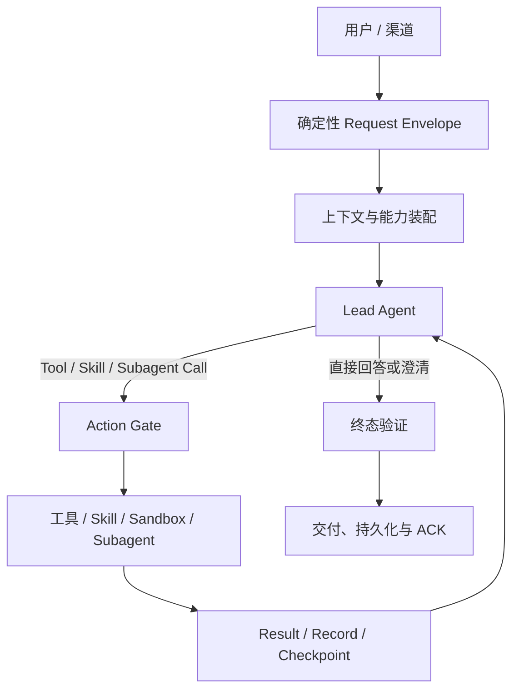

<title>通用 Agent 流程架构共性调研：意图理解、规划与执行</title>

<callout emoji="💡">
**结论先行：**通用 Agent 确实需要一个统一的前置层，但它更准确地应被定义为**确定性的请求接纳与运行上下文装配层**，而不是所有请求都必须经过的独立语义“意图分类器”。在本次核验的 DeerFlow、pi、DeepChat、Codex、Kimi Code、OpenCode 当前开源主链路中，开放式意图理解、任务分解、工具选择和基于结果的重规划，普遍由同一个 Lead Agent 在循环内完成；权限、审批、沙箱、幂等、会话恢复和交付确认则由程序侧机制约束。
</callout>

换句话说，头部通用 Agent 的共性不是“先分类，再进入固定工作流”，而是：

**确定性 Admission + 可反复观察和重规划的主模型循环 + 每次动作前的 Policy Gate + 可验证的完成与交付。**

# 1. 调研问题与边界

## 1.1 要回答的问题

1. 一个通用 Agent 要理解并正确执行用户意图，是否必须增加统一、独立、前置的意图分析？
2. 六个代表性开源 Agent 项目的真实主链路有哪些共性？
3. Plan、Todo、Tool、Skill、Subagent、Permission、Memory 分别处于什么位置？
4. 面向通用 Agent，怎样划分模型语义判断与程序确定性控制的责任？

## 1.2 研究方法

- 只使用官方仓库、官方文档和固定 commit 的源码证据。
- 追踪普通用户输入从入口到模型调用、工具执行、结果回灌和终止的主路径。
- 区分“源码已实现事实”“官方文档声明”“本文架构推论”。
- “未发现统一前置分类器”只限定于下表快照和已核验主链路，不外推到所有历史版本、插件或未开源服务端。

## 1.3 核验快照

| 项目 | 官方仓库与固定快照 | 版本信息 |
|-|-|-|
| DeerFlow | [bytedance/deer-flow @ 99c926b](https://github.com/bytedance/deer-flow/commit/99c926b7bbcd0570870bc24ceb13ab934935f49c) | backend 2.1.0 |
| pi | [earendil-works/pi @ 6b461b7](https://github.com/earendil-works/pi/commit/6b461b75b39b5a19b378dc42fbfbd1655bc446a6) | pi-agent-core / coding-agent 0.83.0；原 pi-mono 地址已重定向 |
| DeepChat | [ThinkInAIXYZ/deepchat @ dc4177c](https://github.com/ThinkInAIXYZ/deepchat/commit/dc4177c2ac80905ebac985554a9f957aaca31ab8) | 1.1.0-beta.11 |
| Codex | [openai/codex @ 70b4653](https://github.com/openai/codex/tree/70b465323282e51b8843c6801b72359e6fa32e94) | 以 commit 为准，不把仓库工作区占位版本当发行版本 |
| Kimi Code | [MoonshotAI/kimi-code @ 7bd3fd9](https://github.com/MoonshotAI/kimi-code/commit/7bd3fd9f6e6c10f88d33b85760631ad6212b5f58) | CLI 0.33.0 |
| OpenCode | [anomalyco/opencode @ b8bd889](https://github.com/anomalyco/opencode/tree/b8bd88901a4870ef3a5752840f4e23e11d54e24e) | package 1.18.14 |

# 2. 核心判断：需要“统一前置层”，不等于需要“统一前置语义分类器”

## 2.1 六类机制必须分开

| 机制 | 典型问题 | 推荐责任方 | 是否必须前置 |
|-|-|-|-|
| 请求规范化与接纳 | 谁发起、属于哪个会话、来自哪个渠道、引用了什么资源、截止时间是什么 | 确定性程序层 | 是 |
| 显式硬路由 | /plan、@agent、Skill 名、文档 URL 类型、用户明确要求只读 | 确定性程序层 | 是，但只处理可验证信号 |
| 开放式任务理解 | 用户真正想达成什么、约束是什么、缺少什么信息 | Lead Agent 模型循环 | 首次模型调用即开始，后续可修正 |
| 任务规划 | 是否需要多步、是否并行、是否委派、何时重规划 | Lead Agent；必要时显式 Plan 能力 | 否，按复杂度与风险启用 |
| 动作授权 | 这个具体工具、这些参数、当前资源范围是否允许执行 | 程序侧 Policy Gate / Sandbox / Approval | 每次副作用动作前都必须 |
| 业务完成判定 | 是否拿到真实结果、写入是否确认、发布是否 ACK、是否满足用户验收 | 终态验证器 + Lead Agent | 结束前必须 |

<callout emoji="💡">
**关键边界：**“意图风险很低”不能替代授权；“模型说已经完成”不能替代工具结果和业务 ACK；“生成了计划”也不能证明计划正确或任务已完成。
</callout>

## 2.2 为什么单次前置分类不够

- **意图会随证据显化：**读到文件、搜索结果或工具错误后，目标、约束和可行路径可能变化。
- **开放任务不是稳定闭集：**将请求强行压进固定 taxonomy，容易丢失长尾任务和复合目标。
- **形成双重语义判断：**前置分类器与 Lead Agent 都要理解上下文，增加延迟、成本和不一致。
- **错误路由会被放大：**如果分类结果锁死工具集或工作流，主 Agent 可能失去纠错机会。
- **安全不能依赖语义标签：**即使一开始被标成“只读”，后续某个工具参数仍可能产生写操作，必须逐动作校验。

# 3. 六个项目的共同主流程



## 3.1 两个正交平面

| 平面 | 包含什么 | 核心性质 |
|-|-|-|
| 语义与决策平面 | 目标理解、缺口识别、澄清、分解、工具与子 Agent 选择、观察结果、重规划、自然终止 | 概率性、上下文依赖、可修正；由 Lead Agent 循环承担 |
| 执行与控制平面 | 身份、会话、能力快照、权限、审批、沙箱、预算、超时、幂等、状态日志、恢复、发布确认 | 确定性、可审计、不可由 prompt 绕过；由产品和运行时承担 |

两者不能互相替代：语义平面决定“下一步做什么更有助于目标”；控制平面决定“这个具体动作在当前条件下能不能做，以及做过后如何证明”。

## 3.2 建议的 Request Envelope

统一前置层应输出可验证的运行输入，而不是一个过早冻结的 intent 标签：

```
{
  "request_id": "req_example",
  "principal": {
    "subject": "user_or_service",
    "roles": ["member"]
  },
  "session_key": "channel_scoped_session",
  "channel": "cli | desktop | im | api",
  "user_input": [
    {"type": "text", "value": "..."}
  ],
  "resource_locators": [
    {"type": "document", "ref": "opaque_resource_ref"}
  ],
  "explicit_mode": "default | plan | read_only",
  "capability_manifest_ref": "capability_snapshot",
  "deadline": "request_deadline",
  "side_effect_policy": {
    "default": "ask",
    "idempotency_key": "opaque_key"
  },
  "publish_target": {
    "type": "reply_thread",
    "ref": "opaque_target_ref"
  }
}
```

这里故意不设置强制的 intent_class 字段。显式模式和确定性路由信号可以进入 Envelope；开放式目标则由 Agent 在完整上下文中持续理解。

# 4. 项目横向对比

| 项目 | 普通输入如何进入主链路 | 意图与 Plan | 工具与执行控制 | 状态与恢复 |
|-|-|-|-|-|
| DeerFlow | Gateway 组装 Lead Agent 后进入同一 LangGraph Agent 循环 | 同一模型遵循 CLARIFY → PLAN → ACT；plan_mode 仅按需增加 Todo | 动态工具、tool_search、授权与 Guardrail；副作用在程序侧约束 | ThreadState、checkpoint、interrupt / rollback；孤儿运行不盲目重放 |
| pi | Session 将历史和 active tool schemas 交给同一模型循环 | 默认无强制 Plan；Plan、Todo、Subagent 主要是可选 extension | 参数校验与 beforeToolCall 可拦截；默认无内置通用沙箱或权限系统 | JSONL session tree、resume / fork / compaction；恢复边界以落盘消息为准 |
| DeepChat | 按 Session 已绑定的 runtime descriptor 进入 DeepChat 或 ACP，不做自然语言分类 | 主模型理解与拆解；update_plan 是可视化进度清单 | 内建工具 + MCP + Skills；参数级 Permission Broker | append-only Tape、ViewManifest、Memory、child Tape 引用 |
| Codex | UserInput 不能 steering 当前 turn 时，直接创建 RegularTask 并运行 turn loop | Plan 是用户显式 collaboration mode；update_plan 只是 Todo，且真实 Plan mode 禁止使用 | 模型选择工具；Exec Policy、Approval 与 OS Sandbox 分层 | rollout、compact、resume；可选异步跨会话 Memory |
| Kimi Code | 普通文本包装为 PromptStepRequest，直接进入动态 step queue | /plan、--plan、模型 EnterPlanMode 或只读 plan subagent 均为可选 | Tool Registry / MCP；有序 Permission Policy 与审批交互 | 每个 Agent 独立 wire.jsonl；replay、blob 恢复、compaction |
| OpenCode | 保存用户消息后直接 runLoop | Build / Plan 是用户可切换 primary Agent；Plan 由权限与 prompt 限制 | 模型读取工具 schema；规则计算 allow / ask / deny，Task 工具委派子 Session | Session 持久化、compact、resume、snapshot undo / redo |

## 4.1 最稳定的共性

1. **主模型首轮就承担任务理解。**没有发现所有普通请求都必须先调用另一个语义分类模型。
2. **工具结果回灌后继续循环。**执行不是单向流水线，而是 Observe → Decide → Act → Observe。
3. **Plan 是条件能力。**它可能是显式模式、prompt 行为、Todo 工具或只读子 Agent，但不是统一的强制前置 Planner。
4. **Tool / Skill / Subagent 都是策略选项。**由主模型结合上下文、工具描述和当前结果决定，产品层可限制其可见性。
5. **副作用控制在模型之外。**成熟实现会在具体调用和参数层做权限、审批或沙箱控制。
6. **状态不只是一段聊天历史。**项目普遍存在日志、checkpoint、compact、resume 或 session tree，用于恢复和审计。

# 5. 各项目的关键差异

## 5.1 DeerFlow：强 Lead Agent 编排，Plan 仍是循环内行为

- 一个 Lead Agent 组装模型、工具、中间件、system prompt 与 ThreadState。
- CLARIFY → PLAN → ACT 是同一模型的行为规约，不是独立分类节点。
- plan_mode 默认关闭；开启后主要引入 TodoMiddleware / write_todos。
- 工具可通过 tool_search 渐进披露；窄范围关键词提升是能力发现优化，不是全局意图分类。
- Guardrail、授权和 sandbox 负责确定性边界；checkpoint 负责恢复。

证据：[架构入口](https://github.com/bytedance/deer-flow/blob/99c926b7bbcd0570870bc24ceb13ab934935f49c/backend/docs/ARCHITECTURE.md#L53-L67)、[CLARIFY / PLAN / ACT prompt](https://github.com/bytedance/deer-flow/blob/99c926b7bbcd0570870bc24ceb13ab934935f49c/backend/packages/harness/deerflow/agents/lead_agent/prompt.py#L503-L554)、[Plan / Todo 实现](https://github.com/bytedance/deer-flow/blob/99c926b7bbcd0570870bc24ceb13ab934935f49c/backend/packages/harness/deerflow/agents/lead_agent/agent.py#L248-L360)、[Guardrail](https://github.com/bytedance/deer-flow/blob/99c926b7bbcd0570870bc24ceb13ab934935f49c/backend/packages/harness/deerflow/guardrails/middleware.py#L24-L170)。

## 5.2 pi：极简循环优先，复杂能力通过扩展组合

- 核心 runLoop 由同一模型读取上下文和工具 schema，并消费 tool result。
- 默认 prompt 不强制 Plan；官方 Plan Mode 位于 extension 示例，需要显式开启。
- Subagent 也是可选扩展示例，不是 core 默认编排。
- 安全边界尤其值得注意：官方明确默认继承启动用户权限，不提供内置通用沙箱。

证据：[Agent loop](https://github.com/earendil-works/pi/blob/6b461b75b39b5a19b378dc42fbfbd1655bc446a6/packages/agent/src/agent-loop.ts#L152-L312)、[默认 prompt](https://github.com/earendil-works/pi/blob/6b461b75b39b5a19b378dc42fbfbd1655bc446a6/packages/coding-agent/src/core/system-prompt.ts#L79-L161)、[Plan 扩展](https://github.com/earendil-works/pi/blob/6b461b75b39b5a19b378dc42fbfbd1655bc446a6/packages/coding-agent/examples/extensions/plan-mode/README.md#L1-L48)、[Security](https://github.com/earendil-works/pi/blob/6b461b75b39b5a19b378dc42fbfbd1655bc446a6/packages/coding-agent/docs/security.md#L1-L41)。

## 5.3 DeepChat：运行时绑定、Tape 与细粒度权限

- DeepChat / ACP 的选择来自 Session 中已持久化的 descriptor.kind，不是自然语言分类。
- TurnCoordinator 在每轮准备 system prompt、Tape 历史、Memory 和工具快照。
- update_plan 是最多 12 项的进度清单，不是 Planner。
- Permission Broker 将批准绑定到会话、工具、执行、参数 hash、来源和读写类型。
- Tape 是 append-only execution fact log，ViewManifest 记录本轮上下文来源。

证据：[输入与 runtime 路由](https://github.com/ThinkInAIXYZ/deepchat/blob/dc4177c2ac80905ebac985554a9f957aaca31ab8/src/main/session/turn.ts#L100-L155)、[主循环](https://github.com/ThinkInAIXYZ/deepchat/blob/dc4177c2ac80905ebac985554a9f957aaca31ab8/src/main/agent/deepchat/loop/deepChatLoopEngine.ts#L53-L127)、[Permission Broker](https://github.com/ThinkInAIXYZ/deepchat/blob/dc4177c2ac80905ebac985554a9f957aaca31ab8/src/main/tool/permission/toolPermissionBroker.ts#L1-L190)、[Tape 架构](https://github.com/ThinkInAIXYZ/deepchat/blob/dc4177c2ac80905ebac985554a9f957aaca31ab8/docs/architecture/tape-system.md#L1-L112)。

## 5.4 Codex：显式协作模式与分层执行安全

- 普通 UserInput 直接创建 RegularTask 并进入 run_turn。
- Plan 是用户显式选择的 collaboration mode，而非全局前置意图阶段。
- update_plan 是 Todo/checklist；源码在真实 Plan mode 中明确禁用它，说明“Plan 模式”和“计划清单工具”不是同一概念。
- 命令策略判断 Forbidden / NeedsApproval / Allow；审批和 OS sandbox 是两个独立边界。
- 上下文压缩、rollout 恢复和可选 Memory 与任务语义理解分层。

证据：[UserInput handler](https://github.com/openai/codex/blob/70b465323282e51b8843c6801b72359e6fa32e94/codex-rs/core/src/session/handlers.rs#L189-L270)、[turn loop](https://github.com/openai/codex/blob/70b465323282e51b8843c6801b72359e6fa32e94/codex-rs/core/src/session/turn.rs#L136-L464)、[Plan handler](https://github.com/openai/codex/blob/70b465323282e51b8843c6801b72359e6fa32e94/codex-rs/core/src/tools/handlers/plan.rs#L62-L95)、[官方 Sandboxing 文档](https://learn.chatgpt.com/docs/sandboxing)。

## 5.5 Kimi Code：Step Queue、可选 Plan 与 Wire Journal

- 普通文本直接包装成 PromptStepRequest，动态排空 step queue。
- Plan 可由用户 /plan 或 --plan 开启，也可由模型 EnterPlanMode，另有只读 plan subagent。
- 每个 LLM step 前装配 profile、context、tool registry 和渐进工具披露。
- 权限由有序 policy chain、审批服务和结构化用户交互共同处理。
- wire.jsonl 是聚合状态的 journal；但正在等待用户响应的内存 Promise 并不等于可无缝恢复。

证据：[PromptStepRequest 入口](https://github.com/MoonshotAI/kimi-code/blob/7bd3fd9f6e6c10f88d33b85760631ad6212b5f58/packages/agent-core-v2/src/agent/prompt/promptService.ts#L180-L216)、[Agent loop](https://github.com/MoonshotAI/kimi-code/blob/7bd3fd9f6e6c10f88d33b85760631ad6212b5f58/packages/agent-core-v2/src/agent/loop/loopService.ts#L603-L855)、[Plan service](https://github.com/MoonshotAI/kimi-code/blob/7bd3fd9f6e6c10f88d33b85760631ad6212b5f58/packages/agent-core-v2/src/agent/plan/planService.ts#L67-L160)、[Wire service](https://github.com/MoonshotAI/kimi-code/blob/7bd3fd9f6e6c10f88d33b85760631ad6212b5f58/packages/agent-core-v2/src/wire/wireService.ts#L1-L213)。

## 5.6 OpenCode：可切换 Primary Agent 与规则权限

- 普通 prompt 保存消息后直接进入 runLoop。
- Build / Plan 是用户可切换的 primary Agent；General / Explore 是 subagent。
- Plan 的差异由专用 prompt 和权限限制实现，不是自动语义分类。
- Task 工具创建 child session 并复用同一 prompt loop，可通过 task_id 恢复。
- 权限规则按顺序计算 allow / ask / deny；本地 shell 路径与 Codex 的 OS 强制沙箱不能等同。

证据：[输入与 runLoop](https://github.com/anomalyco/opencode/blob/b8bd88901a4870ef3a5752840f4e23e11d54e24e/packages/opencode/src/session/prompt.ts#L1052-L1180)、[内置 Agents](https://github.com/anomalyco/opencode/blob/b8bd88901a4870ef3a5752840f4e23e11d54e24e/packages/opencode/src/agent/agent.ts#L119-L265)、[Task 工具](https://github.com/anomalyco/opencode/blob/b8bd88901a4870ef3a5752840f4e23e11d54e24e/packages/opencode/src/tool/task.ts#L81-L214)、[官方 Permissions 文档](https://opencode.ai/docs/permissions/)。

# 6. 如果仍要做“统一意图分析”，应该怎么做

## 6.1 三种方案

| 方案 | 做法 | 适用范围 | 判断 |
|-|-|-|-|
| 强制全局 Intent Classifier | 每个请求先调用分类模型，产出闭集标签并锁定工作流 | 意图种类少、边界稳定、错误可控的窄域系统 | 不推荐作为通用 Agent 默认架构 |
| 轻量 Soft Router | 读取显式信号和少量文本，给模型/技能/成本层提供建议，可被主 Agent纠正 | 存在稳定可测的高置信路由，且收益大于延迟时 | 条件推荐，必须可旁路、可观测 |
| 循环内可更新 IntentState | Lead Agent 维护目标、约束、缺口、假设和风险提示；工具结果后可修订 | 开放式、多轮、多工具通用任务 | 推荐 |

## 6.2 推荐的 IntentState

```
{
  "objective": "用户希望达到的可验收结果",
  "constraints": ["显式限制、时间、范围、格式"],
  "missing_information": ["真正阻塞执行的问题"],
  "assumptions": ["当前可继续工作的可撤销假设"],
  "candidate_resources": ["可能需要读取或操作的对象"],
  "plan_required": false,
  "risk_hints": ["可能触发审批或高成本的提示"]
}
```

IntentState 是模型的工作记忆，不是授权凭证。risk_hints 只帮助选择策略；最终授权必须依据当前 principal、tool、arguments、resource scope 和 side-effect policy 重新计算。

## 6.3 Soft Router 只能处理高确定性信号

- 用户明确输入 /plan、/review、/resume 等命令。
- 资源标识能确定类型，例如文档、表格、代码仓库或日历对象。
- 用户明确点名 Agent、Skill、模型或执行模式。
- 用户明确声明只读、禁止修改、先给计划、截止时间等控制约束。
- 工具数量过多时，按稳定元数据做候选集缩减；主 Agent 仍应能搜索和提升能力。

它不应把“帮我把这个事情搞定”强行分到某个不可逆固定流程，也不应把初步的 read_only / low_risk 标签当成后续调用的安全证明。

# 7. 推荐的通用 Agent 参考架构

| 组件 | 职责 | 关键不变量 |
|-|-|-|
| Channel Adapter | 接收 CLI、IM、API、桌面事件；解析附件和资源引用 | 不做开放式语义决策；保留原始输入与来源 |
| Admission / Envelope | 身份、会话、显式模式、能力快照、deadline、publish target、幂等键 | 字段可验证、可审计；失败应 fail-fast |
| Context Assembler | 组装历史、记忆、资源摘要、Skills、工具 schema 与预算 | 记录 provenance；不能把外部数据当可信指令 |
| Lead Agent | 理解目标、澄清、规划、选择工具或子 Agent、观察、重规划 | 允许修正 IntentState；简单任务可直接回答 |
| Capability Registry | 管理 Tool / Skill / MCP / Subagent 能力，支持渐进披露 | 暴露的 schema 必须与当前可执行能力一致 |
| Action Gate | 基于工具、参数、资源范围、身份、风险和审批策略逐次裁决 | 模型和 prompt 不能绕过；授权有作用域和生命周期 |
| Executor | 在 sandbox 或受控外部服务执行，返回结构化结果 | 明确 timeout、取消、重试和副作用语义 |
| State / Checkpoint | 保存消息、工具调用与结果、审批、摘要、委派和发布意图 | append / checkpoint 边界明确；不盲目重放未知副作用 |
| Completion Validator | 检查验收条件、证据、失败边界和真实业务结果 | final text 不等于 success；需绑定 tool result / ACK |
| Delivery / Publisher | 把结果发布到目标渠道，记录 ACK 或 publish_unknown | 发布意图先持久化；丢失 ACK 不盲目重复发布 |
| Observability / Eval | 记录 trace、token、延迟、路由、审批、回退和结果质量 | 事实事件与模型解释分开；支持 A/B 与回放 |

## 7.1 一次请求的推荐时序

1. Adapter 接收输入，Admission 生成 Request Envelope。
2. Context Assembler 装配当前可见历史、资源、Memory、Skills 与工具快照。
3. Lead Agent 识别目标和缺口：简单任务直接回答；缺关键事实则澄清；复杂任务按需建立计划。
4. 模型发起 Tool / Skill / Subagent Call。
5. Action Gate 对**具体调用和参数**做 allow / ask / deny；需要时暂停等待用户。
6. Executor 执行，State 记录调用、结果、异常和 checkpoint。
7. 结果回灌 Lead Agent；它可以更新 IntentState、改变计划、换工具或停止。
8. Completion Validator 对照验收条件与证据判定终态。
9. Publisher 交付结果并记录 ACK；随后再做异步记忆抽取或压缩。

## 7.2 必须长期保持的架构不变量

- Plan、Todo 和进度展示不是业务成功判据。
- 所有副作用按实际 Tool Call 与参数授权，不按高层 intent 标签授权。
- 主 Agent 能看到足够的工具结果来纠正第一次理解。
- 工具失败、拒绝和超时作为一等观察结果回灌，而不是静默吞掉。
- 未知发布状态标记为 publish_unknown，不做可能重复副作用的盲重试。
- 恢复只重建已持久化事实；不能把“可恢复会话”夸大为“可精确恢复所有进行中副作用”。
- Memory、检索内容和外部文档都视为不可信数据，不能覆盖系统安全策略。

# 8. 对 lark-doc-whisper V2 的直接启示

<callout emoji="💡">
以下是基于本次横向证据的目标设计建议，不代表仓库已经实现。
</callout>

1. **保留薄产品层：**评论事件接入、机器人身份、会话与截止时间、锚点资源、发布目标和 publish ACK 由产品层负责。
2. **让 Lead Agent 拥有开放任务语义：**文档问答、检索、表格、知识库或跨资源任务，都由同一个 Lead Agent 在结果反馈中理解和重规划。
3. **能力通过 Lark Skills 渐进暴露：**按文档、表格、Base、画板等资源类型做确定性候选缩减；不要把固定 WorkflowRouter 变成唯一入口。
4. **不建议引入强制链路：**IntentAnalyzer → AnalysisPlan → WorkflowRouter 不应成为每个评论请求的必经路径。
5. **Plan 按证据启用：**简单问答不付出规划开销；多资源、多步骤、风险高或用户明确要求时，再进入 Plan / Todo。
6. **安全在动作层收口：**评论里说“只读”可进入 Envelope，但真正每个 Lark API 调用仍按工具、资源和参数重新校验。
7. **完成以端到端交付为准：**至少区分 Agent 生成完成、工具业务完成、评论回复发布成功；丢失 ACK 时进入可审计的未知态。

# 9. 如何验证是否真的需要额外 Intent Router

## 9.1 对照实验

| 实验组 | 配置 | 目的 |
|-|-|-|
| A：基础组 | Request Envelope + Lead Agent Loop；不启用独立 Planner / Router | 建立最小可解释基线 |
| B：条件 Plan | 用户显式要求或 Agent 判断复杂时启用 Plan / Todo | 衡量复杂任务收益与简单任务开销 |
| C：Soft Router | 仅对已测出稳定缺口的资源或模式做建议性路由，允许 Agent 纠正 | 验证候选工具缩减、成本和准确率收益 |

## 9.2 任务集至少覆盖

- 简单直接回答。
- 含歧义、需要澄清的请求。
- 带文档锚点或多种资源引用的请求。
- 多步骤、动态变化、适合 Plan 的请求。
- 需要审批或具有副作用的请求。
- 工具不可用、权限拒绝、超时和部分失败。
- 长上下文、压缩、恢复和用户中途修正。
- 执行成功但发布 ACK 丢失的边界情况。

## 9.3 推荐指标

| 指标 | 说明 |
|-|-|
| 端到端任务成功率 | 满足用户验收条件且交付被确认，不只看模型最终文本 |
| 不必要澄清率 | 本可安全继续却打断用户的比例 |
| 关键缺口漏问率 | 缺少不可逆选择仍继续执行的比例 |
| 工具选择与参数正确率 | 首选能力、资源范围和参数是否正确 |
| 重规划恢复率 | 工具失败或新证据出现后能否纠正路径 |
| 越权 / 错误副作用 | 目标必须为零；任何收益都不能交换此项 |
| 延迟、Token 与成本 | P50 / P95、模型调用数、工具 schema token、额外 Router 开销 |
| 发布与恢复正确率 | ACK、幂等、publish_unknown、resume 后是否重复副作用 |

只有当 C 组在稳定任务分布上显著改善端到端成功率、延迟或工具发现成本，且不损害安全、澄清质量和可恢复性时，才值得保留 Soft Router。否则应维持更简单的主循环。

# 10. 常见反模式

- 用闭集 intent taxonomy 表达开放式、复合式用户目标。
- 把一次前置计划冻结成不可修正的工作流。
- 按 intent 标签授予写权限，或把安全边界放进 prompt。
- 默认把全部工具 schema 塞进每一轮，而不做能力快照或渐进披露。
- 把 Todo 状态、Plan 文档或自然语言“已完成”当成真实结果。
- 把模型调用次数写成固定业务流程，而不是以自然终止与预算控制循环。
- 把可以 resume 的消息历史误称为可以无损恢复所有 in-flight 副作用。
- 在发布 ACK 未知时盲目重试，造成重复回复或重复写入。

# 11. 最终建议

<callout emoji="💡">
**推荐默认方案：**以 Request Envelope 统一接纳请求，以单个 Lead Agent 循环持续理解意图，以可选 Plan / Todo / Subagent 处理复杂任务，以程序级 Action Gate 守住每次副作用，以 Checkpoint + Completion Validator + Delivery ACK 证明任务真的完成。
</callout>

如果产品团队仍希望引入“意图分析模块”，应先把它定义成**可旁路、可纠正、可观测的 Soft Router**，只覆盖有稳定证据的高置信硬路由；不要让它成为通用 Agent 的第二个语义大脑或单点真相。

# 12. 官方证据索引

## DeerFlow

- [Lead Agent 组装](https://github.com/bytedance/deer-flow/blob/99c926b7bbcd0570870bc24ceb13ab934935f49c/backend/packages/harness/deerflow/agents/lead_agent/agent.py#L671-L928)
- [tool_search 渐进披露](https://github.com/bytedance/deer-flow/blob/99c926b7bbcd0570870bc24ceb13ab934935f49c/backend/packages/harness/deerflow/tools/builtins/tool_search.py#L120-L218)
- [Guardrail 中间件](https://github.com/bytedance/deer-flow/blob/99c926b7bbcd0570870bc24ceb13ab934935f49c/backend/packages/harness/deerflow/guardrails/middleware.py#L24-L170)

## pi

- [核心 Agent loop](https://github.com/earendil-works/pi/blob/6b461b75b39b5a19b378dc42fbfbd1655bc446a6/packages/agent/src/agent-loop.ts#L152-L312)
- [Session tree 与恢复](https://github.com/earendil-works/pi/blob/6b461b75b39b5a19b378dc42fbfbd1655bc446a6/packages/coding-agent/docs/sessions.md#L1-L33)
- [安全边界说明](https://github.com/earendil-works/pi/blob/6b461b75b39b5a19b378dc42fbfbd1655bc446a6/packages/coding-agent/docs/security.md#L1-L41)

## DeepChat

- [TurnCoordinator](https://github.com/ThinkInAIXYZ/deepchat/blob/dc4177c2ac80905ebac985554a9f957aaca31ab8/src/main/agent/deepchat/runtime/turnCoordinator.ts#L531-L818)
- [update_plan 工具](https://github.com/ThinkInAIXYZ/deepchat/blob/dc4177c2ac80905ebac985554a9f957aaca31ab8/src/main/tool/agentTools/agentPlanTool.ts#L11-L108)
- [Tool system](https://github.com/ThinkInAIXYZ/deepchat/blob/dc4177c2ac80905ebac985554a9f957aaca31ab8/docs/architecture/tool-system.md)

## Codex

- [RegularTask](https://github.com/openai/codex/blob/70b465323282e51b8843c6801b72359e6fa32e94/codex-rs/core/src/tasks/regular.rs#L38-L89)
- [ToolRouter](https://github.com/openai/codex/blob/70b465323282e51b8843c6801b72359e6fa32e94/codex-rs/core/src/tools/router.rs#L255-L290)
- [Exec Policy](https://github.com/openai/codex/blob/70b465323282e51b8843c6801b72359e6fa32e94/codex-rs/core/src/exec_policy.rs#L307-L380)
- [官方 Codex Best Practices](https://learn.chatgpt.com/guides/best-practices)

## Kimi Code

- [Loop continuation](https://github.com/MoonshotAI/kimi-code/blob/7bd3fd9f6e6c10f88d33b85760631ad6212b5f58/packages/agent-core-v2/src/agent/loop/loopContinuationService.ts#L1-L44)
- [EnterPlanMode](https://github.com/MoonshotAI/kimi-code/blob/7bd3fd9f6e6c10f88d33b85760631ad6212b5f58/packages/agent-core-v2/src/agent/tools/plan/enter-plan-mode/enterPlanModeTool.ts#L24-L90)
- [Permission Policy](https://github.com/MoonshotAI/kimi-code/blob/7bd3fd9f6e6c10f88d33b85760631ad6212b5f58/packages/agent-core-v2/src/agent/permissionPolicy/permissionPolicyService.ts#L32-L75)

## OpenCode

- [LLM 与工具调用](https://github.com/anomalyco/opencode/blob/b8bd88901a4870ef3a5752840f4e23e11d54e24e/packages/opencode/src/session/llm.ts#L276-L324)
- [Permission 规则](https://github.com/anomalyco/opencode/blob/b8bd88901a4870ef3a5752840f4e23e11d54e24e/packages/opencode/src/permission/index.ts#L28-L166)
- [Compaction](https://github.com/anomalyco/opencode/blob/b8bd88901a4870ef3a5752840f4e23e11d54e24e/packages/opencode/src/session/compaction.ts#L168-L422)
- [官方 Agents 文档](https://opencode.ai/docs/agents/)

调研日期：2026-08-06。本文中的“共性”“建议”和目标架构是基于以上源码事实做出的架构归纳，不是对六个项目未来版本或未开源能力的保证。