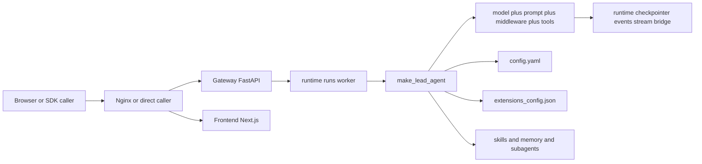
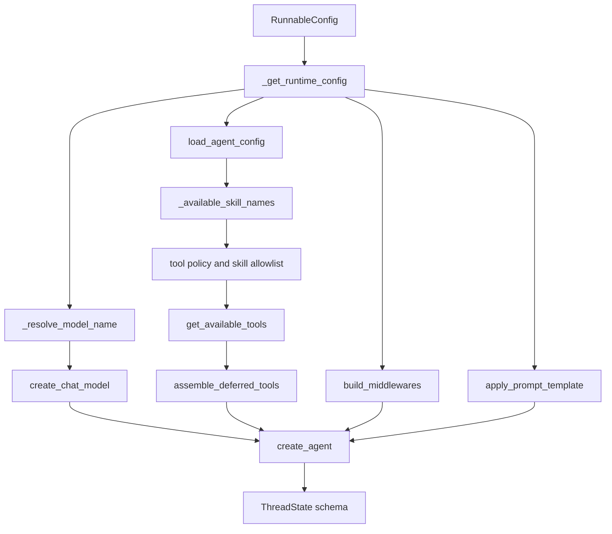
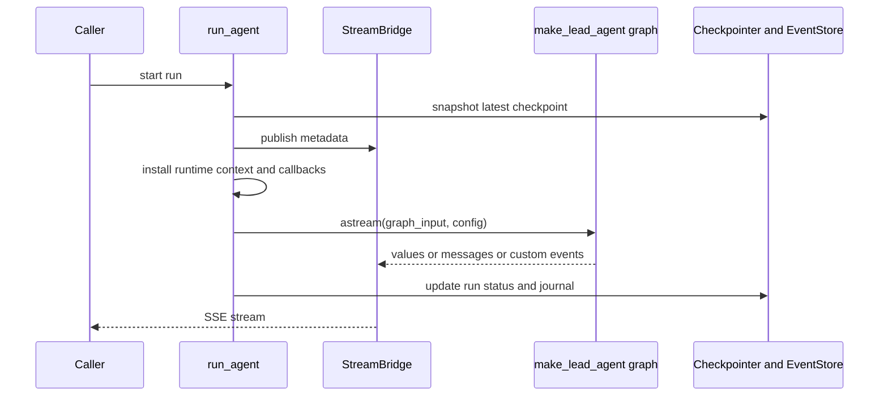

<title>Deer Flow Harness 学习路线与源码解析</title>

<callout emoji="💡">
这是一篇面向架构维护者的 Deer Flow Harness 学习文档。目标不是泛介绍，而是建立一张真正可用的维护者心智图：请求从哪里进入，配置怎样参与装配，Lead Agent 如何成形，中间件链如何接管行为，工具与子 Agent 怎样暴露能力，runtime 又怎样把 run、事件、流式输出和持久化串起来。
</callout>

| 这版文档的阅读目标 | 回答方式 |
|-|-|
| Harness 到底是什么 | 用目录边界、依赖边界、运行边界来回答，而不是只说“它是 SDK” |
| 系统是怎么跑起来的 | 从入口函数、配置解析、Lead Agent 组装、中间件链到 runtime 执行来回答 |
| 改功能该去哪层下手 | 用装配层、行为层、执行层、持久化层的分工来回答 |
| 排障时先查哪里 | 按用户入口、Graph 装配、工具暴露、stream bridge、checkpoint、event store 分层定位 |

---

# 第一章：先分清 Harness 与 App，这不是措辞问题，是边界问题

真正接手 Deer Flow 维护时，第一件事不是读代码，而是把 Harness 与 App 两层拆开。仓库里的中文文档 `frontend/src/content/zh/introduction/harness-vs-app.mdx` 说得很清楚：Harness 是运行时基础层，App 是建立在它之上的产品层。但维护者需要把这句话再往下压一层，压到“边界到底体现在哪里”。

## 1.1 目录边界

| 层 | 主目录 | 典型职责 |
|-|-|-|
| Harness | `backend/packages/harness/deerflow/` | Lead Agent、ThreadState、middlewares、tools、skills、subagents、runtime、config |
| App | `backend/app/`、`frontend/`、`docker/` | FastAPI Gateway、Web UI、部署与产品化交付 |

## 1.2 依赖边界

这一层不是概念约定，而是有测试约束的。`backend/tests/test_harness_boundary.py` 明确约束 Harness 不得 import `app.*`。这意味着维护 Harness 时，必须把它视作一个可被独立嵌入的运行时包，而不是“后端里的一些公共模块”。

<callout emoji="📌">
只要你的改动需要让 Harness 直接依赖 Gateway 或 Web 侧对象，就已经越过了边界。正确做法通常是把依赖压回配置、回调、运行时上下文，或者由 App 层向 Harness 注入。
</callout>

## 1.3 运行边界

App 关注的是“如何把能力交付给用户”，Harness 关注的是“如何把能力组装成可运行的 Agent 系统”。浏览器、FastAPI、Nginx 可以替换，但 Lead Agent、ThreadState、中间件链、工具暴露、子 Agent 执行和 runtime runs 这些东西才是 Harness 的核心。

<grid>
<column width-ratio="0.500000">
## App 层问题
- 为什么前端拿到了 SSE
- 为什么浏览器能删线程
- 为什么某个页面路由跳转错了
</column>
<column width-ratio="0.500000">
## Harness 层问题
- 为什么模型会看到某个技能
- 为什么子 Agent 被裁剪
- 为什么 run 没有把 token usage 记下来
</column>
</grid>

## 1.4 维护者这一章的结论

维护 Harness 时，先默认它是一个独立运行时包；维护 App 时，再把它当成被集成方。这个起手式会直接决定你后面读代码的顺序和改代码的层次感。

---

# 第二章：先看系统全景，理解 Harness 在整套系统里的位置

边界理清后，第二步是建立总图。最该先看的材料是 `backend/docs/ARCHITECTURE.md`。这份文档有一个非常重要的贡献：它把浏览器、Nginx、Gateway、Frontend、配置文件和 Harness 放进了一条共同的请求路径里。



## 2.1 两条入口路径

| 路径 | 入口 | 面向谁 | 最终落点 |
|-|-|-|-|
| Gateway 路径 | FastAPI runs API | 浏览器、IM、HTTP 客户端 | `runtime/runs/worker.py::run_agent` |
| 嵌入式路径 | `DeerFlowClient.stream/chat` | 脚本、Notebook、测试、Python 应用 | `client.py::_ensure_agent()` |

## 2.2 为什么总图重要

很多维护问题不是单文件能解释的。比如“前端看不到流式输出”，表面上是 UI 问题，实际上可能是 worker 没 publish metadata、bridge 没把事件交给 SSE consumer、或者 run 还没进入 running 状态。没有总图时，这类问题会被误判成模型慢、前端卡或者网络异常。

## 2.3 这一章必须抓住的文件

- `backend/docs/ARCHITECTURE.md`：系统分层总览
- `backend/packages/harness/deerflow/agents/lead_agent/agent.py`：Lead Agent 装配核心
- `backend/packages/harness/deerflow/runtime/runs/worker.py`：run 执行入口
- `backend/packages/harness/deerflow/client.py`：嵌入式 SDK 入口

<callout emoji="✅">
读完这一章，维护者至少要能画出一张口头图：外部请求不是直接打进某个 Agent 类，而是先进入 Gateway 或 Client，再进入 Lead Agent 工厂，再进入 runtime 执行与流式桥接。
</callout>

---

# 第三章：公开入口深拆，真正先抓这三个点

对维护者而言，第一轮源码阅读最应该抓的不是目录，而是入口。当前 Deer Flow Harness 最关键的三个入口是：`backend/packages/harness/deerflow/client.py::DeerFlowClient`、`backend/packages/harness/deerflow/agents/lead_agent/agent.py::make_lead_agent`、`backend/packages/harness/deerflow/runtime/runs/worker.py::run_agent`。

## 3.1 DeerFlowClient：嵌入式调用入口

`DeerFlowClient` 的意义不是“另一个 API 包装器”，而是把 Harness 作为 in-process 运行时直接嵌入 Python 世界。它的关键点在于：客户端本身不直接 hardcode 一个固定 Agent，而是在 `_ensure_agent()` 里按当前运行参数懒加载并缓存 Agent。

| 函数 | 作用 | 维护者要看什么 |
|-|-|-|
| `_get_runnable_config()` | 把 thread_id、model_name、thinking、plan_mode、subagent_enabled 放进 RunnableConfig | 嵌入式调用把哪些 runtime 参数透传给 Graph |
| `_ensure_agent()` | 按 config key 缓存或重建 Agent | 哪些变更会触发 Agent 重建 |
| `_get_tools()` | 延迟 import tools，避免循环依赖 | Client 与 tools 层的连接点在哪里 |

```python
1. 读取 configurable 中的 model_name / thinking / plan_mode / subagent_enabled
2. 调 get_available_tools()
3. 调 assemble_deferred_tools()
4. 调 build_middlewares()
5. 调 apply_prompt_template()
6. 视情况附加 checkpointer
7. 最终调用 create_agent()
```

换句话说，`DeerFlowClient` 不是把已有 Agent 拿来用，而是自己也走一遍 Harness 的装配流程。它只是跳过了 Gateway 那一层。

## 3.2 make_lead_agent：Graph 工厂入口

`make_lead_agent(config: RunnableConfig)` 是当前 Harness 的核心 graph factory。它表面上只是 LangGraph 兼容入口，但真正的工作发生在内部的 `_make_lead_agent(config, app_config)`。

```text
make_lead_agent
  -> 读取 runtime config
  -> 拿到 app_config
  -> 进入 _make_lead_agent
  -> resolve model
  -> load agent config
  -> load tool policy skills
  -> build tools
  -> build middlewares
  -> build system prompt
  -> create_agent
```

这也是为什么维护者几乎绕不过 `agent.py`：它不是一个普通模块，而是“把一堆独立子系统拼成可运行图”的地方。

## 3.3 run_agent：后台执行入口

`runtime/runs/worker.py::run_agent` 是 Gateway 路径的真正执行器。它负责在后台 task 中执行 Graph，并持续把事件推给 stream bridge。这个函数最重要的不是它用了什么库，而是它在 run 生命周期里维持了哪些不变式。

| 阶段 | 关键动作 | 意义 |
|-|-|-|
| 初始化 | 创建 RunJournal，设置 run 为 running | 为后续事件、token usage、状态迁移建立基础 |
| 预快照 | 读取 pre-run checkpoint snapshot | 为 rollback 或错误恢复保留状态锚点 |
| 发布 metadata | 把 run_id、thread_id 发给 bridge | 前端 useStream 等消费者需要这对标识 |
| 安装 runtime context | 构造 context，注入 `__pregel_runtime` 和 `__run_journal` | 让 middleware 和 tools 能拿到 thread 级信息 |
| 构造 agent | 通过 agent_factory 生成 Graph | 真正把 config 变成可运行 Agent |
| 流式执行 | 调用 `agent.astream()`，并把不同 mode 的 chunk 转成 SSE 事件 | 把图内部事件送到外部消费者 |

<callout emoji="💡">
如果 run 卡住、状态不对、SSE 不完整、usage 不对、rollback 失效，优先看 `run_agent()`，不要先去怪前端或模型。
</callout>

---

# 第四章：配置系统深拆，为什么说它不是参数表，而是行为装配面

如果只把 `config.yaml` 理解成“部署参数表”，会低估 Deer Flow Harness。对它更准确的理解是：配置系统决定了运行时的装配结果。真正的入口类是 `backend/packages/harness/deerflow/config/app_config.py::AppConfig`。

## 4.1 配置解析优先级

`AppConfig.resolve_config_path()` 把优先级写得很清楚：显式传入的 `config_path` 优先，然后是 `DEER_FLOW_CONFIG_PATH` 环境变量，再然后是项目根目录探测，最后才是 legacy monorepo fallback。这个顺序直接影响本地开发、测试、嵌入式调用与线上部署的一致性。

| 优先级 | 来源 | 典型场景 |
|-|-|-|
| 1 | 函数参数 `config_path` | 测试、嵌入式 SDK、显式加载 |
| 2 | 环境变量 `DEER_FLOW_CONFIG_PATH` | 容器、脚本、部署环境 |
| 3 | 项目根目录发现 | 本地开发默认行为 |
| 4 | legacy backend or repo root | 兼容旧 monorepo 结构 |

## 4.2 AppConfig 不是一个配置对象，而是一组子系统开关

`AppConfig` 本身聚合了模型、sandbox、tools、skills、memory、summarization、subagents、loop_detection、checkpointer、run_events、stream_bridge 等多个子系统的配置。维护者要意识到：改一个配置块，本质上是在改一条运行链路的装配条件。

| 配置块 | 会影响哪里 | 最直接的消费点 |
|-|-|-|
| `models` | 模型选择、thinking、vision | `_resolve_model_name()`、`create_chat_model()` |
| `tool_search` | 是否启用 deferred tool | `assemble_deferred_tools()`、`DeferredToolFilterMiddleware` |
| `summarization` | 是否插入总结中间件，何时触发 | `_create_summarization_middleware()` |
| `memory` | 记忆注入与后台学习 | `MemoryMiddleware` |
| `subagents` | timeout、max_turns、custom_agents | `subagents/registry.py` |
| `run_events`、`checkpointer`、`stream_bridge` | run 底盘 | `runtime/*` |

## 4.3 还有一层是 extensions_config.json

不是所有能力都来自 `config.yaml`。MCP server 配置和技能状态更多落在 `extensions_config.json`。这也是 `get_available_tools()` 读取 MCP cache 时要重新读扩展配置的原因：Gateway API 改过的服务器状态要能被嵌入式运行时感知到。

## 4.4 维护者这一章的结论

配置层的本质是“让运行时行为成为声明式结果”。所以遇到行为异常，第一反应应该是：先看这是不是配置分支导致的，而不是默认把问题归到逻辑实现。

---

# 第五章：Lead Agent 组装过程深拆，从 RunnableConfig 到 create_agent

如果只能选一个文件理解 Harness，我仍然建议选 `backend/packages/harness/deerflow/agents/lead_agent/agent.py`。这个文件最关键的不是某个小函数，而是它完整承接了“运行参数输入”到“可执行 Graph 输出”的装配过程。



## 5.1 运行参数怎样汇入

`_get_runtime_config()` 会把传统的 `configurable` 和 LangGraph runtime context 合并成一个 runtime dict。这里非常关键，因为后续是否启用 plan_mode、subagent_enabled、reasoning_effort，以及是否命中某个 model_name，都是从这里读取的。

## 5.2 模型解析不是简单取默认值

`_resolve_model_name()` 的逻辑是：请求级 model_name 优先，其次是 agent 自己的默认 model，最后才是全局默认模型。如果请求名称无效，会回退到默认值并记录 warning。这意味着用户看到“我传了模型名但最终没生效”的问题，很可能是 allowlist 或配置命中失败，而不是 create_chat_model 本身的问题。

## 5.3 Agent 配置、技能和工具是一起解的

当 `agent_name` 存在时，`load_agent_config(agent_name)` 会读出该 Agent 的工具组、技能白名单和默认模型。然后 `_available_skill_names()` 和 `_load_enabled_skills_for_tool_policy()` 再把“允许哪些技能”和“这些技能允许哪些工具”合并起来，最后才进入工具装配。

| 装配点 | 对应函数 | 意义 |
|-|-|-|
| Agent 配置 | `load_agent_config()` | 让自定义 Agent 成为一等运行参数 |
| 技能可见性 | `_available_skill_names()` | 确定哪些技能可进入当前会话 |
| 工具策略 | `filter_tools_by_skill_allowed_tools()` | 不是所有加载到系统里的工具都能被当前 Agent 用 |

## 5.4 build_middlewares 是骨架，不是附属品

真正把“记忆、总结、计划模式、视觉、安全、澄清”这些能力接起来的，是 `build_middlewares()`。Lead Agent 不是先有一个完备 Agent，再给它挂中间件；更准确地说，这条链本身定义了它运行时的行为骨架。

## 5.5 tracing 为什么挂在 graph invocation root

`agent.py` 顶部的 tracing 注释和 `build_tracing_callbacks()` 的用法很值得维护者细读。核心点是：tracing callback 不是绑定在每个模型调用点，而是挂在 Graph invocation root。这样做的目的是避免重复 span，并确保 session_id、user_id 等 metadata 能正确进入根 trace。任何新增 in-graph `create_chat_model()` site 都要遵守这个约束。

## 5.6 Bootstrap Agent 与默认 Lead Agent 的差异

`_make_lead_agent()` 还分 bootstrap 分支和默认分支。bootstrap 分支暴露的是更窄的技能与工具集，用于 Agent 初始化和配置流程；默认分支才会根据 `agent_name` 决定是否注入 `update_agent` 等能力。维护者若不注意这个分支，很容易在“为什么某工具明明有，却在某会话里看不到”的问题上绕远路。

<callout emoji="✅">
这一章最重要的结论是：Lead Agent 不是一个预制类实例，而是一次按配置、技能、工具策略和运行参数装配出来的结果。
</callout>

---

# 第六章：Middleware 链逐层解析，为什么顺序比单点逻辑更重要

如果说 `agent.py` 是装配中心，那么 `backend/packages/harness/deerflow/agents/middlewares/` 就是核心行为层。维护者最需要注意的是：中间件链不是“多个插件并列存在”，而是“多个行为按严格顺序串行介入”。顺序一旦改坏，即使每个中间件单测都过，系统行为仍然可能整体失真。

## 6.1 从 build_middlewares 读出真实顺序

| 顺序 | 中间件 | 为什么放这里 |
|-|-|-|
| 1 | `build_lead_runtime_middlewares()` 产出的运行时基础链 | 先准备线程数据、上传、工具错误处理等基础条件 |
| 2 | `DynamicContextMiddleware` | 把日期和动态上下文以 reminder 注入首条 HumanMessage |
| 3 | `SkillActivationMiddleware` | 让显式 skill 激活尽早生效 |
| 4 | `DeerFlowSummarizationMiddleware` | 尽量早做上下文压缩，减小后续链路负担 |
| 5 | `TodoMiddleware` | plan mode 需要在后续生成前介入 |
| 6 | `TokenUsageMiddleware` | 记录 LLM 使用情况 |
| 7 | `TitleMiddleware` | 在首轮交互后生成标题 |
| 8 | `MemoryMiddleware` | 标题之后再做记忆队列和注入更自然 |
| 9 | `ViewImageMiddleware` | 视觉信息要在真正生成前就进入上下文 |
| 10 | `DeferredToolFilterMiddleware` | tool_search 模式下先把未提升的 schema 隐掉 |
| 11 | `SystemMessageCoalescingMiddleware` | 保证严格 provider 只看到单个前置 SystemMessage |
| 12 | `SubagentLimitMiddleware` | 裁剪并发 task 调用 |
| 13 | `LoopDetectionMiddleware` 和 `TokenBudgetMiddleware` | 稳定性与成本控制 |
| 14 | custom middlewares | 扩展点，但放在 Clarification 前 |
| 15 | `SafetyFinishReasonMiddleware` | 先处理 provider safety finish_reason |
| 16 | `ClarificationMiddleware` | 固定收口，永远最后 |

## 6.2 为什么顺序真的会影响行为

举三个非常具体的例子。第一，如果总结压缩太晚做，后续中间件可能都在高 token 历史上运行。第二，如果澄清不在末尾，它就拦不到前面中间件已经变形过的状态。第三，如果 system message 不先 coalesce，一些 provider 会直接拒绝非首位 SystemMessage。

## 6.3 ThreadState 也是链的一部分

别只看中间件文件本身，`backend/packages/harness/deerflow/agents/thread_state.py` 也要一起看。这里定义了 `ThreadState`，并通过 reducer 保证多源更新时的合并语义，比如 sandbox 状态只能接受幂等写、artifacts 要按序去重、promoted tools 需要按 catalog hash 归并。这些 reducer 决定了中间件和工具更新状态时的“合法合并方式”。

```text
messages
sandbox
thread_data
title
artifacts
todos
viewed_images
promoted
```

## 6.4 维护者这一章的结论

中间件链是系统骨架。改顺序、删中间件、插自定义中间件之前，必须先回答：它依赖上游谁，影响下游谁，依赖的是状态、消息、工具结果，还是 provider 约束。

---

# 第七章：Tools、Skills、MCP、ACP、Subagents 不是一类东西，它们扩展的是不同维度

维护者很容易把“系统能力扩展”笼统理解成一层，但 Deer Flow 里至少有五种不同的扩展面：built-in tools、配置工具、MCP 工具、ACP Agent、Subagents，再加上技能系统。把它们混成一层，是后续文档和实现都容易发散的根源。

## 7.1 Tools：动作面

`backend/packages/harness/deerflow/tools/tools.py::get_available_tools()` 是工具装配核心。它会先解析 config 工具，再补 builtin tools，再根据 model 能力决定是否补 `view_image_tool`，再看 subagent_enabled 是否补 `task_tool`，再读 MCP cache，最后再决定是否补 ACP invoke tool。最后还会按 tool.name 去重，避免 schema 冲突。

| 工具来源 | 典型例子 | 决定因素 |
|-|-|-|
| Built-in | `present_file`、`clarification` | Harness 核心功能，默认存在 |
| Sandbox tools | `ls`、`read_file`、`bash` | config.yaml 与 sandbox 配置 |
| Vision tools | `view_image` | 当前模型是否 `supports_vision` |
| Subagent tools | `task` | 当前请求是否开启 `subagent_enabled` |
| MCP tools | 外部 server 暴露出的工具 | `extensions_config.json` 与 cache |
| ACP tools | `invoke_acp_agent` | `acp_agents` 配置 |

## 7.2 Skills：提示词与治理面

技能不等于工具。技能更像是带有策略、范围、说明和允许工具集的提示词增强包。SkillActivationMiddleware 决定何时显式激活技能，而 tool policy 决定哪些工具在当前技能上下文里真正允许暴露给模型。

## 7.3 MCP：外部工具目录面

`backend/packages/harness/deerflow/mcp/cache.py` 解释了 MCP 工具为何采用缓存与失效机制。它不是每次请求都重新连接 server，而是缓存已经加载的工具 schema，并通过扩展配置文件的 mtime 判断是否需要失效重载。维护者读这里时要特别注意：它解决的是“工具目录变化如何反映到嵌入式 runtime”这个问题。

## 7.4 Subagents：执行拓扑面

`backend/packages/harness/deerflow/subagents/registry.py` 明确了内置 subagent 与 custom_agents 的解析顺序：先 built-in，再 custom_agents，再叠加 per-agent overrides。这里和普通工具最大的不同在于：子 Agent 不是给模型一个原子动作，而是给模型一个新的执行体。

## 7.5 task_tool：父 Agent 如何启动另一个执行体

`backend/packages/harness/deerflow/tools/builtins/task_tool.py` 里，task 工具不仅负责转发 prompt，还负责 token usage 缓存、取消与清理、背景任务结果轮询，以及与父运行时 journal 的对接。也就是说，subagent 不是“另起一次简单调用”，而是有自己生命周期管理的子执行流。

<grid>
<column width-ratio="0.333333">
## Tools
扩展动作面，回答“模型能做什么动作”
</column>
<column width-ratio="0.333333">
## Skills
扩展提示词与治理面，回答“模型该如何理解与约束任务”
</column>
<column width-ratio="0.333333">
## Subagents
扩展执行拓扑，回答“是否需要把任务拆给另一个上下文去做”
</column>
</grid>

<callout emoji="💡">
维护者这一章最该记住的句子是：Tools 扩展动作，Skills 扩展策略，Subagents 扩展执行拓扑。它们不是同义词。
</callout>

---

# 第八章：Runtime、Streaming 与 Persistence 深拆，这才是很多线上问题真正掉落的地方

只理解 Lead Agent 还不够。只要系统真正跑起来，run 管理、事件存储、checkpointer、stream bridge、SSE、embedded stream 这些底盘问题迟早会浮出来。最值得先读的两份材料是 `backend/packages/harness/deerflow/runtime/runs/worker.py` 和 `backend/docs/STREAMING.md`。

## 8.1 为什么会同时存在两条流式路径

`STREAMING.md` 把这个问题讲得很透。Deer Flow 有两条并行流式路径：Gateway 路径服务 HTTP SSE 与浏览器消费者，DeerFlowClient 路径服务 in-process Python 调用方。它们不能简单合并，因为消费者模型不同：一个需要 Queue、RunManager、JSON 序列化和重连语义，另一个直接 yield 原生对象更合适。

| 维度 | Gateway 路径 | DeerFlowClient 路径 |
|-|-|-|
| 执行模型 | async `agent.astream()` | sync `agent.stream()` |
| 中介 | `StreamBridge` 与 SSE consumer | 直接 yield |
| 事件格式 | JSON 序列化后的 wire format | 原生 StreamEvent data |
| 典型消费者 | 前端 useStream、IM channel、HTTP client | Notebook、脚本、测试 |

## 8.2 run_agent 真正维护了哪些不变式

维护者要特别关注 `run_agent()` 里的几处安装动作：安装 runtime context、把 `__run_journal` 暴露给 middleware、把 `__pregel_runtime` 放进 configurable、为当前 run 注入 tracing metadata、在最终 agent metadata 中回写 resolved model_name。这些动作共同保证了“Graph 虽然是动态装配的，但 run 级上下文是完整可观测的”。



## 8.3 checkpointer、event_store、thread_store 不该混着理解

这几个概念经常被新人混淆。checkpointer 负责 Graph 状态持久化与恢复，event_store 负责运行事件与审计，thread_store 更多承载线程级管理语义。它们虽然都属于 persistence 范畴，但服务对象和恢复粒度不同。排障时必须先确认你丢的是状态、事件，还是线程元数据。

## 8.4 为什么有些问题表面是“模型错了”，本质却是 runtime 问题

例如：模型明明生成了文本，但前端没看到，通常先查 streaming。run 状态卡在 running 不结束，先看 worker 的 finally 路径。token usage 统计少了，先看 callbacks 和 journal。回滚没生效，先看 pre-run snapshot 是否成功抓取。所有这些问题都说明 runtime 不是附属层，而是用户体验的地基层。

<callout emoji="📌">
维护者一旦开始碰线上问题，runtime 往往比 prompt 更重要。因为 prompt 只影响“说什么”，而 runtime 决定“能不能稳定地跑完、记下来、流出来”。
</callout>

---

# 第九章：给维护者的学习路线，不是目录导览，而是三档可执行方案

到这里你已经有足够的结构视角了。剩下的问题不是“还有哪些文件”，而是“怎么学最划算”。下面给出三档路线：3 天速通、7 天系统掌握、改功能前必读。

## 9.1 3 天速通版

| 天数 | 目标 | 必读 | 读完要能回答 |
|-|-|-|-|
| Day 1 | 边界与全景 | `harness-vs-app.mdx`、`ARCHITECTURE.md` | Harness 和 App 真正的边界是什么 |
| Day 2 | 公开入口与组装 | `client.py`、`agent.py` | Lead Agent 是怎样按参数装配出来的 |
| Day 3 | 能力链与 runtime | `middlewares/*`、`tools/tools.py`、`runtime/runs/worker.py` | 一次 run 怎样把能力执行并流出来 |

## 9.2 7 天系统掌握版

- 第 1 天：边界与总图
- 第 2 天：`AppConfig` 与配置优先级
- 第 3 天：`agent.py` 全链路装配
- 第 4 天：中间件链与 `ThreadState`
- 第 5 天：工具体系、MCP、技能与 tool policy
- 第 6 天：subagents 与 task_tool
- 第 7 天：runtime、streaming、events、checkpoint

## 9.3 改功能前必读版

<grid>
<column width-ratio="0.500000">
## 如果你要改行为
- 先看 `agent.py`
- 再看相关 middleware 或 tools
- 最后看对应 config 是否已有开关
</column>
<column width-ratio="0.500000">
## 如果你要改流式或状态
- 先看 `runtime/runs/worker.py`
- 再看 `STREAMING.md`
- 再看 checkpointer 和 event store
</column>
</grid>

- [ ] 我能解释 `DeerFlowClient` 与 Gateway 路径的差异

- [ ] 我能解释 `build_middlewares()` 的顺序为什么不能随便改

- [ ] 我能区分 Tools、Skills、Subagents 三类扩展面的职责

- [ ] 我知道 run 出问题时先查 worker、bridge、journal、checkpoint 哪个点

---

# 第十章：维护者视角下的关键判断

最后这章单独放判断，不和主体混写。下面这些不是“批评”，而是我认为维护这套系统时最值得优先建立的判断。

| 判断 | 解释 |
|-|-|
| Harness 的核心不是某个 Agent 类，而是“装配过程” | 真正决定行为的是 config、tool policy、prompt、middlewares 和 runtime context 的共同结果 |
| Middleware 链就是行为骨架 | 记忆、标题、总结、视觉、安全、澄清这些能力不是并列插件，而是顺序敏感的链 |
| Runtime 层的重要性和 prompt 层同级，甚至在线上更高 | 用户看到的大量故障最后都落在 run、bridge、events、checkpoint、serialization 上 |
| Tools、Skills、Subagents 的边界要强行保持清楚 | 否则后续能力扩展会逐渐变成“所有东西都往 prompt 或 tool 里塞” |
| 配置不是部署细节，而是可声明的运行时治理面 | 很多看似代码层的问题，实际上是配置分支、模型门控或扩展状态导致的 |

<callout emoji="📝">
一句话收尾：Deer Flow Harness 真正值得维护者建立的，不是“目录记忆”，而是一张因果图。配置怎样进入装配，装配怎样形成 Lead Agent，Lead Agent 怎样借 middleware 和 tools 工作，runtime 又怎样把这些动作持久化并流给外部。只要这张因果图稳定了，后续改功能、做重构、查问题才不会迷路。
</callout>

```text
边界问题先看 Harness vs App
装配问题先看 agent.py
行为问题先看 middleware 和 tools
拓扑问题先看 subagents 和 task_tool
流式和状态问题先看 runtime
```