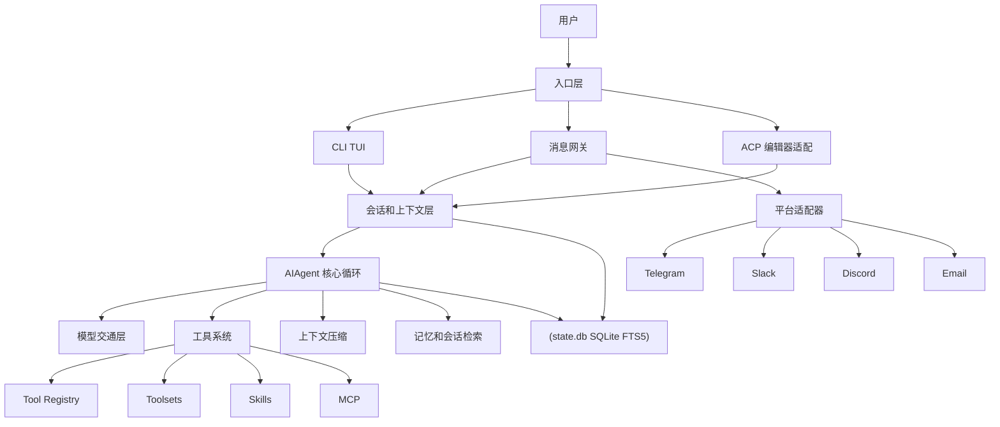
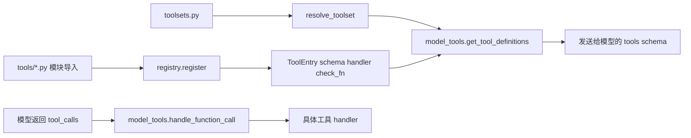
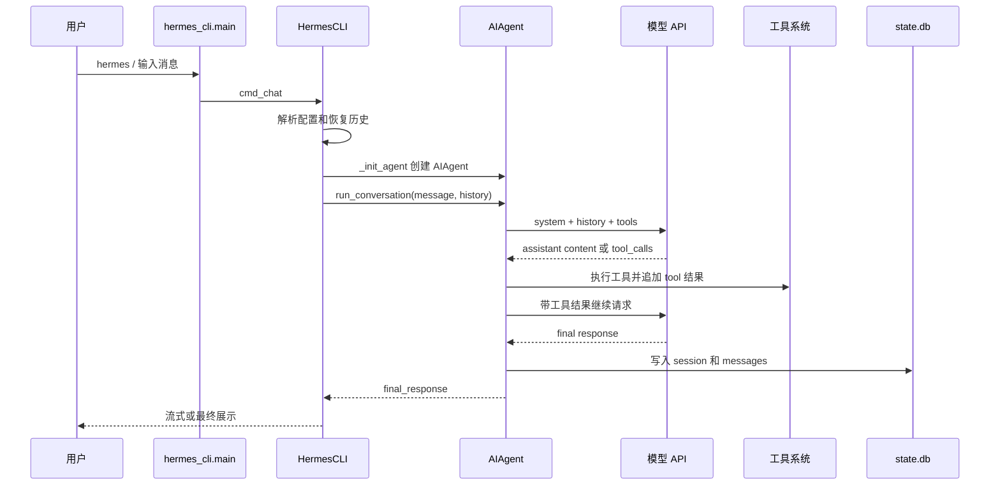
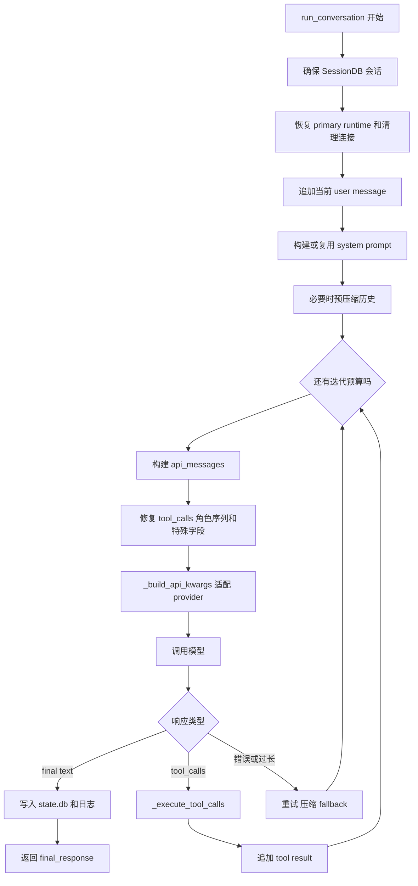
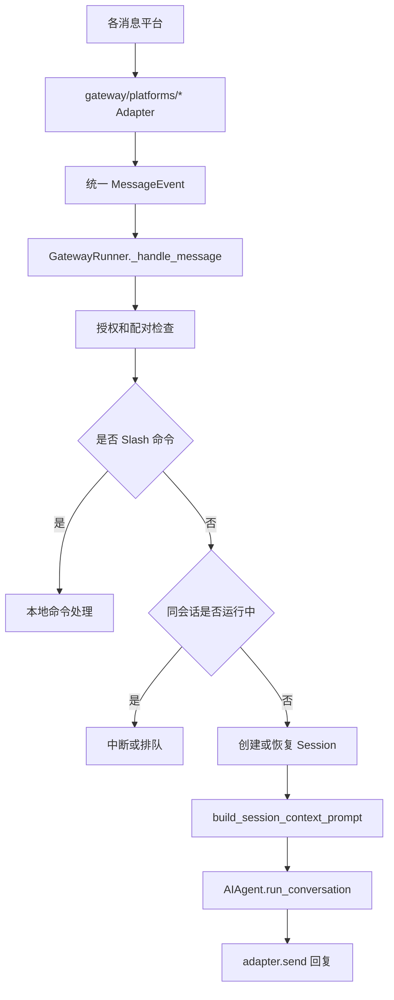
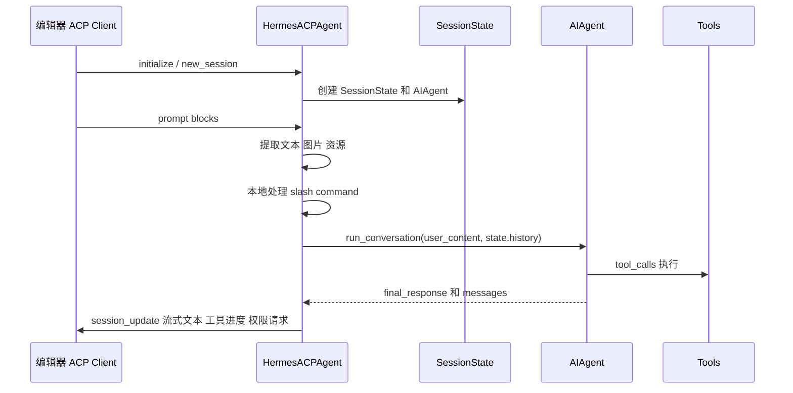
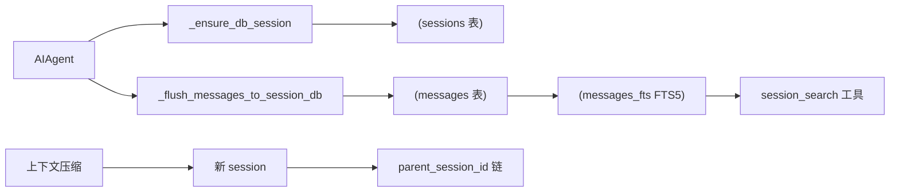
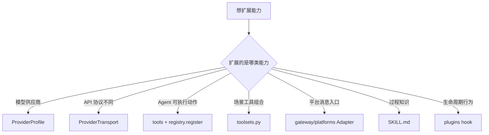

<title>Hermes Agent 社区版源码架构与核心链路学习笔记</title>

# Hermes Agent 社区版源码架构与核心链路学习笔记

> **阅读结论：** Hermes Agent 是一个以 `AIAgent` 为中心的 Python Agent 运行时。CLI、消息网关和 ACP 编辑器适配器只是不同入口层，最终都汇入同一条“构建上下文 → 调用模型 → 执行工具 → 追加结果 → 持久化会话”的工具调用闭环。

> **适合学习顺序：** 先看入口和目录，再看 `run_agent.py` 的 `AIAgent`，随后看 `model_tools.py`、`tools/registry.py`、`toolsets.py`，最后看 Gateway、ACP、记忆、压缩和插件扩展。

## 一、项目定位

仓库名为 `hermes-agent`，版本为 `0.13.0`，项目描述是 “self-improving AI agent”。从源码看，它不是单一聊天机器人，而是一个完整 Agent 平台，覆盖终端 CLI、消息平台、多模型适配、工具系统、技能系统、记忆、会话检索、定时任务、Gateway、ACP 编辑器集成和研究训练环境。

| 维度 | 说明 | 代表文件 |
|-|-|-|
| 运行入口 | `hermes`、`hermes-agent`、`hermes-acp` 三类脚本 | `pyproject.toml`、`hermes_cli/main.py`、`run_agent.py`、`acp_adapter/entry.py` |
| 核心循环 | 模型调用、工具调用、压缩、记忆、重试、流式输出、持久化 | `run_agent.py` |
| 交互界面 | 终端 TUI、消息平台 Gateway、ACP 编辑器协议 | `cli.py`、`gateway/run.py`、`acp_adapter/server.py` |
| 工具能力 | 终端、文件、浏览器、检索、技能、记忆、委派、MCP、语音、图片等 | `tools/`、`model_tools.py`、`toolsets.py` |
| 扩展体系 | Skills、Plugins、Provider profiles、Transports、Messaging adapters | `skills/`、`plugins/`、`providers/`、`agent/transports/`、`gateway/platforms/` |

---

## 二、总体架构

整体可以理解为五层：入口层接收用户输入；会话层管理历史、权限、平台上下文；Agent 核心层统一模型和工具闭环；能力层提供工具、技能、记忆、压缩、插件；基础设施层提供配置、状态库、日志、调度、环境后端。

| 层级 | 职责 | 重点源码 |
|-|-|-|
| 入口层 | 命令行参数解析、TUI 渲染、Gateway 平台消息、ACP 协议事件 | `hermes_cli/main.py`、`cli.py`、`gateway/run.py`、`acp_adapter/server.py` |
| 会话层 | 会话 ID、历史恢复、平台上下文、权限、队列、中断 | `hermes_state.py`、`gateway/session.py`、`gateway/session_context.py` |
| Agent 核心 | 系统提示词、模型请求、工具循环、流式事件、错误恢复、压缩 | `run_agent.py` |
| 能力层 | 工具注册与执行、Skills、记忆、MCP、浏览器、文件、终端、委派 | `model_tools.py`、`tools/`、`agent/` |
| 扩展层 | Provider Profile、Transport、Plugin、Gateway Platform Adapter | `providers/`、`agent/transports/`、`plugins/`、`gateway/platforms/` |

---

## 三、目录与功能模块

### 3.1 顶层目录速览

| 目录 | 职责 | 学习重点 |
|-|-|-|
| `agent/` | Agent 内部能力模块，如提示词、压缩、记忆、模型元数据、错误分类、传输层 | 理解 `AIAgent` 如何把能力拆到子模块 |
| `tools/` | 工具实现和注册，包括终端、文件、浏览器、记忆、技能、MCP、委派等 | 理解工具 schema、handler、availability check |
| `hermes_cli/` | 安装、配置、模型选择、命令分发、Gateway 命令、日志、医生诊断 | 理解 `hermes` 命令体系 |
| `gateway/` | 多平台消息网关，统一 Telegram、Slack、Discord、Email 等消息输入输出 | 理解远程对话与长驻进程 |
| `acp_adapter/` | Agent Client Protocol 适配层，给编辑器或外部客户端复用 Hermes Agent | 理解编辑器协议如何接入 Agent |
| `cron/` | 内置定时任务调度 | 理解自然语言自动化任务如何定时触发 |
| `plugins/` | 插件目录，扩展记忆、会议、Spotify、Teams pipeline 等能力 | 理解 hook 和工具扩展 |
| `skills/` | 内置技能文档，作为过程记忆和操作手册被 Agent 加载 | 理解自进化能力的载体 |
| `environments/` | 研究和评测环境中的可复用 Agent loop | 理解 RL 或批量轨迹生成链路 |
| `tests/` | 覆盖 Agent、CLI、Gateway、工具、ACP、cron 等模块 | 反向学习模块边界 |

### 3.2 三个安装脚本入口

| 命令 | 入口 | 用途 |
|-|-|-|
| `hermes` | `hermes_cli.main:main` | 用户日常入口，包含 chat、model、gateway、setup、doctor、update 等子命令 |
| `hermes-agent` | `run_agent:main` | 直接运行 Agent loop，偏底层或脚本化用途 |
| `hermes-acp` | `acp_adapter.entry:main` | 通过 ACP 协议暴露给编辑器或兼容客户端 |

---

## 四、核心对象与职责边界

### 4.1 AIAgent：系统中枢

`run_agent.py` 中的 `AIAgent` 是源码里最核心的类。它持有模型配置、工具集合、会话 ID、回调、压缩器、记忆管理器、checkpoint、fallback、credential pool 和平台上下文。

| 阶段 | 关键职责 |
|-|-|
| 初始化阶段 | 解析 provider、base_url、api_mode；加载工具定义和有效工具名；初始化上下文压缩器、记忆、会话库、回调；选择 transport |
| 运行阶段 | 构建系统提示词和平台提示；注入记忆、Skills、上下文文件和时间信息；循环调用模型并执行工具；处理压缩、重试、中断、fallback 和持久化 |

### 4.2 Tool Registry 与 Toolsets

工具系统分两层：`tools/registry.py` 是所有工具的注册中心；`toolsets.py` 定义用户或平台可启用的一组工具。`model_tools.py` 在每轮模型调用前根据 toolset、配置和 check_fn 生成 OpenAI function calling 格式的工具 schema。

| 组件 | 职责 | 典型逻辑 |
|-|-|-|
| `ToolRegistry` | 保存工具名、schema、handler、toolset、检查函数 | 导入工具模块时自动注册，支持 MCP 动态刷新 |
| `get_tool_definitions` | 生成模型可见的工具列表 | 按 enabled/disabled toolsets 过滤，执行 availability check，动态改写 schema |
| `handle_function_call` | 把模型 tool_call 分发给真实工具 | 校验参数、执行 handler、返回字符串结果 |
| `AIAgent._invoke_tool` | 处理 Agent 内置特殊工具和通用工具 | todo、memory、session_search、clarify、delegate_task 先特殊处理，其余交给 registry |

### 4.3 Transport 与 Provider Profile

模型适配分为两类：Transport 负责不同 API 协议的数据转换；Provider Profile 负责不同 provider 的声明式元数据和请求差异。

| 抽象 | 代表文件 | 职责 |
|-|-|-|
| `ProviderTransport` | `agent/transports/base.py` | 定义 `convert_messages`、`convert_tools`、`build_kwargs`、`normalize_response` |
| `NormalizedResponse` | `agent/transports/types.py` | 统一 provider 响应，抽象 content、tool_calls、finish_reason、reasoning、usage |
| `ProviderProfile` | `providers/base.py` | 声明 provider 名称、认证、base_url、模型目录、请求额外字段和消息预处理 |

---

## 五、核心链路一：CLI 对话

CLI 是用户最常用的入口。`hermes` 由 `hermes_cli/main.py` 分发到 chat 命令，随后进入 `cli.py` 的 `HermesCLI`。真正的 Agent 只在第一次聊天或模型路由变化时创建。

| 阶段 | 关键方法 | 说明 |
|-|-|-|
| 命令分发 | `hermes_cli.main.cmd_chat` | 处理 CLI 子命令并启动聊天界面 |
| 初始化 Agent | `HermesCLI._init_agent` | 加载配置、凭证、SessionDB、回调，并实例化 `AIAgent` |
| 单轮对话 | `HermesCLI.chat` | 处理图片、@上下文引用、语音、TTS、中断、流式输出 |
| 核心循环 | `AIAgent.run_conversation` | 模型请求和工具调用闭环 |

---

## 六、核心链路二：AIAgent 工具调用闭环

`AIAgent.run_conversation` 是最值得重点阅读的链路。它先准备系统提示词、历史、压缩和插件上下文，然后进入最多 `max_iterations` 次的循环。每次循环调用模型，若模型返回 tool_calls，则执行工具并把结果作为 tool 消息追加回历史；若返回最终文本，则结束。

### 6.1 系统提示词分层

| 顺序 | 内容 | 来源 |
|-|-|-|
| 1 | Agent 身份或 SOUL.md | `agent/prompt_builder.py`、`~/.hermes/SOUL.md` |
| 2 | Hermes 使用提示、记忆、Skills、Session Search、Kanban 等指南 | 根据有效工具名动态注入 |
| 3 | 内置记忆和用户画像 | `tools/memory_tool.py`、`agent/memory_manager.py` |
| 4 | Skills 索引和项目上下文文件 | `skills/`、`AGENTS.md`、`.hermes.md`、`.cursorrules` |
| 5 | 时间、模型、provider、平台提示 | `hermes_time.py`、`PLATFORM_HINTS` |

### 6.2 工具执行策略

| 策略 | 使用场景 | 说明 |
|-|-|-|
| 串行执行 | 工具存在写操作、路径重叠或依赖关系 | 避免文件冲突和状态竞争 |
| 并发执行 | 工具调用相互独立，尤其是只读类工具或不重叠路径的文件操作 | 走线程池并发执行，并按原 tool_call 顺序回填结果 |

> **关键保护：** 工具执行前会经过插件 pre-tool hook、ToolGuardrail、checkpoint、审批回调和中断检查。文件写入、patch、破坏性 terminal 命令会尝试创建 checkpoint，便于回滚。

---

## 七、核心链路三：Gateway 消息平台

Gateway 让 Hermes 作为长驻机器人运行在 Telegram、Discord、Slack、Email 等平台。它把所有平台消息转换成统一的 `MessageEvent`，再复用 `AIAgent`。

| 模块 | 职责 |
|-|-|
| `gateway/run.py` | Gateway 主循环、平台连接、消息分发、Session 管理、中断、命令处理、Agent 调用 |
| `gateway/platforms/` | 不同平台适配器，负责收发消息、媒体、线程元数据 |
| `gateway/session.py` | 平台会话和 transcript 管理 |
| `gateway/session_context.py` | 将平台、用户、聊天、线程信息注入工具可读上下文 |
| `gateway/hooks.py` | Gateway 生命周期 hook |

### 7.1 Gateway 与 CLI 的差异

| 维度 | CLI | Gateway |
|-|-|-|
| 生命周期 | 通常是前台交互进程 | 长驻守护进程，多平台连接 |
| 会话 key | 本地 session_id | 按 platform、chat、thread、user 组合生成 session_key |
| 中断 | 用户输入或 Ctrl+C | 同会话新消息、/stop、队列策略 |
| 审批 | 终端交互 | 通过消息平台 /approve、/deny 或 slash confirm |
| 媒体 | 本地路径或粘贴 | 平台附件下载、语音转写、图片路由 |

---

## 八、核心链路四：ACP 编辑器适配

`acp_adapter` 将 Hermes 封装成 Agent Client Protocol 服务。编辑器发来的 prompt、资源和图片会被转换成 OpenAI 风格内容，再交给同一个 `AIAgent.run_conversation`。

| 关键点 | 说明 |
|-|-|
| 资源转换 | 文本、图片、音频、文件资源会转为模型可消费的内容块 |
| 权限请求 | ACP 的 `request_permission` 被绑定为工具审批回调 |
| 并发保护 | 同一 ACP session 正在运行时，新 prompt 会排队，避免多个 Agent loop 修改同一历史 |
| 事件回传 | 工具进度、reasoning、step、stream delta 都通过 ACP session update 发回客户端 |

---

## 九、会话、记忆与上下文压缩

### 9.1 会话持久化

`hermes_state.py` 提供 SQLite 状态库，默认路径是 `~/.hermes/state.db`。它使用 WAL 模式和 FTS5，存储 sessions、messages、token、成本、系统提示词、parent_session_id 等信息。

### 9.2 记忆系统

记忆由内置 memory store 和可选外部 memory provider 组成。`MemoryManager` 是外部 provider 的编排层，负责系统提示词、turn start、prefetch、sync、工具桥接，并用 `memory-context` fence 防止记忆内容被误当作用户新输入。

| 阶段 | 动作 |
|-|-|
| 系统提示词构建 | 注入持久记忆和用户画像 |
| 回合开始 | 外部 provider 根据当前用户消息预取相关上下文 |
| API 调用前 | 把预取结果以 fenced block 追加到当前 user message 的 API 副本 |
| 工具写入 | memory 工具写内置记忆，同时通知外部 provider |
| 回合结束 | 同步用户消息和助手回复给 provider |

### 9.3 上下文压缩

`agent/context_compressor.py` 在上下文过大时对中间历史做摘要，保护开头和尾部消息，保留已解决问题、未完成事项、工具调用要点和当前任务。压缩结果会以“参考而非指令”的前缀插入，避免旧任务被模型重新执行。

> **设计亮点：** 系统提示词尽量缓存不变；插件和外部记忆上下文默认注入到当前 user message 的 API 副本，而不是改 system prompt，这样可以提升 Anthropic 或本地推理的 prefix cache 命中率。

---

## 十、扩展点

| 扩展类型 | 如何扩展 | 适用场景 |
|-|-|-|
| 新增工具 | 在 `tools/*.py` 中实现 handler 和 schema，调用 `registry.register` | 给模型新增可调用动作 |
| 新增工具集 | 在 `toolsets.py` 中定义 toolset 或组合已有 toolset | 面向场景启用一组能力 |
| 新增模型 provider | 新增 ProviderProfile 或补充 model catalog | 接入 OpenAI-compatible 或特殊 provider |
| 新增 API 协议 | 实现 `ProviderTransport` | 接入非 OpenAI Chat Completions 协议 |
| 新增消息平台 | 在 `gateway/platforms/` 实现 `BasePlatformAdapter` | 接入新的聊天平台 |
| 新增技能 | 在 `skills/` 或用户技能目录写 `SKILL.md` | 沉淀工作流和领域知识 |
| 新增插件 | 通过 `plugins/` 注册 hook 或工具 | 在不改核心循环的情况下扩展行为 |

---

## 十一、建议阅读路线

1. **先读 README 和 pyproject：** 确认项目定位、依赖、入口脚本。
2. **再读 `run_agent.py`：** 重点看 `AIAgent.__init__`、`_build_system_prompt`、`_build_api_kwargs`、`_execute_tool_calls`、`run_conversation`。
3. **再读工具系统：** `tools/registry.py`、`model_tools.py`、`toolsets.py`，理解 schema 生成和 handler 分发。
4. **再读入口适配：** `cli.py`、`gateway/run.py`、`acp_adapter/server.py`，理解不同入口如何复用 `AIAgent`。
5. **最后读增强能力：** `agent/context_compressor.py`、`agent/memory_manager.py`、`agent/transports/`、`providers/`、`plugins/`。

## 十二、核心文件索引

| 文件 | 为什么重要 |
|-|-|
| `run_agent.py` | 核心 Agent loop，绝大多数能力最终汇入这里 |
| `cli.py` | 交互式 CLI 和 TUI，大量 slash command、流式输出和本地审批逻辑 |
| `hermes_cli/main.py` | `hermes` 顶层命令分发入口 |
| `gateway/run.py` | 消息平台长驻 Runner，处理授权、会话、命令、中断和 Agent 调用 |
| `acp_adapter/server.py` | ACP 协议入口，面向编辑器和外部客户端 |
| `model_tools.py` | 工具 schema 生成和调用分发 |
| `tools/registry.py` | 工具注册中心 |
| `toolsets.py` | 工具集定义和组合 |
| `agent/prompt_builder.py` | 系统提示词、Skills、上下文文件和平台提示构建 |
| `agent/context_compressor.py` | 上下文窗口压缩 |
| `agent/memory_manager.py` | 外部记忆 provider 编排 |
| `hermes_state.py` | SQLite 会话库和 FTS5 检索 |

---

> **一句话总结：** Hermes Agent 的架构核心是“入口适配层薄、AIAgent 核心厚、能力通过注册表和配置外插”。理解 `AIAgent.run_conversation` 和工具注册分发后，CLI、Gateway、ACP、Skills、记忆、压缩、插件都可以看作这条主链路周围的增强模块。