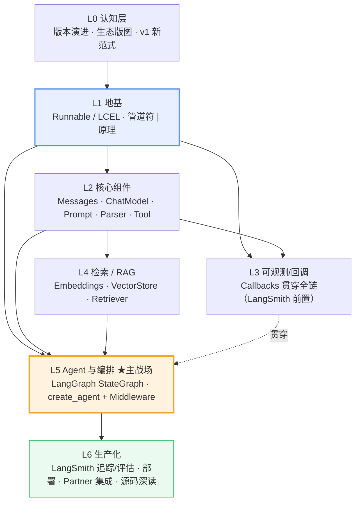
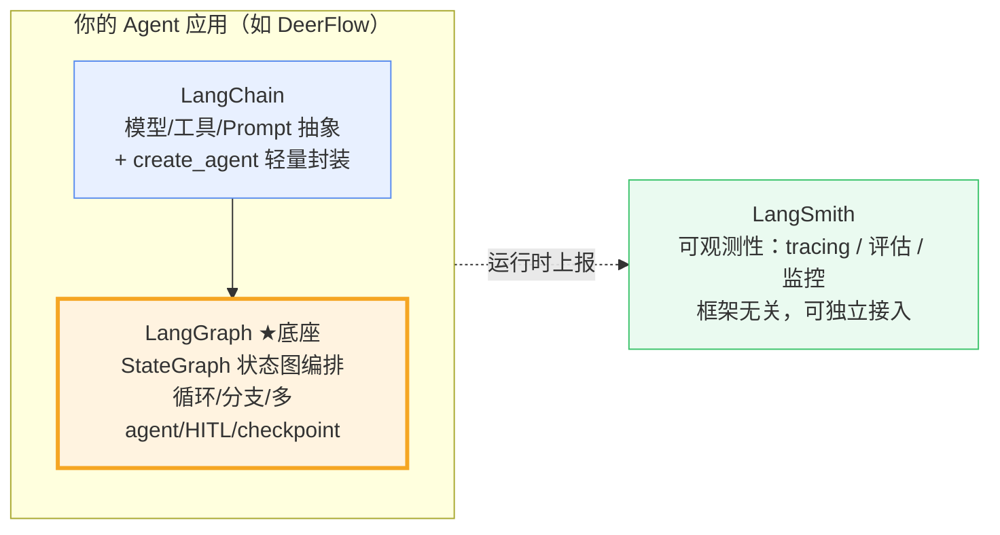
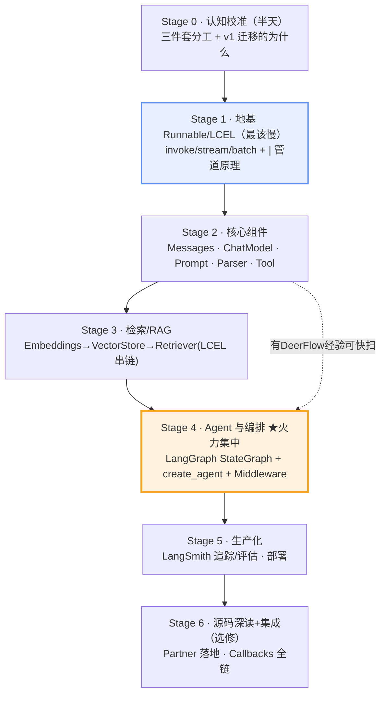
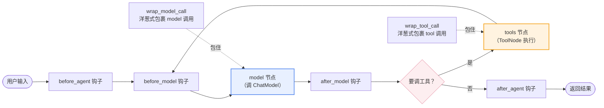
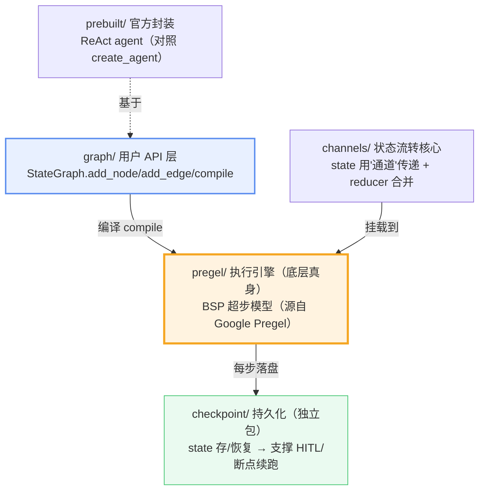
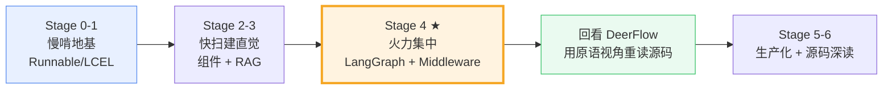

<title>LangChain 系统性学习总纲（v1 新范式）</title>

<callout>
**三条核心结论，先记住再往下看：**
1. **主攻 Python**：官方有 Python / TS 两套，概念同源，Python 生态最全、资料最多，TS 忽略。
2. **LangGraph 是主干，不是补充**：v1 里 agent 的底层就是 LangGraph，必须与 core 同等重要地学。
3. **社区 80% 教程已过时**：见到 LLMChain / AgentExecutor 为核心的教程，只看原理、别抄代码。
</callout>

---

# 一、先校准三个认知（否则必踩坑）

## 1.1 Python vs TS：选 Python

<table><colgroup><col/><col/><col/></colgroup><thead><tr><th vertical-align="top">维度</th><th vertical-align="top">Python</th><th vertical-align="top">JS / TS</th></tr></thead><tbody><tr><td vertical-align="top">概念模型</td><td colspan="2" vertical-align="top">完全同源：Runnable / LCEL / LangGraph 一致，仅 API 命名与包结构不同</td></tr><tr><td vertical-align="top">生态与资料</td><td vertical-align="top">最全 ↑，社区教程多</td><td vertical-align="top">偏少</td></tr><tr><td vertical-align="top">你的现状</td><td vertical-align="top"><b>DeerFlow 用的就是 Python</b></td><td vertical-align="top">—</td></tr></tbody></table>

## 1.2 版本已换血：老 API 对照表

<callout emoji="💡">
系统学习最大陷阱：下列老 API 为核心示例的教程一律只看原理、不抄代码。
</callout>

| 老版本（v0.1/0.2，已废弃） | 现役 v1 范式 |
|-|-|
| LLMChain / SequentialChain / RetrievalQA | LCEL 管道 `prompt \| model \| parser` |
| initialize_agent / AgentExecutor | create_agent + middleware（底层 LangGraph） |
| ConversationBufferMemory | LangGraph state + checkpointer |

## 1.3 LangChain 之外还要单独补 LangGraph 吗？→ 必须，且是重点

<callout emoji="✅">
**一句话：**v1 里 LangGraph 不是可选配件，而是 agent 的地基本身。`create_agent` 底层直接用 LangGraph 的 `StateGraph` 编排 model↔tools 循环；你用的 **DeerFlow 本身就是直接基于 LangGraph** 写的图。不存在"学完 LangChain 再补 LangGraph"，正确姿势是把它当主干。
</callout>

| 层级 | 该学到什么程度 |
|-|-|
| LangChain core（Runnable/LCEL/组件） | 打地基，必学 —— 是 LangGraph 节点里被调用的东西 |
| **LangGraph（StateGraph/state/checkpoint）** | 核心重点 ↑ 必学 —— agent 编排引擎，直通 DeerFlow |
| create_agent + middleware | 学，但它只是 LangGraph 的上层封装糖 |

## 1.4 架构迭代史：v1 是什么？只看最新版即可

<callout emoji="💡">
**说明：**v1 = **LangChain 1.0**，2025 年 10 月正式发布，本仓库 `libs/langchain_v1` 即其源码。主线演进可概括为：**一堆 Chain 子类 → LCEL 组合 → LangGraph 编排**，越来越薄。
</callout>

| 版本 | 时间 | 大事 | 对你 |
|-|-|-|-|
| v0.0.x | 2022.10 | 诞生，`Chain`/`LLMChain` 抽象 | 远古，跳过 |
| v0.1 | 2024.01 | 首个稳定版，开始拆包 | 跳过 |
| v0.2 | 2024.05 | `langchain-core` 独立成基石层 | 跳过 |
| **v0.3** | 2024.09 | 迁移 Pydantic 2；**LCEL 成主流** | 讲 LCEL 原理的文章从这里起可信 |
| **v1.0** | **2025.10** | `create_agent`+middleware；**LangGraph 成 agent 底座**；旧 API 挪进 `langchain-classic` | 你的目标版本 ↑ |

<callout emoji="❗">
**注意：唯一的坑——"只看最新版"要拆两层看：**
• **上层 API 用法**（Chain/Agent/Memory 怎么写）→ 严格只看 v1，老的全废。
• **底层原理**（Runnable/LCEL 怎么运作）→ v0.3 起的文章都可信，原理没变。
判断口诀：见 `create_agent`/middleware/LangGraph = 新；见 `AgentExecutor`/`LLMChain`/`initialize_agent` = 旧。
</callout>

---

# 二、能力全景图（Learning Map）

---

# 三、生态三件套分工

| 组件 | 定位 | 该学多深 |
|-|-|-|
| **LangChain** | 模型/工具/Prompt 抽象 + `create_agent` 轻量 harness，快速起步 | 打地基，必学 |
| **LangGraph** | 底层状态图编排，处理循环/分支/多 agent/human-in-the-loop，生产级 agent 核心；DeerFlow 即基于此 | 重点 ↑ 学透 |
| **LangSmith** | 可观测性（tracing/eval/监控），框架无关；注：LangGraph Platform 2025-10 已更名 "LangSmith Deployment" | Stage 5 接入 |

---

# 四、分阶段路线（Learning Stage）

| 阶段 | 目标 | 仓库精读 / 资源 | 里程碑（自检） |
|-|-|-|-|
| **0** | 三件套分工，读懂 v1 迁移动机 | 官方 overview → v1 迁移指南 → langchain-doc.cn | 能一句话说清"为何 agent 不再用 AgentExecutor" |
| **1** | 吃透统一执行协议 + `\|` 组合成 RunnableSequence | `runnables/base.py`（\_\_or\_\_/Sequence/Parallel/Lambda）+ 官方 LCEL concepts + 杨艺韬《设计与实现》 | 不看文档手写 `prompt \| model \| parser` 并流式输出 |
| **2** | 消息体系/ChatModel 契约/Prompt/Parser/Tool | `messages/` → `chat_models.py` → `prompts/chat.py` → `tools/base.py` | 用 `@tool` 定义工具完成一次 tool calling |
| **3** | 检索链（Retriever 本身即 Runnable） | `embeddings/` → `vectorstores/in_memory.py` → `retrievers.py` + 怕浪猫 RAG 实战 | 用 LCEL 搭一个可流式回答的最小 RAG |
| **4** | 先懂 StateGraph，再懂 create_agent 如何编译 middleware 成图 | `middleware/types.py`（6 钩子）→ `agents/factory.py` + LangChain Academy: Intro to LangGraph + DL.AI: AI Agents in LangGraph | 对照 DeerFlow 的图，指出它用了哪些 LangGraph 原语 |
| **5** | LangSmith 追踪/评估、部署形态 | LangChain Academy: Intro to LangSmith + LangSmith 官网 | 给一个 agent 接上 tracing，看懂完整调用链 |
| **6** | Partner 如何落地抽象 + 回调全链 | `partners/openai/chat_models/base.py` + `callbacks/manager.py` + sihanli 源码剖析 | 能讲清 ChatOpenAI←BaseChatModel 的继承契约 |

---

# 五、Agent 内部机制（你的主战场）

<callout emoji="💡">
**核心洞察：**`create_agent` 不再自研 agent 循环，而是把 middleware 编译成 **LangGraph 状态图**的节点/边。middleware 是"洋葱模型"——请求由外向内穿过各层钩子，响应再反向穿出。
</callout>

**Middleware 六大钩子**（源码 `middleware/types.py` 的 `AgentMiddleware`）：`before_agent` / `before_model` / `after_model` / `after_agent` 是状态钩子；`wrap_model_call` / `wrap_tool_call` 是洋葱式包裹钩子。内置 middleware 举例：

| 内置 Middleware | 作用 |
|-|-|
| Summarization | 上下文过长时自动摘要压缩历史 |
| HumanInTheLoop | 关键动作前插入人工审批（DeerFlow 常用） |
| ModelCallLimit / ToolCallLimit | 限制模型/工具调用次数，防失控循环 |
| ModelFallback / ModelRetry | 模型失败时降级或重试 |
| PIIDetection | 敏感信息检测与脱敏 |
| TodoList / ContextEditing | 任务清单管理 / 上下文编辑 |

## 5.1 LangGraph repo 模块地图（Stage 4 精读索引）

<callout emoji="💡">
**说明：**LangGraph 是独立 repo（本地 `../langgraph/`，v1.2.9），是 agent 的**编排引擎主干**。心智：langchain 提供"积木"（Runnable/Tool），langgraph 提供"用积木搭电路的引擎"。**精读从上层 API 逐层下沉到执行引擎**，勿一上来直接啃 pregel。
</callout>

| 模块 | 你会学到 | 关键文件（../langgraph/libs/langgraph/langgraph/） |
|-|-|-|
| **graph/** 用户 API | StateGraph 怎么 add_node/edge/compile | `graph/state.py` · `graph/_node.py` · `graph/_branch.py` |
| **channels/** state 核心 | 为何 state 用"通道"而非普通变量、reducer 怎么合并 | `channels/base.py` · `last_value.py` · `binop.py` |
| **pregel/** 执行引擎 | 图怎么一步步跑（BSP 超步模型） | `pregel/main.py` · `_loop.py` · `_algo.py` |
| **checkpoint/** 持久化 | state 怎么存/恢复，支撑 HITL、断点续跑 | `libs/checkpoint/`（独立包） |
| **prebuilt/** 封装 | 官方 ReAct agent，对照 langchain 的 create_agent | `libs/prebuilt/` |

<callout emoji="💡">
**关键认知（多数人不知道）：**LangGraph 底层不是普通图遍历，而是 **Pregel 模型**（Google 图计算论文）——节点分"超步(superstep)"批量执行，state 通过 channel 传递。这正是它天然支持**并行 / 循环 / 断点恢复**的原因。Stage 4 精读路径：`StateGraph`（好懂的 API）→ `channels`（状态如何流）→ `pregel/_loop.py`（引擎真身）。
</callout>

---

# 六、全网优质资源清单

<callout emoji="💡">
甄别口诀：以 LLMChain / SequentialChain / initialize_agent / AgentExecutor / RetrievalQA 为核心示例的资源 = 老版，只看原理别抄代码。中文社区过时内容尤其多。
</callout>

### 官方 & 英文优质资源

| 资源 | 适合阶段 | 点评 |
|-|-|-|
| [官方文档(Python)](https://docs.langchain.com/oss/python/langchain/overview) | Stage 0-2 | v1 权威入口，最新，入门首选 |
| [v1 迁移指南](https://docs.langchain.com/oss/python/migrate/langchain-v1) | Stage 0 | 新旧对照必读 |
| [LangChain Academy: Intro to LangGraph](https://academy.langchain.com/courses/intro-to-langgraph) | Stage 4 主线 | 官方免费课，最系统，最新 |
| [官方博客: Agent Middleware](https://blog.langchain.com/agent-middleware/) | Stage 4-5 | 讲清 middleware 洋葱模型设计动机 |
| [DL.AI: AI Agents in LangGraph](https://www.deeplearning.ai/courses/ai-agents-in-langgraph) | Stage 4 | Harrison Chase 主讲，从零手写再用图重建，最推荐 |
| [官方 concepts: LCEL](https://python.langchain.com/docs/concepts/lcel/) | Stage 1 | Runnable 权威定义，含"何时用图而非 LCEL" |
| [GitHub: langchain-academy](https://github.com/langchain-ai/langchain-academy) | Stage 4 实操 | 官方课配套 notebook，最权威实操 |
| [awesome-langchain](https://github.com/kyrolabs/awesome-langchain) | 全程 | 生态导航（Langflow/Dify 等） |

### 中文优质资源

| 资源 | 适合阶段 | 点评 |
|-|-|-|
| [langchain-doc.cn](https://langchain-doc.cn/) | Stage 0-4 | v1 官方文档中文版，最权威新版中文打底 |
| [杨艺韬《LangChain 设计与实现》](https://juejin.cn/post/7626969207810310184) | Stage 1 原理 | 基于 1.0.3 逐行剖析 Runnable/LCEL，深度顶级，✅最新 |
| [ALLINAI《设计原理分析·Runnable/LCEL》](https://juejin.cn/post/7533162298254393396) | Stage 1 | 讲 \_\_or\_\_ 重载，2025-08，✅新版 |
| [sihanli《LangChain 源码剖析》](https://sihanli.blog.csdn.net/article/details/160989673) | Stage 6 | Chain→Agent→Retriever 源码级，✅新版 |
| [chaors《入门到精通 0x0c: middleware》](https://juejin.cn/post/7616617935295234099) | Stage 4 | 用 AOP 类比讲 middleware，✅新版 |
| [怕浪猫《RAG 系统构建》](https://juejin.cn/post/7626244977560420387) | Stage 3 | 2026 更新可复制，注意把 RetrievalQA 换成 LCEL |
| [B站 大模型研究社（45集）](https://www.bilibili.com/video/BV1ZSanzHErM/) | Stage 2 建直觉 | 结构最全，⚠️基于 v0.3，跳过 LangServe/老 Memory |

---

# 七、给你的路径建议

<callout>
**你的定制路线（有 DeerFlow 经验，缺底层）：不跳级但可加速。**Stage 0→1 慢啃（所有 agent 抽象的地基），Stage 2/3 快速扫过建直觉，**火力集中 Stage 4**（LangGraph + middleware，直接反哺对 DeerFlow 的理解）。
</callout>

<callout emoji="📌">
**下一步：**这张总纲你先 review。确认后我们挑一节做"专项突破"——我会聚合全网该主题优质资源 + 带你精读对应仓库源码 + 设计动手练习。建议切入点二选一：**Stage 1（Runnable/LCEL 地基）** 或 **Stage 4（LangGraph/Agent，你的兴趣点）**。
</callout>

---

# 附录 · 学习文档索引

<callout emoji="📚">
**用法：**按下表顺序学习各阶段。原私人文档链接已移除，保留主题说明；需要在线文档时，可按同目录对应阶段的归档内容自行重建。
</callout>

| 阶段 | 主题 | 文档说明 | 归档状态 |
|-|-|-|-|
| **Stage 1** | Runnable 与 LCEL 地基 | Stage 1 · Runnable 与 LCEL 地基 | 已保留同主题归档 |
| Stage 2 | 核心组件：Messages / ChatModel / Prompt / Parser / Tool | Stage 2 · Messages / Model / Tool | 已保留同主题归档 |
| Stage 3 | 检索与 RAG：Embeddings / VectorStore / Retriever | Stage 3 · RAG 两条路线 | 已保留同主题归档 |
| Stage 4 | LangGraph / Agent / Middleware | Stage 4 · LangGraph 与 Agent 内核 | 已保留同主题归档 |
| Stage 5 | LangSmith：追踪 / 评估 / 生产化 | Stage 5 · LangSmith 与可观测性 | 已保留同主题归档 |
| Stage 6 | 源码深读与 Partner 集成 | Stage 6 · 源码深读与 Partner 集成 | 已保留同主题归档 |