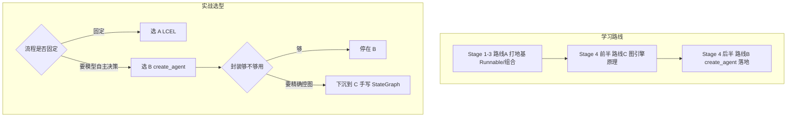
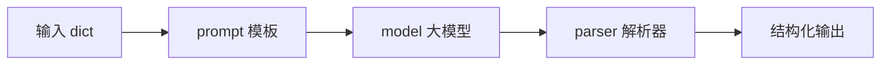

<title>Stage 1 · Runnable 协议与 LCEL：LangChain 的组合地基（附范式全景）</title>

<callout emoji="🎯">
**本阶段目标：**吃透 LangChain 一切组件的公共基类 `Runnable`，理解 `invoke/stream/batch` 为什么是统一签名，以及 LCEL 管道符 `|` 如何把组件拼成链。**先建立「范式全景」**，让你知道自己在学哪条路线、实战时有哪些选择。
**阅读方式：**每节 = 「设计意图 → LangChain 源码片段讲逻辑 → DeerFlow 里长什么样」。读完你能回答「这个 API 为什么这么设计、什么时候该用、DeerFlow 用没用、没用又改用了什么」。
</callout>

<callout emoji="💡">
**代码定位说明（全文源码引用规范）：**下文每条源码引用都写成 `[仓库标签] 仓内完整相对路径:行号`，三个仓库根如下（本地平级 clone）：
**[langchain]** = `/Users/bytedance/WorkSpace/Project/Community/langchain`
**[langgraph]** = `/Users/bytedance/WorkSpace/Project/Community/langgraph`
**[deerflow]** = `/Users/bytedance/WorkSpace/Project/Community/deer-flow`
例：`[langchain] libs/core/langchain_core/runnables/base.py:133` 即从 langchain 仓根按该相对路径打开第 133 行。
</callout>

# 零、范式全景：你在学哪条路线，实战有哪些选择

在写任何代码前，先建立一张地图。当前 langchain/langgraph 生态**并存三条开发路线**，它们不是「新旧替代」，而是「按场景选择」。这是官方文档（docs.langchain.com/oss/python）的现役立场。

| 路线 | 核心 API / 心智模型 | 适用场景 | DeerFlow 用不用 |
|-|-|-|-|
| **A. 声明式链路（LCEL）** | `\|` / `RunnableSequence` / `RunnableParallel`；直线管道，流程由你写死 | 固定流程、可预测、低延迟：2-Step RAG、批处理、数据清洗、格式化 | ❌ 不用（但它是理解 B/C 的地基） |
| **B. Agentic（create_agent）** | `create_agent` / `AgentMiddleware` / `@tool`；模型自主循环决策 | 开放任务、需自主调工具、多轮对话：对话 agent、Agentic RAG | ✅ 主范式 |
| **C. 显式图编排** | 手写 `StateGraph` / `add_node` / `add_conditional_edges`；你手工画节点和边 | 复杂确定性工作流 + 局部 LLM 步骤混合、需精确控图 | ⚠️ 仅 checkpoint 改写用一次 |

**三者关系（一句话）：**B 和 C 都跑在 LangGraph 图引擎上——`create_agent` 内部就是帮你搭了一张标准图（Stage 4 会看到 `[langchain] libs/langchain_v1/langchain/agents/factory.py:1161` 起手工建图）。A 是更轻的组合层，不需要图。**它们分层且可混用**：一个 LCEL 链里可以塞一个 agent 作为其中一环，反之 agent 的某个节点内部也常是一段 Runnable。



<callout emoji="💡">
**为什么 Stage 1-3 要先学 A？**因为 B/C 的每个节点内部往往还是 Runnable，`model.invoke`、`model.stream` 这些方法就是 Runnable 协议提供的。不理解 Runnable，看 create_agent 就是黑盒。**A 是地基，不是弯路。**
</callout>

# 一、Runnable：为什么需要一个统一基类

**设计意图：**LangChain 里有几十种组件——聊天模型、提示模板、输出解析器、检索器、工具、agent……如果每种都有自己的调用方法名（模型叫 `predict`、解析器叫 `parse`、检索器叫 `search`），那把它们拼在一起就得写一堆胶水代码。**Runnable 的作用是：让所有组件都实现同一套方法签名**，于是任意两个组件都能无缝拼接。

这套统一方法就四类：

| 方法 | 语义 |
|-|-|
| `invoke(input)` | 单次调用，输入一个、输出一个（最基础） |
| `stream(input)` | 流式调用，逐块 yield 输出（改善首字延迟） |
| `batch(inputs)` | 批量调用，一次处理多个输入（默认用线程池并行） |
| `ainvoke/astream/abatch` | 上述三者的异步版本，签名一一对应 |

**源码讲逻辑：**抽象基类见 `[langchain] libs/core/langchain_core/runnables/base.py:133`：

```python
class Runnable(ABC, Generic[Input, Output]):
    # 唯一强制子类实现的抽象方法
    @abstractmethod
    def invoke(self, input: Input, config: RunnableConfig | None = None) -> Output: ...

    # 下面这些都有默认实现，子类可不重写
    def batch(self, inputs: list[Input], ...) -> list[Output]: ...
    def stream(self, input: Input, ...) -> Iterator[Output]: ...
    async def ainvoke(self, input: Input, ...) -> Output: ...
```

关键设计有三点：**(1) 只有 `invoke` 是 `@abstractmethod`**（base.py:874），子类最少只需实现它，其余方法基类给了默认实现（如 `batch` 在 base.py:919 默认用线程池把多个 `invoke` 并行跑）。**(2) `Generic[Input, Output]`** 让每个组件声明自己的输入输出类型，类型检查器能在拼接时发现「上一环输出对不上下一环输入」。**(3) 每个方法都收一个 `config`**（RunnableConfig），用来贯穿传递 callbacks、tags、metadata——这是 Stage 5 可观测性的基础。

<callout emoji="💡">
**异步的性能真相：**`ainvoke` 有默认实现，但如果某组件底层没有原生异步 I/O，基类的 `abatch` 会通过 `run_in_executor` 降级为线程池执行——**并非真异步**。写高并发代码时要确认底层集成（如 `ChatOpenAI`）实现了原生 async，否则拿不到异步收益。
</callout>

<callout emoji="🔍">
**DeerFlow 实证：**DeerFlow 全程用的就是 Runnable 协议的异步方法。最干净的一处是单轮 LLM 调用工具 `[deerflow] backend/packages/harness/deerflow/utils/oneshot_llm.py:65`：
</callout>

```python
response = await model.ainvoke(
    [
        SystemMessage(content=system_instruction),
        HumanMessage(content=user_content),
    ],
    config=invoke_config,   # 就是 RunnableConfig，携带 run_name / langfuse metadata
)
return extract_response_text(response.content)
```

三点值得记：**(1)** `model.ainvoke` 就是 Runnable 协议方法——DeerFlow 不自己发 HTTP，而是走统一接口。**(2)** 输入是一个 `[SystemMessage, HumanMessage]` 列表（Stage 2 详讲），输出是一个 `AIMessage`（`response.content`）。**(3)** `config=invoke_config` 把追踪元数据顺着 Runnable 协议传下去——这正是第一节说的「config 贯穿」在生产项目里的价值。

# 二、LanguageModelInput：输入类型为什么这么宽松

**设计意图：**你可能见过三种喂给模型的写法——直接传字符串 `model.invoke("你好")`、传消息列表 `model.invoke([HumanMessage("你好")])`、或传一个 PromptTemplate 渲染出的 PromptValue。为什么都能用？因为模型的输入类型被定义成一个「联合类型」，接收任意一种再内部归一。

**源码讲逻辑：**类型别名见 `[langchain] libs/core/langchain_core/language_models/base.py:125`：

```python
LanguageModelInput = PromptValue | str | Sequence[MessageLikeRepresentation]
```

归一发生在 `[langchain] libs/core/langchain_core/language_models/chat_models.py:449` 的 `_convert_input`：

```python
def _convert_input(self, model_input: LanguageModelInput) -> PromptValue:
    if isinstance(model_input, PromptValue):
        return model_input                                   # 已是 PromptValue，直接用
    if isinstance(model_input, str):
        return StringPromptValue(text=model_input)           # 字符串 → 包一层
    if isinstance(model_input, Sequence):
        return ChatPromptValue(messages=convert_to_messages(model_input))  # 消息列表 → 转标准消息
    msg = f"Invalid input type {type(model_input)}. ..."
    raise ValueError(msg)
```

这就是「为什么三种写法都行」的答案：不是穷举每种类型写重载，而是**定义一个联合类型 + 一个归一函数**，把所有合法输入收敛成内部统一的 `PromptValue`。`invoke` 本身在 chat_models.py:463，第一件事就是调 `_convert_input`。所以你传字符串只是「单条 HumanMessage 的语法糖」。

<callout emoji="💡">
**迁移到实战：**DeerFlow 一律传显式的 `[SystemMessage, HumanMessage]` 列表而非字符串（[deerflow] backend/packages/harness/deerflow/utils/oneshot_llm.py:65）。原因：字符串写法只能表达单条 user 消息，无法带 system 指令；生产代码要精确控制角色，就用消息列表。字符串写法适合快速试验和文档示例。
</callout>

# 三、LCEL 管道符 `|`：把 Runnable 拼成链

**设计意图：**有了统一的 Runnable，下一步是「组合」。LCEL（LangChain Expression Language）用 Python 的 `|` 运算符把多个 Runnable 串成一条链，读起来就像 Unix 管道：`prompt | model | parser`。这是路线 A 的招牌语法。

**源码讲逻辑：**`|` 的实现是 Runnable 重载了 `__or__`，见 `[langchain] libs/core/langchain_core/runnables/base.py:628`。它做的事很简单——**把左右两个 Runnable 包进一个 `RunnableSequence`**（base.py:3063）：

```python
def __or__(self, other) -> RunnableSerializable[Input, Other]:
    # a | b  等价于  RunnableSequence(a, b)
    return RunnableSequence(self, coerce_to_runnable(other))
```

`RunnableSequence` 本身也是个 Runnable，它的 `invoke`（base.py:3418）就是**按顺序把每一步的输出喂给下一步**：

```python
def invoke(self, input, config=None, **kwargs):
    for i, step in enumerate(self.steps):
        input = step.invoke(input, ...)   # 上一步输出 = 下一步输入
    return input
```

这解释了链的两个特性：**(1) 链本身还是 Runnable**（闭包性），所以链能再和别的组件 `|` 下去，也能 `.invoke/.stream/.batch`。**(2) 顺序敏感**——每一步的输出类型必须能作为下一步的输入类型，接错就报错。这也是为什么 `prompt | model | parser` 顺序不能换。



常配套的两个组合器：

| 组件 | 作用 / 源码 |
|-|-|
| `RunnableParallel` | 并行跑多个分支，输出合成一个 dict（`[langchain] libs/core/langchain_core/runnables/base.py:3852`）。RAG 里常用它同时算「检索结果」和「透传问题」。 |
| `RunnableLambda` | 把任意普通函数包成 Runnable（`[langchain] libs/core/langchain_core/runnables/base.py:4691`），用于在链中间插自定义逻辑。 |
| `RunnablePassthrough` | 原样透传输入（`[langchain] libs/core/langchain_core/runnables/passthrough.py:74`），常和 Parallel 搭配保留原始输入。 |

<callout emoji="🔍">
**DeerFlow 实证（诚实说明）：**DeerFlow **不使用** LCEL 管道符 `|` 来搭主流程——它走路线 B，用 `create_agent`。但 Runnable 协议它**处处在用**：除了 `ainvoke`，还有 `with_config` 给模型附加 tags（这也是 Runnable 提供的方法），见 `[deerflow] backend/packages/harness/deerflow/agents/middlewares/summarization_middleware.py:156`：
</callout>

```python
return model.with_config(tags=merged_tags)   # with_config 返回一个新的 Runnable（RunnableBinding）
```

这说明一件重要的事：**路线 A 的管道符 DeerFlow 没用，但路线 A 背后的 Runnable 协议是 B/C 的共同地基**。`with_config`、`ainvoke`、`astream` 全是 Runnable 方法。你学 LCEL，本质是在学这套贯穿全生态的接口。

# 四、stream 与 batch：同一接口的两种执行形态

**设计意图：**同一个 Runnable，既能一次性出结果（`invoke`），也能边生成边吐（`stream`），还能批量并行（`batch`）。三者签名对称，业务代码切换执行形态几乎零成本。

**源码讲逻辑：**`stream` 的默认实现在 `[langchain] libs/core/langchain_core/runnables/base.py:1182`——基类默认「不真流式」，只是把 `invoke` 的完整结果 yield 一次；真正的流式由聊天模型子类重写（逐 token yield `AIMessageChunk`，chunk 之间可用 `+` 累加成完整消息）。`batch` 在 base.py:919 默认用 `ThreadPoolExecutor` 把多个 `invoke` 并行执行。

<callout emoji="🔍">
**DeerFlow 实证：**DeerFlow 的整个 agent 运行就是靠 `astream` 驱动的（流式是 agent 交互的刚需），见 `[deerflow] backend/packages/harness/deerflow/runtime/runs/worker.py:858`：
</callout>

```python
async for chunk in agent.astream(input_payload, config=stream_config, stream_mode=single_mode):
    ...   # 逐块拿到 agent 的中间状态并推给前端
```

注意 `agent` 是 `create_agent` 返回的 `CompiledStateGraph`——它**也**实现了 Runnable 协议，所以能 `.astream()`。这再次印证：**无论路线 B（agent）还是路线 C（图），对外都是 Runnable，都用同一套 `invoke/stream/batch` 接口**。你在 Stage 1 学的接口，一路用到 Stage 4。

# 五、动手练习

<callout emoji="📝">
**练习 1（懂 invoke）：**用 `init_chat_model` 或你的 `ChatOpenAI`/OpenRouter 配置初始化一个模型，分别用三种输入调 `invoke`：字符串、`[HumanMessage(...)]`、`[SystemMessage(...), HumanMessage(...)]`，观察返回都是 `AIMessage`。对照 `[langchain] libs/core/langchain_core/language_models/chat_models.py:449` 的 `_convert_input` 想清楚三者如何归一。
**练习 2（懂 LCEL）：**写一个最小链 `prompt | model | StrOutputParser()`，`invoke` 一次；再把 `parser` 去掉，观察输出从 `str` 变回 `AIMessage`，理解「每一步输出=下一步输入」。
**练习 3（懂顺序）：**故意把链写成 `model | prompt`，观察报错，理解 Runnable 的类型约束和顺序敏感。
**练习 4（懂 stream）：**对同一个链分别调 `invoke` 和 `stream`，用 `for chunk in chain.stream(...)` 打印 `chunk.text`，感受首字延迟差异。
**练习 5（反哺 DeerFlow）：**打开 `[deerflow] backend/packages/harness/deerflow/utils/oneshot_llm.py:65`，确认它用的是 `ainvoke` + 消息列表而非 LCEL 管道符；再找 `with_config`（summarization_middleware.py:156），理解 DeerFlow 虽不用 `|`，却离不开 Runnable 协议。
</callout>

# 六、源码精读清单（下沉顺序）

| 看什么 | 位置 |
|-|-|
| ① Runnable 基类与抽象方法 | `[langchain] libs/core/langchain_core/runnables/base.py:133`（invoke :874 / batch :919 / stream :1182） |
| ② 管道符 `\|` 与 RunnableSequence | `[langchain] libs/core/langchain_core/runnables/base.py:628`（\_\_or\_\_）、:3063（RunnableSequence，invoke :3418） |
| ③ 并行 / lambda / 透传 | `[langchain] libs/core/langchain_core/runnables/base.py:3852`（Parallel）、:4691（Lambda）、passthrough.py:74 |
| ④ 模型输入类型与归一 | `[langchain] libs/core/langchain_core/language_models/base.py:125`、chat_models.py:449（\_convert_input）、:463（invoke） |
| ⑤ DeerFlow Runnable 用法 | `[deerflow] backend/packages/harness/deerflow/utils/oneshot_llm.py:65`（ainvoke）、agents/middlewares/summarization_middleware.py:156（with_config）、runtime/runs/worker.py:858（astream） |

# 七、自检清单（能答上来就算过）

<callout emoji="💡">
**1.** 当前生态哪三条开发路线？它们是替代关系还是并存？DeerFlow 走哪条？
**2.** 为什么需要 Runnable 基类？只有哪个方法是强制实现的，其余方法基类如何提供默认实现？
**3.** `model.invoke("你好")` 和 `model.invoke([HumanMessage("你好")])` 为什么都能跑？归一发生在哪个函数？
**4.** `a | b` 底层等价于什么？为什么链本身还能继续 `|` 和 `.invoke`？为什么顺序不能换？
**5.** DeerFlow 没用 LCEL 管道符，为什么说它仍然「离不开 Runnable」？举两个它用到的 Runnable 方法。
**6.** `ainvoke` 一定是真异步吗？什么情况下会降级成线程池？
</callout>