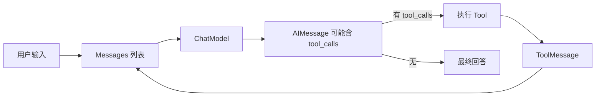

<title>Stage 2 · Messages / Model / Tool：与模型对话的三块基石</title>

<callout emoji="🎯">
**本阶段目标：**把「和大模型交互」拆成三块基石——**Messages**（对话数据结构）、**ChatModel**（模型抽象与初始化）、**Tool**（让模型调用外部能力）。这三块是路线 B（create_agent）真正的原材料，DeerFlow 每天都在用。
**阅读方式：**每节 = 「设计意图 → LangChain 源码片段讲逻辑 → DeerFlow 实证」。
</callout>

<callout emoji="💡">
**代码定位说明（全文源码引用规范）：**源码引用格式为 `[仓库标签] 仓内完整相对路径:行号`，三仓根（`<source-root>` 代表自行选择的源码目录）：
**[langchain]** = `<source-root>/langchain`
**[langgraph]** = `<source-root>/langgraph`
**[deerflow]** = `<source-root>/deer-flow`
</callout>

# 零、承接 Stage 1：为什么先讲这三块

Stage 1 讲的 `model.invoke(input)` 里，**input 是 Messages、model 是 ChatModel、而让模型「干活」靠 Tool**。这三块正是喂进 Runnable 的原材料。Stage 4 的 create_agent 循环，本质就是「模型读一堆 Messages → 决定调哪个 Tool → 把 ToolMessage 塞回 Messages → 再读」。所以这一阶段是通往 agent 的必经之路。



# 一、Messages：为什么不用裸字符串而用带角色的对象

**设计意图：**和模型对话不是「一句问一句答」，而是有**角色**的多轮上下文：系统指令、用户输入、模型回复、工具结果。如果全用字符串拼接，模型无法区分「谁说的」，也没法携带 tool_calls、token 用量等结构化信息。所以 LangChain 用一组带角色的消息类。

| 消息类 | 角色 / 用途 | 源码 |
|-|-|-|
| `SystemMessage` | 系统指令，给模型定角色/规则 | `[langchain] libs/core/langchain_core/messages/system.py:9` |
| `HumanMessage` | 用户输入，可含文本/图片等多模态 | `[langchain] libs/core/langchain_core/messages/human.py:9` |
| `AIMessage` | 模型回复，含 text、tool_calls、usage | `[langchain] libs/core/langchain_core/messages/ai.py:160` |
| `ToolMessage` | 工具执行结果，回传给模型 | `[langchain] libs/core/langchain_core/messages/tool.py:26` |

## content vs content_blocks vs .text：最容易踩坑的三个属性

这是新版最重要的知识点，直接决定你「读不读得到模型输出」。`AIMessage` 有三个相关属性：

| 属性 | 含义 |
|-|-|
| `content` | **原始 payload**，松散类型：可能是 str，也可能是 provider 原生的 list[dict]。不同厂商结构不同。 |
| `content_blocks` | **标准化视图**，把 content 惰性解析成统一的类型化块（text / reasoning / tool_call 等），跨厂商一致。 |
| `.text` | 便捷属性，直接取纯文本部分。 |

**源码讲逻辑：**`content_blocks` 是一个 `@property`，见 `[langchain] libs/core/langchain_core/messages/ai.py:243`——它**惰性地**把 `content`（原始）解析成标准块列表。`.text` 定义在基类 `[langchain] libs/core/langchain_core/messages/base.py:263`。设计动机是**「原始与标准分离」**：`content` 保留厂商原貌（不丢信息），`content_blocks` 给你跨厂商统一的读法。

<callout emoji="💡">
**踩坑实录（Stage 1 实操遇到的真问题）：**某些 reasoning 模型（如方舟/OpenRouter 的推理模型）会把输出放进 `reasoning_content` 或 `additional_kwargs`，导致 `content` 为空字符串——直接读 `content` 或用 `StrOutputParser` 会拿到空。**正确姿势：优先读 `.text` / `content_blocks`，再 fallback。**这就是为什么新版推荐 `content_blocks` 而非直接摸 `content`。
</callout>

# 二、ChatModel：init_chat_model 与 DeerFlow 的 create_chat_model

**设计意图：**你不该为「换个模型厂商」改一堆代码。LangChain 用 `BaseChatModel`（Stage 1 讲过它是 Runnable 子类）统一所有聊天模型的接口，再用工厂函数按「provider:model」字符串动态实例化具体类。

**源码讲逻辑（官方入口）：**官方首推 `init_chat_model`，见 `[langchain] libs/langchain_v1/langchain/chat_models/base.py:176`。一行 `init_chat_model("gpt-5")` 就按名字推断 provider 并实例化对应类（如 `ChatOpenAI`），你后续只跟 `BaseChatModel` 的统一接口打交道。`bind_tools`（chat_models.py:2338）和 `with_structured_output`（:2357）也定义在这个基类上，所以任意模型都能挂工具、要结构化输出。

<callout emoji="🔍">
**DeerFlow 实证（自研工厂，同一思路）：**DeerFlow 没用 `init_chat_model`，而是自研了 `create_chat_model`，见 `[deerflow] backend/packages/harness/deerflow/models/factory.py:174`：
</callout>

```python
def create_chat_model(name=None, thinking_enabled=False, *, app_config=None,
                      attach_tracing=True, model_overrides=None, **kwargs) -> BaseChatModel:
    config = app_config or get_app_config()
    model_config = config.get_model_config(name)
    model_class = resolve_class(model_config.use, BaseChatModel)   # 按 "langchain_openai:ChatOpenAI" 动态解析类
    ...   # 叠加 profile 采样参数、thinking 模式、tracing 回调
```

对照看设计动机很清楚：**(1)** 返回类型标注就是 `BaseChatModel`——DeerFlow 全系统只依赖这个统一抽象，换厂商只改 config 里的 `use` 字段。**(2)** `resolve_class(model_config.use, ...)` 和 `init_chat_model` 是同一思路（配置驱动动态解析），只是 DeerFlow 加了自己的 profile/thinking/tracing 逻辑。**(3)** 这印证 Stage 1 的话：DeerFlow 的模型对象就是个 Runnable，随后被 `ainvoke`/`with_config`/塞进 `create_agent`。

# 三、Tool：@tool 装饰器如何把普通函数变成模型可调用能力

**设计意图：**模型本身只会生成文本，要让它「查网页、算数、读数据库」就得给它工具。工具的本质是：**一个带清晰名字、参数 schema、描述的函数**——模型据此决定「要不要调、传什么参数」。`@tool` 装饰器帮你从函数签名和 docstring 自动生成这套 schema。

**源码讲逻辑：**`tool` 是个多重载装饰器，见 `[langchain] libs/core/langchain_core/tools/convert.py:18`；它最终把函数包成 `StructuredTool`（`[langchain] libs/core/langchain_core/tools/structured.py:40`），而 `BaseTool`（`[langchain] libs/core/langchain_core/tools/base.py:427`）本身**也是 Runnable 子类**——所以工具也能 `invoke`，也能进链。`parse_docstring=True` 会解析 docstring 的 Args 段生成参数描述，让模型更懂每个参数干嘛。

<callout emoji="🔍">
**DeerFlow 实证：**DeerFlow 的网络搜索工具就是标准 `@tool` 写法，见 `[deerflow] backend/packages/harness/deerflow/community/tavily/tools.py:16`：
</callout>

```python
from langchain.tools import tool

@tool("web_search", parse_docstring=True)
def web_search_tool(query: str) -> str:
    """Search the web.

    Args:
        query: The query to search for.
    """
    client = _get_tavily_client()
    res = client.search(query, max_results=max_results)
    return json.dumps(normalized_results, indent=2, ensure_ascii=False)
```

三点：**(1)** `@tool("web_search", ...)` 第一个参数是工具名（模型看到的就是这个名字）。**(2)** `parse_docstring=True` + Args 段 → 模型知道 `query` 参数的含义。**(3)** 返回值是 str（这里是 JSON 字符串），会被包成 `ToolMessage` 回传给模型。**这个工具会被塞进 `create_agent(tools=[...])`，成为 agent 循环里模型可调用的能力。**

# 四、OutputParser：为什么新版把它弱化了

**设计意图（历史背景）：**早期 LangChain 模型只吐字符串，要拿结构化数据就得用 OutputParser（如 `StrOutputParser`、`PydanticOutputParser`）把文本再解析一遍，常拼在链尾 `model | parser`。

**为什么弱化：**新版有两个更好的选择——**(1)** 直接读 `content_blocks`/`.text`（第一节讲的），不需要额外解析器就能拿到干净文本；**(2)** 要结构化对象直接用 `model.with_structured_output(SomeSchema)`（`[langchain] libs/core/langchain_core/language_models/chat_models.py:2357`），底层用工具调用/JSON 模式保证格式，比「先出文本再正则解析」可靠得多。`StrOutputParser` 仍在（`[langchain] libs/core/langchain_core/output_parsers/string.py`），但更多是路线 A 链式写法里的收尾便利，不是首选。

<callout emoji="🔍">
**DeerFlow 实证：**DeerFlow **不用 OutputParser**。要纯文本时它自定义了 `extract_response_text(response.content)`（见 oneshot_llm.py，Stage 1 引用过），自己处理 content 可能为空/为 list 的情况——这正是「直接摸 content 有坑，需要主动清洗」的生产级应对。要结构化输出的场景则走工具调用。**结论：OutputParser 了解即可，实战优先 `content_blocks` + `with_structured_output`。**
</callout>

# 五、动手练习

<callout emoji="📝">
**练习 1（懂 Messages）：**构造 `[SystemMessage("你是翻译"), HumanMessage("翻译: I love LangChain")]` 调 `invoke`，打印 `response.text`、`response.content`、`response.content_blocks` 三者，观察差异。若用 reasoning 模型，验证 `content` 可能为空而 `content_blocks` 有内容。
**练习 2（懂 Model 工厂）：**用 `init_chat_model` 换两个不同 provider 各初始化一个模型，确认后续调用代码完全一致。再读 `[deerflow] backend/packages/harness/deerflow/models/factory.py:174`，找出 DeerFlow 靠哪个字段决定实例化哪个类。
**练习 3（懂 Tool）：**用 `@tool(parse_docstring=True)` 写一个 `get_weather(city: str)`，打印 `tool.name`、`tool.args_schema.schema()`，看自动生成的 schema。对照 `[deerflow] backend/packages/harness/deerflow/community/tavily/tools.py:16`。
**练习 4（懂结构化输出）：**定义一个 Pydantic 模型，用 `model.with_structured_output(它)` 让模型直接返回结构化对象，对比「用 OutputParser 解析文本」的可靠性差异。
**练习 5（串起来）：**把练习 3 的工具 `bind_tools` 到模型，问一个需要调工具的问题，观察返回的 `AIMessage.tool_calls`——这就是 Stage 4 agent 循环的第一步。
</callout>

# 六、源码精读清单（下沉顺序）

| 看什么 | 位置 |
|-|-|
| ① 四种消息类 | `[langchain] libs/core/langchain_core/messages/` system.py:9 / human.py:9 / ai.py:160 / tool.py:26 |
| ② content_blocks 与 .text | `[langchain] libs/core/langchain_core/messages/ai.py:243`（content_blocks）、base.py:263（.text） |
| ③ 模型工厂与基类接口 | `[langchain] libs/langchain_v1/langchain/chat_models/base.py:176`（init_chat_model）；bind_tools/with_structured_output 见 chat_models.py:2338/:2357 |
| ④ Tool 装饰器与基类 | `[langchain] libs/core/langchain_core/tools/convert.py:18`（tool）、structured.py:40、base.py:427（BaseTool 是 Runnable） |
| ⑤ DeerFlow 模型工厂 | `[deerflow] backend/packages/harness/deerflow/models/factory.py:174` |
| ⑥ DeerFlow 工具 | `[deerflow] backend/packages/harness/deerflow/community/tavily/tools.py:16` |

# 七、自检清单（能答上来就算过）

<callout emoji="💡">
**1.** 为什么用带角色的 Messages 而非裸字符串？四种消息类各管什么？
**2.** `content`、`content_blocks`、`.text` 三者区别？为什么 reasoning 模型下直接读 `content` 可能为空？正确读法是什么？
**3.** `init_chat_model` 和 DeerFlow 的 `create_chat_model` 思路上有何共性？它们返回的统一类型是什么？
**4.** `@tool` 从哪里生成参数 schema？`parse_docstring=True` 有什么用？为什么说工具也是 Runnable？
**5.** 新版为什么弱化 OutputParser？要结构化输出应优先用什么？DeerFlow 怎么做的？
**6.** 一个带 tool_calls 的 `AIMessage` 之后会发生什么？这和 Stage 4 的 agent 循环什么关系？
</callout>