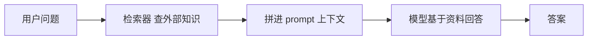
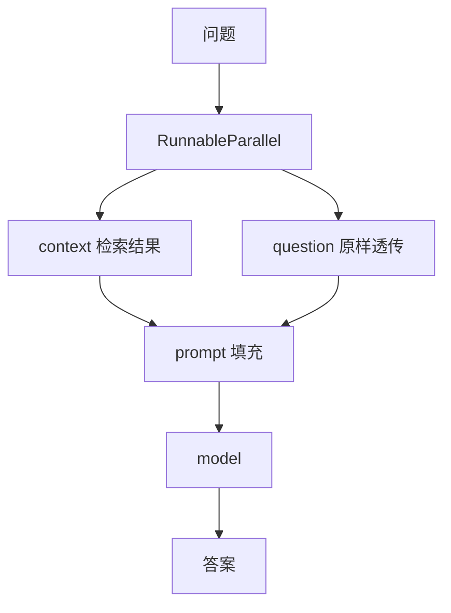

<title>Stage 3 · RAG：从 2-Step 检索链到 Agentic RAG（两条路线并讲）</title>

<callout emoji="🎯">
**本阶段目标：**搞懂 RAG（检索增强生成）的本质，掌握官方并存的**两条实现路线**：路线 A 的 2-Step 检索链（固定检索一次）和路线 B 的 Agentic RAG（模型自主决定何时检索）。理解它们「同一目标、不同控制粒度」的关系，以及 DeerFlow 为什么选后者。
**阅读方式：**每节 = 「设计意图 → LangChain 源码片段讲逻辑 → 实证/对照」。
</callout>

<callout emoji="💡">
**代码定位说明：**源码引用格式 `[仓库标签] 仓内完整相对路径:行号`，三仓根（本地平级 clone）：**[langchain]**=`/Users/bytedance/WorkSpace/Project/Community/langchain`；**[deerflow]**=`/Users/bytedance/WorkSpace/Project/Community/deer-flow`。
</callout>

# 零、RAG 到底解决什么，和 Stage 1/2 什么关系

**设计意图：**大模型的知识停在训练截止日，也不知道你的私有文档。RAG 的思路很朴素：**回答前先去外部知识源「查资料」，把查到的内容塞进 prompt 再让模型回答**。它不改模型权重，只改「喂给模型的上下文」。

和前两阶段的衔接：RAG 的「查资料 → 回答」链条，正是 Stage 1 的 Runnable 组合（把检索器、prompt、模型串起来），喂进去的是 Stage 2 的 Messages。**RAG 不是新框架，而是 Stage 1/2 基石的一个经典应用。**



<callout emoji="💡">
**官方立场（docs.langchain.com）：**RAG 有两条并存路线——**2-Step RAG**（固定「先检索后生成」，可预测、低延迟，属路线 A）和 **Agentic RAG**（模型把检索当工具，自主决定何时/查几次，属路线 B）。两者都用同一批 building blocks，只是「谁来决定检索」不同。
</callout>

# 一、检索管道的四个 building block

无论哪条路线，把外部知识变得「可检索」都要这四步。官方明确它们仍是现役地基。

| 组件 | 职责 | 源码 |
|-|-|-|
| **TextSplitter** | 把长文档切成小块（chunk），便于精准检索 | `[langchain] libs/text-splitters/langchain_text_splitters/base.py:59` |
| **Embeddings** | 把文本转成向量，让「语义相近」变成「距离相近」 | `[langchain] libs/core/langchain_core/embeddings/embeddings.py:8` |
| **VectorStore** | 存向量并支持相似度检索 | `[langchain] libs/core/langchain_core/vectorstores/base.py:43` |
| **Retriever** | 统一的检索入口（是 Runnable） | `[langchain] libs/core/langchain_core/retrievers.py:55` |

## TextSplitter：为什么要切块

模型上下文有限，且检索粒度太粗会带入无关内容。`RecursiveCharacterTextSplitter`（`[langchain] libs/text-splitters/langchain_text_splitters/character.py:91`）是最常用的——它按一组分隔符（段落→句→词）**递归**切分，尽量在自然边界断开，核心方法 `split_text`（character.py:153）。

## Embeddings：两个方法为什么要分开

**源码讲逻辑：**`Embeddings` 基类（`[langchain] libs/core/langchain_core/embeddings/embeddings.py:8`）有两个抽象方法——`embed_documents(texts)`（:37，批量嵌入文档）和 `embed_query(text)`（:48，嵌入单条查询）。**为什么要分开？**因为有些嵌入模型对「文档」和「查询」用不同的前缀/编码策略（非对称检索），分成两个方法才能区别对待。入库时用前者批量，检索时用后者单条。

## VectorStore 与 Retriever：检索为什么是 Runnable

**源码讲逻辑：**`VectorStore`（vectorstores/base.py:43）负责 `add_texts`（:46 入库）和 `similarity_search`（:361 相似度检索），并通过 `as_retriever()`（:905）包成一个 `VectorStoreRetriever`。关键在 `BaseRetriever`——它的定义是 `class BaseRetriever(RunnableSerializable[...])`（`[langchain] libs/core/langchain_core/retrievers.py:55`），**即检索器本身就是 Runnable**！所以它有 `invoke`（retrievers.py:179），能直接进 LCEL 链，你写自定义检索只需实现 `_get_relevant_documents`（:298）。这就是 Stage 1「统一 Runnable 接口」的红利：检索器无需特殊胶水就能拼进链。

# 二、路线 A：2-Step RAG（手写 LCEL 检索链）

**设计意图：**流程固定——永远「先检索一次，再生成」。适合可预测、低延迟场景。用 Stage 1 的 LCEL 把 building block 串起来即可。

**典型链结构（示意）：**

```python
from langchain_core.runnables import RunnableParallel, RunnablePassthrough
from langchain_core.output_parsers import StrOutputParser

# retriever 是 Runnable，question 原样透传
chain = (
    RunnableParallel({"context": retriever, "question": RunnablePassthrough()})
    | prompt          # 把 context + question 填进模板
    | model           # 基于资料回答
    | StrOutputParser()
)
answer = chain.invoke("公司报销政策是什么？")
```

逐段看它怎么用到前面的知识：**(1)** `RunnableParallel`（Stage 1 讲过，`[langchain] libs/core/langchain_core/runnables/base.py:3852`）并行跑「检索」和「透传问题」，输出合成 dict。**(2)** `retriever` 能直接放进链，正因为它是 Runnable（第一节）。**(3)** 整条链靠 `|` 串联，本身还是 Runnable，可 `invoke/stream`。**这就是路线 A 的招牌：流程由你写死，一次检索、一次生成，完全可预测。**



# 三、路线 B：Agentic RAG（模型自主检索）

**设计意图：**固定检索一次有局限——问题复杂时可能要查多轮、换关键词、或先判断「到底要不要查」。Agentic RAG 把**检索包成一个工具**交给 agent，由模型自主决定何时调、调几次。这就是 Stage 2 的 `@tool` + Stage 4 的 `create_agent`。

```python
from langchain.tools import tool
from langchain.agents import create_agent

@tool
def search_docs(query: str) -> str:
    """检索内部知识库。"""
    return retriever.invoke(query)   # 工具内部仍用 building block

agent = create_agent(
    model="claude-sonnet-4-6",
    tools=[search_docs],
    system_prompt="需要资料时调用 search_docs，并引用检索片段。",
)
```

**关键区别：**路线 A 里「先检索」是**你**写死的；路线 B 里「要不要检索、检索几次」是**模型**决定的。检索的 building block 没变（工具内部还是 retriever/vector store），变的是**控制权**——从开发者手里交给了模型。这正是 Stage 4 开篇「从链路切到图」的动机。

<callout emoji="🔍">
**DeerFlow 实证：**DeerFlow 走的就是路线 B，而且更「纯粹」——它连向量库都没建，直接把**联网搜索**作为检索工具。见 Stage 2 引用的 `[deerflow] backend/packages/harness/deerflow/community/tavily/tools.py:16` 的 `web_search` 工具。这个工具被塞进 `create_agent(tools=[...])`，模型在对话中自主决定「要不要搜、搜什么」。**所以 DeerFlow 的「RAG」= Agentic RAG with web search，没有传统的 splitter/embedding/vector store 那一套。**它用最新的 agentic 范式替代了经典向量 RAG 管道。
</callout>

# 四、两条路线怎么选

| 维度 | 路线 A · 2-Step | 路线 B · Agentic |
|-|-|-|
| 谁决定检索 | 开发者写死 | 模型自主 |
| 检索次数 | 固定一次 | 0 到多次 |
| 延迟 / 成本 | 低、可预测 | 较高、不定 |
| 适用 | FAQ、固定知识问答 | 开放研究、多跳问题 |
| 实现 | LCEL 链（Stage 1） | create_agent + 检索工具（Stage 4） |

<callout emoji="💡">
**一句话：**两条路线的 building block 完全一样（splitter/embedding/vector store/retriever），差别只在「检索的控制权在开发者还是模型手里」。理解这点，你就能在实战里根据「流程是否固定」自由切换——这也是 Stage 1 范式全景的直接应用。
</callout>

# 五、动手练习

<callout emoji="📝">
**练习 1（懂 building block）：**用 `RecursiveCharacterTextSplitter` 切一篇长文，观察 chunk 数量随 `chunk_size` 变化；再用一个 `InMemoryVectorStore` + 嵌入模型入库，`similarity_search` 一个查询看返回。
**练习 2（懂 Retriever 是 Runnable）：**把上面的 store `as_retriever()`，直接 `retriever.invoke("问题")`，确认它无需包装就能当 Runnable 用。对照 `[langchain] libs/core/langchain_core/retrievers.py:55` 的类定义。
**练习 3（路线 A）：**用 `RunnableParallel + prompt + model` 手搓一条 2-Step RAG 链，`invoke` 一个需要资料的问题。
**练习 4（路线 B）：**把检索包成 `@tool`，用 `create_agent` 建一个 Agentic RAG，问一个复杂问题，观察模型调了几次检索工具。
**练习 5（反哺 DeerFlow）：**打开 `[deerflow] backend/packages/harness/deerflow/community/tavily/tools.py:16`，确认它是「web 搜索即检索工具」的 Agentic RAG，思考它为什么不建向量库。
</callout>

# 六、源码精读清单

| 看什么 | 位置 |
|-|-|
| ① TextSplitter | `[langchain] libs/text-splitters/langchain_text_splitters/base.py:59`、character.py:91（Recursive，split_text :153） |
| ② Embeddings | `[langchain] libs/core/langchain_core/embeddings/embeddings.py:8`（embed_documents :37 / embed_query :48） |
| ③ VectorStore | `[langchain] libs/core/langchain_core/vectorstores/base.py:43`（add_texts :46 / similarity_search :361 / as_retriever :905） |
| ④ Retriever 是 Runnable | `[langchain] libs/core/langchain_core/retrievers.py:55`（invoke :179 / \_get_relevant_documents :298） |
| ⑤ DeerFlow Agentic RAG 工具 | `[deerflow] backend/packages/harness/deerflow/community/tavily/tools.py:16` |

# 七、自检清单（能答上来就算过）

<callout emoji="💡">
**1.** RAG 解决什么问题？它改的是模型权重还是上下文？和 Stage 1/2 什么关系？
**2.** 四个 building block 各干什么？`embed_documents` 和 `embed_query` 为什么分开？
**3.** 为什么说「检索器无需胶水就能进链」？源码里 `BaseRetriever` 继承自谁？
**4.** 2-Step RAG 和 Agentic RAG 的核心区别是什么？building block 有变吗？
**5.** DeerFlow 属于哪条路线？它为什么没有向量库？用什么当检索工具？
**6.** 给你一个「固定 FAQ 问答」和一个「开放研究助手」，各选哪条路线，为什么？
</callout>