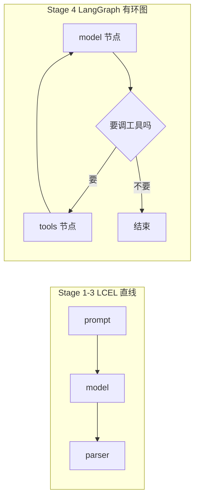
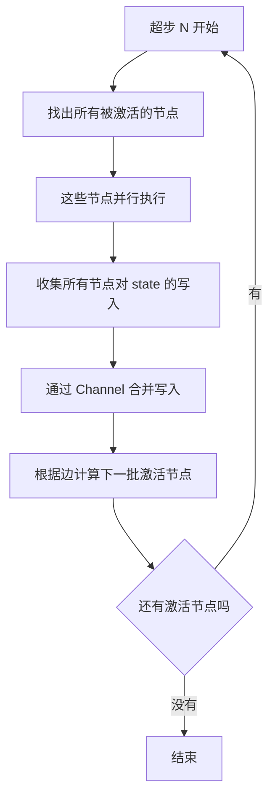
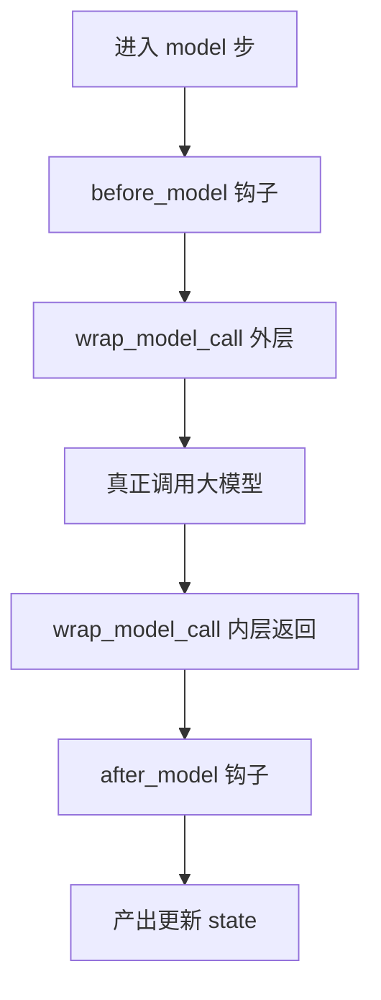
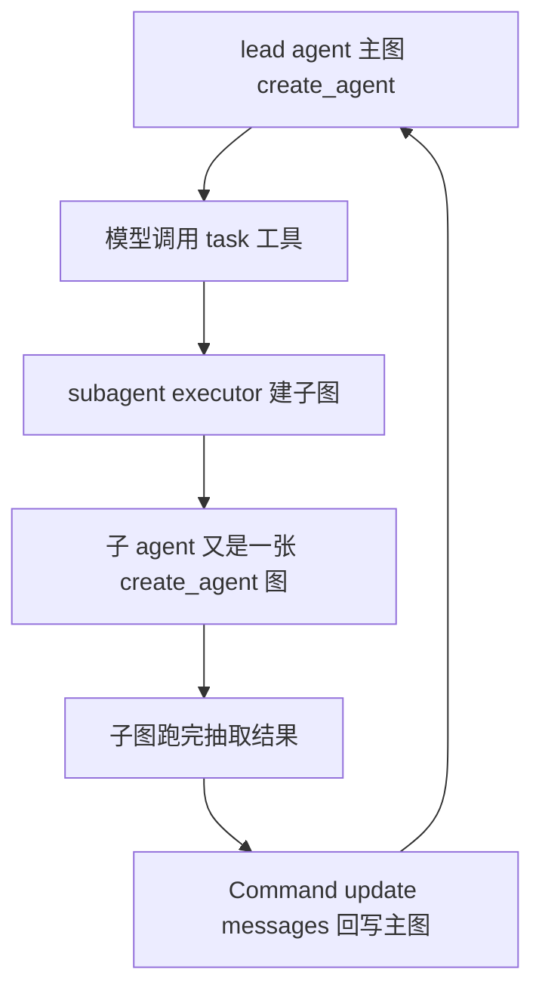

<title>Stage 4 · LangGraph 与 Agent 内核（以 DeerFlow 真实源码贯穿）</title>

<callout emoji="🎯">
**本阶段目标：**从「声明式链路范式（LCEL）」切到「Agentic 图范式」——这不是升级替代，而是**按场景换路线**，并用一个真实开源项目 **DeerFlow** 把每个抽象概念对应到可验证的源码上。
**阅读方式：**每节 = 一个概念的「设计意图 → LangChain/LangGraph 源码 → DeerFlow 里长什么样」。读完你不仅懂 API，还能指着 DeerFlow 说出「它这么写是为了什么」。
</callout>

<callout emoji="💡">
**代码定位说明（全文源码引用规范）：**下文每条源码引用都写成 `[仓库标签] 仓内完整相对路径:行号`，三个仓库根如下（`<source-root>` 代表自行选择的源码目录）：
**[langchain]** = `<source-root>/langchain`
**[langgraph]** = `<source-root>/langgraph`
**[deerflow]** = `<source-root>/deer-flow`
例：`[deerflow] ``backend/packages/harness/deerflow/runtime/checkpoint_state.py:61` 即从 deer-flow 仓根按该相对路径打开第 61 行。
</callout>

<callout emoji="❗">
**重要前提（关于 DeerFlow 版本）：**网上流传的经典 DeerFlow 是 `coordinator → planner → researcher → reporter` 多节点手写 `StateGraph`。**但本文基于的本地新版已经演进为「单 agent + 一长串 middleware + subagent 委派」架构**：主图不再手写 StateGraph，而是用 langchain 的 `create_agent()`；多角色协作靠 `task_tool` 委派子 agent。这恰好是 Stage 4 现役范式的最佳活教材。文中所有 DeerFlow 路径以 `backend/packages/harness/deerflow/` 为根。
</callout>

# 零、承接：为什么到这里要从「链路」切到「图」

前三阶段学的是**路线 A（声明式链路 / LCEL）**：数据从头流到尾，一条路走到底，流程由**你**写死。Stage 3 的 RAG 也只是「固定检索一次」的直线——是你替模型决定了「先查资料再回答」。这条路线并没有过时，官方文档里它仍是「可预测、低延迟」场景（如 2-Step RAG、批处理）的坚实地基。

但 Agent 的本质是**循环 + 自主决策**：模型输出后要判断「要不要调工具」，调完工具还得**回到模型**再判断，可能来回好几轮，直到模型认为可以给出最终答案。直线管道无法表达「回到上一步」，因此需要一个能表达**循环、分支、共享状态**的新结构——这就是 LangGraph。



用一句话锚定 RAG 和 Agent 的关系：**RAG 是「写死的检索」，Agent 是「模型自主的检索 + 循环」**。把 Stage 3 里固定的 retriever 步骤改成「一个模型可按需调用的工具」，直线就必须变成能循环的图。这就是本阶段的起点。

# 一、LangGraph 三个核心概念：State / Node / Edge

LangGraph 的心智模型只有三样东西，理解它们的分工是一切的基础。

| 概念 | 是什么 | 设计动机 |
|-|-|-|
| **State** | 贯穿全图的共享状态（一个 TypedDict） | 节点之间**不直接传参**，而是「读写同一份 state」。任意节点都能看到全局上下文，这是回溯、持久化、断点续跑的前提。 |
| **Node** | 一个函数：读 state，返回对 state 的**增量**更新 | 每个节点只干一件事（调模型 / 调工具），输入是 state，输出是「要改哪些字段」，而不是完整新 state。 |
| **Edge** | 决定「下一个节点是谁」 | 普通边=固定跳转；条件边=根据 state 动态选择。这就是「循环」和「分支」的唯一来源。 |

**源码层面（LangGraph）：**`StateGraph` 类在 [langgraph] libs/langgraph/langgraph/graph/state.py:130，建图三方法 `add_node`（:375）、`add_edge`（:915）、`add_conditional_edges`（:969），最后 `compile`（:1164）把描述性的图「编译」成可执行对象。

<callout emoji="🔍">
**DeerFlow 实证：**新版 DeerFlow 主图**不直接调这些 API**（被 `create_agent` 封装了）。全仓唯一一处显式手写 StateGraph 反而是个「状态改写图」——用于回滚/上下文压缩时整体替换 checkpoint，见 [deerflow] backend/packages/harness/deerflow/runtime/checkpoint_state.py:61：
</callout>

```python
from langgraph.graph import StateGraph

builder = StateGraph(state_schema if state_schema is not None else get_thread_state_schema(mode, snapshot_frequency))
builder.add_node(as_node, _finish_state_mutation)   # 唯一节点，是个 no-op
builder.set_entry_point(as_node)
builder.set_finish_point(as_node)
return builder.compile()
```

这段虽然简单，却是理解「StateGraph 就是 建节点 → 定入口出口 → compile」的最干净例子：`_finish_state_mutation` 返回 `{}`（什么都不改），整张图的作用只是「借 LangGraph 的持久化机制，把一份新 state 落进 checkpoint」。**你会发现：哪怕不跑任何业务逻辑，只要想操作 state，就得走一张图。**这就是 LangGraph「一切皆图」的体现。

# 二、State 深入：为什么字段底层是「通道 Channel」

这是 LangGraph 最容易被忽略、却最核心的设计。你在 state 里写的每个字段，底层其实是一个 **Channel（通道）**。为什么不能是普通变量？

因为在**同一步**里，可能有多个节点都想更新同一个字段（例如并行分支都往 `messages` 追加消息）。若是普通变量赋值，就会互相覆盖、丢数据。Channel 的职责就是定义「**当多方同时写一个字段时，如何合并**」。

| Channel 类型 | 合并规则 / 用途 |
|-|-|
| `LastValue`（默认） | 后写覆盖先写，只保留最后一个值（[langgraph] libs/langgraph/langgraph/channels/last_value.py:20）。适合「当前计划」这类单值字段。 |
| `BinaryOperatorAggregate` | 用一个二元操作把新值并入旧值（[langgraph] libs/langgraph/langgraph/channels/binop.py:65）。传 `operator.add` 就能让 list 累加而非覆盖。 |

**源码讲逻辑（LangGraph）：**`BinaryOperatorAggregate` 的构造函数（[langgraph] libs/langgraph/langgraph/channels/binop.py:76）就存了一个 `operator`，每次收到更新时用 `self.value = self.operator(self.value, new)` 合并。这就是为什么 agent 的 `messages` 用 `add_messages` reducer 后，每个节点的输出是**追加到历史**而不是覆盖历史。抽象基类见 [langgraph] libs/langgraph/langgraph/channels/base.py:19。

<callout emoji="🔍">
**DeerFlow 实证（这是它最精彩的地方）：**DeerFlow 的 State 就是一个继承自 langchain `AgentState` 的 TypedDict，并且给几乎每个字段都配了**自定义 reducer**。见 [deerflow] backend/packages/harness/deerflow/agents/thread_state.py:264：
</callout>

```python
class ThreadState(AgentState):
    sandbox: SandboxStateField
    artifacts: Annotated[list[str], merge_artifacts]
    todos: Annotated[list | None, merge_todos]
    goal: Annotated[GoalState | None, merge_goal]
    viewed_images: Annotated[dict[str, ViewedImageData], merge_viewed_images]
    delegations: Annotated[list[DelegationEntry], merge_delegations]
    skill_context: Annotated[list[SkillEntry], merge_skill_context]
    # messages 字段继承自 AgentState，自带 add_messages reducer
```

读这段能学到三件事：**(1)** `messages` 没有重写，直接继承 `AgentState` 自带的 `add_messages`——这就是 Channel 里 `BinaryOperatorAggregate` 的实际应用。**(2)** 每个 `Annotated[类型, merge_xxx]` 就是「字段 + 它的合并规则」，比如 `artifacts` 用 `merge_artifacts` 累加产物、`delegations` 用 `merge_delegations` 累加委派记录。**(3)** 为什么要这么多自定义 reducer？因为 DeerFlow 是多 subagent 并发的，多个子 agent 可能同时往 `artifacts`、`delegations` 写入，必须定义合并规则才不会丢数据——这正是 Channel 设计存在的根本理由，在真实项目里体现得淋漓尽致。

# 三、下沉到引擎：Pregel 超步模型（LangGraph 的真身）

很多人以为 LangGraph 是「按边逐个跑节点」，其实不是。它底层是 **Pregel 模型**（源自 Google 图计算论文），执行单位是**超步（superstep）**而非单个节点。



**为什么用超步？**它把「并行执行」和「状态更新」严格分成两段：一个超步内，所有被激活的节点看到的是**同一份**输入 state，各自独立计算；等它们都算完，才通过 Channel 统一合并写入，进入下一超步。这样做的三个收益：

- **消除竞态**：节点执行时 state 不变，不会读到别人写一半的中间值。
- **天然并行**：同一超步的节点可以安全并发。
- **可快照可恢复**：因为每两个超步之间 state 是一致的稳定点，就能在这里存 checkpoint、断点续跑、插入人工审核（human-in-the-loop）。

**源码位置（LangGraph）：**引擎主循环 `PregelLoop` 在 [langgraph] libs/langgraph/langgraph/pregel/\_loop.py:158，调度算法在 pregel/\_algo.py（搜 `superstep` 可见超步逻辑与「finish 通知所有 channel」的处理）。

<callout emoji="🔍">
**DeerFlow 实证：**DeerFlow 的 delta 模式为了在超步之间高效存快照，专门做了 `DeltaChannel(merge_message_writes, snapshot_frequency=...)`（[deerflow] backend/packages/harness/deerflow/agents/thread_state.py:366）——它在 `merge_message_writes` 里复刻了 `add_messages` 的去重/删除语义，同时按 `snapshot_frequency` 控制多少个超步存一次快照。这正是「超步 + checkpoint」机制在生产项目里的直接落地。
</callout>

<callout emoji="📌">
**下沉阅读路径：**StateGraph（好懂的 API 层）→ channels（state 怎么合并）→ pregel/\_loop.py（引擎怎么一超步一超步跑）。别一上来啃 pregel，会懵。
</callout>

# 四、create_agent：把「model↔tools 循环」这张标准图搭好

你在 langchain 里用的 `create_agent`（[langchain] libs/langchain_v1/langchain/agents/factory.py:740）返回的不是链，而是一个 **CompiledStateGraph**——它内部就在建一张 LangGraph 图。最小的 agent 图就是「一个 model 节点、一个 tools 节点，中间用条件边形成循环」：

**源码讲逻辑（LangChain）：**在 factory.py 里能一行行看到这张图被搭起来——`graph = StateGraph(...)`（:1161）→ `graph.add_node("model", ...)`（:1502）→ `graph.add_node("tools", tool_node)`（:1506）→ `graph.add_conditional_edges(...)`（:1632 起，即上图那个「要调工具吗」的菱形判断）→ `graph.compile(...)`（:1787）。所以 `create_agent` 不是黑魔法，它帮你调用了第一节那些 StateGraph API，把标准循环图搭好并编译。

<callout emoji="🔍">
**DeerFlow 实证：**DeerFlow 主图（lead agent）就是一次 `create_agent` 调用，见 [deerflow] backend/packages/harness/deerflow/agents/lead_agent/agent.py:758：
</callout>

```python
return create_agent(
    model=create_chat_model(name=model_name, thinking_enabled=thinking_enabled, ...),
    tools=final_tools,
    middleware=normalize_middleware_state_schemas(
        build_middlewares(config, model_name=model_name, agent_name=agent_name, ...),
        mode,
    ),
    system_prompt=apply_prompt_template(...),
    state_schema=get_thread_state_schema(mode),   # 就是上一节的 ThreadState
)
```

对照着看信息量很大：**(1)** `tools=final_tools` 就是这个 agent 能调的工具集（内置 + MCP，经授权过滤）。**(2)** `state_schema` 传的正是第二节那个 `ThreadState`——图跑起来后，所有节点读写的就是它。**(3)** `middleware=...` 是一长串扩展逻辑，下一节讲。**整个 DeerFlow 的主对话循环，就是这张由 create_agent 生成的 model↔tools 图。**

# 五、Middleware：在图的节点周围挂钩子（DeerFlow 的核心扩展手段）

Middleware 是 langchain agent 的扩展机制，心智模型是**洋葱 / 拦截器**：在 model 调用、tool 调用的**前后**插入逻辑，而**不用改动核心那张 model↔tools 图**。

**源码（LangChain）：**抽象基类 `AgentMiddleware` 在 [langchain] libs/langchain_v1/langchain/agents/middleware/types.py:383，主要钩子：

| 钩子 | 触发时机 / 典型用途 |
|-|-|
| `before_agent`（:419） | 整个 agent 开始前，一次性准备 |
| `before_model`（:443） | 每次调模型前，如裁剪历史、注入提示 |
| `after_model`（:467） | 每次调模型后，如校验输出、打点 |
| `wrap_model_call`（:491） | 包裹整个模型调用，可改 request、可重试、可短路返回 |
| `wrap_tool_call` | 包裹工具调用，如权限校验、改参数 |



**为什么用 middleware 而不是直接改图？**关注点分离：裁剪历史、限流、审计、澄清这些横切逻辑，不该和「model↔tools 循环」骨架耦合。在源码里，每个 middleware 会被 `create_agent` 编译成图里额外的节点（[langchain] libs/langchain_v1/langchain/agents/factory.py:1527 起的 `{m.name}.before_model` / `.after_model` 节点）——**所以 middleware 本质还是往图里加节点和边，只是你不用手写。**

<callout emoji="🔍">
**DeerFlow 实证：**DeerFlow 把大量能力做成 middleware，`build_middlewares`（[deerflow] backend/packages/harness/deerflow/agents/lead_agent/agent.py:273 起）按固定顺序装配了约 14 个，注释里列得很清楚：
</callout>

```text
0-2. ThreadData → Uploads → Sandbox   (准备上下文)
3.   DanglingToolCall                 (清理悬挂工具调用)
4.   Guardrail                        (安全护栏)
5.   ToolErrorHandling                (工具报错处理)
6.   Summarization                    (历史摘要压缩)
7.   Todo (plan_mode)                 (计划模式)
8.   Title / 9. Memory / 10. ViewImage
11.  SubagentLimit                    (子 agent 数量限制)
12.  LoopDetection                    (死循环检测)
13.  Clarification (always last)      (向用户澄清)
```

这串顺序本身就是一堂课：DeerFlow 把「一个生产级 agent 需要的所有横切能力」拆成独立 middleware 按序叠加，核心的 model↔tools 图始终不变。**这就是 Stage 4 前面讲的「middleware = 洋葱层」在真实项目里的完整形态。**

# 六、路由与跳转：Command(goto=...) 才是新版的「条件边」

经典 LangGraph 用 `add_conditional_edges` + 一个路由函数来决定流转。但新版 agent（含 DeerFlow）更多地用另一种方式：**节点/中间件直接返回一个 `Command` 对象**，用 `Command(goto=..., update=...)` 同时「更新 state」和「指定下一步去哪」。

| 写法 | 含义 |
|-|-|
| `Command(update={...})` | 只更新 state，不改变默认流转 |
| `Command(goto="节点名")` | 跳到指定节点 |
| `Command(goto=END)` | 直接结束整张图 |

<callout emoji="🔍">
**DeerFlow 实证（路由 = 中间件读 state 后返回带 goto 的 Command）：**当模型调用了 `ask_clarification` 工具（说明它需要问用户问题），`ClarificationMiddleware` 直接让整张图结束去等人工输入，见 [deerflow] backend/packages/harness/deerflow/agents/middlewares/clarification_middleware.py:445：
</callout>

```python
return Command(
    update={"messages": [tool_message]},   # 塞入一条澄清消息
    goto=END,                              # 中断整张图，去等用户回答
)
```

这比抽象的「条件边」直观得多：**它就是「读 state（模型是否触发了澄清工具）→ 决定下一步（结束）」**，只是把「路由决策」和「状态更新」合并进了一个 `Command`。这也是为什么新版 DeerFlow 里几乎找不到独立的路由函数——路由逻辑都内联在 middleware/工具的返回值里了。

# 七、多 agent 协作：不是图内多节点，而是 task_tool 委派子图

经典 DeerFlow 靠图里的 planner/researcher/reporter 多个节点协作。**新版换了思路：多角色协作靠一个 `task` 工具，把子任务委派给一个独立的 subagent，而每个 subagent 本身又是一张 `create_agent` 子图。**



<callout emoji="🔍">
**DeerFlow 实证：**subagent 执行器为每个被委派的角色单独建一张子图，见 [deerflow] backend/packages/harness/deerflow/subagents/executor.py:583：
</callout>

```python
return create_agent(
    model=model,
    tools=tools if tools is not None else self.tools,
    middleware=middlewares,
    system_prompt=None,
    state_schema=ThreadState,
    checkpointer=False,      # 子图不落 checkpoint（生命周期短）
)
```

子图跑完后，结果通过一个 `Command(update={"messages": [ToolMessage(...)]})` 回写到主图的对话历史里，见 [deerflow] backend/packages/harness/deerflow/tools/builtins/task_tool.py:209。**这条设计线索很关键：**「主图 = 一次 create_agent，子任务 = 又一次 create_agent，用 task 工具连接，用 Command 回传结果」——它把第四、五、六节的所有概念（create_agent、middleware、Command）组合成了一个可无限嵌套的多 agent 系统。你理解了这一节，就理解了新版 DeerFlow 的骨架全貌。

# 八、动手练习

<callout emoji="📝">
**练习 1（懂 API）：**手写一个最小 StateGraph——两节点 A、B，普通边连接，跑通 `compile().invoke()`，观察 state 流动。可对照 DeerFlow 的 [deerflow] backend/packages/harness/deerflow/runtime/checkpoint_state.py:61 那张单节点图。
**练习 2（懂 reducer）：**给 state 加一个 `Annotated[list, add]` 字段，让两个节点都往里写，验证是「累加」而非「覆盖」。再去读 [deerflow] backend/packages/harness/deerflow/agents/thread_state.py:264，找出它给哪些字段配了自定义 reducer、为什么。
**练习 3（懂 agent）：**用 `create_agent` 建一个带一个 `@tool` 的 agent，`agent.get_graph().draw_ascii()` 打印图结构，对照第四节的图和 [deerflow] backend/packages/harness/deerflow/agents/lead_agent/agent.py:758。
**练习 4（懂 middleware）：**写一个最简单的 `before_model` 钩子每次调模型前打印一句话；再去看 DeerFlow 的 middleware 列表，挑一个（如 LoopDetection）想想它该在 wrap_model_call 里做什么。
**练习 5（懂路由）：**写一个返回 `Command(goto=END)` 的逻辑，让 agent 在某条件下提前结束，对照 [deerflow] backend/packages/harness/deerflow/agents/middlewares/clarification_middleware.py:445。
**练习 6（反哺 DeerFlow）：**顺着 [deerflow] backend/packages/harness/deerflow/agents/lead_agent/agent.py:758 的 `create_agent` → `build_middlewares` → `task_tool` → [deerflow] backend/packages/harness/deerflow/subagents/executor.py:583，画出 DeerFlow「主图委派子图」的完整调用路径。
</callout>

# 九、源码精读清单（下沉顺序）

| 看什么 | 位置 |
|-|-|
| ① StateGraph API | [langgraph] libs/langgraph/langgraph/graph/state.py:130（add_node :375 / add_edge :915 / add_conditional_edges :969 / compile :1164） |
| ② Channel（state 合并） | [langgraph] libs/langgraph/langgraph/channels/base.py:19、[langgraph] libs/langgraph/langgraph/channels/last_value.py:20、[langgraph] libs/langgraph/langgraph/channels/binop.py:65 |
| ③ Pregel 引擎 | [langgraph] libs/langgraph/langgraph/pregel/\_loop.py:158、pregel/\_algo.py（搜 superstep） |
| ④ create_agent 建图 | [langchain] libs/langchain_v1/langchain/agents/factory.py:740（建图 :1161 / model :1502 / tools :1506 / 条件边 :1632 / compile :1787） |
| ⑤ Middleware 钩子 | [langchain] libs/langchain_v1/langchain/agents/middleware/types.py:383（before/after_model :443/:467、wrap_model_call :491） |
| ⑥ DeerFlow State + reducer | [deerflow] backend/packages/harness/deerflow/agents/thread_state.py:264（delta 变体 :366/:377） |
| ⑦ DeerFlow 主图 create_agent | [deerflow] backend/packages/harness/deerflow/agents/lead_agent/agent.py:758；middleware 装配见 [deerflow] backend/packages/harness/deerflow/agents/lead_agent/agent.py:273 |
| ⑧ DeerFlow 路由 Command | [deerflow] backend/packages/harness/deerflow/agents/middlewares/clarification_middleware.py:445 |
| ⑨ DeerFlow 多 agent 委派 | [deerflow] backend/packages/harness/deerflow/subagents/executor.py:583；[deerflow] backend/packages/harness/deerflow/tools/builtins/task_tool.py:209；唯一显式 StateGraph：[deerflow] backend/packages/harness/deerflow/runtime/checkpoint_state.py:61 |

# 十、自检清单（能答上来就算过）

<callout emoji="💡">
**1.** 为什么 Agent 不能用 LCEL 直线管道表达，必须用图？RAG 和 Agent 的本质差别是什么？
**2.** State / Node / Edge 各自职责？为什么节点返回「增量」而非完整新 state？
**3.** state 字段为什么底层是 Channel？用 DeerFlow 的 `artifacts` / `messages` 举例说明 reducer 的作用。
**4.** 什么是超步？它为什么能支撑 checkpoint 和断点续跑？DeerFlow 的 delta 模式和它什么关系？
**5.** `create_agent` 返回什么？它内部搭了怎样一张图？DeerFlow 主图对应哪一行？
**6.** 新版为什么用 `Command(goto=...)` 而不是 `add_conditional_edges`？举 DeerFlow 的真实例子。
**7.** 新版 DeerFlow 如何实现多 agent 协作？和经典版多节点图的区别是什么？
</callout>