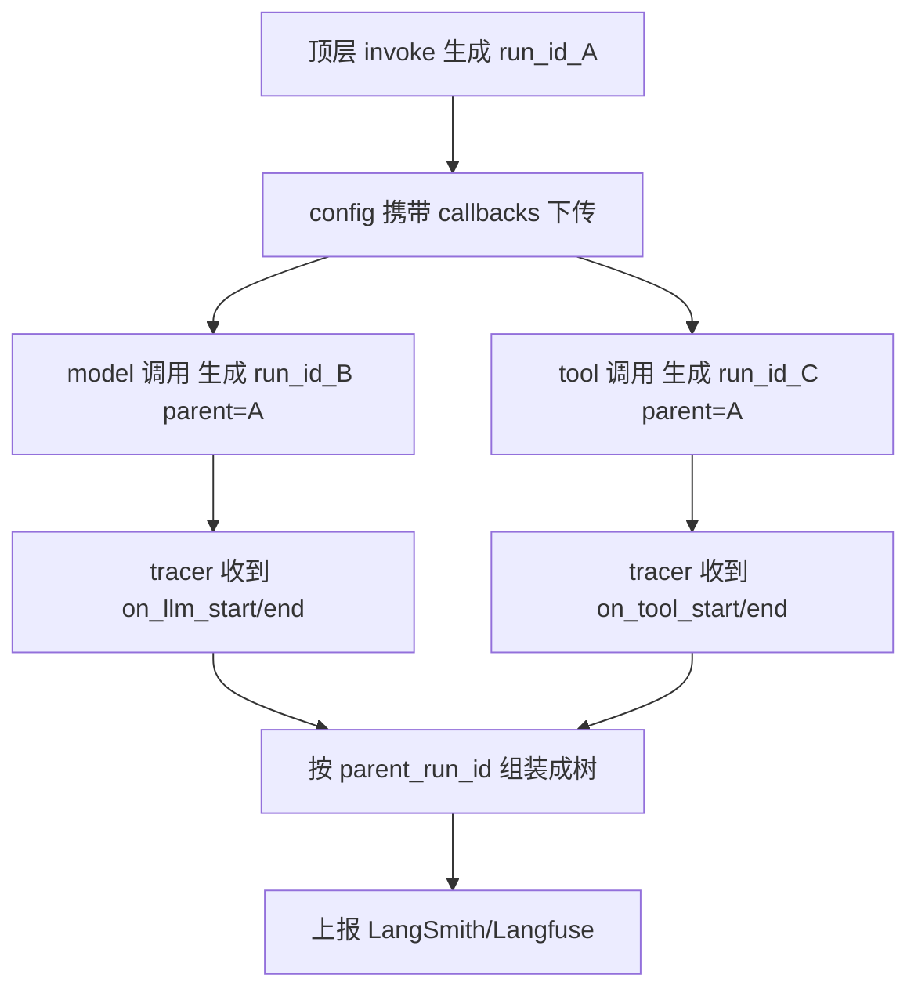

<title>Stage 5 · LangSmith 与可观测性：一条 Trace 是怎么长出来的</title>

<callout emoji="🎯">
**本阶段目标：**搞懂 LangChain「可观测性」的底层机制——不是「配个 API key 就能看图」，而是理解 **callbacks + RunnableConfig 如何贯穿每一次调用、run tree（调用树）如何被自动组装、tracer 如何把它上报**。用本仓的 tracing 插件和 DeerFlow 的 Langfuse 接入做双实证。
**阅读方式：**每节 = 「设计意图 → LangChain 源码片段讲逻辑 → 实证（本仓 / DeerFlow）」。读完你能回答「为什么 agent 里几十次模型/工具调用能自动拼成一棵有父子关系的树」。
</callout>

<callout emoji="💡">
**代码定位说明：**源码引用格式 `[仓库标签] 仓内完整相对路径:行号`，三仓根（本地平级 clone）：**[langchain]**=`/Users/bytedance/WorkSpace/Project/Community/langchain`；**[deerflow]**=`/Users/bytedance/WorkSpace/Project/Community/deer-flow`。
</callout>

# 零、承接前四阶段：可观测性为什么是「贯穿」出来的

前四个 Stage 反复出现一个参数你可能没在意：**每个 Runnable 方法都收一个 `config: RunnableConfig`**（Stage 1 讲 Runnable 时提过）。这个 config 就是可观测性的载体——它携带 `callbacks`、`tags`、`metadata`，**顺着调用链一层层传下去**。

所以 LangSmith 的「一条完整 trace」不是某个中心组件画出来的，而是：**每一层调用（chain→model→tool→子 chain）都通过 config 把 callbacks 往下传，每层开始/结束时触发回调，回调里带着 `run_id` 和 `parent_run_id`，tracer 据此把散点拼成一棵树。**理解「贯穿」二字，是这一阶段的核心。



# 一、RunnableConfig：贯穿一切的「随行上下文」

**设计意图：**要让追踪、tags、元数据自动跟随每一次调用而不用手工到处传，就需要一个「随行上下文」对象。它必须能被安全地在父子调用间传递、合并、派生。这就是 `RunnableConfig`。

**源码讲逻辑：**定义见 `[langchain] libs/core/langchain_core/runnables/config.py:57`：

```python
class RunnableConfig(TypedDict, total=False):
    tags: list[str]                    # 打在所有 callback 上的标签
    metadata: dict[str, Any]           # 传给 handle*Start 回调的元数据
    callbacks: Callbacks               # 回调（可观测性的真正入口）
    run_name: str
    run_id: UUID | None
    ...
```

三个配套函数解释了它如何「安全贯穿」：**(1)** `ensure_config`（config.py:255）——没传 config 时给一个干净默认值，保证下游永远拿得到。**(2)** `patch_config`（config.py:357）——派生子调用的 config 时，替换 callbacks 但清掉 run_name（因为 run_name 只该作用于同一个 run）。**(3) `callbacks` 字段的注释（config.py:95）写得很直白：**「tags 传给所有 callbacks，metadata 传给 handle\*Start 回调」。**这就是 tags/metadata 能出现在 LangSmith 每个 span 上的原因。**

<callout emoji="💡">
**关键心智：**你几乎从不手写 callbacks——框架在每层调用间自动 `patch_config` 派生并下传。你只需在**最外层**设好 tracing（配 env 或传 metadata），整棵树就都带上了。这就是「贯穿」的工程含义。
</callout>

# 二、CallbackManager 与 run tree：run_id / parent_run_id 如何组树

**设计意图：**一次 agent 运行有几十次子调用，怎么知道「谁是谁的子步骤」？答案：每次调用开始时生成一个 `run_id`，并记录它的 `parent_run_id`；父子 id 链就构成了调用树。

**源码讲逻辑：**负责派生子调用上下文的是 `CallbackManager`。当一个 run 开始，它创建一个 `RunManager` 持有自己的 `run_id`；要跑子步骤时，**用自己的 `run_id` 作为子调用的 `parent_run_id`**。见 `[langchain] libs/core/langchain_core/callbacks/manager.py:612` 一带：`CallbackManager(handlers=[], parent_run_id=self.run_id)`——子管理器的 parent 就是当前 run 的 id。而新 run 的 id 用 `uuid7()` 生成（manager.py:536），uuid7 自带时间序，方便排序。

<callout emoji="🧠">
**记忆点（来自项目经验）：**batch 场景有个约定——`run_id` 仅由首个 batch 元素继承，其余强制生成新 `uuid7()`，确保多条 trace 物理隔离、不串树。这是 tracing 树正确性的保障。
</callout>

# 三、BaseTracer：一个特殊的 callback handler

**设计意图：**tracer 本质就是一个 **callback handler**——它实现 `on_llm_start/end`、`on_chain_start/end`、`on_tool_start/end` 等钩子，在每个事件里把数据攒成 `Run` 对象，再上报。它不是独立于 callback 体系的东西，而是 callback 体系的一个消费者。

**源码讲逻辑：**`BaseTracer` 定义就写明了这个双重身份，见 `[langchain] libs/core/langchain_core/tracers/base.py:33`：

```python
class BaseTracer(_TracerCore, BaseCallbackHandler, ABC):
    @abstractmethod
    def _persist_run(self, run: Run) -> None: ...   # 子类实现「上报到哪」
```

它既是 `BaseCallbackHandler`（能接收回调），又通过 `_persist_run` 抽象方法把「怎么上报」留给子类——`LangChainTracer`（`[langchain] libs/core/langchain_core/tracers/langchain.py`）就实现成「发到 LangSmith」。`on_llm_start` 等钩子（base.py:108 起）都带 `run_id` / `parent_run_id` 参数，收到后交给下面的组树逻辑。

## 组树的核心：\_start_trace 的 dotted_order

这是整套机制最精妙的一处。每个 run 开始时，`_start_trace`（`[langchain] libs/core/langchain_core/tracers/core.py:124`）用三样东西把它挂到树上：

```python
def _start_trace(self, run: Run):
    current_dotted_order = run.start_time.strftime("...") + str(run.id)
    if run.parent_run_id:
        if parent := self.order_map.get(run.parent_run_id):
            run.trace_id, run.dotted_order = parent
            run.dotted_order += "." + current_dotted_order   # 父的 dotted_order + 自己
            if parent_run := self.run_map.get(str(run.parent_run_id)):
                self._add_child_run(parent_run, run)          # 挂成父的孩子
    else:
        run.trace_id = run.id                                 # 没有父 = 根节点
        run.dotted_order = current_dotted_order
    self.order_map[run.id] = (run.trace_id, run.dotted_order)
    self.run_map[str(run.id)] = run
```

三个关键设计：**(1) `run_map`**——id→Run 的字典，让子 run 能按 `parent_run_id` 找到父对象。**(2) `dotted_order`**——形如 `父时间戳+父id.子时间戳+子id` 的点分字符串，**一个字符串就编码了完整的层级路径和时间序**，LangSmith 靠它排序和缩进渲染。**(3) `trace_id`**——整棵树共享根的 id，标识「同一条 trace」。**这就是几十个散落的调用能自动拼成一棵有序树的全部秘密。**

# 四、tracing 怎么被「自动打开」：\_configure 注入 tracer

**设计意图：**你只设了个环境变量 `LANGSMITH_TRACING=true`，为什么 tracer 就自动挂上了？因为每次调用配置 callback manager 时，框架会检查环境、按需把 `LangChainTracer` 塞进 handler 列表。

**源码讲逻辑：**关键在 `_configure`（`[langchain] libs/core/langchain_core/callbacks/manager.py:2390`）。它先读 tracing 上下文，判断是否启用，再决定要不要注入 tracer，见 manager.py:2528 一带：

```python
if tracing_v2_enabled_ and not any(
    isinstance(handler, LangChainTracer) for handler in callback_manager.handlers
):
    ...
    handler = LangChainTracer(project_name=tracer_project, ...)   # manager.py:2532
    callback_manager.add_handler(handler)
```

逻辑很清楚：**只要 tracing_v2 启用且当前还没挂 tracer，就自动 `add_handler(LangChainTracer(...))`**。这就是「设个 env 就有 trace」的真相——没有魔法，只是 `_configure` 在每次构建 callback manager 时按环境自动补了一个 handler。`_configure` 由 Stage 1 讲过的 `invoke/stream` 在内部调用，所以每层调用都会走这套注入。

# 五、实证一（本仓）：CI tracing 桥接插件

<callout emoji="🔍">
**本仓实证：**本 monorepo 有个 pytest 插件把 CI 环境变量桥接进 tracing 上下文，见 `[langchain] libs/standard-tests/langchain_tests/_langsmith_plugin.py:83`：
</callout>

```python
from langsmith.run_helpers import tracing_context

with tracing_context(tags=tags or None, metadata=metadata):   # 进入追踪上下文
    yield
```

它解决一个真实工程问题：LangSmith SDK **不会**自动读 `LANGSMITH_TAGS` / `LANGSMITH_METADATA` 环境变量（插件顶部注释 :3 写明）。所以插件在测试会话期间手动进入 `tracing_context`，把 CI 注入的 tags/metadata 应用到本次会话的所有 trace 上。它只在 `GITHUB_ACTIONS=true` 时激活（:34），本地开发不受影响。**这印证了第一节「在最外层设好上下文，整棵树都带上」——这里的「最外层」就是整个 pytest session。**

# 六、实证二（DeerFlow）：Langfuse 接入的同源机制

DeerFlow 用的可观测性后端是 **Langfuse** 而非 LangSmith，但底层机制**完全同源**——都是「callback handler + config.metadata 贯穿」。这恰好证明这套机制是框架级的、后端无关的。

<callout emoji="🔍">
**实证 A（挂 handler）：**DeerFlow 把 Langfuse 的 CallbackHandler 挂到模型上，见 `[deerflow] backend/packages/harness/deerflow/tracing/factory.py:37` 的 `build_tracing_callbacks`（内部 `LangfuseCallbackHandler`，:25/:34），再由模型工厂附加，见 `[deerflow] backend/packages/harness/deerflow/models/factory.py:313`：
</callout>

```python
if attach_tracing:
    callbacks = build_tracing_callbacks()
    if callbacks:
        existing_callbacks = model_instance.callbacks or []
        model_instance.callbacks = [*existing_callbacks, *callbacks]   # 把 tracer 挂到模型
```

<callout emoji="🔍">
**实证 B（贯穿 metadata）：**DeerFlow 通过 `inject_langfuse_metadata` 把会话/用户/模型信息塞进 `config["metadata"]`，见 `[deerflow] backend/packages/harness/deerflow/tracing/metadata.py:80`：
</callout>

```python
merged_metadata = dict(config.get("metadata") or {})
for key, value in langfuse_metadata.items():
    merged_metadata.setdefault(key, value)    # 用户已设的值优先，不覆盖
config["metadata"] = merged_metadata          # 就是第一节的 RunnableConfig.metadata
```

然后在驱动 agent 前，把这份 config 传给 `agent.astream(config=...)`，见 `[deerflow] backend/packages/harness/deerflow/runtime/runs/worker.py:729` 调 `inject_langfuse_metadata`、:742 构造 `RunnableConfig`。**对照第一节：DeerFlow 做的就是「在最外层（worker 驱动 astream 处）设好 config.metadata + callbacks，让整棵 agent 调用树自动带上追踪信息」——和本仓 pytest 插件、和 LangSmith 自动注入是同一个原理的三种落地。**

<callout emoji="💡">
**DeerFlow 的一个坑（来自源码注释）：**attach_tracing 参数在 [deerflow] backend/packages/harness/deerflow/models/factory.py:174 的 docstring 里特别强调——如果调用方**已在图根挂了 tracing**（如 `make_lead_agent`、图内 `TitleMiddleware`），就必须传 `attach_tracing=False`；否则同一次 LLM 调用会发出**重复 span**（一个挂在图根、一个挂在模型），且 `session_id`/`user_id` 元数据会因模型变成嵌套 observation 而丢失。**这是「callbacks 会贯穿下传」的副作用——挂两遍就重复。理解了贯穿机制，才理解这个坑。**
</callout>

# 七、动手练习

<callout emoji="📝">
**练习 1（打开 trace）：**给你的 Ark/OpenRouter 练习脚本设 `LANGSMITH_TRACING=true` + `LANGSMITH_API_KEY`，跑一次 `model.invoke`，去 LangSmith 看生成的 trace。对照第四节想清楚：你没写任何 callback，tracer 是在哪一步被自动注入的。
**练习 2（看树）：**用 `create_agent` 建一个带工具的 agent 跑一个需要调工具的问题，在 LangSmith 观察 chain→model→tool 的父子层级，对照第三节 `dotted_order` 的结构。
**练习 3（打标签）：**调用时传 `config={"tags": ["exp-1"], "metadata": {"user": "me"}}`，验证 tags/metadata 出现在 trace 上，理解第一节 config 贯穿。
**练习 4（贯穿验证）：**写一个两层链 `chainA` 内部调用 `chainB`，只在最外层传一次 config，验证内层调用也带上了 tags——亲手确认「贯穿」。
**练习 5（反哺 DeerFlow）：**顺着 `[deerflow] backend/packages/harness/deerflow/runtime/runs/worker.py:729` → `tracing/metadata.py:80` → `models/factory.py:313`，画出 DeerFlow「在最外层注入 metadata + 给模型挂 handler」的完整链路，并说明 `attach_tracing=False` 那个坑为什么存在。
</callout>

# 八、源码精读清单（下沉顺序）

| 看什么 | 位置 |
|-|-|
| ① RunnableConfig 与贯穿函数 | `[langchain] libs/core/langchain_core/runnables/config.py:57`（callbacks :92 / ensure_config :255 / patch_config :357） |
| ② CallbackManager 派生子上下文 | `[langchain] libs/core/langchain_core/callbacks/manager.py:612`（run_id=uuid7 :536 / parent_run_id 传递） |
| ③ tracer 自动注入 | `[langchain] libs/core/langchain_core/callbacks/manager.py:2390`（\_configure；LangChainTracer 注入 :2528-2532） |
| ④ BaseTracer 与组树 | `[langchain] libs/core/langchain_core/tracers/base.py:33`；组树 core.py:124（\_start_trace / dotted_order / run_map） |
| ⑤ 本仓 CI tracing 桥接 | `[langchain] libs/standard-tests/langchain_tests/_langsmith_plugin.py:83` |
| ⑥ DeerFlow Langfuse 接入 | `[deerflow] backend/packages/harness/deerflow/tracing/factory.py:37`、tracing/metadata.py:80、models/factory.py:313、runtime/runs/worker.py:729 |

# 九、自检清单（能答上来就算过）

<callout emoji="💡">
**1.** LangSmith 的一条完整 trace 是「某个中心组件画的」还是「贯穿出来的」？载体是什么对象的哪几个字段？
**2.** `run_id` 和 `parent_run_id` 是怎么产生的？它们如何构成调用树？
**3.** `dotted_order` 是什么？为什么一个字符串就能表达层级 + 时间序？`run_map` 的作用是什么？
**4.** tracer 本质是什么？它和普通 callback handler 什么关系？`_persist_run` 抽象方法留给子类干什么？
**5.** 只设一个环境变量 tracer 就自动挂上，发生在哪个函数的哪个判断分支？
**6.** DeerFlow 用 Langfuse 而非 LangSmith，为什么说底层机制同源？举出「挂 handler」和「贯穿 metadata」各一处源码。
**7.** DeerFlow 的 `attach_tracing=False` 坑是怎么来的？它印证了贯穿机制的什么特性？
</callout>