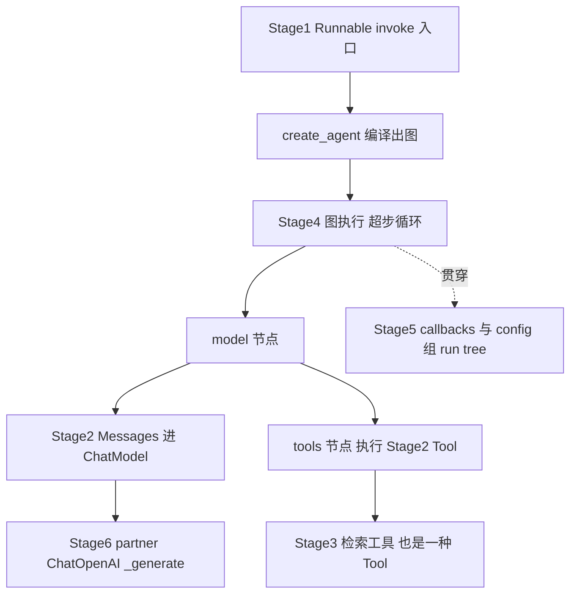

<title>Stage 6 · 源码深读与 Partner 集成：把五个 Stage 串成一条线</title>

<callout emoji="🎯">
**本阶段目标（收官）：**两条主线合流——**(A) 端到端源码走读**：跟着一次 `create_agent(...).invoke(...)`，从入口一路走到图执行，把 Stage 1-5 学的 Runnable / Messages / Tool / 图 / 可观测性全部对应到源码；**(B) Partner 集成拆解**：以 `langchain-openai` 为例讲清「一个模型集成包长什么样、怎么实现、怎么被动态加载」，并用 DeerFlow 的 `resolve_class` 收尾。
**阅读方式：**每节 = 「设计意图 → 源码片段讲逻辑 → 实证」。读完你应能：指着任意一层说出它在整条调用链的位置，并能自己接入或编写一个 partner 包。
</callout>

<callout emoji="💡">
**代码定位说明：**源码引用格式 `[仓库标签] 仓内完整相对路径:行号`，三仓根（本地平级 clone）：**[langchain]**=`/Users/bytedance/WorkSpace/Project/Community/langchain`；**[langgraph]**=`/Users/bytedance/WorkSpace/Project/Community/langgraph`；**[deerflow]**=`/Users/bytedance/WorkSpace/Project/Community/deer-flow`。
</callout>

# 零、全景：五个 Stage 在一次调用里各占哪一环

前五个 Stage 是分块讲的，这里先用一张图把它们缝合成一条完整调用链——这也是本阶段 A 线要逐层走读的地图。



# 一、A 线第 1 层：create_agent 是怎么把图搭出来的

**设计意图：**你调 `create_agent(model, tools, ...)` 拿到的不是链，而是一张编译好的 LangGraph 图（Stage 4 讲过）。这一节把「搭图」这一步的源码顺序走一遍，看它如何用 Stage 4 的 StateGraph API。

**源码讲逻辑：**入口在 `[langchain] libs/langchain_v1/langchain/agents/factory.py:740`（多个 `@overload` 后，真正实现在 :808 起）。它的返回类型标注就点明了本质——`CompiledStateGraph`（factory.py:757）。建图顺序清晰可循：

```python
graph = StateGraph(...)                                    # factory.py:1161 建图
graph.add_node("model", RunnableCallable(model_node, ...)) # :1502 模型节点
graph.add_node("tools", tool_node)                         # :1506 工具节点
# 每个 middleware 编译成额外节点（Stage 4 讲的洋葱层）
graph.add_node(f"{m.name}.before_model", ...)              # :1527 起
graph.add_conditional_edges(...)                           # :1632 「要调工具吗」菱形判断
return graph.compile(...)                                   # :1787 编译成可执行图
```

三点回收：**(1)** `model_node` 用 `RunnableCallable` 包裹——它同时提供同步 `model_node` 和异步 `amodel_node`，这正是 Stage 1「invoke/ainvoke 对称」在图节点层的体现。**(2)** `add_conditional_edges`（:1632）就是 Stage 4 那个「有 tool_calls 就去 tools，否则结束」的条件边。**(3)** `compile()` 把描述性的图变成一个实现了 Runnable 协议的 `CompiledStateGraph`——所以下一步你能对它 `.invoke()`。

# 二、A 线第 2 层：invoke 进入图，超步循环开始转

**设计意图：**对编译后的图调 `.invoke(input)`，控制权就交给了 LangGraph 的 Pregel 引擎（Stage 4 第三节）。这一层解释「一次 invoke 如何驱动 model↔tools 循环转起来」。

**源码讲逻辑：**`CompiledStateGraph` 也是 Runnable，其执行落到 Pregel 主循环 `[langgraph] libs/langgraph/langgraph/pregel/_loop.py:158`。每个超步：找出被激活的节点 → 并行执行 → 通过 Channel（Stage 4 第二节）合并写入 state → 按边算下一批激活节点。对最小 agent 图，节奏就是：**START → model 节点 → 条件边判断 → （有 tool_calls）tools 节点 → 回到 model → …… → （无 tool_calls）END**。每一轮 model→tools→model 就是一个（或几个）超步。

<callout emoji="💡">
**回收 Stage 4：**为什么必须是「图」而非「LCEL 直线」？因为这里有 `tools → model` 的**回边**，直线管道表达不了「回到上一步」。超步模型让每轮循环之间 state 是一致的稳定点，也正是断点续跑 / checkpoint 的落点。
</callout>

# 三、A 线第 3 层：model 节点内部——从 invoke 到 partner 的 \_generate

这是全课程「最深的一跳」：图的 model 节点最终会调用你传入的 ChatModel。现在把 Stage 1 埋下的伏笔挖到底——**`model.invoke` 最终调用的是 partner 实现的 `_generate`**。

**源码讲逻辑（调用链）：**

```text
model.invoke(messages)                        # Stage1: BaseChatModel.invoke, chat_models.py:463
  → _convert_input(...)                        # Stage2: 归一成 PromptValue, :449
  → generate_prompt(...)                        # chat_models.py:1841
    → _generate_with_cache(...)                 # chat_models.py:1864（查缓存/触发回调）
      → _generate(messages, ...)                # chat_models.py:2180 —— @abstractmethod！
```

关键在最后一跳：`_generate` 在 `[langchain] libs/core/langchain_core/language_models/chat_models.py:2180` 是 **`@abstractmethod`**——**基类不实现，强制每个 partner 自己实现**。这就是「统一接口、各家实现」的分界线：`invoke`/`stream`/缓存/回调这些通用逻辑基类全包了，唯独「真正怎么调这家 API」留给 partner 的 `_generate`。`_generate_with_cache`（:1864）在调 `_generate` 前后处理缓存和 Stage 5 的回调触发——所以 run tree 的每个 LLM span 就是在这里产生的。

# 四、B 线：一个 Partner 集成包长什么样（以 langchain-openai 为例）

**设计意图：**LangChain 主包不绑定任何厂商 SDK，每个模型厂商是一个独立发布的 `langchain-xxx` 包。这样厂商能独立迭代版本，用户按需安装。拆解它的结构，你就懂了「集成」的全部要件。

**目录结构（`[langchain] libs/partners/openai/`）：**

| 组成 | 作用 |
|-|-|
| `pyproject.toml` | 包名 `langchain-openai`、版本、依赖 `langchain-core`（本地 editable 指向 ../../core） |
| `langchain_openai/__init__.py` | 导出 `ChatOpenAI`/`AzureChatOpenAI` 等公共入口 |
| `chat_models/base.py` | 核心：`ChatOpenAI` 实现 |
| `embeddings/` `llms/` `tools/` | 其他能力：嵌入、补全、内置工具 |
| `data/`（含 profile_augmentations.toml） | model-profiles：模型能力元数据（上下文窗口、是否支持视觉等） |

**源码讲逻辑（实现要件）：**`ChatOpenAI`（`[langchain] libs/partners/openai/langchain_openai/chat_models/base.py:2612`）继承自 `BaseChatOpenAI`（:622），后者继承 `BaseChatModel`。它实现了第三节说的那个抽象方法，以及一整套配套：

| 方法 | 职责 / 源码 |
|-|-|
| `_generate` | 非流式核心：调 OpenAI API → 转成 ChatResult（[langchain] libs/partners/openai/langchain_openai/chat_models/base.py:1695；结果封装 \_create_chat_result :1797） |
| `_stream` / `_astream` | 流式：逐 chunk yield（base.py:1620 / :1881）——Stage 1 stream 的真身 |
| `_llm_type` | 返回模型类型标识（base.py:2070） |
| `bind_tools` | 把 Stage 2 的 `@tool` 转成 OpenAI function schema 挂上（base.py:2203） |
| `with_structured_output` | 结构化输出（base.py:2311）——Stage 2 弱化 OutputParser 后的首选 |

<callout emoji="💡">
**写一个自己的 partner 需要什么：**最小要件就是「继承 `BaseChatModel` + 实现 `_generate` + 实现 `_llm_type`」。想支持流式再加 `_stream`，想支持工具再加 `bind_tools`。基类把 invoke/batch/callbacks/缓存全给你了——这就是 Stage 1「统一基类」设计对集成者的最大红利。
</callout>

# 五、B 线：standard-tests——集成质量的统一标尺

**设计意图：**几十个 partner 包若各写各的测试，质量参差。LangChain 用一套**共享测试套件** `langchain-tests`，让每个 partner 继承同一批标准用例，保证「所有集成行为一致」。

**源码讲逻辑：**标准测试基类在 `[langchain] libs/standard-tests/langchain_tests/`：单测 `ChatModelUnitTests`（unit_tests/chat_models.py:277）、集成测试 `ChatModelIntegrationTests`（integration_tests/chat_models.py:194）。partner 只需继承它、用 `chat_model_class` 指定自己的模型类（示例见 :210/:230 的 `ChatParrotLink`），就自动获得一大批标准用例（消息往返、工具调用、流式、usage 统计等）。**这套包还携带 Stage 5 讲过的 `_langsmith_plugin.py`，把 CI 测试自动接入追踪。**

# 六、合流：DeerFlow 如何「按字符串加载一个 partner 类」

A 线（图怎么跑）和 B 线（partner 怎么写）在这里合流——DeerFlow 不 `import ChatOpenAI` 写死，而是**按配置字符串动态解析 partner 类**，这样换厂商只改配置。这正是 Stage 2 `create_chat_model` 里那行 `resolve_class` 的展开。

<callout emoji="🔍">
**DeerFlow 实证：**`[deerflow] backend/packages/harness/deerflow/models/factory.py:208` 调 `resolve_class(model_config.use, BaseChatModel)`，其实现见 `[deerflow] backend/packages/harness/deerflow/reflection/resolvers.py:73`：
</callout>

```python
def resolve_class[T](class_path: str, base_class: type[T] | None = None) -> type[T]:
    model_class = resolve_variable(class_path, expected_type=type)   # "langchain_openai:ChatOpenAI" → 类对象
    if not isinstance(model_class, type):
        raise ValueError(f"{class_path} is not a valid class")
    if base_class is not None and not issubclass(model_class, base_class):
        raise ValueError(f"{class_path} is not a subclass of {base_class.__name__}")   # 强制校验是 BaseChatModel 子类
    return model_class
```

这段把全课程收束得很漂亮：**(1)** 配置里写 `"langchain_openai:ChatOpenAI"`，运行时按字符串导入——这就是第四节 partner 包 `__init__.py` 导出 `ChatOpenAI` 的用途。**(2)** `issubclass(model_class, BaseChatModel)` 的校验，正是因为第三节说的「所有 partner 都继承 `BaseChatModel`、共享统一接口」——只要是子类，DeerFlow 后续的 `ainvoke`/`with_config`/塞进 `create_agent` 就都成立。**(3)** 换个厂商（如 `langchain_anthropic:ChatAnthropic`）只改配置字符串，业务代码零改动——这就是「统一抽象 + 动态加载」的终极价值。

# 七、动手练习

<callout emoji="📝">
**练习 1（走读 A 线）：**在 `[langchain] libs/langchain_v1/langchain/agents/factory.py:1161` 打断点或加日志，跑一次带工具的 `create_agent(...).invoke(...)`，观察 model 节点、tools 节点、条件边被调用的顺序，对照第一、二节。
**练习 2（挖到 \_generate）：**给你的 `ChatOpenAI`/OpenRouter 模型 `invoke` 一次，在 `[langchain] libs/core/langchain_core/language_models/chat_models.py:2180` 的 `_generate` 处确认它进了 partner 实现（base.py:1695），亲眼看到「统一接口→各家实现」的分界。
**练习 3（读 partner）：**通读 `[langchain] libs/partners/openai/langchain_openai/chat_models/base.py` 的 `_generate`（:1695）和 `_stream`（:1620），说清一次非流式 vs 流式调用分别怎么把 OpenAI 响应转成 `ChatResult`/chunk。
**练习 4（写最小 partner）：**照 standard-tests 里的 `ChatParrotLink`（unit_tests/chat_models.py:313）写一个玩具 ChatModel，只实现 `_generate` + `_llm_type`，验证它能 `invoke`、能进 `create_agent`。
**练习 5（反哺 DeerFlow）：**顺着 `[deerflow] backend/packages/harness/deerflow/models/factory.py:208` → `reflection/resolvers.py:73`，把配置字符串改成另一个 partner（如 anthropic），验证「只改配置不改代码」；并说明 `issubclass` 校验为什么能成立。
</callout>

# 八、源码精读清单（下沉顺序）

| 看什么 | 位置 |
|-|-|
| ① create_agent 建图 | `[langchain] libs/langchain_v1/langchain/agents/factory.py:740`（建图 :1161 / model :1502 / tools :1506 / 条件边 :1632 / compile :1787） |
| ② 图执行引擎 | `[langgraph] libs/langgraph/langgraph/pregel/_loop.py:158` |
| ③ invoke → \_generate 调用链 | `[langchain] libs/core/langchain_core/language_models/chat_models.py:463`（invoke）→ :1841（generate_prompt）→ :1864（\_generate_with_cache）→ :2180（\_generate 抽象） |
| ④ Partner 实现 | `[langchain] libs/partners/openai/langchain_openai/chat_models/base.py:2612`（ChatOpenAI；\_generate :1695 / \_stream :1620 / bind_tools :2203） |
| ⑤ Partner 包结构 | `[langchain] libs/partners/openai/pyproject.toml`、langchain_openai/\_\_init\_\_.py、data/（model-profiles） |
| ⑥ 标准测试套件 | `[langchain] libs/standard-tests/langchain_tests/integration_tests/chat_models.py:194`、unit_tests/chat_models.py:277 |
| ⑦ DeerFlow 动态加载 | `[deerflow] backend/packages/harness/deerflow/models/factory.py:208`、reflection/resolvers.py:73 |

# 九、自检清单（能答上来就算过）

<callout emoji="💡">
**1.** `create_agent` 返回什么？它内部按什么顺序调了哪些 StateGraph API？
**2.** 对编译后的图 `invoke`，控制权交给了谁？model↔tools 循环靠什么表达、为什么不能用 LCEL 直线？
**3.** `model.invoke` 到 partner 的完整调用链是怎样的？哪个方法是 `@abstractmethod`、为什么这么设计？
**4.** 一个 partner 包最小实现要件是什么？基类替集成者包办了哪些通用能力？
**5.** standard-tests 解决什么问题？partner 怎么接入它？
**6.** DeerFlow 如何做到「换厂商只改配置」？`resolve_class` 里的 `issubclass(..., BaseChatModel)` 校验凭什么总能成立？
**7.** 用这条端到端链，把 Stage 1-5 的核心概念各自定位到调用链的哪一环。
</callout>