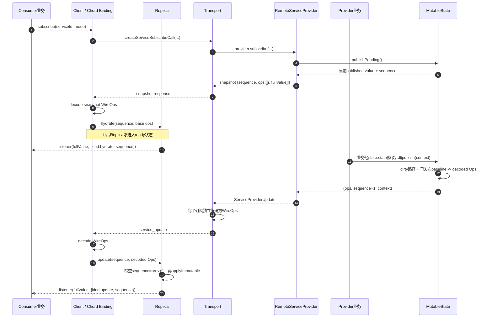

<title>Chord 组件机制：跨进程组合与 Snapshot + Update 状态复制</title>

本文解释 Chord 在 Pi 新 Harness 架构中的角色，并把它从 Pi 产品逻辑、RPC transport和插件打包细节中分离出来。读完后应能回答四个问题：Chord到底解决什么，为什么它不是一个独立服务，Snapshot + Update怎样从Provider闭环到Consumer，以及哪些能力可以复用于其他Agent或一般服务化应用。

<callout emoji="💡">
**适用基线：**Pi 仓库 main 分支提交 `6671c604766b3670ed95f405aa7856835d0ca702`，核验日期 2026-09-22。Chord公开包名为 `@earendil-works/chord`，位于 Pi monorepo，但源码和依赖边界按独立通用组件维护。
</callout>

# 一句话定位

Chord是一个**应用组合运行时**：它让一个功能拆成运行在不同Host中的Facet，通过有稳定身份的Service互相依赖，并由Host统一完成依赖图校验、激活、远端绑定、复制状态、热替换和逆序释放。

Chord不是插件市场，不负责安装依赖；不是网络服务，不监听端口；也不是完整分布式通信框架，不规定socket、WebSocket、CBOR、request ID、server路由或认证。应用必须提供这些外层能力。

> 图示重建说明（私人画板已移除）：按 Host 划分进程内边界，把 Facet、Service 的提供方与消费方放入对应 Host；跨 Host 的通信由应用 Adapter 和 transport 连接。

# 为什么需要 Facet，而不是一个大插件对象

一个功能可能同时需要 Session Worker中的工具实现、TUI中的对话框和Server中的全局目录。它们位于不同进程，依赖也不同。若强行加载一个聚合插件对象，就会把Node工具代码、终端UI代码和浏览器代码耦合在同一模块中，并模糊凭证与状态的owner。

Chord把进程内装载单元定义为Facet：

```typescript
interface Facet {
  readonly id: string;
  setup(env: FacetEnvironment): void;
}
```

`setup()`只同步声明依赖、提供能力和注册生命周期回调；真正的异步初始化放在 `onActivate()`。一个插件包可以导出多个进程专用bundle，但不存在一个跨进程共享实例。

# 四个核心抽象

| 抽象 | 解决的问题 | 关键约束 |
|-|-|-|
| Facet | 声明一个功能在当前Host里的依赖、提供和生命周期 | setup同步；ID稳定；依赖必须在setup期间声明 |
| Service | 用稳定token连接provider与consumer | singleton或keyed二选一；remote契约只允许方法和ReplicatedState |
| ReplicatedState | 把provider权威状态以快照和增量复制给消费者 | 严格JSON；断线后unready；重新连接必须重新hydrate |
| Context | 显式携带取消信号和一次调用范围内的值 | 控制数据不序列化；远程proxy剥离尾部Context |

# Service：声明即依赖图

## 稳定token与两种提供模式

`defineService<T>(id)`只创建类型化身份，不创建实例。Facet在setup里选择一种模式：

- `provide(service, implementation)`：提供一个singleton。
- `use(service)`：声明依赖singleton，并立即取得稳定lazy proxy。
- `provideMany(service)`：声明拥有keyed Service，返回可在运行时 `spawn(key, implementation)`的spawner。
- `observe(service, handler)`：声明依赖keyed Service，观察实例出现、替换和关闭。

同一generation内，一个token不能混用singleton与keyed模式。`local: true`的Service只在进程内使用，可以承载任意JavaScript对象；默认可远程暴露的Service必须满足严格契约。

## 为什么不需要单独维护 requires/provides 清单

TypeScript interface运行时已擦除，Chord不会反射类型。相反，Facet在setup期间实际调用 `use`、`observe`、`provide`和 `provideMany`，Host据此记录generation-scoped ledger。所有Facet声明完成后，Host再一次性解析provider，检查缺失、重复、模式不一致和依赖环。

> 图示重建说明（私人画板已移除）：从 Facet 的 use、observe、provide 和 provideMany 声明生成依赖图；标明 provider 先激活、consumer 后激活，释放顺序相反。

生命周期排序来自真实Service依赖边，而不是插件列表顺序。Provider先激活，consumer后激活；释放时反过来。Facet用 `own()`交给Host的资源也按逆序释放，因此setup失败不会把已经创建的局部资源泄漏出去。

# 稳定句柄如何屏蔽连接和替换

`use()`返回的对象身份在provider未连接、断开或热替换时保持不变。成员第一次被访问时才建立本地slot；远端catalogue与snapshot到达后，Chord校验该成员究竟是method还是state并接入当前provider。consumer不需要在每次重连后换引用。

keyed Service实例用 `{key, generation}`寻址。同一个key关闭后重新spawn会递增generation，迟到调用不能误打到新实例。这和Pi Protocol的attachment generation思想相似，但分别属于Service实例层和Session路由层。

# 远程Service主线

> 图示重建说明（私人画板已移除）：连接 Service consumer、应用 Adapter、transport 与 provider；沿调用和订阅分别标出 catalogue、control call、snapshot 与 update 的交接。

Chord只拥有图中的Service语义：catalogue、control call、方法调用、订阅、snapshot/update和错误码。应用Adapter决定这些JSON值放进什么外层信封、发往哪个进程、如何关联response、是否认证和使用哪种transport。

## 严格JSON边界

远程方法必须形如“JSON参数加尾部Context，返回Promise中的JSON或void”。远端对象成员只能是方法或 `ReplicatedState`。`undefined`、函数值、class实例、Map、Set、循环引用和非有限number不能跨边界。业务上的空值用 `null`；state尚未hydrate时本地 `value === undefined`只表示控制面未就绪。

# ReplicatedState的 Snapshot + Update 闭环

Provider用 env.replicatedState(initial)得到权威可变proxy。所有修改必须经 state完成，再调用 publish(context)。初始化时Tracker建立base；对外订阅时总是发送当前完整值的base snapshot，之后的publish才发送相对上一发布基线的路径操作。消费者得到不可变revision，未变部分可以结构共享。

- 字符串追加和前部截断有专门增量表达，适合流式文本与滚动窗口。
- 数组追加可表达为splice；复杂改写会按位置继续diff、组合splice，只有无法安全缩小时才回退为较大范围的set。
- 每个service subscription × Service实例 × state member都有独立path codec；replacement、unavailable和新snapshot会重置/重建，实例关闭只移除对应codec，断线则丢弃整个订阅codec。
- 断线期间不自动回放应用mutation。重新绑定从新snapshot恢复权威值。

因此它比“发事件让前端自己拼状态”更可验证，又比每次发完整snapshot更节省；但它不是数据库复制或跨机持久化。

## 先看完整闭环：订阅先拿 base，之后只接连续 update

这里的 `snapshot`不是数据库快照，而是“某个订阅开始时，足以独立构造当前状态的一批 base operations”；`update`也不是业务事件原文，而是把上一已发布版本变成下一版本的路径操作。二者由同一个单调递增的 `sequence`串起来。



**传输结论：**这是主动推送，不是客户端定时poll。Chord定义订阅、snapshot、update和合并规则；socket、Radius或WebSocket只负责把请求、响应和 `service_update`消息按序送达，因此可以替换传输实现，但不能省掉Chord上层的状态协议。

## 四份容易混淆的“状态”

| 对象 | 由谁持有 | 实际含义 |
|-|-|-|
| `MutableReplicatedState.state` | Provider业务 | 当前可写proxy，可能包含尚未publish的修改。 |
| `MutableReplicatedState.value` | Provider侧状态对象 | 上一次成功publish后的不可变完整值；给本地订阅者和新远程订阅生成snapshot。 |
| Tracker baseline | Delta tracker内部 | 用于和dirty路径上的当前值比较的“上次flush基线”。它是生成operations的内部参照，不是另一个对外snapshot。 |
| `ReplicatedStateReplica.value` | Consumer | 由base hydrate后，再逐批不可变合并update得到的客户端完整值；未hydrate或检测到序号缺口时为 `undefined`。 |

因此，“Provider内存持有完整snapshot，再与整个对象做diff”只说对了一半：Provider确实同时持有当前可写值和上一已发布完整值，但Proxy在写入时还会记录dirty路径；flush不扫描未触及的根状态分支；但dirty节点代表整段对象替换或复杂数组改写时，仍可能完整比较该dirty子树或数组。多次中间写入会折叠为从上一发布基线到当前最终值的一批operations。

**源码：**`packages/chord/src/services/state.ts:6-54`；`packages/chord/src/delta/index.ts:315-361, 435-477, 613-676, 725-746`。

## 接口按“问什么 → 答什么”理解

| 调用 | 调用方在问什么 | 返回或产生什么 |
|-|-|-|
| `env.replicatedState(initial)` | 给我一个可跟踪、可发布的权威状态。 | `{state, value, publish, subscribe}`；初始化时内部建立base，但业务sequence仍从0开始。 |
| 写 `state.state.x = ...` | 把当前工作状态改成什么。 | 同步修改proxy指向的值，并标记路径dirty；此时尚未对外发布。 |
| `state.publish(context)` | 把上一已发布版本到当前版本的差异结算并通知订阅者。 | 返回 `void`；有实际差异时生成Ops、sequence加1、更新published value并推送。无差异则什么也不发。 |
| `provider.subscribe(serviceId, mode, listener)` | 给我这个Service当前可独立恢复的起点，并继续通知后续变化。 | `{snapshot, activate, close}`。snapshot中每个state成员都是 `{sequence, ops:[["r", fullValue]]}`。 |
| `replica.subscribe(listener)` | 状态可用或变化时把完整新版本交给我。 | 已hydrate则立即回调一次 `kind:"hydrate"`；以后每个连续update回调 `kind:"update"`。 |

**源码：**`packages/chord/src/types.ts:38-55, 134-173`；`packages/chord/src/services/provider.ts:237-283, 435-464`；`packages/chord/src/services/state.ts:74-105`。

## 一批operations里到底有什么

路径是从状态根节点走到目标位置的segment数组：对象字段用字符串，数组下标用非负整数。例如 `["snapshot","operation","streamingMessage"]`表示沿三个字段定位到流式消息。它不是文件路径，也不是JSONL行号。

| 操作 | 含义 | 示例 |
|-|-|-|
| `r` | 替换整个根值；base batch的第一项必须是它。 | `["r", {"output":"abcdefgh"}]` |
| `s` | 设置某条路径的值，即让指定字段/数组元素变为新值。 | `["s", ["status"], "done"]` |
| `d` | 删除对象属性。 | `["d", ["retry"]]` |
| `a` | 向字符串尾部追加。 | `["a", ["output"], "xyz"]` |
| `t` | 从字符串头部裁掉指定数量的UTF-16 code units（代码单元）；是对副本状态的增量变换，不是撤回已经显示过的网络消息。 | `["t", ["output"], 3]` |
| `p` | 数组splice：从index起删除remove项，再插入items。 | `["p", ["items"], 2, 0, [3]]` |

例如上一发布值是 `{output:"abcdefgh", items:[1,2], status:"running"}`，本批改为 `{output:"defghxyz", items:[1,2,3], status:"done"}`，可能得到：

```typescript
[
  ["t", ["output"], 3],
  ["a", ["output"], "xyz"],
  ["p", ["items"], 2, 0, [3]],
  ["s", ["status"], "done"]
]
```

这批内容描述的是“怎样得到下一份完整状态”，不是“用户刚发生了什么业务事件”。因此Harness event可以触发这些变化，但不能与operations逐项等同。

**源码：**`packages/chord/src/delta/index.ts:30-36, 194-313, 1002-1005`；行为例见 `packages/chord/test/delta.test.ts:29-124`。

## Decoded Ops与WireOps是两层，不要混在一起

Tracker产出的是带完整路径的decoded Ops。跨进程前，Server为“每个订阅 × 每个Service实例 × 每个state成员”建立独立Encoder；Client建立严格配对的Decoder。路径第一次出现时内联，第二次出现时可用 `["#", id, path]`建字典，后续用数字id引用；同一batch连续使用相同路径时还可省略路径。

```typescript
// 第一批
[["s", ["revision"], 1]]

// 第二批：先定义id=0，再引用
[["#", 0, ["revision"]], ["s", 0, 2]]
```

因此同一批decoded Ops发给两个不同客户端，WireOps可能不同：各自字典历史不同。完整 r是恢复点，会清空字典；replacement、unavailable和新snapshot会重置/重建对应codec，实例关闭只移除该实例的codec，后续新实例再新建。

**源码：**`packages/chord/src/delta/index.ts:1090-1265`；`packages/chord/src/services/state-codec.ts:27-157`；接线位置为 `packages/server/src/server.ts:338-381, 438-449`和 `packages/client/src/client.ts:172-220, 313-330`。

## 为什么snapshot与紧随其后的update不会互相超车

1. Provider订阅前先 `publishPending`，保证snapshot包含订阅瞬间以前的修改；创建snapshot后、订阅activate前产生的update先留在Provider buffer。
2. Server从处理subscribe请求起缓存新update；建立Encoder并发出snapshot response后，再按顺序冲刷 pendingUpdates。
3. Client在snapshot尚未decode时先收进 queuedWireUpdates；snapshot建立Decoder字典并hydrate后再decode这些update。decode完成但transport subscription尚未start/ready时，Client再放入第二层decoded queued；Chord facade安装snapshot并activate subscription后，Client才按序交给Chord consumer。

这三层buffer不是重复实现同一件事：它们分别保护Provider激活边界、Server“编码器建立/响应发出”边界和Client“字典hydrate/业务ready”边界。共同保证Consumer总是先拿可独立恢复的base，再按原顺序接update。

**源码：**`packages/chord/src/services/provider.ts:237-283`；`packages/server/src/server.ts:332-381`；`packages/client/src/client.ts:172-220, 313-330`。

## 序号缺口、断线和重新hydrate

- Snapshot可携带任意当前sequence（初始常为0），但必须以 `r`开头；Replica只有hydrate后才有值。
- Update必须满足 `nextSequence === currentSequence + 1`。重复或跳号都会清空Replica，使 value重新变为 undefined，同时经绑定层onError上报错误；clear本身不会向已有state listener发送一次undefined通知；只有重新hydrate时listener才再次收到值；此后连续的有效update才继续触发通知。
- Chord不保存缺失update供重放，也不自行重连。外层transport或绑定生命周期需要重新subscribe，以新snapshot重新hydrate。
- 不可变合并只复制被修改路径上的容器；未变化子树可以共享引用，所以旧revision不会被后续update原地改坏。

**源码：**`packages/chord/src/services/state.ts:59-110`；`packages/chord/src/delta/index.ts:1013-1064`；对应缺口测试 `packages/chord/test/services.test.ts:500-550`。

## 映射到Pi Transcript：Harness event不是直接下发的delta

`Transcript Provider`持有 `{snapshot, event}`这份权威状态。启动时 `lane.watch()`返回完整 `LaneSnapshot`，Provider写入state并publish；运行中收到可转发的 `HarnessEvent`后，先用 `reduceLaneSnapshot(snapshot, event)`原地归约完整Lane状态，再把事件放入 `state.event`，最后publish。这里“归约”就是把一条业务事件应用到当前完整状态，例如 `entry_added`追加transcript并更新 `tipId`，`tool_update`更新运行中工具结果。

随后Chord只观察最终被改动的字段并生成operations。Consumer每次收到的仍是合并后的完整 `TranscriptState`；其中 `event`保留给展示副作用，但hydrate不会把旧event重新当成一次新事件执行。若Reducer判断某类变化无法可靠增量归约，则Provider异步调度且合并并发rebase：当前可转发event仍先写入 state.event并publish；resnapshot()完成后再以event:null发布新的权威LaneSnapshot。

**源码：**`packages/coding-agent/src/experimental/services/transcript-provider.ts:20-77`；`packages/coding-agent/src/experimental/services/transcript.ts:4-13`；`packages/agent/src/harness/runtime/reducer.ts:21-25, 93-183；packages/coding-agent/src/experimental/client.ts:85-94`。

## 能力边界与Node编程提示

- **不是轮询器：**`publish()`是显式批次边界，没有内置定时器；调用频率由业务决定。
- **不是事件存储：**中间写入可以被折叠，只有flush时相对published baseline的最终差异会发出。
- **不是多主复制：**它假设单一Provider写、按序交付；冲突合并、持久化、重试和断点续传不在Delta层。
- **只能经Proxy写：**绕过 `state.state`修改原对象不会被跟踪；写入对象随后归Tracker所有，也不能从外部保留别名继续修改。
- **Node常见模式：**这里用 `Proxy`拦截属性写入，用闭包保存baseline与dirty tree，用 `Set<listener>`实现订阅，用返回的unsubscribe函数管理生命周期；这些都是Node/TypeScript里常见的轻量可观察对象写法。

# Facet bundle：为什么输出CommonJS

Chord bundler读取普通 `package.json`中的name、version、peerDependencies和可选 `chord`配置，再结合Host提供的约定入口，把每个Facet入口分别构建成一个内容寻址的 `.cjs`文件，并生成 `chord-facets.json`。

| 输入 | 作用 |
|-|-|
| `package.json` | 标准Node包元数据，加可选 `chord.facets`、`chord.external`、`chord.sourceMap` |
| Host默认入口 | Pi当前约定存在时使用 `src/session.ts`和 `src/tui.ts`；不是Chord强制文件 |
| `chord.facets` | 覆盖、增加或用false禁用某个Host入口 |
| peerDependencies与external | 不打进bundle，由接收Host按自己的版本解析 |

输出CommonJS不是因为源代码必须写成CJS。源文件可以是TypeScript或ESM；esbuild把单个入口连同内部依赖压成一个CJS body。Loader不调用Node普通 `require`缓存该bundle，而是用 `node:vm.compileFunction`每次编译一个新generation，并只开放manifest声明的external require。这样热reload可以产生新的模块实例，并在旧generation释放后让其被GC。

# 装载、传输和热替换

1. 构建器先写临时目录，完成后原子替换输出目录，避免loader看到半成品。
2. manifest记录每个入口文件、SHA-256 integrity、source map和external imports。
3. 同机Host用 `createFacetBundleLoader()`读取manifest并校验源码。
4. 要发给另一Node Host时，`readFacetBundleArtifact()`把单个已校验入口与源码装成严格数据；接收端落入临时generation再装载。
5. `FacetHost.reload()`先装配和激活candidate，同时保留旧provider路由；candidate成功后直接切换singleton，普通reload不制造unavailable窗口。
6. 失败时释放candidate，旧generation继续服务；成功后再释放旧LoadedFacets。

# Chord在Pi中实际落在哪些位置

| Host | FacetHost中的本地权威 | 远端消费 |
|-|-|-|
| Session Worker | AgentController、Transcript、Models、插件工具与Session级状态 | 可消费Server提供的服务 |
| TUI Presentation | 终端renderer、dialog等表现能力 | Session与Server Service proxy、复制状态 |
| Server | SessionDirectory、SessionManagement等Server级权威 | 当前部分代码直接使用RemoteServiceProvider和endpoint；并非所有位置都必须有完整FacetHost |

Pi的Harness Lane不会因Chord存在而自动变成Service。应用层显式提供AgentController、Transcript等契约，把适合远程访问的投影暴露出去。真实Harness、工具实现和Provider credential仍留在Worker。

# 可复用于哪些系统

Chord没有依赖Pi工作区包，生产依赖只有esbuild用于bundle，因此机制上可用于其他应用。适配价值最高的场景具备以下特征：

- 一个功能要拆到backend、worker、desktop、browser或TUI等多个Host。
- 需要强制区分权威状态和只读replica，而不是广播无类型事件。
- 希望插件声明依赖后由Host统一校验生命周期，而不是在业务代码里到处手动invoke。
- 需要动态keyed实例，例如任务对话框、运行中的作业、租户连接或设备会话。
- 已有自己的transport、路由和认证，希望复用上层Service语义。

在非Agent系统里，可以把“Session Worker”换成订单worker、媒体任务、IDE backend或设备控制进程；Chord仍只看到Facet、Service、Context和JSON state。

## 不适合或仍需补齐的部分

- 单进程小应用只有少量静态依赖时，普通构造函数依赖注入更简单。
- Chord不提供服务发现、网络连接池、认证授权、重试语义、持久消息、分布式事务或共识。
- Remote Service是严格JSON RPC与状态复制，不支持任意JavaScript对象远程化。
- “对称RPC peer”在Chord规划中仍是可选未来实现；Pi当前由自己的Client/Server adapter完成。
- 热reload解决进程内generation切换，不等于跨集群滚动发布。

# 故障与安全边界

| 场景 | Chord行为 | 应用责任 |
|-|-|-|
| setup或activate失败 | 拒绝generation并逆序dispose已取得资源 | 记录故障并决定是否保留旧generation |
| 远端断线 | Service标记unavailable，state变为未ready | 重连transport、重新catalogue和hydrate |
| 收到非法payload | parser和Delta apply拒绝不符合严格JSON或协议形态的值 | 在外层信封边界验证身份、大小和路由 |
| 插件读取未声明依赖 | setup之后不能新引入Service依赖，句柄在非法生命周期不可用 | Host仍要控制插件来源与external解析权限 |
| bundle被篡改 | 默认SHA-256校验失败，拒绝装载 | integrity不是签名；分发来源和信任策略仍由应用负责 |

# 快速判断：某个职责该不该放进Chord

1. 它是在描述Feature依赖、生命周期、远端方法或权威状态复制吗？是，则属于Chord候选。
2. 它是在决定Session、用户、租户或机器的业务路由吗？不是Chord，属于应用。
3. 它是在决定WebSocket、Unix socket、CBOR、重连或认证吗？不是Chord，属于通信adapter或基础设施。
4. 它是在定义模型、工具、prompt或Agent恢复语义吗？不是Chord，属于Agent/Harness产品层。

# 源码索引

- `packages/chord/README.md`：公开能力与边界总览。
- `packages/chord/src/types.ts`：Facet、Service、Context、ReplicatedState和RemoteService接口。
- `packages/chord/src/facets/host.ts`：依赖图装配、生命周期、reload。
- `packages/chord/src/services/`：consumer proxy、provider endpoint、catalogue、snapshot和update。
- `packages/chord/src/delta/`：JSON change tracking与immutable apply。
- `packages/chord/src/node/package.ts`：从package.json解析Facet入口。
- `packages/chord/src/node/bundle.ts`：esbuild构建、integrity和原子目录替换。
- `packages/chord/src/node/bundle-loader.ts`：VM装载、external限制和artifact materialization。
- `packages/agent/docs/plugins.md`：Pi如何把Chord映射到Server、Session和Presentation Host。