<title>Pi Lane Harness 总体架构：从请求路由到持久恢复</title>

本文面向准备理解、评审或接手 Pi 新 Harness 架构的工程师。目标不是记住类名，而是建立一套可以解释源码行为的机制模型：请求从哪里进入，哪个进程拥有 Session，Lane 如何把一次 Agent 运行变成可恢复状态，Chord、Pi Protocol、Coordinator 与 Radius 分别承担什么，以及进程失败后信息从哪里恢复。

<callout emoji="💡">
**适用基线：**Pi 仓库 main 分支提交 `6671c604766b3670ed95f405aa7856835d0ca702`，核验日期 2026-09-21。该链路仍标为 experimental。本文严格区分“当前已实现”“设计允许”和“尚未证明”。
</callout>

# 先建立总判断

阅读路线：先读第 2 章区分 Session、Operation、Turn 和 Drive，再读第 3 章，看一次 prompt 如何接纳、访问模型、执行工具并结束。第 4～6 章解释 Client/Server 如何把请求送到 Worker；第 7～12 章按需查协议、插件及故障处理。恢复、重试和具体异常可先跳过。

Lane Harness 不是一个独立服务，也不是把原来的 AgentSession 换成一个新类。它是一组有明确所有权边界的协作机制：

- **Agent 产品层**决定模型、工具、提示词、Session 管理和交互产品能力。
- **Harness runtime**把 Session 内的会话执行建模为可持久化的 Lane、Operation 和 Drive。
- **Chord**在每个进程内组装 Facet 与 Service，并把远端 Service 映射成稳定本地句柄；它是库，不是常驻服务。
- **Pi Protocol、Client、Server**提供有目标地址的请求信封、关联、订阅和 attachment 路由。
- **Coordinator**是本机独立进程，只维持稳定 Unix 入口和当前 Server generation 的临时路由。
- **Radius**是可选的外部远程传输路径；Pi Server 内的 `RadiusRelayHost`只是一个组件，不是另一个本地服务进程。

因此，正确的分层不是“Agent → Chord 服务 → Radius 服务”，而是“产品能力落在 Harness 与各 Host 中，Chord 负责 Host 内组合，Pi Protocol 负责应用信封，Unix 或 Radius 负责传输”。

**物理连接总览：**本地数据路径是 `Client ↔ Coordinator public socket ↔ Server private Unix listener`；私有控制面是 Server 和每个 Worker 分别连接 Coordinator 的 control socket，Server→Worker 消息实际经 Coordinator 透明转发。远程数据路径是 `Client ↔ Radius Gateway ↔ RadiusRelayHost`，随后进入同一个 Server。下图按 OS 进程分区；进程内组件不会画成独立网络节点。

> 图示重建说明（私人画板已移除）：按 OS 进程划分 Client、Coordinator、Server 与 Worker；本地连接经 Coordinator，远程连接经 Radius Gateway 和 Server 内的 RadiusRelayHost，控制面另行标注。

## 先分清进程、组件和模块

| 对象 | 形态 | 当前所有权 | 不负责 |
|-|-|-|-|
| Coordinator | 独立 OS 进程 | 稳定公开 socket、当前 Server endpoint、控制 peer 表 | 不理解 Session、Harness 或业务 payload |
| Pi Server generation | 可替换 OS 进程 | Session 目录、attachment、Worker 管理、Server Service、Radius host | 不持有真实 AgentHarness |
| Session Worker | 独立 OS 进程 | 一个 Session 的写权限、Harness、Lane、模型与工具、Session FacetHost | 不管理其他 Session |
| Presentation | TUI 或其他 Client 进程 | 用户交互、Presentation FacetHost、选中的 attachment | 不直接持有 Session 或 Worker |
| Chord | 进程内 TypeScript 运行库 | Facet 生命周期、Service 图、远端绑定、复制状态 | 不监听端口、不决定 Pi 路由 |
| Radius Gateway | Pi 进程外的网络服务 | 认证后的 host/client WebSocket 配对和字节中继 | 公开 Pi 源码未证明其内部持久化或部署拓扑 |

# 运行对象与状态层级

先按“谁拥有数据、一次任务有多大、下一步停在哪、由谁推进”分层看；这些名字并不是并列的状态。

| 层级 | 对象或字段 | 回答的问题 |
|-|-|-|
| 数据归属 | `Session → Harness → Lane` | 会话存在哪里，哪个 Worker 打开它，哪条会话分支正在运行？ |
| 任务范围 | `Operation → Turn` | 整项 run / compaction / navigation 是什么？run 中当前是哪一轮模型回答及工具调用？ |
| 进度记录 | `meta.intent.kind`、`state.at`、`control.status` | 任务要做什么、下次从哪里继续、是否已请求取消？`at`就是 `state`内部的类型标签。 |
| 执行与写入 | `Drive`、`Lane.command()` | 谁在当前进程推进任务，状态变化怎样写入 Session？ |

## Session：持久事实与单写者边界

Session 是持久数据边界。当前 JSONL 实现保存会话 entry、具名 value、Lane 配置、Operation 元数据与状态、结果和中间材料。一个 Session 在同一时刻只能由一个 Worker 进程拥有写权限；真实 JavaScript Session 和 Harness 从不跨进程传输。

## Harness：一个 Session 的运行容器

`AgentHarness.create()`读取持久 Session，恢复所有完整 Lane 的投影并返回仍然 open 的 Operation 清单。创建过程只恢复状态，不启动模型、工具、hook 或 timer effect。真正继续执行必须显式调用对应 Lane 的 `drive()`或 `resume()`。

## Lane：同一 Session 内的一条持久会话分支

Lane 是一个进程内 actor：它串行化自己的状态变更，持有当前 tip、模型与工具配置、inbox、当前 Operation 和最后结果。一个 Harness 可以有多条 Lane；当前 coding-agent experimental Worker只主动取得 `main` Lane。这说明“一个 Worker 对一个 Session”不等于“一进程只允许一条 Lane”。

## Operation：一次可恢复的用户意图

Operation 是一次从接纳到结束的持久任务。`meta.intent.kind`说明它要执行 run、compaction 还是 navigation；`state`记录目前从哪里继续，其中 `at`只是 `OperationState`内部的类型标签，例如 `at=tools`的状态带有工具批次。`control.status`另行记录是否已请求取消。一个 run 可以包含多轮 Turn；Promise 只代表当前进程的一次等待，不是 Operation 本身。类型见 `packages/agent/src/harness/session/types.ts:78-100,180-342`。

## Drive：推进 Operation 的进程内执行权

Drive 位于 Session Worker 内，是某条 Lane 当前 Operation 的唯一推进者。它按持久 `Operation.state.at`推进一次 run、compaction 或 navigation；多个调用者请求推进同一 Operation 时加入同一个 Drive。调用者取消只结束自己的等待，不能取消共享执行；只有 `requestAbort()`写入持久 `cancel_requested`，才表示业务上的取消。

# 主流程：一次 prompt 如何变成可恢复执行

下面两张图分别回答两个层次的问题：本节开头的状态机图展示 Run 在 Worker内如何围绕 durable checkpoint推进；3.1 的时序图展示 Presentation命令如何进入 Lane，以及执行进度如何持续返回界面。后续小节再逐段解释 accept、Drive、模型、Tool与Transcript。

> 图示重建说明（私人画板已移除）：从接纳输入进入 checkpoint 判断，再请求模型、保存响应并执行工具；工具结果回到后续模型请求，没有工具且满足结束条件时收口。按后文区分持久 checkpoint 与 Worker 内的 Drive。

**先沿图看一条普通 run：**接纳输入 → 检查是否还要继续 → 请求模型 → 写入模型结果 → 如有工具则执行工具并再次请求模型，否则检查能否结束。图中的 `checkpoint`是已写入 Session 的“下次从这里判断”位置；前一步提交这个状态及 `continuation`、`triggerEntryId`，Drive 随后才处理 inbox、压缩或结束判断。一次 run 可以多次回到这里。见 `drive/checkpoint.ts:25-175`、`drive/boundary.ts:163-261`。

图中只展示 run主路径；完整 durable union还包含 deferred suspend/poll、summary ready/retry、navigation ready-to-commit等叶子。它们共享相同原则：持久状态决定下一步，内存 Promise不决定事实。

## 先看业务闭环：命令调用和界面更新是两条通道

**Agent 业务主链从 Session 级 `AgentController` 开始，到 Worker 内 `main` Lane 的持久 Operation 结束。**Chord、Radius、socket 只负责把调用和状态更新送到对端；它们不决定 prompt 内容、模型上下文、工具执行或 run 何时结束。

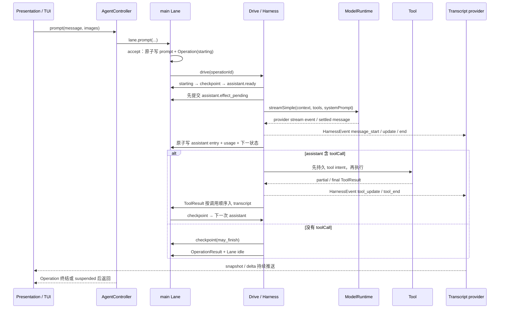

图中刻意省略 Server、Coordinator、Worker 路由，因为第 4～6 章会解释它们。业务上只需记住两条并行结果：**Controller Promise**回答“命令最终是否完成或挂起”，**Transcript replica**回答“执行到哪一步、当前有哪些消息和工具进度”。源码入口：`packages/coding-agent/src/experimental/client-tui.ts:563`、`services/agent-controller-provider.ts:24`、`packages/agent/src/harness/runtime/lane.ts:1133`。

## AgentController：Presentation 可以问什么，Worker 回答什么

`AgentController`是面向 Presentation 的业务门面，不暴露完整 `AgentLane`。Worker把它绑定到当前 Session 唯一的 `main` Lane；TUI只拿到远程 service facade。定义与装配分别见 `packages/coding-agent/src/experimental/services/agent-controller.ts:38`、`agent-controller-provider.ts:11`、`worker.ts:47`。

| 调用 | 问什么 | 答什么 | 容易误解的点 |
|-|-|-|-|
| `prompt` | 请以文本/图片启动一次普通 run | `accepted + operationId + error` | 它内部等待 `lane.prompt = accept + drive`走到 completed、failed或deferred suspended，再压平为同一种响应：接纳前拒绝是 `accepted=false`；接纳后失败是 `accepted=true`且 `error!=null`；完成成功和suspended都是 `accepted=true`且 `error=null`。当前契约不单独返回status，Presentation需结合Transcript snapshot判断Operation是否仍挂起。 |
| `steer` | 把输入插到当前 run 的下一个安全边界 | `entryId`或拒绝原因 | 不直接打断正在进行的模型/工具 effect；到 checkpoint 才进入 transcript。 |
| `followUp` | 当前 run 原本要结束时，再追加一轮 | `entryId`或拒绝原因 | 只有 `may_finish`边界没有更高优先输入时才消费。 |
| `nextRun` | 保留给下一次新 Operation | `entryId`或拒绝原因 | 当前 run 的 checkpoint 不消费；下一次 accept 时与新 prompt 一起捕获。 |
| `requestAbort` | 为指定 operation 写入取消请求 | 成功只返回 `void` | 回答的是“取消标记已持久化”，不是“所有 effect 已经停完”。随后 Drive 按 durable state核销。 |
| `resume` | 继续当前未完成 Operation | 终态或 suspended 的 operation响应 | 对 deferred operation会授予一次 poll；没有活动 Operation 返回 `nothing_to_resume`。 |
| `compact` / `navigate` | 压缩上下文或移动 Branch tip | 结构性 Operation 的结果 | 它们与普通 run 共用 Lane 单写者和 Drive，但 intent、状态叶子不同。 |
| `cancelQueued` | 撤销某条尚未消费的队列输入 | `cancelled / already_consumed / not_found` | 用 `entryId`定位，不按消息文本猜测。 |

TUI当前的选择逻辑很直接：Lane snapshot显示已有 Operation时，普通回车走 `steer`；否则走 `prompt`。见 `packages/coding-agent/src/experimental/client-tui.ts:563-580`。这是 Presentation 策略，不是 Harness 强制规则。

## 第一步：accept 只负责把用户意图变成持久事实

`lane.prompt()`是便利方法；真正的接纳原语是 `Lane.accept()`。它先把字符串和图片规范化成 user message，拒绝空消息、pending assistant和 Busy Lane，然后在同一 Session事务中写入以下内容：

- prompt及本次捕获的队列 entry；
- Branch tip；
- `OperationMeta`：operationId、sourceTipId、startedAt、promptEntryIds；
- `OperationState.at = starting`；
- Lane当前 Operation及剩余 inbox。

事务成功后才发布 `run_start`和 `entry_added`。因此 `starting`的含义是“这次用户意图已经接纳，可以恢复”，不是“模型请求已经开始”。接纳代码见 `packages/agent/src/harness/runtime/lane.ts:480-676`；`prompt = accept + drive`见同文件 `:1133-1198`。

## 第二步：Drive 是状态分派循环，不保存业务事实

同一 Lane 当前的 Operation 同时只有一个 Drive 在推进；重复调用 `drive()`会等待同一结果。模型或工具运行期间，取消请求及工具进度仍可能写入新状态，但这些写入都经 `Lane.command()`串行处理；Drive 每轮重新读取当前状态，`continueOperation()`在继续前检查取消。Drive 和 Promise 只存在于当前进程，重启后依据 Session 中已提交的状态继续。见 `runtime/lane.ts:328-475,921-1001`、`runtime/drive.ts:47-104`。

| Operation 要做什么 | 可能停在哪类位置 |
|-|-|
| `run` | `starting → checkpoint → assistant.* → tools / deferred.* → checkpoint`；需要压缩时也进入 `summary.*`，其 `task.boundary=resume_checkpoint`。 |
| `compaction` | `summary.*`，完成后按 `task.boundary=finish`结束这次 Operation。 |
| `navigation`，需要摘要 | `summary.*`，完成后按 `task.boundary=commit_navigation`移动 Branch。 |
| `navigation`，不需要摘要 | `navigation.ready_to_commit`，直接移动 Branch。 |

`at`不是另一套状态，而是 `OperationState`的类型标签：类型定义规定每个 `at`对应哪些字段。较松的一层是 `meta.intent.kind`与 `state.at`的组合；`Operation`类型没有把两者绑成一个联合类型，入口代码负责构造，恢复 Session 时由 `stateMatchesIntent()`按上表校验。Drive 只按 `at`分派下一步。`finish`也不是第 14 个状态：结束事务直接写结果并清空当前 Operation。见 `session/types.ts:250-342`、`runtime/restore.ts:26-46,136-164`、`runtime/drive.ts:41-105`。

## 选读：Operation、Turn 与一次状态写入的关系

本节解释代码怎样保存上图中的状态变化，初读可跳到 3.6。`Operation`是从接纳到结束的整项任务，`Turn`是 run 中一次模型回答及其工具结果；二者都可能跨多次写入。`Lane.command()`把每次读取、判断和写入串行执行；`continueOperation()`先检查是否已请求取消，再运行具体判断：只返回结果时不写 Session，返回 `commit`时写入下一状态，返回 `finish`时写入 Operation 结果并结束。见 `runtime/lane.ts:328-475`。

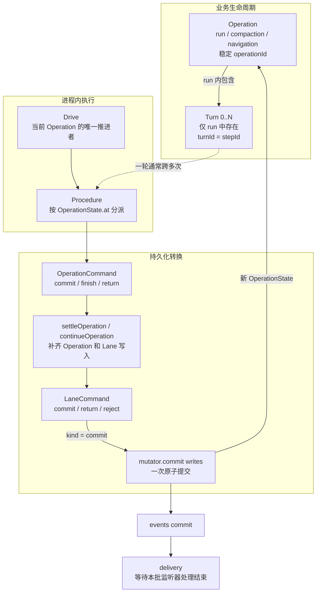

Drive本身不直接修改 Storage。它只读取当前 `OperationState.at`并调用对应 procedure。procedure返回较高层的 `OperationCommand`；`settleOperation()`把它翻译成完整的 `LaneCommand`；最后只有 `Lane.command()`的 `kind = commit`分支才调用 `mutator.commit(writes)`。

| 概念 | 范围或标识 | 准确职责 |
|-|-|-|
| `Operation` | `operationId` | 一次顶层、可恢复的持久任务；从接纳到写入 `OperationResultRecord`。 |
| `Turn` | `turnId / stepId` | run Operation中的一轮 assistant生成及其工具结果；不是独立的顶层 Operation。 |
| `Drive` | `operationId` | 进程内执行权和状态分派循环；可重建，不是持久事实。 |
| `Lane.command()` | 一次调用 | Lane的串行读改写入口；可能 commit，也可能只 return或 reject。 |
| `mutator.commit()` | 一个 writes批次 | Lane持久状态机最细的原子迁移边界；一个批次可以包含多条相关写入。 |
| `delivery` | 本次 commit产生的事件批次 | 若本次 commit生成了事件，Lane.command会在事务完成后等待该事件批次的监听器；它不属于 Storage事务的原子范围。流式消息等事件也可以在 command之外直接调用emitBatch投递。 |

### 一次 run 中，Turn 与 command 的实际关系

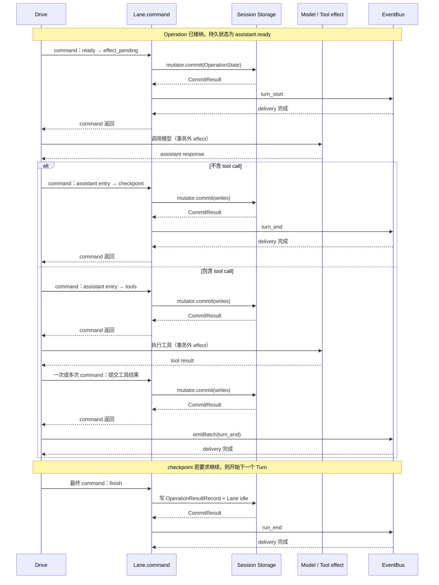

因此不能把一次 commit理解为“整个 Turn或整个 Operation的结果”。普通 `commit`只推进一个持久状态叶子；只有 `OperationCommand.kind = finish`被 `settleOperation()`转换后，那次事务才写入 `OperationResultRecord`、清空当前 Operation并把 Lane投影为 idle。

对应源码：`drive.ts:29-105`负责状态分派；`runtime/types.ts:52-82`定义 `LaneCommand`与 `OperationCommand`；`lane.ts:328-380`定义原子 command及 delivery边界；`lane.ts:388-444`完成两层 command的转换；`drive/generation.ts:148-170`展示 `turn_start`；终结事务见 `drive/boundary.ts:236-257`。

## 第三步：checkpoint 决定“现在该问模型，还是可以结束”

首次从 `starting`进入 checkpoint时，Drive读取已经接纳的 prompt entry，运行 `before_run`，并把 hook注入的消息和 `continuation=need_assistant`一起提交。见 `packages/agent/src/harness/runtime/drive/checkpoint.ts:24-91`。

之后每次进入 checkpoint都会重新看 Lane inbox与压缩阈值：有 `write/steer`就把它们接到 Branch并进入 assistant；达到阈值就进入 summary；仍是 `need_assistant`就直接准备模型请求；处于 `may_finish`且没有新输入才进入结束边界。见 `checkpoint.ts:94-175`、`drive/boundary.ts:79-147`。

这里的 `write`不是 `AgentController`的一项远程队列命令，而是 `AgentLane.appendMessage()`或 `appendCustomEntry()`产生的内部写入类型：Lane空闲时直接接到Branch；Lane运行时先进入inbox，再在下一个checkpoint物化。见 `packages/agent/src/harness/runtime/lane.ts:1916-1989`。

## 第四步：先固定配置，再组装并发出模型请求

`assistant.ready`已经捕获本步的 `stepId`、triggerEntryId、模型/思考等级/活动工具配置、streamOptions和重试策略；它保证同一持久步骤不会因为 Lane之后改配置而悄悄换模型。见 `packages/agent/src/harness/runtime/drive/boundary.ts:55-75`。

`prepareGeneration()`从 Session 读取这一步可见的会话消息，解析模型、工具和 system prompt，并运行 `before_request`；此时还没访问模型。接着先把 `assistant.effect_pending`及本次响应的 ID 写入 Session，表示“请求可能已经发出，结果尚未写入”。提交成功后，`performGeneration()`才依次处理 `transform_context → toProviderMessages → before_payload`，最后由 `models.streamSimple()`发出模型请求。见 `drive/generation.ts:68-230,284-301`。

**当前 experimental coding-agent slice的实际边界：**`createCodingAgentHarness()`只装入模型、thinking、`read/write/bash`、toolContext以及空的 `resources:{}`；没有传 `systemPrompt`，所以普通 assistant请求当前得到空 system prompt。见 `packages/coding-agent/src/experimental/session-worker.ts:805-863`与 `packages/agent/src/harness/runtime/drive/generation.ts:56-66`。后续接入 coding-agent prompt、skills或更多 tools时，组合入口应优先落在 `AgentHarness.create` options及其 hook注册，而不是改 Radius/Chord路由。

## 第五步：模型结果怎样进入会话，并决定下一步

Provider流式返回时，`openAssistantResponse()`立即发布 `message_start / message_update / message_end`供界面渲染；同时把可编码的 frame写到 `pendingAssistantFrames`，供 `effect_pending`恢复。此时最终 assistant entry还没有提交。见 `packages/agent/src/harness/runtime/drive/response.ts:46-96`与 `packages/agent/src/harness/runtime/progress.ts:35-88`。

模型流结束后，`publishResponse()`不再访问模型，而是在一次 Session 提交中写入消息、用量和下一状态。普通主路径只有两种：有工具调用就进入 `tools`；没有就进入 `checkpoint(may_finish)`，再检查能否结束。同一函数也处理重试、延迟响应、上下文压缩和失败；这些条件见下方速查表或 `drive/response.ts:181-404`，初读可跳过。

### publishResponse()：写入本次结果，再选 Operation 的下一步

`publishResponse()`收到的已经是完整的模型消息；用户看到的回答由模型流和 `after_response` hook 形成。它把这次请求的消息与用量写入 Session，并选择下一步：执行工具、等待重试、继续轮询、先压缩上下文、检查能否结束，或记录失败。这里结束的是一次请求，不一定结束整个 Operation。主路径只需记住“写结果 → 选下一步”；具体条件见 `drive/response.ts:181-404`。

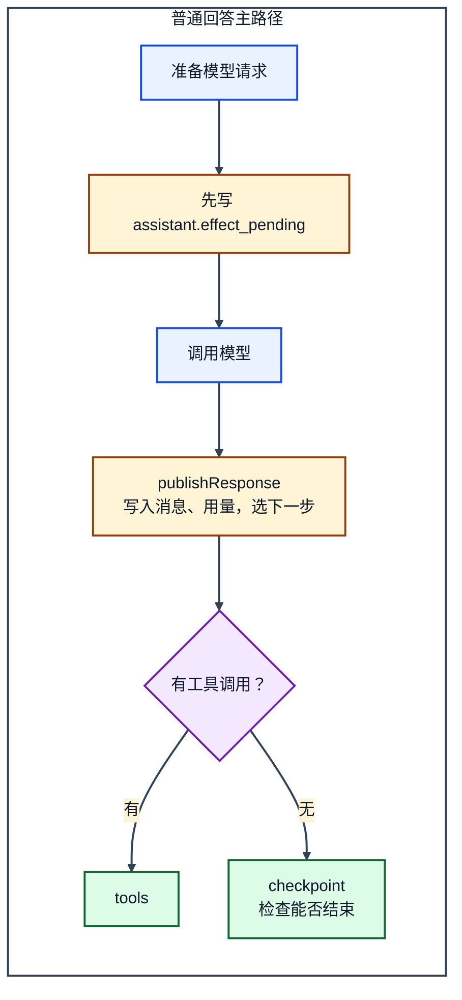

`effect_pending`只说明“本次请求已登记，结果尚未写入”；模型请求可能还没发出，也可能已经返回。若此时进程中断，不能当作从未请求而直接重发。恢复代码读取已保存的流式片段，记录一条中断结果，再走 `publishResponse()`。这条细节不影响正常主路径，见 `drive/recovery.ts:43-86`。

| 响应条件 | 下一状态 | 作用 |
|-|-|-|
| 包含 toolCall | `tools` | 执行工具批次，Operation 继续 |
| 可重试 error 且未超过上限 | `assistant.retry_wait` | 等待后回到 `assistant.ready` |
| 有效 deferred handle | `deferred.suspended` | 暂停并等待后续 poll |
| 首次可恢复 overflow | `summary.deciding` | 先做压缩，再恢复生成 |
| 普通最终回答；或已请求取消但需先归档已准入 effect | `checkpoint(may_finish)` | 进入结束边界检查，不等于已经结束 |
| 不可恢复失败 | `failed` | 写 OperationResult 并结束 Operation |

`publishResponse()`只把一次模型生成或延迟轮询的结果写入 Session，并确定接下来做什么；它不是整项 Operation 的统一结束点。普通回答随后还要经过 `finishRunBoundary()`：运行 `before_run_end`，再次检查新输入；确实没有后续工作时，才写入 `completed` 的 Operation 结果。见 `drive/boundary.ts:163-261`。

源码依据：`generation.ts:132-171,174-231,284-301`（意图提交、Provider 调用与调用链）；`response.ts:46-96,181-485`（流式 observer、分类与原子提交）；`lane.ts:390-445`（`settleOperation()`）；`drive/recovery.ts:43-125`（中断恢复不重放请求）；`drive/boundary.ts:163-261`（真正的成功收尾）。

## 第六步：模型要用工具时，先记录再执行

模型回答包含 toolCall后，assistant entry先落盘，Operation进入 `tools`并保存每个 call的 sourceIndex与预留resultEntryId。每个工具调用按下面的顺序推进：

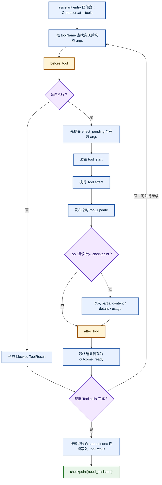

实现位置：`packages/agent/src/harness/runtime/drive/tools.ts:187-293`、`:350-512`、`:542-691`，以及 `drive/tool-placement.ts:84-278`。Node层面这里用了常见的 Promise并行执行模式，但用单独的 source-order materialization保证“完成顺序”不会改写对话顺序。

若进程在工具执行期间中断，工具可能已经改过文件或远端数据，默认不能直接再执行。只有持久记录和当前工具实现都标记 `replay=safe`，才允许重做；否则记录中断的工具结果。恢复细节见 `drive/tools.ts:158-226,515-540`，不影响上图的普通执行顺序。

## 第七步：steer、followUp、nextRun分别在哪个边界生效

| 队列类型 | 当前 run中何时消费 | 作用 |
|-|-|-|
| `steer` | 下一个 checkpoint边界 | 尽快改变下一次模型调用，但不侵入当前正在执行的 effect。 |
| `followUp` | run准备结束的 `may_finish`边界 | 让同一 Operation再走一轮，而不是先结束再新建 Operation。 |
| `nextRun` | 当前 run不消费；下一次 accept时捕获 | 明确跨越 Operation边界。 |

在新 Operation接纳时，`selectAcceptedInbox()`按原inbox顺序捕获全部 `write/nextRun`；`steer/followUp`按各自的 `all`或 `one-at-a-time`配置取值。捕获的队列entry先接到Branch，新prompt再接在其后。运行中 `planBoundaryInbox()`只消费 `write/steer`，并仅在可结束且没有现成trigger时追加 `followUp`。见 `packages/agent/src/harness/runtime/lane.ts:143-167`、`:588-676`、`:1418-1460`与 `drive/boundary.ts:79-147`。

## 第八步：finish、abort和resume回答的是不同生命周期问题

**finish**：结束边界先再次检查 inbox并运行 `before_run_end`；如果得到新输入就回到 assistant，否则在同一事务写 `OperationResultRecord`、清理operation-owned临时值、更新Lane tip并发布 `run_end`。见 `packages/agent/src/harness/runtime/drive/boundary.ts:163-257`。

**requestAbort**：原子写 `control.status=cancel_requested`，移除并返回 steer/followUp队列内容，再通知活动 Drive的 gate。Drive下次分派优先进入 reconciliation，不再启动新的普通 provider/tool work。见 `packages/agent/src/harness/runtime/lane.ts:1005-1104`与 `drive.ts:41-105`。

**resume**：不创建新 Operation；它读取当前 operationId并重新取得 Drive执行权，对 deferred状态额外允许一次poll。见 `packages/agent/src/harness/runtime/lane.ts:1327-1370`。

## Transcript snapshot + update在 agent链路中的准确位置

这套机制解决的是“Controller调用仍在等待时，Presentation如何持续看到长 run 的变化”，但它不是对JSONL做增量scan：

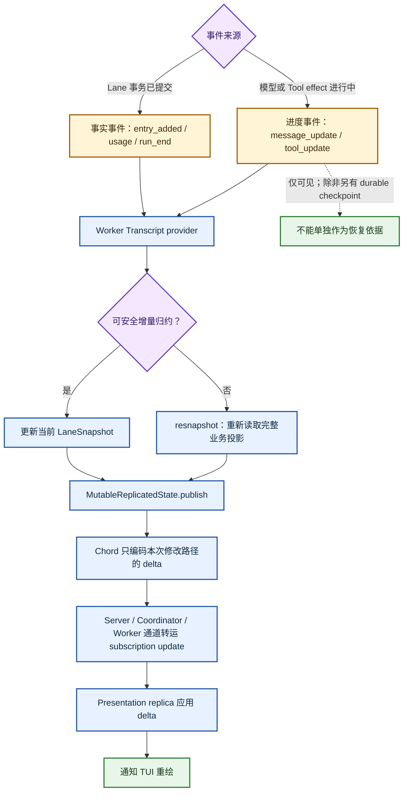

所以与Paimon的共同点只有“先拿基线，再接增量”；不同点是这里由事件驱动主动推送，不是客户端定时poll，也不是把JSONL新行直接翻译成delta。Transcript只拥有业务投影与必要的 `resnapshot()`；delta版本、排序、缺口检测和断线后的重新hydrate属于Chord协议层，可到第 7 章理解。实现见 `packages/coding-agent/src/experimental/services/transcript-provider.ts:20-100`，当前服务说明见 `services/README.md:19`。

## 后续加入完整 agent能力时，从哪些接入点扩展

| 需求 | 现有接入点 | 不要放到哪里 |
|-|-|-|
| coding-agent system prompt | `AgentHarnessOptions.systemPrompt`或 `transform_context`；稳定规则优先前者，请求级改写才用后者。 | Chord service定义、Radius连接。 |
| skills / prompt templates | `AgentHarnessOptions.resources`，由 `before_run`消费或由 Lane的skill/template请求展开。 | TUI把文本提前拼成不可恢复的临时prompt。 |
| 新工具 | `tools + activeToolNames + toolContext`；副作用恢复策略由tool的 `replay`声明。 | Presentation直接执行工具。 |
| 请求策略、审计、参数变换 | `before_request / before_payload / after_response / before_tool / after_tool` hooks。 | 把业务策略塞进RPC转发层。 |
| 新的前端操作 | 先判断是否已有 Lane能力；只有Presentation确实需要时才扩充 `AgentController`。 | 把完整 `AgentLane`远程暴露。 |

表中列的是本轮源码可以直接确认的接入点与缺口，不等同于“完整coding-agent产品”的ready checklist。Harness可配置项与hook契约见 `packages/agent/src/harness/agent-harness.ts:430-535`。当前 coding-agent worker的组合根仍是 `packages/coding-agent/src/experimental/session-worker.ts:805-863`；这里应负责选择并注入能力，agent-core继续只拥有可恢复执行语义。

### Hook 执行点：按 Operation、Drive、Turn 与请求粒度定位

<callout emoji="💡">
`HookMap` 是 Lane Harness 统一定义的插件切点，但这些切点不属于同一粒度：有的每次 Drive pass 执行，有的只在一个 Run 的起止边界执行，有的随模型请求重试，有的随每个 Tool call 执行。所有事件都带 `lane` 与 `runId`；这里的 `runId` 实际是当前 Operation ID，不等于 Turn ID。
</callout>

下面按真实持久状态和分支展示 Hook 的先后关系。一次 Operation 可以经历多次 Drive pass；每次恢复都会重新从 `before_drive` 进入状态分派，但不会重新执行已经越过的 Run 起点 Hook。

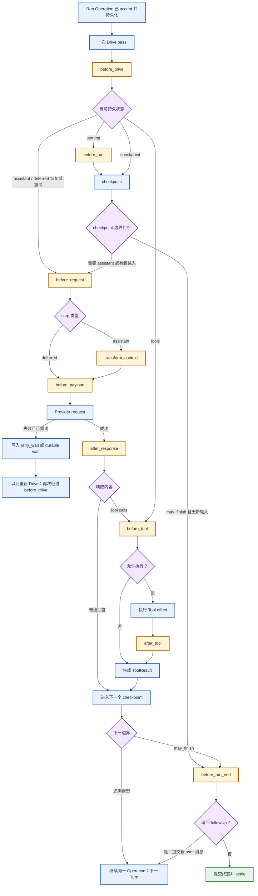

compaction 与 navigation 仍由同一套 Drive 推进，但它们不经过 Run 起止 Hook；只有需要摘要的 navigation 才进入 `before_navigation`。

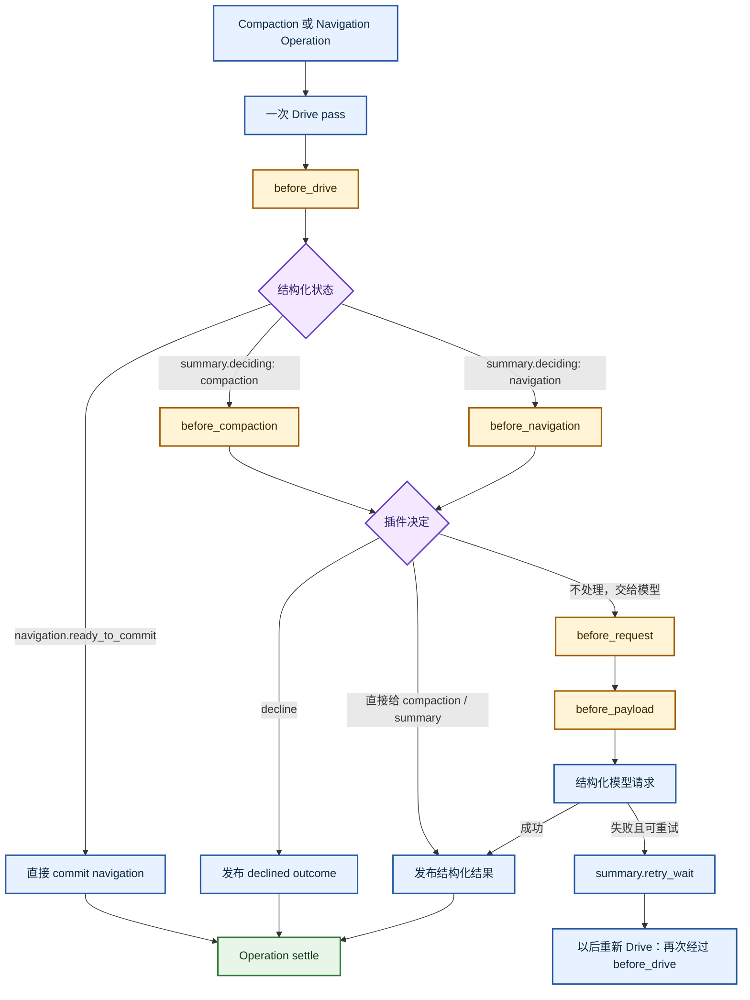

| Hook | 准确触发条件 | 粒度 | 作用 |
|-|-|-|-|
| `before_drive` | 已安装的 Drive pass 开始，且 Operation 仍为 `running` | Drive pass | 所有 Operation 类型的统一入口守卫；同一 Operation 恢复后可再次执行 |
| `before_run` | `kind=run` 且状态为 `starting` | Run Operation 起点 | 追加持久消息；越过起点后不会因 Turn 或 Drive 恢复而重跑 |
| `before_run_end` | `checkpoint` 判断为 `may_finish`，且没有更新的队列输入 | Run 结束边界 | 可返回 `followUp`，提交为新的 user 消息并继续同一 Operation；否则提交终态 |
| `before_request` | 每次 assistant、deferred、compaction 或 branch summary 请求尝试前 | 模型请求尝试 | 按 `step` 和 `attempt` 调整 transport、timeout、retry、headers 等 stream options |
| `transform_context` | 仅 assistant 请求，在上下文已读取、转 provider messages 之前 | assistant 请求尝试 | 改写本次请求的 messages 与 system prompt；不直接改 durable transcript |
| `before_payload` | provider payload 已形成、实际发出之前 | provider 请求 | 改写最终协议 payload；assistant、deferred 与 structural 请求都会经过 |
| `after_response` | assistant 或 deferred 响应流已正常收束之后 | 成功响应 | 改写 settled assistant message；structural 请求不经过此 Hook |
| `before_tool` | 每个 planned Tool call 在副作用 intent 和工具执行之前 | Tool call | 串行改写 args，或返回 `block` 阻止该调用并生成 ToolResult |
| `after_tool` | 工具副作用返回、持久 ToolResult 形成之前 | Tool call | 改写 content、details、isError、usage，也可要求终止后续工具执行 |
| `before_compaction` | `summary.deciding` 的任务为 manual、threshold 或 overflow compaction | 结构化决策 | 可 decline、直接提供 CompactResult，或不处理并进入结构化模型请求 |
| `before_navigation` | navigation 需要生成 branch summary 并进入 `summary.deciding` | 结构化决策 | 可 decline、直接提供 BranchSummaryResult，或继续请求模型；无需摘要的 navigation 不触发 |

同一个 key 的 handler 按注册顺序执行。上下文、payload、response 和 Tool 参数采用前一个 handler 的结果继续向后传递；`before_tool` 遇到第一个 block 即停止；compaction/navigation 采用第一个明确的 decline 或结果；`before_run_end` 采用最后一个非空 followUp。`before_drive` 失败会关闭本次推进，`before_tool` 失败会把该调用转成阻止结果。

### 与 DeerFlow AgentMiddleware 的位置对比

DeerFlow 的 middleware 不是一组只挂在持久状态机切点上的函数，而是编译进 Agent Graph 的前置节点、后置节点和环绕调用。下面的编号表示 middleware 注册顺序。

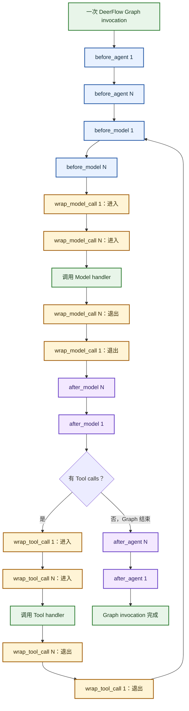

| Pi Hook 区域 | DeerFlow 近似位置 | 不能直接等同的原因 |
|-|-|-|
| `before_run` | `before_agent` | Pi 绑定 durable Run Operation 的起点；DeerFlow 绑定一次 Graph invocation |
| `before_request / transform_context / after_response` | `before_model / wrap_model_call / after_model` | Pi 把请求加工拆成固定窄切点；DeerFlow wrapper 可以改请求、短路，或调用下层 handler 多次实现重试 |
| `before_payload` | 无通用 AgentMiddleware 等价点 | 它位于 Pi 的 provider 协议 payload 边界，比通用 model middleware 更靠近传输层 |
| `before_tool + after_tool` | `wrap_tool_call` | Pi 是执行前后两个切点；DeerFlow 是环绕调用，也可短路或多次调用下层 handler |
| `before_run_end` | `after_agent` 仅在时间位置上接近 | Pi 可用 followUp 继续同一 Operation；DeerFlow 已处于 Graph 退出阶段 |
| `before_compaction / before_navigation` | 无固定通用 Hook | Pi 把它们建模为 durable structural operation；DeerFlow 通常把摘要能力实现为模型循环中的 middleware |

所有权与并发也不同：Pi 的 `HookRegistry` 属于 Harness 并被各 Lane 共用；单个 Lane 的 Operation 串行推进，但不同 Lane 以及 parallel tool execution 可能并发进入同一 handler。DeerFlow middleware 实例属于持有它的 compiled Agent Graph；同一 Graph 内的并行 Tool calls 也可能并发进入同一个 middleware 实例。因此，两边都不应把未分区、未加锁的可变字段当作 run-local 状态。

源码锚点：Pi Hook 契约见 `packages/agent/src/harness/agent-harness.ts:430-510`，聚合规则见 `packages/agent/src/harness/hooks.ts`，Drive 与各调用点见 `packages/agent/src/harness/runtime/drive.ts` 及 `runtime/drive/`。DeerFlow 组合根见 `packages/harness/deerflow/agents/lead_agent/agent.py:273`；LangChain middleware 接口与编排见 `langchain/agents/middleware/types.py` 和 `langchain/agents/factory.py`。

## 按业务顺序读源码

1. `client-tui.ts:563-610`：Presentation何时prompt、steer、followUp、abort。
2. `services/agent-controller.ts:38-52`与 `agent-controller-provider.ts:11-73`：远程业务契约如何映射到main Lane。
3. `harness/runtime/lane.ts:480-676`、`:921-1001`、`:1133-1198`：accept、Drive认领、便利调用组合。
4. `harness/runtime/drive.ts:41-105`：先掌握持久状态总分派。
5. `drive/checkpoint.ts`与 `drive/boundary.ts`：输入队列、模型边界和终结。
6. `drive/generation.ts`与 `drive/response.ts`：一次模型请求从intent到outcome。
7. `drive/tools.ts`与 `drive/tool-placement.ts`：工具副作用、并行完成和顺序入账。
8. `services/transcript-provider.ts`：业务事件怎样变成Presentation可见状态。

# Server 服务框架如何启动

本章的完整启动控制流见下一节“Server 服务框架完整启动时序”。后续小节按组合根、Backend、Coordinator、Worker 与退出路径逐段展开，不再用编号列表重复同一条主链。

**三个 ID 不可混用：**`serverId`是逻辑服务身份；`serverConnectionId`标识一次 Server generation；随机 `serverNonce`只用于内部 socket 路径。稳定地址与可替换进程因此分开。

## 阅读方法：先把 Chord 和 Radius 从启动主链拿开

理解 Server 启动时，先只保留一条最小主链：`命令入口 → 锁定逻辑 serverId → 准备插件 → 确保 Coordinator 存在 → 在 generation 私有 socket 上启动 Backend → 向 Coordinator 注册该 endpoint → 发现存活 Worker → 返回 RunningServer`。这条主链已经能解释“进程何时可被本地 Client 访问”和“新 Server 如何替换旧 generation”。

**Chord 只在 Backend 内把应用能力做成 Service endpoint；Radius 只在 Backend 可用后追加一个远程字节入口。**二者都不负责创建 Coordinator，也不决定哪个 Server generation 是 current。阅读 `server.ts` 时，可先把 `createExperimentalServerServices(...)`视为“构造 Server 级 RPC 实现”，把 `RadiusRelayHost`视为“可选的第二种传输适配器”，最后再展开内部细节。

**图：Server 服务框架完整启动时序**

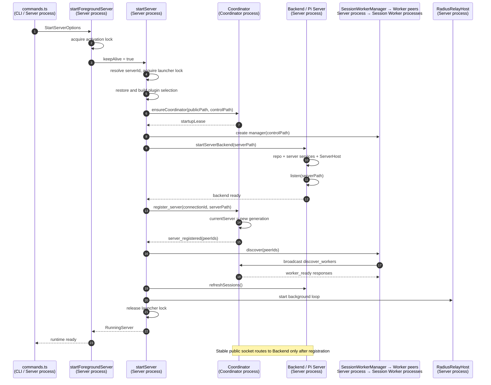

| 层 | 启动时真正做的事 | 暂时不要混入的概念 |
|-|-|-|
| 进程与 generation | 锁、spawn、私有 socket、current Server 切换、关闭 | Service member、订阅、Facet |
| Pi Server | 接受字节连接、握手、解析 Pi envelope、按 target 路由 | Unix 或 Radius 谁提供字节 |
| Chord | 定义并执行 ServiceCall、复制状态和订阅 | socket 文件和 Server generation |
| Radius | 把远程 WebSocket logical connection 适配成 Server.accept() 所需的 ByteConnection | Session、Lane、Service 语义 |

## 第一段：命令入口只负责参数、前台持有和最终关闭

源码入口是 `packages/coding-agent/src/experimental/commands.ts:11-64`。`runServerCommand()`把 CLI 参数映射为 `StartServerOptions`，调用 `startForegroundServer()`，打印逻辑 `serverId`和稳定 socket，随后等待信号或 `runtime.closed`。它不创建 Coordinator、Worker、Chord provider 或 Radius WebSocket；这些都属于下层组合根。

`startForegroundServer()`位于 `packages/coding-agent/src/experimental/server.ts:709-729`。foreground 的实际含义只有两个：先取得 activation lock，避免和 Client 触发的自动冷启动竞争；再把 `keepAlive`固定为 `true`，因此没有 Client 和 Worker 时也不自动退休。它不是另一套 Server 实现。

| 入口 | 路径 | 差异 |
|-|-|-|
| 显式 `pi server` | `runServerCommand → startForegroundServer → startServer` | 当前 CLI 进程就是 Server 进程；`keepAlive=true` |
| Client 自动冷启动 | `activateServer → spawnInternalProcess("server") → runServerProcess → startServer` | 先探测稳定 socket；只有不可达时才 spawn；`keepAlive=false`。源码：`server.ts:144-198`、`756-785` |

两条入口最终都汇合到 `startServer()`，所以后续 Coordinator、Backend、Worker 和 Radius 的组合完全相同。

## 第二段：两个锁解决不同竞争

`acquireServerProfile()`位于 `server.ts:83-126`。它先确定稳定逻辑身份 `serverId`：显式参数优先，否则读取或原子创建 `default-server-id`；同时取得 `launcher-<serverId>`锁。`startServer()`持有这把锁直到新 generation 完成 Backend 监听、Coordinator 注册、Worker 发现和 Radius loop 启动，然后才释放，见 `server.ts:529-538`、`687-689`。

`acquireServerActivation()`位于 `server.ts:200-213`。它保护“探测现有 Server，若不存在则启动”的完整决策，防止多个 Client 同时判断为不可达后各自 spawn。foreground 入口也先持有它，因此显式启动和自动冷启动不会交叉。

| 锁 | 保护范围 | 为什么不能只看文件名理解 |
|-|-|-|
| `launcher-<serverId>` | 同一逻辑 Server generation 的构造和发布窗口 | `acquireServerProfile`不只读 profile；`startServer`会长时间持有其 release handle |
| `activation-<serverId>` | Client 冷启动的“探测 → 决定 → spawn → 等待可达”事务 | 它不代表 Server 生命周期；Server 可在释放后继续运行 |

## 第三段：startServer 是 generation 的组合根

`startServer()`位于 `server.ts:520-707`。它不处理单次 RPC，而是一次性组装一个可替换 Server generation。建议把函数分为五段阅读：

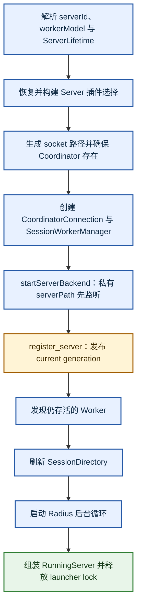

源码范围依次为：身份与生命周期 `server.ts:521-537`，插件选择 `:539-609`，本机拓扑 `:610-619`，Backend监听与Coordinator注册 `:620-634`，Worker恢复、目录刷新、Radius和返回句柄 `:635-689`。

函数顶部的可选变量是故障清理清单，不是五套 Server：

| 变量 | 实际对象 | 存在理由 |
|-|-|-|
| `backend` | Session catalog + Pi `Server` + generation 私有 Unix listener | 承载真正的 Pi 协议和 Session 路由 |
| `coordinator` | 当前 Server 进程到 Coordinator control socket 的客户端连接 | 注册 generation endpoint，并与 Worker 互发控制消息 |
| `startupLease` | `ensureCoordinator()`返回的一条临时 control 连接 | 填补“Coordinator 已启动”和“真实 Server 已注册”之间的空窗，避免空闲 Coordinator 提前退出；注册完成后立即关闭 |
| `workers` | Session path、peerId、子进程、请求和订阅的内存管理器 | 让通用 Pi Server只依赖 `RoutedSessionHandle`，不直接理解 Worker 协议 |
| `relay` | Radius WebSocket host 及 logical connection 复用器 | 给同一个 `backend.server`追加远程 ByteConnection 来源 |
| `active*` | 启动完成后对上述对象的非空快照 | 供替换回调和 `runtime.close()`闭包使用，避免继续携带“可能尚未构造”的类型状态 |

**图：启动函数的输入、返回值与成功条件**

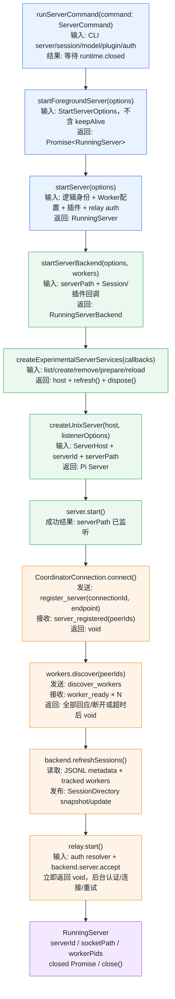

## 第四段：startServerBackend 才创建可接收 Pi 请求的本地服务

`startServerBackend()`位于 `server.ts:376-518`，可按“事实源 → 应用 Host → 协议 Server → Unix listener”四层理解。

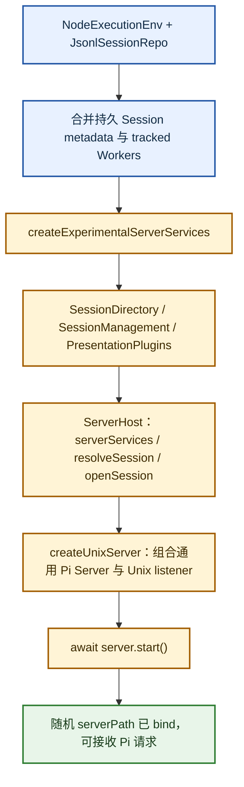

事实源与目录合并见 `server.ts:381-417`，Server级服务见 `:418-457`，Host路由口见 `:458-465`，协议Server与监听见 `:473-488`。

**接口名字的设计意图：**

| 接口 | 白话含义 | 生命周期 |
|-|-|-|
| `ServerHost` | 通用 Pi Server向 coding-agent询问“Server 级服务在哪里、Session如何解析和打开”的应用适配口 | 一个 Backend generation一份 |
| `RoutedServerServiceHost` | 为每条 Presentation connection创建一份 Server 级 Chord endpoint | Host跨连接复用；attachment按连接创建 |
| `RoutedSessionHandle` | Server对某个已打开 Session/Worker的进程安全句柄 | 可被多个 Client attachment复用 |
| `RoutedSessionAttachment` | 某个 Client对某个 Worker的临时调用租约 | 每次 attach独立；release 后不可复用 |
| `RunningServerBackend` | 内部 Backend句柄，额外允许刷新 SessionDirectory | 组合成功后被外层 `RunningServer`包住 |
| `RunningServer` | 交给命令入口的最终运行时句柄：公开身份、关闭通知和幂等 close | 整个 Server generation |

## Chord 在启动链中的准确位置

Chord 没有创建 socket，也没有启动独立服务进程。它在两处嵌入 Pi Server：

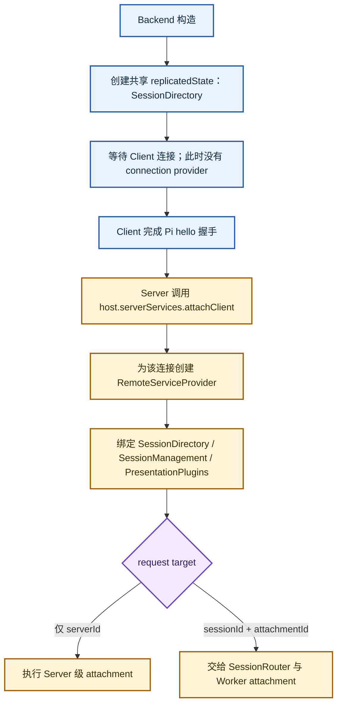

之后 Pi `Server`解析 request envelope：target只有 `serverId`时调用 Server 级 attachment；target含 `sessionId + attachmentId`时交给 `SessionRouter`和 Worker attachment。分流代码在 `packages/server/src/server.ts:306-404`。因此可把 Chord理解成“Pi request中的 ServiceCall语义和 endpoint执行器”，不能把它理解成另一个网络 Server。

## 第五段：三类 socket 与 Coordinator 注册

`server.ts:610-615`生成三个路径。一个 Unix socket文件表示监听地址；accept 后的每条连接都是全双工，不是“多输入单输出”。这里拆成三个地址是为了分离稳定入口、控制面和可替换 Backend，而不是因为 socket只能单向通信。

| 路径 | 谁监听 / 谁连接 | 用途 |
|-|-|-|
| `socketPath` | Coordinator监听；本地 Client连接 | 由 `serverId`决定的稳定公开入口，不随 generation变化 |
| `controlPath` | Coordinator监听；Server和Worker分别主动连接 | 注册身份、generation通知和 opaque send/broadcast |
| `serverPath` | 当前 Backend监听；Coordinator为每条 public connection主动连接 | 随机 generation 私有 endpoint；切换 Server时换路径 |

**图：稳定入口、控制通道与 generation 私有入口**

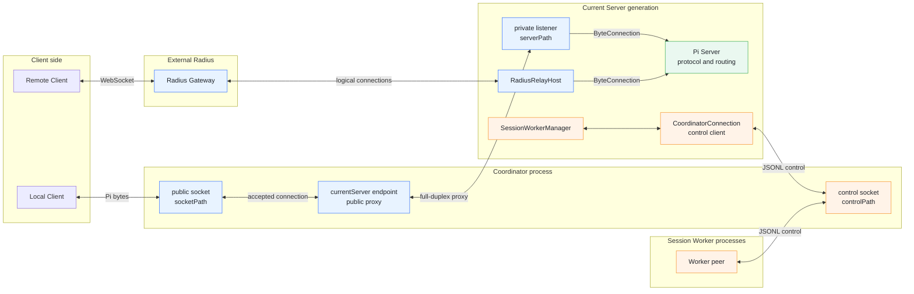

`ensureCoordinator()`先探测 `controlPath`；不存在时 spawn coordinator并轮询到可连接，见 `packages/coding-agent/src/experimental/coordinator.ts:187-199`。Coordinator进程自己监听 public/control 两个稳定路径，见 `coordinator.ts:301-328`。

`CoordinatorConnection.connect()`不是监听动作，而是 `createConnection(controlPath)`，随后发送 `register_server { serverConnectionId, endpoint: serverPath }`并等待 `server_registered`，见 `coordinator.ts:80-98`。Coordinator把它写入 `currentServer`；若已有旧 generation，则关闭旧 public connections、通知 Worker旧 Server断开、向旧 Server发送 `server_replaced`，见 `coordinator.ts:372-396`。

本地 Client连接稳定 `socketPath`后，Coordinator再连接 `currentServer.endpoint`，并用双向 pipe桥接两个全双工连接，见 `coordinator.ts:444-462`。Coordinator不解析 Pi frame；它只解决“稳定地址如何指向可替换 Backend”。

## 第六段：注册后先接管 Worker，再发布完整 Session目录

`coordinator.connect()`返回时，新 Backend已经成为 current，并取得注册响应中的 `peerIds`快照（`coordinator.ts:130-140`）。随后 `workers.discover(coordinator.peerIds)`不是任选一个 Worker，而是盘点所有当前 control peer：排除 manager已知或正在启动的 peer，广播一次 `discover_workers`，等待候选 peer回复、断开或超时，见 `session-worker-manager.ts:154-176`。

存活 Session Worker收到广播后重发 `worker_ready`。manager校验 metadata形态和冲突后重建 `workersBySession`、`workersByPeer`和 `workerPids`，见 `session-worker-manager.ts:516-588`、`652-704`。这一步服务于 Server generation替换：Worker可以继续存活，新 Server不必立即重启 Harness。

**图：Server generation 替换与 Worker 接管**

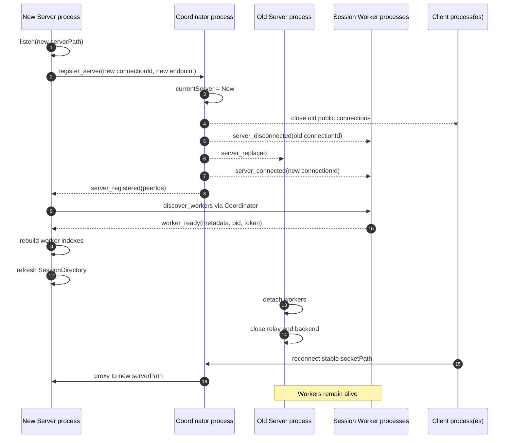

`backend.refreshSessions()`随后重新 list JSONL目录并合并已发现 Worker，更新共享的 SessionDirectory replicated state（`server.ts:385-389`、`509`；`services/server.ts:44-50`）。顺序上先 discover再 refresh，是为了让目录快照包含新 Server刚接管的活动 Worker。

若后续 Client attach一个尚无 Worker的 Session，调用链才进入 `ServerHost.openSession → SessionWorkerManager.openSession → #launch`；spawn参数从出生起就固定该 Session metadata和插件 manifest，见 `session-worker-manager.ts:178-203`、`452-513`。Server启动本身不会 eager拉起历史 Session的 Worker。

## 本章结束边界，以及后续 prompt 链路从哪里接入

**到这里仍只是服务框架搭建完成。**启动成功只证明：稳定本地入口已经指向当前 Backend；Server级 Service可在 Client握手后创建；已有 Worker已被盘点；需要时可以按 Session懒启动新 Worker；Radius可选远程入口已进入后台维护。此时没有用户问题、没有 `AgentController.prompt()`调用，也没有 Lane Operation被创建。

**图：Client 首次连接并 attach Session（prompt 之前）**

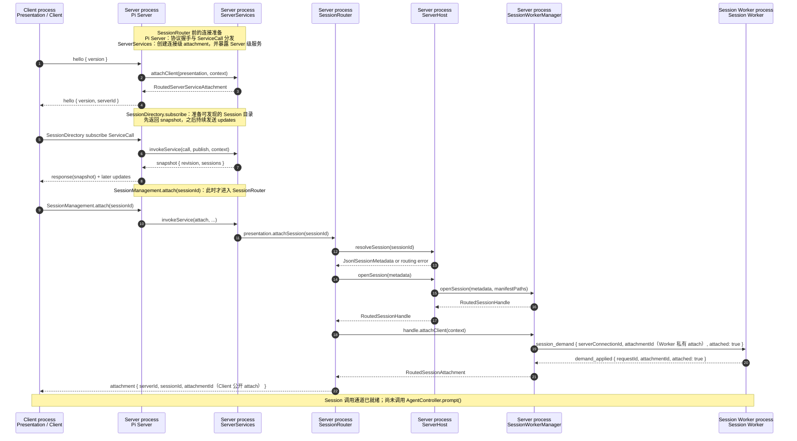

**图中每一步在准备什么**

| 阶段 | 调用方问什么 | 被调用方答什么 | 这一步准备出的东西 |
|-|-|-|-|
| **1. 协议握手**  <br/>`Client → Pi Server` | `hello {version}`：这个连接能否按当前 Pi 协议通信？ | 版本不兼容则返回 `hello_error`并关闭；兼容才继续创建连接级服务，最后返回 `hello {version, serverId}`。 | 只确认协议版本、逻辑 Server身份和连接可用；尚未选择 Session。源码：`packages/server/src/server.ts:223-296`。 |
| **2. 创建连接级 Server Service**  <br/>`Pi Server → ServerServices` | `attachClient(presentation, context)`：请为这一条 Client连接创建可调用的 Server级服务端点。 | 返回 `RoutedServerServiceAttachment`，内部持有一个 Chord `RemoteServiceProvider`。 | 把 `SessionDirectory`、`SessionManagement`、`PresentationPlugins`三组接口绑定到这条连接；断开时一起 release。源码：`services/server.ts:62-115`、`packages/server/src/server.ts:272-286`。 |
| **3. 取得可发现目录**  <br/>`Client → SessionDirectory` | 发起 subscribe ServiceCall：当前有哪些持久 Session，此后目录如何变化？ | 先返回 `snapshot {revision, sessions}`；订阅保持期间再发送 update。 | Client能够展示和选择 Session，但仍未绑定任何 Session。Pi Server还会为该 subscription安装状态编码器。源码：`services/server.ts:36-50`、`packages/server/src/server.ts:330-381`。 |
| **4. 请求选择 Session**  <br/>`Client → SessionManagement` | `attach(sessionId)`：把这条 Client连接的当前 Session切换到指定 ID。 | Server级方法本身最终返回成功或错误；内部先串行调用 `presentation.attachSession(sessionId)`，从这里才进入 `SessionRouter`。 | 把“Server级 RPC”转换为“连接级 Session路由动作”，避免同一 Client上的 create/remove/attach/detach交错。源码：`services/server.ts:89-110`。 |
| **5. 解析并打开 Session**  <br/>`SessionRouter → ServerHost` | `resolveSession(sessionId)`后再 `openSession(metadata)`：这个 ID对应哪份持久 metadata，是否已有可复用 Worker？ | 不存在或重名就返回路由错误；成功则返回 `RoutedSessionHandle`。Manager会复用已跟踪 Worker，或按 metadata和插件 manifest启动新 Worker。 | 在 Server内建立可复用的 `HostedSession`，但还没有给当前 Client发放调用租约。源码：`session-router.ts:276-299`、`server.ts:458-464`、`session-worker-manager.ts:178-202`。 |
| **6. 建立 Worker私有 attachment**  <br/>`SessionRouter → Manager → Worker` | `handle.attachClient()`继而发送 `session_demand {serverConnectionId, attachmentId, attached:true}`：这一代 Server是否可以在该 Worker上持有一个调用 scope？ | Worker返回匹配的 `demand_applied`后，Manager才返回 `RoutedSessionAttachment`；超时或字段不匹配都不算成功。 | 得到 Server generation到Worker的私有租约及 `invokeService/release`能力。这里的 `attachmentId`是 Worker私有 ID。源码：`session-worker-manager.ts:205-238`、`282-318`。 |
| **7. 发布 Client公开 attachment**  <br/>`SessionRouter → Client` | 内部检查 HostedSession、Client连接和Worker租约仍有效后，才把此次绑定提交为当前 attachment。 | 推送 `attachment {serverId, sessionId, attachmentId}`；此后只有携带这个 target的 Session级 ServiceCall才被接受。 | Client获得公开路由凭据。这个 `attachmentId`由 SessionRouter另行生成，不等于上一步的 Worker私有 ID。源码：`session-router.ts:160-213`。 |

因此，`SessionRouter`之前的组件不是在执行 prompt：Pi Server先建立协议连接，ServerServices再为该连接安装 Server级接口，SessionDirectory让 Client看到可选 Session，最后由 `SessionManagement.attach`把选择动作送进 SessionRouter。只有公开 attachment和Worker私有 attachment都建立后，后续 Session级RPC才有可验证的路由范围；此时仍未调用 `AgentController.prompt()`。

后续补充用户问答链路时，可以从下面四个接入点继续，不需要重新解释启动过程：

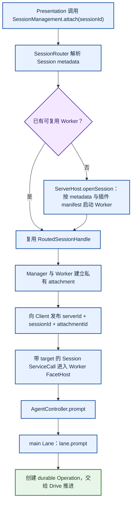

路由与attachment见 `services/server.ts:89-110`、`session-router.ts:160-213`；Worker服务端点见 `session-worker.ts:525-646`和 `services/worker.ts:47-131`；问答入口见 `agent-controller-provider.ts:11-31`。

因此当前启动章节只负责把调用通道铺到 `AgentController`门口；后续问答章节再从 `AgentController.prompt → AgentLane.prompt → Operation/Drive → Transcript更新`继续。

## Radius 为什么放在最后，而且调用 start 不等于已经联网

本地 Backend、Coordinator注册和 Worker接管完成后，`server.ts:637-643`才构造 `RadiusRelayHost`。它接收的是已经可用的 `backend.server`；远端 gateway发来 `connection_open`时，relay把 logical connection包装成 `ByteConnection`并调用同一个 `Server.accept()`，见 `radius-relay.ts:219-268`。所以 Radius和 Unix listener是两个“字节从哪里来”的入口，后面的 Pi hello、request target、Chord ServiceCall和Session路由完全复用。

`relay.start()`只启动后台维护循环，不阻塞 `startServer()`等待远程连接。循环以 `required:false`解析凭证：无凭证时报告 `not_authenticated`并保持 local only；有凭证才打开 WebSocket；断线后在后台退避重连，见 `radius-relay.ts:120-171`、`radius-auth.ts:30-53`。因此“每个 Server都构造 Radius能力”与“每个 Server一定连接 Radius”是两件事。

这也是为什么 Radius不应混入前半段启动推理：即使 Radius未认证或暂时断开，本地 Server仍已经完成监听和注册。Radius失败不是本地启动失败。

## 第七段：返回 RunningServer 前建立统一退出路径

`startServer()`最后不是简单返回 Backend，而是把 replacement、主动关闭和启动失败三种终态统一起来：

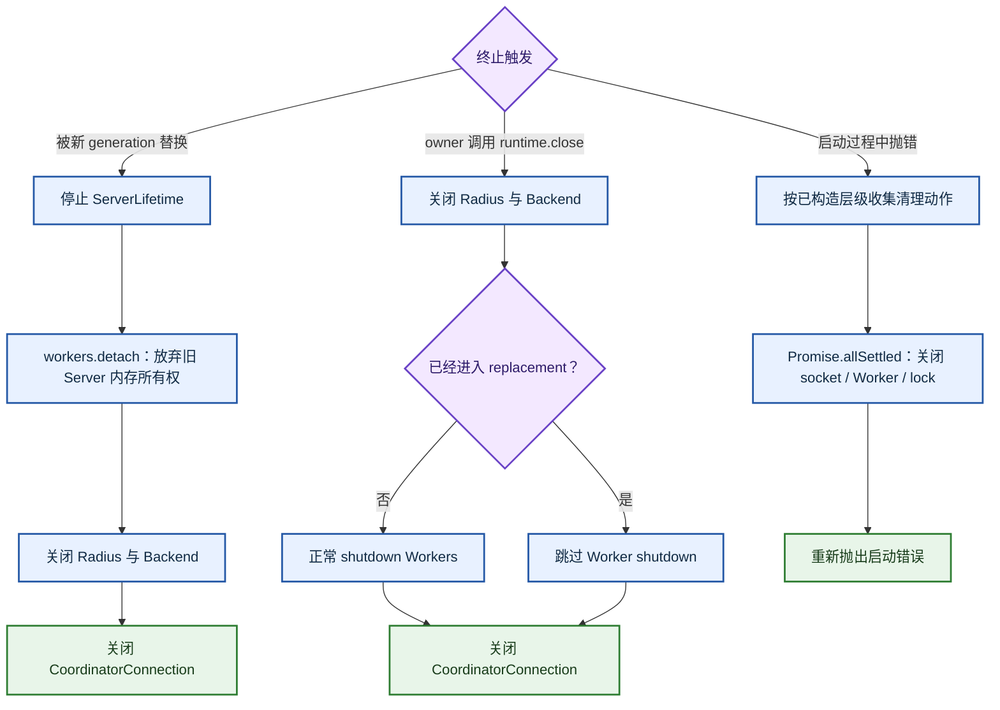

replacement 路径见 `server.ts:645-657`，主动关闭见 `:658-682`，启动失败清理见 `:690-705`。

`ServerLifetime`只决定自动启动的 generation何时可以退休：它综合 `keepAlive`、启动保护、活动 Pi connection数量和 Worker数量，见 `server.ts:244-320`。foreground由于 `keepAlive=true`不会因空闲自动退出；自动冷启动进程则在 Client和Worker都归零后进入短 idle grace。

`close()`是发起幂等关闭的命令；`closed`是观察底层关闭已经完成或失败的 Promise。命令入口等待后者，并在 `finally`再次调用前者完成兜底，这不是重复创建关闭流程。

## 这段代码里值得认识的 Node 编程模式

下面这些写法大多是 Node异步资源管理的常见模式，不是 Lane Harness特有协议。识别它们后，可以把注意力留给真正的业务边界。

| 模式 | 当前代码中的含义 | 源码锚点 |
|-|-|-|
| `createServer` 与 `createConnection` | 前者绑定路径并接受多条连接；后者主动连接已有监听地址。连接建立后双方都可读写，调用方向不等于数据方向。 | `coordinator.ts:201-225`、`298-322`、`444-462` |
| EventEmitter的 `once/on/off` | `once`用于只应发生一次的 connect、close、signal；`on`用于持续读取 data；结束时用 `off`移除监听，避免重复回调和对象被意外持有。 | `coordinator.ts:80-98`、`201-248`；`commands.ts:44-63` |
| Promise作为一次性生命周期信号 | `registered`、`replaced`和`closed`不是线程；它们是未来某个事件发生时只核销一次的通知。代码保存resolver，在socket消息或关闭事件中完成Promise。 | `coordinator.ts:43-64`、`80-98`、`124-180`；`packages/server/src/server.ts:46-93` |
| 缓存 Promise实现幂等异步关闭 | 第一次 `close()`创建关闭流程并缓存；后续调用返回同一个Promise，防止重复关socket、重复释放仓库或重复shutdown Worker。 | `server.ts:490-516`、`658-682`；`packages/server/src/server.ts:176-206` |
| `try/finally` 与 `Promise.allSettled` | `finally`保证锁和顶层runtime被关闭；`allSettled`用于多个独立资源都必须尝试释放的场景，避免第一个失败阻止后续清理。 | `commands.ts:44-64`、`server.ts:690-705`、`709-729` |
| `AbortController` | 把连接关闭或RPC cancel变成可向下传递的取消信号。它停止当前等待者或网络操作，不自动回滚已经提交的持久业务状态。 | `packages/server/src/server.ts:306-403`；`radius-relay.ts:103-132` |
| `timer.unref()` | 定时器仍会在进程存活时触发，但不会单独阻止Node事件循环退出。适用于启动保护、空闲退休、发现超时和重试等待。 | `server.ts:263-320`；`session-worker-manager.ts:154-176` |
| `void promise.catch(...)` | 表示调用方刻意不等待后台任务，但必须就地消费失败；裸写 `void promise`而没有错误终点容易形成未处理 rejection。 | `server.ts:649-657`、`684-686`；`session-worker-manager.ts:573-588` |
| `Map`/`Set`作为运行时索引 | 它们保存连接、peer、Worker、pending request和subscription的内存关系，不是持久事实源；进程替换后必须通过注册、discovery或Session Storage重建。 | `coordinator.ts:291-295`；`session-worker-manager.ts:97-117` |

另一个常见写法是“先声明可选资源变量，再在 `try`中逐层赋值，在 `catch`中按非空程度清理”。`backend/coordinator/startupLease/workers/relay`正是这种异步构造事务。它看起来变量多，但目的是让任意一步失败时都知道哪些资源已经成功创建。

### 什么时候使用 `timer.unref()`

`unref()`用于“进程还活着就执行，但它不值得单独维持进程存活”的辅助定时器。它不会取消定时器，也不会改变延迟时间；只要还有 socket、server 等其他活跃句柄，回调仍会正常触发。如果它已经是事件循环里最后一个活跃句柄，Node 可以在回调前退出。

| 场景 | 是否适合 `unref()` | 本项目例子 |
|-|-|-|
| 辅助性的宽限期、空闲回收、发现超时 | 适合。进程继续运行时需要它兜底；进程已无其他工作时，不必仅为等待该回调而存活。 | `server.ts:263-320`；`session-worker-manager.ts:154-176` |
| 重试退避、清理看门狗 | 通常适合，但前提是提前退出等价于不再需要这项辅助工作。 | 这是 Node 的通用使用条件，不是 Lane 协议。 |
| 必须执行的定时任务、用户正在等待的结果、必须触发的截止处理 | 不适合。此时定时器本身就是主工作，应该让它保持进程存活，或交给外部调度器。 | 例如“到点必须写盘”不能只靠已 `unref()` 的 timer。 |

判断句可以简化为：如果删掉这个 timer 后，进程在没有其他工作时立即退出仍然正确，就可以考虑 `unref()`。它和 `clearTimeout()`解决不同问题：前者控制进程是否被 timer 拽住；后者在结果提前到达或对象关闭时取消已经无用的回调。本项目两者都用了，例如 discovery 完成后在 `session-worker-manager.ts:173`清除超时 timer。

### Harness / Lane 里的 `Map`、`Set`为什么存在

先看结论：是否持久化不由容器是 `Map`还是 `Set`决定，而由“谁拥有它、数据是否另行 `commit`到 Session Storage、进程重启后从哪里恢复”决定。当前 Harness 中的用途可以按生命周期分成下面几类。

| 对象 | 存在的必要性 | 持久化判断 |
|-|-|-|
| `Harness.lanesByName` | 把 lane 名称映射到本进程内唯一的 `Lane`对象，避免每次访问都创建新对象，并让同一 lane 的运行中状态由一个实例协调。 | Map 本身不持久化。lane 的 `branch.tip`、配置和状态先写入 Session Storage；启动时由 `restoreSession()`扫描并重建。见 `runtime/harness.ts:34, 75, 99-147`和`runtime/restore.ts:91-114`。 |
| `StorageBackedSession.branches` | 缓存 branch 名称对应的包装对象，维持同一 Session 内的对象身份，避免反复构造访问门面。 | 不是真相源；branch 条目和 tip 在 Storage 中。见 `session/session.ts:223-280`。 |
| `listeners`、`watchListeners`、`registrations` | 保存正在运行进程里的事件订阅和 hook 函数，用 `Set`去重或快速删除，用 `Map`按事件类型、hook 名分组。 | 不持久化。函数和订阅属于本次运行的接线，关闭时清空，下次由应用代码或插件重新注册。见 `events.ts:7-83`和`hooks.ts:14-36`。 |
| `admitted`、`pendingIds`、文件队列、子进程 PID 集合 | 记录“正在进行”的 Promise、占用中的 ID、同一路径写入顺序和当前子进程，用来做并发互斥、等待关闭和资源回收。 | 不持久化。这些关系只在当前进程存活期间有意义；崩溃后不能把旧 Promise 或 PID 当成可恢复业务状态。例见 `session/memory.ts:145-180, 334-371`、`tools/file-mutation-queue.ts:6-29`、`env/nodejs.ts:442`。 |
| restore、fork、compaction、tool placement 中的临时集合 | 在一次算法执行中按 ID 建索引或去重，把原本反复线性查找降为直接查询，并明确“已经复制/选择/处理过”的成员。 | 不持久化；函数结束即可丢弃。最终需要保留的结果会通过 Storage 写入。例见 `runtime/restore.ts:99-113`、`session/fork.ts:30-91`、`runtime/drive/tool-placement.ts:31-133`。 |
| `InMemoryStorageState`内的 entries、values、usage | 它们是完整 Session 状态的内存物化视图，支持按 ID / key 快速读取、校验提交和计算统计。 | 要分后端：`MemoryStorage`中它就是易失的事实源，进程结束即丢；`JsonlStorage`中持久事实在 JSONL 文件，打开时逐条 replay 重建这些 Map。见 `in-memory-storage-state.ts:72-138`和`jsonl/storage.ts:39-125`。 |

因此，“Harness 里很多 Map/Set 都不持久化”只对运行中索引、订阅、并发占用和临时算法集合成立。对 `JsonlStorage.storageState`更准确的说法是：Map 是持久数据的内存投影，不是磁盘格式；真正的恢复依据仍是 JSONL。

### 为什么先声明可选资源，再在 `catch`中逐项清理

这不是数据库事务，而是手写的“分段构造 + 补偿清理”。`startServer()`要依次拿到 profile 锁、coordinator 启动租约、coordinator 连接、Worker 管理器、后端监听 socket 和 Radius relay。每一步都是异步的，可能在后面的步骤失败；代码必须记住失败发生前哪些资源已经拿到，才能只清理那些已存在的资源。

| 写法 | 它记录的状态 | 失败时的作用 |
|-|-|-|
| `let backend ... \| undefined` | `undefined`表示尚未取得该资源；赋值后表示当前函数已经拥有它，并有责任释放。 | `backend?.close()`只在后端确实启动后执行，不需要为每个失败点写一套不同的 `catch`。 |
| `startupLease = undefined` | 在 coordinator 连接成功后，启动租约已经关闭并移交完保护职责。 | 后续失败时不会再次关闭一份已经释放的租约。 |
| `released` | 记录 profile 锁的 `release()`是否已经成功执行。 | `catch`只在尚未释放时补做，避免重复释放。 |
| `Promise.allSettled([...])` | relay、backend、Worker、coordinator和profile锁是相互独立的清理动作。 | 即使第一个 `close()`失败，也继续尝试其余动作；最后把原始启动错误和所有清理错误合并抛出。 |

按实际代码走一个失败例子：`ensureCoordinator()`成功 → 创建 `CoordinatorConnection`和`SessionWorkerManager` → `startServerBackend()`已绑定server socket → `coordinator.connect()`成功并关闭startup lease → `workers.discover()`失败。此时 `catch`看到 `backend/coordinator/workers`都非空、`startupLease`已是空，于是停止生命周期 timer，关闭backend，shutdown Worker，关闭coordinator并释放profile锁。它不会错误地再次关闭startup lease。对应实现见 `server.ts:530-537, 614-643, 687-705`。

所以这些成员变量不是在表达业务状态，而是在表达“启动过程中已经取得了哪些外部资源”。只有当所有步骤成功并返回 `RunningServer`后，资源所有权才从局部启动函数转交给runtime的 `close()`。

## 按这个顺序读源码

1. `packages/coding-agent/src/experimental/commands.ts:11-64`：确认命令入口只做参数、状态输出和等待关闭。
2. `packages/coding-agent/src/experimental/server.ts:709-729`：理解 foreground与自动启动的差异。
3. `server.ts:520-707`：只看组合顺序和失败清理，暂不跳进回调。
4. `server.ts:376-518`与`packages/server/src/types.ts:17-64`：理解 Backend和四层 routed接口。
5. `packages/server/src/server.ts:262-404`：看 Pi handshake以及 Server target / Session target分流。
6. `packages/coding-agent/src/experimental/coordinator.ts:80-180`、`301-462`：看 control注册和稳定入口代理。
7. `packages/coding-agent/src/experimental/session-worker-manager.ts:97-220`、`452-704`：看 Worker发现、启动和请求相关表。
8. `packages/coding-agent/src/experimental/services/server.ts:25-149`：最后展开 Server级 Chord provider。
9. `packages/coding-agent/src/experimental/radius-relay.ts:103-268`：最后把远程 transport接回同一个 Pi Server。

# Client 如何启动、发现 Server 并选择 Session

Client 启动不是“连接一个固定 socket”这一条直线。当前实现先在命令入口判断是否启用交互 TUI，再由 `openClientRuntime()`决定显式连接、发现本地 Server，或自动冷启动 Server；建立连接后，TUI 与非交互模式再用不同规则选择 Session。需要始终区分两个动作：**连接 Server**可以同时发生在多个 route 上，**attach Session**最终只发生在选中的一个 Server 上。

<callout emoji="💡">
**总判断：**`pi client`是 Presentation 入口，但 `client-runtime.ts`同时承担本地依赖自动激活职责。它可以 spawn 独立 Server 进程，却不在 Client 进程内构造 Coordinator、Backend 或 Worker；新 Server 子进程仍通过同一个 `startServer()`进入完整架构。
</callout>

## 入口先分成 TUI 与非交互两种运行模式

`runClientCommand()`位于 `packages/coding-agent/src/experimental/commands.ts:67-90`。只有“没有命令行 prompt，且 stdin、stdout 都是 TTY”时进入 `runClientTui()`。只要传入 prompt、stdin 被重定向，或 stdout 被重定向，就进入一次性 `runClient()`。这项判断决定的是 Presentation 形态，不决定使用 Unix 还是 Radius。

**图：Client 命令入口的第一处分流**

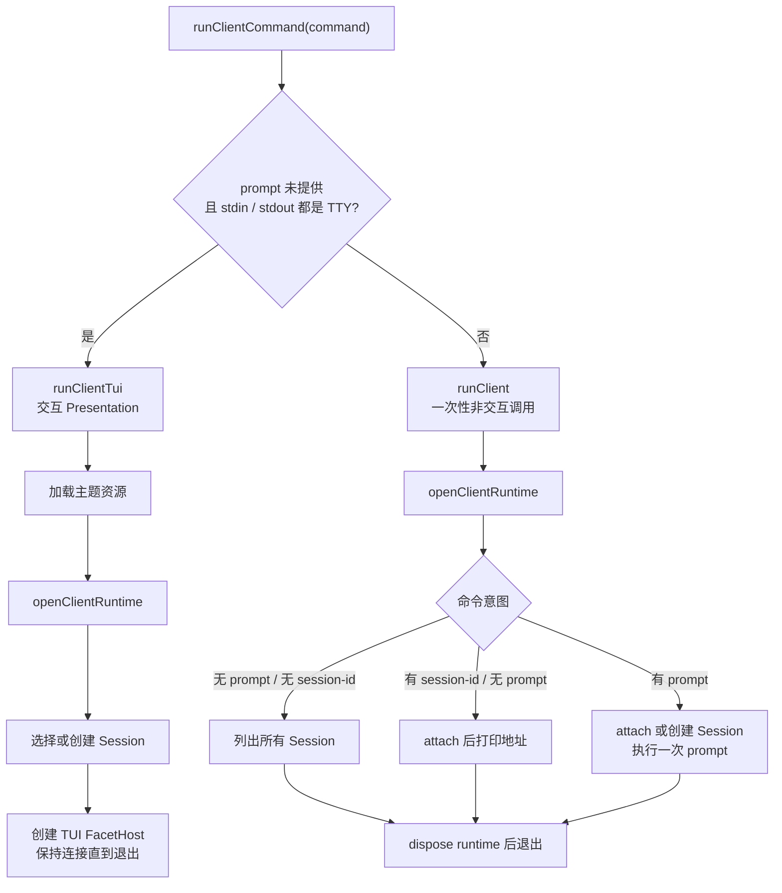

| 入口条件 | 调用 | 生命周期 |
|-|-|-|
| 无 prompt，stdin/stdout 均为 TTY | `runClientTui()` | 持有 TUI、Server connections 和选中 Session，直到用户退出 |
| 有 prompt，或任一标准流不是 TTY | `runClient()` | 完成 list、attach 或 prompt 后立即释放 runtime |

## openClientRuntime 先决定 route 集合，再连接全部 route

`openClientRuntime()`位于 `packages/coding-agent/src/experimental/client-runtime.ts:53-183`。`routes`是“可连接 Server 实例列表”，不是 transport 列表；每一条 route 才在 Unix 与 Radius 之间二选一。显式 `--connect`永远只产生一条 route；未指定时只发现本地 Unix socket，因此多个 route 也全部是 Unix。

**图：route 解析、自动冷启动与连接**

```mermaid
flowchart TD
    A["openClientRuntime"] --> B["校验 auth / model / pluginPackages 组合"]
    B --> C{"指定 --connect?"}
    C -->|是| D{"地址类型"}
    D -->|Unix| E["routes = 一个 Unix route"]
    D -->|Radius| F["routes = 一个 Radius route"]
    C -->|否| G["discoverUnixServers
探测 server 目录内所有 UUID socket"]
    G --> H{"发现数量"}
    H -->|0| I["activateServer"]
    I --> J["探测同 serverId 是否已可达"]
    J -->|已可达| K["复用现有 Client"]
    J -->|不可达| L["spawn detached Server 进程"]
    L --> M["子进程 runServerProcess
进入完整 startServer"]
    M --> N["等待稳定 Unix socket 可连"]
    K --> O["routes = 一个 Unix route"]
    N --> O
    H -->|1 或多个| P["routes = 全部可达 Unix routes"]
    E --> Q["逐条 Client.connect"]
    F --> Q
    O --> Q
    P --> Q
    Q --> R["每条连接包装
ServerServiceSource + SessionServiceSource"]
    R --> S["返回 ClientRuntimeServer 数组"]
```

`discoverUnixServers()`只返回通过 socket 类型、连接和协议握手验证的 Server，并按 `serverId`排序。`openClientRuntime()`随后顺序连接每条 route；任意连接失败会释放此前已建立的全部连接并使启动失败。自动发现的 Unix route 若出现协议版本不匹配，且用户没有显式 `--connect`，则调用 `activateServer()`以相同 `serverId`激活当前 Pi 版本。

自动冷启动只把 Server 进程拉起来并等待公开 socket 可达。新子进程执行 `runServerProcess() → startServer(keepAlive=false)`，因此仍会执行 `ensureCoordinator()`、创建 generation Backend、注册 Coordinator、创建 `SessionWorkerManager`并启动 Radius host。Client 进程没有 Coordinator 代码，是因为这些操作属于新 Server 进程。

## 多个 Unix route 时先全部连接，再按 Session 意图选择一个

多个 route 来自同一 server 目录下多个可达的 `<serverId>.sock`。建立所有连接后，TUI 的 `prepareClientSession()`会在每个 Server 上打开 `SessionDirectory`、`SessionManagement`和 `PresentationPlugins`，等待所有目录就绪后再选择。当前没有交互式 Server 选择器。

**图：TUI 在多个 Server 之间选择 Session**

```mermaid
flowchart TD
    A["已连接 Server A / B / ..."] --> B["读取全部 SessionDirectory"]
    B --> C{"指定 --session-id?"}
    C -->|是| D["在所有 Server 中查找该 ID"]
    D --> E{"匹配数"}
    E -->|1| F["选择该 Server / Session"]
    E -->|多个| G["报错: Session ID 跨 Server 歧义"]
    E -->|0| H{"当前是否只有一个 Server?"}
    H -->|是| I["在唯一 Server 创建指定 ID"]
    H -->|否| J["报错: 无法决定创建位置"]
    C -->|否| K{"--continue 或 --resume?"}
    K -->|是| L["汇总所有 Server 的 Session"]
    L --> M["按 createdAt 降序
再按 serverId / sessionId 排序"]
    M --> N{"是否存在 Session?"}
    N -->|是| F
    N -->|否| O["进入新建规则"]
    K -->|否| O
    O --> P{"是否只有一个 Server?"}
    P -->|是| Q["在唯一 Server 创建新 Session"]
    P -->|否| R["报错: Starting a Session requires exactly one server"]
    F --> S["prepareSession plugins"]
    I --> S
    Q --> S
    S --> T["attach 选中 Session"]
    T --> U["等待 Session services 完成绑定"]
```

所以“连接哪个”和“使用哪个”是两件事：底层会连接全部 route，但只对最终选中的 Server 执行 Session attach。未选中的连接仍保留在 `ClientRuntime`中，直到 TUI 退出后统一 dispose。若传入 client 级 `-e`插件选择，代码提前要求 route 数量恰好为一，避免插件选择缺少明确 Server 归属。

## 非交互 runClient 的 list、attach 与 prompt 分支

`runClient()`位于 `packages/coding-agent/src/experimental/client.ts:25-126`。它和 TUI 共用 `openClientRuntime()`，但没有界面状态和长期连接；完成一次结果后由 `finally`释放 runtime。

**图：非交互 Client 的终态**

```mermaid
flowchart TD
    A["runClient"] --> B["连接全部 routes
激活内置 Client services"]
    B --> C{"session-id 与 prompt"}
    C -->|都没有| D["汇总并排序所有 SessionAddress"]
    D --> E["返回 kind = list"]
    C -->|有 session-id / 无 prompt| F["跨 Server 查找唯一 Session"]
    F --> G{"找到唯一匹配?"}
    G -->|是| H["prepare plugins + attach"]
    G -->|否| I["报错
不会仅为 attach 创建 Session"]
    H --> J["返回 kind = attached"]
    C -->|有 prompt / 无 session-id| K{"是否只有一个 Server?"}
    K -->|是| L["创建新 Session"]
    K -->|否| M["报错: prompt 无法决定创建位置"]
    C -->|有 prompt / 有 session-id| N["查找唯一 Session
特定条件下可在唯一 Local Server 创建"]
    L --> O["prepare plugins + attach"]
    N --> O
    O --> P["订阅 Transcript 增量"]
    P --> Q["AgentController.prompt"]
    Q --> R["流式输出 text_delta"]
    R --> S["返回 kind = prompted"]
    E --> T["finally: dispose runtime"]
    J --> T
    S --> T
```

**当前实现边界：**非交互 `runClient()`没有读取 `command.continue`或 `command.resume`。因此标准流不是 TTY 时，`-c`/`-r`不会复用 TUI 中“跨 Server 选择最新 Session”的规则：无 prompt、无 `session-id`时仍返回 Session 列表；带 prompt、无 `session-id`时仍按新建 Session 处理。这是当前行为，不应从 TUI 分支推导出另一种语义。

## Client 与 Server 的所有权边界

| 对象 | Client 侧职责 | 不属于 Client 的职责 |
|-|-|-|
| `openClientRuntime` | 校验连接参数、发现 route、必要时自动激活本地 Server、建立 Client连接和远程 ServiceSource | 不创建 Session storage、Backend、Coordinator或Worker |
| `prepareClientSession` | 查询 Session目录、选择或创建一个 Session、准备 Presentation插件、发起 attach | 不持有 Session写权限，不构造 AgentHarness |
| `ExperimentalClientTui` | 渲染复制状态、提交命令、维护 Presentation FacetHost与重连表现 | 不直接执行模型、工具或持久化 Lane |
| 自动激活的 Server 子进程 | 由 Client bootstrap 发起 spawn，并由 Client等待其公开 socket 可达 | 启动后按完整 Server架构独立拥有 Coordinator连接、Backend和Worker管理 |

## 按这个顺序读 Client 源码

1. `packages/coding-agent/src/experimental/commands.ts:67-90`：先确认 TUI 与非交互分流条件。
2. `packages/coding-agent/src/experimental/client-runtime.ts:53-183`：看 route 形成、自动激活、连接和 dispose。
3. `packages/client/src/unix.ts:37-83`：看多 Unix Server如何发现和验证。
4. `packages/coding-agent/src/experimental/server.ts:144-198, 756-785`：看 Client冷启动如何进入完整 `startServer()`。
5. `packages/coding-agent/src/experimental/client-tui.ts:631-725`：看 TUI 如何跨 Server选择 Session。
6. `packages/coding-agent/src/experimental/client.ts:25-126`：看非交互 list、attach和prompt终态。
7. `packages/coding-agent/src/experimental/services/connection.ts`：最后展开 Server与Session两类远程 ServiceSource 的重绑定和状态。

# 本地和远程请求在哪里汇合

> 图示重建说明（私人画板已移除）：把本地 Coordinator 路径与远程 Radius Gateway、RadiusRelayHost 路径汇合到 Server.accept()；汇合后复用 attachment、Pi envelope、Chord payload 和 Worker 路由。

两条链路只在 Server 入口前不同。本地 Coordinator 不等价于远程 Radius Gateway：Coordinator 同时承担稳定本机入口和 Server generation 切换；Radius Gateway 只在 Pi 可见契约中提供远程 WebSocket 配对和中继。远程流量进入 `RadiusRelayHost`后，调用同一个 `Server.accept()`，后续 attachment、Pi envelope、Chord payload 和 Worker 路由完全复用。

## attachment 为什么存在两层

| 层次 | 标识 | 目的 |
|-|-|-|
| 公开 Pi Protocol attachment | `{serverId, sessionId, attachmentId}` | 把一个 Client connection当前选择的 Session 变成不可复用的 live route；切换或重连后旧帧会被拒绝。 |
| Server 到 Worker 私有 scope | `{serverConnectionId, attachmentId}` | 把请求绑定到当前 Server generation 和该 Worker 的需求记录，旧 generation不能继续操作 Worker。 |

公开 attachment ID 和 Worker scope attachment ID 都是临时能力，不是持久 Session 身份。`{serverId, sessionId}`只能标识逻辑 Session，不能区分同一 Client detach 后重新 attach 的新旧绑定，也不能隔离多个 Presentation 对同一 Session 的 lease、subscription 和释放生命周期；因此每次 attach都要生成新的 `attachmentId`，用于拒绝旧绑定上迟到的 request或cancel。

`serverConnectionId`标识一次 Server generation，该 generation 下所有 Worker attachment共用；`attachmentId`标识一次 attach lease，同一 generation内可以有很多个。前者在 Server替换时变化，后者在 attach、detach或切换 Session时变化。一个 Client connection同时只保留一个公开 attachment。

# 协议栈：每层只解释自己拥有的语义

| 层 | 拥有的协议 | 不拥有 |
|-|-|-|
| Chord | Service catalogue、call、subscribe、snapshot/update、service error、Delta path codec | 不规定 transport、frame、serverId或attachment |
| Pi Protocol | version hello、request/response correlation、target、cancel、subscription update、CBOR frame | 不解析 Agent、Session 目录或 Chord 业务成员 |
| Pi Client/Server | 连接生命周期、route校验、attachment、请求与订阅转发 | 不远程化 JavaScript Session/Harness |
| Coordinator private control | Server/Worker peer注册、generation通知、opaque send/broadcast | 不是公开 Pi RPC，也不持久化业务状态 |
| Radius relay | host/client WebSocket、logical connection复用、字节顺序与backpressure | 不解释内部 Pi CBOR 或 Chord payload |

# 插件如何穿过多个进程

一个插件包不是在 Server 中实例化一次再分发对象。Server 读取 `package.json`与约定入口，使用 Chord bundler分别把 `session`和 `tui`入口构建为内容校验的 CommonJS bundle及 `chord-facets.json`。Session Worker从共享文件系统读取选中 manifest，只加载 `session`入口；Presentation接收打包 artifact，只加载 `tui`入口。

插件代码的 `setup()`、Service注册与 `onActivate()`在各自 Host 进程的 FacetHost 中执行。Server负责构建和选择，不代表插件的运行 owner。不同 Session 的插件选择按 Session path持久化，活跃 Session拒绝中途换成不同 manifest，以避免一个已运行 Harness 的依赖图被偷偷替换。

# 持久化事实源与可重建缓存

| 数据 | 位置 | 恢复用途 |
|-|-|-|
| Session、Lane、Operation、transcript | Session Storage；当前 coding-agent后端为 Session目录下的 JSONL文件 | 从最后成功 commit的事务恢复 Lane投影、checkpoint和 open Operation |
| 默认逻辑 Server ID | `~/.pi/server/default-server-id` | 让后续 Server generation沿用同一逻辑地址 |
| Server级插件选择 | `plugin-packages-<serverId>.json` | 恢复默认 package path列表 |
| Session级插件选择 | `session-plugin-packages-<serverId>-<pathHash>.json` | 为该持久 Session恢复同一插件集合 |
| Facet build产物 | `plugin-builds/<serverId>/...` | 可从 package path重建；manifest和hash用于装载校验 |
| Coordinator peer表、current Server、attachments、Chord proxy | 仅内存 | 重启后通过重新注册、attach和订阅重建 |

# 恢复与故障处理

## 中断后为什么不能直接重做

模型请求可能已产生费用，工具调用可能已修改文件或远端数据；若进程在写结果前中断，仅凭内存无法知道它们是否执行过。因此代码先把 `effect_pending`写入 Session，再发出请求或执行工具，最后记录结果。重新启动看到这个状态时，按模型或工具各自的规则处理，不能一律再调用一次。模型见 `drive/generation.ts:132-230`、`drive/recovery.ts:43-86`；工具见 `drive/tools.ts:187-293,515-540`。

## 故障矩阵

| 故障 | 立即结果 | 恢复来源与动作 | 当前限制 |
|-|-|-|-|
| Client断开 | 本地 pending请求失败，attachment在已接纳调用核销后释放 | 重新 connect、显式 attach Session、重新订阅；不自动重放请求 | 远端工作可能已完成，调用方须判断重试幂等性 |
| Radius WebSocket断开 | 该 host连接上的逻辑连接全部关闭 | Host指数退避重连；Client指数退避 reconnect并按记住的 sessionId重新 attach | 连接和订阅不是持久事实 |
| Server generation替换 | Coordinator切断旧 public connections，通知 peers与旧 Server | Coordinator仍存活时，新 Server从其内存 peer表发现 Worker并广播 discovery；Worker重新声明 metadata，只接受新 `serverConnectionId`的 demand | Client仍要重连和 attach |
| Session Worker崩溃 | 该 Session的内存 Harness、FacetHost与进行中 continuations丢失 | 新 Worker重新打开 JSONL，`AgentHarness.create()`恢复 Lane和 open Operation，再显式 drive/resume | 外部 effect的未知结果依赖具体 recovery语义 |
| Coordinator崩溃 | Server控制连接关闭后视为 replaced；Worker控制 socket关闭并退出 | 下次启动只重建 Coordinator、Server并刷新持久 Session目录，不会 eager拉起历史活跃 Worker；Client重新 connect并显式 attach某个 Session后，Server才 lazy启动 Worker并从 JSONL恢复 | Coordinator无持久注册表，不能原地恢复活动 attachment |
| Harness close或进程丢失 | 停止接纳新 mutation；close本身不伪造 durable取消 | 后续 owner从 Session Storage最后成功提交的事务继续；当前 coding-agent后端即 Session JSONL | 迟到 effect可能返回，但关闭后的 mutation被拒绝 |

# 生命周期与资源回收

Server和Worker都不是“没有前台 Client就立即退出”。ServerLifetime综合 operator keepAlive、启动保护期、连接数和Worker数；auto Server在所有 hold消失后才进入短 idle grace。WorkerLifecycle综合当前 Server generation的 attachment demand、Harness活动 Operation和临时 retirement hold。demand是 Server generation在 Worker上持有的“该 attachment仍需要此 Worker”的内部租约，键为 `{serverConnectionId, attachmentId}`。旧 Server断开时，其 demand进入默认30秒的 orphan grace；这不是普通 idle timeout，而是给新 generation完成 Worker discovery、Client reattach并建立新 demand的交接窗口。旧 demand到期且没有活动 Operation、其他 demand或hold时，Worker才退出。

这也解释“一 Session 一 Worker”的依据：它优先换取 Session写锁、崩溃、插件状态和资源释放的隔离，而不是 Harness协议的必然要求。设计文档明确允许未来共置多个逻辑 Host，只要仍保持每个 Session单 owner和同样的 Service图可见性。

# 旁路、边界与当前高可用能力

- **多 Presentation：**同一 Session可被多个 TUI或未来 Web客户端观察；每个 attachment独立，keyed Service可把一个待处理交互发布给所有观察者。
- **steer与follow-up：**它们是 Lane inbox的具名输入，不是另起进程。Lane在 checkpoint或终结边界按模式消费。
- **compaction与navigation：**与 run共享 Operation、Drive、取消和持久恢复框架，而不是旁挂的工具函数。
- **subagent：**Lane Harness设计中，subagent是从父上下文边界创建的独立子 conversation/child Lane，不继续占用父 `main` Lane；当前 experimental Worker只取得并发布 `main` Lane，尚未实现子 Lane的创建、所有权与Service暴露。旧示例插件另起 pi进程，属于另一套实现。
- **Server高可用：**已实现单机内 generation切换和存活 Worker重新发现，但不是多活 Server；Coordinator只允许一个 current Server。
- **Coordinator高可用：**当前没有持久注册、主备或无损接管。它挂掉会触发整个活动进程组重建。
- **Radius高可用：**Pi侧有重连与退避；外部 Gateway是否多实例、是否持久化路由、如何容灾不在公开 Pi源码中。

# 用四个问题检验是否真正理解

1. **谁能写 Session？**只有该 Session当前 Worker中的 Harness；Server只持有目录元数据和路由。
2. **断线会不会取消 Agent？**不会。断线取消调用者的观察；只有持久 `requestAbort()`取消 Operation。
3. **为什么 Server可以替换而 Worker不立刻重建？**Coordinator维持稳定入口和peer路由，Worker demand带 `serverConnectionId`并允许短暂 orphan grace。
4. **Chord与Radius谁负责 RPC？**Chord定义 Service payload语义；Pi Protocol定义请求信封；Radius只承载字节。三者缺一不可但职责不重叠。

# 源码索引

- `packages/agent/src/harness/runtime/`：Lane、Drive、恢复、持久过程。
- `packages/agent/docs/runtime-simplification.md`：当前 durable procedure不变量。
- `packages/agent/docs/plugins.md`：Host、Facet与跨进程 Service设计。
- `packages/coding-agent/src/experimental/server.ts`：Server组合根、generation和插件选择。
- `packages/coding-agent/src/experimental/commands.ts`、`client-runtime.ts`：Client 交互/非交互入口分流、route 发现、连接与自动冷启动。
- `packages/coding-agent/src/experimental/client-tui.ts`、`client.ts`：TUI 与非交互模式的 Session 选择、attach 和 prompt 终态。
- `packages/client/src/unix.ts`：本地 Unix Server 的 socket 发现、握手验证和排序。
- `packages/coding-agent/src/experimental/coordinator.ts`：稳定入口与私有控制路由。
- `packages/coding-agent/src/experimental/session-worker.ts`：Worker owner、Harness与FacetHost构造。
- `packages/coding-agent/src/experimental/session-worker-manager.ts`：按 Session启动、复用和路由Worker。
- `packages/protocol/README.md`、`packages/client/README.md`、`packages/server/README.md`：公开协议边界。
- `packages/chord/README.md`：Service与Facet运行时。
- `packages/coding-agent/src/experimental/radius-relay.ts`：Radius远程字节传输。