<title>Pi 项目理解手册：开发与架构维护者源码指南</title>

<callout emoji="💡">
**先给结论：**Pi 当前可运行产品不是一个“LLM 调用器”，而是由 **pi-coding-agent** 负责产品装配和会话生命周期、**pi-agent-core** 负责单次 Agent 循环、**pi-ai** 负责 Provider / Model / Auth / Stream、**pi-tui** 负责终端交互的组合系统。仓库里的 AgentHarness、通用 Session、SQLite、protocol / client / server 是另一条尚未接入主产品的演进线，不能与当前主链混写。
</callout>

本文面向准备开发、排障或做架构调整的维护者。目标不是列出目录，而是回答六个可操作问题：对象由谁构造；状态由谁持有；一次请求经过哪些顺序；扩展能在哪些位置改写行为；会话替换后什么必须失效；某类改动应落在哪一层。

| 核对项 | 本文口径 |
|-|-|
| 源码快照 | commit **e86823096c5b**，核对日期 2026-09-01。 |
| 工程规模 | 10 个工作区包；公共包版本统一为 0.84.3；Node.js 要求 >= 22.19.0；packages 下生产 src 共 126,523 行 TypeScript / JavaScript。 |
| 证据边界 | 结论来自根文档、包 README / manifest、组合根、Agent 循环、资源与扩展、会话、TUI、远程协议和代表性测试。生成的模型目录、重复 Provider adapter 与完整测试语料按结构扫描，不据此推断单个 Provider 的特殊行为。 |
| 运行验证 | 本次只重写学习文档，没有修改代码，也没有运行 npm run check 或测试。“已实现”表示源码和既有测试存在对应契约，不表示本次重新做过现场运行验证。 |

# 阅读口径：先区分对象、阶段与证据

## 2026-09-14 架构更新红线审阅版

<callout emoji="💡">
**审阅方式**
绿色表示基于当前 main（71dca871bc80）的新增或替代表述。
~~红色删除线表示旧版手册中已经不成立、范围过窄或需要降级为历史口径的判断。~~
本节以旧版分析基线 e86823096c5b 为比较起点。为保留已有评论，当前先不拆改下方原正文；确认后再把本节结论归并到对应章节并清除红线。
</callout>

### 结论：Pi 不是把旧运行栈整体替换掉，而是增加了一套可持久恢复的 Agent Harness

| 变化主题 | 旧版判断 | 当前判断 |
|-|-|-|
| 总体架构 | ~~产品主线是 coding-agent → Agent → pi-ai；AgentHarness 只是尚未完成的实验骨架。~~ | 轻量 Agent 主线仍然存在；同时，AgentHarness 的 WP00～WP07 已完成并成为 pi-agent-core 的公开持久运行能力。两套运行时并存，不能再把 Harness 写成空壳，也不能反过来写成它已替代本地 coding-agent。 |
| 产品入口 | ~~coding-agent 只有一个围绕 AgentSession 的运行边界。~~ | 稳定 CLI / SDK / interactive / print / stdin RPC 仍由 AgentSession + SessionManager v3 驱动；PI_EXPERIMENTAL=1 的 client/server/worker 路径则由 AgentHarness 驱动。入口不同，生命周期和持久化协议也不同。 |
| 跨进程架构 | ~~protocol / client / server 只有协议和存储实现，coding-agent 尚未提供实际 service。~~ | coding-agent 已实现 experimental client、server、Session worker、服务目录、会话管理、AgentController、Transcript、Models、插件装载与 TUI 展示链；但包 README 仍明确标记 experimental，认证、兼容性和若干远程契约尚未稳定。 |
| 扩展体系 | ~~扩展只需要按 ExtensionRunner 的事件与注册 API 理解。~~ | 现在要区分三类：稳定 coding-agent Extension；AgentHarness 的执行 hooks；Chord 的 plugin facets。它们分别解决产品内扩展、持久操作拦截、跨宿主功能拆分，注册点与生命周期不能互换。 |
| 会话持久化 | ~~Pi session 可以统一描述成“一个 JSONL 文件里的 parentId 会话树”。~~ | 这只准确描述 coding-agent format 3。Harness format 4 把逻辑状态拆成 entries、values/lists、usage ledger，并通过原子 transaction 统一提交；后端可选 Memory、JSONL、SQLite。 |
| compaction | ~~Pi 的 CompactionEntry 都依赖 firstKeptEntryId 指向旧树中的保留边界。~~ | coding-agent v3 仍使用 firstKeptEntryId；Harness format 4 的 CompactionEntry 改为自包含 retainedTail，读取上下文遇到最近 compaction 即停止向前扫描。两种格式必须分别讲。 |
| JSONL 性能 | ~~JSONL 只是单条 entry 的顺序追加和整文件冷加载。~~ | Harness JSONL 的一行对应一次完整 transaction：单 write 写对象，多 write 写数组；打开时仍需整文件 replay。逻辑删除或 value 替换会留下死字节，J1 snapshot compaction 已有规范但尚未实现；需要索引和局部查询时应选 SQLite。 |
| 成熟度口径 | ~~只需按“当前主线 / 实验栈”二分。~~ | 要改成三段：稳定产品链；已实现但仅 experimental 入口可达的链；仅规范或明确待办。否则会同时低估 Harness 内核、高估远程产品化程度。 |

### 更新后的顶层运行图

| 运行面 | 主链路 | 当前状态 |
|-|-|-|
| 本地产品链 | CLI / SDK / interactive / print / stdin RPC → createAgentSession\* → AgentSession → 轻量 Agent / agent-loop → pi-ai Provider；旁路由 SessionManager format 3 追加 JSONL。 | 稳定且默认可达 |
| 持久运行内核 | AgentHarness.create → Session → Branch + AgentLane → accept operation → drive / recover → Models / Tool / Hook → 原子提交 entries、values/lists、usage。 | 核心已实现并公开导出 |
| 远程产品链 | pi client → pi-protocol v8 / pi-client → pi-server → Chord service routing → per-session worker → AgentHarness；Transcript 以 replicated state 回送 presentation。 | 已实现的 experimental 入口 |
| 组合层 | Chord FacetHost 将一个 plugin 按 worker / server / TUI 等宿主拆成独立 facets，以 typed service 连接；remote adapter 只运输 strict JSON 服务语义和 replicated-state delta。 | Chord 可独立使用；Pi 集成仍属 experimental |

<callout emoji="🔎">
**框架对照｜DeerFlow：顶层 owner**
**对应概念：**Pi 的稳定 AgentSession 更接近单进程产品运行边界；AgentHarness 的 Session / Lane / Operation 更接近把 DeerFlow thread、run 与 checkpoint 恢复语义显式拆开；Chord server / worker / presentation 则对应 DeerFlow Gateway、worker 与客户端展示层所解决的跨进程问题。
**差异：**DeerFlow 以 LangGraph graph + checkpointer/store 组织执行；Pi Harness 不使用图解释器，而是以可持久状态机和直接 async procedure 驱动。Chord 还把一个插件拆成多个宿主 facet，这不是 DeerFlow middleware 的同构物。
**认知落点：**比较时先找“谁持有可恢复状态”和“谁拥有一次写权限”，不要按 Agent、run、plugin 等同名单纯映射。
</callout>

### 演进主题：从隐式运行控制流迁移到显式持久状态机

#### 一图看懂替换方向

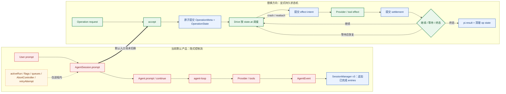

左侧的“状态”依附于当前进程和调用栈；右侧把接受、effect 前意图、effect 后核销和终态都变成原子持久化转换。后续替换的实质是 owner 与恢复协议迁移，不是简单换一个类名。

<callout emoji="💡">
**成熟度校正**
~~AgentHarness 状态机目前只存在于 roadmap，尚未实现。~~
更准确的说法是：AgentHarness 的 Operation 状态机、公开 Lane runtime 和恢复路径已经实现，WP00～WP07 与 WP09 已完成；但默认 coding-agent 仍运行旧的 AgentSession / Agent 链。新状态机进入产品的入口目前是 PI_EXPERIMENTAL=1 下的 client / server / Session worker，全面取代旧链仍是演进目标，而不是当前默认行为。
</callout>

| 观察维度 | 当前默认链：AgentSession / Agent | 替换方向：AgentHarness |
|-|-|-|
| 运行模型 | 直接调用 prompt() / continue() 进入 agent-loop，控制权主要保留在当前 JavaScript 调用栈和 Promise 中。 | 先 accept 一个 run / compaction / navigation Operation，再由 drive() 按持久状态推进；接受与执行所有权明确分开。 |
| 状态表达 | 并非没有状态，但状态散落在 activeRun、isStreaming、streamingMessage、pendingToolCalls、\_isAgentRunActive、多个 AbortController、retryAttempt 和消息队列中，没有统一状态类型。 | OperationMeta 固化接受时输入；OperationState 是封闭联合类型，以 at 字段枚举 13 个可恢复叶子；LaneState 只保存 currentOperationId、lastOperationId 与 inbox。 |
| 转换规则 | 转换隐含在 AgentSession.prompt()、\_runAgentPrompt()、事件处理、\_checkCompaction()、retry 和 abort 分支中，需要沿调用链推断。 | 每个转换都以完整 pi.op.state 替换提交；Drive 按 state.at 分派到唯一 procedure，若既未 settle/wait 又没有改变状态则触发 invariant error。 |
| 持久化边界 | SessionManager v3 保存已完成的消息和产品事件，不保存当前模型请求、工具 effect 或 retry 正执行到哪一步。 | pi.op.meta、pi.op.state、pending entry/tool output/assistant frames 与 usage 一起通过原子 transaction 保存；终态删除 operation 临时值并写不可变 pi.result/{operationId}。 |
| 崩溃恢复 | 进程退出会丢失正在运行的调用栈；resume 只能从已追加到 JSONL 的会话内容重新开始。 | 重新 attach 时从 lane state + operation state 恢复；新的 Drive 从持久叶子继续。effect_pending 被视为结果未知，并按 assistant、summary、deferred 或工具 replay policy 分别核销。 |
| 并发与互斥 | Agent 用 activeRun 拒绝并发 prompt；AgentSession 另用 isStreaming、isCompacting 和控制器协调 prompt、compact、retry、branch summary。 | 一个 AgentLane 同时只有一个 current Operation；第二次 accept 返回 LaneBusy。并行能力位于不同 Lane，或 tools 子状态机内部，而不是同一 Lane 上并发 prompt / compaction。 |
| 取消与关闭 | abort() 主要中断当前进程内 run；各类 compaction/retry/summary 有各自 AbortController。 | 调用者 Context 取消只停止该调用者观察；requestAbort 才写 durable cancel_requested。close 是受控崩溃，不伪造 aborted 终态。 |
| 上层观察 | UI 直接订阅 AgentSession / Agent 事件并读取内存状态。 | LaneSnapshot + gap-free watch 是统一投影；experimental 远程链再由 Transcript replicated state 投送给 TUI presentation。 |

#### 新状态机的主转换图

##### 13 个持久状态的主图

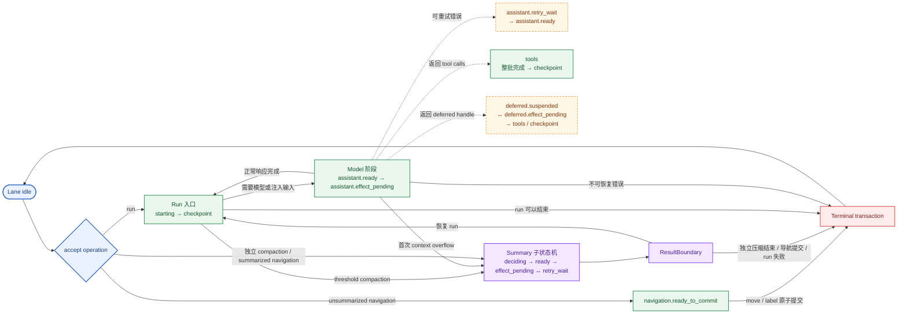

图中的 Idle、ResultBoundary、Terminal 是帮助阅读的解释节点；真正写入 pi.op.state.at 的是其余 13 个状态。

##### Summary 共用子状态机

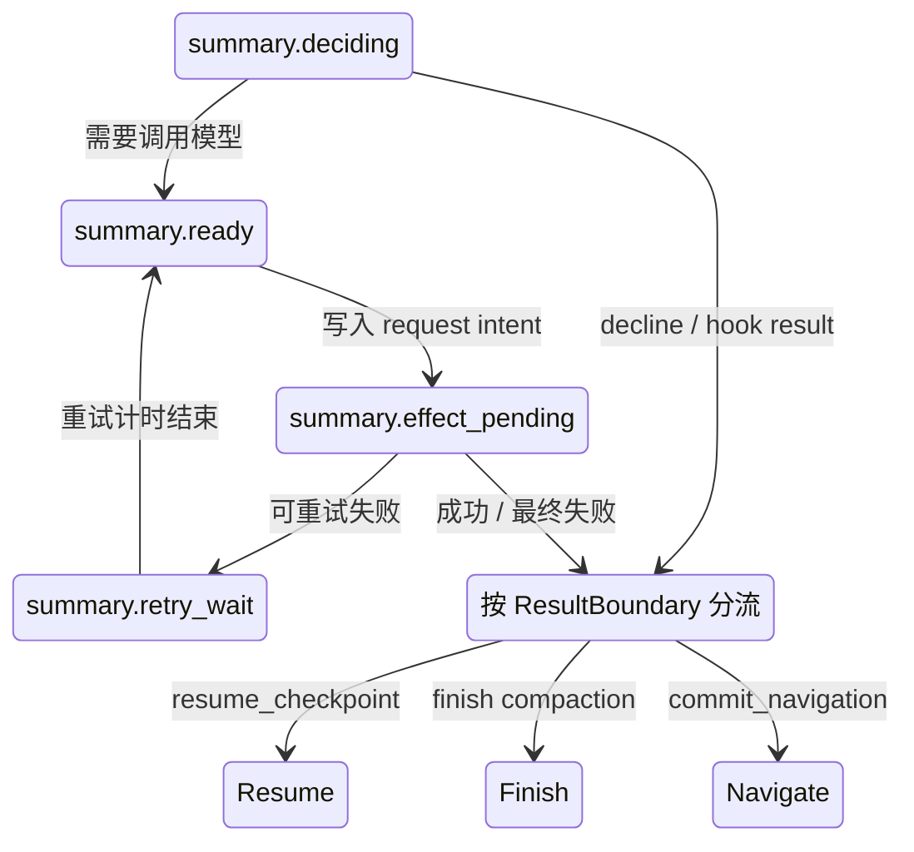

##### 取消是与 at 正交的控制维度

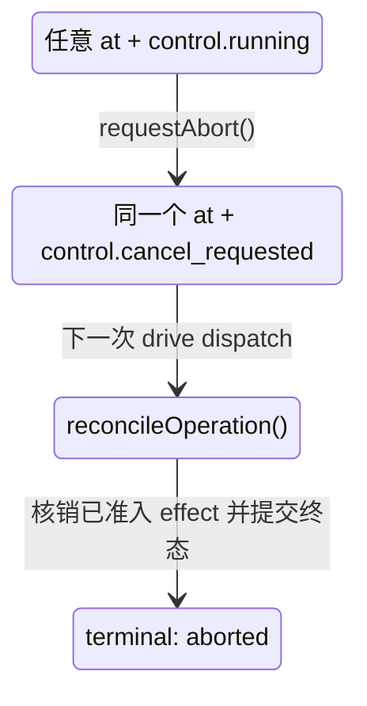

requestAbort 通常不改变当前 at，而是切换 control；这样恢复代码仍能知道被取消时究竟处于哪个 effect 窗口。

##### 并行工具批次的子状态机

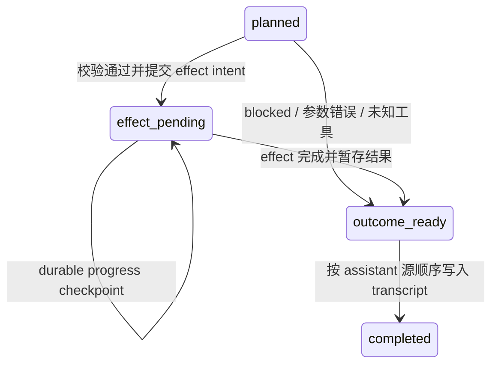

工具 effect 可以按完成顺序核销，但 transcript 只提交连续 ready 前缀，因此“并发执行”和“确定性消息顺序”可以同时成立。

| 阶段 | 典型转换 | 持久含义 |
|-|-|-|
| 接受 | idle → starting（run）｜idle → summary.deciding（manual compaction）｜idle → navigation.ready_to_commit / summary.deciding（navigation） | 同一 transaction 写 OperationMeta、初始 OperationState、LaneState；run 还同时写入 prompt entries。 |
| 模型请求 | starting → checkpoint → assistant.ready → assistant.effect_pending → tools / checkpoint / retry / deferred / terminal | ready 表示请求尚未准入；effect_pending 表示请求已经进入不可判断结果的窗口。 |
| 工具批次 | tools.call[i]: planned → effect_pending → outcome_ready → completed；批次完成后回到 checkpoint 或进入终态。 | effect 可按完成顺序核销，entry 只按 assistant 源顺序提交连续 ready 前缀。 |
| 结构化摘要 | summary.deciding → summary.ready → summary.effect_pending → checkpoint / navigation.ready_to_commit / terminal；失败可进入 summary.retry_wait。 | 同一套状态支持 manual、threshold、overflow compaction 和 branch summary，结束边界由 SummaryTask.boundary 决定。 |
| Deferred | deferred.suspended → deferred.effect_pending → assistant settlement / 再次 suspended | 等待和轮询位点可跨进程保存；是否发起下一次 poll 由新的 Drive permit 决定。 |
| 取消 / 终态 | 任意叶子 + cancel_requested → total reconciliation → completed / declined / failed / aborted result | 取消先阻断新 effect admission，已准入 effect 仍必须核销；终态 transaction 清理 operation-owned values/lists。 |

#### 为什么这是替换旧链，而不是给旧 Agent 外面再套一层状态枚举

1. **状态必须在 effect 前后落盘：**如果只从 AgentEvent 推导状态，进程可能在 Provider/tool 已执行但事件尚未产生时崩溃，仍无法判断是否可以重试。
2. **每个叶子必须是完整重启点：**Harness 保存的是当前 OperationState，不是历史事件 reducer 的偶然结果；恢复无需重放整个控制流。
3. **产品 owner 会迁移：**旧链由 AgentSession 同时拥有编排、扩展、会话和 UI 协调；新链把持久执行交给 AgentLane，把跨进程 API 交给 Chord services，把展示投影交给 Transcript / presentation。
4. **行为迁移不能只看 happy path：**prompt、compact、navigation、retry、deferred、parallel tools、abort、close 和 crash recovery 都要映射到新 Operation 语义，Extension 也要区分继续保留、改成 Harness Hook 或拆为 Chord Facet。
5. **旧会话迁移不等于运行状态迁移：**format 3 可以归一化为 format 4 的 entries、retainedTail 和 lane configuration；但旧链没有持久 in-flight Operation，因此只能恢复已提交会话，不能凭空恢复崩溃前的模型或工具调用。

<callout emoji="🔎">
**框架对照｜DeerFlow：显式状态机的粒度**
**对应概念：**DeerFlow 通过 LangGraph 节点转换和 checkpoint 保存 thread state；Pi Harness 通过 OperationState.at 和原子 value 提交保存运行位点。两者都把“执行到哪里”从进程调用栈提升为可恢复数据。
**差异：**DeerFlow 的图状态主要表达 model/tool node 与业务 state 的推进；Pi Harness 的叶子更贴近副作用持久化协议，显式区分 ready、effect_pending、outcome_ready、retry_wait 和 deferred.suspended。Pi 不使用 graph interpreter，Drive 直接按叶子调用 async procedure。
**认知落点：**以后比较 Agent 框架状态机时，应分别检查“业务/图节点状态”和“外部副作用的 intent—effect—settlement 状态”；只看到 checkpoint 或 state 字段还不能证明崩溃恢复语义等价。
</callout>

#### 当前与替换目标的判定

~~当前 Pi 没有运行时状态机；roadmap 将来会新增一个 AgentHarness 状态机。~~

**当前默认产品：**没有统一、显式、可持久恢复的运行时状态机，仍由 AgentSession / Agent 的隐式控制流协调。

**当前代码能力：**AgentHarness 的显式持久状态机已经实现，并已在 experimental client/server/worker 链实际运行。

**后续替换目标：**让默认 coding-agent 从旧 AgentSession 执行模型迁移到 AgentHarness / AgentLane。时间表不能仅从源码断言；现阶段文档应把它写成明确演进方向，并持续标注 stable 入口是否已经切换。

### 运行对象与生命周期需要重新分层

| 对象 | 当前职责 | 生命周期 / owner |
|-|-|-|
| Agent | 兼容且公开的内存运行循环：消息转换、Provider 请求、工具批次、steering / follow-up、事件。 | 由 AgentSession 持有；不是持久恢复边界。 |
| AgentSession | 稳定 coding-agent 的产品编排边界：模型、扩展、资源、compaction、session 切换、交互模式。 | 一次本地 coding-agent 会话实例。 |
| SessionManager v3 | 稳定产品的 JSONL entry tree、current leaf、firstKeptEntryId compaction 与 fork/navigation。 | 一个 session 文件；resume 打开并继续追加。 |
| Session format 4 | Harness 的持久能力根：不可变 entry tree、mutable values/lists、usage ledger、Branch/Lane 配置与操作状态。 | 正常情况下恰好一个可写 host；backend 不负责跨进程 writer lease。 |
| Branch | 一个有名字的数据路径和 tip；可以只存数据，不一定可执行。 | 归 Session；本身不是 agent worker。 |
| AgentLane | Branch + lane configuration + lane state + result records，提供 prompt、compact、navigate、queue、watch 等执行能力。 | 由 Harness 恢复并持有；不同 lane 可承载并行工作。 |
| Operation | 持久化的 run / compaction / navigation。accept 只提交操作和初始状态，不等于已经开始执行。 | 跨进程崩溃保留；同一 lane 同时只有一个 current operation。 |
| Drive | 某次进程内推进 Operation 的 continuation，拥有 effect gate 和共享 completion；崩溃后可由新 drive 从 durable state 继续。 | 进程内、pass 级；Lane 才是执行 owner。 |
| FacetHost | 校验依赖图，按 provider → consumer 激活 facets，并按反向依赖释放；service facade 在 provider 替换时保持稳定。 | 每个 server / worker / presentation 宿主各自持有。 |

### 持久化与 compaction：现在有两套 Pi 格式，不能再拉平描述

| 维度 | coding-agent format 3 | AgentHarness format 4 |
|-|-|-|
| 物理组织 | 一个 session 一个 JSONL；header 后逐条追加 SessionEntry，parentId 构成树。 | SessionRepo 管理 session；Storage 可为 Memory、JSONL、SQLite。JSONL 仍是一 session 一文件，文件名含创建时间与 session id。 |
| 逻辑数据集 | 消息、模型切换、thinking、compaction、branch summary、label、session info 等都表现为 entry。 | entries 是不可变树；values/lists 保存 lane 配置、操作状态、pending payload、stream frame 等可变或暂存状态；usage ledger 独立追加。 |
| 原子边界 | 以 SessionManager 的同步 append 为主。 | 一次 Storage transaction 全有或全无，所有 write 获得 Session 全局递增 seq。JSONL 以“一行一 transaction”保存，对多 write 使用 JSON array。 |
| 读取 | 打开文件解析全部 entry，在内存重建 id map 与当前 branch。 | Memory / JSONL 在内存沿 parent pointer 回溯；JSONL 打开时 replay 全文件。SQLite 使用表与私有 segmented branch cache，适合局部查询和更大状态。 |
| CompactionEntry | summary + firstKeptEntryId；split turn 可能先顺序生成 history summary，再生成 turn-prefix summary，最后拼成一个 summary entry。 | summary + retainedTail；entry 自包含，不依赖被压缩旧节点继续存在。读取路径遇到最近 compaction 即停止向前。 |
| 空间回收 | 没有 max-size 或在线物理压缩机制。 | JSONL 的 value 替换/删除只改变 replay 后的逻辑状态，死字节仍保留；J1 snapshot rewrite 仅有规范，当前未实现。SQLite 的 value set 是原位 upsert。 |
| 迁移 | 旧格式继续由稳定产品读取。 | legacy v3 可在 Harness 打开时归一化：firstKeptEntryId 转 retainedTail，模型/thinking/tool 变更转 lane configuration；首次非空 format-4 commit 写入新格式。format 4 尚未稳定，R11 通用迁移仍未实现。 |

<callout emoji="🔎">
**框架对照｜DeerFlow：持久化划分**
**对应概念：**Harness 的 entries 类似可回放的对话事实；values/lists 类似 checkpoint 中为恢复服务的当前状态；usage ledger 则是独立审计/计量事实。这个划分比旧 Pi “所有记录都塞进一种 entry JSONL” 更接近 DeerFlow 按消费方和恢复职责拆分数据的思路。
**差异：**DeerFlow 仍由 checkpointer 保存 graph state，由 RunEventStore 保存产品事件；Pi format 4 把三类逻辑数据放进同一个 Session Storage 契约，并要求一次 transaction 原子提交。相同 backend 不等于相同数据类型。
**compaction：**当前 Harness 仍把 compaction 建模为 lane 上的独占 Operation，和 prompt/navigation 共享 current-operation 槽；这不是异步 watermark compaction。先前讨论的 sourceHead/watermark 属于候选设计，不应写成现状。
</callout>

### 工具执行与崩溃恢复：从“调用顺序”升级为“intent / effect / settlement”

~~旧文档只需说明 prepare → execute → finalize，以及工具结果按调用顺序写回。~~

轻量 Agent 仍遵循 prepare → execute → finalize：preflight 按源顺序，effect 可并行，结果按源顺序进入消息。Harness 在此基础上增加持久边界：先提交 effect_pending intent，再执行真实 effect，再提交 outcome_ready，最后只把连续 ready prefix 按源顺序 materialize 为 entry。

因此并行工具可能形成 [effect_pending, outcome_ready, effect_pending] 的持久中间态。崩溃恢复只重放声明 replay=safe 的工具；其余 orphan effect 生成“外部结果未知”的中断结果。pending tool output、pending entry、assistant frames 都是为不确定窗口服务的暂存数据，不是普通会话消息。

AbortSignal 只取消某个调用者对 Drive 的观察；只有 requestAbort / abort 才会写入 durable cancel_requested。close 被定义为受控崩溃：不伪造取消和终态，下次打开从最后一个持久点恢复。

### 扩展体系：Extension、Harness Hook、Chord Facet 各自解决不同问题

| 机制 | 职责 | 边界 |
|-|-|-|
| coding-agent Extension | 稳定产品扩展：事件、tools、commands、provider、UI renderer/widget、session hook、资源发现和动态 reload。 | 围绕 AgentSession / ExtensionRunner；可接触产品 UI 与 SessionManager。 |
| AgentHarness Hook | before_drive、before_run、transform_context、before_request、before_payload、after_response、before/after_tool、before_compaction/navigation 等持久操作阶段。 | 结果分 pass-local、request-local、transition-consumed；没有全局 exactly-once，外部副作用必须按稳定 operation/invocation id 自己幂等。 |
| Chord Plugin / Facet | 把同一个 feature 拆成 server、session worker、TUI/Web 等独立 facet，通过 typed services、keyed instances、replicated state 连接。 | 同步声明依赖图；provider 先于 consumer 激活，反向释放；远端只过 strict JSON。它不是工具 sandbox，也不自动提供进程隔离或权限。 |

<callout emoji="🔎">
**框架对照｜DeerFlow：扩展与 middleware**
DeerFlow middleware 最接近 Harness Hook：都在模型、工具和生命周期阶段拦截或变换数据。coding-agent Extension 的覆盖面更宽，包含 UI、命令和 provider 注册；Chord Facet 更像跨宿主模块装配和服务依赖容器。三者都不能简单标成 DeerFlow middleware 的同义词。
</callout>

### 远程链路：现在已可运行，但仍要保留 experimental 标签

1. **连接与路由：**pi-client 通过 Unix socket 等 byte transport 连接，pi-protocol v8 用长度前缀 + CBOR 传递 hello、server/session target、request/response、cancel、subscription update 和 attachment change。
2. **语义边界：**pi-protocol 只验证 envelope 与 strict JSON；Chord 解析 serviceId / member / args、catalogue、subscription snapshot/update 与 Delta。不要把协议包写成业务 API 定义者。
3. **会话路由：**session 请求携带 serverId + sessionId + attachmentId，attachmentId 用来拒绝切换或重连后的迟到帧。一个 Session 可被多个 presentation 同时观察。
4. **worker owner：**每个 active Session 由独立 worker 持有 writable Session 与 AgentHarness；server 管目录、attachment、worker 生命周期和服务转发，TUI 只持 replicated Transcript。
5. **当前缺口：**peer authentication、公开协议兼容性、raw RemoteSession、完整 trace carrier、自动重连/请求重放都不是已完成保证。client 断开后必须显式 reconnect，并只重试确认安全的操作。

### 实现成熟度清单

| 状态 | 可以写成当前能力 | 不能越界推导 |
|-|-|-|
| 已实现 | Harness WP00～WP07；Memory/JSONL/SQLite 一致存储模型；Operation accept/drive/recover/abort；Branch/Lane；工具与 assistant 不确定窗口；Chord services/facets/replicated state。 | 已实现内核不等于默认 coding-agent 已迁移。 |
| 已实现但 experimental | pi-protocol/client/server；coding-agent client/server/worker；SessionDirectory、SessionManagement、Models、AgentController、Transcript、PresentationPlugins、SessionPlugins、SlashCommands、PresentationUI。 | 无兼容保证；安全认证与生产运维边界未完成。 |
| 规范 / 待办 | J1 JSONL snapshot compaction；R11 通用迁移；R12 watchSession；T1 完整 telemetry；S3 搜索；raw RemoteSession 契约；WP08 余下 streaming fork；部分 precise rewrite / Postgres 设想。 | 文档中的设计段不能写成生产现状。 |

### 对原手册的最终归并计划

| 原章节 | 确认后如何调整 |
|-|-|
| 1 生命周期术语 | 保留既有 turn 区分；新增 Session v4、Branch、AgentLane、Operation、Drive、FacetHost，并补 DeerFlow 对照。 |
| 2 架构图 / 3～6 运行链 | 改成“稳定本地链 + 持久 Harness 内核 + experimental 远程链”三层图；分别写轻量 Agent 与 Harness 的 prompt/tool 流程，不混成一条。 |
| 7 扩展执行链 | 拆为 Extension、Harness Hook、Chord Facet 三种机制，并按构造、激活、作用域、失效和 reload 比较。 |
| 10 session / compaction | 拆成 format 3 与 format 4 两章；加入原子 transaction、values/lists、usage ledger、retainedTail、迁移、J1 缺口和 SQLite 选择。 |
| 13 远程架构 | 把“未接通”改为“experimental 已贯通”，补 client/server/worker、Chord service、attachment fencing、replicated Transcript 和安全缺口。 |
| 15～20 排障、改动矩阵、源码路线 | 增加按运行面选择入口的排障矩阵，源码顺序从 package topology 开始，再分别走 stable AgentSession 与 durable Harness 两条路线。 |

### 本轮代码与文档证据

版本：main 71dca871bc80，工作区干净；比较基线 e86823096c5b。

- packages/agent/README.md：轻量 Agent 仍是公开 API，agent-loop.ts 保持兼容实现。
- packages/agent/docs/harness.md：format 4、Session/Branch/Lane/Operation、持久执行与恢复的规范及实现状态。
- packages/agent/src/harness/\*\*：AgentHarness、Drive、Lane、Session、JSONL 与 runtime reducer 的当前实现。
- packages/coding-agent/src/main.ts、core/agent-session.ts：稳定本地产品链仍使用 AgentSession + SessionManager。
- packages/coding-agent/src/experimental/\*\*：client/server/worker、services、plugin facets 与 service-only TUI 的实验链。
- packages/chord/README.md、packages/agent/docs/plugins.md：FacetHost、typed services、replicated state、reload 与跨宿主插件模型。
- packages/protocol、packages/client、packages/server：协议 v8、连接、attachment fencing 与 Session service routing。
- packages/coding-agent/docs/session-format.md、compaction.md：稳定 format 3、split turn、firstKeptEntryId。

---

<callout emoji="🔎">
**阅读提示：本文已加入 DeerFlow 对照组**
正文始终以 Pi 为主体；重要概念、运行流程和能力边界旁，会在确有对应机制时加入 DeerFlow 高亮对照，帮助读者把已有认知迁移到 Pi。
**后续复用：**拆解新的 XXAgent 时，应新建一份以 XXAgent 为主体的手册，复用本文的章节组织和“对应概念、相同点、差异、认知落点”格式，并在新文档中分别加入 DeerFlow 与 Pi 对照；这些对照不回写本文。
</callout>

## 本文使用的生命周期术语

| 术语 | 在 Pi 中的含义 | 典型 owner |
|-|-|-|
| session | 一份 JSONL 会话树及其 current leaf，以及围绕它工作的 AgentSession。 | SessionManager、AgentSession。 |
| agent run | 一次 prompt 开始，到 retry、自动 compact、steer / follow-up 全部稳定后的执行段。 | AgentSession.\_runAgentPrompt；产品层结束信号是 agent_settled。 |
| 会话 turn（compaction 口径） | 从一条 user message 开始，包含其后全部 assistant response、tool call 和 tool result，直到下一条 user message。一个会话 turn 可以包含多个 agent-loop turn。 | SessionManager、compaction。 |
| agent-loop turn（模型轮次） | pi-agent-core 内部从 turn_start 到 turn_end 的一轮：一次 assistant response，以及该响应触发的一批 tool result。它是事件与运行循环口径，不等于 compaction 的会话 turn。 | pi-agent-core 的 runLoop。 |
| tool call | AssistantMessage 中一个带 id 的工具调用；一个 agent-loop turn 可串行或并行执行多个。 | agent-loop 的 prepare / execute / finalize 三段。 |
| model request | transformContext、convertToLlm 完成后交给 Provider 的一次请求；正常情况下生成一个 assistant response，并构成一个 agent-loop turn 的模型阶段。 | Agent + ModelRuntime + pi-ai Provider。 |

<callout emoji="💡">
**术语冲突：Pi 在两层代码里复用了 turn**
[Pi 官方 Split Turns](https://pi.dev/docs/latest/compaction#split-turns) 将 turn 定义为从一条 user message 到下一条 user message 前的完整会话段；但 pi-agent-core 的 turn_start / turn_end 事件把一次 assistant response 及其 tool results 称为一轮。
**本文约定：**未加限定的 turn 一律指 compaction 的“会话 turn”；描述运行循环事件时固定写“agent-loop turn（模型轮次）”。二者是一对多关系，不可混用。
</callout>

<callout emoji="🔎">
**框架对照｜DeerFlow：生命周期术语**
**对应概念：**
- **进程 / cwd runtime：**DeerFlow Gateway 的 application lifespan 与 runtime resources 可对应进程级 owner；嵌入式 DeerFlowClient 的配置和缓存可对应调用者持有的运行环境。但 DeerFlow 没有与 Pi cwd-bound AgentSessionServices 完全等价的统一对象。
- **session：**Pi 指 JSONL 会话树、current leaf 及其 AgentSession；DeerFlow 更接近 thread，由 checkpointer / store 延续状态，而不是由 compiled graph 实例本身延续。
- **agent run：**Pi 从一次 prompt 开始，直到 retry、compact、steer / follow-up 全部稳定；DeerFlow Gateway 的 run 是一次 worker 执行，Gateway 路径会为该 run 新建 graph。
- **会话 turn：**Pi 按 compaction 口径从一条 user message 划到下一条 user message 之前；DeerFlow 没有完全等价的公开生命周期对象，只能近似理解为一次用户输入驱动的 thread 处理段，其中也可能经历多次 model / tool node 循环。
- **agent-loop turn：**Pi 的 turn_start / turn_end 覆盖一次 assistant response 及其工具结果；DeerFlow 可用一次 model node 与紧随其后的 tool node 批次辅助理解，但不是同名、同边界的公开对象。
- **tool call：**两边都由模型产生带 id 的调用，并要求 ToolResult / ToolMessage 与原调用配对；执行顺序和 middleware / hook 语义不同。
- **model request：**Pi 在 context 转换后进入 ModelRuntime 与 Provider；DeerFlow 以 ModelRequest 穿过 model middleware，再进入具体模型调用。
**相同点：**两边都要把进程、持久会话、用户输入驱动的处理段、模型轮次和工具调用分开，才能判断状态由谁持有、何时失效。
**差异：**Pi 同时存在 compaction 的会话 turn 和 agent-core 的事件 turn；DeerFlow 的公开执行语义围绕 run、compiled graph、node 与 thread checkpoint 组织，不能直接套用 Pi 的 turn 名称。
**认知落点：**先看 owner、起止事件和持久化范围，再做概念对照；同名不代表同一个生命周期对象。
</callout>

## 判断“代码已经接通”的四个条件

类型、接口或构造函数存在，只能说明设计面已经出现。本文只有在以下四项都能闭合时，才把能力写成当前主线：

1. **入口引用：**CLI、SDK 或宿主组合根实际引用该对象。
2. **对象可构造：**依赖、配置和持久化 backend 能在当前入口完成装配。
3. **主操作实现：**prompt、resume、compact 等核心方法不是占位或明确拒绝。
4. **结果可消费：**事件、状态或错误有上层消费者，不只是生产了一个没人读取的 marker。

# 整张架构图：当前主线与实验栈

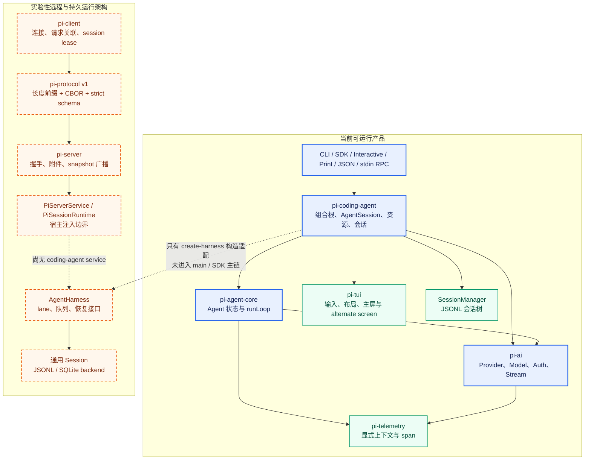

蓝色实线区域是今天运行 pi 时真实经过的链。橙色虚线区域已经有不少协议和存储实现，但 AgentHarness 的主操作仍未完成，也没有由 coding-agent 主入口提供 PiServerService。因此，不能因为 protocol、SQLite 或 client 测试通过，就推导“远程 Pi 已经可用”。

## 各包拥有的职责

| 包 | 拥有的职责 | 不应承担的职责 |
|-|-|-|
| pi-coding-agent | CLI / SDK 组合根、AgentSession、资源和扩展、项目 trust、当前 JSONL 会话、compaction、交互模式、产品内置工具。 | 不重新实现 Provider wire protocol；不把 TUI 几何状态塞进会话模型。 |
| pi-agent-core | Agent 的运行状态、队列、事件、agent-loop turn（模型轮次）、工具调度与错误归一；另含实验 AgentHarness / Session 抽象。 | 不决定项目资源来源、session 文件位置或产品 UI。 |
| pi-ai | Provider 集合、模型目录、认证、OAuth、统一模型消息、流式事件、usage / cost、API adapter。 | 不拥有 Agent retry / compaction 产品策略，也不保存用户会话树。 |
| pi-tui | 终端输入、组件、layout、focus、overlay、主屏 / alternate screen、图片与字符宽度。 | 不持有 Agent 业务状态，不决定模型和工具生命周期。 |
| pi-telemetry | 显式 TelemetryContext、span 契约、NOOP 与内存实现。 | 不内置 exporter，不依赖隐式全局 tracing 状态。 |
| protocol / client / server / sqlite backend | 远程协议、连接与 lease、服务端 runtime 注入边界、通用 Session 持久化。 | 在未接通 AgentHarness 与 coding-agent service 前，不代表当前产品远程化完成。 |

## Pi 与 DeerFlow 对照索引

本文以 Pi 为主体，只与 DeerFlow 对照。对照只在两边确实解决同一工程问题时出现，重点比较 owner、构造点、生命周期和约束边界；框架名称和类名只用于定位，不作为等价依据。

<callout emoji="💡">
**本手册的对照边界与后续复用方式**
**当前文档：**只记录 Pi 与 DeerFlow 的对应关系，不在本文继续追加其他 Agent 框架。
**后续新文档：**分析 XXAgent 时，新建一份以 XXAgent 为主体的理解手册，复用这里的章节组织和对照框格式；在新文档的相近机制旁，分别放置“框架对照｜DeerFlow”和“框架对照｜Pi”两张同级高亮框。
**固定字段：**对应概念、相同点、差异、认知落点。正文始终解释当前文档的主体框架，对照框只承担已有认知迁移。
**收录条件：**只有职责或机制确实相近才写；没有直接对应物时明确写“无直接对应”，不为结构完整强行映射。
</callout>

| 对照主题 | Pi 正文位置 | DeerFlow 对应机制 |
|-|-|-|
| 组合根与实例生命周期 | 启动链 | Gateway graph / DeerFlowClient cache |
| Agent 运行循环 | Agent 核心循环 | Gateway worker / LangGraph |
| 扩展 Hook 与顺序 | 扩展执行链 | middleware hook stack |
| Prompt 运行时组合 | System Prompt | template / context / middleware |
| Skill 渐进式披露 | 资源系统 | Skill index / activation / durable facts |
| 会话连续性与压缩 | 会话与持久化 | checkpointer / store / summarization |
| 远程服务边界 | 实验性远程架构 | Gateway ASGI service |
| 安全与工具治理 | 安全与硬约束 | guardrail / sandbox audit middleware |

DeerFlow 对照依据：<cite doc-id="R6dXduhz3oQjV8x6DEultC9Mglg" file-type="docx" title="Deer Flow Harness 学习路线与源码解析" type="doc"></cite>、<cite doc-id="RNHDd1PBKo7jdtxyAvKliVVlgl6" file-type="docx" title="DeerFlow Agent 架构与运行机制：源码学习笔记" type="doc"></cite>、<cite doc-id="JYDQdjzm4oMdxIxvB5vlaYDHg1f" file-type="docx" title="DeerFlow Lead Agent Middleware 执行链：顺序、Hook、作用域与跨层影响" type="doc"></cite>、<cite doc-id="X2nMdop4hoPl3RxAqt8lsVeKgy2" file-type="docx" title="DeerFlow Agent Prompt 设计方法论：分层、标签与作用域" type="doc"></cite>。

# 启动链：组合根、构造顺序与对象 owner

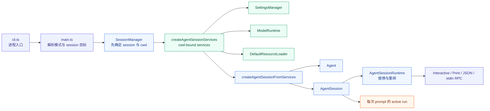

## 为什么必须先解析 session，再创建 cwd 服务

恢复已有会话时，session header 可能把 cwd 指向另一个项目。若 main 在解析目标 session 前创建 SettingsManager、ResourceLoader 或 trust context，恢复后仍会拿着旧目录的扩展、Skill、AGENTS.md 和模型设置。这不是刷新不及时，而是 owner 绑定错了。当前主链先由 **createSessionManager()** 确定目标会话和 cwd，再调用 **createAgentSessionServices()**，正是为了避免这类跨项目串用。

## 构造步骤与可见副作用

| 顺序 | 入口 | 完成的动作 | 失败影响 |
|-|-|-|-|
| 1 | packages/coding-agent/src/cli.ts | 建立进程级 HTTP dispatcher 和标识，转入 main(args)。 | 尚未创建 session，错误属于进程启动。 |
| 2 | main.ts: main / createSessionManager | 解析 CLI、模式、resume / fork / session id，并得到目标 cwd。 | 会话文件或 cwd 不合法时在资源装配前具名失败。 |
| 3 | agent-session-services.ts: createAgentSessionServices | 创建 SettingsManager、ModelRuntime、DefaultResourceLoader；做 trust / package / resource reload；应用扩展注册的 Provider；离线 refresh 模型目录。 | 资源错误进入 diagnostics；无法形成一致服务集时不创建 AgentSession。 |
| 4 | sdk.ts: createAgentSession | 恢复 model / thinking / messages，计算有效工具，构造 Agent，再构造 AgentSession 并绑定 ExtensionRunner。 | 模型不可恢复时保留 fallback message；无可用模型时 session 可存在但 prompt 前会失败。 |
| 5 | agent-session-runtime.ts | 保存同一个 runtime factory，用于 new、resume、fork、import 的 teardown / recreate / rebind。 | 替换是先拆旧再建新；新建失败不会自动回滚成旧 runtime。 |
| 6 | main.ts 的模式分派 | 把同一 AgentSessionRuntime 交给 Interactive、Print、JSON 或 stdin RPC。 | 交付模式失败不改变底层对象边界。 |

## 对象生命周期总表

| 对象 | 创建者 / scope | 持有的状态 | 失效与清理 |
|-|-|-|-|
| AgentSessionServices | createAgentSessionServices；cwd scope。 | cwd、agentDir、settings、models、resources、diagnostics。 | 目标 cwd 变化或 runtime replacement 时整体替换。 |
| ModelRuntime | services 或 SDK 调用者；通常 cwd runtime scope。 | Provider map、credentials、catalog snapshot、动态刷新 generation。 | 服务集替换或宿主释放；一次 model request 不会重建它。 |
| DefaultResourceLoader | services；cwd scope。 | extensions、skills、prompts、themes、context files、source metadata。 | reload 清缓存并重建结果；cwd 改变必须换实例。 |
| SessionManager | main / SDK；session file scope。 | append-only entries、索引、当前 leaf、header、branch tree。 | 切换会话文件或 in-memory session 被丢弃。 |
| AgentSession | createAgentSession；session runtime scope。 | Agent、ExtensionRunner、工具 registry、system prompt、retry / compaction、SessionManager。 | new / resume / fork / import / reload 或 dispose。 |
| Agent | createAgentSession；跟随 AgentSession。 | 消息、model、thinking、tools、active run、steer / follow-up queues。 | 所属 AgentSession 被替换；同一实例一次只允许一个 active run。 |
| ExtensionRunner | AgentSession 构建 runtime；session scope。 | handlers、commands、tools、provider registrations、ctx bindings。 | reload 或 session replacement 后旧 ctx 变 stale，继续使用会明确报错。 |
| active run | Agent.runWithLifecycle；agent run scope。 | AbortController、完成 Promise、streaming state。 | agent_end 监听者处理完后 finishRun；AgentSession 还可能继续 retry / compact。 |

<callout emoji="🔎">
**框架对照｜DeerFlow：组合根与实例生命周期**
**对应概念：**Pi 的 AgentSessionServices、AgentSession 与 AgentSessionRuntime，可对照 DeerFlow Gateway 的 graph factory，以及嵌入式 DeerFlowClient 的 graph cache。
**相同点：**都要先找到真正创建并持有运行对象的一层，生命周期才有确定答案。
**差异：**Pi 主要按 session runtime 复用；DeerFlow Gateway 每个 run 新建 graph，而 DeerFlowClient 按配置 key 复用 graph。
**认知落点：**不要问“是不是单例”，要问从哪个入口进入、谁创建、复用到 session、run 还是 graph。
</callout>

# AgentSession 为什么是产品运行边界

**Agent** 只解决“给定模型、上下文、工具和队列，怎样完成一轮循环”；**AgentSession** 解决“这个产品怎样准备一次用户请求，并把结果接回可恢复的会话”。把 retry、compaction、资源、扩展或 JSONL 持久化塞进 agent-loop，会让 pi-agent-core 与具体产品绑定；把工具循环放进 TUI，则会让非交互 SDK 无法复用。当前分层的价值就在这里。

| 职责 | AgentSession | Agent / agent-loop |
|-|-|-|
| 请求入口 | extension command、input hook、Skill / prompt template 展开、auth / model preflight、streaming queue 策略。 | 接受已归一化的 AgentMessage，拒绝同一实例并发 prompt。 |
| 上下文 | 构建 base system prompt；扩展可按 run 覆盖；当前 JSONL 恢复与 compact。 | 每轮调用 transformContext，再 convertToLlm，形成 provider context。 |
| 工具 | 维护 active tool set、内置 / 扩展工具、tool hook 绑定、系统 Prompt 联动重建。 | 验证、阻断、执行、并行 / 串行、结果归一和事件顺序。 |
| 结束语义 | 处理自动 retry、自动 compact、agent_end 后新入队消息，最终发 agent_settled。 | 在工具和消息队列耗尽时发 agent_end，并等待订阅者完成。 |
| 持久化 | 在 message_end 等事件上追加 SessionManager entry。 | 只维护内存 AgentState，不知道 JSONL 路径和分支。 |

# 一次 prompt 的真实执行图

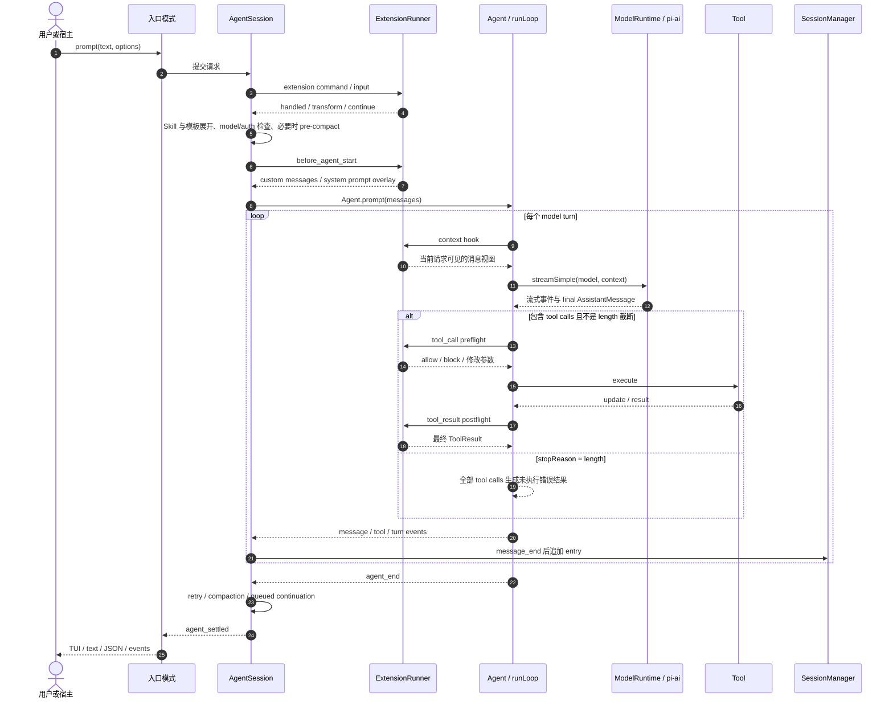

## prompt 前置阶段

| 顺序 | 动作 | 真实语义 | 短路 / 失败 |
|-|-|-|-|
| 1 | extension command | 以 /command 命中的扩展命令立即执行，即使当前正在 streaming；命令自己决定是否触发 LLM。 | 命中后不再形成用户 prompt。 |
| 2 | compaction gate | 已有 compaction 在进行时拒绝新 prompt，避免两个状态重写并发。 | 具名抛错，要求等待并重试。 |
| 3 | input hook | 扩展在 Skill / template 展开前处理原始文本和图片，可 handled 或 transform。 | handled 时不再进入 Agent。 |
| 4 | Skill / template 展开 | /skill:name 读取完整 SKILL.md 并与参数合并；prompt template 做文本展开。 | 未知 Skill 原样透传；文件读取错误进入 extension error。 |
| 5 | streaming queue | Agent 已运行时，调用者必须明确 steer 或 followUp；两者进入时机不同。 | 未给 streamingBehavior 直接拒绝。 |
| 6 | model / auth | 验证模型存在，并在调用前重新检查可用凭据，支持会过期的 OAuth。 | 无模型、无 key 或 OAuth 失效分别具名。 |
| 7 | pre-compaction | 检查上一条 AssistantMessage，补上中断响应后尚未发生的自动压缩。 | 只 compact，不在此处 agent.continue。 |
| 8 | before_agent_start | 按扩展加载顺序累积 custom messages；systemPrompt 修改会成为本 run overlay。 | 单个 handler 报错进入诊断，后续扩展继续。 |

# Agent 核心循环：顺序不变量与工具语义

## 一次 agent-loop turn（模型轮次）的固定阶段

1. 把 steer 队列中的消息作为 message_start / message_end 插入上下文。
2. transformContext 产生当前模型请求使用的 AgentMessage 视图，不直接改 SessionManager。
3. convertToLlm 把产品消息转换为 pi-ai Message；随后构造 Context(systemPrompt, messages, tools)。
4. ModelRuntime 在调用时解析最新凭据、headers、retry / timeout，再进入具体 Provider adapter。
5. 流事件不断替换内存中的 partial AssistantMessage；done / error 时写入 final message。
6. 若有 tool calls，按执行策略完成整批工具；再发 turn_end。
7. prepareNextTurn 可替换下一轮 context、model 或 thinking；shouldStopAfterTurn 可提前结束。
8. steer 在下一次 model call 前进入；follow-up 只在 Agent 本应结束时开启新的内循环。

## 工具执行不是一个 execute 调用，而是三段协议

| 阶段 | 代码动作 | 维护含义 |
|-|-|-|
| prepare | 按名字找 tool；prepareArguments；TypeBox schema validation；beforeToolCall。 | hook 发生在初次校验之后。扩展改写后的 args 不会再次校验，改写者必须保证类型和语义。 |
| execute | 调用 tool.execute；收集 update 回调；等待已发出的 update 事件完成；异常转 error result。 | 工具完成不表示更新事件已丢弃；late update 在 execute 返回后被拒绝。 |
| finalize | afterToolCall 可改 content、details、usage、terminate、isError；再发 tool_execution_end 和 ToolResult message。 | postflight 抛错会把本次结果替换成 error result；最终持久化的是归一后的 ToolResult。 |

## 必须保住的执行不变量

| 不变量 | 真实行为与原因 |
|-|-|
| length 截断不执行工具 | AssistantMessage 以 stopReason=length 结束时，全部 tool calls 都生成“未执行”错误结果。流式 JSON salvage 可能让截断参数恰好通过 schema；执行它们仍不安全。 |
| 并行完成顺序与消息顺序分开 | tool_execution_end 按真实完成顺序发出；Promise.all 归并后，ToolResult message 按原始 tool call 顺序写入上下文，保证 provider 配对稳定。 |
| 一个 sequential tool 让整批串行 | 全局 toolExecution=sequential，或当前批次任一工具声明 executionMode=sequential，整批走顺序路径；不是只串行那个工具。 |
| terminate 采用“全体同意” | 只有本批至少一个调用，且所有 finalized result 都 terminate=true，才停止后续模型循环；单个工具不能静默取消同批其他结果的后续处理。 |
| Agent idle 等待异步监听者 | 事件 sink 被逐个 await；agent_end 监听者处理完成后，activeRun 才结束。上层可在 agent_end 入队新消息，AgentSession 会继续运行。 |
| agent_end 不是产品最终稳定点 | AgentSession 仍可能 retry、compact 或 continue。需要“用户这一请求真的结束”的调用者应监听 agent_settled。 |

<callout emoji="🔎">
**框架对照｜DeerFlow：Agent 运行循环**
**对应概念：**Pi 的 AgentSession 外层编排与 Agent / runLoop 内层循环，可对照 DeerFlow Gateway worker 与 compiled LangGraph。
**相同点：**两边都把产品级运行管理与 model → tool → next model 的执行循环分开。
**差异：**Pi 直接维护手写循环和工具三阶段协议；DeerFlow 把 model node、tool node 与 middleware hook 编译进 graph，由 graph 完成路由、interrupt 和继续执行。
**认知落点：**排障时先判断问题属于外层 run / session 编排，还是内层模型与工具循环。
</callout>

# 扩展执行链：注册、发现、激活、调用与失效

Pi 扩展不是 middleware 列表，但同样存在顺序和作用域。维护时要区分五个阶段：扩展代码被加载；注册项进入 runtime；资源被发现；handler 在某个生命周期点执行；session replacement 后旧 context 失效。只看到 registerTool 或 handler 名字，不能推断它每轮都生效。

| 阶段 | 入口 | 产物 / scope | 容易误判的点 |
|-|-|-|-|
| 加载 | DefaultResourceLoader.reload；extensions/loader.ts。 | Extension 对象与共享 ExtensionRuntime；cwd scope。 | 项目 trust bootstrap 只先加载允许的 extension 集，不等于所有资源都已加载。 |
| 注册 | 扩展 factory 调用 registerTool / registerCommand / registerProvider / on。 | tool、command、handler、pending Provider registration。 | 注册 Provider 在 services 阶段刷新进 ModelRuntime；运行时注册则立即生效。 |
| 资源发现 | resources_discover；resourceLoader.extendResources。 | 附加 Skill / prompt / theme 路径和 sourceInfo。 | 发现路径不等于 Skill 已展开进用户请求，也不等于工具 active。 |
| 激活 | active tool set、/skill:name、/command、具体事件条件。 | 本 session、本 run 或一次 model request。 | Skill 索引常驻 system prompt，但完整正文只在显式命令展开时进入用户消息。 |
| 执行 | input、before_agent_start、context、provider、tool、message / turn / agent / session hooks。 | 按扩展加载顺序与每个扩展的 handler 顺序 await。 | 不同 hook 的短路语义不同；不能把“handler 抛错”统一理解成整次 run 失败。 |
| 失效 | reload、new、resume、fork、switchSession。 | 旧 ExtensionRunner、ctx、SessionManager 引用变 stale。 | 异步任务缓存旧 pi / ctx 再使用会明确报 stale context；应使用 withSession 返回的新 ctx。 |

## 按一次请求展开的 hook 顺序

| 位置 | hook | 能改什么 | 持久化 |
|-|-|-|-|
| 用户输入前 | input | handled 或 transform 文本 / 图片；发生在 Skill 和模板展开前。 | 本身不持久；只有形成的后续消息会持久。 |
| run 构造前 | before_agent_start | 追加 custom messages；按链式结果覆盖本 run system prompt。 | custom message 会进会话；system overlay 在 run 结束后清除。 |
| 每轮模型前 | context | 变换发给模型的 AgentMessage 视图。 | 不自动写回 Agent state 或 JSONL。 |
| Provider 边界 | before_provider_headers、before_provider_request、after_provider_response | 改 headers / payload，观察 status / response headers。 | transport overlay，不属于会话消息。 |
| 工具前后 | tool_call、tool_result | 阻断、改变参数；再改变结果 content / details / usage / terminate。 | 最终 ToolResult 才进入会话。 |
| 事件观察 | agent_start / end、turn_start / end、message_start / update / end | 观察或替换 message_end 消息；异步 handler 被 await。 | AgentSession 在最终 message_end 后追加 session entry。 |
| 会话切换 | session_before_switch / fork / tree / compact、session_shutdown / start | 切换前可取消；shutdown 做收尾；新 runtime 发 start。 | 旧 runtime 先 settle / dispose，再应用新 runtime。 |

<callout emoji="🔎">
**框架对照｜DeerFlow：扩展 Hook 与顺序**
**对应概念：**Pi 的 ExtensionRunner 命名事件和工具 prepare / execute / finalize，可对照 DeerFlow 的 middleware hook stack。
**相同点：**扩展是否生效都取决于注册位置、调用阶段、相对顺序和实例 scope。
**差异：**Pi 按具体事件线性 await，并由各事件定义短路或改写语义；DeerFlow 的 before hook 正序、after hook 反序，wrapper 进入正序、返回反序。
**认知落点：**不要把 DeerFlow 的反序回收直接套到 Pi；先画出当前框架真实的调用方向。
</callout>

# System Prompt 是组合结果，不是单文件

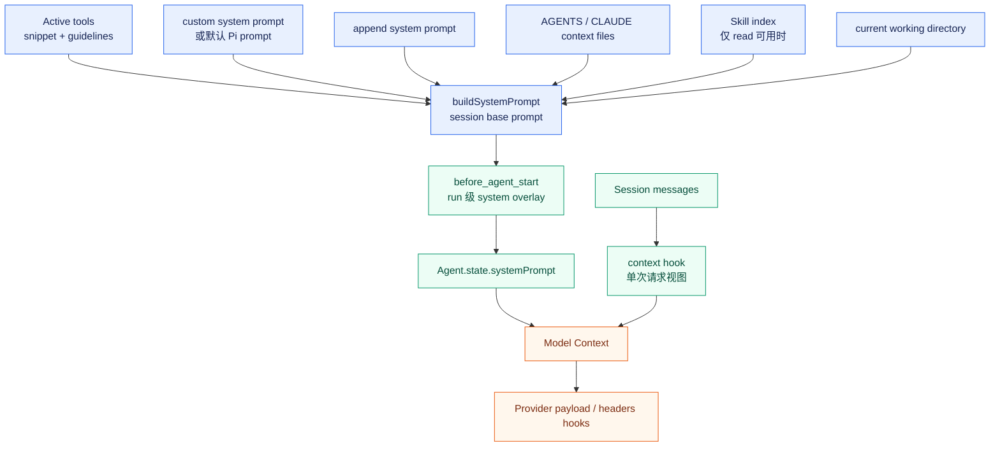

## Prompt 来源与生命周期矩阵

| 来源 | 何时组装 | 影响范围 | 退出条件 |
|-|-|-|-|
| 默认 Pi prompt 或 customPrompt | AgentSession 构建 / reload / active tools 变化时。 | base prompt；customPrompt 会替代默认主体。 | 资源 reload、session replacement 或显式换源。 |
| append system prompt | ResourceLoader 解析配置或文件。 | 追加在主体后，不夺走主体 owner。 | reload 后按新资源重建。 |
| AGENTS / CLAUDE context files | 从 agentDir 与 cwd 祖先目录加载。 | base prompt 的 project_context；跨本 session model calls。 | cwd 或文件变化后 reload / replacement。 |
| Skill index | buildSystemPrompt；只有 read tool 可用时加入。 | 告诉模型 Skill 名称和路径，不常驻完整正文。 | active tools 或资源 reload 改变。 |
| /skill:name 正文 | prompt preflight 时同步读取 SKILL.md。 | 作为当前用户消息的一部分进入会话。 | 随会话历史和 compaction 规则处理，不是独立状态。 |
| before_agent_start systemPrompt | 每个非命令 prompt 前，按 handler 顺序链式改写。 | 当前 agent run。 | \_runAgentPrompt finally 清 overlay；下一次恢复 base。 |
| context hook | 每个 agent-loop turn（模型轮次）的 transformContext。 | 一次 model request 的消息视图。 | 调用结束即丢弃，除非扩展另行写会话。 |
| Provider payload / headers | streamSimple 即将发请求时。 | 传输层一次调用。 | 响应结束；不进入 JSONL。 |

<callout emoji="🔎">
**框架对照｜DeerFlow：Prompt 是运行时组合**
**对应概念：**Pi 的 base prompt、run overlay、context hook 和 Provider hook，可对照 DeerFlow 的静态模板、Dynamic / Durable Context、middleware request override 与 SystemMessageCoalescing。
**相同点：**最终发给模型的上下文都由多层输入在运行时合成，不能只找一个 prompt 文件。
**差异：**Pi 的主扩展位置围绕 AgentSession / ExtensionRunner；DeerFlow 的动态注入围绕 graph state 与 middleware。
**认知落点：**先确定信息的权威等级和生命周期，再决定应放在 session base、单次 run、单次 model request 还是传输层。
</callout>

<callout emoji="🔒">
**安全边界：**project trust 是项目动态资源的加载 gate，不是操作系统 sandbox。DefaultResourceLoader 的 pre-trust pass 会排除未信任项目的 extension / package 设置，但 context files 仍按独立规则加载；工具是否能读写、命令是否能执行，必须由真实权限层约束，不能靠 Prompt 或 trust 文案推断。
</callout>

# 资源系统：来源、冲突、可见性与激活不是一回事

DefaultResourceLoader 把 extension、Skill、prompt template、theme、context file 和 system prompt 统一成一个 cwd-bound 资源快照，但这些资源的消费方式不同。需要使用 DeerFlow 文档里同样严格的对象阶段口径：**存在于路径**、**被发现**、**被加载**、**对模型可见**、**在当前 run 被激活**、**真正执行**是六件事。

| 资源 | 发现 / 加载 | 可见与激活 | 冲突和失败 |
|-|-|-|-|
| Extension | package manager、CLI 临时路径、inline factory；loader cache。 | 加载即注册 handler / command / tool；具体 handler 仍受事件触发。 | 同名 tool / command / flag 记录 diagnostics；保留全部扩展，优先级由加载顺序处理。 |
| Skill | 解析 Skill 路径或目录内 SKILL.md，附 sourceInfo。 | read 可用时索引进 system prompt；/skill:name 才展开全文。 | 坏 frontmatter、重名、路径缺失进入 skill diagnostics。 |
| Prompt template | 资源路径扫描并按名字去重。 | /template 在 prompt preflight 展开为文本。 | 重名与解析错误进入 prompt diagnostics。 |
| Theme | 资源路径加载；只在 interactive UI 消费。 | 用户选择后进入 TUI，不影响 Agent context。 | 非法主题或路径进入 theme diagnostics。 |
| Context file | agentDir + cwd 祖先链；每层按 override / AGENTS / CLAUDE 候选优先级取一个。 | 进入 project_context，跨本 session model calls。 | 嵌套 linked worktree 会排除被本 worktree 同逻辑范围遮蔽的主仓文件，避免重复注入。 |

<callout emoji="🔎">
**框架对照｜DeerFlow：Skill 渐进式披露**
**对应概念：**Pi 的 Skill 索引与 /skill:name 正文展开，可对照 DeerFlow 的 Skill index、显式 activation、run context 与 Durable Context。
**相同点：**两边都避免把所有 Skill 正文常驻主 Prompt，只在需要时增加模型可见内容。
**差异：**Pi 的显式展开进入真实用户消息，随后进入 AgentState、JSONL 和 compaction；DeerFlow 把单次正文可见性、run 激活信息和跨压缩 Skill 事实拆开保存。
**认知落点：**发现、索引可见、当前请求激活和持久化是不同阶段，不能因为模型看见名字就认为 Skill 已执行。
</callout>

# Pi session 与持久化：内存 AgentState 和 JSONL session 树

<callout emoji="💡">
**术语约定：**本文用 `session` 指 Pi 的持久化单元，用 `thread` 指 DeerFlow 的状态命名空间；中文“会话”只作为自然语言泛称，不替代这两个源码概念。Pi 的一个 session 可以包含多条 branch，DeerFlow 的一个 thread 可以承载多次 run。
</callout>

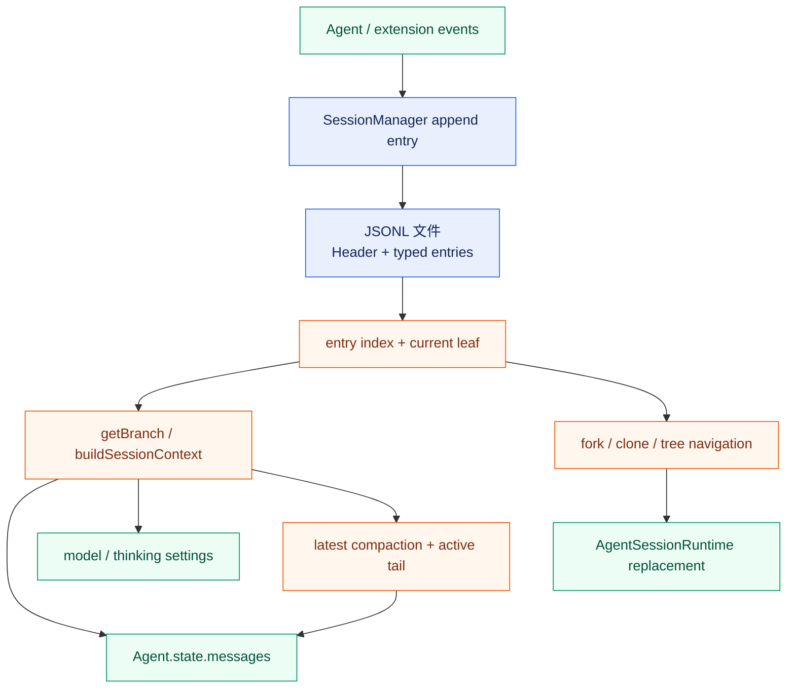

## JSONL 不是线性聊天记录

文件在物理上 append-only，但每个 entry 有 id / parentId，逻辑上是一棵树。SessionManager 的 current leaf 决定当前分支；buildSessionContext 只把从根到 leaf 的有效路径投影成 AgentMessage、model 和 thinking。分支、标签、custom entry、compaction 和 branch summary 都是 typed entry，不应通过扫描自由文本恢复语义。

| 机制 | 持久对象 | 维护契约 |
|-|-|-|
| message | 用户、助手、ToolResult、custom message entry。 | 以最终 message_end 结果追加；扩展替换后的 message 才是 session 事实。 |
| model / thinking | ModelChangeEntry、ThinkingLevelChangeEntry。 | 恢复时沿当前 branch 找有效设置；不是只看全文件最后一行。 |
| compaction | summary、firstKeptEntryId、tokensBefore、details。 | 摘要替代旧上下文视图，但旧 entry 仍在文件；切点落在 turn 内时必须保留 split-turn 前置语义。 |
| branch summary | 从旧 leaf 导航到目标前生成的分支摘要。 | 用于解释被离开的分支，不应与自动 context compaction 混成同一对象。 |
| fork / clone | 新 session header、parentSession、复制或重建目标 branch。 | 属于 session replacement；旧 AgentSession / ExtensionRunner 不继续服务新文件。 |
| migration | CURRENT_SESSION_VERSION=3；v1→v2→v3 迁移。 | 新 entry 类型要考虑旧文件解析、构建上下文和导出，不只改写入端。 |

## session 替换的真实收尾顺序

1. 执行 session_before_switch / session_before_fork；允许扩展取消。
2. 对旧 session 调用 abort，并等待被中断的 agent-loop turn 及其 ToolResult 持久化完成。
3. 发送 session_shutdown，让扩展释放外部资源。
4. 同步执行 beforeSessionInvalidate，先拆除宿主持有的扩展 UI 引用。
5. dispose 旧 AgentSession，使旧 extension ctx 变 stale。
6. 使用目标 cwd、SessionManager 与同一个 factory 创建新 services / AgentSession。
7. rebind UI / host；withSession 只接收新 ctx。

这个顺序决定了一个重要失败语义：replacement 是“先拆旧，再建新”。若新 runtime 创建失败，错误交给调用者展示，系统不会把旧 ExtensionRunner 重新激活。因此新增替换流程时，应把用户可恢复入口和失败提示设计在调用方，而不是假设底层事务回滚。

## Pi 与 DeerFlow：compaction 边界与持久化模型

<callout emoji="💡">
**先校正“DeerFlow 不会截断 turn”的说法：**DeerFlow 没有 Pi 的 split-turn 专用分支，也不会为被切开的当前会话 turn 再生成一段独立摘要；但它的保留窗口仍可落在一个会话 turn 内。当前实现只把同一次 assistant tool call 及其连续 ToolMessage 视为不可拆组，不保证从完整 HumanMessage turn 的边界开始保留。
</callout>

两者都用“旧内容摘要 + 新内容原文”控制模型上下文，但承担语义的对象不同：Pi 把压缩建模为会话树中的一条 typed entry；DeerFlow 把压缩建模为 ThreadState 的一次状态更新。这个差异会继续传导到恢复、分支、审计和扩展方式。

### 切分与摘要生成

| 维度 | Pi | DeerFlow |
|-|-|-|
| 切点单位 | 在 SessionEntry / AgentMessage 边界上寻找可保留后缀；不会让保留段从 toolResult 开始，并显式判断切点是否落在一个会话 turn 内。 | 按保留消息数、token 数或比例计算 cutoff，再把 messages 分成前缀和后缀；安全调整主要保护 AIMessage 与其连续 ToolMessage 组。 |
| turn 内切分 | 有独立的 isSplitTurn 分支：把当前 turn 的已执行前缀与更早历史分开处理。 | 没有 split-turn 概念。若 cutoff 位于同一用户请求触发的多个模型 / 工具批次之间，该 turn 仍会被分到摘要前缀与原文后缀两侧。 |
| 摘要输入 | History summary 覆盖切点所在 turn 之前的历史；Turn prefix summary 只覆盖该 turn 中位于切点之前的消息。 | 把 cutoff 之前的所有 messages 与 previous_summary 一起生成一份新的累计 summary_text，不再区分“完整旧 turn”和“当前 turn 前缀”。 |
| LLM 调用 | 发生 split turn 且前面还有历史时，两段摘要是两次独立调用，最后拼成一个 CompactionEntry.summary；没有更早历史时只需生成 turn prefix。 | 语义上只生成一份累计摘要。配置的摘要模型失败时可以换候选模型重试，但不是两份不同职责的摘要。 |
| 压缩后的活动视图 | 上下文由 CompactionEntry.summary 加 firstKeptEntryId 之后的原始 entry 重建；旧 entry 仍保留在 append-only 文件中。 | 向 ThreadState 写入 RemoveMessage(REMOVE_ALL_MESSAGES)、preserved_messages 和新的 summary_text；DurableContextMiddleware 在后续模型请求中把 summary_text 注入隐藏上下文。 |

#### 执行互斥、异步与 watermark

| 维度 | Pi | DeerFlow |
|-|-|-|
| 自动 compaction | 属于同一个 AgentSession 的 post-run / pre-prompt 链；调用方会等待摘要、CompactionEntry 落盘和 AgentState 重建。新的 model turn 不会与它并发消费旧上下文。 | 位于 SummarizationMiddleware.abefore_model；虽然摘要模型走异步 ainvoke，但 hook 会等待结果并把 messages + summary_text 写入 graph state，然后才进入当前 model 调用。它是异步 I/O，不是后台 compaction。 |
| 手动 compaction | compact() 先中止当前 agent run，再等待摘要、追加 CompactionEntry 与上下文重建。core 直接调用 prompt 会在手动 compaction 期间报错；TUI 将普通输入排队到结束后。 | POST /threads/{thread_id}/compact 在 checkpoint-write reservation 中执行；同一 thread 有 run in flight 时返回 409。请求等待摘要和新 checkpoint 写完才返回。 |
| 与用户输入的关系 | 普通 user prompt 的执行与 compaction 互斥；界面可以先接收并排队，但不会启动一个读取旧上下文的新模型轮次。Extension command 在 prompt 的 compaction guard 之前处理，是单独入口。 | 同一 thread 的 run 与手动 checkpoint mutation 互斥；自动摘要就是当前 graph run 的 before-model 阶段，因此当前请求也必须等待它。 |
| watermark | context compaction 不使用 watermark；持久边界由 CompactionEntry.firstKeptEntryId 表示。 | context compaction 同样没有 watermark。源码中的 watermark 属于 DeerMem durable-memory updater：记录最后成功提取到长期记忆的 message identity，用于后台增量提取，不能表示 summary_text 已提交到哪个 checkpoint。 |

<callout emoji="🔎">
**框架对照｜为何 memory 可以后台化，compaction 仍要等待**
compaction 会改变下一次模型调用的直接输入，必须先固定 summary 与保留段；durable memory 是旁路投影，晚一些完成不会改变当前 graph 的消息状态。DeerMem 的 watermark 只用于避免重复提取；summarization 在删除旧 messages 前触发的 emergency memory flush 还会绕过 watermark，避免用一个即将被裁掉的消息子集错误推进正常水位。
</callout>

**源码核对基线：**Pi `e86823096c5b`；DeerFlow `0d8e11ad492b`。

**Pi 入口：**`packages/coding-agent/src/core/agent-session.ts` 的 `prompt()`、`compact()`、`_handlePostAgentRun()`、`_runAutoCompaction()`，以及 `interactive-mode.ts` 的 compaction 输入排队逻辑。

**DeerFlow 入口：**`summarization_middleware.py` 的 `abefore_model()` / `acompact_state()`，`runtime/context_compaction.py`，`app/gateway/routers/threads.py` 与 `app/gateway/services.py` 的 thread operation reservation，以及 `memory_middleware.py`、`deermem/core/updater.py` 的后台 durable-memory watermark。

**同一切点的例子：**一个用户请求产生 `U3 → A3(tool) → T3 → A4(tool) → T4 → A5`。若从 A4 开始保留，Pi 会把 U3 / A3 / T3 识别为当前 turn 的 prefix，并与更早历史分别摘要；DeerFlow 会把 cutoff 前的所有消息合并进同一份累计摘要，同时原样保留 A4 / T4 / A5。两者都可能保住 A4 与 T4 的配对，只有 Pi 还保留了“这是被切开 turn 的前半段”这一层语义。

<callout emoji="🔎">
**框架对照｜如何理解“粒度更粗”**
DeerFlow 的粒度确实比 Pi 粗：它只区分“进入累计摘要的消息前缀”和“继续原样携带的消息后缀”，没有再把前缀拆成历史段与当前 turn 前缀段。不过，“粒度更粗”不等于“只在完整 user turn 边界 compact”。
</callout>

### CompactionEntry、checkpoint 与 JSONL 不是同一层对象

| 维度 | Pi session | DeerFlow thread / run |
|-|-|-|
| 状态事实源 | 一个 session JSONL：首行为 header，后续每行都是 SessionEntry。 | LangGraph checkpoint 中的 ThreadState；checkpointer 可使用内存、SQLite 或 Postgres。物理格式由 saver 实现拥有。 |
| 逻辑结构 | entry 通过 id / parentId 形成树，current leaf 决定当前 branch。 | 以 thread_id、checkpoint namespace / id 和 checkpoint lineage 组织状态版本；状态由 messages、summary_text、todos、artifacts 等 channel 组成。 |
| compaction 表示 | 独立 CompactionEntry：包含 summary、firstKeptEntryId、tokensBefore，以及可选 details / usage / fromHook。 | 不是独立的“compaction record”；它是对 messages channel 的 reset + preserved messages，以及对 summary_text channel 的更新。 |
| 其他记录 | Pi 不按记录类型拆文件，而是把同一 session 的多种记录混写在一个 JSONL 中。首行是 SessionHeader；其后 SessionEntry 联合类型包括 message、thinking_level_change、model_change、compaction、branch_summary、custom、custom_message、label、session_info。类型定义集中在 packages/coding-agent/src/core/session-manager.ts。 | 运行状态进入 checkpoint channel；面向流式展示、回放和审计的事件则进入独立 RunEventStore，两者不是一个统一 entry union。 |
| JSONL 的含义 | JSONL 本身就是 session 状态载体；解释 JSONL 可恢复会话树与上下文。 | JSONL 只是 RunEventStore 的一个可选后端，按 run 写 message / trace / lifecycle 事件；它不能替代 checkpoint 恢复 ThreadState。 |
| 扩展新语义 | 新增 SessionEntry variant，并同步处理解析、树投影、导出和版本迁移。 | 会影响 Agent 决策的语义通常新增 state channel / reducer；只用于观测的语义新增 event_type / category。先判断属于恢复状态还是运行事件。 |

### 三种落盘形态的最小示意

**Pi：**compaction 是 session JSONL 中可寻址、可参与 parentId 链的一行。

```json
{
  "type": "compaction",
  "id": "...",
  "parentId": "...",
  "summary": "...",
  "firstKeptEntryId": "...",
  "tokensBefore": 12345
}
```

**DeerFlow：**compaction 的逻辑结果是一次 ThreadState 更新；下面是语义示意，不是 checkpoint 的物理 JSON 格式。

```python
{
  "messages": [RemoveMessage(REMOVE_ALL_MESSAGES), *preserved_messages],
  "summary_text": new_summary,
}
```

RemoveMessage 不是 RunEventStore 中的“撤回事件”，而是 LangGraph message reducer 识别的状态更新命令。RemoveMessage(REMOVE_ALL_MESSAGES) 表示先清空当前 messages channel，再写回 preserved_messages；结果随 ThreadState 进入 checkpoint。DeerFlow RunEventStore 若选用 JSONL 后端，每行才是运行事件 envelope，例如 thread_id、run_id、event_type、category、content、metadata、seq、created_at；它服务于事件回放与审计，不表达完整 ThreadState，也没有与 Pi CompactionEntry 一一对应的记录类型。

<callout emoji="💡">
**设计判断：**不要从“两边都有 JSONL 文件”外推为同一种会话协议。Pi 采用事件溯源式的 typed session tree：同一 entry 流同时承担状态事实与历史导航；DeerFlow 把可恢复状态交给 checkpoint，把可观察运行过程交给 RunEventStore。分析其他记录格式时，应先问“它用于恢复 Agent 状态，还是用于展示 / 回放执行事件”，再比较字段。
</callout>

### DeerFlow 按“谁消费、是否参与恢复”划分存储

DeerFlow 不是按数据类型简单规定“消息进 JSONL、其他数据进 checkpoint”，而是先判断数据服务于哪种一致性与查询契约。同一条消息可能同时出现在 checkpoint 和 RunEventStore，因为两份记录承担不同职责。

| 存储层 | 判定问题 | 典型内容 | 读取方式 |
|-|-|-|-|
| LangGraph checkpoint | 恢复或继续执行 graph 时，下一节点是否必须看到它？ | messages、summary_text、todos、goal、sandbox / thread 路径、artifact 引用、skill_context、delegations 等 ThreadState channel。 | 按 thread_id、checkpoint_ns、checkpoint_id 恢复某一状态版本与 lineage。 |
| RunEventStore | 前端、回放、调试或审计是否需要按时间线查询它？ | human input、AI response、tool result、run start / end / error、LLM trace、middleware、subagent、workspace changes。 | 按 thread / run、category、event_type、seq 分页或过滤。 |
| 应用数据库 | 调度与控制面是否要脱离 graph 独立查询、抢占或更新它？ | RunRow 的 status、owner / lease、cancel、stop reason、token 统计和列表页摘要，以及 thread / user 等业务元数据。 | ORM 表与业务索引；用于调度、恢复协调和列表接口。 |
| 文件或对象存储 | 内容是否体积大、适合按需读取，而不应复制到每个 checkpoint？ | artifact、上传文件、图片字节等；ThreadState 只保留路径、大小、MIME 等轻量引用。 | 需要时按引用加载。 |

<callout emoji="🔎">
**框架对照｜为什么消息会“存两份”**
checkpoint 中的 message 是 Agent 恢复与下一步推理所需的状态；RunEventStore 中的 message 是前端历史与运行时间线。前者必须遵循 reducer、checkpoint lineage 和 compaction 语义，后者必须支持 seq 排序、分页和审计。因此这不是无意重复，而是面向两种读取模型的投影。
</callout>

Checkpoint 与 RunEventStore 是同一次运行的两种并行投影，不是包含关系。graph 的下一步决策与 thread 恢复以 checkpoint 为基线，不从 RunEventStore 回放状态；但不能据此说 RunEventStore 完全不影响运行：前端历史、事件流重放、终态回执、审计和部分恢复协调仍依赖它，存储不可用时 graph 状态可能尚可恢复，产品层的可见性、投递或协调却会退化。RunEventStore 也不等于 JSONL：当前配置支持 memory、db、jsonl 三种后端。JSONL 适合单进程轻量部署；db 后端为 (thread_id, category, seq) 和 (thread_id, run_id, seq) 建索引，适合生产查询和多进程并发。JSONL 后端则按 .deer-flow/threads/{thread_id}/runs/{run_id}.jsonl 分片：查询单个 run 只读一个文件，查询整个 thread 的消息需要扫描该 thread 下所有 run 文件并按 seq 排序。

### Pi JSONL 的读取效率：冷加载线性，热路径主要在内存

<callout emoji="💡">
**先修正范围：**Pi JSONL 保存的是可恢复 session 语义，不是所有运行事件。最终 user / assistant / toolResult message、模型和 thinking 变更、compaction、branch summary、label、session info 与扩展自定义 entry 会写入；流式 token、pending assistant、普通 hook 调用过程和纯 UI 事件不会逐条写入。
</callout>

| 场景 | 当前实现 | 成本与影响 |
|-|-|-|
| 定位最近 session | 在当前 cwd 对应目录枚举 JSONL，只读取文件头并结合 mtime 排序；header 探测使用 4 KiB buffer，最多扫描 1 MiB。 | 不解析 session 正文，但仍需枚举目录中的文件，成本随 session 文件数增长。 |
| session 列表 / 搜索 | 逐文件流式扫描，解析所有行并收集名称、消息数、首条消息和 allMessagesText；最多并发处理 10 个文件。 | 总工作量是所有候选文件字节数的线性扫描；并发降低等待时间，不减少 I/O 和 JSON 解析量。 |
| 打开一个 session | 用 1 MiB buffer 分块读取，但按换行逐条 JSON.parse，最终把全部 FileEntry 留在内存，并重建 byId、label map 和 current leaf。 | 时间约为 O(文件字节数)，对象内存约为 O(全部 entry 与 payload)。没有从 compaction 处直接起读的持久索引。 |
| 打开后的 ID / branch 访问 | getEntry 使用内存 Map；getBranch 沿 parentId 从 leaf 回溯；新 entry 同时追加到数组、Map 和文件尾。 | ID 查询接近 O(1)，branch 构建约 O(当前 branch 深度)，通常不再读取磁盘。 |
| 重建模型上下文 | 先从全部 fileEntries 中筛出 SessionEntry，再从 current leaf 回溯当前 branch；若该路径上已经存在 CompactionEntry，buildSessionContext 才解释它，将已摘要历史替换为 summary 与 firstKeptEntryId 之后的保留段。重建本身不会触发 compaction。 | compaction 减少发送给 LLM 的历史，但不缩小 JSONL，也不消除冷启动全文件解析；当前投影仍包含一次 O(全部 entry) 过滤。 |
| 追加写 | 正常情况每条 entry 追加一行并更新内存索引；没有数据库事务、fsync 或跨进程文件锁。 | 磁盘追加近似 O(本条 entry 大小)。当前 \_persist 每次还会扫描 fileEntries 判断是否已有 assistant，因此代码层仍有一个 O(entry 数) 检查。 |

**文件组织：**默认路径是 \~/.pi/agent/sessions/--<扁平化 cwd>--/<时间戳>\_<UUIDv7>.jsonl。第一层按 cwd 将不同项目的候选 session 分到不同目录，SessionManager.list(cwd) 默认只枚举该目录；因此 cwd 是目录分区与路由键，不是内容索引。第二层是一个 session 一个文件；时间戳便于人工识别，UUIDv7 避免重名。fork / branched session 会创建新文件，并在 header 的 parentSession 中记录来源。这个命名结构仍只是粗粒度分片；“最近 session”实际以 mtime 判断。

#### 中断、resume 与文件增长

| 场景 | 文件行为 |
|-|-|
| --resume / --session | 打开选中的原 JSONL，加载全部 entry 并重建内存索引；\_buildIndex 把最后一条有效的物理 entry 设为 leaf，后续 entry 继续 append 到同一文件尾，并以该 leaf 作为 parentId。 |
| --continue | 在当前 cwd 对应目录按 mtime 选择最近 session，然后执行同样的 open / append 流程。 |
| 在原 session 内 branch | 仍追加到同一物理文件尾，但新 entry 的 parentId 指向选中的较早 entry，因此物理顺序是日志，逻辑结构是树。 |
| /new、--fork、branched session | 创建新的 session ID 与 JSONL；fork / branched session 的 header 用 parentSession 记录来源文件。 |
| 新 session 首次响应前退出 | 新文件会延迟到出现 assistant entry 后才整体写出；若此前进程退出，首条 user entry 可能只存在内存，没有可供 resume 的 JSONL。 |

**没有 max size：**当前 SessionManager 没有 session 文件大小上限、自动轮转、按 compaction 生成新 segment 或后台归档。compaction 只改变后续模型上下文的投影，旧 entry 仍留在原 JSONL，所以一个持续 resume、频繁 branch 的 session 可以一直增长。源码中的 1 MiB 只分别表示加载 buffer 大小与 header 探测上限，不是 session 文件上限。

<callout emoji="💡">
**并发与崩溃边界：**单进程 append 是当前设计假设。SessionManager 没有跨进程文件锁；两个进程同时 resume 同一文件，可能各自基于不同内存 leaf 继续追加，不能保证得到一致的会话树。写入也没有 fsync；崩溃产生的 malformed / incomplete line 会在加载时被跳过。
</callout>

### JSONL 是否只能原子解析

不是整个 JSONL 文件只能一次性解析。JSONL 天然可以按换行流式读取，也能让并行读取器从不同 byte range 找到下一条换行后分别解析。Pi 当前 loader 已经按 1 MiB 字节块读取，因此不会先把整份原始文本一次性载入；不过每个 JSON object 仍是最小 JSON.parse 单元，解析出的全部 entry 最终仍驻留内存。

当前 Pi 没有实现 byte-offset sidecar index、分段 manifest、compaction snapshot 文件或数据库索引。因此完整恢复仍必须找到文件末尾的 leaf、收集 id / parentId 并识别当前路径上的最新 compaction。即使并行解析各行，也只减少部分 CPU 墙钟时间，不能减少总读取字节数，而且最后仍要合并顺序和建立索引。

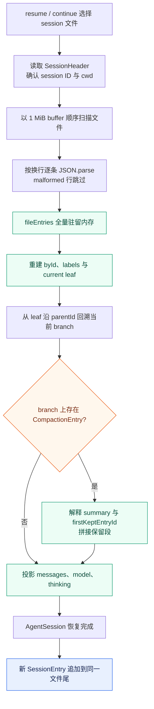

JSONL 的“按行独立”更接近故障隔离单元，而不是强事务原子性：加载器会跳过 malformed line，包括崩溃留下的不完整尾行；但当前写入没有 fsync 与跨进程锁，不能把每一行描述成已具备数据库级持久事务。

<callout emoji="🔎">
**框架对照｜何时这种选择开始成为问题**
从默认架构取向看，Pi 更适合单用户、本地进程：一个 session 一个文件加内存索引，用较低实现与运维成本换取冷加载线性扫描；DeerFlow 更适合服务端多租户与多 worker：以 thread / run 标识隔离状态，把恢复状态、运行事件和控制面拆开，并允许事件查询切到带索引数据库。这是默认适配方向，不是能力边界：Pi 可被嵌入远程服务，DeerFlow 也可使用内存或 JSONL 后端做单节点开发。Pi 的风险主要出现在超长单 session、大量分支、内联大 payload 或大量 session 全文列表与搜索，而不是每个 agent-loop turn 都从头读取 JSONL。
</callout>

**可演进方向：**若测量确认 open latency、resume 列表延迟或 heap 随历史明显增长，优先级通常是：为 session 列表维护轻量 manifest；在 compaction 处生成可校验 snapshot / segment；为 entry ID、parentId、type 和 byte offset 建 sidecar index；需要多进程查询与事务时再迁移到 SQLite。是否引入应由真实文件规模与延迟基线决定，当前源码没有给出必须迁移的阈值。

**源码入口：**Pi 见 `packages/coding-agent/src/core/session-manager.ts` 与 `packages/coding-agent/docs/session-format.md`；DeerFlow 见 `agents/thread_state.py`、`runtime/checkpointer/async_provider.py`、`runtime/events/catalog.py`、`runtime/events/store/base.py`、`runtime/events/store/jsonl.py`、`runtime/events/store/db.py`、`persistence/models/run_event.py` 与 `persistence/run/model.py`。

# ModelRuntime 与 pi-ai：Provider 才是模型运行单元

Pi 把 Provider 定义为认证、base URL、模型目录和调用路由的运行单元，而 adapter 表示具体 wire protocol。直接厂商 Provider 通常固定使用一种协议，例如 OpenAI 使用 openai-responses、Anthropic 使用 anthropic-messages；但 GitHub Copilot、OpenCode Go、Fireworks 这类聚合或网关 Provider 会在同一凭据与模型目录下承载不同协议的模型，所以 createProvider 按 model.api 选择 adapter。也就是说 provider 到 adapter 常见是 1:1，但不是协议约束：model.provider 决定运行归属，model.api 决定请求与流式协议。coding-agent 的 ModelRuntime 再叠加 settings、扩展 Provider、runtime credentials 与动态 catalog 刷新。

| 层 | owner | 契约 |
|-|-|-|
| Provider factory | packages/ai/src/providers | 声明模型来源、认证、stream 函数和能力；lazy wrapper 控制按需加载。 |
| API adapter | packages/ai/src/api | 把统一 Context 转成具体 wire payload，并把 SSE / websocket / response 还原为统一事件。 |
| Models / catalog | pi-ai ModelsImpl；coding-agent ModelRuntime | getModels 读最后一次完整发布的 snapshot；refresh 异步构建下一代目录。 |
| 动态刷新 | ModelRuntime generation + AbortController | 新 refresh 取消旧 generation；只有完整结果串行 publish，调用者不会读到半更新 catalog。 |
| 认证 | CredentialStore、auth resolver、OAuth provider | 每次 stream 前延迟解析，支持过期 token；runtime API key 与持久凭据有明确同步操作。 |
| 请求 overlay | AgentSession extensions + ModelRuntime | provider attribution headers、before_provider_headers、payload hook、timeout / retry options 在调用时合并。 |

## 新增 Provider 时必须一起验证

- 模型目录和能力字段是否由 source / generator 产生；不要直接编辑 packages/ai/src/models.generated.ts。
- API key、OAuth 与 headers 的优先级；认证刷新是否发生在每次调用前。
- text / thinking / tool call 的流事件是否完整闭合；error 和 abort 是否能让 result() 收敛。
- usage、cost、cache token 与 provider attribution 是否保留。
- 不同 Provider 的历史消息转换，尤其是 tool call / result 配对与图片能力。
- coding-agent 的 before_provider_request / headers / after_provider_response hook 是否仍处在正确传输边界。

# TUI：同一组件模型，两套终端渲染策略

| 模式 | 目标 | 实现约束 |
|-|-|-|
| Main screen | 保留终端原生 scrollback，让长会话成为用户终端历史的一部分。 | 在 append、局部重绘与整帧重绘间选择；不是固定 viewport 的应用布局。 |
| Alternate screen | 提供固定 viewport、应用式的全屏交互。 | 显式 layout root、VStack / HStack / ScrollView、overlay、mouse、search、selection、hyperlink 和图片。 |

TuiBase 持有终端生命周期、输入、focus、overlay 与 render scheduling；layout.ts 每帧从组件树重建几何并服务绘制和 hit test；ScrollView 自己持有 scrollTop 和 follow 状态。AgentSession 只发产品事件和提供动作，不拥有这些 UI 状态。修改输入或布局时，main screen 与 alternate screen 必须分别验证，不能从一个模式的通过推导另一个模式正确。

# 实验性远程架构：实现分层与当前缺口

| 层 | 已经存在 | 不能据此推导 |
|-|-|-|
| pi-protocol v1 | 4-byte big-endian 长度前缀、definite CBOR、hello 首帧、strict TypeBox schema、server / session snapshot。 | 协议仍是 experimental；有 schema 不代表存在生产 service。 |
| pi-client | request correlation、断线失效、shared / exclusive session lease、detach reconciliation。 | 不自动重连；连接恢复策略属于宿主。 |
| pi-server | listener、握手、session attachment、多客户端控制、snapshot 广播、空闲释放。 | 依赖宿主注入 PiServerService；仓库没有接入 coding-agent 主线的 service 实现。 |
| 通用 Session / SQLite | entry / lane / record / fact / branch tip、writer lease fence、branch cache、FTS、migration 与 conformance。 | 没有替换 standalone 的 SessionManager JSONL。 |
| AgentHarness | 类型面、typed errors、lane / queue / operation 状态、model / tool / resource setter。 | create 只接受空 session；restore、prompt、skill、compact、navigate、resume、abort、steer、followUp、watch、lane 等主操作明确抛 HarnessNotImplemented。 |
| coding-agent adapter | server/create-harness.ts 能构造工具和 system prompt。 | 未被 main.ts 或 SDK 主组合根引用；构造适配不等于端到端接通。 |

## 不要混淆两种 RPC

| 对比项 | 当前 stdin RPC | 实验 remote protocol |
|-|-|-|
| 入口 | pi --mode rpc / pi-rpc。 | protocol / client / server 独立包。 |
| 传输 | stdin / stdout；LF 分隔 JSONL。 | ByteConnection；长度前缀 CBOR；Unix transport 已提供。 |
| 运行时 | 直接控制当前 AgentSessionRuntime。 | 通过 PiServerService 获取 PiSessionRuntime。 |
| 状态 | response + Agent event JSON stream。 | 握手、request / response、权威 snapshot 与瞬时 progress。 |

<callout emoji="🔎">
**框架对照｜DeerFlow：远程服务边界**
**对应概念：**Pi 的实验 remote protocol / client / server，可对照 DeerFlow Gateway 的 ASGI 服务；当前 stdin RPC 不属于同一层。
**相同点：**两边都需要协议、会话所有权、执行管理、状态发布和持久化协作，才能形成远程 Agent 服务。
**差异：**DeerFlow Gateway 已形成 thread / run API 到 worker、stream bridge、checkpointer 和 store 的可用链路；Pi remote stack 仍缺 coding-agent 的 PiServerService 接入，AgentHarness 多个主操作也未实现。
**认知落点：**比较远程能力时看端到端调用链和当前成熟度，不用“已有协议或类型”代替“服务已接通”。
</callout>

# 安全与硬约束：Prompt 只解释，代码才拦截

| 边界 | 真实控制点 | 不应误写成的能力 |
|-|-|-|
| 项目 trust | SettingsManager + PackageManager + ResourceLoader 的项目动态资源加载选择。 | 不是文件系统、进程或网络 sandbox。 |
| 工具参数 | prepareArguments + schema validation + tool_call hook + 具体工具内部校验。 | Prompt 里的“不要做”不能替代工具 gate；hook 改写后也不会自动重验。 |
| 路径与并发写 | 各工具 path-utils、file mutation queue、宿主文件权限。 | Agent 单 run 串行不等于多个进程或多个 session 不会写同一文件。 |
| 认证凭据 | CredentialStore、runtime key、OAuth resolver，在调用时解析。 | system prompt、session JSONL 和 extension message 都不应承载 secret。 |
| 远程 session 独占 | pi-client / server lease 与 backend writer fence。 | 当前 standalone AgentSession 没有因此自动获得远程多写者保护。 |
| 实验能力 | 具体方法实现、composition root 引用、消费者与测试。 | 接口声明、README 目标或类型通过不能当成上线能力。 |

<callout emoji="🔎">
**框架对照｜DeerFlow：安全与工具治理**
**对应概念：**Pi 分散在 trust、tool validation、path utils、extension hook 和宿主权限中的控制点，可对照 DeerFlow 的 Authorization / Guardrail、SandboxAudit、ReadBeforeWrite 与 ToolErrorHandling middleware。
**相同点：**Prompt 只能说明规则，真正的拒绝和隔离必须落在 runtime 路径。
**差异：**DeerFlow 把多类治理策略显式装入 middleware 链；Pi 没有一组可直接一一映射的同名 guardrail，控制点分布在不同层。
**认知落点：**只比较实际控制范围；不能把 Pi 的 trust 写成 sandbox，也不能把 DeerFlow 的启发式审计写成物理隔离。
</callout>

# 故障定位：从症状找到 owner

| 症状 | 先检查 | 关键区分 | 证据位置 |
|-|-|-|-|
| 输入后没有进入模型 | extension command、input handled、compaction gate、model / auth preflight。 | 是请求被短路，还是 Provider 没返回 start。 | AgentSession.prompt；ExtensionRunner。 |
| 模型有回复但工具没执行 | stopReason=length、tool 名称、schema validation、tool_call block、abort。 | 生成 tool call 不等于 execute 被调用。 | agent-loop prepareToolCall。 |
| 工具 UI 显示完成但上下文顺序异常 | 完成事件顺序与 ToolResult message 顺序。 | 并行完成顺序和 provider 配对顺序本来就不同。 | executeToolCallsParallel。 |
| Agent 看见旧规则或旧 cwd | session header cwd、services 构造时机、reload / replacement、旧 extension ctx。 | 是 base prompt 没重建，还是宿主还绑定旧 session。 | main；AgentSessionRuntime；ResourceLoader。 |
| 扩展修改没有生效 | 是否被加载、注册项冲突、hook 触发条件、active tools、ctx 是否 stale。 | 发现 / 注册 / 激活 / 执行分别确认。 | extensions loader / runner；diagnostics。 |
| 回复结束后进程仍不 idle | 异步 event listener、agent_end handler、retry、compaction、follow-up。 | agent_end 与 agent_settled 不同。 | Agent.runWithLifecycle；AgentSession.\_handlePostAgentRun。 |
| 恢复会话后消息缺失 | current leaf、branch path、latest compaction、entry migration。 | 物理文件有 entry 不等于当前分支会投影它。 | SessionManager.buildSessionContext。 |
| Provider 看得到模型但调用失败 | runtime auth、provider resolver、model.api、payload / headers hook、timeout。 | catalog 可见性和调用凭据是不同阶段。 | ModelRuntime.streamSimple；pi-ai provider。 |
| 远程 client / server 测试通过但 prompt 不可用 | PiServerService 实现、AgentHarness prompt、main 引用。 | transport / protocol 通过不等于业务 runtime 接通。 | agent-harness.ts；create-harness.ts。 |

# 常见改动的进入点与验证矩阵

| 要改的行为 | 优先入口 | 必须验证 |
|-|-|-|
| CLI 模式、resume、fork、cwd | coding-agent/src/main.ts；core/agent-session-runtime.ts；core/agent-session-services.ts。 | 目标 cwd 先于服务构造；旧 run settle；shutdown、invalidate、rebind 顺序。 |
| 一轮模型 / 工具调度 | agent/src/agent.ts；agent/src/agent-loop.ts；agent/src/types.ts。 | 事件顺序、abort、length、不同比例的并行 / 串行、terminate 全体语义。 |
| prompt、retry、compaction | coding-agent/src/core/agent-session.ts；core/compaction。 | preflight 短路、agent_end 与 agent_settled、compact 并发、split-turn。 |
| 扩展 hook 或命令 | core/extensions/types.ts、runner.ts、loader.ts；core/agent-session.ts。 | 加载顺序、handler 异常策略、作用域、持久化、replacement 后 stale ctx。 |
| Skill / prompt / theme / trust | core/resource-loader.ts；package-manager.ts；settings-manager.ts；project-trust.ts。 | 来源优先级、diagnostics、trust 只控制哪些资源、reload 后 sourceInfo。 |
| System Prompt | core/system-prompt.ts；AgentSession.\_rebuildSystemPrompt；before_agent_start。 | active tools、custom vs append、context files、Skill index、run overlay 退出。 |
| Provider / API wire | ai/src/providers；ai/src/api；coding-agent/core/model-runtime.ts。 | auth、abort、stream closure、tool pairing、usage、dynamic refresh 原子发布。 |
| 终端布局与输入 | tui/src/tui.ts、layout.ts、components；coding-agent/modes/interactive。 | main / alt screen 分开；Unicode 宽度、IME、mouse、overlay、局部重绘。 |
| 当前会话格式 | coding-agent/core/session-manager.ts；docs/session-format.md；docs/compaction.md。 | append-only、branch leaf、migration、fork / clone、导出、恢复。 |
| 远程与持久 Session | protocol、client、server、agent/harness、session-backends/sqlite-node。 | 先声明实验边界；补 service composition 和 AgentHarness 主操作后再谈接入。 |

# 维护者检查清单

## 新增或调整运行阶段

1. **先定 owner：**这是单个 tool call、model request、agent-loop turn、会话 turn、agent run、session 还是 cwd runtime 的状态。
2. **写清入口与退出：**谁创建，谁消费，何时清理；异常、abort、replacement 是否仍会经过清理。
3. **同时写正序与回程：**尤其是扩展、Provider 与 ToolResult，不要只写“在模型前执行”。
4. **区分内存与持久事实：**request overlay、AgentState、SessionManager entry、外部文件或数据库分别说明。
5. **检查两种结束点：**Agent 的 agent_end 与产品的 agent_settled；不要让上层过早判定完成。
6. **验证 replacement：**new / resume / fork / reload 后旧 ctx、订阅、UI 组件和 SessionManager 都不能继续使用。

## 新增扩展能力

1. 声明资源来自用户、项目、package、CLI 临时路径还是 inline factory。
2. 声明注册、发现、可见、激活和执行条件，不用“已加载”概括全部阶段。
3. 声明 hook 在哪一个生命周期触发，是否会短路，handler 抛错后的策略是什么。
4. 若修改 tool args，主动校验修改后的形态；框架不会二次 schema validation。
5. 若返回 system prompt overlay，验证 run 结束后恢复 base；若修改 context，验证不会意外持久化。
6. 验证 reload / replacement 后旧异步任务不再使用 stale ctx。

## 代码改动后的仓库约束

- 代码改动后从根目录运行 **npm run check**，它不等于测试。
- 非 e2e 全量测试走根目录 **./test.sh**；不要直接运行完整 vitest 触发真实 Provider e2e。
- 修改测试文件时，从对应 package 运行指定测试；coding-agent 回归优先使用 faux provider harness。
- 不要直接修改 packages/ai/src/models.generated.ts；改 generator / source 再生成。
- 没有用户要求不要 commit；多个 session 共用 worktree 时只触碰本任务文件。

# 源码学习路线与完成标准

路线按“先边界，再主链，再旁路”的顺序组织。每一阶段都给出完成标准，避免读完文件名却仍无法定位问题。

| 阶段 | 阅读入口 | 完成标准 |
|-|-|-|
| 1. 产品边界 | README.md、CONTRIBUTING.md、SECURITY.md、packages/coding-agent/README.md、各 package.json。 | 能说清 coding-agent / agent / ai / tui 的 owner 边界，并指出实验远程栈为何不是当前主线。 |
| 2. 组合根 | coding-agent/src/cli.ts、main.ts、core/agent-session-services.ts、core/sdk.ts、core/agent-session-runtime.ts。 | 能从 session 目标追到 services、AgentSession 和 mode，并解释 cwd 为什么先解析。 |
| 3. 一次请求 | core/agent-session.ts；agent/src/agent.ts；agent/src/agent-loop.ts。 | 能画出 preflight、model turn、tool 三段、retry / compact 和 agent_settled。 |
| 4. Prompt 与扩展 | core/system-prompt.ts、resource-loader.ts、extensions/types.ts / runner.ts / loader.ts、docs/extensions.md、docs/skills.md。 | 能判断一段内容属于 base prompt、run overlay、request view、用户消息还是 Provider payload。 |
| 5. 会话 | core/session-manager.ts、docs/session-format.md、docs/sessions.md、docs/compaction.md。 | 能从 leaf 构建当前 branch，并解释 compaction、branch summary、fork 与 replacement 的不同。 |
| 6. 模型或 UI | ai/src/models.ts、providers、api、coding-agent/model-runtime.ts；或 tui/src/tui.ts、layout.ts、components。 | 能把 Provider 目录 / auth / stream 分开，或把 main / alternate screen 的状态 owner 分开。 |
| 7. 演进栈 | agent/src/harness、protocol、client、server、session-backends/sqlite-node 的 README、types 与 conformance tests。 | 能逐层标记已实现、未接通、未实现，不用“远程架构完成度”一个词笼统概括。 |

# 源码索引

- 进程与模式：**packages/coding-agent/src/cli.ts**；**packages/coding-agent/src/main.ts**。
- cwd 服务组合：**packages/coding-agent/src/core/agent-session-services.ts** 的 createAgentSessionServices / createAgentSessionFromServices。
- 产品 session 工厂：**packages/coding-agent/src/core/sdk.ts** 的 createAgentSession。
- session replacement：**packages/coding-agent/src/core/agent-session-runtime.ts** 的 teardownCurrent / apply / switchSession / newSession / fork。
- prompt 与产品编排：**packages/coding-agent/src/core/agent-session.ts** 的 prompt / \_runAgentPrompt / \_handlePostAgentRun / \_rebuildSystemPrompt。
- Agent 生命周期：**packages/agent/src/agent.ts** 的 prompt / continue / runWithLifecycle。
- 模型与工具循环：**packages/agent/src/agent-loop.ts** 的 runLoop / streamAssistantResponse / prepareToolCall / executePreparedToolCall / finalizeExecutedToolCall。
- 扩展：**packages/coding-agent/src/core/extensions/types.ts**、**runner.ts**、**loader.ts**。
- Prompt 与资源：**packages/coding-agent/src/core/system-prompt.ts**、**resource-loader.ts**、**package-manager.ts**。
- 当前会话：**packages/coding-agent/src/core/session-manager.ts** 与 **core/compaction**。
- 模型运行时：**packages/coding-agent/src/core/model-runtime.ts**；**packages/ai/src/models.ts**、**providers**、**api**。
- 终端：**packages/tui/src/tui.ts**、**tui-main-screen.ts**、**tui-alt-screen.ts**、**layout.ts**。
- 实验运行层：**packages/agent/src/harness/agent-harness.ts**；**packages/coding-agent/src/server/create-harness.ts**。

# 维护者最终判断

<callout emoji="💡">
**定位改动时先问 owner，而不是先搜名字：**产品编排、会话 turn 与 session 生命周期归 coding-agent；agent-loop turn 与工具协议归 agent-core；模型目录、认证和 wire stream 归 pi-ai；终端几何与输入归 pi-tui。任何涉及远程 Harness 的方案，都先核对 AgentHarness 主操作、PiServerService 组合和主入口引用，三者未闭合前只按实验设计处理。
</callout>