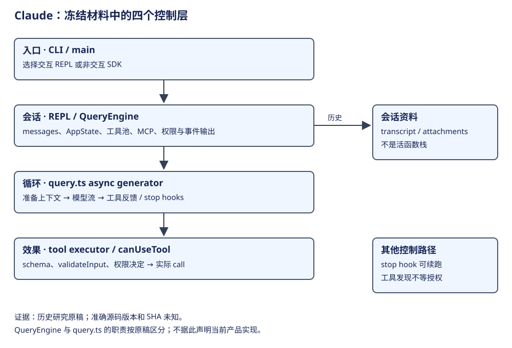
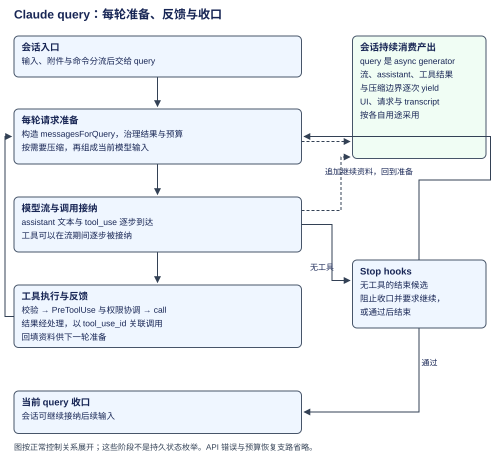

# Claude Code：层次与主链路

Claude Code 可以分成入口与会话、query 循环、工具执行和上下文四层。会话层保存交互状态，query 决定一次输入如何请求模型和继续调用工具，执行器落实校验、权限与反馈。分清这四层，才能解释长会话与单次运行的关系。




全章按一次任务走四步：会话接纳目标并准备环境，query 构造请求并取得模型决定，执行器落实动作后回填观察，结束检查决定收口或继续。概念表先区分这些层的所有者；随后用 CSV 修复说明它们如何合作，再讲发现能力和委派等支路。

## 概念与职责

| 名词 | 所在层次 | 谁创建/持有、控制什么 |
|---|---|---|
| CLI / main | 模式分发 | 交互 REPL 或非交互/SDK 入口 |
| REPL / AppState | 产品会话与 UI | 持有 messages、工具池、MCP、命令、权限上下文，消费流事件 |
| QueryEngine | 非交互/SDK 会话门面 | 管理非交互会话；query.ts 承担内部循环，两者分别定位 |
| query.ts | 单次 query 的模型循环 | async generator 产出流、assistant、tool result、compact boundary 等 |
| Tool / tool_use / tool_result | 定义、模型请求、执行反馈 | schema/校验/权限/实际 call 分开处理 |
| ToolSearch / deferred tool | 按需发现工具定义 | 按关键词匹配或定名选择，返回定义引用，不执行工具 |
| Skill Discovery / SkillTool | 任务知识与执行方式 | inline 加载正文；fork 启动独立 Agent 执行；权限另按效果路径判断 |
| stop hook | 收口阶段 | 可阻止结束并要求续跑；不是只有通知副作用 |

QueryEngine 面向非交互会话，submitMessage 为一次输入准备 query 并消费其产出；queryLoop 在内部推进模型与工具。前者的生命周期覆盖多次提交，后者的推进边界属于当前工作。[查看会话门面与 query 调用](https://github.com/permanentstar/claude-code-source-leak/blob/9f51e71641c1472293ebe4a7968b44455c00f0ba/src/QueryEngine.ts#L180)、[查看循环入口](https://github.com/permanentstar/claude-code-source-leak/blob/9f51e71641c1472293ebe4a7968b44455c00f0ba/src/query.ts#L230)。

## 第一步：会话接纳输入并准备 query

| 当前位置 | 上层 → 下层 | 状态/控制权与输出 |
|---|---|---|
| 接收输入 | REPL handlePromptSubmit / SDK submit | 普通文本、附件、slash command 分流 |
| query 准备 | 会话层 → query.ts | 构建 messagesForQuery，治理过大工具结果和上下文 |
| 模型请求 | query → provider stream | 形成 assistant 内容或 tool_use；runtime 决定工具可见集合 |
| 效果执行 | executor → schema / validateInput / canUseTool → tool.call | 校验、PreToolUse 与权限协调在效果之前；流式工具执行器可参与 |
| 结果回填 | tool_result → messages → 下轮 query | 继续生成模型请求，单次输入可含多轮工具反馈 |
| 结束检查 | 无 tool_use → stop hooks | 可直接结束，或追加信息继续循环 |

模型在给定上下文和工具中选择动作；runtime 准备请求，执行权限检查，安排并发并回填反馈。一次用户输入因此可以包含多个模型请求和工具批次。 参见：[模型与工具循环](https://github.com/permanentstar/claude-code-source-leak/blob/9f51e71641c1472293ebe4a7968b44455c00f0ba/src/query.ts#L548)。

## 第二步：query 请求模型并接收动作决定



假设用户要求修复 CSV 导出。会话层先处理输入与文件引用，query 获得当前 messages、systemPrompt、工具集合及 canUseTool。QueryEngine 的调用对象可节选如下，省略其他选项与消费分支：

```ts
for await (const message of query({
  messages, systemPrompt, userContext, systemContext,
  canUseTool: wrappedCanUseTool,
  toolUseContext: processUserInputContext,
  querySource: 'sdk',
})) { /* 会话消费每次 yield；完整实现另含 fallback、预算等选项。 */ }
```

这处交接同时绑定请求资料与效果政策；query 产出消息后，门面按消息类型更新会话与存储。[查看非交互宿主的实际调用](https://github.com/permanentstar/claude-code-source-leak/blob/9f51e71641c1472293ebe4a7968b44455c00f0ba/src/QueryEngine.ts#L675)。

模型可以先请求 Read，读取结果返回后再请求修改和验证；每轮动作取决于已获得的事实。图里的“准备、生成、工具、结束检查”是理解该循环的阶段划分，不是另造的一套持久状态枚举。

工具调用把自由文本判断和可执行动作连接起来。下面是说明内容块关系的教学样例，并非某次真实 transcript：

```json
{"role":"assistant","content":[
  {"type":"tool_use","id":"call_read_1","name":"Read",
   "input":{"file_path":"/workspace/export.csv.ts"}}
]}
{"role":"user","content":[
  {"type":"tool_result","tool_use_id":"call_read_1",
   "content":"导出函数当前直接用逗号拼接字段……"}
]}
```

tool_use_id 让程序知道反馈对应哪次调用；content 承载代码和观察，并不预先归入有限的业务状态。下一轮模型用这些语义资料决定怎么修改，工具执行器则依据具体工具定义处理校验和权限。tool_result 使用 user 消息包装也不表示其正文成了新的用户授权，这两层仍需分清。[模型调用与流式工具接纳](https://github.com/permanentstar/claude-code-source-leak/blob/9f51e71641c1472293ebe4a7968b44455c00f0ba/src/query.ts#L548)。

## 第三步：执行器把动作变成观察

query 收到 tool_use 后，将调用块和运行上下文交给执行器。schema 解决字段形状，`validateInput` 解决工具自己的受理条件，`canUseTool` 根据宿主策略决定 allow、deny 或 ask；通过后才进入 `Tool.call`。结果经过输出预算和 hook 处理，成为配对的 tool_result。

请求与反馈的采用可以直接从 queryLoop 读取。下面按源码保留消息回填骨架；中间的模型、工具处理和状态的其他控制字段省略，变量来自当前 loop State 与本轮结果。

```ts
let messagesForQuery = [...getMessagesAfterCompactBoundary(messages)]
// 省略：工具结果预算、条件性局部处理、压缩、模型与工具执行。
const next: State = {
  messages: [...messagesForQuery, ...assistantMessages, ...toolResults],
  // 省略：toolUseContext、tracking、计数与 transition 等控制字段。
}
state = next
```

这份 next 成为下一次循环的起点；下一轮重新构造请求视图，使用刚获得的工具观察。工具可在模型流期间逐步被接纳，代码骨架展示的是最终消息的回填位置，不把模型流和效果执行强制串行化。[查看每轮视图起点](https://github.com/permanentstar/claude-code-source-leak/blob/9f51e71641c1472293ebe4a7968b44455c00f0ba/src/query.ts#L365)、[查看工具轮次后的 State 交接](https://github.com/permanentstar/claude-code-source-leak/blob/9f51e71641c1472293ebe4a7968b44455c00f0ba/src/query.ts#L1716)。

## 第四步：会话采用产出，结束检查决定继续

query 是 async generator：会话消费其产出的流事件、assistant、tool result 和压缩边界。它因此能在一项工作尚未结束时更新界面，也能把最终资料接回会话。界面事件、请求所用 messagesForQuery 和 transcript 的存储资料分属不同用途；看到一段流式文本不意味着整个工作已经结束或所有效果已经持久化。

无 tool_use 是结束候选，仍需检查 stop hooks。hook 若追加继续所需的信息，就重新请求模型；若没有后续要求才收口。上下文治理则发生在请求边界：过大的结果、旧消息与摘要可以改变下一次 messagesForQuery，模型不必反复接收全部原始文本。关于预算治理的内部层次，见[上下文与记忆](context.md)。

这种主线可以对照 ReAct 的反馈思想：行动产生观察，观察影响后续动作。Plan、Todo 和 Task 功能应分别沿工具或运行资料研究；不能只凭“先写计划再调用工具”就将 query 判定为独立 Plan & Execute。

学习自检：query 与 QueryEngine 分别在哪一层？为什么自然语言计划、tool_use 和执行权限不是同一个东西？没有工具请求时，什么机制仍可能让循环继续？

## 请求准备的支路：发现工具定义与加载知识

模型可以先发现某个 deferred tool 的定义，也可以加载一个 Skill 的知识，再提出实际动作。三种行为都可能产生自然语言或结构化内容，但所获取的对象不同。

| 行为 | 返回给后续请求的资料 | 还没有因此完成什么 |
|---|---|---|
| ToolSearch／发现定义 | 工具的能力描述及相关定义引用 | 没有实际运行这个工具 |
| Skill 知识加载 | 特定任务的说明、方法与约定 | 没有直接取得所有效果权限 |
| Tool 调用 | 参数受理、权限和执行后的反馈 | 不自动证明整体任务已完成 |

对 CSV 任务而言，先知道“能读取文件”，与已经得到导出源码不同；先读到“如何验证转义”的任务知识，与已经运行验证也不同。模型下一轮决定依据哪些事实，必须沿真正的调用和 tool_result 判断，而不能从能力目录或计划文字补出已经发生的效果。

这个区分可迁移到其他框架：MCP 的发现及 schema、Skills 的知识、工具 handler 的效果分别落在共同职责的不同位置。SkillTool 还可以选择 fork 执行：命令声明 context=fork 时，它启动独立 Agent 推进技能工作；上表的知识加载行只描述 inline 用法。fork 的结果仍需经过父层采用，技能说明也不直接授予效果权限。[ToolSearch 定义引用](https://github.com/permanentstar/claude-code-source-leak/blob/9f51e71641c1472293ebe4a7968b44455c00f0ba/src/tools/ToolSearchTool/ToolSearchTool.ts#L462)、[Skill 执行分支](https://github.com/permanentstar/claude-code-source-leak/blob/9f51e71641c1472293ebe4a7968b44455c00f0ba/src/tools/SkillTool/SkillTool.ts#L621)。

**演算。** query 已将新发现的工具加入可见资料，是否能够在最终回答里说该工具已完成验证？

参考解答：不能。需要实际 tool_use、执行路径和对应结果。知识或定义的可见性只是请求准备的一部分，效果仍由执行器落实。


## 能力加载与效果控制的交点

| 边界 | 运行机制 | 作用与边界 |
|---|---|---|
| 定义可发现 | inline 与 deferred tools；ToolSearch 返回引用 | 按需暴露 schema，减少初始定义负担；没有权限保证 |
| 参数可受理 | Tool 的输入 schema 与 validateInput | 模型生成参数仍需校验 |
| 效果可执行 | REPL 绑定 canUseTool 与审批 UI；allow/deny/ask | 需按规则、hook、模式等进一步判定 |
| 并发可安排 | read-only 与 concurrency-safe 属性 | 按声明和批次分组；声明是否正确仍需检查具体工具 |
| 输出可反馈 | tool_result、大小限制与持久输出引用 | 结果参与下一轮请求，不等于活动执行可恢复 |

Skill 的知识加载与 ToolSearch 的 schema 加载服务不同对象。把两者合为“搜索插件”，会掩盖它们进入请求的位置；把任一加载视作执行授权，也会漏掉 canUseTool 的实际调用边界。来源：[发现机制](https://github.com/permanentstar/claude-code-source-leak/blob/9f51e71641c1472293ebe4a7968b44455c00f0ba/src/tools/ToolSearchTool/ToolSearchTool.ts#L328)、[权限协调](https://github.com/permanentstar/claude-code-source-leak/blob/9f51e71641c1472293ebe4a7968b44455c00f0ba/src/services/tools/toolHooks.ts#L347)。

## 多 Agent：三种工作粒度

| 类型 | 工作与执行载体 | 共享内容与不能推出的结论 |
|---|---|---|
| background Bash | 单个命令任务 | 与子 Agent 的上下文/模型循环不是同一种工作 |
| AgentTool / LocalAgentTask | 同进程内的异步子 Agent 工作 | Agent type 定义能力和提示边界；不等于 durable Task 重放 |
| teammate / swarm | 长期队友，可用 tmux 进程或 in-process 路径 | 任务表、owner、依赖与 mailbox 协调，不是只传一条 prompt |

auto-claim 在任务 pending、owner 空且依赖满足时争取认领；显式分配则写入 owner，并发送 task_assignment 消息。对存活的 in-process 队友，TaskUpdateTool 写 owner 并发送 task_assignment，runner 读取未读消息，包装为 currentPrompt 后进入 runAgent/query。这里有从分配到模型输入的链；工作自动进入 in_progress、跨崩溃确认及 tmux 故障保证仍需分别证明。[分配与投信](https://github.com/permanentstar/claude-code-source-leak/blob/9f51e71641c1472293ebe4a7968b44455c00f0ba/src/tools/TaskUpdateTool/TaskUpdateTool.ts#L272)、[队友消息采用](https://github.com/permanentstar/claude-code-source-leak/blob/9f51e71641c1472293ebe4a7968b44455c00f0ba/src/utils/swarm/inProcessRunner.ts#L812)。 参见：[任务分配研究](https://github.com/permanentstar/agent-insight/blob/9ecf6e00b17caa5c8930c538978b208300d3b19c/archive/claude-march.md#L470)。

## 状态与故障边界

会话消息、transcript、AppState、活动 query 和长期记忆分属不同生命周期；会话恢复和压缩重建可以重建请求状态，不足以证明工具效果跨崩溃恰好一次。上下文治理的内部层次另见[压缩与记忆专题](context.md)。

| 场景 | 运行行为 | 机制边界 |
|---|---|---|
| prompt too long | 压缩或重建后重试；失败进入收口 | 重试与压缩按触发分支判断 |
| stop hook 阻止结束 | 消息回填后继续 query | “无工具调用”不总是终态 |
| 外部工具已成功但反馈前中断 | 缺少统一 intent/replay 的执行证据 | 不能类比 Pi Durable 的工作恢复 |
| 客户端与托管平台的能力不同 | 按宿主和对象契约区分 | 使用建议不能直接反推内部实现 |

任务约束、上下文选择、持久规则和 Hooks/MCP 的使用问题，见 [任务与托管边界](practices.md)。使用方式与内部机制相互联系，但仍分别需要配置契约和执行证据。
