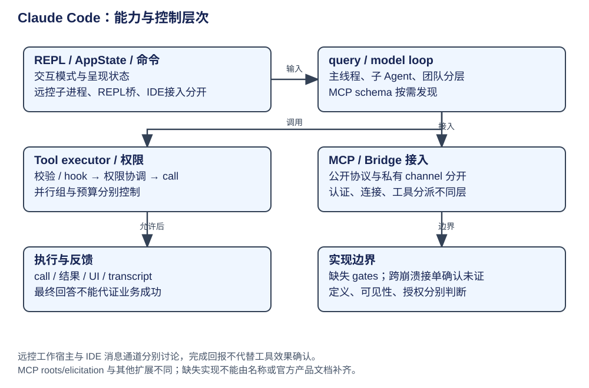

# Claude Code：工具、权限、MCP 与 Bridge

工具执行发生在客户端管线中：模型提出 tool_use，运行时校验输入、判断权限、执行动作并回填结果。工具目录、MCP 协议、用户命令和远端 Bridge 分别扩展这条链的不同位置。

| 概念 | 所属层次与所有者 | 生命周期 / 限制 |
|---|---|---|
| Tool / ToolUseContext | 工具定义与当前运行上下文 | schema、readOnly/concurrencySafe、call 与结果预算各有作用 |
| StreamingToolExecutor | query 工具编排 | 可并发/需串行按工具声明和当前批次判断，非所有工具同时执行 |
| canUseTool | 宿主生成并注入 query | tool permission context、规则、hook、classifier/UI 各有分支 |
| deferred tools / ToolSearch | 能力目录与发现 | 搜索 schema，引用随对话保留；不是用 LLM 重新定义工具 |
| Skill | 操作知识 | 发现/加载过程资料；不是和 ToolSearch 同一对象 |
| MCP client | 外部协议 | initialize、工具/资源/prompt、通知；能力以实际 handler 为准 |
| Slash command | 用户控制面 | 会话、配置、登录、压缩、扩展管理；不经过模型决策也可生效 |
| Bridge | 远端连接/工作宿主 | 远控任务宿主与 IDE 消息通道需要分开理解 |

## 工具定义到效果点

调用链是 tools.ts 构造工具池 → feature/config/permissions/MCP/agent 范围过滤 → query 交 orchestration/execution → 参数验证、pre hook 与权限 → Tool.call → result budget / post hook → tool_result → 下一轮模型。FileRead/FileEdit/Bash/Agent/Skill 是不同 handler，不把某个工具的 checkpoint/安全检查概括成全工具能力。

ToolSearch 使用 keyword/select:name 检索与 deferred schema 披露；Skill Discovery 是知识入口。两者按需提供定义或知识，减少初始请求需要携带的内容；具体收益取决于目录规模和使用方式。工具输出过大写文件和预览由具体结果预算实现，路径不是模型自动可靠引用的证明。

## 权限链与拒绝语义

REPL 的 useCanUseTool 生成 canUseTool 后传给 query；执行前 hasPermissionsToUseTool 得到 allow/deny/ask。deny 回错误 tool_result，ask 才进入 UI、远端回调或对应协调通道。CLI permission mode、用户/项目/managed settings、工具规则、hook 与 classifier 参与决策，不能把自然语言 tool description 当安全政策。

Bash classifier 做分类判断，readOnly/concurrencySafe 是工具声明，二者都不保证任意命令或环境完全安全。feature/settings gates 决定具体分支是否启用；接口存在与本次运行采用该接口是不同条件。

## MCP 能力与扩展边界

MCP client 声明 roots 和 elicitation，包含对应 handler，以及 progress、list_changed 通知；没有注册 sampling/createMessage handler。协议提供某项能力，不意味着客户端实现了它。notifications/claude/channel 是私有扩展，也不能当作标准 MCP 功能。

连接策略由 client/transport 管理；transport 的选择、可用 handler 和业务授权分别决定能接入什么、能处理什么、获准执行什么。OAuth/Bearer 解决业务授权，TLS 解决传输加密，登录成功也不代替工具执行政策。

## 远控宿主与 IDE 消息通道

| 接入方式 | 执行链 | 作用范围 |
|---|---|---|
| 远控任务宿主 | bridgeMain 注册 environment、轮询 work、sessionRunner spawn Claude child、heartbeat、completion | 这是远控任务宿主链，CLI 子进程仍拥有模型工具执行 |
| IDE 消息通道 | IDE ↔ Bridge ↔ Claude Session 的双向消息和审批转发 | 双向消息与审批转发；和远控任务宿主的模块对应关系缺少证据 |

远控 Bridge 负责接纳工作、管理子进程和回传状态；IDE 通道负责编辑器与会话之间的消息和审批转发。二者是否共享实现模块仍缺少证据。远端收到完成回报，也不能直接证明工具副作用已经耐久完成。

## UI 状态与执行状态

AppState 字段包括 messages/status/toolPermissionContext/model/settings/tasks/replBridgeEnabled；它描述 UI/会话管理视角，不能因此说全部运行状态都由 React 保存。QueryEngine 是非交互宿主，query 是循环，REPL 是显示与控制，三者边界见 [架构](architecture.md)。

UI messages/status、活动 query、transcript 和后台任务各有生命周期。snip/contextCollapse 的算法与显式队友接单路径仍有实现证据缺口；这些边界分别见 [上下文](context.md)与 [主链路](architecture.md)。