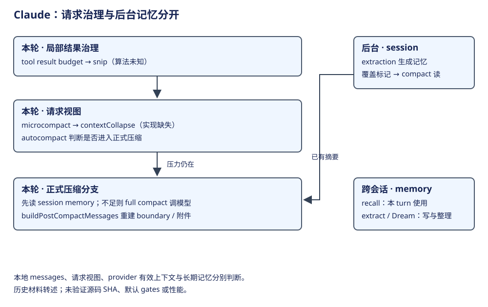

# Claude Code：压缩与记忆层次

compact 包含多种处理：有的改变本地消息，有的只改变 API 请求视图，有的在后台生成摘要。先定位处理对象和采用时机，才能判断一次压缩改变了什么。




本章先沿当前请求走三步：治理结果与历史视图，按需要取得会话摘要，重建下一请求可用的资料。后台记忆是与这条主线相交的生产路径，放在主流程后解释。先看处理层表，便能知道后面的“压缩”究竟改了哪份资料。

## 第一步：在请求边界治理结果与历史视图

| 处理层 | 输入 / 输出与 owner | 是否在此生成 LLM 摘要 | 算法与作用范围 |
|---|---|---|---|
| tool result budget | 过大结果外置，消息保留预览与引用 | 否 | 局部结果处理，不能称全局摘要 |
| snip | query 前的局部历史视图 | 未知 | 算法实现缺少证据 |
| microcompact：time-based | 旧 tool_result 在本地改成更小内容 | 否 | 会改变本地 messages |
| microcompact：cached | API 层 cache_edits，保留本地消息 | 否 | 条件成立才走；不可用本地数组大小度量 |
| contextCollapse | query 的 collapsed view | 未知 | 入口存在，算法实现缺少证据 |
| autocompact | 上下文压力判断 | 否 | 决策层；具体摘要由后续路径提供 |
| session memory compact | 已生成的会话记忆 + 保留近期消息 | 读取时否 | 摘要模型成本发生在后台 extraction |
| compactConversation | 历史 → 模型摘要 | 是 | 正式摘要路径，成功后还需重建附件等 |
| buildPostCompactMessages | boundary、summary、attachments、hook messages | 否 | 拼装供后续 query 使用的上下文 |

顺序依据：[query 每轮的处理顺序](https://github.com/permanentstar/claude-code-source-leak/blob/9f51e71641c1472293ebe4a7968b44455c00f0ba/src/query.ts#L365)。这里“先后”不表示每轮必走全部算法；gates、上下文压力和前一层效果都可能使后续路径不触发。触发阈值和实际进入哪些分支，由配置与请求压力共同决定。

## 第二步：取得摘要，并确定它覆盖的历史

session memory extraction 在 post-sampling 条件满足后异步维护当前会话的记忆文件；sequential 包装避免同进程并发写。compact 读取方以超时和 stale 条件协调正在进行的 extraction，再读取已有文件，用消息覆盖标记选择保留尾部；文件生成与此次 compact 读取不是同一个模型调用。

| 当前位置 | 关联状态 | 为什么要区分 |
|---|---|---|
| 后台摘要生成 | lastMemoryMessageUuid 等触发位置 | 统计抽取后新增工具调用，判断何时再次抽取 |
| compact 读取现成记忆 | lastSummarizedMessageId 等覆盖位置 | 标明成功抽取的覆盖，compact 据此选择保留尾部 |
| fallback full compact | 历史摘要请求 | 前一条路不足时才产生新 summary |
| compact 后重建 | boundary + summary + 保留消息 + 附件/hook | 摘要文本本身不足以重建工具、文件和技能上下文 |

抽取成功后更新 lastSummarizedMessageId，compact 读取它并调整保留起点以维持调用配对。[抽取触发与覆盖水位](https://github.com/permanentstar/claude-code-source-leak/blob/9f51e71641c1472293ebe4a7968b44455c00f0ba/src/services/SessionMemory/sessionMemory.ts#L149)、[成功更新](https://github.com/permanentstar/claude-code-source-leak/blob/9f51e71641c1472293ebe4a7968b44455c00f0ba/src/services/SessionMemory/sessionMemory.ts#L346)、[compact 读取与选尾](https://github.com/permanentstar/claude-code-source-leak/blob/9f51e71641c1472293ebe4a7968b44455c00f0ba/src/services/compact/sessionMemoryCompact.ts#L514)。这份等待协调不构成事务锁；跨会话 ancestry 与事务保证仍需另证；覆盖逻辑应按消息标记理解，不能仅按文件写入时间推断。

## 第三步：重建上下文，交给下一次 query

摘要取得后，还要恢复近期消息、文件、计划、技能和工具等与续跑有关的资料。`buildPostCompactMessages` 组合 boundary、summary、attachments 和 hook messages，输出再进入下一次 query。摘要是一份语义产物，重建决定这份产物在请求中的位置及其配套资料。

上下文的最终排列可以直接节选 `buildPostCompactMessages`：

```ts
return [
  result.boundaryMarker,
  ...result.summaryMessages,
  ...(result.messagesToKeep ?? []),
  ...result.attachments,
  ...result.hookResults,
]
```

query 得到压缩结果后，先向会话 yield 重建消息，再将它们采用为当前请求视图：

```ts
const postCompactMessages = buildPostCompactMessages(compactionResult)
for (const message of postCompactMessages) {
  yield message
}
messagesForQuery = postCompactMessages
```

第一段输出规范次序，第二段同时连接会话消费者与当前模型请求。hookResults 来自压缩后的 SessionStart hook；PostCompact 的 userDisplayMessage 另行合并到显示信息，不能把两者都看作模型消息。完整压缩过程还负责摘要生成、附件重建及 pre/post hook；这里省略触发、预算计数与错误恢复。[查看重建顺序](https://github.com/permanentstar/claude-code-source-leak/blob/9f51e71641c1472293ebe4a7968b44455c00f0ba/src/services/compact/compact.ts#L330)、[查看 query 的采用位置](https://github.com/permanentstar/claude-code-source-leak/blob/9f51e71641c1472293ebe4a7968b44455c00f0ba/src/query.ts#L528)。

例如已读源码并做过一次修改，压缩需要保留“用户目标、已改路径、验证事实、尚未完成事项”，近期工具交换则由保留段补足。下一次 query 才能知道应继续验证，而非重复调查。这里表达摘要应服务的学习目标，不承诺每次压缩都会无损保存全部事实。[查看正式压缩与上下文重建的研究顺序](https://github.com/permanentstar/agent-insight/blob/9ecf6e00b17caa5c8930c538978b208300d3b19c/archive/claude-march.md#L1120)。

主流程到这里已经闭合：旧资料经治理或摘要变成新的请求输入。接下来解释摘要或长期知识怎样由后台工作产生，以及它们在哪个边界被主请求采用。

## 后台支路：不同记忆交给不同消费者

| 机制 | 生命周期 / producer → consumer | 与主请求的关系 |
|---|---|---|
| Relevant Memory Prefetch | 每个 turn 发 side-query 选择长期 memory，供本轮后续 iteration | 不等待首轮；返回晚则本轮失效，不延到下一 turn |
| Session Memory Extraction | 当前 session 的后台摘要文件 → compact | 为会话压缩续接准备，不承担全部长期记忆 |
| Extract Memories | turn 结束后抽取 → durable/auto memory | 跨 session 的信息积累，和当前 compact 没有同一同步边界 |
| Dream / AutoDream | 长期 memory 集合 → 整理后的索引/内容 | 条件启用后的后台治理，不是主 query 压缩 |

当前 turn 的预取在 query 启动，工具反馈后只消费已完成结果；selector 使用模型 sideQuery。[预取启动](https://github.com/permanentstar/claude-code-source-leak/blob/9f51e71641c1472293ebe4a7968b44455c00f0ba/src/query.ts#L297)、[后续采用](https://github.com/permanentstar/claude-code-source-leak/blob/9f51e71641c1472293ebe4a7968b44455c00f0ba/src/query.ts#L1592)、[记忆选择](https://github.com/permanentstar/claude-code-source-leak/blob/9f51e71641c1472293ebe4a7968b44455c00f0ba/src/memdir/findRelevantMemories.ts#L98)。recall 用模型 side-query 选择文件，不是 embedding 检索；能力均受 feature/settings gates 控制。功能入口存在与 feature/settings gates 放行是不同条件；客户端的记忆机制也不能直接扩展到其他产品界面。

## 失败与取舍

| 场景 | 处理行为 | 不能推出什么 |
|---|---|---|
| 首轮直答且 recall 返回慢 | 主请求不等 side-query，本轮可能无该记忆 | 不能说每次回答都已检索全部长期记忆 |
| cached microcompact 生效 | 本地历史可保持不变 | 不能用文件变小证明或否认请求减重 |
| contextCollapse 缺实现 | 只确认调用边界和视图职责 | 不补成确定的 LLM/非 LLM 算法 |
| full compact 成功 | 重建短上下文继续工作 | 不能证明摘要无信息损失或工具效果可重放 |

分层治理允许局部瘦身先于整段摘要，后台工作也可缩短关键请求路径；其代价是本地历史、请求视图和记忆新鲜度不再是同一状态。比较时应先选定测量对象，再谈成本和一致性。测量性能或信息保留时，需要分别固定这些状态与覆盖范围。
