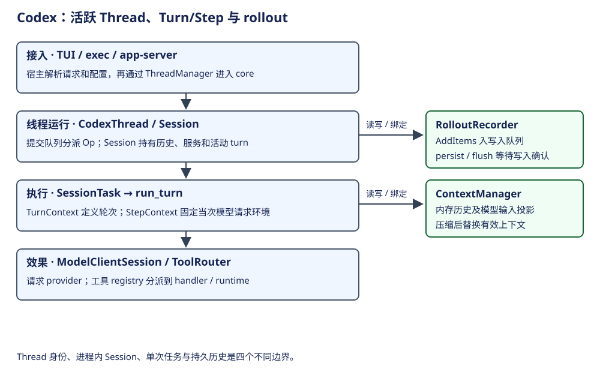
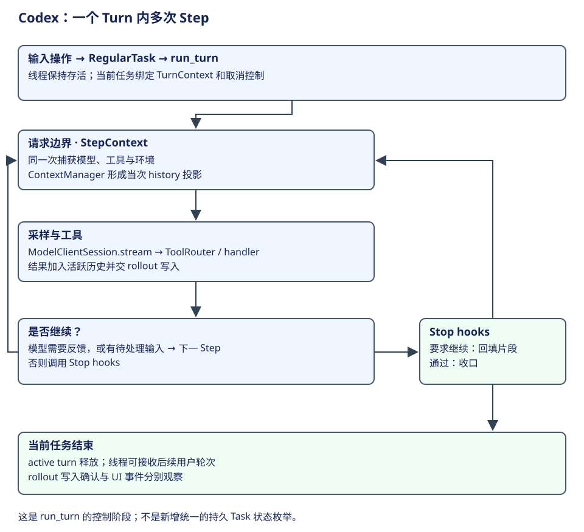

# Codex：线程运行、轮次快照与执行边界

Codex 开源 core 把活跃线程、一次用户轮次、一次模型请求和持久历史分别建模。宿主通过 ThreadManager 创建或加载 CodexThread，core Session 接收操作并驱动 SessionTask；run_turn 再驱动模型与工具循环。本章沿 Rust core 的构造和执行路径解释这些关系。



## 层次与概念词典

| 概念 | 层次与职责 | 创建者 / 生命周期 | 状态边界 |
|---|---|---|---|
| ThreadManager | 宿主接入 core 的活跃线程管理 | 宿主构造并传入共享服务 | 管理活对象，不等于全部历史文件 |
| CodexThread | 双向操作/事件门面 | manager 创建或加载 | 持有 Arc Session 与 SessionIo |
| Session / SessionIo | 线程运行状态及队列接口 | Session::spawn 建立 | 历史、服务、active_turn 与输入队列在内存 |
| SessionTask | 一次受控运行任务 | Session.start_task 安装并持取消 token | Regular 等任务类型；不是通用 durable Task 记录 |
| TurnContext | 用户轮次的配置、身份与环境边界 | 轮次创建时构造 | 多次模型请求可共享同一 turn |
| StepContext | 当前采样的模型、tool router、环境快照 | 每个请求边界捕获 | 防止把下一次动态配置混进当次请求 |
| ModelClientSession | turn 内的 provider 连接/路由状态 | run_turn 创建或复用预热实例 | 与用户 Thread 的持久身份不同 |
| ContextManager | 活跃历史及模型输入投影 | Session 持有 | 可以截断或替换；不是原始 rollout 原封不动发送 |
| RolloutRecorder | 后台历史写入器 | 启动时按新建/恢复参数构造 | AddItems 队列与 flush ack 分开 |

依据：[Thread 门面](https://github.com/openai/codex/blob/2351d9e1b608e6f9d9a3699b71d7eb39ee41cfa4/codex-rs/core/src/codex_thread.rs#L208)、[manager](https://github.com/openai/codex/blob/2351d9e1b608e6f9d9a3699b71d7eb39ee41cfa4/codex-rs/core/src/thread_manager.rs#L251)、[Session 构造](https://github.com/openai/codex/blob/2351d9e1b608e6f9d9a3699b71d7eb39ee41cfa4/codex-rs/core/src/session/mod.rs#L520)。ThreadId、运行 SessionId、rollout 与 Git branch 不能互相替代；线程 fork 的历史关系须读实际 lineage 元数据。

## 构造、复用与一次轮次

ThreadManager 的 spawn_thread 调 Session::spawn，注入配置、认证、模型、environment、thread store、扩展与初始历史，再包装为 CodexThread。SessionIo 把 Submission 送入队列。submission_loop 分派 Op：普通输入、Interrupt、shutdown、审批回复等并非同一个模型 prompt。活线程可保持多轮；冷启动要依据 InitialHistory 和持久资料重建。

| 当前位置 | 调用链 / 执行点 | 状态与返回 |
|---|---|---|
| 接入 core | ThreadManager.spawn_thread → Session::spawn | 创建运行状态、服务和操作/事件接口 |
| 接纳操作 | SessionIo.submit → submission_loop | 根据 Op 分派；中断与审批可直接改变控制状态 |
| 安装任务 | Session.spawn_task → start_task | spawn_task 先中止被替换任务；start_task 建立取消 token 与 active turn |
| 准备轮次 | RegularTask → run_turn | 前置压缩、接纳输入、skills/plugins、hook 与上下文准备 |
| 当次采样 | StepContext → ModelClientSession.stream | 当前 history 投影、模型与 tool specs 形成请求 |
| 工具执行 | ToolRouter → registry → handler/runtime | 按调用类型处理结果，再反馈到循环 |
| 收口 | 任务结束、事件与持久写入 | 事件展示、history 更新和 rollout 确认各有边界 |

依据：[spawn_thread](https://github.com/openai/codex/blob/2351d9e1b608e6f9d9a3699b71d7eb39ee41cfa4/codex-rs/core/src/thread_manager.rs#L2022)、[操作分派](https://github.com/openai/codex/blob/2351d9e1b608e6f9d9a3699b71d7eb39ee41cfa4/codex-rs/core/src/session/handlers.rs#L439)、[任务安装](https://github.com/openai/codex/blob/2351d9e1b608e6f9d9a3699b71d7eb39ee41cfa4/codex-rs/core/src/tasks/mod.rs#L272)、[run_turn](https://github.com/openai/codex/blob/2351d9e1b608e6f9d9a3699b71d7eb39ee41cfa4/codex-rs/core/src/session/turn.rs#L164)、[provider 请求](https://github.com/openai/codex/blob/2351d9e1b608e6f9d9a3699b71d7eb39ee41cfa4/codex-rs/core/src/session/turn.rs#L2565)。等待界面的结束不自动等于 task 中止；控制必须进入 Op/取消路径。

## 用一项修复任务理解 Turn 与 Step



设用户提出“读 CSV 导出代码，修复转义，运行验证并说明结果”。core 接收的是一份用户操作，建立当前任务及 TurnContext。第一次采样之前准备历史和上下文，捕获 StepContext；模型可能先请求读取文件。工具执行后，代码与结果进入活跃历史，下一 Step 据此判断如何修改。修复和验证可能再需要多次 Step，直到没有工具反馈或待接纳输入要求继续，Stop hooks 也允许收口。

下表是正常任务的教学轨迹，工具名与请求次数由实际模型决定，并非源码硬编码的必经步骤。

| 工作边界 | 当前输入与决定 | 程序保存和控制什么 |
|---|---|---|
| 用户 Turn 开始 | 修复目标、已有会话、当前协作约定 | 安装任务，绑定 TurnContext 与取消控制 |
| Step 1：获取事实 | 模型请求读取需求和代码 | 同一 StepContext 固定工具与环境；执行结果加入历史 |
| Step 2：形成修改 | 模型根据代码生成修改调用 | router 选择 handler，效果编排处理审批与执行 |
| Step 3：利用验证结果 | 模型请求验证，依据输出修订或回答 | 结果回填；需要后续工作则再次采样 |
| Turn 收口 | 模型给出说明，队列与 hooks 无续跑要求 | 当前任务结束，Session 可承接下一用户 Turn |

因此，Thread 是长期交互身份，Turn 是一次用户工作边界，Step 是其中一次采样的配置视图。StepContext 不是新会话；工具调用也不必一对一地建立新 Turn。这些区别解释了为什么用户在运行中补充一句要求，可以在允许的后续请求边界进入当前工作，却不应改变已经发出的请求。

## 请求快照为什么需要单独一层

下面保留 run_turn 的控制骨架，省略预算、重试、hook 细节，是教学伪代码而非可编译 Rust：

```rust
loop {
    let pending = drain_input_when_allowed();
    record_accepted_inputs(pending);
    let step = capture_step_context();
    let input = history.for_prompt(step.model.input_modalities);
    let result = run_sampling_request(step, input).await;
    let continue_work = result.needs_follow_up || input_queue.has_pending_input();
    if continue_work { continue; }
    if stop_hooks_require_continuation() { continue; }
    break;
}
```

一次捕获的 StepContext 同时用于组装上下文、公布工具和处理这次工具请求。这使“模型看见的工具”与“执行器使用的配置”处于同一请求视图；下一 Step 才能接纳新的配置与输入。`history.for_prompt` 则说明模型输入是经过投影的资料，不是将全部 rollout JSON 原封不动发送。[请求快照及历史投影](https://github.com/openai/codex/blob/2351d9e1b608e6f9d9a3699b71d7eb39ee41cfa4/codex-rs/core/src/session/turn.rs#L460)、[继续条件与 Stop hooks](https://github.com/openai/codex/blob/2351d9e1b608e6f9d9a3699b71d7eb39ee41cfa4/codex-rs/core/src/session/turn.rs#L548)。

自然语言负责承载“为什么修改、资料说明什么”；工具调用的名字、参数、调用关系及结果由协议对象组织。程序不需要预先枚举全部修复意图，但必须识别调用并选择 handler。文件内容中的建议也不会因为被读取就成为执行授权；实际控制还要走工具的审批和 runtime。

## Plan 协作模式与进度清单

Codex 有内置的 Default/Plan 协作模式。模式内容进入上下文，Plan 说明要求先探索和形成可讨论的方案。它改变当前协作目标，但本章的模型反馈循环仍然成立，不能据此推断已经换成一个独立 Planner 驱动 Executor 的图。

`update_plan` 则是另一件事：模型提交结构化清单，handler 解析后发出 PlanUpdate 事件。源码在 Plan 模式明确拒绝这个 TODO/checklist 工具。这个直接分支说明产品规划约定与执行中的进度清单不能混称；也说明应逐个检查工具规则，不能只从 Plan 文本推定所有修改效果都被底层 sandbox 拦住。[模式内容构造](https://github.com/openai/codex/blob/2351d9e1b608e6f9d9a3699b71d7eb39ee41cfa4/codex-rs/core/src/context/world_state/collaboration_mode.rs#L25)、[清单 handler](https://github.com/openai/codex/blob/2351d9e1b608e6f9d9a3699b71d7eb39ee41cfa4/codex-rs/core/src/tools/handlers/plan.rs#L65)。

学习自检：用户的一次修复要求为什么能对应多个 Step？工具和模型配置在何时固定？Plan 模式、update_plan 和 ToolOrchestrator 分别控制什么？

## 用一条输入介入轨迹检验 Turn 与请求快照

设一项 CSV 修复正在进行。第一次 Step 已公布工具和发送输入，模型请求读取；用户随后补充“保留公开接口”。下面的编号仅用于教学，不是新增持久 Step ID：

| 时点 | 用户工作与资料 | 实际控制 |
|---|---|---|
| 第一次 Step 发出 | 修复目标、当时工具／环境和历史投影 | 这次采样使用捕获的 StepContext |
| 用户补充到达 | 新要求进入待处理输入 | 不回头修改已经发出的 provider 请求 |
| 采样及工具反馈完成 | 读取观察可进入活跃历史；循环检查待输入 | 根据有效接纳条件进入下一边界 |
| 第二次 Step 准备 | 接纳补充，历史投影包含有效新资料 | 再捕获 StepContext，使当次上下文、工具和调用共享视图 |
| 修改和验证反馈 | 用户目标与新约束仍属于该项工作 | 后续 Step 按观察推进 |
| 正常收口 | 无反馈和待输入需要继续，Stop hooks 通过 | 当前任务结束；Thread 可接后续 Turn |

这条轨迹回答一个设计问题：为什么既有长活 Session，又有 TurnContext 和 StepContext？Session 持有跨轮的历史和服务，TurnContext 绑定这次用户工作，StepContext 固定一次请求的选择。这样动态输入和配置可以在后续边界采用，而不让同一请求中的“公布工具”和“执行工具”各自读取不同配置。[接纳与快照控制](https://github.com/openai/codex/blob/2351d9e1b608e6f9d9a3699b71d7eb39ee41cfa4/codex-rs/core/src/session/turn.rs#L418)。

自然语言补充影响模型理解目标，程序队列影响采用时点，两者不能合成一个“模型自动看到最新输入”。相似问题在 AgentSession 由 steering/followUp 和请求边界解释；Codex 的具体 Op、任务和输入接纳路径仍按 core 实现阅读。

**演算。** 用户补充到达时，第一次工具是否必然已经遵守新约束？

参考解答：不能必然推定。先确认补充何时接纳、哪次请求使用了它，以及具体工具路径的有效政策。后续消息采用并不等于已经发出的调用被改写。这里解释正常介入时序，不将所有取消或重试模式都假定为同一契约。


## 历史、压缩与持久确认

`record_prepared_conversation_items` 先给历史项补元数据，更新内存 history，再转为 RolloutItem 交持久路径。RolloutRecorder.record_canonical_items 返回表示 AddItems 已进入后台队列；persist/flush 通过 oneshot ack 等待 writer 确认。这两类 await 对应不同的持久边界；断电耐久性还取决于 writer 与存储后端。

压缩通过活动历史替换及持久 compaction 资料影响后续请求；上下文指令、用户消息和工具输出不会按所有 JSONL 行直接拼接。原始日志顺序也不能单独证明逻辑覆盖范围或 conversation branch。依据：[历史写入](https://github.com/openai/codex/blob/2351d9e1b608e6f9d9a3699b71d7eb39ee41cfa4/codex-rs/core/src/session/mod.rs#L3596)、[历史替换](https://github.com/openai/codex/blob/2351d9e1b608e6f9d9a3699b71d7eb39ee41cfa4/codex-rs/core/src/session/mod.rs#L4116)、[writer 接口](https://github.com/openai/codex/blob/2351d9e1b608e6f9d9a3699b71d7eb39ee41cfa4/codex-rs/rollout/src/recorder.rs#L1048)。

## 工具、审批与 sandbox

ToolRouter 区分 model-visible specs、code mode 的嵌套工具身份和 registry；工具出现在 schema 不代表已经获准执行。执行工具的 ToolOrchestrator 解析审批需求，取得审批决定，选择 sandbox attempt，再调用 ToolRuntime.run；是否能再次尝试受有效权限及失败类型限制。不同工具的网络、文件、动态工具边界并不都归同一个 shell sandbox。

| 边界场景 | 当前静态证据 | 不应扩大成的保证 |
|---|---|---|
| 新任务替换活任务 | spawn_task 先 abort_all_tasks(Replaced) | 已启动进程与外部系统副作用可撤销 |
| 取消模型请求 | stream 被 cancellation_token 包裹 | provider 已做的计算或费用被撤回 |
| 工具请求可见 | ToolRouter.exposes_tool / model_visible_specs | approval 或 sandbox 已放行 |
| 写入排队后进程崩溃 | AddItems 与确认分开 | 每个 UI 事件都已持久 |
| 重启恢复历史 | InitialHistory / rollout 等资料用于重建 | 任意进程内 SessionTask 都能续跑或工具恰好一次 |

依据：[工具路由](https://github.com/openai/codex/blob/2351d9e1b608e6f9d9a3699b71d7eb39ee41cfa4/codex-rs/core/src/tools/router.rs#L85)、[效果编排](https://github.com/openai/codex/blob/2351d9e1b608e6f9d9a3699b71d7eb39ee41cfa4/codex-rs/core/src/tools/orchestrator.rs#L127)。

## 快照与执行边界的设计取舍

TurnContext/StepContext 让长活线程与动态模型/工具配置能够共存，代价是读源码时不能把这些 context 都当成同一对象。code mode、插件、MCP、子 Agent 和远端 environment 各有组合入口，应沿 router/handler 继续下钻。会话历史恢复与工作续跑也是不同问题：前者依赖历史重建，后者需要对应任务类型的持久记录和执行器。

[任务组织与运行配置](official-practices.md)把使用问题与执行机制对应起来。开源 core、app-server 和桌面宿主承担不同职责，core 的实现不能直接代替宿主契约。
