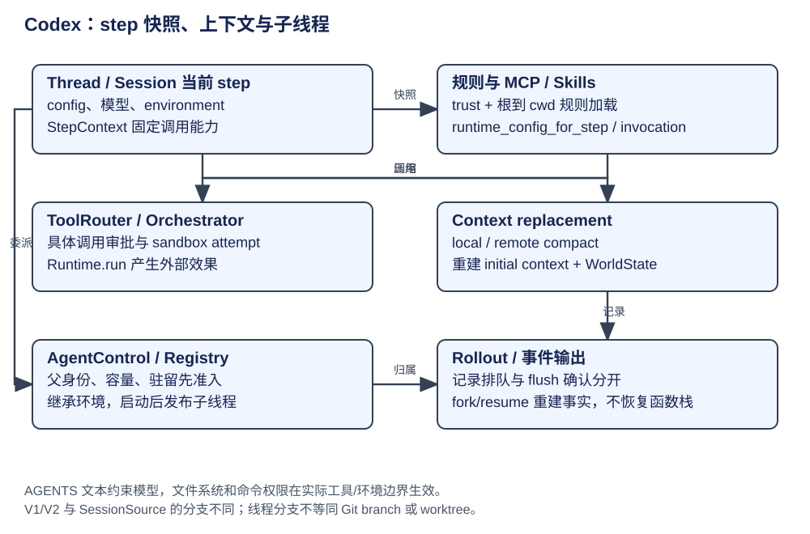

# Codex：规则、工具快照、压缩与子线程

Codex 在一次模型 step 中固定环境、模型与能力快照；长期规则、MCP 配置、对话历史和子线程运行资格由不同模块管理。产品文档中的“线程/worktree/skills”用法不能直接代替这些执行点。

| 概念 | 所属层 / 构造与消费 | 生命周期 |
|---|---|---|
| LoadedAgentsMd | 规则加载：active project、turn environments | 根到 cwd 的目录链读取；按总字节预算累计，保存来源 |
| Skill load input | 知识加载：config / explicit invocation | 选择、正文与调用记录不同；不因 Skill 存在授予权限 |
| McpManager | 能力配置与 catalog/cache | plugin/config overlay + 当前 step 环境；远程调用仍有审批 |
| replacement history | 压缩结果 | model context 新投影；不抹掉整个 rollout 历史 |
| AgentControl / registry | 子线程运行控制 | 父身份、容量、配置继承、驻留/恢复和投递 |
| SessionSource / fork history | 线程来历 | 对话分支，与 Git branch/worktree 无必然一对一关系 |

## 规则发现与能力快照

load_project_instructions 先保存用户提供规则；active project untrusted 时不加载项目规则。对 turn environments 分别使用该环境文件系统和 sandbox context，按剩余 project_doc_max_bytes 读取。agents_md_paths 根据 project root markers 找最近根，将根到 cwd 目录链按顺序搜索，每目录按候选文件优先级选一个文件；不是任意递归扫描所有子目录。

规则加载基于当前真实环境路径，不能把本机绝对 cwd 写成跨环境约束。规则文本约束模型；真正的文件读写授权仍由 environment/permission profile/tool runtime 执行。[加载与 trust/budget](https://github.com/openai/codex/blob/2351d9e1b608e6f9d9a3699b71d7eb39ee41cfa4/codex-rs/core/src/agents_md.rs#L58)、[目录链选择](https://github.com/openai/codex/blob/2351d9e1b608e6f9d9a3699b71d7eb39ee41cfa4/codex-rs/core/src/agents_md.rs#L192)。

Skills 的 explicit/implicit invocation 分开记录；McpManager 的 runtime_config_for_step 与 selected_plugins_for_step 依据当前配置、环境 authority、连接器与 plugin overlay 计算能力。目录缓存、模型工具 schema 和执行授权分别核验，避免把“发现到了”当“可调用并获批”。[Skill load 与 invocation](https://github.com/openai/codex/blob/2351d9e1b608e6f9d9a3699b71d7eb39ee41cfa4/codex-rs/core/src/skills.rs#L29)、[MCP step 配置](https://github.com/openai/codex/blob/2351d9e1b608e6f9d9a3699b71d7eb39ee41cfa4/codex-rs/core/src/mcp.rs#L160)、[工具效果点](https://github.com/openai/codex/blob/2351d9e1b608e6f9d9a3699b71d7eb39ee41cfa4/codex-rs/core/src/tools/orchestrator.rs#L127)。

## local / remote 压缩的共同提交面

local compact 使用摘要模型结果，保留按策略选取的用户内容并构建 summary history；remote v2 接收服务压缩结果，再按 retained message/image/feature 策略组装。两者都调用 build_compaction_replacement_history 重建初始 context 与 WorldState baseline，然后 Session.replace_compacted_history，记录 compaction metadata 并重算 token usage。

| 数据面 | 变化 | 不能推断 |
|---|---|---|
| Session conversation history | replacement history 成为后续模型输入 | 不等同 JSONL 文件只剩摘要 |
| WorldState / initial context | prefix 与当前环境重新合入 | 不能只拼旧 summary 而丢当前规则/环境 |
| rollout | 压缩记录与 turn context 等持久项 | 排队 record 不等于 flush 已确认 |
| metadata | window IDs、response/model hash 等 | 不用于推定 Git 分支或任务效果已完成 |

证据：[context 重建](https://github.com/openai/codex/blob/2351d9e1b608e6f9d9a3699b71d7eb39ee41cfa4/codex-rs/core/src/compact.rs#L80)、[local 安装替换历史](https://github.com/openai/codex/blob/2351d9e1b608e6f9d9a3699b71d7eb39ee41cfa4/codex-rs/core/src/compact.rs#L386)、[remote v2 安装](https://github.com/openai/codex/blob/2351d9e1b608e6f9d9a3699b71d7eb39ee41cfa4/codex-rs/core/src/compact_remote_v2.rs#L315)。local/remote、feature gate 和模型选择的具体分支需固定配置；没有跑远端服务，不评价其摘要质量或压缩性能。

## 子线程准入与驻留

spawn_agent_internal 先 runtime.admit_start，再解析父 thread/source 与 multi-agent version，检查容量，V2 特定 session source 走 residency slot，随后 registry.reserve_spawn_slot 并继承 environments/config。身份与容量先保留，线程启动后再发布，不是先 spawn 一个进程再补 owner。

fork 复制经过选择的 rollout/context，resume 从线程事实重建 LiveAgent；它们不是恢复旧函数栈。V1/V2 与 source 分支不能合并成“全部子 Agent 均一套常驻实现”。资源驻留、线程可发现与工作完成分别记录；收到了工具结果或最终文本也不代证目标任务验收通过。

[spawn 准入](https://github.com/openai/codex/blob/2351d9e1b608e6f9d9a3699b71d7eb39ee41cfa4/codex-rs/core/src/agent/control/spawn.rs#L672)、[resume 控制](https://github.com/openai/codex/blob/2351d9e1b608e6f9d9a3699b71d7eb39ee41cfa4/codex-rs/core/src/agent/control/resume.rs)。本书未运行子线程或清理实验；Shell、MCP、远程环境等工具仍须沿各自执行管线追查权限。exec policy 的命令匹配/heuristic 不等同完整语义安全证明，见 [exec policy](https://github.com/openai/codex/blob/2351d9e1b608e6f9d9a3699b71d7eb39ee41cfa4/codex-rs/core/src/exec_policy.rs#L316)。
