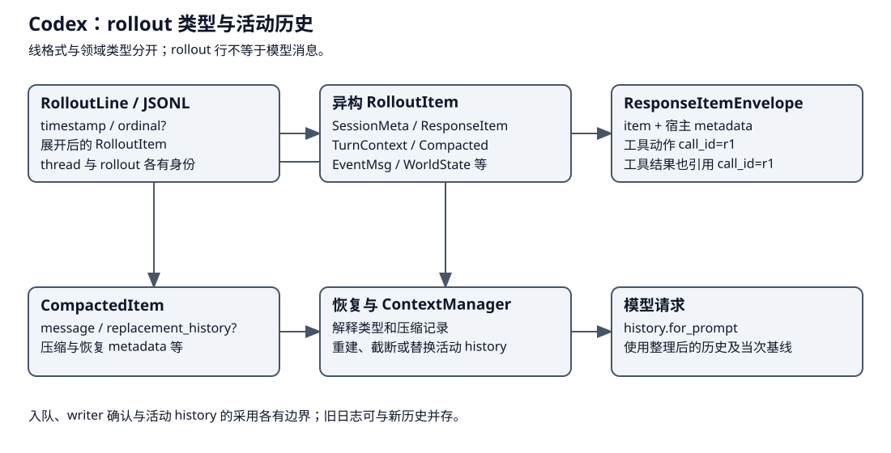

# Codex：规则、工具快照、压缩与子线程

Codex 在一次模型 step 中固定环境、模型与能力快照；长期规则、MCP 配置、对话历史和子线程运行资格由不同模块管理。产品文档中的“线程/worktree/skills”用法不能直接代替这些执行点。


本章承接执行章的第三步，将请求资料分成三个交接：加载规则和能力、在 Step 固定当次视图、长历史压缩后安装替换上下文。子线程则沿另一条执行生命周期使用继承资料，放在主请求流程之后。

| 阶段 | 输入 | 输出与消费者 |
|---|---|---|
| 1. 加载 | 工作环境、项目规则、Skill 与插件选择 | 带来源的指令和能力配置 |
| 2. 固定 Step | 当前历史与运行选择 | 模型和工具共用的 StepContext |
| 3. 压缩并采用 | 历史范围与摘要结果 | 新 history、WorldState baseline、持久压缩资料 |

| 概念 | 所属层 / 构造与消费 | 生命周期 |
|---|---|---|
| LoadedAgentsMd | 规则加载：active project、turn environments | 根到 cwd 的目录链读取；按总字节预算累计，保存来源 |
| Skill load input | 知识加载：config / explicit invocation | 选择、正文与调用记录不同；不因 Skill 存在授予权限 |
| McpManager | 能力配置与 catalog/cache | plugin/config overlay + 当前 step 环境；远程调用仍有审批 |
| replacement history | 压缩结果 | model context 新投影；不抹掉整个 rollout 历史 |
| AgentControl / registry | 子线程运行控制 | 父身份、容量、配置继承、驻留/恢复和投递 |
| SessionSource / fork history | 线程来历 | 对话分支，与 Git branch/worktree 无必然一对一关系 |

## 请求之前：rollout 的异构记录怎样读回历史 {#storage-model}



rollout 是保存线程资料的记录流。文件层的 `RolloutLine` 包含 `timestamp`、可选 `ordinal` 和展开的 item；逻辑层 `RolloutItem` 是类型联合，不同记录保存不同形状。`SessionMeta.id` 是稳定 thread 身份，rollout 自身还可以有独立身份；不能把文件名、每行序号与 thread ID 当成同一个键。[行结构与联合类型](https://github.com/openai/codex/blob/2351d9e1b608e6f9d9a3699b71d7eb39ee41cfa4/codex-rs/history/src/lib.rs#L213)、[写入 JSONL 的包装](https://github.com/openai/codex/blob/2351d9e1b608e6f9d9a3699b71d7eb39ee41cfa4/codex-rs/rollout/src/recorder.rs#L2078)、[稳定 thread 与 rollout 身份](https://github.com/openai/codex/blob/2351d9e1b608e6f9d9a3699b71d7eb39ee41cfa4/codex-rs/protocol/src/protocol.rs#L3229)。

| 代表记录 | 负载形态 | 读取后的用途 |
|---|---|---|
| SessionMeta | 会话身份、来源与配置资料 | 确定恢复哪一线程及其来历 |
| ResponseItem | `ResponseItemEnvelope={item,metadata}`；item 内可为消息、工具调用或结果等 | 保留协议内容与宿主 metadata 的区别，整理模型历史 |
| TurnContext / WorldState | 当次上下文与环境资料 | 重建请求基线，不能当作普通用户发言 |
| Compacted | `message`、可选 `replacement_history` 及恢复 metadata 等 | 确定压缩后的活动历史；原先的日志行仍可保留 |
| EventMsg / TokenUsageRecord 等 | 事件或用量结构 | 服务展示、统计及恢复消费，不逐条变成模型消息 |

这是代表分支，未枚举完整 RolloutItem，也不是线格式的所有 key。`ResponseItemEnvelope` 是内存领域类型，文件序列化有自己的适配；下面按解码后类型展示样例，避免把领域字段嵌套误当作原始 JSONL schema。

| 同一线程的记录顺序 | 字段／内容节选 | 与其他记录的关联 |
|---|---|---|
| 1. SessionMeta | `id=T1` | 为该 rollout 识别 thread |
| 2. ResponseItem | 用户目标：修复 CSV | 进入活动历史 |
| 3. ResponseItem | `item` 为读取工具调用，`call_id=r1` | call_id 是动作身份，不是第 3 行的 ordinal |
| 4. ResponseItem | `item` 为读取结果，`call_id=r1` | 与上一动作配对，成为下一请求的观察 |
| 5. Compacted | `replacement_history=保留目标与摘要组成的新历史` | 这是随后活动 history 的替换依据，不是删除第 2～4 行 |
| 6. ResponseItem | 新的验证工具交换 | 接到压缩后历史继续使用 |

T1、r1 与行号均为教学标记，时间、完整工具负载与其他上下文项省略。恢复逻辑解释这些类型及压缩语义，再重建活动 history；模型通过 `history.for_prompt` 消费整理后的内容。如果把每一行 payload 都拼进 Prompt，就会把已被摘要承接的旧内容、展示事件和配置资料重复塞回去。此样例限定为带 replacement_history 的压缩，其他历史格式和分支策略不能据此类推。[CompactedItem 的恢复资料](https://github.com/openai/codex/blob/2351d9e1b608e6f9d9a3699b71d7eb39ee41cfa4/codex-rs/history/src/lib.rs#L290)、[活动历史与 writer 确认边界](architecture.md)。

## 第一步与第二步：加载资料，固定当次能力

load_project_instructions 先保存用户提供规则；active project untrusted 时不加载项目规则。对 turn environments 分别使用该环境文件系统和 sandbox context，按剩余 project_doc_max_bytes 读取。agents_md_paths 根据 project root markers 找最近根，将根到 cwd 目录链按顺序搜索，每个目录按候选文件优先级选取一份。

规则加载基于当前真实环境路径，不能把本机绝对 cwd 写成跨环境约束。规则文本约束模型；真正的文件读写授权仍由 environment/permission profile/tool runtime 执行。[加载与 trust/budget](https://github.com/openai/codex/blob/2351d9e1b608e6f9d9a3699b71d7eb39ee41cfa4/codex-rs/core/src/agents_md.rs#L58)、[目录链选择](https://github.com/openai/codex/blob/2351d9e1b608e6f9d9a3699b71d7eb39ee41cfa4/codex-rs/core/src/agents_md.rs#L192)。

Skills 的 explicit/implicit invocation 分开记录；McpManager 的 runtime_config_for_step 与 selected_plugins_for_step 依据当前配置、环境 authority、连接器与 plugin overlay 计算能力。目录缓存、模型工具 schema 和执行授权需要分别核验，以确认能力配置、请求声明与执行准入。[Skill load 与 invocation](https://github.com/openai/codex/blob/2351d9e1b608e6f9d9a3699b71d7eb39ee41cfa4/codex-rs/core/src/skills.rs#L29)、[MCP step 配置](https://github.com/openai/codex/blob/2351d9e1b608e6f9d9a3699b71d7eb39ee41cfa4/codex-rs/core/src/mcp.rs#L160)、[工具效果点](https://github.com/openai/codex/blob/2351d9e1b608e6f9d9a3699b71d7eb39ee41cfa4/codex-rs/core/src/tools/orchestrator.rs#L127)。

## 第三步：将压缩结果安装为后续请求历史

local compact 使用摘要模型结果，保留按策略选取的用户内容并构建 summary history；remote v2 接收服务压缩结果，再按 retained message/image/feature 策略组装。两者都调用 build_compaction_replacement_history 重建初始 context 与 WorldState baseline，然后 Session.replace_compacted_history，记录 compaction metadata 并重算 token usage。

| 数据面 | 变化 | 不能推断 |
|---|---|---|
| Session conversation history | replacement history 成为后续模型输入 | 不等同 JSONL 文件只剩摘要 |
| WorldState / initial context | prefix 与当前环境重新合入 | 不能只拼旧 summary 而丢当前规则/环境 |
| rollout | 压缩记录与 turn context 等持久项 | 排队 record 不等于 flush 已确认 |
| metadata | window IDs、response/model hash 等 | 不用于推定 Git 分支或任务效果已完成 |

证据：[context 重建](https://github.com/openai/codex/blob/2351d9e1b608e6f9d9a3699b71d7eb39ee41cfa4/codex-rs/core/src/compact.rs#L80)、[local 安装替换历史](https://github.com/openai/codex/blob/2351d9e1b608e6f9d9a3699b71d7eb39ee41cfa4/codex-rs/core/src/compact.rs#L386)、[remote v2 安装](https://github.com/openai/codex/blob/2351d9e1b608e6f9d9a3699b71d7eb39ee41cfa4/codex-rs/core/src/compact_remote_v2.rs#L315)。local/remote、feature gate 和模型选择的具体分支需固定配置；没有跑远端服务，不评价其摘要质量或压缩性能。

本地压缩的摘要和保留内容已形成 new_history 后，还要合入当前请求的初始上下文和 WorldState。下面节选共同安装面，省略 CompactedHistoryMetadata 的各字段和后续用量计算：

```rust
let (new_history, world_state_baseline) = build_compaction_replacement_history(
    sess.as_ref(),
    &replacement_step_context,
    &world_state,
    new_history,
).await;
sess.replace_compacted_history(
    new_history,
    replacement_step_context.to_turn_context_item(),
    world_state_baseline,
    /* 省略：本次压缩的 CompactedHistoryMetadata */ metadata,
).await;
```

metadata 是这里代指真实构造对象的教学名字。关键交接是 replacement_step_context 和新历史一起进入 Session，下一请求从已替换的活动 history 取消息；rollout 另记录压缩事实。[本地安装路径](https://github.com/openai/codex/blob/2351d9e1b608e6f9d9a3699b71d7eb39ee41cfa4/codex-rs/core/src/compact.rs#L386)。

## 子线程专题：先接纳身份与容量，再继承资料

spawn_agent_internal 先 runtime.admit_start，再解析父 thread/source 与 multi-agent version，检查容量，V2 特定 session source 走 residency slot，随后 registry.reserve_spawn_slot 并继承 environments/config。这些准备在启动前完成，线程启动后才发布。

fork 复制经过选择的 rollout/context，resume 从线程事实重建 LiveAgent；它们不是恢复旧函数栈。V1/V2 与 source 分支不能合并成“全部子 Agent 均一套常驻实现”。资源驻留、线程可发现与工作完成分别记录；父线程读取子工作结果后，继续按自身目标处理。

[spawn 准入](https://github.com/openai/codex/blob/2351d9e1b608e6f9d9a3699b71d7eb39ee41cfa4/codex-rs/core/src/agent/control/spawn.rs#L672)、[resume 控制](https://github.com/openai/codex/blob/2351d9e1b608e6f9d9a3699b71d7eb39ee41cfa4/codex-rs/core/src/agent/control/resume.rs)。Shell、MCP、远程环境等工具仍须沿各自执行管线追查权限。exec policy 的命令匹配/heuristic 不等同完整语义安全证明，见 [exec policy](https://github.com/openai/codex/blob/2351d9e1b608e6f9d9a3699b71d7eb39ee41cfa4/codex-rs/core/src/exec_policy.rs#L316)。

子线程的准入顺序在 spawn_agent_internal 开头可见。下面节选身份接纳与父身份解析，后续容量、版本及驻留分支按原文表述展开：

```rust
let membership = self.runtime.admit_start()?;
let state = self.runtime.upgrade()?;
let parent_thread_id = session_source.as_ref()
    .and_then(SessionSource::parent_thread_id)
    .or(options.parent_thread_id);
// 省略：解析 multi_agent_version，检查执行容量，
// 按实际 source 决定 residency，再预留 spawn slot。
```

这些输入决定子线程继承谁的配置、占用哪个运行额度。启动完成才发布其运行对象，结果再由父线程消费。[子线程的接纳入口](https://github.com/openai/codex/blob/2351d9e1b608e6f9d9a3699b71d7eb39ee41cfa4/codex-rs/core/src/agent/control/spawn.rs#L672)。
