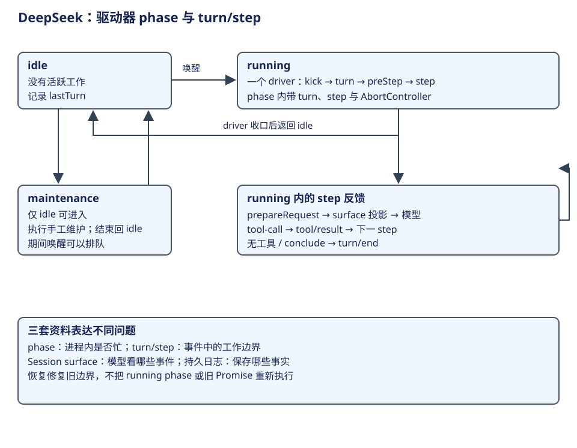

# DeepSeek Harness：插件树、会话事件与一次执行

DeepSeek Harness 是以 Cordis 插件树装配的 Agent 运行环境。AgentLoop 也是插件：它负责创建、恢复和释放运行实例，Session 负责事件事实，持久后端负责写入所有权与耐久边界。恢复时关闭上次中断的 turn，再开始后续工作；它没有把旧 Promise 继续运行的语义。


阅读主线分为四步：先装配并取得会话的运行归属，再把输入接纳为 turn，随后在每个 step 中形成模型请求并执行工具，最后关闭工作边界。Session 的事件写入伴随这些步骤发生；surface 从中选择模型贡献，存储句柄负责把记录保存下来。这三者有联系，也有不同的消费者。

先看下面的概念表，尤其区分工厂、驱动器和会话。后面的调用链会反复经过这三层。

## 层次与概念词典

| 概念 | 所属层、白话含义 | 创建者与生命周期 | 状态 / 持久性 |
|---|---|---|---|
| profile / bundle | 启动组合；profile 选择要叠加的配置包 | launcher 按有序 patch 装配 | 配置和分发物，不是会话 |
| Cordis Context / fiber | 服务注入、事件和可撤销资源的作用域 | 插件装载时建立，卸载时回收 effect | 进程内注册关系 |
| AgentLoop | 具体 Agent 工厂与生命周期 owner | 注入 agents、sessions、llm、tools 等服务 | 管理运行实例及尚未完成的启动工作 |
| ReactLoopAgent | 一个 Session 的运行驱动器 | 工厂构造；有独立 scope、inbox、phase | idle / maintenance / running 在内存 |
| turn / step | turn 是接纳输入到结束的工作轮；step 是其中一次模型及工具推进 | 驱动器创建，记录 start/end | 边界进入 Session 事件 |
| Session / seq | 按连续序号追加的事件历史 | sessions 服务准备、发布、释放 | 不是模型消息数组 |
| surface | 选择哪些事件以何种次序进入模型视图 | Session 依据 surfaceOp 及来源序号维护 | deriveMessages 从中投影 |
| SessionHandle | 存储后端发出的读写句柄 | create/open 获得，close 释放 | 写句柄拥有写权；flush 是耐久契约 |

`step` 是一次反馈推进的边界。它帮助定位模型与工具活动；重启后的中断修复按事件闭合旧工作，再接纳后续输入。依据：[工厂](https://github.com/deepseek-ai/deepseek-harness/blob/d743267388641bc76f17c45ce8b4c231aed1d32c/packages/core/agent-loop/src/index.ts#L341)、[驱动器](https://github.com/deepseek-ai/deepseek-harness/blob/d743267388641bc76f17c45ce8b4c231aed1d32c/packages/core/agent-loop/src/agent.ts#L98)、[Session](https://github.com/deepseek-ai/deepseek-harness/blob/d743267388641bc76f17c45ce8b4c231aed1d32c/packages/core/session/src/index.ts#L798)。

## 第一步：装配实例并取得会话归属

`AgentLoop.createAgent` 准备 Session 与 Agent scope，取得可选 persistence 的写句柄，完成 setup 后才发布到 registries。`resumeWith` 先 open(write)，读出物理有效日志，追加中断修复事件，再用 seed 准备会话。这样同一后端实例内不能同时取得两个活跃写 owner。

工厂的 FactoryOwnership 跟踪运行实例的 teardown 和启动任务；卸载先停止接纳、发出 abort，再等待收口。运行 Agent 的 scope 与工厂 scope 分开，插件资源不会成为存储中的函数。JSONL 后端通过 lease 增加跨进程排他；这项能力属于该后端，不能推广到所有自定义 persistence。依据：[createAgent](https://github.com/deepseek-ai/deepseek-harness/blob/d743267388641bc76f17c45ce8b4c231aed1d32c/packages/core/agent-loop/src/index.ts#L750)、[resumeWith](https://github.com/deepseek-ai/deepseek-harness/blob/d743267388641bc76f17c45ce8b4c231aed1d32c/packages/core/agent-loop/src/index.ts#L852)、[lease](https://github.com/deepseek-ai/deepseek-harness/blob/d743267388641bc76f17c45ce8b4c231aed1d32c/packages/session/session-persistence-jsonl/src/lease.ts)。

## 第二步：把输入接纳为 turn

| 当前位置 | 上层调用者 → 执行者 | 输入输出与状态变化 |
|---|---|---|
| 接纳输入 | followup / steer / inject → send | followup 进 next-turn；steer 进 next-step 并唤醒；inject 不主动唤醒 |
| 工作驱动 | kick → turn → preStep | 记录 turn/start；pre-step 可拒绝，无需发起一次模型请求 |
| 单步请求 | step → prepareRequest → buildRequest | 组合 system/context/tool 定义；记 request/header/context；冻结消息快照 |
| 模型效果 | preparedCall.stream 或 llm.stream | assistant-stream 提供临时帧；结束后另记 assistant/message 或 assistant/attempt |
| 工具效果 | executeToolCalls → ctx.tools | 顶层调用记 tool/call；通过执行门面做效果；另记 tool/result |
| 回到循环 | 工具结果 → 下一 step | 无工具或工具 conclude 可结束；next-step 输入可继续推进 |
| 收口 | finally 关闭 step/turn | 标记 completed、max-tokens、blocked、aborted、error 等原因 |

证据：[turn/step](https://github.com/deepseek-ai/deepseek-harness/blob/d743267388641bc76f17c45ce8b4c231aed1d32c/packages/core/agent-loop/src/agent.ts#L298)、[请求快照](https://github.com/deepseek-ai/deepseek-harness/blob/d743267388641bc76f17c45ce8b4c231aed1d32c/packages/core/agent-loop/src/agent.ts#L616)、[工具记录点](https://github.com/deepseek-ai/deepseek-harness/blob/d743267388641bc76f17c45ce8b4c231aed1d32c/packages/core/agent-loop/src/tool-calls.ts#L264)。模型流帧与持久事件分别命名；看到 assistant delta 不能据此认定已完成持久写入。

## 第三步：在 step 中请求模型并反馈观察



phase 是 ReactLoopAgent 在进程内的活动状态：idle 表示没有活跃工作；唤醒后变为 running，kick 可以连续推进 turn；driver 收口时回 idle。手工 maintenance 只允许从 idle 进入，工作完成后也回 idle。维护期间接到唤醒可以先登记，随后再启动驱动。这不是保存到日志、等重启继续执行的任务状态机。[phase 与唤醒](https://github.com/deepseek-ai/deepseek-harness/blob/d743267388641bc76f17c45ce8b4c231aed1d32c/packages/core/agent-loop/src/agent.ts#L183)、[driver 收口](https://github.com/deepseek-ai/deepseek-harness/blob/d743267388641bc76f17c45ce8b4c231aed1d32c/packages/core/agent-loop/src/agent.ts#L253)。

| 转移 | 主线条件 | 主要动作 |
|---|---|---|
| idle → running | 收到启动驱动的唤醒 | 建立 AbortController，开启 driver |
| running → idle | driver 正常、错误或取消收口 | 保存 lastTurn，处理已经登记的后续唤醒 |
| idle → maintenance | 请求手工维护且无活跃工作 | 暂时保有工作归属 |
| maintenance → idle | 维护结束 | 释放归属，必要时处理排队唤醒 |

running 内的 turn/step 才表达任务推进。turn 首次 preStep 面向 next-turn 输入；后续 step 面向 next-step。模型调用工具以后，工具观察参与后续模型输入，继续决定动作；无工具或工具 conclude 可以产生完成原因，但新输入和 turn-stopping 处理仍可能要求继续。类名 ReactLoopAgent 与这样的反馈机制相符，不能单凭名称推定它采用某个固定推理文本格式。

### 请求快照从哪里来

`ReactLoopAgent.buildRequest` 接收本次准备好的配置、模型调用和工具定义。它先记录请求配置的变化，再从 Session 的 surface 派生消息。下面节选末尾的采用路径；前面的 header 构造、工具集合变化记录和取消检查省略。

```ts
// 源码节选：header 已由本次模型与工具配置构成。
deepFreeze(header)
const boundaryMessages = session.deriveMessages()
for (const message of boundaryMessages) {
  if (this.frozenMessages.has(message)) continue
  deepFreeze(message)
  this.frozenMessages.add(message)
}
Object.freeze(boundaryMessages)
const request = markAgentLoopRequest(Object.freeze({
  ...header.config,
  messages: boundaryMessages,
  toolHistory: session.toolHistory(),
  ...header.tools !== undefined ? { tools: header.tools } : {},
  sessionId: this.session.id,
  signal,
}))
return request
```

输出是当次调用的不可变请求快照，由模型服务消费。`toolHistory` 提供工具历史，`messages` 才是由 surface 投影出的对话；二者在请求中各有字段。后续会话追加事件不会把已经发出的快照悄悄改掉。[查看 buildRequest 的配置准备与快照形成](https://github.com/deepseek-ai/deepseek-harness/blob/d743267388641bc76f17c45ce8b4c231aed1d32c/packages/core/agent-loop/src/agent.ts#L616)。

### 工具结果怎样进入下一请求

模型提出调用后，执行器先记 `tool/call`，得到调用事件的序号 `callSeq`。实际执行返回结果，再进入下面的 `appendToolResult`。这段保留源码中的消息构造、追加和来源关系；可选的错误、meta 字段省略。

```ts
const message = createToolResultMessage({
  callId: block.id,
  content: result.content,
  isError: result.isError,
})
session.append('tool/result', { turn, step, message }, {
  surfaceOp: 'append',
  sourceEventSeqs: [callSeq],
})
```

`callId` 把模型中的调用与工具消息配对，`sourceEventSeqs` 把结果事件与实际调用记录连接，`surfaceOp` 让该结果成为可见贡献。于是下一 step 的 `deriveMessages()` 可以取得它，模型据此决定继续读文件、修改还是回答。[查看调用与结果的完整记录代码](https://github.com/deepseek-ai/deepseek-harness/blob/d743267388641bc76f17c45ce8b4c231aed1d32c/packages/core/agent-loop/src/tool-calls.ts#L264)。

## 第四步：关闭 step 与 turn

每个 step 有自己的结束原因，turn 汇总一轮工作的终点；驱动器的 `finally` 负责收口。无工具、工具的 conclude、新输入和取消等控制条件共同决定是否继续。这里的“回答完成”是运行边界，工具已经造成的外部效果另有归属，后端是否完成 flush 也需单独确认。

工作结束后，driver 回到 idle；如果已有后续唤醒，它可以再推进新的 turn。手工维护则沿 maintenance 支路进入压缩等操作。这样既能看到一次任务的终点，也能解释为什么进程还在、实例还可以接纳下一项工作。

## 同一修复任务怎样成为事件和模型消息

以“读取代码、修复 CSV、验证、回答”为例，第一次 followup 把用户要求送到 next-turn 并唤醒驱动。turn/start 与 step/start 先记录工作边界；请求准备把角色、上下文和工具定义组合好。模型返回 tool-call 后，工具执行器记录调用与结果；结果进入 surface，再由下次请求派生为模型消息。

| 正常轨迹 | Session 事实 | 下一请求为什么需要它 |
|---|---|---|
| 提交修复要求 | user/message 与工作边界 | 告诉模型目标；turn/step 号供运行记录定位 |
| 模型请求读取 | assistant/message 内的 tool-call | 保存动作请求及模型正文 |
| 实际读取 | tool/call、tool/result | 保存执行与观察；结果供模型决定修改 |
| 修改、验证与回答 | 后续 step 的同类事件 | 随新观察继续推进，最终形成回答 |
| 收口 | step/end、turn/end 与 reason | 标明工作边界；不是把全部事件都发给模型 |

这里同时存在两个次序：事件日志保留发生过的运行事实，surface 选择模型要看到的贡献。request/header、工作边界、临时流帧和最终 assistant 不能统称为“聊天消息”。请求通过 deriveMessages 从 surface 投影，并冻结当次消息快照；压缩更新 surface 的可见贡献，事件日志继续保留原记录。[单步消息与模型响应](https://github.com/deepseek-ai/deepseek-harness/blob/d743267388641bc76f17c45ce8b4c231aed1d32c/packages/core/agent-loop/src/agent.ts#L400)、[调用和结果记录](https://github.com/deepseek-ai/deepseek-harness/blob/d743267388641bc76f17c45ce8b4c231aed1d32c/packages/core/agent-loop/src/tool-calls.ts#L264)。

工具内容与用户目标保持开放的语义表达；event type、seq、call 关系和 surfaceOp 为程序提供明确接口。一个插件可以在 pre-step 改变准备或受理条件，另一个插件提供具体工具，但插件层次本身不意味着存在独立计划执行器。显式 P&E 需要在这些扩展口上另外组织计划消费关系。

学习自检：为什么 phase=running 与存在一个未闭合 turn 是两种状态？assistant-stream 与 assistant/message 的职责有什么不同？事件仍在日志里，却不进入当前 surface，模型是否一定能看见它？

## 存储、压缩与故障边界

Session.append 接纳事件与投影；persistence 的 append 承诺有序可见，flush 才是跨崩溃存活的统一契约。启用 checkpoint-policy 时，它在模型 stream、顶层 tools/execute 和下一 pre-step 发起 session flush；失败则不进入相应下游效果。嵌套工具复用外层调用的持久边界，不能声称每个嵌套动作都有独立 durable intent。

| 崩溃或事件位置 | 重建依据 / 当前处理 | 保证的边界 |
|---|---|---|
| 输入或结果尚未完成 flush | 后端实际有效前缀 | 界面已显示不等于已耐久 |
| assistant 请求工具，但无 tool/call | 修复为 TOOL_NOT_STARTED | 是日志边界事实，不代表所有外部系统都有去重 |
| tool/call 已保存，结果缺失 | 修复为 TOOL_OUTCOME_UNKNOWN | 不自动盲目重做有副作用操作 |
| turn/step 仍开着 | 补结果、step/end、turn/end(interrupted) | 关闭旧工作，不续跑原 step |
| cancel | AbortController 与 inbox 控制 | keepInbox 与默认清空不同；不能撤销已发生效果 |
| 插件卸载 / 后端重装载 | teardown、句柄失效与错误收口 | 原后端签发的句柄不会被新实例无声接管 |

依据：[checkpoint-policy](https://github.com/deepseek-ai/deepseek-harness/blob/d743267388641bc76f17c45ce8b4c231aed1d32c/packages/session/session-checkpoint-policy/src/index.ts#L53)、[中断修复](https://github.com/deepseek-ai/deepseek-harness/blob/d743267388641bc76f17c45ce8b4c231aed1d32c/packages/core/session/src/repair.ts#L19)、[存储契约](https://github.com/deepseek-ai/deepseek-harness/blob/d743267388641bc76f17c45ce8b4c231aed1d32c/packages/session/session-persistence/src/handle.ts)。压缩插件与 Session 的 surface 操作协作；压缩的 surface 提交见 [上下文章](context.md)，subprocess sandbox 与审批见 [能力章](capabilities.md)。flush 提供持久屏障，不代替这些独立的控制规则。

## 取舍与独有内容

插件树让模型协议、工具、会话、压缩、权限策略可按组合替换，代价是运行行为取决于实际 profile 与 patch。每次比较都应说明启用了哪套后端和 checkpoint policy。Python SDK 通过同版本 dsh SDK profile 接入，不能把 Python 包目录误读成另一套 loop。profile 组合来自[上游架构说明](https://github.com/deepseek-ai/deepseek-harness/blob/d743267388641bc76f17c45ce8b4c231aed1d32c/docs/architecture.md)；SDK 接入 runtime，不因此成为另一套循环。
