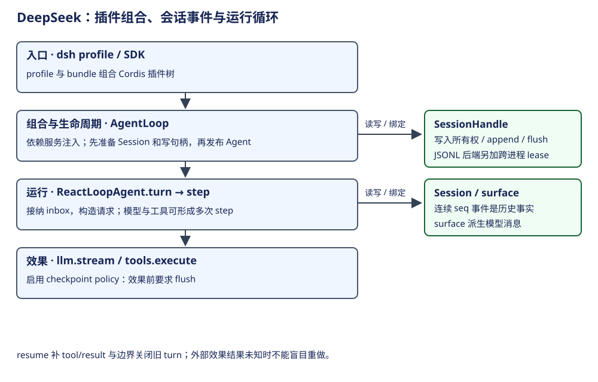

# DeepSeek Harness：插件树、会话事件与一次执行

DeepSeek Harness 是以 Cordis 插件树装配的 Agent 运行环境，当前上游标为 developer preview。AgentLoop 也是插件：它负责创建、恢复和释放运行实例，Session 负责事件事实，持久后端负责写入所有权与耐久边界。恢复时关闭上次中断的 turn，再开始后续工作；它没有把旧 Promise 继续运行的语义。

## 层次与概念词典

| 概念 | 所属层、白话含义 | 创建者与生命周期 | 状态 / 持久性 |
|---|---|---|---|
| profile / bundle | 启动组合；profile 选择要叠加的配置包 | launcher 按有序 patch 装配 | 配置和分发物，不是会话 |
| Cordis Context / fiber | 服务注入、事件和可撤销资源的作用域 | 插件装载时建立，卸载时回收 effect | 进程内注册关系 |
| AgentLoop | 具体 Agent 工厂与生命周期 owner | 注入 agents、sessions、llm、tools 等服务 | 管理活实例及尚未完成的启动工作 |
| ReactLoopAgent | 一个 Session 的运行驱动器 | 工厂构造；有独立 scope、inbox、phase | idle / maintenance / running 在内存 |
| turn / step | turn 是接纳输入到结束的工作轮；step 是其中一次模型及工具推进 | 驱动器创建，记录 start/end | 边界进入 Session 事件 |
| Session / seq | 按连续序号追加的事件历史 | sessions 服务准备、发布、释放 | 不是模型消息数组 |
| surface | 选择哪些事件以何种次序进入模型视图 | Session 依据 surfaceOp 及来源序号维护 | deriveMessages 从中投影 |
| SessionHandle | 存储后端发出的读写句柄 | create/open 获得，close 释放 | 写句柄拥有写权；flush 是耐久契约 |

不要把 `step` 称作 Pico5 Task。这里记录的 step 边界不会在重启后变成继续执行原步骤的程序计数器。依据：[工厂](https://github.com/deepseek-ai/deepseek-harness/blob/d743267388641bc76f17c45ce8b4c231aed1d32c/packages/core/agent-loop/src/index.ts#L341)、[驱动器](https://github.com/deepseek-ai/deepseek-harness/blob/d743267388641bc76f17c45ce8b4c231aed1d32c/packages/core/agent-loop/src/agent.ts#L98)、[Session](https://github.com/deepseek-ai/deepseek-harness/blob/d743267388641bc76f17c45ce8b4c231aed1d32c/packages/core/session/src/index.ts#L798)。

## 构造、发布与释放

`AgentLoop.createAgent` 准备 Session 与 Agent scope，取得可选 persistence 的写句柄，完成 setup 后才发布到 registries。`resumeWith` 先 open(write)，读出物理有效日志，追加中断修复事件，再用 seed 准备会话。这样同一后端实例内不能同时取得两个活跃写 owner。

工厂的 FactoryOwnership 跟踪活实例 teardown 和启动任务；卸载先停止接纳、发出 abort，再等待收口。运行 Agent 的 scope 与工厂 scope 分开，插件资源不会成为存储中的函数。JSONL 后端通过 lease 增加跨进程排他；这项能力属于该后端，不能推广到所有自定义 persistence。依据：[createAgent](https://github.com/deepseek-ai/deepseek-harness/blob/d743267388641bc76f17c45ce8b4c231aed1d32c/packages/core/agent-loop/src/index.ts#L750)、[resumeWith](https://github.com/deepseek-ai/deepseek-harness/blob/d743267388641bc76f17c45ce8b4c231aed1d32c/packages/core/agent-loop/src/index.ts#L852)、[lease](https://github.com/deepseek-ai/deepseek-harness/blob/d743267388641bc76f17c45ce8b4c231aed1d32c/packages/session/session-persistence-jsonl/src/lease.ts)。

## 一次输入到实际执行

| 当前位置 | 上层调用者 → 执行者 | 输入输出与状态变化 |
|---|---|---|
| 接纳输入 | followup / steer / inject → send | followup 进 next-turn；steer 进 next-step 并唤醒；inject 不主动唤醒 |
| 工作驱动 | kick → turn → preStep | 记录 turn/start；pre-step 可拒绝，无需花一次模型请求 |
| 单步请求 | step → prepareRequest → buildRequest | 组合 system/context/tool 定义；记 request/header/context；冻结消息快照 |
| 模型效果 | preparedCall.stream 或 llm.stream | assistant-stream 提供临时帧；结束后另记 assistant/message 或 assistant/attempt |
| 工具效果 | executeToolCalls → ctx.tools | 顶层调用记 tool/call；通过执行门面做效果；另记 tool/result |
| 回到循环 | 工具结果 → 下一 step | 无工具或工具 conclude 可结束；next-step 输入可继续推进 |
| 收口 | finally 关闭 step/turn | 标记 completed、max-tokens、blocked、aborted、error 等原因 |

证据：[turn/step](https://github.com/deepseek-ai/deepseek-harness/blob/d743267388641bc76f17c45ce8b4c231aed1d32c/packages/core/agent-loop/src/agent.ts#L298)、[请求快照](https://github.com/deepseek-ai/deepseek-harness/blob/d743267388641bc76f17c45ce8b4c231aed1d32c/packages/core/agent-loop/src/agent.ts#L616)、[工具记录点](https://github.com/deepseek-ai/deepseek-harness/blob/d743267388641bc76f17c45ce8b4c231aed1d32c/packages/core/agent-loop/src/tool-calls.ts#L264)。模型流帧与持久事件分别命名；看到 assistant delta 不能据此认定已完成持久写入。

## 存储、压缩与故障边界

Session.append 接纳事件与投影；persistence 的 append 承诺有序可见，flush 才是跨崩溃存活的统一契约。启用 checkpoint-policy 时，它在模型 stream、顶层 tools/execute 和下一 pre-step 发起 session flush；失败则不进入相应下游效果。嵌套工具复用外层调用的持久边界，不能声称每个嵌套动作都有独立 durable intent。

| 崩溃或事件位置 | 重建依据 / 当前处理 | 保证的边界 |
|---|---|---|
| 输入或结果尚未完成 flush | 后端实际有效前缀 | 界面已显示不等于已耐久 |
| assistant 请求工具，但无 tool/call | 修复为 TOOL_NOT_STARTED | 是日志边界事实，不代表所有外部系统都有去重 |
| tool/call 已保存，结果缺失 | 修复为 TOOL_OUTCOME_UNKNOWN | 不自动盲目重做有副作用操作 |
| turn/step 仍开着 | 补结果、step/end、turn/end(interrupted) | 关闭旧工作，不续跑原 step |
| cancel | AbortController 与 inbox 控制 | keepInbox 与默认清空不同；不能撤销已发生效果 |
| 插件卸载 / 后端重装载 | teardown、句柄失效与错误收口 | 原后端签发的句柄不会被新实例无声接管 |

依据：[checkpoint-policy](https://github.com/deepseek-ai/deepseek-harness/blob/d743267388641bc76f17c45ce8b4c231aed1d32c/packages/session/session-checkpoint-policy/src/index.ts#L53)、[中断修复](https://github.com/deepseek-ai/deepseek-harness/blob/d743267388641bc76f17c45ce8b4c231aed1d32c/packages/core/session/src/repair.ts#L19)、[存储契约](https://github.com/deepseek-ai/deepseek-harness/blob/d743267388641bc76f17c45ce8b4c231aed1d32c/packages/session/session-persistence/src/handle.ts)。压缩插件与 Session 的 surface 操作协作；压缩的 surface 提交见 [上下文章](context.md)，subprocess sandbox 与审批见 [能力章](capabilities.md)。flush 提供持久屏障，不代替这些独立的控制规则。

## 取舍与独有内容

插件树让模型协议、工具、会话、压缩、权限策略可按组合替换，代价是运行行为取决于实际 profile 与 patch。每次比较都应说明启用了哪套后端和 checkpoint policy。Python SDK 通过同版本 dsh SDK profile 接入，不能把 Python 包目录误读成另一套 loop。profile 组合来自[上游架构说明](https://github.com/deepseek-ai/deepseek-harness/blob/d743267388641bc76f17c45ce8b4c231aed1d32c/docs/architecture.md)；SDK 接入 runtime，不因此成为另一套循环。
