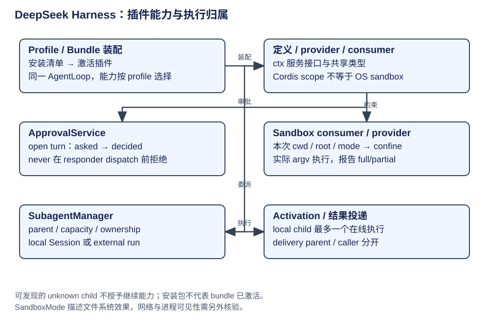

# DeepSeek Harness：Profile、审批、Sandbox 与子 Agent

DeepSeek Harness 将能力定义、provider 和 consumer 插件分开，Profile 决定实际组合。核心 AgentLoop 不硬编码所有产品能力；选择了哪个 bundle/provider，才决定审批、环境、压缩和子 Agent 的行为。




这些能力在主循环中有明确的接入位置：启动时由 Profile 装配，工具执行前消费审批和 Sandbox，委派时由子执行管理器建立独立身份。读完本章，应能从一次工具调用反向找到谁提供能力，再顺着结果找到谁继续推进父任务。

| 自造概念 | 层次 / owner | 白话含义与生命周期 |
|---|---|---|
| Profile / bundle | boot 装配 | package manifest 选择激活哪些插件，不是另一套 AgentLoop |
| seam / Service Definition | 能力接口 | 定义 ctx 服务与共享类型；本书称“能力接口” |
| provider / consumer | 插件实现/使用 | provider 落实能力，consumer 如工具/命令使用接口 |
| scope / patch | Cordis 上下文 | 插件作用范围与局部贡献，不能当 OS sandbox |
| approval request | 交互控制 | 精确一次操作问题；独立 ApprovalRequestId |
| local child / activation | 子执行 | child Session 可持久，activation 是一次在线执行期 |
| external run | 外部后端 | 句柄持有一次执行，不自动拥有本地多轮 Session |

## 第一步：由 Profile 连接能力定义与实现

ProfilePluginInventory 从已安装依赖与 bundle manifest 区分普通 package 和可激活插件，metadata 不可解析仍可列举/移除依赖。profile resolution、兼容与插件启动各有 owner；“包已安装”不等于“已作为 bundle 激活”。Python/TS SDK 消费已启动 runtime 的同一能力，minimal profile 是另一装配选择，不能把 SDK 当独立循环来重复分析。

[Profile 插件 inventory](https://github.com/deepseek-ai/deepseek-harness/blob/d743267388641bc76f17c45ce8b4c231aed1d32c/packages/boot/app-boot/src/profile-plugins.ts#L46)、[boot profile](https://github.com/deepseek-ai/deepseek-harness/blob/d743267388641bc76f17c45ce8b4c231aed1d32c/packages/boot/app-boot/src/profile.ts)、[SDK 用户说明](https://github.com/deepseek-ai/deepseek-harness/blob/d743267388641bc76f17c45ce8b4c231aed1d32c/docs/user/guide/python-sdk.zh.md)。SDK 的部署和连接契约由该接口说明定义。

## 第二步：执行前取得审批结果

ApprovalService.request 要求 session 在 open turn 内，追加 approval/asked，决策后追加 approval/decided。policy 来自日志最后一个 approval/policy，回退配置；`never` 在 service.decide 内、waterfall dispatch 前返回 rejected，因此后注册 responder 不能绕过该策略。

| 结果 | 消费方行为 | 生命周期 |
|---|---|---|
| allowed-once | 允许被询问的那个具体操作 | 不授予工具今后所有调用 |
| rejected | 拒绝 | 包含 never 政策 |
| cancelled | 拒绝 | signal 先到达时迟到回答被丢弃 |
| unavailable | 拒绝 | 无 responder、抛异常或词汇外返回值 |

审计 pair 仅日志，模型看到的是调用方生成的工具反馈与运行 context snapshot。实际工具必须消费 outcome；光发出审计事件不构成效果阻断。[request 与 decide](https://github.com/deepseek-ai/deepseek-harness/blob/d743267388641bc76f17c45ce8b4c231aed1d32c/packages/interaction/user-approval/src/index.ts#L215)、[闭合结果定义](https://github.com/deepseek-ai/deepseek-harness/blob/d743267388641bc76f17c45ce8b4c231aed1d32c/packages/interaction/user-approval/src/types.ts)。

审批策略的生效点位于 `ApprovalService.decide` 内部。下面节选分派前的路径；signal 与 responder 结果归一化的后续处理省略。

```ts
if (signal?.aborted) return 'cancelled'
if (this.effectivePolicy(session) === 'never') return 'rejected'
const answer: Promise<ApprovalOutcome> = Promise.resolve().then(
  () => this.ctx.waterfall(
    scopeTarget(req.agent, req.agent), 'approval/request', req,
    () => Promise.resolve<ApprovalOutcome>('unavailable'),
  ),
)
```

`never` 在询问 responder 前拒绝。其他策略进入 `approval/request` 的 waterfall，得到结果后仍由工具消费方决定是否执行。审批服务输出的是闭合结果，真正的效果发生在下游工具。[查看决定、取消与回答归一化](https://github.com/deepseek-ai/deepseek-harness/blob/d743267388641bc76f17c45ce8b4c231aed1d32c/packages/interaction/user-approval/src/index.ts#L266)。

## 第三步：把受限命令交给实际执行器

进程 SandboxMode 定义文件系统效果：read-only、workspace-write 和 danger-full-access。网络与进程可见性不由这项模式保证。工具每次调用从 Session cwd 与当前 policy 解析 root/mode；受限执行经 ctx.sandbox.confine 返回实际 argv，再由子进程 provider 执行；danger-full-access consumer 直接原 argv。

后端报告 full/partial enforcement，restricted 无可用后端应 SANDBOX_UNAVAILABLE；runner 启动失败和命令被 sandbox 拒绝用不同分类。Windows ACL / 较旧 Landlock 等局限属于后端事实，不把接口名写成全平台等价安全。

[bash 实际 confine](https://github.com/deepseek-ai/deepseek-harness/blob/d743267388641bc76f17c45ce8b4c231aed1d32c/packages/shell/bash-sandbox/src/index.ts#L98)、[共享 Sandbox 接口](https://github.com/deepseek-ai/deepseek-harness/blob/d743267388641bc76f17c45ce8b4c231aed1d32c/packages/sandbox/sandbox/src/index.ts)、[官方范围与后端限制](https://github.com/deepseek-ai/deepseek-harness/blob/d743267388641bc76f17c45ce8b4c231aed1d32c/docs/subsystems/sandbox.zh.md)。后端的约束强度需要按平台与 enforcement 结果判断。

受限执行中，`SandboxBashExecutor` 先让 provider 把命令转成实际 argv，再交给进程执行器。下面按源码保留交接顺序，省略执行后记录 enforcement 等事实的回调。

```ts
let confined: ConfinedArgv | undefined
const ex = await this.executeArgv(spec, async (signal) => {
  const prepared = await this.confine(spec.command, { ...policy, mode }, signal)
  signal.throwIfAborted()
  confined = prepared
  return prepared.argv
})
```

这里的输出已经是 provider 约束后的启动参数。执行结果携带实际 enforcement 信息，供调用方解释失败和返回观察；`mode` 只是所请求的约束，判断后端兑现程度还需读结果。

## 委派支路：建立子执行，再投递结果

startActivation 按 provider capability 选择本地 prepareContinuable 或外部 start。Manager 保留身份/容量/父所有权，materialize 后观察完成；本地 child 有持久 Session 且最多一个在线 activation，外部 provider 返回 SubagentRun。结果需等待释放/完成通知，cleanup 失败单独报告，不覆盖已捕获执行结果。

本地相邻 Agent 的 sendMessage 按确切在线发送者实例授权，运行中进入引导，离线可继续 child 可冷恢复；外部一次执行拒绝后续输入。delivery=parent 向父回传，caller 由调用者等待且抑制重复父通知。listChildren 从父目录恢复成员关系，不读取所有子日志；catalog 不含完整运行状态，unknown descriptor 只可发现，不授予继续能力。

证据：[Manager 的父实例与 ownership](https://github.com/deepseek-ai/deepseek-harness/blob/d743267388641bc76f17c45ce8b4c231aed1d32c/packages/subagent/subagent/src/manager.ts#L938)、[子执行官方接口契约](https://github.com/deepseek-ai/deepseek-harness/blob/d743267388641bc76f17c45ce8b4c231aed1d32c/docs/subsystems/subagent.zh.md)。主线程共享文件系统不意味着子上下文共享；父目录持久化也不等于未知外部执行能继续。
