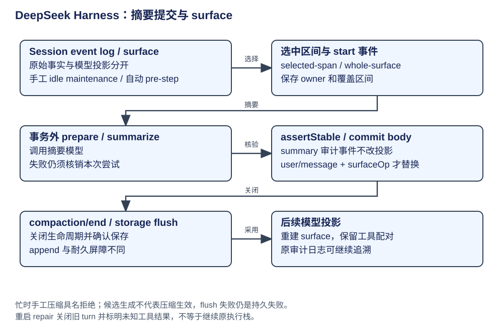

# DeepSeek Harness：surface 压缩与持久屏障

DeepSeek 的会话日志和 model surface 分开：压缩保留审计事件，同时用一条带 surfaceOp 的消息替换模型可见区间。日志 append、surface 生效和 storage flush 是三个不同动作。




本章沿一次手工压缩走四步：确定可以维护的运行边界与覆盖区间，生成候选摘要，确认区间仍稳定后提交投影变更，最后完成持久屏障，维护收口后再由下一请求采用。概念表先说明各份记录的消费者；随后只沿这条正常路径展开，自动压缩和结果裁剪放在后面比较。

| 概念 | 层次 / owner | 生命周期与消费者 |
|---|---|---|
| Session event log / seq | 会话事实 | 完整事件，包括 log-only 控制/审计 |
| surface | 模型投影 | 消息生产事件及 surfaceOp 重建，不是所有 event 的直读 |
| compaction/start / end | 生命周期记录 | 防并发压缩与恢复时识别未完成尝试 |
| compaction/summary | 审计/来源 | 摘要、shadowed seqs、token/usage，自己不改 surface |
| user/message + surfaceOp | 投影变更 | summary checkpoint message 替换指定 startSeq/endSeq 区间 |
| flush | storage 屏障 | 确认已排队保存；不撤销外部模型/工具效果 |

## 第一步：取得维护边界并选定覆盖区间

CompactionEngine 是可选能力，Basic provider 的 compactNow 进入 Agent.runMaintenance，要求 idle 且没有 waking queued work；选择可用区间，组合 Agent 与命令 signal，调用 compactSurfaceRegion，传 selected-span 稳定契约与 sessions.flush。忙时抛 ManualCompactionError(busy)，不是往活跃模型流里随时插摘要。

## 第二步：生成候选摘要

`compactSurfaceRegion` 检查没有未关闭压缩，并确认自动或手工调用的 turn 归属，然后追加 `compaction/start`。prepare/summarize 在事务外调用模型，输入是选定区间的消息和请求所需的配置；输出先是候选摘要。生成完成后，`assertStable` 确认所选 surface 仍符合原快照，才进入提交。

## 第三步：写入摘要来源并替换模型投影

提交体先追加 `compaction/summary`，保存摘要及被覆盖的来源，再追加承载摘要的 checkpoint 消息。下面是按源码顺序抽出的记录骨架；命令来源、原始模型输出与调用标记、usage 等统计字段省略，变量都来自已选定区间及摘要结果。

```ts
const summaryEvent = session.append('compaction/summary', {
  compactionId: startEvent.data.compactionId,
  summary,
  shadowedRange: { start, end },
  shadowedSeqs: [...shadowedSeqs],
  shadowedTokenCount,
  provider,
  model,
})
session.append('user/message', checkpointMessage, {
  surfaceOp: { op: 'replace', startSeq: start, endSeq: end },
  sourceEventSeqs: [startEvent.seq, summaryEvent.seq, ...shadowedSeqs],
})
```

第一条为审计和来源服务，第二条改变模型可见贡献。`replace` 的对象是选定 surface 区间；原事件仍保留在日志里，新的模型视图以摘要消息代替该区间。随后 `compaction/end` 关闭本次尝试。[查看摘要与 surface 写入的对应关系](https://github.com/deepseek-ai/deepseek-harness/blob/d743267388641bc76f17c45ce8b4c231aed1d32c/packages/compaction/compaction-basic/src/region.ts#L491)。

## 第四步：完成 flush，再由下一请求采用

`sessions.flush` 先确认保存边界，手工维护返回并释放 maintenance 后，后续请求才能继续。正常路径是追加 end、等待 flush、返回压缩结果，再结束维护；图与正文使用这一顺序。[查看 end 后的 flush 与返回](https://github.com/deepseek-ai/deepseek-harness/blob/d743267388641bc76f17c45ce8b4c231aed1d32c/packages/compaction/compaction-basic/src/region.ts#L253)。

下一次 `buildRequest` 调用 `deriveMessages()`，读取的已经是变更后的 surface。假设之前的消息依次为“修复目标、读取、读取结果、修改、验证结果”，所选前段被摘要覆盖，下一请求便使用“摘要、保留的近期消息”；审计侧仍能查回原步骤。

摘要生成、surface 变更和持久确认解决不同问题：模型怎样理解既往工作、哪些消息进入请求、这些记录是否能跨崩溃存活。失败按 summary/commit/persistence 等阶段归因，并尽力关闭 end；单次 append 不能被解释成外部事务的原子回滚。

## 两条相关支路：自动压缩与结果裁剪

自动压缩可在 open turn 的 pre-step 使用 whole-surface 稳定约束；手工可在没有 turn 时维护 selected span。两者必须保持 tool call/result 配对，不能把半个工具交换折叠为摘要。tool-result pruner 与 image offload 是兄弟策略，修改可见结果/媒体的方式不同，不由 compaction-basic 一包概括。

`compaction/*` 事件本身 log-only；UI 与模型由各自投影消费。序号是此会话事件身份，选中覆盖区间依 surface 语义，不能按文件写入时间或任意日志最后一行推断摘要已覆盖所有交错事件。[压缩事件与 checkpoint 类型](https://github.com/deepseek-ai/deepseek-harness/blob/d743267388641bc76f17c45ce8b4c231aed1d32c/packages/compaction/compaction/src/types.ts)、[官方 surface 说明](https://github.com/deepseek-ai/deepseek-harness/blob/d743267388641bc76f17c45ce8b4c231aed1d32c/docs/subsystems/compaction.zh.md)。

## 持久性与恢复限制

运行前 checkpoint/flush policy 在模型与顶层工具边界建立屏障（须实际装载对应插件），防持久失败后继续效果。恢复修复未闭合 step/tool/turn，生成 TOOL_NOT_STARTED / TOOL_OUTCOME_UNKNOWN 等结果；不是继续原程序栈或无条件重放工具。

压缩 provider 决定上下文如何投影，存储后端决定记录何时耐久，repair 决定如何继续未闭合的执行；后两层见 [架构章](architecture.md)。模型摘要已经生成但 flush 失败仍是持久失败；最终文字、UI 可见与磁盘确认不能相互替代。
