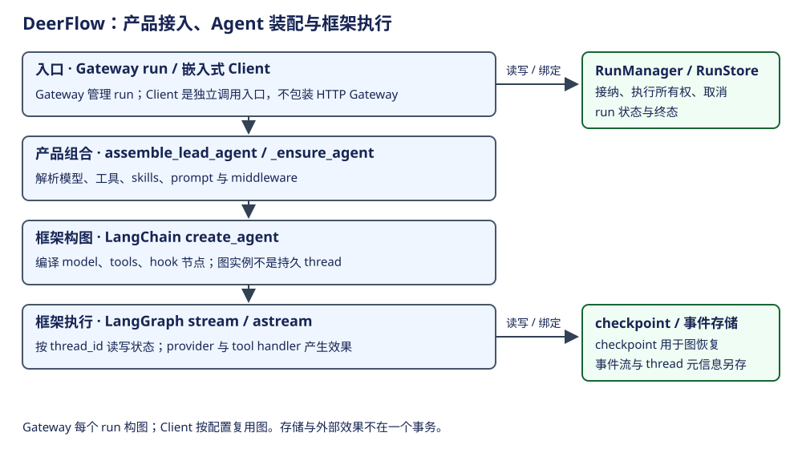
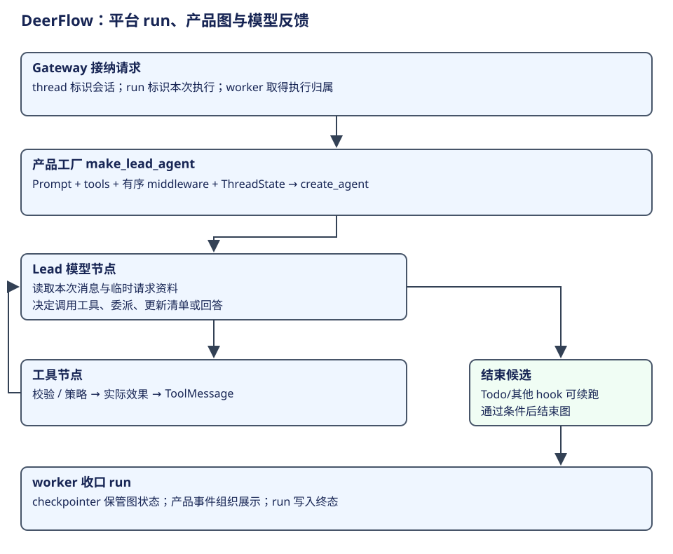

# DeerFlow：接入、装配、图执行与状态归属

DeerFlow 是带 Gateway、嵌入式 Client 与产品策略的 Agent 系统。它使用 LangChain 构造图、LangGraph 执行图。Gateway 的 run、持久 thread 和进程内 graph 实例分别归不同层；理解这三个身份后，再看 middleware 和 prompt 才不会把一条请求读成多个独立 Agent。

## 概念、所有权与实例范围

| 概念 | 所属层与职责 | owner / 生命周期 | 持久边界 |
|---|---|---|---|
| Gateway / run | HTTP 接入及一份执行请求 | RunManager 准入、取消、租约与终态 | RunStore 保存 run 状态 |
| thread | 会话状态的寻址身份 | 同一 thread 可接收多个 run | checkpoint 按 thread_id / namespace 保存 |
| LeadAgentAssembly / graph | 产品模型、工具、prompt 与 hook 组合 | assemble_lead_agent 创建 | 图是代码和实例，不是会话历史 |
| DeerFlowClient | 进程内 SDK 门面 | 调用方创建；配置 key 一致则复用 _agent | 通过注入的 checkpointer 延续状态 |
| middleware | 在 agent/model/tool 阶段改变行为 | 产品工厂实例化，和所属图一起复用 | 实例成员不能一概视作 thread 私有状态 |
| ThreadState | 业务消息和可恢复字段 | 节点及 middleware 返回更新 | full/delta channel 模式分开 |
| Runtime.context | 本次调用的用户、run、能力与环境 | worker/Client 注入 | 不能自动当成 checkpoint 字段 |
| event store / thread store | 流重放资料 / 会话元信息 | 平台存储层 | 与图 checkpoint、工具效果不同 |

依据：[产品装配](https://github.com/bytedance/deer-flow/blob/b842e06be19f04280a9e5e12f90da04d0c6f09a5/backend/packages/harness/deerflow/agents/lead_agent/agent.py#L845)、[Client 缓存](https://github.com/bytedance/deer-flow/blob/b842e06be19f04280a9e5e12f90da04d0c6f09a5/backend/packages/harness/deerflow/client.py#L329)、[RunManager](https://github.com/bytedance/deer-flow/blob/b842e06be19f04280a9e5e12f90da04d0c6f09a5/backend/packages/harness/deerflow/runtime/runs/manager.py#L930)。

## 构造与一次请求

Gateway worker 取得执行所有权后，组合 RunContext 与 Runtime，调用 agent_factory 构图并绑定存储，随后 astream。Client 不通过 Gateway：_ensure_agent 根据包含用户存储身份等因素的 key 复用或重建图；同步 stream 直接调用图的 stream。两条入口都会用产品 build_middlewares，但不能把“Gateway 每 run 一个实例”推广成所有调用都这样。

| 当前位置 | 上层 → 下层 | 状态与结果 |
|---|---|---|
| run 接纳 | Gateway → RunManager → worker.run_agent | try_start 失败不开始模型；取消已有单独路径 |
| 产品装配 | agent_factory → assemble_lead_agent | 解析模型、授权工具、skills、system prompt、middleware、state schema |
| 构图 | create_agent | 输出 compiled graph；此时尚未请求模型 |
| 图执行 | worker → agent.astream | 多种 stream_mode 分别传消息增量、更新、值和自定义事件 |
| 具体效果 | model 节点 / tools 节点 | provider 与工具 handler 执行，middleware 可拦截 |
| run 收口 | worker → RunManager | set_status_if_not_cancelled 避免正常终态覆盖已接受取消 |

证据：[worker 执行与收口](https://github.com/bytedance/deer-flow/blob/b842e06be19f04280a9e5e12f90da04d0c6f09a5/backend/packages/harness/deerflow/runtime/runs/worker.py#L891)、[create_agent 装配点](https://github.com/bytedance/deer-flow/blob/b842e06be19f04280a9e5e12f90da04d0c6f09a5/backend/packages/harness/deerflow/agents/lead_agent/agent.py#L1391)、[Client 图调用](https://github.com/bytedance/deer-flow/blob/b842e06be19f04280a9e5e12f90da04d0c6f09a5/backend/packages/harness/deerflow/client.py#L955)。流发布与 checkpoint 写入、外部效果完成分别判断；SSE metadata 中的 run/thread ID 本身不能证明业务成功。

## 把请求、消息和工具反馈串成一项任务

沿“修复 CSV 导出”的案例看 Gateway 主线：请求定位到 thread，并创建 run；worker 取得执行归属后组合 Runtime.context 和 graph 输入。thread 表示一段可恢复业务状态，run 表示这一次执行请求，graph 是本次使用的代码和实例；一个用户任务不会因为每次模型调用而重新创建一个 Gateway run。

产品装配把模型、授权后的工具、system prompt、ThreadState schema 和 middleware 交给 create_agent。调用 graph.astream 后才开始执行。模型前的 hook 和 wrap 组织消息与能力，模型输出动作请求，工具路径运行 wrapper 与 handler，再将观察送回图中的消息状态。模型可以据新事实继续请求工具或回答。[产品装配点](https://github.com/bytedance/deer-flow/blob/b842e06be19f04280a9e5e12f90da04d0c6f09a5/backend/packages/harness/deerflow/agents/lead_agent/agent.py#L1391)、[worker 运行入口](https://github.com/bytedance/deer-flow/blob/b842e06be19f04280a9e5e12f90da04d0c6f09a5/backend/packages/harness/deerflow/runtime/runs/worker.py#L891)。

假设模型先读需求和代码，接着修改，再验证。其间消息保留目标、动作和观察；Runtime.context 提供本次身份与环境；ThreadState 则可以保存 messages、todos、sandbox 等业务资料。它们共同服务本次工作，但没有相同的生命周期。

| 案例材料 | 所属层 | 为什么这样组织 |
|---|---|---|
| 用户需求、代码文本、工具结果 | 图 messages / 请求消息 | 模型理解与修订动作所需的语义材料 |
| 角色、SOUL、skills、子 Agent 使用说明 | 产品 Prompt 及相应请求注入 | 描述工作方式和可用知识 |
| 用户／run／工具能力和执行环境 | Runtime.context 等调用环境 | 程序判断身份、能力与环境 |
| todos、sandbox 等结构字段 | ThreadState | 保存可解释的业务状态 |
| pending/运行归属/终态 | RunManager 和 RunStore | 管理这一次平台执行 |

并不是所有 middleware 都拥有 system prompt。产品先形成基底，middleware 再按自身职责改变请求或状态；将 tool result 注入为消息也不表示这段内容升级成系统规则。详细顺序与作用域见[中间件](middleware.md)和[Prompt 专题](context-prompt.md)。

## Plan 模式：清单会参与控制，但没有独立 Planner

开启 is_plan_mode 时，装配 TodoMiddleware，提供 write_todos。模型可以保存“读取、修改、验证”的 pending/in_progress/completed 清单。当前实现还做两项配合：清单原始调用被压缩出上下文时，before_model 补充清单提示；模型准备最终回答而清单仍未完成时，after_model 在规定条件内跳回 model，并由 wrap_model_call 加入临时提醒。

因此它超出了纯 UI 清单，但仍在同一 Lead 模型循环里推进：没有一个独立执行器按 todo 的每项描述自动派发步骤。提醒存在次数与结束条件限制，也不能代替对文件和验证结果的验收。[清单保留与提醒](https://github.com/bytedance/deer-flow/blob/b842e06be19f04280a9e5e12f90da04d0c6f09a5/backend/packages/harness/deerflow/agents/middlewares/todo_middleware.py#L146)、[继续控制与临时请求注入](https://github.com/bytedance/deer-flow/blob/b842e06be19f04280a9e5e12f90da04d0c6f09a5/backend/packages/harness/deerflow/agents/middlewares/todo_middleware.py#L352)。

这是自然语言与结构化资料的具体协作：todo.content 描述目标，todo.status 让程序判断是否有未完成项，提示消息将这种状态重新传给模型。程序要求继续关注目标，实际该读哪个文件、怎样修复，仍由模型结合工具结果选择。

## 图的结束与 run 的收口

图运行中的 token、updates、values 和 custom 流分别对应消息、状态与自定义观察，worker 将它们组织成产品事件；图状态则由 checkpointer 管理。图正常结束以后，worker 还需要更新 run 终态。运行管理与会话状态存储是合作关系，外部工具效果也不因 run 标记结束而自动验证。

主线状态可理解为“run 等待执行→取得归属并运行→正常、错误或中断收口”；准确终态与取消、租约关系见[Run 专题](runtime.md)。这里没有再给全部层次强造同一个状态枚举：模型反馈循环、图调度、平台 run 各有自己的终点。

学习自检：一个 run 内为什么可以有多个模型调用？TodoMiddleware 怎样让模型继续，却没有直接替模型选择下一工具？如果 SSE 读连接断开，哪个执行对象仍可能继续运行？

## Prompt、工具与扩展的层次

产品 `apply_prompt_template` 负责 system prompt 的基底，包含角色、SOUL、skills、子 Agent 等按配置组合的内容。DynamicContext 等 middleware 再按生命周期加入记忆、时间或请求事实；DurableContext 用可恢复业务状态生成当次请求内容。因此“某段文本由 middleware 注入”不等于“该 middleware 拥有整个 system prompt”。

Tool 是动作，Skill 是任务知识及策略，MCP 是发现和调用外部工具的协议，subagent 是另一份执行拓扑。SkillToolPolicy 同时过滤模型 tools 并在 wrap_tool_call 再判断，阻断时不调用 handler；只隐藏 schema 不能替代执行门禁。依据：[prompt 基底](https://github.com/bytedance/deer-flow/blob/b842e06be19f04280a9e5e12f90da04d0c6f09a5/backend/packages/harness/deerflow/agents/lead_agent/prompt.py#L1135)、[Skill 门禁](https://github.com/bytedance/deer-flow/blob/b842e06be19f04280a9e5e12f90da04d0c6f09a5/backend/packages/harness/deerflow/agents/middlewares/skill_tool_policy_middleware.py#L484)。完整有序链见[中间件专题](middleware.md)。

## 状态与故障

| 状态 / 事件 | 当前路径与归属 | 边界 |
|---|---|---|
| run 未获得执行权 | try_start → 具名结果 | 不构造“已经运行”的结论 |
| 图实例重建 | 工厂重新组合代码和资源 | checkpoint thread 不随图实例消失 |
| 用户取消 / worker 失去所有权 | abort 与 ownership_lost 控制收口 | 不能由停止读 SSE 推定取消成功 |
| graph state 保存 | checkpointer 与 channel 模式 | 不包含任意外部 shell/API 的事务回滚 |
| 客户端重连 | 事件流可用于展示 | 显示恢复与执行恢复是不同能力 |
| 正常结束与取消竞争 | set_status_if_not_cancelled | 所有权与终态竞争见 [运行管理](runtime.md) |

## 接入方式的设计取舍

Gateway 提供执行准入、所有权与终态管理，适合通过独立接入层承接请求。嵌入式 Client 减少 HTTP 层，并可复用图实例；代价是调用方需要管理实例与资源生命周期。两者共用产品工厂，但中间件成员是否跨调用共享仍由实例复用范围决定。