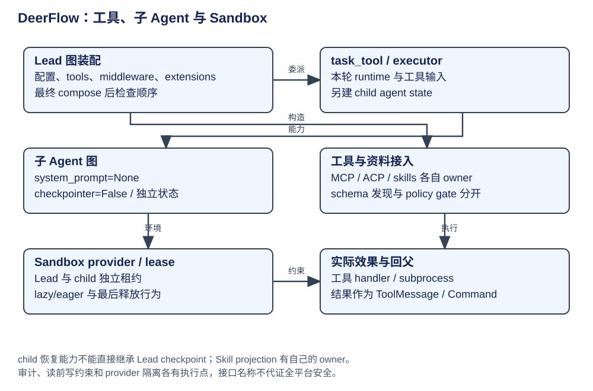

# DeerFlow：能力发现、Sandbox 与子 Agent

DeerFlow 的 Tools、Skills、MCP、ACP 和 Subagents 扩展不同边界：动作、知识/策略、外部工具目录、外部 Agent 接入和执行拓扑。不能用一个“插件”概念把权限、发现与生命周期拉平。

| 概念 | owner / 构造 | 消费者与作用域 |
|---|---|---|
| AppConfig | 配置加载与类型校验 | 模型、runtime、中间件、skills、sandbox 等组合输入 |
| extensions | 扩展装载与 scope/slot | compose 后成为最终图；不是一份万能参数字典 |
| Tool object / definition | 工具工厂 | executor 用对象、模型用 schema，发现结果可促进曝光 |
| Skill | storage/manifest 与 capability policy | 索引、正文、required resources 和 secret 绑定分别处理 |
| MCP server / client | 连接与外部目录 | server 配置、连接状态与工具 schema 是三种信息 |
| ACP subagent backend | 外部执行协议 | 远端会话、审批与结果由适配器负责，不能套本地图所有权 |
| SubagentExecutor | task_tool 构造 | 构图、运行、进度、timeout、completion 回收 |
| Sandbox provider / lease | 环境层 | 工具使用 thread 环境，运行各自持有 lease |

## 发现 → 激活 → 执行

能力目录先按产品配置、agent 范围和授权结果装配，模型看到 direct schema 或 deferred 发现入口。tool_search 促进 schema 进入后续请求；Skill discovery 展示知识而非凭此授予写权限。lazy/eager/deferred 必须说明目标是连接、schema 还是环境，不能互相替代。

SkillActivation 为显式 Skill 输入解析正文与需求，SkillToolPolicy 过滤模型侧和效果点，Sandbox projection 约束真实文件可见范围。这三项不同：schema 隐藏不收回真实文件访问，Skill 目录过滤不自动隔离磁盘。实际阻断见 [middleware](middleware.md)。

## 子任务的真实执行链

`task_tool` 收集父 context snapshot、thread incarnation、配置、extensions、recorder 和执行容量 → SubagentExecutor.execute_async → `_aexecute_admitted` 构建初始 state/tools → `_create_agent` → create_agent(model, tools, middleware, state_schema=ThreadState, **checkpointer=False**) → 运行并回收 → task_tool 以 ToolMessage/Command 更新父 messages 和 delegation 资料。

子图的 system prompt 已放入 initial state，工厂 system_prompt=None 避免重复；编译后工具注册表包含 middleware tools 及同名 precedence。子执行默认没有 lead checkpointer，因此“每个子 Agent 都自动持久恢复”不成立。它可共享父 Sandbox 和文件，但上下文、停止原因和执行身份独立。

[task_tool 构造与 async dispatch](https://github.com/bytedance/deer-flow/blob/b842e06be19f04280a9e5e12f90da04d0c6f09a5/backend/packages/harness/deerflow/tools/builtins/task_tool.py#L939)、[子图构造](https://github.com/bytedance/deer-flow/blob/b842e06be19f04280a9e5e12f90da04d0c6f09a5/backend/packages/harness/deerflow/subagents/executor.py#L1153)、[实际子运行](https://github.com/bytedance/deer-flow/blob/b842e06be19f04280a9e5e12f90da04d0c6f09a5/backend/packages/harness/deerflow/subagents/executor.py#L1605)。

## Sandbox、审计与文件并发

SandboxMiddleware 默认 lazy 首次工具调用 acquire，eager 才在 before_agent acquire。并发 lead/subagent 持有独立进程内 lease，最后 release 可把远端环境 park 回 warm pool；provider shutdown 才是终态清理。不能把 after_agent 解读为每次销毁容器。

lead 拥有物理 Skill projection，subagent 的 discovery/activation 范围不允许重建共享 projection，否则会改变其他运行的文件视图。provider 不支持要求的 agent Skill filesystem isolation 时拒绝，不悄悄降级为目录过滤。

SandboxAudit 记录命令与环境行为，ReadBeforeWrite 协调读写约束；它们不等同容器网络/文件系统 isolation。文件 keyed locks 只在所属 owner/进程与路径范围有效，不能覆盖任意外部 writer。Prompt“最大 task 数”要由 SubagentLimit/执行容量控制核验，不由自然语言承诺。

证据：[环境生命周期与 projection](https://github.com/bytedance/deer-flow/blob/b842e06be19f04280a9e5e12f90da04d0c6f09a5/backend/packages/harness/deerflow/sandbox/middleware.py#L54)、[审计效果点](https://github.com/bytedance/deer-flow/blob/b842e06be19f04280a9e5e12f90da04d0c6f09a5/backend/packages/harness/deerflow/agents/middlewares/sandbox_audit_middleware.py#L511)、[读写门禁](https://github.com/bytedance/deer-flow/blob/b842e06be19f04280a9e5e12f90da04d0c6f09a5/backend/packages/harness/deerflow/agents/middlewares/read_before_write_middleware.py#L226)。

## 配置归属与能力边界

运行参数、agent 配置、AppConfig、模型 profile、能力 storage 与 extensions 是不同输入。配置字段要沿读取者追到工厂和执行点：一个默认 YAML 字段可能影响装配，却未必是所有宿主最终采用的值。先从 [架构](architecture.md)确认所有者，再在 [运行管理](runtime.md)、[中间件](middleware.md)和本章追配置如何生效。

工具的名称说明用途，动作契约才说明输入、输出和效果范围。MCP/ACP 目录、Sandbox 环境和子 Agent 执行分别有自己的生命周期；能力被发现后，还需要经过激活、授权和实际调用。