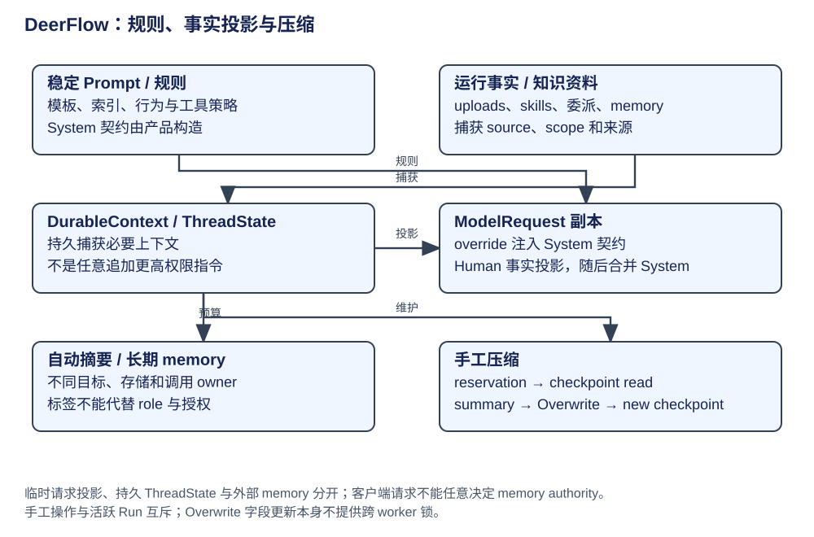

# DeerFlow：Prompt 作用域、持久上下文与压缩

DeerFlow 的 prompt 由构建期规则、持久事实和请求级提醒组合。先判断内容 owner、权威等级与保存周期，再选 hook；标签只是表达结构，不能代替角色、来源元数据和执行权限。

| 来源 | 构造/消费 | 作用域与是否持久 | 注入与退出 |
|---|---|---|---|
| role、thinking、clarification、工作区和引用规则 | lead prompt builder → create_agent | 图构建期规则 | model request 加基础 system，重建图才换基础配置 |
| Skill/Subagent/MCP 索引 | 配置与能力装配 | 能力目录，不是完整执行权限 | 按需披露正文/schema，能力变化须刷新 |
| 日期/可选记忆 | DynamicContext before_agent / wrapper | 持久标记消息及请求提醒 | [middleware 章](middleware.md) 的实际 SystemMessage 与旧注释差异 |
| 上传事实 | Uploads before_agent | 消息 state，属于当前用户资料 | 文件目录和 metadata，不提升为规则 |
| skill_context / delegations / summary_text / task notes | ThreadState reducers | 持久资料 | DurableContext wrapper 临时渲染，不能重复写所有 reminder |
| slash Skill | SkillActivation wrapper | 本次披露正文；相关激活/工具策略可持续当前 run | 请求与 state 分开，不能全称一次性 |
| Todo / goal / budget / loop 提醒 | 对应 hooks/wrappers | 状态与提醒分别管理 | 停止条件由代码判定，不由提示文字自证 |
| 子 Agent prompt | executor._build_initial_state | 子运行自己的 messages | create_agent(system_prompt=None)，初始 state 已包含 SystemMessage |

## 持久数据，临时渲染

DurableContext before/after_model 捕捉 delegation 与已读 Skill 信息进入字段。wrap_model_call 从 state 取 summary、delegations、skills、task notes/history、artifacts 和 goal，插入 authority contract 的 SystemMessage 与数据 HumanMessage，再 request.override；数据块标记 hide_from_ui 与 provenance。它没有把临时渲染结果永久追加到 state。

这也解释为什么“把 durable context 放 system prompt”不准确：规则和历史数据用两种消息角色，持久事实与本次投影又是两层。task notes 是模型报告，仍需按 source IDs 核验。[捕捉与请求投影](https://github.com/bytedance/deer-flow/blob/b842e06be19f04280a9e5e12f90da04d0c6f09a5/backend/packages/harness/deerflow/agents/middlewares/durable_context_middleware.py#L389)。

## 压缩、summary 与 memory

自动 Summarization 在 before_model 判断，使用独立摘要模型与内部 prompt，保留需要的尾部/消息配对，并维护 summary_text；Memory 在自己的生命周期处理长期资料，不是同一个缓存。摘要调用可以不对 UI stream，空/失败结果与无需压缩分别处理。

手工 compact 从 checkpoint accessor 读 materialized state，构造压缩 middleware，`acompact_state(...raise_on_failure=True)` 后以 Overwrite(preserved_messages) 写 messages，并更新 summary_text/task_history。当前原稿中“RemoveMessage 即全部压缩”的单一描述不够；独立修改借 mutation accessor，不需要重新构建完整 lead 图。

| 情形 | 返回或持久结果 | 边界 |
|---|---|---|
| 消息不足/无需压缩 | compacted=false，not_enough_messages | 不写新摘要 |
| 摘要模型失败 | ContextCompactionFailed | 不伪装无需压缩；路由回具名错误 |
| 成功 | 新 checkpoint ID 与移除/保留计数 | UI 原历史可由 event store 留存 |
| 活跃 run 与手工 compact 冲突 | reservation 拒绝 | 不从旧 snapshot 覆盖新运行写入 |
| 未知旧 checkpoint agent binding | 不凭 body hint 授权 memory 写 | 绑定提示可选兼容模型，不等于资料 owner |

[摘要实现](https://github.com/bytedance/deer-flow/blob/b842e06be19f04280a9e5e12f90da04d0c6f09a5/backend/packages/harness/deerflow/agents/middlewares/summarization_middleware.py)、[手工读/生成/Overwrite](https://github.com/bytedance/deer-flow/blob/b842e06be19f04280a9e5e12f90da04d0c6f09a5/backend/packages/harness/deerflow/runtime/context_compaction.py#L132)、[准入与错误 HTTP 映射](https://github.com/bytedance/deer-flow/blob/b842e06be19f04280a9e5e12f90da04d0c6f09a5/backend/app/gateway/routers/threads.py#L1506)。

## 为新插件选注入点

| 需求 | 采用机制 | 要记录的边界 |
|---|---|---|
| 全图稳定规则 | 构建 prompt | 数据来源、重建条件 |
| run 初始化资料 | before_agent 返回 state | 后续 run 是否保留、清除/压缩规则 |
| 每轮必需更新的状态 | before_model | reducer、并发与 checkpoint |
| 单次模型提醒/可见 schema | wrap_model_call.override | 不自动持久，必须原样保留未改字段 |
| 副作用审批/拒绝 | wrap_tool_call 或实际 handler 前门禁 | blocked 路径不能继续 handler |
| 内部摘要/路由模型 | 独立调用 | 不继承错误角色、主 Agent tools 或 UI stream |

不可信内容做转义/标签中和，来源由服务器 additional_kwargs 标记；不能仅扫描内容里某个 tag 来判可信。标签名如 role、skill_index、subagent_system、current_date、durable_context_data 与 system-reminder 表达不同层次；同义不同拼写要同时检查净化规则。原稿推荐“标签注册表”“单次插件模板”已转为上述评审契约，是可采用设计，不写成已实现全局注册表。

## 取舍与验证口径

稳定前缀有利于复用，但没有测量就不报告 prefix cache 命中收益；工具 description 引导模型决策，也不保证它遵循 policy。新增 prompt 插件应分别验证真实最终请求、state/checkpoint、UI 是否隐藏、工具阻断是否到效果点。旧文测试清单按这四类合并，未在本书执行目标系统测试。
