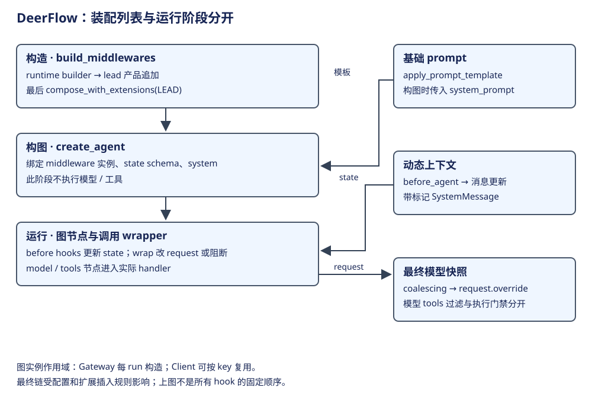
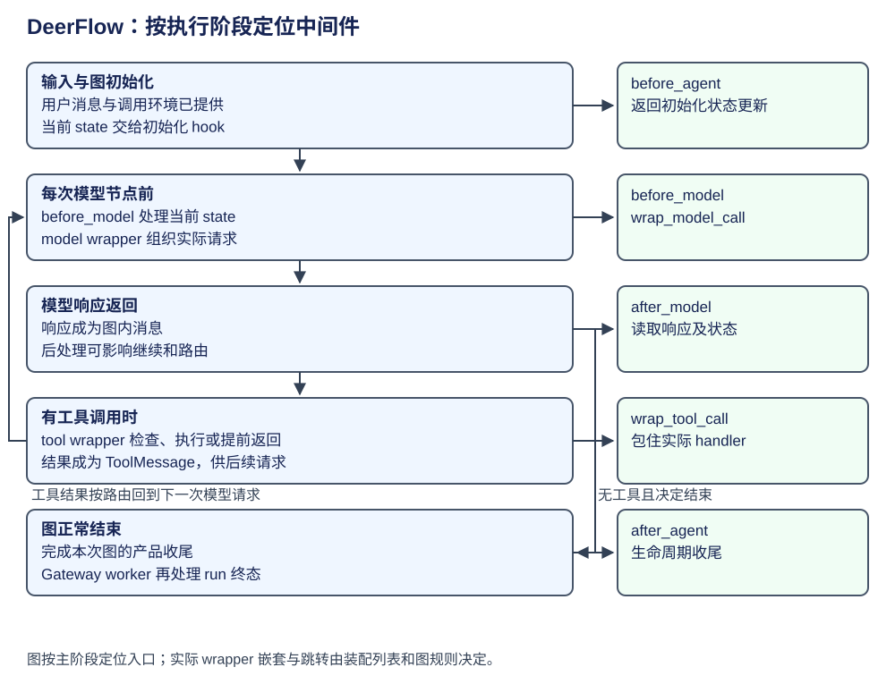

# DeerFlow：中间件装配、Prompt 与执行门禁

middleware 是插在已有执行阶段里的产品策略代码。工厂先按配置生成实例列表，图运行时再调用各成员实现的 hook：例如请求前组织上下文，工具执行前检查政策，结果回来后决定继续。一个成员可以参与多个阶段。




本章先说明列表如何装配，再沿一次任务的时间线定位各 hook，随后用 Prompt 合并和 Skill 工具检查展开两个调用位置。完整候选名单和 hook 索引放在末尾，供按需查阅。

| 阅读阶段 | 输入 | 输出与消费者 |
|---|---|---|
| 1. 装配实例 | 配置、能力与扩展贡献 | 最终 middleware 列表，交 create_agent |
| 2. 运行阶段调用 | state、ModelRequest、ToolCallRequest | 对应 hook 的更新、请求或结果 |
| 3. 模型请求位置 | 基础 Prompt 与动态消息 | 合并后的请求，交 model handler |
| 4. 工具调用位置 | 工具身份、参数和当前政策 | 放行 handler，或具名阻断结果 |

## 先定位工厂、实例和调用资料

| 概念 | 当前层次 / 上下层 | 保存什么、影响什么 |
|---|---|---|
| build_middlewares | 产品工厂，调用 runtime builder 后追加产品策略 | 返回实例列表；没有在此执行模型 |
| runtime middleware | 输入、thread 环境、工具效果和结果的基础处理 | 与 lead/subagent 各自的构造边界绑定 |
| product middleware | lead 的技能、上下文、摘要、预算与终态策略 | 依据配置及本次装配参数决定是否加入 |
| extension contribution | 扩展声明的插入槽位与适用范围 | 最后 compose；可能改变相邻关系 |
| before_agent / before_model | 图阶段的 hook | 返回 state 更新；是否持久取决于字段/channel |
| wrap_model_call / wrap_tool_call | 包住一次调用的 hook | 可改 request、调用 handler 或提前返回 |
| ModelRequest.override | 请求快照变换 | 不自动等同写回 ThreadState |

middleware 实例由图工厂构造。Gateway 当前按 run 构图，Client 按配置 key 复用图，所以实例成员的作用域取决于入口。跨 thread 复用时，不能把 `self` 的普通字段当成 thread 私有数据；以 Runtime.context 或 state 取当前身份的代码需要单独追踪。参见[架构章](architecture.md)。

## 第一步：按配置装配实例列表

| 装配组 | 源码中的代表成员 | 条件与阅读边界 |
|---|---|---|
| 输入和输出外层 | InputSanitization、KnowledgeScope、ToolOutputBudget、ToolResultSanitization | PiiRedaction 等按配置加入 |
| thread 环境 | ThreadData、Uploads、Sandbox | Uploads 视参数启用；不把所有宿主都当成同一 Sandbox |
| 工具与错误尾部 | DanglingToolCall、LLMErrorHandling、ToolErrorHandling | receipt、artifact、guardrail、audit、read-before-write、progress 等分别有条件 |
| lead 产品组 | DynamicContext、SkillActivation；可选 SkillToolPolicy、DurableContext、Summarization、Memory、预算/子 Agent 限制 | 配置、授权 provider、deferred tool 设置会改变成员 |
| lead 终态组 | TerminalResponse、ModelLengthFinishReason；可选 SafetyFinishReason；Clarification | 这是 compose 前的列表尾部，不能跳过扩展插入规则 |
| 最终组合 | compose_with_extensions | 使用 LEAD scope 与 build context 合并贡献，再交 create_agent |

证据：[基础工厂](https://github.com/bytedance/deer-flow/blob/b842e06be19f04280a9e5e12f90da04d0c6f09a5/backend/packages/harness/deerflow/agents/middlewares/tool_error_handling_middleware.py#L344)、[lead 追加及最后组合](https://github.com/bytedance/deer-flow/blob/b842e06be19f04280a9e5e12f90da04d0c6f09a5/backend/packages/harness/deerflow/agents/lead_agent/agent.py#L565)。启用条件会改变实际列表。要复现某个配置的精确顺序，须固定 AppConfig、装配参数及扩展贡献后观察最终列表。

框架如何组合 before/after/wrap hooks，见 [LangChain 构图](../../frameworks/langchain/architecture.md)。应用中某个中间件是否被调用，还要同时满足装配条件、hook 实现和对应阶段有输入这三个条件。

## 第二步：在任务时间线中找到每个 hook



同一成员只在自己实现的入口参与处理。before_agent 准备本次图输入，before_model 在每次模型节点前处理 state，wrap_model_call 在实际请求边界处理 ModelRequest，after_model 消费响应。wrap_tool_call 包住具体工具 handler；after_agent 收尾。wrapper 的嵌套关系由最终列表和框架组合规则决定，本图按阶段定位。

模型请求 override 的结果只在这次调用中传递；hook 返回 state 更新则交给图的 channel/reducer 采用。接下来分别展开这两个数据交接，先看模型请求，再看工具执行。

## 第三步：在模型调用前组织 Prompt

| 阶段 | producer → consumer | 生命周期与副作用 |
|---|---|---|
| 原生 system | apply_prompt_template → create_agent(system_prompt=...) | 产品装配得到角色、规则、技能信息等基础提示 |
| 动态上下文 | DynamicContextMiddleware.before_agent → 消息更新 | 当前实现用带标记的 SystemMessage 保存日期/可选记忆；日期变化可增补提醒 |
| 最终请求整理 | SystemMessageCoalescingMiddleware → handler(request.override(...)) | 合并 system 部分，输出一个前置 system；普通消息单独传递 |
| provider 请求 | 框架 model 调用 → provider | 以此次请求快照为准，不只看初始模板 |

[DynamicContext 的执行代码](https://github.com/bytedance/deer-flow/blob/b842e06be19f04280a9e5e12f90da04d0c6f09a5/backend/packages/harness/deerflow/agents/middlewares/dynamic_context_middleware.py#L519)构造 SystemMessage，和装配文件中“首条 HumanMessage”的注释存在差异。本页采用执行实现；[合并器](https://github.com/bytedance/deer-flow/blob/b842e06be19f04280a9e5e12f90da04d0c6f09a5/backend/packages/harness/deerflow/agents/middlewares/system_message_coalescing_middleware.py#L64)返回 `request.override(system_message=merged, messages=non_system)`。基础 prompt 的 owner 仍是产品模板，middleware 按自身职责加入或整理请求材料。

这里的“静态”描述基础模板复用目标；最终请求仍含日期、记忆、项目与工具等动态部分。动态内容的位置和变化频率会影响稳定前缀；缓存收益需要按实际请求单独测量。

合并器的末尾交接可以直接节选。前面已从 request.system_message 与消息列表收集 system 部分，形成 merged：

```python
non_system = [m for m in request.messages if not isinstance(m, SystemMessage)]
return request.override(system_message=merged, messages=non_system)
```

wrapper 把新请求交给 handler，原 ThreadState.messages 继续保存各自记录。因此下一消费者拿到一个前置 system 和普通对话，持久状态仍保留消息来源。[请求合并的输出](https://github.com/bytedance/deer-flow/blob/b842e06be19f04280a9e5e12f90da04d0c6f09a5/backend/packages/harness/deerflow/agents/middlewares/system_message_coalescing_middleware.py#L117)。

## 第四步：工具调用到达时检查当前政策

以 SkillToolPolicyMiddleware 为例，模型侧 `_filter_model_request` 过滤工具 schema 并返回 override；工具侧 wrap_tool_call / awrap_tool_call 再检查当前 policy，得到 blocked ToolMessage 时直接返回，**不会调用实际 handler**。异步路径可复用同一 model step 缓存的决策，缓存未命中时再解析授权。

| 输入情形 | 控制发生处 | 后续动作 |
|---|---|---|
| policy 不限制当前工具集合 | model / tool wrapper | 原请求或原 handler 继续 |
| schema 从可见列表被移除 | model wrapper | 模型请求看不到该定义 |
| 工具调用仍到达但未获 policy 放行 | tool wrapper | 生成具名阻断结果，不进入 handler |
| 被允许的工具发现结果 | tool wrapper 返回阶段 | 对 ToolSearch 结果继续做过滤 |

依据：[模型过滤](https://github.com/bytedance/deer-flow/blob/b842e06be19f04280a9e5e12f90da04d0c6f09a5/backend/packages/harness/deerflow/agents/middlewares/skill_tool_policy_middleware.py#L334)、[实际阻断](https://github.com/bytedance/deer-flow/blob/b842e06be19f04280a9e5e12f90da04d0c6f09a5/backend/packages/harness/deerflow/agents/middlewares/skill_tool_policy_middleware.py#L484)。这个 policy 同时控制模型可见集合与实际 handler。完整执行隔离还取决于其他授权与环境控制，不能由 schema 隐藏单独推出。

工具检查的同步入口很短，可直接节选。当前 policy 给出允许集合，blocked 分支在 handler 之前返回：

```python
policy = self._active_policy(request)
if not policy[1]:
    return handler(request)
allowed = self._allowed_names(request, policy=policy)
blocked = self._blocked_tool_message(request, allowed=allowed)
if blocked is not None:
    return blocked
return self._filter_tool_search_result(request, handler(request), allowed=allowed)
```

最后一行先执行允许的 handler，再过滤发现结果。模型可见定义和实际调用因此各自经过相应入口；异步版使用同样的阻断位置。[工具 wrapper 的执行实现](https://github.com/bytedance/deer-flow/blob/b842e06be19f04280a9e5e12f90da04d0c6f09a5/backend/packages/harness/deerflow/agents/middlewares/skill_tool_policy_middleware.py#L484)。

## 策略组合的设计取舍

中间件将产品策略从模型工具节点抽出，便于不同宿主组合；代价是同一 state、request、Runtime.context 被多个阶段读取时，所有权与顺序必须明确。分析任何新增中间件，固定记录：构造者、实例复用范围、参与 hook、读写字段、提前返回与真实效果点。

上下文读写见 [Prompt 与压缩](context-prompt.md)，能力与环境见 [工具和子 Agent](capabilities.md)，运行所有权见 [运行管理](runtime.md)。这些职责可以由中间件组合，但不会因此共享同一个持久状态或资源生命周期。

<details>
<summary>参考：装配候选槽位与 hook 索引</summary>

## 当前候选槽位的完整顺序

下表是 compose 前的候选顺序，括号说明条件；配置关闭时对应项不存在。最终实例名单由具体启用条件和扩展贡献确定。同步/异步 hook 的覆盖范围还要按下节签名检查。

| 位置组 | 有序成员 | 构造入口 |
|---|---|---|
| 基础外层 | InputSanitization → KnowledgeScope → ToolOutputBudget → ToolResultSanitization → PiiRedaction（条件） | build_runtime_middlewares |
| 环境 | ThreadData → Uploads（参数） → Sandbox | 同上 |
| 基础尾部 | DanglingToolCall → LLMErrorHandling → ToolReceipt（条件） → ArtifactResolution（条件） → Guardrail（配置） → SandboxAudit（条件） → ReadBeforeWrite（条件） → ToolProgress（条件） → ToolErrorHandling → ArtifactCapture（条件） | 同上；guardrail backend/config 分支分别构造 |
| 产品入口 | DynamicContext → SkillActivation → ToolPromotionAudit（deferred/审计条件） → SkillToolPolicy（授权条件） | build_middlewares |
| 产品状态 | DurableContext（条件） → Summarization（条件） → Todo（条件） → TokenUsage → Title → Memory（条件） → ViewImage（条件） → McpRouting（条件） → DeferredToolFilter（条件） → SystemMessageCoalescing | 同上 |
| 产品控制 | SubagentLimit（条件） → LoopDetection（条件） → TokenBudget（条件） → CompletedSubagentUsage（条件） → config/custom middleware | 同上 |
| 终态 | TerminalResponse → ModelLengthFinishReason → SafetyFinishReason（条件） → Clarification | 同上 |
| 最后合并 | 按 scope/placement anchor 注入 extensions，记录 diagnostics，再 assert_ordering | compose_with_extensions |

[当前槽位构造](https://github.com/bytedance/deer-flow/blob/b842e06be19f04280a9e5e12f90da04d0c6f09a5/backend/packages/harness/deerflow/agents/lead_agent/agent.py#L565)、[基础三组](https://github.com/bytedance/deer-flow/blob/b842e06be19f04280a9e5e12f90da04d0c6f09a5/backend/packages/harness/deerflow/agents/middlewares/tool_error_handling_middleware.py#L344)、[扩展最后合并](https://github.com/bytedance/deer-flow/blob/b842e06be19f04280a9e5e12f90da04d0c6f09a5/backend/packages/harness/deerflow/extensions/stack.py#L134)。扩展要求每条 hook 链的位置，不只要求列表 index；没有 override 某 hook 的实例不会因此参加那条链。最终顺序由启用条件与扩展贡献共同决定。

## hook 索引与实例安全

下表列出实现文件直接定义的 hook；`a` 前缀是异步对应接口，合并展示。只列本目录直接实现，不把继承方法误算为源码不存在。Sandbox 与框架/外部 guardrail 在各自模块；完整配置生成结果还需记录启用条件。

| 实现文件 | 直接实现的 hook | 首个执行位置 |
|---|---|---|
| `artifact_capture_middleware.py` | `before_model` | [源码](https://github.com/bytedance/deer-flow/blob/b842e06be19f04280a9e5e12f90da04d0c6f09a5/backend/packages/harness/deerflow/agents/middlewares/artifact_capture_middleware.py#L38) |
| `artifact_resolution_middleware.py` | `wrap_tool_call` | [源码](https://github.com/bytedance/deer-flow/blob/b842e06be19f04280a9e5e12f90da04d0c6f09a5/backend/packages/harness/deerflow/agents/middlewares/artifact_resolution_middleware.py#L40) |
| `clarification_middleware.py` | `wrap_tool_call`, `after_model` | [源码](https://github.com/bytedance/deer-flow/blob/b842e06be19f04280a9e5e12f90da04d0c6f09a5/backend/packages/harness/deerflow/agents/middlewares/clarification_middleware.py#L524) |
| `dangling_tool_call_middleware.py` | `wrap_model_call` | [源码](https://github.com/bytedance/deer-flow/blob/b842e06be19f04280a9e5e12f90da04d0c6f09a5/backend/packages/harness/deerflow/agents/middlewares/dangling_tool_call_middleware.py#L506) |
| `deferred_tool_filter_middleware.py` | `wrap_model_call`, `wrap_tool_call` | [源码](https://github.com/bytedance/deer-flow/blob/b842e06be19f04280a9e5e12f90da04d0c6f09a5/backend/packages/harness/deerflow/agents/middlewares/deferred_tool_filter_middleware.py#L84) |
| `durable_context_middleware.py` | `before_model`, `after_model`, `wrap_model_call` | [源码](https://github.com/bytedance/deer-flow/blob/b842e06be19f04280a9e5e12f90da04d0c6f09a5/backend/packages/harness/deerflow/agents/middlewares/durable_context_middleware.py#L358) |
| `dynamic_context_middleware.py` | `before_agent`, `wrap_model_call` | [源码](https://github.com/bytedance/deer-flow/blob/b842e06be19f04280a9e5e12f90da04d0c6f09a5/backend/packages/harness/deerflow/agents/middlewares/dynamic_context_middleware.py#L304) |
| `input_sanitization_middleware.py` | `wrap_model_call` | [源码](https://github.com/bytedance/deer-flow/blob/b842e06be19f04280a9e5e12f90da04d0c6f09a5/backend/packages/harness/deerflow/agents/middlewares/input_sanitization_middleware.py#L493) |
| `knowledge_scope_middleware.py` | `before_agent`, `wrap_model_call`, `wrap_tool_call` | [源码](https://github.com/bytedance/deer-flow/blob/b842e06be19f04280a9e5e12f90da04d0c6f09a5/backend/packages/harness/deerflow/agents/middlewares/knowledge_scope_middleware.py#L44) |
| `llm_error_handling_middleware.py` | `wrap_model_call` | [源码](https://github.com/bytedance/deer-flow/blob/b842e06be19f04280a9e5e12f90da04d0c6f09a5/backend/packages/harness/deerflow/agents/middlewares/llm_error_handling_middleware.py#L894) |
| `loop_detection_middleware.py` | `before_agent`, `after_model`, `after_agent`, `wrap_model_call` | [源码](https://github.com/bytedance/deer-flow/blob/b842e06be19f04280a9e5e12f90da04d0c6f09a5/backend/packages/harness/deerflow/agents/middlewares/loop_detection_middleware.py#L846) |
| `mcp_routing_middleware.py` | `before_model` | [源码](https://github.com/bytedance/deer-flow/blob/b842e06be19f04280a9e5e12f90da04d0c6f09a5/backend/packages/harness/deerflow/agents/middlewares/mcp_routing_middleware.py#L140) |
| `memory_middleware.py` | `after_agent` | [源码](https://github.com/bytedance/deer-flow/blob/b842e06be19f04280a9e5e12f90da04d0c6f09a5/backend/packages/harness/deerflow/agents/middlewares/memory_middleware.py#L197) |
| `model_length_finish_reason_middleware.py` | `after_model` | [源码](https://github.com/bytedance/deer-flow/blob/b842e06be19f04280a9e5e12f90da04d0c6f09a5/backend/packages/harness/deerflow/agents/middlewares/model_length_finish_reason_middleware.py#L168) |
| `pii_redaction_middleware.py` | `wrap_model_call`, `wrap_tool_call` | [源码](https://github.com/bytedance/deer-flow/blob/b842e06be19f04280a9e5e12f90da04d0c6f09a5/backend/packages/harness/deerflow/agents/middlewares/pii_redaction_middleware.py#L465) |
| `read_before_write_middleware.py` | `wrap_tool_call`, `wrap_model_call` | [源码](https://github.com/bytedance/deer-flow/blob/b842e06be19f04280a9e5e12f90da04d0c6f09a5/backend/packages/harness/deerflow/agents/middlewares/read_before_write_middleware.py#L226) |
| `safety_finish_reason_middleware.py` | `after_model` | [源码](https://github.com/bytedance/deer-flow/blob/b842e06be19f04280a9e5e12f90da04d0c6f09a5/backend/packages/harness/deerflow/agents/middlewares/safety_finish_reason_middleware.py#L436) |
| `sandbox_audit_middleware.py` | `wrap_tool_call` | [源码](https://github.com/bytedance/deer-flow/blob/b842e06be19f04280a9e5e12f90da04d0c6f09a5/backend/packages/harness/deerflow/agents/middlewares/sandbox_audit_middleware.py#L511) |
| `skill_activation_middleware.py` | `wrap_model_call` | [源码](https://github.com/bytedance/deer-flow/blob/b842e06be19f04280a9e5e12f90da04d0c6f09a5/backend/packages/harness/deerflow/agents/middlewares/skill_activation_middleware.py#L907) |
| `skill_tool_policy_middleware.py` | `wrap_model_call`, `wrap_tool_call` | [源码](https://github.com/bytedance/deer-flow/blob/b842e06be19f04280a9e5e12f90da04d0c6f09a5/backend/packages/harness/deerflow/agents/middlewares/skill_tool_policy_middleware.py#L444) |
| `subagent_limit_middleware.py` | `after_model` | [源码](https://github.com/bytedance/deer-flow/blob/b842e06be19f04280a9e5e12f90da04d0c6f09a5/backend/packages/harness/deerflow/agents/middlewares/subagent_limit_middleware.py#L176) |
| `summarization_middleware.py` | `before_model` | [源码](https://github.com/bytedance/deer-flow/blob/b842e06be19f04280a9e5e12f90da04d0c6f09a5/backend/packages/harness/deerflow/agents/middlewares/summarization_middleware.py#L640) |
| `system_message_coalescing_middleware.py` | `wrap_model_call` | [源码](https://github.com/bytedance/deer-flow/blob/b842e06be19f04280a9e5e12f90da04d0c6f09a5/backend/packages/harness/deerflow/agents/middlewares/system_message_coalescing_middleware.py#L147) |
| `terminal_response_middleware.py` | `after_model` | [源码](https://github.com/bytedance/deer-flow/blob/b842e06be19f04280a9e5e12f90da04d0c6f09a5/backend/packages/harness/deerflow/agents/middlewares/terminal_response_middleware.py#L69) |
| `thread_data_middleware.py` | `before_agent` | [源码](https://github.com/bytedance/deer-flow/blob/b842e06be19f04280a9e5e12f90da04d0c6f09a5/backend/packages/harness/deerflow/agents/middlewares/thread_data_middleware.py#L82) |
| `title_middleware.py` | `after_model` | [源码](https://github.com/bytedance/deer-flow/blob/b842e06be19f04280a9e5e12f90da04d0c6f09a5/backend/packages/harness/deerflow/agents/middlewares/title_middleware.py#L373) |
| `todo_middleware.py` | `before_model`, `before_agent`, `after_model`, `wrap_model_call`, `after_agent` | [源码](https://github.com/bytedance/deer-flow/blob/b842e06be19f04280a9e5e12f90da04d0c6f09a5/backend/packages/harness/deerflow/agents/middlewares/todo_middleware.py#L146) |
| `token_budget_middleware.py` | `before_agent`, `after_agent`, `after_model`, `wrap_model_call` | [源码](https://github.com/bytedance/deer-flow/blob/b842e06be19f04280a9e5e12f90da04d0c6f09a5/backend/packages/harness/deerflow/agents/middlewares/token_budget_middleware.py#L179) |
| `token_usage_middleware.py` | `after_model` | [源码](https://github.com/bytedance/deer-flow/blob/b842e06be19f04280a9e5e12f90da04d0c6f09a5/backend/packages/harness/deerflow/agents/middlewares/token_usage_middleware.py#L374) |
| `tool_error_handling_middleware.py` | `wrap_tool_call` | [源码](https://github.com/bytedance/deer-flow/blob/b842e06be19f04280a9e5e12f90da04d0c6f09a5/backend/packages/harness/deerflow/agents/middlewares/tool_error_handling_middleware.py#L308) |
| `tool_output_budget_middleware.py` | `wrap_tool_call`, `wrap_model_call` | [源码](https://github.com/bytedance/deer-flow/blob/b842e06be19f04280a9e5e12f90da04d0c6f09a5/backend/packages/harness/deerflow/agents/middlewares/tool_output_budget_middleware.py#L1181) |
| `tool_progress_middleware.py` | `wrap_tool_call`, `wrap_model_call`, `before_agent` | [源码](https://github.com/bytedance/deer-flow/blob/b842e06be19f04280a9e5e12f90da04d0c6f09a5/backend/packages/harness/deerflow/agents/middlewares/tool_progress_middleware.py#L660) |
| `tool_promotion_audit_middleware.py` | `wrap_tool_call` | [源码](https://github.com/bytedance/deer-flow/blob/b842e06be19f04280a9e5e12f90da04d0c6f09a5/backend/packages/harness/deerflow/agents/middlewares/tool_promotion_audit_middleware.py#L124) |
| `tool_receipt_middleware.py` | `wrap_tool_call`, `wrap_model_call` | [源码](https://github.com/bytedance/deer-flow/blob/b842e06be19f04280a9e5e12f90da04d0c6f09a5/backend/packages/harness/deerflow/agents/middlewares/tool_receipt_middleware.py#L98) |
| `tool_result_sanitization_middleware.py` | `wrap_tool_call` | [源码](https://github.com/bytedance/deer-flow/blob/b842e06be19f04280a9e5e12f90da04d0c6f09a5/backend/packages/harness/deerflow/agents/middlewares/tool_result_sanitization_middleware.py#L143) |
| `uploads_middleware.py` | `before_agent` | [源码](https://github.com/bytedance/deer-flow/blob/b842e06be19f04280a9e5e12f90da04d0c6f09a5/backend/packages/harness/deerflow/agents/middlewares/uploads_middleware.py#L221) |
| `view_image_middleware.py` | `wrap_model_call` | [源码](https://github.com/bytedance/deer-flow/blob/b842e06be19f04280a9e5e12f90da04d0c6f09a5/backend/packages/harness/deerflow/agents/middlewares/view_image_middleware.py#L539) |


判断默认是否生效，要分别检查：配置默认是否开、依赖能力是否满足、本次构造是否选择、hook 是否有实际输入。标题/记忆/图片/子 Agent 等 conditional 逻辑是否产生效果，不能仅凭它们是否在列表中判断。实例生命周期按 Gateway run 与 Client graph cache 分开，state/Runtime.context 的 user/thread/run 才是当前身份；共享 `self` 缓存与 recorder 要核验 key 及清理边界。

新增 middleware 的检查问题固定为：参与哪些 hook，读写哪个 owner 的字段，排序依赖是什么，短路后是否还执行 handler，恢复后是否会重复副作用。日志/审计/trace 属观察，除非在真实效果点阻断，否则不称权限边界。

</details>
