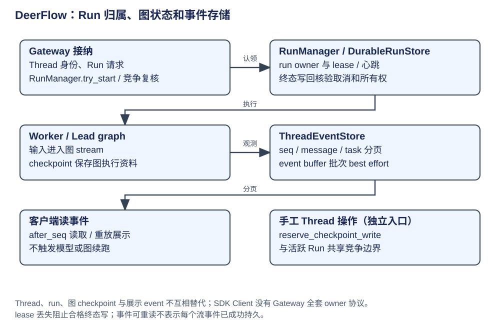
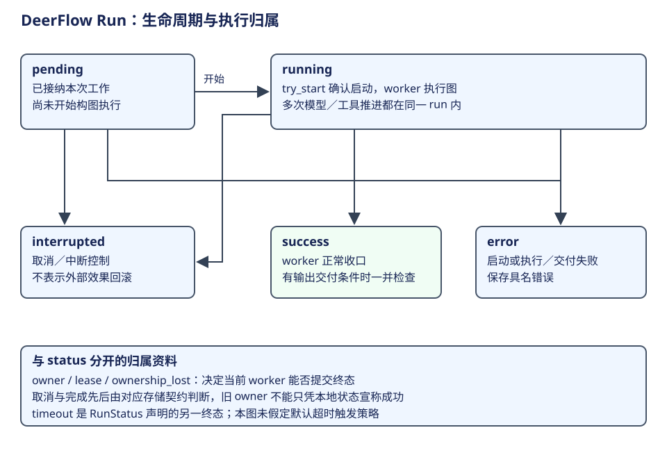

# DeerFlow：Run 归属、事件读取与独立写入

Gateway 的 RunManager 管执行归属与准入，LangGraph checkpointer 管图状态，event store 管可读取的历史/事件。运行管理、图恢复和产品读取分别使用这三类资料。




上一章的 worker 调图前后都经过 RunManager。本章按一份 run 的生命周期解释三步：确认启动资格、持有执行归属、写入终态。事件存储在运行旁路提供读取；手工压缩等独立写入再复用 thread 的准入机制。

| 阶段 | 读取什么 | 改变什么 |
|---|---|---|
| 1. 启动 | pending 状态和取消信息 | 持久 start_run 与本地 running |
| 2. 执行 | 当前 owner、lease 与 abort | worker 的继续资格与图输出 |
| 3. 收口 | 执行结果和已经接受的取消 | owner 合格的持久终态 |

| 概念 | owner / 构造与消费 | 生命周期与权威范围 |
|---|---|---|
| thread | 产品会话，Gateway 解析身份/权限 | 跨多 run 的可恢复状态与元数据 |
| run / RunRecord | RunManager 接纳，worker 执行 | pending/running/terminal、owner、lease、cancel；不等同 graph instance |
| checkpoint | saver，由图 root 调用 | 恢复 channel、任务和节点进度 |
| event store | worker/converter 写，Gateway 分页读 | 可见消息、子任务事件、seq 游标；不驱动图恢复 |
| thread store / artifact | 产品资料 | 标题、权限、产物与历史，不替代 channel reducer |
| reservation | RunManager 非 run 操作 | 独立 checkpoint/artifact/branch/delete 的写入资格 |

## 先用状态图定位本章三步



CSV 修复任务从接纳到回答可以是一份 run，其间 Lead 多次请求模型、读取代码、修改和验证。run.status 不记录每次工具或模型轮次；这些过程由图状态和消息表达。RunManager 关心本次工作是否启动、谁有执行资格、怎样收口，checkpointer 则保存图内进度。

| 主要转移 | 条件与动作 | 对学习者的含义 |
|---|---|---|
| pending → running | try_start 确认未取消并协调存储启动 | 取得开始执行的资格，不是仅向 UI 发开始事件 |
| pending → error | worker 启动安装失败，仍处于 pending | 接纳成功不等于已经有执行者 |
| running → success / error | worker 完成执行及相应交付收尾 | 图结束与平台运行收口分别进行 |
| pending / running → interrupted | 对应取消／中断控制生效 | 终止继续推进；已发生工具效果另需判断 |

RunStatus 同时声明 timeout 类型；是否采用及何时触发，需要沿具体调用入口确定，不能只从枚举猜一套默认计时策略。ownership_lost 表示当前 worker 已无法确认或保有提交资格。这样分开建模，才能解释“本地函数返回了结果，却不能再写持久 success”的情况。[运行状态声明](https://github.com/bytedance/deer-flow/blob/b842e06be19f04280a9e5e12f90da04d0c6f09a5/backend/packages/harness/deerflow/runtime/runs/schemas.py#L17)、[启动与启动失败](https://github.com/bytedance/deer-flow/blob/b842e06be19f04280a9e5e12f90da04d0c6f09a5/backend/packages/harness/deerflow/runtime/runs/manager.py#L930)。

## 第一步：确认启动资格，再进入运行

`try_start` 在 record.start_lock 内先核验 pending/abort，再调用持久 store.start_run，最后重新核验本地取消竞争才采用 running。失败具名为 startup error 或 cancelled，不能继续构图。worker 随后固定 checkpoint mode、context、metadata、工厂参数，再构图并 astream。

try_start 的正常路径按源码整理如下，省略持久 start_run 拒绝、失败和取消竞争的恢复分支。两次检查分别位于存储调用前后：

```python
async with record.start_lock:
    async with self._lock:
        if record.abort_event.is_set() or record.status != RunStatus.pending:
            return RunStartOutcome.cancelled
    # 省略：通过存储适配器调用 start_run，并处理拒绝和错误。
    async with self._lock:
        if not record.abort_event.is_set() and record.status == RunStatus.pending:
            record.status = RunStatus.running
            record.updated_at = _now_iso()
            return RunStartOutcome.started
    # 省略：已接受取消时恢复相应持久状态，再返回 cancelled。
```

worker 消费具名启动结果；只有 started 路径继续构图。[启动资格实现](https://github.com/bytedance/deer-flow/blob/b842e06be19f04280a9e5e12f90da04d0c6f09a5/backend/packages/harness/deerflow/runtime/runs/manager.py#L930)。

### 第二步：持有执行归属

启动成功后 worker 才装配图并处理输出。heartbeat 模式下 owner lease 续期；丢失归属会设置 ownership_lost 并限制后续持久 run/thread finalization。

### 第三步：按执行结果和取消顺序收口

成功/错误终态用 set_status_if_not_cancelled，让先赢的持久取消优先；store 无法确认取消/完成先后时，标记归属丢失，不凭本地 status 宣布持久成功。

| 竞争/失败 | 控制点 | 结果与不能推出的保证 |
|---|---|---|
| pending 期间取消 | try_start 前后两次核验 | 不创建可继续的运行；start_run 已写后仍协调恢复状态 |
| 同 thread 新工作 | durable admission / operation_kind | 依存储准入和 multitask 策略；进程内锁不足跨 worker |
| lease 丢失 | owner-qualified store 与 manager 状态 | 停止旧 owner 终态写入；已发生工具效果不回滚 |
| 终态与取消同时到达 | finalize_if_not_cancelled | cancellation 可胜出；不重写为无条件 success |
| stream 关闭失败 | cancellation/stream cleanup | 命名并清理；不能把 generator close 当所有外部任务已结束 |

证据：[try_start](https://github.com/bytedance/deer-flow/blob/b842e06be19f04280a9e5e12f90da04d0c6f09a5/backend/packages/harness/deerflow/runtime/runs/manager.py#L930)、[终态核销](https://github.com/bytedance/deer-flow/blob/b842e06be19f04280a9e5e12f90da04d0c6f09a5/backend/packages/harness/deerflow/runtime/runs/manager.py#L1090)、[worker 执行与收尾](https://github.com/bytedance/deer-flow/blob/b842e06be19f04280a9e5e12f90da04d0c6f09a5/backend/packages/harness/deerflow/runtime/runs/worker.py#L891)。

## 运行旁路：保存事件，供断线后补读

worker 将 graph 输出转为产品事件，event store 以 seq 保存可分页资料。list_messages/list_events 的 after_seq 返回较新的记录，before_seq 可向历史回读；一些端点只允许向后游标，不能给所有 endpoint 一个通用 cursor 参数。`put_if_absent` 允许按身份幂等补终态事件，但不是数据库与模型调用的统一事务。

子 Agent 事件 buffer 的 put_batch 是旁路持久化，错误处理有 best-effort 分支。UI 看到 token、store 读到事件、checkpoint 写完、Run 终态成功是四个观察点；缺一个不能由另一个代证。断线后分页/补读只恢复已保存事件，不能保证重放所有曾被客户端看见的临时 delta。

证据：[事件存储契约](https://github.com/bytedance/deer-flow/blob/b842e06be19f04280a9e5e12f90da04d0c6f09a5/backend/packages/harness/deerflow/runtime/events/store/base.py#L46)、[worker 子任务事件 buffer](https://github.com/bytedance/deer-flow/blob/b842e06be19f04280a9e5e12f90da04d0c6f09a5/backend/packages/harness/deerflow/runtime/runs/worker.py#L757)、[Gateway 分页接口](https://github.com/bytedance/deer-flow/blob/b842e06be19f04280a9e5e12f90da04d0c6f09a5/backend/app/gateway/routers/thread_runs.py#L1633)。重连读取与客户端去重分别由流接口和消费方承担。

## 独立写入：在同一 thread 上取得修改资格

手工 compact 入口权限检查后，在 reserve_checkpoint_write 中读/压缩/更新 checkpoint。内部 reserve_thread_operation 建立短期 pending row，和普通 run 共享活跃 thread 的持久唯一约束；退出删除 row，删除失败留下具名孤儿协调。reservation 附着调用任务，lease 丢失取消该写入并转成 ConflictError。

持久 reservation 协调跨 worker 准入，Python keyed lock 协调进程内调用。非 heartbeat 多 worker 不能因有 reservation 代码就称完全安全；具体 store、部署与故障注入还需测试。

证据：[reservation](https://github.com/bytedance/deer-flow/blob/b842e06be19f04280a9e5e12f90da04d0c6f09a5/backend/packages/harness/deerflow/runtime/runs/manager.py#L1865)、[compact 路由保护](https://github.com/bytedance/deer-flow/blob/b842e06be19f04280a9e5e12f90da04d0c6f09a5/backend/app/gateway/routers/threads.py#L1506)。嵌入式 Client 直接调用图，没有自动经过 Gateway 的 RunManager；要复用准入应由宿主显式接入。
