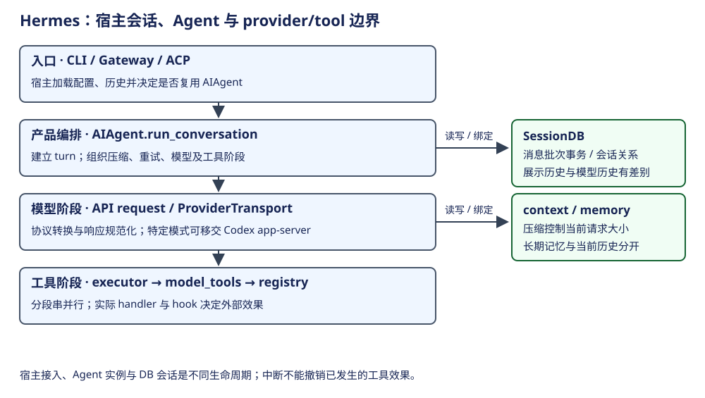

# Hermes：宿主生命周期、对话循环与存储边界

Hermes 的共用编排门面是 AIAgent，但其生命周期由宿主决定：CLI 持有自身 Agent，Gateway 按会话/配置条件复用缓存实例，ACP 有独立协议宿主。一次 run_conversation 可以包含多次模型及工具轮次；SQLite 会话行、Agent 活实例与当前 turn 不能合成一个“session”。

## 概念与构造

| 概念 | 层次、职责 | owner / 生命周期 | 状态边界 |
|---|---|---|---|
| HermesCLI / Gateway / ACP | 交互、消息平台、编辑器协议宿主 | 宿主维护配置、历史和投递 | 三种入口不能互推并发/复用保证 |
| AIAgent | 产品编排门面；由多个职责 mixin 组成 | _init_agent 或 TurnRunner 构造 | clients、tool 配置、当前运行控制在内存 |
| turn / API iteration | 一份用户输入 / 其中一次模型调用 | run_conversation 建立 turn，循环推进 iteration | tool round 属于其中阶段 |
| ProviderTransport | 协议方言的数据路径 | 按 api_mode 选择并缓存 | convert/build/normalize，不负责整个宿主会话 |
| Tool registry / toolsets | handler 注册 / 启用能力集合 | 导入与配置组合 | schema 暴露不等于授权或 handler 已执行 |
| SessionDB | 会话、消息及关系的数据库门面 | 宿主可注入；Agent 自持时负责释放 | 消息批次事务与恢复历史 |
| context engine / memory | 当前上下文处理 / 跨轮或跨会话记忆 | 配置与 provider 注入 | 摘要、请求历史和长期记忆分开 |

`CLIAgentSetupMixin._init_agent` 把 model/runtime、session_id、SessionDB 与宿主回调传给 AIAgent。Gateway TurnRunner 先查缓存，再按身份与配置条件复用或构造；压缩可能改变 session_id，宿主需同步新的会话关系。依据：[CLI 构造](https://github.com/NousResearch/hermes-agent/blob/8bff64d6ed3414a66976bfa8ab72c14b6bca2a6f/hermes_cli/cli_agent_setup_mixin.py#L625)、[Gateway 构造与缓存判断](https://github.com/NousResearch/hermes-agent/blob/8bff64d6ed3414a66976bfa8ab72c14b6bca2a6f/gateway/run_turn_runner.py#L1055)、[AIAgent 门面](https://github.com/NousResearch/hermes-agent/blob/8bff64d6ed3414a66976bfa8ab72c14b6bca2a6f/run_agent.py#L214)。

## 一次原生对话的主链路

| 当前位置 | 调用链 | 输入输出及提前结束 |
|---|---|---|
| 宿主输入 | CLI / TurnRunner → AIAgent.run_conversation | 可分别传模型用输入和持久用原始用户内容 |
| turn 初始化 | run_conversation → _run_conversation_turn → build_turn_context | 绑定历史和本轮局部状态；不是为每次 API iteration 新建 Agent |
| 循环准备 | begin_iteration → prepare_iteration → assemble_api_request | 整理历史、上下文和请求 |
| 前置检查 | run_preflight_gate | 可 return / break / continue，不一定调用模型 |
| 模型阶段 | _run_api_retry_loop → normalize_model_response | 重试和规范化后形成统一 assistant 结果 |
| 工具阶段 | run_tool_round → AIAgent._execute_tool_calls | 分段串行/并行；结果反馈给下一 iteration |
| 最终收口 | finalize_turn → export_current_turn_boundary | 返回结果及边界；失败 turn 可另补 durable closer |

依据：[原生循环](https://github.com/NousResearch/hermes-agent/blob/8bff64d6ed3414a66976bfa8ab72c14b6bca2a6f/agent/conversation_loop.py#L1547)。`api_mode == codex_app_server` 是明显旁路：可把完整 turn 交给 Codex 子进程，不走上述每个本地模型/工具阶段。不能因类名仍是 AIAgent，就把该旁路解释成纯协议转换。

## 模型、工具与扩展

ProviderTransport 的契约把消息、工具、kwargs 和 NormalizedResponse 处理集中在协议层；provider 选择、凭据与模型元数据另有责任。这比让每个 loop 分支直接理解所有 API 更容易替换，但 fallback、streaming 与 app-server 旁路仍要单独追。

工具执行有两层：agent/tool_executor 处理一轮调用的分段、并发、interrupt 和结果顺序；model_tools.handle_function_call / _execute_tool 再经执行 middleware 到 registry.dispatch 或 connector dispatch。并行 executor 的结果按原调用次序回填；并发安全的判定是具体策略，不能只凭“读工具”名字推断。依据：[分段门面](https://github.com/NousResearch/hermes-agent/blob/8bff64d6ed3414a66976bfa8ab72c14b6bca2a6f/run_agent.py#L1294)、[并行执行](https://github.com/NousResearch/hermes-agent/blob/8bff64d6ed3414a66976bfa8ab72c14b6bca2a6f/agent/tool_executor.py#L1563)、[handler 分派](https://github.com/NousResearch/hermes-agent/blob/8bff64d6ed3414a66976bfa8ab72c14b6bca2a6f/model_tools.py#L822)、[transport 契约](https://github.com/NousResearch/hermes-agent/blob/8bff64d6ed3414a66976bfa8ab72c14b6bca2a6f/agent/transports/base.py#L12)。

有些 hook 是可替换结果的观察点，并不是安全门禁。`transform_tool_result` 失败按源码处理为保留原结果；不能将所有插件错误都称作 fail-closed。审批、guardrail 和 shell sandbox 尚需逐工具核验，不把工具可用性检查推广成执行授权。

## 持久化、压缩与故障

`_db_flush_write` 用 append_messages_batch 提交新增消息，成功后才更新本地“已持久化”标记。展示文本可与模型请求文本不同；某些 scaffolding 不适合成为永久对话。记忆抽取、trajectory 与 DB 消息也不是同一份事实。

| 状态 / 事件 | 实现依据 | 不能推定 |
|---|---|---|
| 消息批次写失败 | 事务失败不更新成功标记 | 模型/工具已经做的效果被撤回 |
| 缓存 Agent 淘汰 | 宿主 release/close 并管理客户端资源 | 已持久会话被删除 |
| interrupt | 停止继续调度，工具可产生 skipped/error 结果 | 已派发工具瞬间停止或外部效果可逆 |
| 失败 turn 留用户消息尾部 | run_conversation 可补 assistant 边界 | 所有失败类型都走同一修复；context pressure 有排除条件 |
| 压缩超时 / 后台线程迟到 | 压缩模块声明提交 fence 与持久锁约束 | 本章已验证完整 fence 的每条执行路径 |
| session_id 变化 | Gateway 同步新的身份与历史关系 | session ID 与 Agent 对象永远一对一 |

依据：[消息批次](https://github.com/NousResearch/hermes-agent/blob/8bff64d6ed3414a66976bfa8ab72c14b6bca2a6f/agent/session_persistence.py#L290)、[失败收口](https://github.com/NousResearch/hermes-agent/blob/8bff64d6ed3414a66976bfa8ab72c14b6bca2a6f/agent/conversation_loop.py#L1813)、[压缩约束说明](https://github.com/NousResearch/hermes-agent/blob/8bff64d6ed3414a66976bfa8ab72c14b6bca2a6f/agent/conversation_compression.py#L1)。压缩的提交 fence、coverage watermark 和 DB lineage 是需要单独深入的独有机制；当前只定位其契约，未以注释替代完整实现证明。

## 旧文归并与取舍

原稿的三个入口、transport/toolset、记忆与压缩保留在上述共同章节；安装脚本与旧 0.13.0 目录介绍按历史材料理解。当前源码已经大量拆分：AIAgent 是门面，conversation_loop 是阶段编排，tool_executor 是调用调度。维护者应从门面追到这些实际函数，不能只读 run_agent.py 就认定读完了实现。ACP 全链路、平台投递可靠性、skills、cron 与多 Agent 的具体共享规则仍需专章核验。
