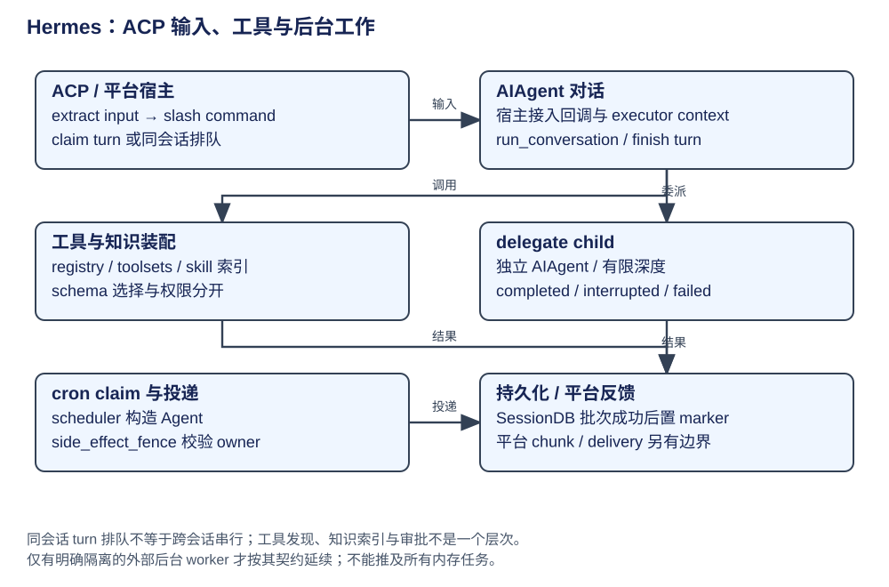

# Hermes：ACP、平台、Skills、委派与定时宿主

CLI、Gateway、ACP、cron 都可宿主持有 AIAgent，但输入身份、队列、审批回传和收尾不同。扩展要先判断改变的是入口、模型协议、知识、工具还是运行拓扑。

| 概念 | 层次与构造者 | 实际消费者 | 生命周期 |
|---|---|---|---|
| MessageEvent / BasePlatformAdapter | Gateway 平台层：adapter 转换消息与媒体 | gateway runner | 平台连接常驻，消息映射到 session key |
| ACP SessionState | 编辑器协议：session manager | HermesACPAgent.prompt | 外部 handle 稳定，内部 Hermes ID 可能轮换 |
| ToolRegistry / toolsets | 能力目录：模块/插件注册 | model_tools 定义与 handler 分发 | 注册、可见、availability 与授权分开 |
| ProviderProfile | provider 元数据与请求差异 | 初始化与路由 | 身份/地址/模型能力不等于传输实现 |
| ProviderTransport | API 协议适配 | 本轮请求/响应转换 | convert_messages/tools、build_kwargs、normalize_response |
| delegate child | 执行拓扑：父上下文构造 AIAgent | 子运行与 completion 回收 | 独立上下文；共享文件需要另行协调 |
| cron fire claim | 调度归属：scheduler / store | job worker 与结果交付 | job 定义、一次 execution 与 owner 分别管理 |

## ACP：同一个循环，不同协议宿主

`prompt` 查 SessionState → 提取文本与多模态资源 → 文本 slash 命令分流 → `_claim_turn_or_queue` 认领或排队 → 绑定工具、reasoning、step、delta 与审批回调 → 在线程 executor 的独立 ContextVars copy 中 `_run_agent_turn` → AIAgent.run_conversation → flush 工具事件 → `_finish_turn` 持久与排空队列。

ACP 的 `conn.request_permission` 绑定为工具审批及编辑批准 requester，用户决定由编辑器返回。协议拒绝、工具失败与执行器异常分别有终态；不能凭 prompt RPC 收到 end_turn 判断每个工具成功。压缩轮换 internal ID 后宿主更新状态与 provenance，而客户端 session_id 仍是稳定 handle。[ACP prompt 到执行点](https://github.com/NousResearch/hermes-agent/blob/8bff64d6ed3414a66976bfa8ab72c14b6bca2a6f/acp_adapter/server.py#L810)、[审批与事件绑定](https://github.com/NousResearch/hermes-agent/blob/8bff64d6ed3414a66976bfa8ab72c14b6bca2a6f/acp_adapter/server.py#L907)。

## 工具、Skills 与模型扩展

registry 记录 handler/schema/toolset/check_fn；get_tool_definitions 过滤并生成模型工具面，handle_function_call 执行 handler。工具执行还会经过宿主 hook、guardrail、checkpoint/审批与中断；可见 schema 不是这些步骤的替代。文件 checkpoint 是回滚资料，不能推出网络副作用恰好一次。

Skills 由 SKILL.md 及元数据组成；prompt builder 构建索引，技能工具按需读取/维护正文。索引缓存按文件签名与平台/app 事实重新判定可见性，不等同把所有技能正文放入 system prompt。ProviderProfile、Transport、平台 adapter、插件 hooks 是独立扩展口，新增一个厂商并不必然要新传输协议。

证据：[工具目录](https://github.com/NousResearch/hermes-agent/blob/8bff64d6ed3414a66976bfa8ab72c14b6bca2a6f/tools/registry.py)、[工具分发](https://github.com/NousResearch/hermes-agent/blob/8bff64d6ed3414a66976bfa8ab72c14b6bca2a6f/model_tools.py)、[Skills 索引](https://github.com/NousResearch/hermes-agent/blob/8bff64d6ed3414a66976bfa8ab72c14b6bca2a6f/agent/prompt_builder.py#L1362)、[协议基类](https://github.com/NousResearch/hermes-agent/blob/8bff64d6ed3414a66976bfa8ab72c14b6bca2a6f/agent/transports/base.py)。

## 子 Agent 与定时任务

`delegate_task` 先区分 spawn 和 list/steer/stop 控制动作；spawn 受暂停、深度与预算约束，`_build_child_agent` 解析模型/工具面/凭证路由并构造 child，`_run_single_child` 收集 completed/interrupted/failed 与 exit_reason。background 返回 dispatch handle，前台返回结果列表；有摘要仍可能 failed，预算耗尽与普通错误不能同称 truncated。当前 role 参数保留兼容，能力由深度推导，不能把角色名解释为硬路由规则。

cron scheduler 构造一次执行的 Agent，使用 fire claim/heartbeat 与 owner 检查控制归属。在交付等副作用边界使用 owner fence；丢失归属后不能继续把旧 worker 结果覆盖为成功。Gateway 退出时，只有拥有独立 scope 的外部 cron worker 才有对应的重启隔离，不能把“子进程”直接等同能跨服务重启存活。

证据：[委派入口与结果契约](https://github.com/NousResearch/hermes-agent/blob/8bff64d6ed3414a66976bfa8ab72c14b6bca2a6f/tools/delegate_tool.py#L337)、[cron 构造](https://github.com/NousResearch/hermes-agent/blob/8bff64d6ed3414a66976bfa8ab72c14b6bca2a6f/cron/scheduler.py#L2465)、[交付 owner fence](https://github.com/NousResearch/hermes-agent/blob/8bff64d6ed3414a66976bfa8ab72c14b6bca2a6f/cron/scheduler.py#L3001)。本书没有创建定时任务或验证各平台消息投递；这些是源码中的宿主机制。

## 原稿内容的落点

安装脚本/目录索引转为组合根阅读入口，旧版本号不沿用为当前版本。CLI/Gateway 主线见 [架构](architecture.md)，会话/记忆/压缩见 [上下文](context.md)，ACP、工具集、provider、Skills、plugins 与多 Agent 扩展在本页。平台与 provider 名单只作示例，不声称对每个集成都完成兼容实测。
