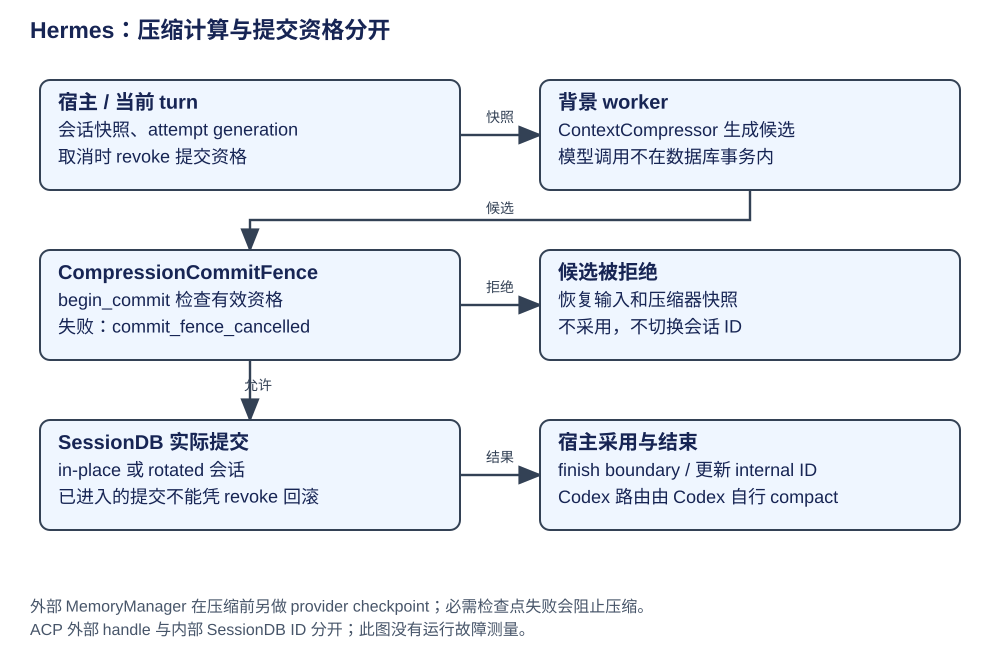

# Hermes：记忆、压缩与提交许可

Hermes 把“形成摘要”和“允许修改当前会话”分开。背景压缩可继续计算，但宿主取消/超时后必须失去提交资格；记忆提供长期资料，摘要管理本次上下文，会话 ID 定位宿主保存的记录。




压缩发生在执行章的请求准备阶段或宿主显式调用中。本章沿四步解释它怎样生效：读取当前资料和受控快照、生成候选、取得提交许可并更新会话、让宿主采用结果。长期记忆先作为请求资料介绍，再定位它在压缩前的检查点。

| 步骤 | 输入 | 交给下一步 |
|---|---|---|
| 1. 准备 | 当前消息、Prompt、记忆资料和会话身份 | 受控快照与压缩 attempt |
| 2. 生成 | 可总结范围和需保留尾部 | compressed 候选 |
| 3. 提交 | 合格候选与 commit_fence | 已更新的数据库会话及 Prompt |
| 4. 采用 | 成功提交及会话关系 | 当前消息、新身份与后续请求 |

| 概念 | 所属层 | owner 与消费者 | 生命周期 / 权威范围 |
|---|---|---|---|
| 原始消息 / SessionDB | 会话存储 | AIAgent 与宿主共享会话身份 | 数据库行及 active/归档状态是持久事实 |
| ContextCompressor | 上下文算法 | AIAgent 持有，压缩 worker 使用 | 形成摘要、保护尾部、处理预算；不是持久事务 |
| 压缩候选 / attempt | 背景工作 | worker 使用受控快照与 generation | 未提交结果可以丢弃；不是已生效 state |
| CompressionCommitFence | 提交控制 | 宿主撤销，worker 在提交前认领 | 线程同步与取消资格，防迟到结果修改会话 |
| MemoryManager | 外部记忆编排 | AIAgent 调 provider hooks | turn start、上下文预取、sync、压缩前检查点；provider 各自持久化 |
| 内置 memory / Skills | 长期资料与操作知识 | memory/skills 工具维护，prompt builder 展示 | 不等同本轮对话历史 |

## 第一步：准备当前请求资料和压缩起点

固定身份/内置记忆/用户画像/Skill 索引/项目上下文由 prompt builder 构造。MemoryManager 对外部 provider 派发 turn-start 与上下文 hooks，API 调用前的临时上下文按专用边界包裹并附到请求副本。这些附加资料在请求副本中保留其来源和作用范围。

provider 生命周期包括会话切换、回合同步、记忆工具桥接及 pre-compress。`on_pre_compress(require_checkpoint=True)` 要求有声明相应版本且实际成功的 checkpoint provider，否则异常传出、保留未压缩历史。普通 provider hook 的容错与这个必需检查点分支不同；不能一概说“记忆失败都忽略”。证据：[MemoryManager](https://github.com/NousResearch/hermes-agent/blob/8bff64d6ed3414a66976bfa8ab72c14b6bca2a6f/agent/memory_manager.py#L731)、[压缩前 checkpoint 契约](https://github.com/NousResearch/hermes-agent/blob/8bff64d6ed3414a66976bfa8ab72c14b6bca2a6f/agent/memory_manager.py#L807)、[Prompt 资料构造](https://github.com/NousResearch/hermes-agent/blob/8bff64d6ed3414a66976bfa8ab72c14b6bca2a6f/agent/prompt_builder.py)。

## 第二步：从受控快照生成压缩候选

`compress_context` 接受消息/system prompt 与可选 commit_fence：先处理 gates、锁与 attempt，再产生 compressed 候选；候选不合格或快照失效则拒绝。即使候选已经生成，仍须 `begin_commit` 允许，随后保护最近回复/用户锚点、折叠 todo、重建 prompt，进入 `_commit_compaction`，随后采用 commit 返回的有效消息，完成记账与通知，再把消息和 prompt 返回调用方。

### 第三步：候选合格后取得提交许可

commit_fence 是宿主与后台 worker 之间的提交资格控制。宿主撤销资格后，迟到候选在 begin_commit 处停止；已经进入提交的工作继续按数据库边界完成。下面的条件表说明这一位置如何连接生成和写入。

| 状态/条件 | 提交动作 | 失败结果与边界 |
|---|---|---|
| 背景生成中，宿主取消 | 撤销未来提交许可 | 迟到 worker 返回候选不代表可以写回 |
| begin_commit 未通过 | 恢复压缩器与输入快照 | reason=commit_fence_cancelled；会话不 split |
| 已进入提交 | fence 标记 in-flight，finish_commit 结束 | 宿主撤销不能声称已经回滚正在进行的事务 |
| in-place | 同 ID soft-archive 旧 rows 并原子插入 compressed | 旧内容仍可搜索；不是物理删除全部历史 |
| rotated | 建立压缩后的子会话与 parent 关系 | 宿主需采用新 internal session_id；稳定外部 ACP handle 可不变 |
| Codex app-server 路由 | 调 Codex 所有线程的原生 compact | Hermes 本地 transcript 不重写，避免压了错误 owner |

压缩锁、turn lease、attempt generation、commit fence 分别控制持久竞争、当前宿主、旧 worker 和迟到提交，不能用一个“加锁”概念替代。holder-qualified 释放防止旧 worker 删除新锁；内存 append 的 persisted markers 只在数据库成功后采用。[fence](https://github.com/NousResearch/hermes-agent/blob/8bff64d6ed3414a66976bfa8ab72c14b6bca2a6f/agent/conversation_compression.py#L451)、[实际提交许可与采用](https://github.com/NousResearch/hermes-agent/blob/8bff64d6ed3414a66976bfa8ab72c14b6bca2a6f/agent/conversation_compression.py#L4200)、[数据库边界](https://github.com/NousResearch/hermes-agent/blob/8bff64d6ed3414a66976bfa8ab72c14b6bca2a6f/agent/conversation_compression.py#L3688)、[Codex 路由](https://github.com/NousResearch/hermes-agent/blob/8bff64d6ed3414a66976bfa8ab72c14b6bca2a6f/agent/conversation_compression.py#L4314)、[会话批量写入](https://github.com/NousResearch/hermes-agent/blob/8bff64d6ed3414a66976bfa8ab72c14b6bca2a6f/agent/session_persistence.py#L290)。

压缩中段与保留两端只说明摘要算法。完整的压缩契约还包括候选覆盖范围、提交资格、数据库更新和宿主采用：fence 防止迟到工作取得新的提交许可，持久事务与外部记忆 provider 的保证仍需分别判断。
候选生成后的主要控制按源码整理如下，省略各 helper 的长参数列表、取消时恢复快照的细节，以及被拒绝提交的返回分支：

```python
phase = _run_summary_phase(...)  # 省略：快照、范围、attempt 与生成参数。
if phase.abort_prompt is not None:
    return phase.messages, phase.abort_prompt
messages, compressed = phase.messages, phase.compressed
# 省略：_candidate_rejected 检查内容与 attempt；拒绝则返回原视图。
if commit_fence is not None:
    entered = commit_fence.begin_commit(_hard_cancel_event)
    if not entered:
        # 省略：恢复 compressor 和消息快照、记录取消原因后返回。
        return messages, _existing_system_prompt(agent, system_message)
# 省略：保留回复和用户锚点，折叠 todo，再重建 System Prompt。
commit = _commit_compaction(...)
if commit.refused_prompt is not None:
    return messages, commit.refused_prompt
compressed = commit.compressed
_finish_compaction_boundary(...)  # 记账与通知，返回粗略 token 估算。
return compressed, new_system_prompt
```

这是流程骨架，entered 代指实现中的 _commit_fence_entered。它让读者看到生成、许可、数据库提交和消息返回的先后；完整 finally 还负责结束已经进入的 fence。[压缩生成后的交接](https://github.com/NousResearch/hermes-agent/blob/8bff64d6ed3414a66976bfa8ab72c14b6bca2a6f/agent/conversation_compression.py#L4190)。

## 第四步：采用会话结果，继续准备请求

同 ID 压缩更新原会话的有效消息范围；轮换模式建立压缩后的子会话，宿主随后采用新 internal session_id 和消息。`compress_context` 将 `commit.compressed` 与新 prompt 返回调用方，调用方回赋请求资料，下一请求从这些已采用资料组织上下文。这里采用的是提交层的结果，它可能包含重新接回的尾部或失败后保留的原历史；并非直接把生成阶段候选一律写回。ACP 的外部 handle 可以保持不变，由协议宿主同步内部身份关系。

以 CSV 任务为例，较早阅读资料由摘要承接，最近修改和验证反馈继续保留。模型看到更新后的上下文才继续决策。一个尚未提交的候选只表明摘要计算完成，生效位置仍是第三步及本步的采用。
