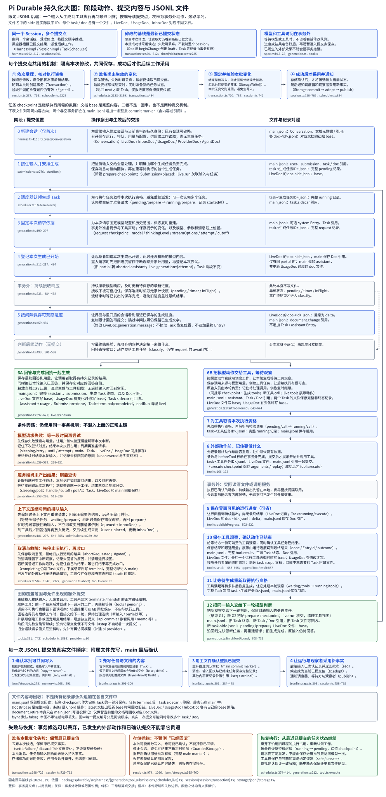

# Pi Durable：事务、任务与副作用恢复

Pi Durable 把执行进度变成可保存的 Task 状态，再由调度器按 checkpoint 推进。Session 负责一批记录的提交；模型请求和工具效果发生在事务之外。它保存工作位置，模型仍根据上下文选择动作。

从[分册首页的持久化总览](index.md#persistence-overview)先看完整执行顺序；每个阶段的记录变化与 JSONL 去向集中在[执行章的提交明细](loop.md#commit-trace)。本章放大这些提交点共用的事务机制，后面的原尺寸大图保留全部节点与旁路。


一次用户任务的推进依次跨过四个位置：应用装配 Harness，scheduler 认领 Task，阶段代码处理输入并提交状态，结果供下一阶段或调用者采用。主线结束后，再看中断时怎样按保存的阶段重新进入。下面的表把每步的输出接回总图。

| 步骤 | 谁负责 | 输入与输出 |
|---|---|---|
| 1. 装配 | 应用与 Harness | Storage、Models、Registry → Session 与 scheduler |
| 2. 认领 | TaskScheduler | pending Task 与定义 → 当前 invocation |
| 3. 推进与提交 | TaskRuntime、Session | 阶段处理 → 新 Entry、checkpoint 和 Document |
| 4. 交出结果 | scheduler、父 Task 或 Submission | 已提交 outcome → 下属等待解除或输入收口 |

Task 的 checkpoint 是任务代码保存的恢复资料；status 是调度器判断能否运行的状态。先理解这两份信息，才能把第三步的提交与第四步的结果衔接起来。

## 第一步：装配会话、定义与调度器

应用打开 Harness 时，提供 Storage、Models、Registry 等能力。Harness 连接 Session 与 TaskScheduler，并提供 root Conversation 和相关会话操作。Session 是统一修改记录的地方；scheduler 观察提交，决定哪些 Task 可以推进；Registry 给出任务 kind/version 对应的当前代码。

| 层次 | 构造与调用关系 | 主职责 | 不应混入的职责 |
|---|---|---|---|
| 产品／应用 | 调用 Harness.open、root、submit | 准备环境、模型和可用能力 | 不直接替任务重写 checkpoint |
| 接纳与会话 | Conversation → Submissions | 接纳输入、排队、放置历史与收口记录 | 不靠模型文字表示执行所有权 |
| 任务执行 | scheduler → Registry phase → TaskRuntime | 认领工作、执行阶段、等待 child | 不把 JS 程序栈当持久状态 |
| 事务内核 | TaskRuntime.commit → Session.commit → Storage.commit | Entry、Task、Document 等同批变化 | 不包含任意外部工具效果 |
| 观察 | 已采用的记录／Document → 订阅与复制视图 | 向产品展示已提交进度 | 不接管模型或工具调度 |

应用门面与 session 的装配见[Harness](https://github.com/earendil-works/pi/blob/2ec55d808d455b1a64a2bf7888198207a096120a/packages/durable/src/harness/harness.ts)。这里的“一个 Session”按顺序处理状态修改；Conversation 可以有多个，Task 可以形成所有权树。要理解具体生成工作，接下来分别看 Task 调度状态和任务自身阶段。

### 从应用最外层进入

Durable 作为库由应用打开。阅读入口可以从官方的 `test/examples/14-chat.ts` 开始：示例构造模型与 Registry，然后打开 Harness、取得 Conversation、提交输入并等待结果。编码应用的装配示例在 `26-coding-agent.ts`，还注入随 Conversation.cwd 解析的执行环境。[最小聊天示例](https://github.com/earendil-works/pi/blob/2ec55d808d455b1a64a2bf7888198207a096120a/packages/durable/test/examples/14-chat.ts)、[编码应用示例](https://github.com/earendil-works/pi/blob/2ec55d808d455b1a64a2bf7888198207a096120a/packages/durable/test/examples/26-coding-agent.ts)。

下面按示例提取入口骨架；省略模型及工具定义、结果读取和资源清理。`models`、`registry`、`context` 和模型引用 `selectedModel` 由应用准备，Storage 在这里选用文件型 SQLite：

```ts
const storage = await openNodeSqliteStorage("./session.sqlite");
const harness = await Harness.open(storage, { models, registry }, context);
const root = await harness.root(context, { agent: { model: selectedModel } });
// 重开已有存储时，明确启动上次尚未结束的工作。
harness.resume();
const submission = await root.submit({
  type: "input", content: "修复 CSV 转义", requestId: "csv-fix-1",
}, context);
const result = await submission.wait(context);
```

`Harness.open()` 创建继承 SessionImpl 的 HarnessImpl，构造 TaskScheduler 和 Submissions，再打开已保存的任务。它负责接线和恢复准备；派发由 resume、submit 或等待入口触发。普通 CLI 与这个库的关系集中见[版本说明](../../guide/baselines.md)，宿主长期持有与按需唤醒的差异见[宿主与恢复](hosting.md)。

Models 和 settings 既可传对象，也可传返回当前值的函数。后者使后续取用读到新配置，已经保存进 request checkpoint 的 model/cutoff 等资料仍按本次请求解释。Registry 保存可执行代码，`pi.agent` 保存每个会话选中的名称；更新其中一个不会把其他对象自动替换。[装配与动态读取](https://github.com/earendil-works/pi/blob/2ec55d808d455b1a64a2bf7888198207a096120a/packages/durable/src/harness/harness.ts#L192)。

Storage 由调用者显式传入：`createSession(storage, …)` 与 `Harness.open(storage, …)` 都没有省略该参数后的默认后端。Session 内部将传入实例包成 GuardedStorage，scheduler 使用的是这个 Session 及其受保护的存储；选用 JSONL 或 SQLite 取决于应用装配。同一份逻辑提交不会因此自动双写两个后端。[Session 构造与存储包装](https://github.com/earendil-works/pi/blob/2ec55d808d455b1a64a2bf7888198207a096120a/packages/durable/src/session/session.ts#L76)、[Harness 构造 scheduler](https://github.com/earendil-works/pi/blob/2ec55d808d455b1a64a2bf7888198207a096120a/packages/durable/src/harness/harness.ts#L201)。

## 第二步：认领 Task，再进入其保存的阶段


Task record 保存身份、conversationId、kind、version、input、owner 和 state。`status` 是运行内核管理的状态，checkpoint 是任务定义自己的完整恢复资料。比如 `pi.generation` 的 checkpoint 可以指向 request，而 `pi.tool` 可以指向 execute；两者共享调度规则，却不共享业务阶段。

| 状态 | 表示什么 | 正常推进条件与下一状态 |
|---|---|---|
| pending | 已有 checkpoint，等待被认领 | scheduler 找到定义且满足调度条件后 → running |
| running | 被一个进程内 invocation 认领 | 提交新 checkpoint 保持 running；等待 → waiting；结束 → terminal/completing |
| waiting | 当前没有 invocation，等待指定 Task 收口 | 等待条件满足后重新认领 → running，以原 checkpoint 进入阶段 |
| sleeping | 没有 invocation，保存了到期时间 until | Harness 时钟达到 until 后重新认领 → running；取消可提前进入终止处理 |
| completing | 结果已决定，但仍有普通 owned work 活着 | 不再执行任务代码；下属收口后 → terminal |
| terminal | 持久结果回执，任务不会再执行 | 保存 completed/failed/aborted 等 outcome |

status 为 terminal、outcome 为 completed 是不同层的字段：一个表示不再推进，一个表示工作结果。completed 的生成 Task 可能还把用户运行交给 successor；不能据它推断整个 Conversation 已经空闲。[TaskState 完整定义](https://github.com/earendil-works/pi/blob/2ec55d808d455b1a64a2bf7888198207a096120a/packages/durable/src/types.ts#L561)、[调度认领](https://github.com/earendil-works/pi/blob/2ec55d808d455b1a64a2bf7888198207a096120a/packages/durable/src/harness/scheduler.ts#L1470)、[完成与 owned work](https://github.com/earendil-works/pi/blob/2ec55d808d455b1a64a2bf7888198207a096120a/packages/durable/src/harness/scheduler.ts#L1938)。

## 第三步：将一次工作变化提交到历史、任务和视图

<details id="commit-map">
<summary>展开提交顺序大图（原尺寸，可横向和纵向滚动）</summary>
<div style="overflow: auto; max-height: 75vh;">

</div>
</details>


图按 JSONL 后端展开，可在上方展开原尺寸图查看字段与文件去向，编号表示阅读顺序；并非一次运行固定产生这些序号。下面先放大所有提交点共用的事务链；执行章再按[请求阶段](loop.md#request-commits)解释模型前后发生的几次提交，存储章解释[各类 write 的文件与表映射](documents.md#storage-writes)。

模型返回读取代码的工具调用时，需要保存 assistant Entry、创建 tool child Task、让 generation 进入 waiting，并更新 `pi.live` 的工具视图。它们表达同一个推进动作。如果只保存 assistant，调度器不知道该执行谁；如果只创建工具 Task，模型历史又缺少它的来源。

Pi Durable 在一次事务中组织这些修改。TaskRuntime.commit 进入 Session 的串行修改队列（mutation line），读取当前事实并准备写入；Storage 接收一批 writes，成功后 Session 采用新的状态，再发布变化。概念性顺序如下：

```ts
await runtime.commit(async tx => {
  assistant = await tx.appendEntry(assistantMessage)
  child = await tx.createTask(toolDefinition, callReference)
  live = await tx.doc(LiveDoc, conversationId)
  live.tools = describeToolRound(child)
  return waitingOn(child, checkpointForToolRound)
})
```

实际操作使用 typed Entry/Task/Document，让**同一工作变化的历史、调度与视图在一个提交边界对齐**。[工具轮次创建](https://github.com/earendil-works/pi/blob/2ec55d808d455b1a64a2bf7888198207a096120a/packages/durable/src/harness/generation.ts#L624)、[存储、采用与发布顺序](https://github.com/earendil-works/pi/blob/2ec55d808d455b1a64a2bf7888198207a096120a/packages/durable/src/session/session.ts#L714)。Storage 提交后的耐久性仍取决于所选后端。

### 回调怎样接到任务状态，再进入 Storage

阶段代码需要把业务变化交给会话保存，同时由调度器统一检查任务状态和等待关系。为此，每次认领后的执行都会取得一个绑定本次身份的 TaskRuntime，阶段只调用它提供的 commit 入口。构造关系是 TaskScheduler.#run 创建 runtime 并传给 handler；runtime.commit 的闭包持有 scheduler 和 invocation，再将回调结果交给 #commitState。下面节选包装函数，省略遥测：

```ts
await this.#gated(
  invocation,
  async (tx, current) => {
    const next = await change(tx, current);
    // 回调返回下一状态时，才为当前任务暂存状态变化。
    if (next !== undefined) await this.#commitState(tx, invocation, current, next);
  },
  context,
);
```

例如请求产生工具动作时，调用来源、工具工作和生成等待关系必须同批生效；请求直接回答时，回答和任务结束也必须共同确认。业务回调准备消息与文档，并返回后续走向；包装函数让调度器校验该走向，再把完整任务候选放入同一事务（answer/startToolRound → next → #commitState → tx.setTask）。只报告进度则不移动当前任务恢复位置（回调返回 undefined），文档变化仍可提交。[阶段调用与 runtime 注入](https://github.com/earendil-works/pi/blob/2ec55d808d455b1a64a2bf7888198207a096120a/packages/durable/src/harness/scheduler.ts#L1711)、[commit 包装函数](https://github.com/earendil-works/pi/blob/2ec55d808d455b1a64a2bf7888198207a096120a/packages/durable/src/harness/scheduler.ts#L2133)、[状态校验与暂存](https://github.com/earendil-works/pi/blob/2ec55d808d455b1a64a2bf7888198207a096120a/packages/durable/src/harness/scheduler.ts#L1938)。

排队期间，任务可能已被取消或结束；因此要轮到本批修改时再检查资格，阻止失效执行的迟到结果覆盖当前事实。代码由 #gated 经 Session.commitWith 入队，在事务回调里确认 invocation 未结束、Harness 未关闭、Task 仍为 running，普通执行没有持久取消标记，再执行阶段回调。等待关系和文档 schema 等另由后续层校验；取消清理使用 abort invocation，允许执行必要的收尾。[提交资格检查](https://github.com/earendil-works/pi/blob/2ec55d808d455b1a64a2bf7888198207a096120a/packages/durable/src/harness/scheduler.ts#L2327)。

### 每次事务的候选从哪里来

每次修改都要与当前已提交值隔离：本批成功才让后续工作采用，准备失败则丢弃候选，原值不被本批覆盖。因此轮到一个提交时，Session 先从最新事实建立独立事务，再执行修改回调（Session.commitWith → #runCommit → new Transaction → change(tx)）。文档通过 tracker.beginChange 得到本次可撤销 Draft，同一事务重复取得同一地址时复用；任务、消息和输入回执也先暂存候选。读取旧记录或分配 ID 并不代表本批已写入后端；模型请求、工具执行和阶段局部缓冲仍在事务外。[串行入队](https://github.com/earendil-works/pi/blob/2ec55d808d455b1a64a2bf7888198207a096120a/packages/durable/src/session/session.ts#L237)、[新建事务](https://github.com/earendil-works/pi/blob/2ec55d808d455b1a64a2bf7888198207a096120a/packages/durable/src/session/session.ts#L716)、[取得 Document 草稿](https://github.com/earendil-works/pi/blob/2ec55d808d455b1a64a2bf7888198207a096120a/packages/durable/src/session/transaction.ts#L536)。

准备完毕后，还要固定这批变化，防止回调外继续写草稿，再校验哪些记录应共同保存；随后才进入持久后端（settleSuccess 封闭草稿并准备文档变化，#assemble 汇总 StorageWrite[]，#runCommit 调用 this.#storage.commit）。本次草稿到此结束，下一次修改从最新已提交值重新开始；不存在各阶段长期共用“最初 Session 的整份备份”。[封闭与准备](https://github.com/earendil-works/pi/blob/2ec55d808d455b1a64a2bf7888198207a096120a/packages/durable/src/session/transaction.ts#L700)、[汇总 writes](https://github.com/earendil-works/pi/blob/2ec55d808d455b1a64a2bf7888198207a096120a/packages/durable/src/session/transaction.ts#L784)、[后端调用](https://github.com/earendil-works/pi/blob/2ec55d808d455b1a64a2bf7888198207a096120a/packages/durable/src/session/session.ts#L750)。

实际 Session 提交的正常路径可以节选为下面几步，省略事务失败处理、空写入和调用者取消的处理。writes 来自阶段回调产生的事务草稿，adopt 将成功提交的结果接入当前进程，publish 再通知观察者：

```ts
const writes = await tx.settleSuccess();
// 省略：空 writes 返回，以及 Storage 错误处理。
seq = await this.#storage.commit(writes, withoutAbortSignal(context));
// 省略：采用失败时将 Session 标为不可继续使用。
documents = tx.adopt(seq);
this.#publish(seq, writes, documents, context);
return result;
```

这条交接决定观察者什么时候可以看到新事实：存储成功在前，当前状态采用在后，通知最后发生。[Session 提交实现](https://github.com/earendil-works/pi/blob/2ec55d808d455b1a64a2bf7888198207a096120a/packages/durable/src/session/session.ts#L714)。

### 失败发生在哪一步，决定能撤销什么

事务候选的撤销与持久后端的恢复是两层机制；不能把所有 commit 抛错都解释为“文件已回滚”：

| 失败位置 | Session 的动作 | 已提交事实与恢复 |
|---|---|---|
| change 回调或 settleSuccess 准备失败 | 中止本次文档变化，丢弃记录候选 | 尚未调用本批 Storage.commit，原已提交值不变 |
| Storage.commit 抛错 | 丢弃进程中的候选，GuardedStorage 将 Session 标记为失败 | 本批是否已经完成不能一概判断；停止使用该实例，重开后由后端恢复确认 |
| Storage 已成功，adopt 失败 | 将 Session 标记为失败 | 存储已经向前推进，不能靠丢弃 Draft 撤回；重新打开并加载持久事实 |

外部模型请求、文件修改或 API 操作不在这些候选中，不能随事务撤销。JSONL 的未确认尾部如何处理见[存储恢复边界](documents.md#jsonl-confirmation)；完整处理分支见 [Session 提交实现](https://github.com/earendil-works/pi/blob/2ec55d808d455b1a64a2bf7888198207a096120a/packages/durable/src/session/session.ts#L716)。

## 第四步：结果解除等待，并沿同一工作继续

第三步提交成功后，scheduler 观察 Task 变化。工具 child 已进入 terminal 时，等待它的 generation 可以重新被认领，读取结果 Entry，决定交给 successor 继续还是收口输入。任务结果已经决定但仍有 owned work 时，Task 先进入 completing，等待下属结束后再变为 terminal。父子工作关系因此参与完成判断。[完成与 owned work](https://github.com/earendil-works/pi/blob/2ec55d808d455b1a64a2bf7888198207a096120a/packages/durable/src/harness/scheduler.ts#L1938)。

下一章按一份 CSV 输入展开这条交接。先把其中的工具阶段放大，说明第三步的持久记录如何在实际调用前后保存。

## 工具阶段：先保存调用意图，再执行并提交结果


工具先确定这次允许执行的最终动作，并把“要做什么、中断后能否重跑”留下，供恢复时判断；保存成功后才产生外部效果，结束时再把观察交给等待方。实现对照：从 assistant Entry 读取调用，查当前定义、准备参数并执行 beforeTool；保存 execute checkpoint 中的 arguments/replay，再在事务外调用 tool.execute；最后同批保存结果 Entry、视图和 outcome。

正常执行的 call handler 会在保存 intent 后直接执行工具并收口；`execute` 阶段 handler 主要用于恢复。这里的 intent 保存“已经决定去做什么”，结果保存“已观察到什么”。一旦提交 intent 后进程消失，外部效果是否发生可能未知，所以恢复只在历史 replay 和当前工具 replay 都为 safe 时重跑。[工具阶段与恢复](https://github.com/earendil-works/pi/blob/2ec55d808d455b1a64a2bf7888198207a096120a/packages/durable/src/harness/tool.ts#L74)。

| 中断位置 | 读者应怎样理解 |
|---|---|
| intent 之前 | 尚无这次工具执行的持久意图 |
| intent 之后、result 之前 | 操作可能执行过；恢复不能只凭缺结果判断未执行 |
| result 和终态已提交 | 调度有明确结果，可供 generation 消费 |
| 调用者停止等待 Submission | 只是停止等待；已接纳工作有自己的取消协议 |

这组条件足以理解恢复主线。持久内核保证自己的记录推进，不会把外部文件或 API 操作变成可回滚的数据库事务；是否适合重跑是工具契约的一部分。

工具 call 阶段中，最后一次校验得到 final 参数后，保存 execute checkpoint，再调用 run。下面是源码节选，省略前面的定义查找、beforeTool 及 block 处理：

```ts
const final = copyJson(validated.args, { omitUndefinedProperties: true }) as JsonObject;
await runtime.commit(async (tx) => {
  const slot = toolSlot(await tx.doc(LiveDoc, runtime.conversationId), runtime.taskId);
  if (slot !== undefined) slot.status = "running";
  const intent = { phase: "execute", arguments: final, replay: tool.replay ?? "unsafe" } as const;
  return { status: "running", checkpoint: intent };
}, context);
await run(runtime, task.input, call, tool, final, context);
```

run 调用工具并保存结果。若进程在这两步之间消失，execute 恢复阶段以保存的 arguments 和 replay 判断能否重跑。因此恢复需要的是最终调用资料，而不只是模型最初生成的参数。[ToolTask 的 call 与 execute 阶段](https://github.com/earendil-works/pi/blob/2ec55d808d455b1a64a2bf7888198207a096120a/packages/durable/src/harness/tool.ts#L74)。

模型直接发起的调用和工具内部的嵌套调用共用 `pi.tool` version 2。前者向历史追加工具结果 Entry，后者把结果写到调用者的 NestedCallDoc；二者都经过参数校验、hooks、intent 和 replay 检查。具体数据交接见[工具组合与 codemode](tools.md)。

## 主线补充：重开后按 checkpoint 重新进入

重开后加载最近的恢复资料，重新提交认领，再进入对应阶段。scheduler 打开时加载活跃任务，将上次留下的 running 改回 pending 并保留 checkpoint。实际派发另由 resume 开启，submit/wait 等入口也会请求推进；open 只完成加载和准备。[恢复与启用](https://github.com/earendil-works/pi/blob/2ec55d808d455b1a64a2bf7888198207a096120a/packages/durable/src/harness/scheduler.ts#L370)、[Submission 推进入口](https://github.com/earendil-works/pi/blob/2ec55d808d455b1a64a2bf7888198207a096120a/packages/durable/src/harness/submissions.ts#L76)。

恢复需要当前 Registry 中仍有适用定义。函数不随 Task 存储，因此定义与旧状态的兼容关系也是运行条件；任务定义需要能解释保存的输入与 checkpoint。重开时还会统计被非正常进程终止截断的任务；连续没有状态进展达到 restartLimit 后，任务会暂时阻塞，等待显式重试。这些条件与 sleeping、宿主唤醒一起在[宿主与恢复](hosting.md)展开。

## 保存频率：阶段变化与运行进度分开

每次提交保存本次记录变化，不会周期性复制整个 Session。阶段 checkpoint 随状态转移提交；生成中的回答和工具输出则由 progress policy 节流，`partialIntervalMs` 和 `outputIntervalMs` 默认均为 100 毫秒。该间隔只限制进度写入，不限制创建 Task、切换阶段或保存结果的事务。[默认政策](https://github.com/earendil-works/pi/blob/2ec55d808d455b1a64a2bf7888198207a096120a/packages/durable/src/harness/agent.ts#L34)、[流式提交](https://github.com/earendil-works/pi/blob/2ec55d808d455b1a64a2bf7888198207a096120a/packages/durable/src/harness/generation.ts#L446)。

Document 的 `checkpointWhen` 决定何时以完整 base 代替增量，服务于文档重建；Task checkpoint 决定工作从哪里继续。这两个机制与 SQLite 的 WAL checkpoint 也应分别理解。保存了模型 partial 只能保留已提交的观察，恢复请求时仍可能需要重新向模型发起调用。

## 设计选择

Pi Durable 增加 Task checkpoint、事务与观察层，使进行中的工作可以被保存和解释；代价是任务阶段必须明确建模，代码与旧记录必须相容。模型继续动态决策：下一个动作仍由模型根据上下文选择，内核负责把选择变成有身份的工作并推进。

学习自检：一个 Task 的 status 与 phase 各回答什么？为什么保存 assistant、创建 tool Task 和改变 waiting 状态应当同批提交？工具意图已保存为什么仍可能出现未知结果？下一章用完整案例把这些对象串起来。
