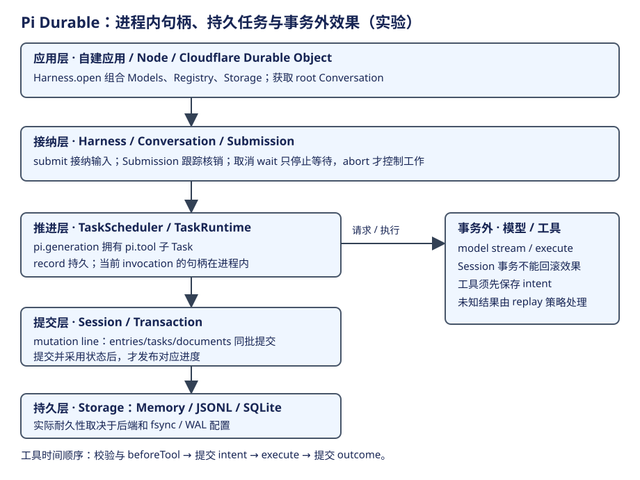
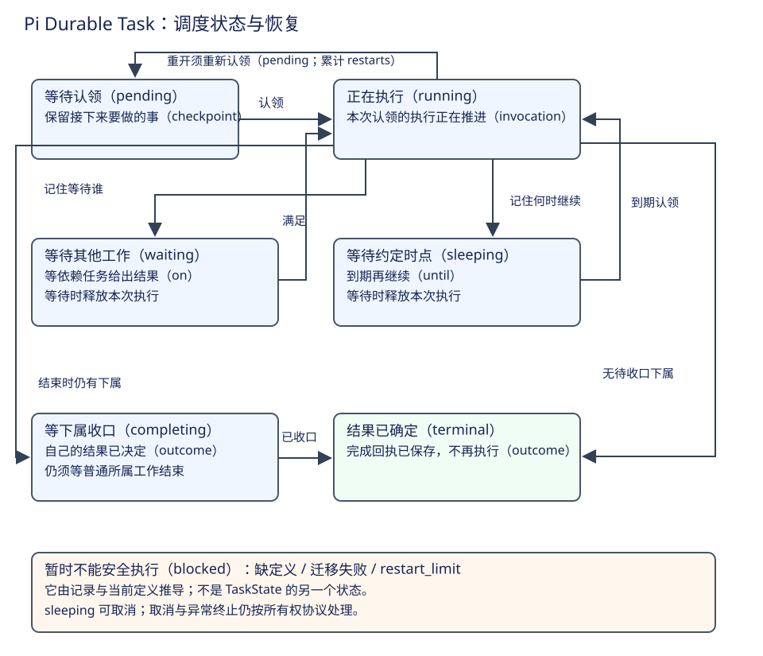
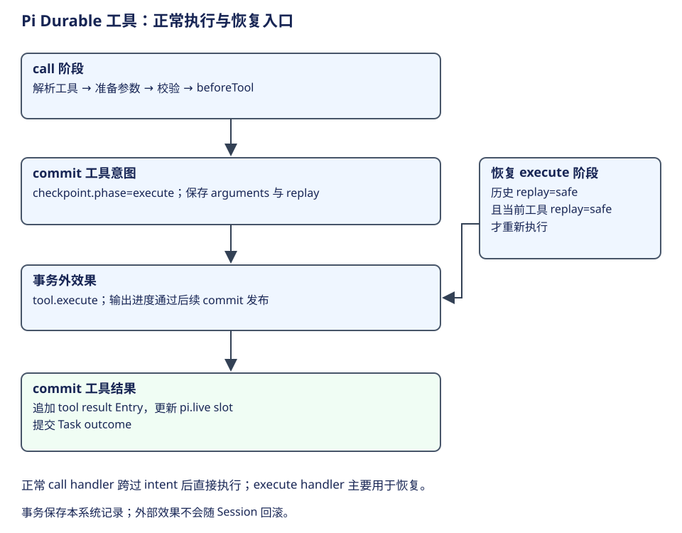

# Pico5：事务、任务与副作用恢复

Pico5 把执行进度变成可保存的 Task 状态，再由调度器按 checkpoint 推进。Session 负责一批记录的提交；模型请求和工具效果发生在事务之外。它保存工作位置，模型仍根据上下文选择动作。




一次用户任务的推进依次跨过四个位置：应用装配 Harness，scheduler 认领 Task，阶段代码处理输入并提交状态，结果供下一阶段或调用者采用。主线结束后，再看中断时怎样按保存的阶段重新进入。下面的表把每步的输出接回总图。

| 步骤 | 谁负责 | 输入与输出 |
|---|---|---|
| 1. 装配 | 应用与 Harness | Storage、Models、Registry → Session 与 scheduler |
| 2. 认领 | TaskScheduler | pending Task 与定义 → 当前 invocation |
| 3. 推进与提交 | TaskRuntime、Session | 阶段处理 → 新 Entry、checkpoint 和 Document |
| 4. 交出结果 | scheduler、父 Task 或 Submission | 已提交 outcome → 下属等待解除或输入收口 |

Task 的 checkpoint 是任务代码保存的恢复资料；status 是调度器判断能否运行的状态。先理解这两份信息，才能把第三步的提交与第四步的结果衔接起来。

## 第一步：装配会话、定义与调度器

应用打开 Harness 时，提供 Storage、Models、Registry 等能力。Harness 连接 Session 与 TaskScheduler，并提供 root Conversation 和相关会话操作。Session 是统一修改记录的地方；scheduler 观察提交，决定哪些 Task 可以推进；Registry 给出任务 kind/version 对应的当前代码。

| 层次 | 构造与调用关系 | 主职责 | 不应混入的职责 |
|---|---|---|---|
| 产品／应用 | 调用 Harness.open、root、submit | 准备环境、模型和可用能力 | 不直接替任务重写 checkpoint |
| 接纳与会话 | Conversation → Submissions | 接纳输入、排队、放置历史与收口记录 | 不靠模型文字表示执行所有权 |
| 任务执行 | scheduler → Registry phase → TaskRuntime | 认领工作、执行阶段、等待 child | 不把 JS 程序栈当持久状态 |
| 事务内核 | TaskRuntime.commit → Session.commit → Storage.commit | Entry、Task、Document 等同批变化 | 不包含任意外部工具效果 |
| 观察 | 已采用的记录／Document → 订阅与复制视图 | 向产品展示已提交进度 | 不接管模型或工具调度 |

应用门面与 session 的装配见[Harness](https://github.com/earendil-works/pi/blob/f1b2e77f5b13b2a199b1052cb79c235451afe7d7/packages/durable/src/harness/harness.ts)。这里的“一个 Session”是一条状态修改线；Conversation 可以有多个，Task 可以形成所有权树。要理解具体生成工作，接下来分别看 Task 调度状态和任务自身阶段。

## 第二步：认领 Task，再进入其保存的阶段



Task record 保存身份、conversationId、kind、version、input、owner 和 state。`status` 是运行内核管理的状态，checkpoint 是任务定义自己的完整恢复资料。比如 `pi.generation` 的 checkpoint 可以指向 request，而 `pi.tool` 可以指向 execute；两者共享调度规则，却不共享业务阶段。

| 状态 | 表示什么 | 正常推进条件与下一状态 |
|---|---|---|
| pending | 已有 checkpoint，等待被认领 | scheduler 找到定义且满足调度条件后 → running |
| running | 被一个进程内 invocation 认领 | 提交新 checkpoint 保持 running；等待 → waiting；结束 → terminal/completing |
| waiting | 当前没有 invocation，等待指定 Task 收口 | 等待条件满足后重新认领 → running，以原 checkpoint 进入阶段 |
| completing | 结果已决定，但仍有普通 owned work 活着 | 不再执行任务代码；下属收口后 → terminal |
| terminal | 持久结果回执，任务不会再执行 | 保存 completed/failed/aborted 等 outcome |

status 为 terminal、outcome 为 completed 是不同层的字段：一个表示不再推进，一个表示工作结果。completed 的生成 Task 可能还把用户运行交给 successor；不能据它推断整个 Conversation 已经空闲。[TaskState 完整定义](https://github.com/earendil-works/pi/blob/f1b2e77f5b13b2a199b1052cb79c235451afe7d7/packages/durable/src/types.ts#L448)、[调度认领](https://github.com/earendil-works/pi/blob/f1b2e77f5b13b2a199b1052cb79c235451afe7d7/packages/durable/src/harness/scheduler.ts#L773)、[完成与 owned work](https://github.com/earendil-works/pi/blob/f1b2e77f5b13b2a199b1052cb79c235451afe7d7/packages/durable/src/harness/scheduler.ts#L1048)。

## 第三步：将一次工作变化提交到历史、任务和视图

模型返回读取代码的工具调用时，需要保存 assistant Entry、创建 tool child Task、让 generation 进入 waiting，并更新 `pi.live` 的工具视图。它们表达同一个推进动作。如果只保存 assistant，调度器不知道该执行谁；如果只创建工具 Task，模型历史又缺少它的来源。

Pico5 在一次事务中组织这些修改。TaskRuntime.commit 进入 Session 的 mutation line，读取当前事实并准备写入；Storage 接收一批 writes，成功后 Session 采用新的状态，再发布变化。概念性顺序如下：

```ts
await runtime.commit(async tx => {
  assistant = await tx.appendEntry(assistantMessage)
  child = await tx.createTask(toolDefinition, callReference)
  live = await tx.doc(LiveDoc, conversationId)
  live.tools = describeToolRound(child)
  return waitingOn(child, checkpointForToolRound)
})
```

这段是教学伪代码。实际操作使用 typed Entry/Task/Document；它想说明的是**同一工作变化的历史、调度与视图在一个提交边界对齐**。[工具轮次创建](https://github.com/earendil-works/pi/blob/f1b2e77f5b13b2a199b1052cb79c235451afe7d7/packages/durable/src/harness/generation.ts#L540)、[存储、采用与发布顺序](https://github.com/earendil-works/pi/blob/f1b2e77f5b13b2a199b1052cb79c235451afe7d7/packages/durable/src/session/session.ts#L403)。Storage 提交后的耐久性仍取决于所选后端。

实际 Session 提交的正常路径可以节选为下面几步，省略事务失败处理、空写入和调用者取消的处理。writes 来自阶段回调产生的事务草稿，adopt 将成功提交的结果接入当前进程，publish 再通知观察者：

```ts
const writes = await tx.settleSuccess();
// 省略：空 writes 返回，以及 Storage 错误处理。
seq = await this.#storage.commit(writes, withoutAbortSignal(context));
// 省略：采用失败时将 Session 标为不可继续使用。
documents = tx.adopt(seq);
this.#publish(seq, writes, documents, context);
return result;
```

这条交接决定观察者什么时候可以看到新事实：存储成功在前，当前状态采用在后，通知最后发生。[Session 提交实现](https://github.com/earendil-works/pi/blob/f1b2e77f5b13b2a199b1052cb79c235451afe7d7/packages/durable/src/session/session.ts#L403)。

## 第四步：结果解除等待，并沿同一工作继续

第三步提交成功后，scheduler 观察 Task 变化。工具 child 已进入 terminal 时，等待它的 generation 可以重新被认领，读取结果 Entry，决定交给 successor 继续还是收口输入。任务结果已经决定但仍有 owned work 时，Task 先进入 completing，等待下属结束后再变为 terminal。父子工作关系因此参与完成判断。[完成与 owned work](https://github.com/earendil-works/pi/blob/f1b2e77f5b13b2a199b1052cb79c235451afe7d7/packages/durable/src/harness/scheduler.ts#L1048)。

下一章按一份 CSV 输入展开这条交接。先把其中的工具阶段放大，说明第三步的持久记录如何围住一次实际调用。

## 工具阶段：先保存调用意图，再执行并提交结果



工具工作先从 assistant Entry 读取调用，找到当前可用定义，准备参数并执行 beforeTool。参数确定后，提交 checkpoint：`phase=execute`、最终 arguments、replay 声明；随后才在事务外调用 `tool.execute`。结束时保存工具结果 Entry、更新视图并提交 outcome。

正常执行的 call handler 会跨过 intent 后直接执行工具并收口；`execute` 阶段 handler 主要用于恢复。这里的 intent 保存“已经决定去做什么”，结果保存“已观察到什么”。一旦提交 intent 后进程消失，外部效果是否发生可能未知，所以恢复只在历史 replay 和当前工具 replay 都为 safe 时重跑。[工具阶段与恢复](https://github.com/earendil-works/pi/blob/f1b2e77f5b13b2a199b1052cb79c235451afe7d7/packages/durable/src/harness/tool.ts#L35)。

| 中断位置 | 读者应怎样理解 |
|---|---|
| intent 之前 | 尚无这次工具执行的持久意图 |
| intent 之后、result 之前 | 操作可能执行过；恢复不能只凭缺结果判断未执行 |
| result 和终态已提交 | 调度有明确结果，可供 generation 消费 |
| 调用者停止等待 Submission | 只是停止等待；已接纳工作有自己的取消协议 |

这组条件足以理解恢复主线。持久内核保证自己的记录推进，不会把外部文件或 API 操作变成可回滚的数据库事务；是否适合重跑是工具契约的一部分。

工具 call 阶段中，最后一次校验得到 final 参数后，保存 execute checkpoint，再调用 run。下面是源码节选，省略前面的定义查找、beforeTool 及 block 处理：

```ts
const final = validated.args;
await runtime.commit(async (tx) => {
  const slot = toolSlot(await tx.doc(LiveDoc, runtime.conversationId), runtime.taskId);
  if (slot !== undefined) slot.status = "running";
  const intent = { phase: "execute", arguments: final, replay: tool.replay ?? "unsafe" } as const;
  return { status: "running", checkpoint: intent };
}, context);
await run(runtime, call, tool, final, context);
```

run 调用工具并保存结果。若进程在这两步之间消失，execute 恢复阶段以保存的 arguments 和 replay 判断能否重跑。因此恢复需要的是最终调用资料，而不只是模型最初生成的参数。[ToolTask 的 call 与 execute 阶段](https://github.com/earendil-works/pi/blob/f1b2e77f5b13b2a199b1052cb79c235451afe7d7/packages/durable/src/harness/tool.ts#L35)。

## 主线补充：重开后按 checkpoint 重新进入

打开 scheduler 会加载活跃 Task，将上次留下的 running 改回 pending，同时保留 checkpoint。这表示上一个进程的认领已经失效，任务可以重新被认领。`open` 本身不派发；`resume` 开启调度，submit/wait 等操作也会请求调度推进。[恢复与启用](https://github.com/earendil-works/pi/blob/f1b2e77f5b13b2a199b1052cb79c235451afe7d7/packages/durable/src/harness/scheduler.ts#L238)、[Submission 推进入口](https://github.com/earendil-works/pi/blob/f1b2e77f5b13b2a199b1052cb79c235451afe7d7/packages/durable/src/harness/submissions.ts#L54)。

恢复需要当前 Registry 中仍有适用定义。函数不随 Task 存储，因此定义与旧状态的兼容关系也是运行条件；任务定义需要能解释保存的输入与 checkpoint。重新打开后，Pico5 从 Task 的状态定位到明确阶段。

## 设计选择

Pico5 增加 Task checkpoint、事务与观察层，使进行中的工作可以被保存和解释；代价是任务阶段必须明确建模，代码与旧记录必须相容。模型继续动态决策：下一个动作仍由模型根据上下文选择，内核负责把选择变成有身份的工作并推进。

学习自检：一个 Task 的 status 与 phase 各回答什么？为什么保存 assistant、创建 tool Task 和改变 waiting 状态应当同批提交？工具意图已保存为什么仍可能出现未知结果？下一章用完整案例把这些对象串起来。
