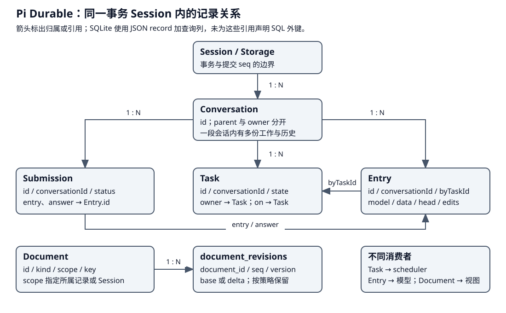

# Pi Durable：Document、上下文投影与异步摘要

Pi Durable 用 Entry 保留历史贡献，用 Document 管理可变资料，再把历史范围投影为模型上下文。Document 的“当前运行视图”和 ContextView 的“模型输入”用途不同；学习时先看资料由谁使用。


上一章已经把模型响应和工具结果写成 Entry，并让 Task checkpoint 保存推进位置。本章从这些已提交事实继续，解释两个消费者怎样取资料：产品通过 Document 观察当前进度，模型通过 ContextView 读取历史贡献。摘要则改变后续模型采用的范围。

| 阶段 | 当前资料 | 后续消费者 |
|---|---|---|
| 1. 建立记录与地址 | Entry、Task、typed Document | Session 的事务草稿 |
| 2. 提交并发布 | Storage 成功后的已采用状态 | Document 观察者、产品界面 |
| 3. 构造模型视图 | cutoff 限定的 Entry 范围 | generation.request |
| 4. 放置摘要 | 已生成摘要与 firstKept | 后续 ContextView 与模型请求 |

## 第一步：分别记录历史贡献和当前资料

在导出任务里，UserEntry 保存原目标，assistant Entry 保存模型动作请求，tool result Entry 保存观察。这些贡献应当可以追溯。与此同时，界面想知道“当前哪个工具正在运行”，scheduler 想知道“哪一个生成负责输入收口”，应用还可能要保存自己的可变任务资料。将所有这些都当成历史消息，会让消费者反复解析文本来判断当前状态。

Document 为后者提供 typed JSON。`pi.live` 保存当前 run、generation 和 tools，工具进度可以更新它；历史 Entry 则保存已结束的贡献。一个工具结束时，结果进入 Entry，工具 slot 变成 done 并清理运行中输出，两种变化可同批提交。[pi.live 的字段与视图职责](https://github.com/earendil-works/pi/blob/2ec55d808d455b1a64a2bf7888198207a096120a/packages/durable/src/harness/live.ts#L81)。

| 资料 | 谁消费 | 应放到哪里 |
|---|---|---|
| “修复 CSV 转义”的目标与代码观察 | 模型、历史浏览 | Entry.model 贡献 |
| 工具正在运行、已显示多少输出 | 产品观察者 | pi.live Document |
| 当前由 G2 负责收口 S1 | Harness 的运行控制 | pi.live.run |
| 下一阶段要等待哪些 tool IDs | scheduler／任务阶段 | Task checkpoint |
| 应用定义的可变结构资料 | 对应任务或会话代码 | typed Document，按 scope 寻址 |

Document 可以承载计划资料，但必须由应用定义、更新并让规划／执行代码消费；存在可变 JSON 并不表示内核已经有一个独立 Planner。

### 资料需要什么地址与作用域

defineDoc/defineDocFamily 声明 kind、schema version、scope 以及初始值、history/fork 等策略。地址还需要 owner ID，family 可以增加 key。调用 tx.doc 获得事务中的可变草稿；它与观察句柄或已提交值不是同一个对象。

| scope | 归属范围 | 适合的资料 |
|---|---|---|
| session | 整个事务 session | 多 conversation 共用的应用状态 |
| conversation | 一段会话 | pi.live、该会话配置和资料 |
| task | 一份 Task | 特定工作自己的结构资料 |

例如宿主可用 session scope 保存各会话的业务索引，用 conversation scope 保存 CSV 修复计划，用 task scope 保存一次 codemode 的交付日志。后者随所属任务终态退休；conversation 文档的 history/fork 控制分支如何读取或复制资料。Document 是一个有地址和生命周期的 JSON 对象，业务里称作 session 或 task 的实体需要由应用自己映射。

Pi Durable 检查 owner 身份和记录 schema，不允许只凭同一个 kind 在任意作用域读写。history 与 fork 策略也影响资料在回退或分支时如何解释，例如 pi.live 声明 latest 与 fork=initial，不能把运行进度视为应原样复制到新分支的历史事实。[定义与地址](https://github.com/earendil-works/pi/blob/2ec55d808d455b1a64a2bf7888198207a096120a/packages/durable/src/documents.ts#L109)、[LiveDoc 策略](https://github.com/earendil-works/pi/blob/2ec55d808d455b1a64a2bf7888198207a096120a/packages/durable/src/harness/live.ts#L111)。

## 第二步：提交成功后向观察者发布

### 先看一份 Session 实际保存什么 {#storage-model}



这里的 Session 是事务与存储边界，内部可以有多段 Conversation。历史、工作和当前资料采用不同记录，交接靠显式 ID；类型中的 ID 是数字，不能把界面标签 G1 或 E1 当作原始 JSON 值。[记录定义](https://github.com/earendil-works/pi/blob/2ec55d808d455b1a64a2bf7888198207a096120a/packages/durable/src/types.ts#L397)。

| 记录 | 身份与关联 | 当前值／历史的含义 |
|---|---|---|
| ConversationRecord | `id`；分支 `parent={conversationId,at}`；创建归属 `owner={conversationId,taskId}` | parent 限定继承到哪条历史；owner 表示谁创建并控制子会话，两条关系不同 |
| SubmissionRecord | `id/conversationId`；`requestId` 在会话内去重；`entry/answer` 引用 Entry | 保存一次输入的接纳及回答状态 |
| EntryRecord | `id/conversationId/kind`；`byTaskId` 可指产出任务 | 不可变历史；`model` 是消息数组，`data` 是应用 JSON；`head/edits` 决定投影 |
| TaskRecord | `id/conversationId/kind/version`；`owner` 引用父 Task | `input` 与 `state` 保存工作；waiting 的 `on` 引用依赖任务，checkpoint 由该种任务定义解释 |
| DocumentRecord 与修订 | `id/kind/scope`，family 可有 `key`；修订以 `document_id/seq` 寻址 | 记录文档的一次创建到退休；值由 base 加后续 delta 重建，是否保留旧修订取决于 history 策略 |

SQLite 后端把它们映射到 `conversations/entries/submissions/tasks/documents/document_revisions`。前五张表的 `record` 列保存 JSON，另取 `conversation_id/status/kind` 等列供查询；这不是把每个嵌套字段都拆成关系表。`record_ids` 在各类记录间登记身份，`durable_metadata` 保存分配位置。关系由 Session／Storage 的规则维护，这份 DDL 没有为上述引用声明 SQL 外键。表名还可以加 prefix，不能拿默认表名当作所有部署的绝对名称。[SQLite 建表与 v2 迁移](https://github.com/earendil-works/pi/blob/2ec55d808d455b1a64a2bf7888198207a096120a/packages/durable/src/storage/sqlite/migrations.ts#L11)。

### JSONL 与 SQLite 的官方选型依据 {#storage-choice}

官方 README 明确建议长期运行的 Agent 使用 SQLite，理由是当前 JSONL 后端除了追加文件，还把整份历史保存在内存中，内存会随历史增长。官方设计说明进一步解释：SQLite 让活跃上下文、任务和待处理输入等工作集留在内存，其余资料按需从磁盘读取。这个区别来自当前后端实现，不是 JSONL 格式本身必然要求全量常驻内存。[官方后端说明](https://github.com/earendil-works/pi/blob/2ec55d808d455b1a64a2bf7888198207a096120a/packages/durable/README.md#storage)、[官方设计说明的 Long runs anywhere](https://earendil.com/posts/pi-durable/#long-runs-anywhere)。

| 考量 | JSONL 当前实现 | SQLite 当前实现 |
|---|---|---|
| 历史不断增长 | 文件外另有完整历史的内存表示 | 历史留在数据库，按需查询；Session 缓存可回收 |
| 同批提交 | 附属文件先追加，再由 main marker 确认 | 一次 SQL transaction 对应一次 Session commit |
| 文档与任务读取 | 恢复文件后建立内存记录与索引 | 按索引读取记录及文档 base／delta 区间；活跃 Task 变化替换相应行 |
| 宿主接入 | 依赖可移植 FileSystem 能力 | 依赖异步 SQLite 门面，提供 Node 和 Cloudflare Durable Object 适配 |

例如一段对话已经积累很多轮工具结果，compact 可以让下一请求只带摘要和近期内容，但旧 Entry 仍然保存。因此它能缩小模型输入，不能据此推定 JSONL 后端已释放旧历史；SQLite 则不需要让全部旧历史一直驻留进程内存。上层的文档缓存回收也不等于 JSONL 的完整存储镜像被清空。[JSONL 内存准备层](https://github.com/earendil-works/pi/blob/2ec55d808d455b1a64a2bf7888198207a096120a/packages/durable/src/storage/jsonl/storage.ts#L241)、[两种后端的存储规范](https://github.com/earendil-works/pi/blob/2ec55d808d455b1a64a2bf7888198207a096120a/packages/durable/docs/spec.md#11-backends)。

宿主选择也是官方说明的一部分：两套后端的可移植内核都不依赖 Node API，应用注入文件系统或数据库适配；Cloudflare 的 SQLite-backed Durable Object 有对应 SQLite 入口。无论选择哪个后端，当前契约仍是一个进程拥有一份 Storage，SQLite 不会让 Harness 自动变成多进程写入系统。[宿主与单进程归属](https://github.com/earendil-works/pi/blob/2ec55d808d455b1a64a2bf7888198207a096120a/packages/durable/README.md#storage)。

耐久性需要单独比较配置。Node SQLite 默认使用 WAL 与 synchronous=NORMAL，可应对普通进程崩溃，但最新提交可能在断电或宿主故障时丢失；JSONL 默认 fsync=false，启用后的具体确认边界见[下节](#jsonl-confirmation)。不能只凭后端名称推定断电零丢失。将 JSONL 用于规模可控、便于直接查看文件的本地流程，是据文件形态和内存成本作出的工程判断；本次查到的官方材料没有给出同负载下两者的性能排名。[默认配置与边界](https://github.com/earendil-works/pi/blob/2ec55d808d455b1a64a2bf7888198207a096120a/packages/durable/README.md#storage)。

### 同一批 StorageWrite，怎样落到文件或表 {#storage-writes}

上面的图选 SQLite 展示记录关系；实际后端来自 [Harness 的显式装配](architecture.md#第一步-装配会话、定义与调度器)，没有“默认唯一使用 JSONL”的约定。Session 先产生与后端无关的 StorageWrite[]，再调用已注入实例的 commit。SQLite 在数据库事务中处理它们；JSONL 则把同一批编码为 main 中的完整记录或附属文件引用。[八种 StorageWrite](https://github.com/earendil-works/pi/blob/2ec55d808d455b1a64a2bf7888198207a096120a/packages/durable/src/types.ts#L852)、[SQLite 事务入口](https://github.com/earendil-works/pi/blob/2ec55d808d455b1a64a2bf7888198207a096120a/packages/durable/src/storage/sqlite/storage.ts#L187)、[SQLite 文档写入执行点](https://github.com/earendil-works/pi/blob/2ec55d808d455b1a64a2bf7888198207a096120a/packages/durable/src/storage/sqlite/storage.ts#L864)。

| write.type | JSONL 后端的保存位置 | SQLite 后端的主要落点 |
|---|---|---|
| conversation | main.jsonl 中的完整记录 | conversations |
| entry | main.jsonl 中的完整记录 | entries |
| submission | main.jsonl 中的完整记录 | submissions |
| task | 非 terminal 的完整记录进 task-&lt;id&gt;.jsonl，main 保存引用；terminal 的完整记录进 main | tasks，状态作为记录的一部分更新 |
| document.create | main 保存元数据与引用，doc-&lt;id&gt;.jsonl 保存初始 base | documents 与 document_revisions |
| document.copy | 从来源物化内容，按新文档的 create 保存 | 新 documents 记录与初始修订 |
| document.change | doc-&lt;id&gt;.jsonl 保存 base 或 delta，main 保存引用 | document_revisions；当前内容按 seq 查询并重建 |
| document.retire | main 保存退休标记，符合回收条件的 doc 文件可删除 | 文档的退休状态及按保留策略处理的修订 |

所以文件布局是 main.jsonl 加上**每个 Task／Document 各自的文件**，不是固定三个 JSONL。LiveDoc、UsageDoc 和 InboxDoc 有不同 DocumentId，也各有文件。Task checkpoint 是完整任务记录中的字段；Document base 是完整 JSON 值，delta 是文档操作，两者不能当作同一种 checkpoint。document.copy 也不是另有一类 copy 文件；JSONL 的内存准备层会把它展开为 create。[JSONL 编码分流](https://github.com/earendil-works/pi/blob/2ec55d808d455b1a64a2bf7888198207a096120a/packages/durable/src/storage/jsonl/storage.ts#L384)、[copy 的准备](https://github.com/earendil-works/pi/blob/2ec55d808d455b1a64a2bf7888198207a096120a/packages/durable/src/storage/memory.ts#L268)。

### JSONL 如何确认同一批，失败后读哪一份 {#jsonl-confirmation}

一次推进可能同时改变消息、任务和展示资料，重开时需要知道这些变化是否已经共同确认。JSONL 因此先写任务与文档的内容，再用主文件确认整批；消费者随后才采用新事实。[提交顺序大图](architecture.md#commit-map)底部给出实现对照：校验本批并分配 seq，追加 task/doc 附属文件，再向 main.jsonl 追加 {format,type:"commit",seq,writes}；附属记录按 seq/ordinal 与主文件引用配对。完成后后端更新索引并返回 seq，Session 才 adopt/publish。[JSONL commit 执行点](https://github.com/earendil-works/pi/blob/2ec55d808d455b1a64a2bf7888198207a096120a/packages/durable/src/storage/jsonl/storage.ts#L278)。

重开时，完整 main commit marker 确认批次；未确认的附属尾部会截断，不完整尾行按恢复规则处理。已经确认且按保留规则仍需使用的内容缺失，会报损坏。[恢复与一致性检查](https://github.com/earendil-works/pi/blob/2ec55d808d455b1a64a2bf7888198207a096120a/packages/durable/src/storage/jsonl/storage.ts#L535)。

回收发生在本次 Storage.commit 内：先追加 main marker、采用后端内存状态，再 await reclaimSidecars，最后返回 seq。启用 fsync 时，回收前还先 flush main；flush 或替换失败则保留旧文件，已确认提交继续有效。这个路径随提交尝试回收，采用可重试的 best effort 方式。[回收的调用时点](https://github.com/earendil-works/pi/blob/2ec55d808d455b1a64a2bf7888198207a096120a/packages/durable/src/storage/jsonl/storage.ts#L278)、[文件删除与替换](https://github.com/earendil-works/pi/blob/2ec55d808d455b1a64a2bf7888198207a096120a/packages/durable/src/storage/jsonl/storage.ts#L507)。

| 本批确认的变化 | 回收动作 | 继续读取需要什么 |
|---|---|---|
| Task 进入 terminal | 完整终态已在 main，尝试删除对应 task 文件 | main 中的 Task 结果 |
| 当前值 Document 追加 delta | 保留适用 base 与后续 delta | 用整条必要链重建最新值 |
| 当前值 Document 写入新 base | 用本批完整 base 替换对应 doc 文件中的旧链 | 新 base，以及此后追加的 delta |
| 当前值 Document 退休 | main 保存退休事实，尝试删除对应 doc 文件 | 退休记录 |
| conversation 文档为 history=rewindable | 保留可按历史位置读取的修订 | 对应时点的 base 与 delta |

这里“当前值 Document”包括 session／task scope，以及 conversation scope 的 history=latest。**最新值指最近一次已确认修改后的 JSON 内容；新 base 指保存这份内容的一条完整修订。** 两者可能处在不同提交：例如 seq=10 保存 base `{count:1}`，seq=11、12 分别修改成 2、3，当前值就是 seq=12 的 `{count:3}`，文件仍需保留 10～12 的链。若 seq=13 保存完整 base `{count:4}`，才可用这一新 base 替换旧链。定义的 checkpointWhen 可以要求把普通修改保存为完整 base；内容 schema 的 version 字段继续表示结构版本。[当前值策略](https://github.com/earendil-works/pi/blob/2ec55d808d455b1a64a2bf7888198207a096120a/packages/durable/src/storage/jsonl/storage.ts#L107)、[回收条件](https://github.com/earendil-works/pi/blob/2ec55d808d455b1a64a2bf7888198207a096120a/packages/durable/src/storage/jsonl/storage.ts#L451)、[完整 base 的选择](https://github.com/earendil-works/pi/blob/2ec55d808d455b1a64a2bf7888198207a096120a/packages/durable/src/session/transaction.ts#L861)。

这里保证的是按提交标记恢复一致状态；断电耐久性还取决于文件 flush。`fsync` 默认 false，启用后会在追加 main marker 前 flush 受影响的附属文件，不能据此宣称所有提交都具有断电零丢失保证。Storage 抛错后 Session 也不会假定“什么都没写”，而是停止使用当前实例并由重开恢复确认。[JSONL fsync 选项](https://github.com/earendil-works/pi/blob/2ec55d808d455b1a64a2bf7888198207a096120a/packages/durable/src/storage/jsonl/storage.ts#L77)、[Session 失败边界](architecture.md#失败发生在哪一步-决定能撤销什么)。

### 样例：结果 Entry 怎样让等待任务继续

沿 CSV 修复任务，设 Conversation 为 1，输入 Submission 为 10，生成任务为 12，读取工具任务为 14。下列 JSON 是多个逻辑记录的字段节选，外层分组是教学整理，省略定义版本、任务 input、Entry kind、模型消息的完整协议字段等，不是可直接导入的数据库快照：

```json
{
  "submission": {"id":10,"conversationId":1,"type":"input","status":"placed","entry":11},
  "assistantEntry": {"id":13,"conversationId":1,"byTaskId":12},
  "resultEntry": {"id":15,"conversationId":1,"byTaskId":14,
    "model":[{"role":"toolResult","toolCallId":"r1",
      "content":[{"type":"text","text":"export 函数尚未转义字段"}]}]},
  "generation": {"id":12,"conversationId":1,"state":{
    "status":"waiting","on":[14],"policy":"allSettled",
    "checkpoint":{"phase":"tools","assistant":13,"tools":[14],"pending":[]}}},
  "tool": {"id":14,"conversationId":1,"owner":12,"state":{
    "status":"terminal","outcome":{"status":"completed","result":{"kind":"model","entryId":15}}}}
}
```

写入前，任务 12 在等 14；工具结束的一次提交可以同时保存 14 的终态、结果 Entry 15 和 `pi.live` 的工具完成视图。提交采用后，scheduler 沿 `on=[14]` 检查等待条件，generation 从 `checkpoint.phase=tools` 继续，并按结果中的 `entryId=15` 找到“export 函数尚未转义字段”的观察；其中 r1 配对此前 assistant 的读取调用，与 Task ID 14 分开。下一 generation 构造上下文时，读取范围才会包含 Entry 15 的模型贡献；不是把 Task 的整份 JSON 发给模型。Submission 10 此时仍是 placed，后续回答 Entry 才可能让它成为 done。

若同批更新的 Document 身份为 2，修订的 `seq=8` 表示第 8 号提交，不表示第 8 条消息，也不等于 Task 12。读取文档 2 时从适用 base 应用后续 delta；读取历史消息时按 Conversation 的 Entry 范围；恢复工作时读 Task。三种读取共用提交边界，消费的结构各不相同。最新值文档不承诺任意旧 seq 可回读，分支策略仍按前节的 history/fork 规则执行。

界面要看到已确认的当前资料，不能把尚可能丢弃的草稿当作完成事实。因此观察句柄读取已提交值，只有存储成功并被 Session 采用后，才收到变化通知。构造链是 Session.documentState 在会话队列加载记录，接入 CommittedStateSource，再包成 Chord replicatedState；Chord 提供可观察状态与复制，存储和任务调度仍各有执行者。[观察句柄构造](https://github.com/earendil-works/pi/blob/2ec55d808d455b1a64a2bf7888198207a096120a/packages/durable/src/session/session.ts#L356)。

因此，界面可以订阅 pi.live，而模型并不会因此自动读到所有 Document。要把文档资料交给模型，需要 Prompt section 或其他请求组织代码明确读取并转换成语义材料。观察者消费已提交视图；模型消费请求组织代码明确提供的消息。

观察句柄存活期间需要保留其当前值；没有观察者、最近也没读写的文档可以从进程缓存回收。`documentRetentionMs` 默认十分钟，设为 0 表示用后即可释放，再次读取从 Storage 加载。回收内存不删除持久文档。它使一个长期 Session 接触很多会话时，不必把全部当前 JSON 永久留在堆中。[文档缓存生命周期](https://github.com/earendil-works/pi/blob/2ec55d808d455b1a64a2bf7888198207a096120a/packages/durable/src/session/session.ts#L121)。

## 第三步：从固定范围构造模型消息

ContextView 包含 head、entries、contributions 和 messages。读取时先在 Session line 捕获范围：当前 tail 或指定 at，加上可见的最新 head marker；随后从稳定范围扫描不可变 Entry，应用 edit 和 model 贡献，整理工具 call/result 次序并形成消息。[范围捕获](https://github.com/earendil-works/pi/blob/2ec55d808d455b1a64a2bf7888198207a096120a/packages/durable/src/harness/context.ts#L19)、[贡献与消息整理](https://github.com/earendil-works/pi/blob/2ec55d808d455b1a64a2bf7888198207a096120a/packages/durable/src/harness/context.ts#L123)。

这一步先确定哪些记录对当前请求有效。Entry 可以只有结构资料而没有 model 贡献，edit 可以改变旧贡献的视图，summary/reset 的 head marker 可以改变当前范围。generation.prepare 渲染位置化 Prompt sections 与工具声明；request 再从保存的 cutoff 取得上下文并运行 beforeRequest。最终 messages 由这些有效记录的模型贡献组成。

捕获范围的源码节选如下，省略 tail 查找和可见性检查。head 是最新的范围标记记录，tail 是当前历史末端或请求的 cutoff。下面以摘要标记为例：标记中的 head 字段指向保留起点 firstKept；扫描保留段后，再采用标记自身的摘要贡献。reset 等其他标记按各自的 model 贡献组织消息。

```ts
if (at === undefined) {
  tail = (await storage.scanEntries({ conversationId }, 1, undefined, context)).items[0]?.id;
  if (tail === undefined) return undefined;
} else {
  // 省略：确认 at 对当前 conversation 可见。
  tail = at;
}
return { head: await storage.findLatestHeadMarker(conversationId, tail, context), tail };
```

generation 使用执行章第二步准备时保存的 cutoff 调用 runtime.context，下一生成会捕获新的范围。因此同一轮请求与随后新增资料有明确时间关系。[范围捕获实现](https://github.com/earendil-works/pi/blob/2ec55d808d455b1a64a2bf7888198207a096120a/packages/durable/src/harness/context.ts#L19)。

假设摘要标记 H 的 ID 为 E10，H.head=E5，tail=E12，则范围扫描 E5 至 E12；活动记录采用 H，再接 E5/E6/E7/E8/E9/E11/E12。这个例子假定其他记录都没有 head 字段；标记 H 从扫描段中移除，作为摘要放到最前。[扫描查询与活动记录选择](https://github.com/earendil-works/pi/blob/2ec55d808d455b1a64a2bf7888198207a096120a/packages/durable/src/harness/context.ts#L268)。

### 应用输入与展示记录怎样进入

输入 Submission 可以附带 `entry: { kind, data }`，将业务目标保存为应用自己的 Entry 类型，content 仍贡献用户消息。kind 需非空且不以 pi. 开头。程序因此能按业务字段关联输入，无需从模型正文猜测工作身份。

只含 kind/data 的展示 write 不改变模型上下文，允许在忙时直接追加并收为 done；若前面排着 reset，则仍等待，避免记录被该 reset 隐藏。包含 model、head 或 edits 的写入会影响模型，仍需遵守接纳边界。[输入与展示写入的接纳](https://github.com/earendil-works/pi/blob/2ec55d808d455b1a64a2bf7888198207a096120a/packages/durable/src/harness/submissions.ts#L201)。

## 第四步：生成摘要，并在允许边界放置


压缩的目标是用较短摘要代替较早材料，同时保留近期的详细消息。CompactionTask 先 select 范围，再把摘要请求所需资料存入 summarize checkpoint。模型在事务外产生摘要；正常非空、无工具调用的回答才能成为候选。之后保存摘要 Entry，head 指向 firstKept，ContextView 据此解释保留范围。

| 方式 | 为什么存在 | 摘要怎样采用 |
|---|---|---|
| generation-owned 阻塞摘要 | 当前生成需要先减小上下文，才能继续请求 | generation 持有 run 并等待 child；摘要直接追加到受控边界 |
| conversation-owned 背景摘要 | 主工作继续推进，摘要并行准备 | 用 write Submission 接纳；空闲直接放，忙时等允许边界 |

背景摘要生成期间，Conversation 可能继续增加 Entry。因此“LLM 返回摘要”只代表文字准备好；真正生效要经过接纳、放置和范围检查。若旧范围已经不适用，write 可以按 stale 收口。这样不会让后台任务绕过活跃生成，直接改写它正在依据的上下文。[CompactionTask](https://github.com/earendil-works/pi/blob/2ec55d808d455b1a64a2bf7888198207a096120a/packages/durable/src/harness/compaction.ts#L112)、[两种放置路径](https://github.com/earendil-works/pi/blob/2ec55d808d455b1a64a2bf7888198207a096120a/packages/durable/src/harness/compaction.ts#L428)。

举例说，摘要浓缩“已读需求、确认 CSV 的转义规则”，近期修改与验证结果仍逐条保留；接下来模型既有任务方向，也能读取最近验证失败的具体细节。摘要作为语义材料进入下一请求，近期结果继续提供具体观察。

placeSummary 的两个采用出口直接对应上表。下面节选入口选择，entry 已包含摘要的 model 贡献和 head=firstKept：

```ts
const result: CompactionResult = current.owner === undefined
  ? { submissionId: (await admitSubmission(
      tx, runtime.conversationId,
      { type: "write", requestId: `compaction:${runtime.taskId}`, entry },
      runtime.now(), runtime.settings,
    )).id }
  : { entryId: (await tx.appendEntry(runtime.conversationId, entry)).id };
return { status: "terminal", outcome: { status: "completed", result } };
```

无 owner 的后台摘要取得 write Submission，由接纳流程决定放置；有 generation owner 的阻塞摘要直接追加，等待它的 generation 随后继续。这条分支把文字生成接到了会话的实际采用位置。[摘要放置实现](https://github.com/earendil-works/pi/blob/2ec55d808d455b1a64a2bf7888198207a096120a/packages/durable/src/harness/compaction.ts#L428)。

## 摘要之后如何恢复请求基线

保留段可能已经包含 assistant 消息，而摘要后重新渲染的完整 system baseline 出现在后面。ContextView 会识别这个 baseline，将其放到请求最前，再接摘要及保留内容；其他后续 system 贡献保持原有位置。因而前面的活动 Entry 顺序不等于最终 messages 的排列。读者推导消息时，需要在贡献整理后再应用这一规则。[baseline 与消息整理](https://github.com/earendil-works/pi/blob/2ec55d808d455b1a64a2bf7888198207a096120a/packages/durable/src/harness/context.ts#L145)。

压缩政策还可按精确的 provider/modelId 设置 modelOverrides。阈值判断、溢出恢复和摘要任务读取适用模型的配置；一次 Harness 服务不同窗口的模型时，不必共享同一组阈值。[模型政策选择](https://github.com/earendil-works/pi/blob/2ec55d808d455b1a64a2bf7888198207a096120a/packages/durable/src/harness/compaction.ts#L262)。

阻塞压缩明确失败时，等待它的 generation 以 model_error 收口，避免仍用过大的上下文继续请求。后台或手动压缩失败则保留最新 compactionFailure 供界面读取，直到成功产生摘要清除。摘要文字、采用时机、失败状态各有消费者；不能只观察压缩 Task 已离开任务图。[阻塞结果检查](https://github.com/earendil-works/pi/blob/2ec55d808d455b1a64a2bf7888198207a096120a/packages/durable/src/harness/generation.ts#L147)、[失败展示资料](https://github.com/earendil-works/pi/blob/2ec55d808d455b1a64a2bf7888198207a096120a/packages/durable/src/harness/live.ts#L74)。

## 预算与结构的分工

上下文预算会利用适用范围内的 assistant usage，再估算新增消息；缺少可用测量时改用估算。它判断请求是否需要压缩，不等于统计 Storage 的字节数。可变 Document、完整历史和模型上下文的规模因此不能混算。[预算与摘要处理](https://github.com/earendil-works/pi/blob/2ec55d808d455b1a64a2bf7888198207a096120a/packages/durable/src/harness/compaction.ts#L331)。

Pi Durable 的组合体现了三种职责：Entry 保存语义来源，Document 维护当前结构状态，Task checkpoint 保存推进位置。ContextView 把语义来源组织给模型，事务与调度把模型选择组织成程序工作。与 AgentSession 的历史树比较时，应分别比较这些问题，分别定位历史贡献、当前资料与工作推进的位置。

学习自检：pi.live 更新为什么不会自动进入模型 Prompt？cutoff、head、firstKept 各限定哪一部分输入？后台摘要已生成但尚未放置时，当前请求应该采用哪段上下文？
