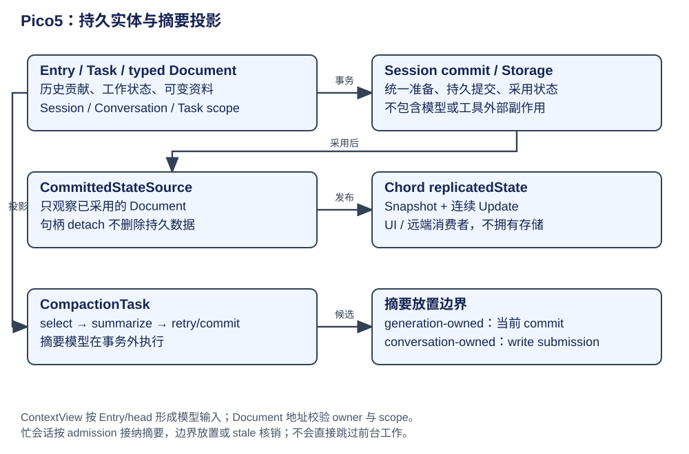
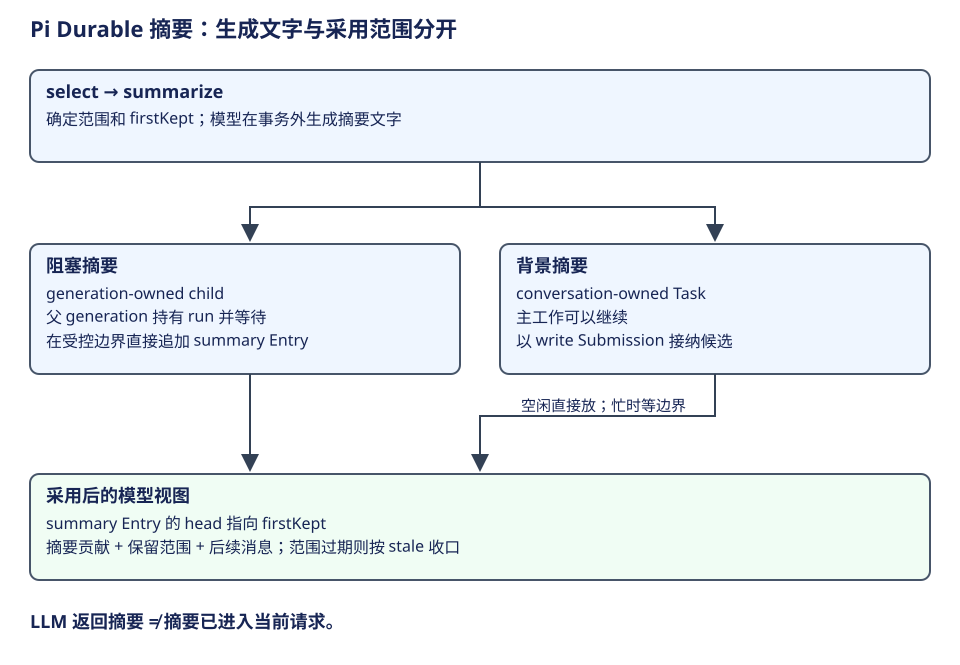

# Pico5：Document、上下文投影与异步摘要

Pico5 用 Entry 保留历史贡献，用 Document 管理可变资料，再把历史范围投影为模型上下文。Document 的“当前运行视图”和 ContextView 的“模型输入”用途不同；学习时先问消费者是谁。




上一章已经把模型响应和工具结果写成 Entry，并让 Task checkpoint 保存推进位置。本章从这些已提交事实继续，解释两个消费者怎样取资料：产品通过 Document 观察当前进度，模型通过 ContextView 读取历史贡献。摘要则改变后续模型采用的范围。

| 阶段 | 当前资料 | 后续消费者 |
|---|---|---|
| 1. 建立记录与地址 | Entry、Task、typed Document | Session 的事务草稿 |
| 2. 提交并发布 | Storage 成功后的已采用状态 | Document 观察者、产品界面 |
| 3. 构造模型视图 | cutoff 限定的 Entry 范围 | generation.request |
| 4. 放置摘要 | 已生成摘要与 firstKept | 后续 ContextView 与模型请求 |

## 第一步：分别记录历史贡献和当前资料

在导出任务里，UserEntry 保存原目标，assistant Entry 保存模型动作请求，tool result Entry 保存观察。这些贡献应当可以追溯。与此同时，界面想知道“当前哪个工具正在运行”，scheduler 想知道“哪一个生成负责输入收口”，应用还可能要保存自己的可变任务资料。将所有这些都当成历史消息，会让消费者反复解析文本来判断当前状态。

Document 为后者提供 typed JSON。`pi.live` 保存当前 run、generation 和 tools，工具进度可以更新它；历史 Entry 则保存已结束的贡献。一个工具结束时，结果进入 Entry，工具 slot 变成 done 并清理运行中输出，两种变化可同批提交。[pi.live 的字段与视图职责](https://github.com/earendil-works/pi/blob/f1b2e77f5b13b2a199b1052cb79c235451afe7d7/packages/durable/src/harness/live.ts#L43)。

| 资料 | 谁消费 | 应放到哪里 |
|---|---|---|
| “修复 CSV 转义”的目标与代码观察 | 模型、历史浏览 | Entry.model 贡献 |
| 工具正在运行、已显示多少输出 | 产品观察者 | pi.live Document |
| 当前由 G2 负责收口 S1 | Harness 的运行控制 | pi.live.run |
| 下一阶段要等待哪些 tool IDs | scheduler／任务阶段 | Task checkpoint |
| 应用定义的可变结构资料 | 对应任务或会话代码 | typed Document，按 scope 寻址 |

Document 可以承载计划资料，但必须由应用定义、更新并让规划／执行代码消费；存在可变 JSON 并不表示内核已经有一个独立 Planner。

### 资料需要什么地址与作用域

defineDoc/defineDocFamily 声明 kind、schema version、scope 以及初始值、history/fork 等策略。地址还需要 owner ID，family 可以增加 key。调用 tx.doc 获得事务中的可变草稿；它与观察句柄或已提交值不是同一个对象。

| scope | 归属范围 | 适合的资料 |
|---|---|---|
| session | 整个事务 session | 多 conversation 共用的应用状态 |
| conversation | 一段会话 | pi.live、该会话配置和资料 |
| task | 一份 Task | 特定工作自己的结构资料 |

Pico5 检查 owner 身份和记录 schema，不允许只凭同一个 kind 在任意作用域读写。history 与 fork 策略也影响资料在回退或分支时如何解释，例如 pi.live 声明 latest 与 fork=initial，不能把运行进度视为应原样复制到新分支的历史事实。[定义与地址](https://github.com/earendil-works/pi/blob/f1b2e77f5b13b2a199b1052cb79c235451afe7d7/packages/durable/src/documents.ts#L109)、[LiveDoc 策略](https://github.com/earendil-works/pi/blob/f1b2e77f5b13b2a199b1052cb79c235451afe7d7/packages/durable/src/harness/live.ts#L63)。

## 第二步：提交成功后向观察者发布

Session.documentState 在 Session 队列中加载记录，接入 CommittedStateSource，再包成 Chord replicatedState。事务内部的 Draft 不直接送给观察者；Storage 提交、Session 采用后才发布。Chord 负责可观察状态与复制，存储与 Task 调度仍由各自层承担。[观察句柄构造](https://github.com/earendil-works/pi/blob/f1b2e77f5b13b2a199b1052cb79c235451afe7d7/packages/durable/src/session/session.ts#L213)。

因此，界面可以订阅 pi.live，而模型并不会因此自动读到所有 Document。要把文档资料交给模型，需要 Prompt section 或其他请求组织代码明确读取并转换成语义材料。观察者消费已提交视图；模型消费请求组织代码明确提供的消息。

## 第三步：从固定范围构造模型消息

ContextView 包含 head、entries、contributions 和 messages。读取时先在 Session line 捕获范围：当前 tail 或指定 at，加上可见的最新 head marker；随后从稳定范围扫描不可变 Entry，应用 edit 和 model 贡献，整理工具 call/result 次序并形成消息。[范围捕获](https://github.com/earendil-works/pi/blob/f1b2e77f5b13b2a199b1052cb79c235451afe7d7/packages/durable/src/harness/context.ts#L18)、[贡献与消息整理](https://github.com/earendil-works/pi/blob/f1b2e77f5b13b2a199b1052cb79c235451afe7d7/packages/durable/src/harness/context.ts#L117)。

这一步先确定哪些记录对当前请求有效。Entry 可以只有结构资料而没有 model 贡献，edit 可以改变旧贡献的视图，summary/reset 的 head marker 可以改变当前范围。generation.prepare 渲染位置化 Prompt sections 与工具声明；request 再从保存的 cutoff 取得上下文并运行 beforeRequest。模型看到的是被组织好的消息，而不是 Session 的所有数据表。

捕获范围的源码节选如下，省略 tail 查找和可见性检查。head 是最新的范围标记记录，tail 是当前历史末端或请求的 cutoff。下面以摘要标记为例：标记中的 head 字段指向保留起点 firstKept；扫描保留段后，再采用标记自身的摘要贡献。reset 等其他标记按各自的 model 贡献组织消息。

```ts
if (at === undefined) {
  tail = (await storage.scanEntries({ conversationId }, 1, undefined, context)).items[0]?.id;
  if (tail === undefined) return undefined;
} else {
  // 省略：确认 at 对当前 conversation 可见。
  tail = at;
}
return { head: await storage.findLatestHeadMarker(conversationId, tail, context), tail };
```

generation 使用执行章第二步准备时保存的 cutoff 调用 runtime.context，下一生成会捕获新的范围。因此同一轮请求与随后新增资料有明确时间关系。[范围捕获实现](https://github.com/earendil-works/pi/blob/f1b2e77f5b13b2a199b1052cb79c235451afe7d7/packages/durable/src/harness/context.ts#L18)。

假设摘要标记 H 的 ID 为 E10，H.head=E5，tail=E12，则范围扫描 E5 至 E12；活动记录采用 H，再接 E5/E6/E7/E8/E9/E11/E12。这个例子假定其他记录都没有 head 字段；标记 H 从扫描段中移除，作为摘要放到最前。[扫描查询与活动记录选择](https://github.com/earendil-works/pi/blob/f1b2e77f5b13b2a199b1052cb79c235451afe7d7/packages/durable/src/harness/context.ts#L228)。

## 第四步：生成摘要，并在允许边界放置



压缩的语义目标是用较短摘要代替较老材料，同时保留近处的详细消息。CompactionTask 先 select 范围，再把摘要请求所需资料存入 summarize checkpoint。模型在事务外产生摘要；正常非空、无工具调用的回答才能成为候选。之后保存摘要 Entry，head 指向 firstKept，ContextView 据此解释保留范围。

| 方式 | 为什么存在 | 摘要怎样采用 |
|---|---|---|
| generation-owned 阻塞摘要 | 当前生成需要先减小上下文，才能继续请求 | generation 持有 run 并等待 child；摘要直接追加到受控边界 |
| conversation-owned 背景摘要 | 主工作继续推进，摘要并行准备 | 用 write Submission 接纳；空闲直接放，忙时等允许边界 |

背景摘要生成期间，Conversation 可能继续增加 Entry。因此“LLM 返回摘要”只代表文字准备好；真正生效要经过接纳、放置和范围检查。若旧范围已经不适用，write 可以按 stale 收口。这样不会让后台任务绕过活跃生成，直接改写它正在依据的上下文。[CompactionTask](https://github.com/earendil-works/pi/blob/f1b2e77f5b13b2a199b1052cb79c235451afe7d7/packages/durable/src/harness/compaction.ts#L103)、[两种放置路径](https://github.com/earendil-works/pi/blob/f1b2e77f5b13b2a199b1052cb79c235451afe7d7/packages/durable/src/harness/compaction.ts#L401)。

举例说，摘要浓缩“已读需求、确认 CSV 的转义规则”，近期修改与验证结果仍逐条保留；接下来模型既有任务方向，也能读取最近验证失败的具体细节。摘要作为语义材料进入下一请求，近期结果继续提供具体观察。

placeSummary 的两个采用出口直接对应上表。下面节选入口选择，entry 已包含摘要的 model 贡献和 head=firstKept：

```ts
const result: CompactionResult = current.owner === undefined
  ? { submissionId: await admitSubmission(
      tx, runtime.conversationId,
      { type: "write", requestId: `compaction:${runtime.taskId}`, entry },
      runtime.now(), runtime.settings,
    ) }
  : { entryId: (await tx.appendEntry(runtime.conversationId, entry)).id };
return { status: "terminal", outcome: { status: "completed", result } };
```

无 owner 的后台摘要取得 write Submission，由接纳流程决定放置；有 generation owner 的阻塞摘要直接追加，等待它的 generation 随后继续。这条分支把文字生成接到了会话的实际采用位置。[摘要放置实现](https://github.com/earendil-works/pi/blob/f1b2e77f5b13b2a199b1052cb79c235451afe7d7/packages/durable/src/harness/compaction.ts#L401)。

## 预算与结构的分工

上下文预算会利用适用范围内的 assistant usage，再估算新增消息；缺少可用测量时改用估算。它判断请求是否需要压缩，不等于统计 Storage 的字节数。可变 Document、完整历史和模型上下文的规模因此不能混算。[预算与摘要处理](https://github.com/earendil-works/pi/blob/f1b2e77f5b13b2a199b1052cb79c235451afe7d7/packages/durable/src/harness/compaction.ts#L307)。

Pico5 的组合体现了三种职责：Entry 保存语义来源，Document 维护当前结构状态，Task checkpoint 保存推进位置。ContextView 把语义来源组织给模型，事务与调度把模型选择组织成程序工作。与 AgentSession 的历史树比较时，应分别比较这些问题，分别定位历史贡献、当前资料与工作推进的位置。

学习自检：pi.live 更新为什么不会自动进入模型 Prompt？cutoff、head、firstKept 各限定哪一部分输入？后台摘要已生成但尚未放置时，当前请求应该采用哪段上下文？
