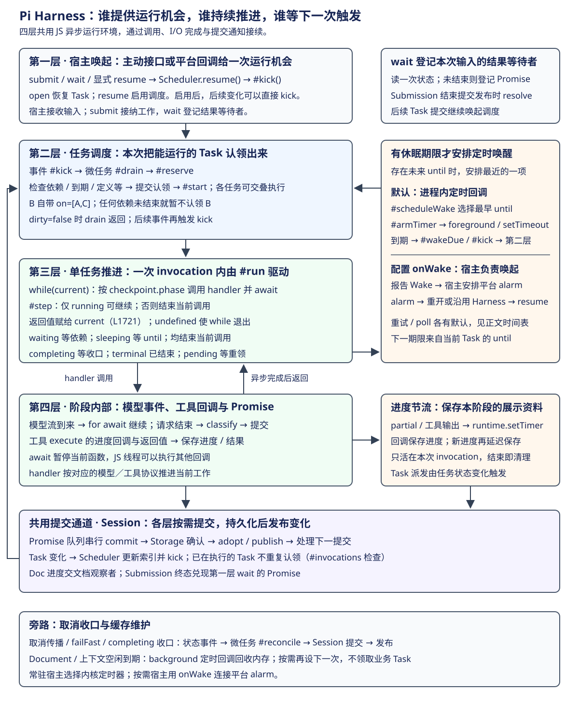
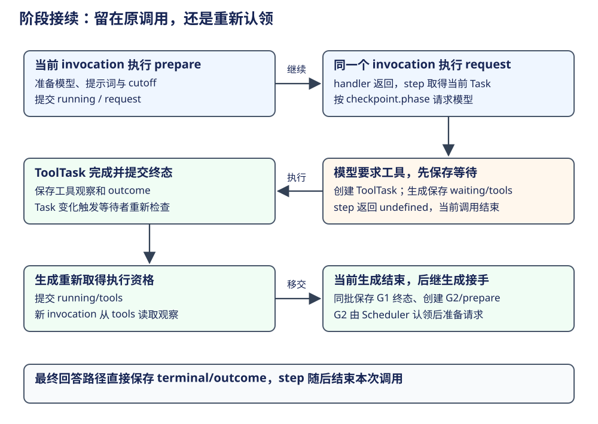
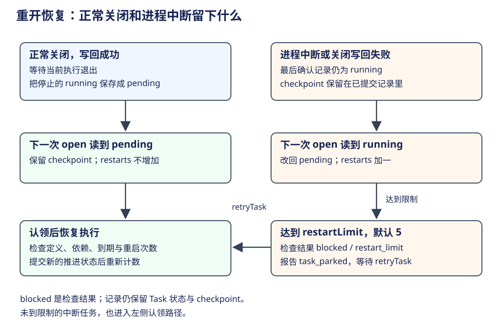

# Pi Durable：持久休眠、宿主唤醒与故障观测

Task 保存了工作位置以后，还需要宿主提供再次执行的机会。例如 CSV 修复服务要稍后查询验证结果：任务先记住查询身份和到期时刻；常驻进程用定时器继续，按需宿主用平台 alarm 重新唤起进程。重开后，新的运行对象读取同一份已提交记录，继续执行。


本章按“启动工作、推进阶段、保存等待、安排唤醒、重开恢复”的顺序展开。依赖等待、阶段接续和跨进程恢复分别用图定位；最后说明故障与追踪怎样接回这条主线。

## 先看同一对话怎样恢复旧工作、接纳新输入 {#submit-start}

沿用 26-coding-agent 的入口，把 Storage 换成已有未完成工作的 JSONL。`root` 是根 Conversation 的句柄，每次 `root.submit` 都向这个对话提交输入。假设旧 run 仍在进行，新输入使用默认 followUp 策略：


| 调用或交接 | 完成什么 | 后续消费者 |
|---|---|---|
| L62 `Harness.open` | 加载已确认记录，恢复任务索引；遗留 running 改为 pending，保留 checkpoint | Scheduler 等待启用 |
| L63 `harness.root` | 取得根 Conversation 句柄 | 应用向它提交输入 |
| L71 `root.submit` | 先 resume，再在事务中接纳新输入；对话有活动 run 时写入 queued Submission 与 InboxDoc | Scheduler 推进旧工作；生成边界消费队列 |
| 旧 run 到达 final 边界 | 默认取一个 followUp，放入历史并启动新 run | 新 GenerationTask 处理该输入 |
| L71 `.wait` | 等这份 Submission 收口 | 调用者取得持久结果 |

入口调用链是 Conversation.submit → Submissions.submit → resume／接纳事务。随后由 Scheduler 的认领与阶段执行接手。[示例入口](https://github.com/earendil-works/pi/blob/2ec55d808d455b1a64a2bf7888198207a096120a/packages/durable/test/examples/26-coding-agent.ts#L62)、[启用并接纳](https://github.com/earendil-works/pi/blob/2ec55d808d455b1a64a2bf7888198207a096120a/packages/durable/src/harness/submissions.ts#L76)。

### 同一 Conversation 的新输入怎样排队

接纳事务用 `live.run` 判断对话是否正在处理输入。默认 followUp 在 final 边界采用，`followUpMode=one-at-a-time` 每次取一份，配置为 all 时可合入多份；steer 可在工具后等边界进入当前 run，reject 在忙时拒绝。其他 Conversation 和后台 Task 继续由调度器分别推进。[入队判断](https://github.com/earendil-works/pi/blob/2ec55d808d455b1a64a2bf7888198207a096120a/packages/durable/src/harness/submissions.ts#L229)、[边界取输入](https://github.com/earendil-works/pi/blob/2ec55d808d455b1a64a2bf7888198207a096120a/packages/durable/src/harness/inbox.ts#L70)。

示例 L77 位于 L71 的 wait 之后。正常完成且没有其他并发输入时，前一 run 已结束，第二次 submit 可以直接启动下一 run。只剩后台任务而对话已空闲时，新输入也可以直接接纳。

JSONL 将 queued Submission 写入 main，将 InboxDoc 的变化写入对应 doc 文件，再由 main marker 确认整批。输入在边界被采用时，才追加用户 Entry 并创建生成任务。[JSONL 提交顺序](documents.md#jsonl-confirmation)。

## Harness 的四层驱动：事件、阶段与定时唤醒 {#scheduler-loops}



| 层次 | 负责什么 | 怎样继续 |
|---|---|---|
| 宿主 | 提供一次运行机会、接纳输入或等待答案 | submit、wait、显式 resume；平台 alarm 也调用 resume |
| Scheduler | 选择现在可以执行的 Task，提交认领并启动 | Task 提交、Registry 变化、到期回调与执行结束触发 kick |
| 一次 Task 执行 | 从保存的阶段推进到下一阶段或持久等待 | handler 完成后，step 决定继续当前 invocation 或结束它 |
| 阶段内部 | 接收模型流、调用工具、保存进度与结果 | 流事件、工具回调和 Promise 完成接续当前代码 |

Harness 构造 TaskScheduler 时注入同一个 Session、Storage、Registry。open 绑定提交观察者并恢复任务，resume 启用调度。kick 把需要检查的变化合并到一个微任务，drain 再认领可运行的任务。drain、run 与 I/O 回调在 JS 执行线程上交错运行；遇到 await 时，当前调用暂停，线程继续处理其他回调。[装配](https://github.com/earendil-works/pi/blob/2ec55d808d455b1a64a2bf7888198207a096120a/packages/durable/src/harness/harness.ts#L213)、[open 与 resume](https://github.com/earendil-works/pi/blob/2ec55d808d455b1a64a2bf7888198207a096120a/packages/durable/src/harness/scheduler.ts#L374)、[kick 与 drain](https://github.com/earendil-works/pi/blob/2ec55d808d455b1a64a2bf7888198207a096120a/packages/durable/src/harness/scheduler.ts#L1437)。

### 第二层怎样认领与等待依赖

![B 保存 on=[A,C] 并结束当前执行。A 的终态提交后重新检查 B，但 C 尚未结束，B 继续等待；C 的终态提交后，所有依赖已结束，Scheduler 认领 B 并从原 checkpoint 继续。](../../assets/durable-dependency-resume.svg)

drain 清除本轮 dirty 标记，经 Session 事务 reserve 一批任务，逐个 start。认领事务检查定义、等待关系、到期时间和取消条件，将符合条件的任务改为 running，并登记 invocation。提交成功后才运行 handler；新变化把 dirty 再次置位，当前 drain 再检查一轮，无新变化时返回。[认领执行点](https://github.com/earendil-works/pi/blob/2ec55d808d455b1a64a2bf7888198207a096120a/packages/durable/src/harness/scheduler.ts#L1466)。

等待关系已经保存在 B 的记录里：`state.on=[A,C]`。waitingOn 读取这些 ID，再查 Scheduler 的 live 索引；`first=true` 找到一个未结束依赖即可判定 B 继续等待。allSettled 等待的是各依赖进入终态，成功与失败都算结束。

| 已提交事实 | 检查结果 | B 的后续 |
|---|---|---|
| A、C 都在 live 中 | 仍有依赖未结束 | 保持 waiting |
| A 已终态，C 仍在 live 中 | C 未结束 | 保持 waiting |
| A、C 都已终态 | 依赖满足 | 检查其余认领条件，通过后继续 B |

B 保存 waiting 时，Scheduler 同时登记反向 waiters 索引。A 或 C 的终态提交会把等待它的 B 放回候选集合，再 kick 检查。GenerationTask 等待 ToolTask 就使用这条路径；串行工具则先创建当前可执行的工具，完成后再创建下一个。取消父任务时，Scheduler 先等所属普通子工作退出，再运行父任务的取消处理。[依赖检查](https://github.com/earendil-works/pi/blob/2ec55d808d455b1a64a2bf7888198207a096120a/packages/durable/src/harness/scheduler.ts#L1580)、[登记与唤回](https://github.com/earendil-works/pi/blob/2ec55d808d455b1a64a2bf7888198207a096120a/packages/durable/src/harness/scheduler.ts#L1004)。

### 第三层怎样逐阶段推进



start 启动一个 Task 的异步执行并立即返回，因此同批认领的任务可以交错推进。run 的 `while (current !== undefined && !closing)` 按 `current.state.checkpoint.phase` 找 handler 并等待完成，再由 step 取得最新任务。下一阶段由已提交的 checkpoint.phase 指定，initial(input) 给出新任务的首个阶段。[start 与 run](https://github.com/earendil-works/pi/blob/2ec55d808d455b1a64a2bf7888198207a096120a/packages/durable/src/harness/scheduler.ts#L1691)。

| handler 完成后的提交状态 | step 交回什么 | 后续执行 |
|---|---|---|
| running，允许继续 | 最新 TaskRecord | 原 invocation 按新的 phase 继续 |
| waiting | undefined | 结束当前 invocation，依赖满足后重新认领 |
| sleeping | undefined | 结束当前 invocation，到期后重新认领 |
| completing | undefined | 等所属普通工作退出，完成终态收口 |
| terminal | undefined | Task 已结束，保留 outcome |
| pending，调度器交出当前执行权 | undefined | 等重新认领，沿已有 checkpoint 继续 |

例如 prepare 保存 request，下一轮执行 request；retry 保存 prepare，下一轮重新准备请求。回答路径则显式保存 terminal/completed，handler 返回后 step 结束 invocation，把 undefined 交回 run，while 随之退出。若 handler 返回时仍为 running，且没有提交新的 checkpoint，框架按“没有持久进展”报告任务故障。关闭、取消和定义替换也由 step/decide 检查。[阶段选择](https://github.com/earendil-works/pi/blob/2ec55d808d455b1a64a2bf7888198207a096120a/packages/durable/src/harness/scheduler.ts#L1721)、[继续判断](https://github.com/earendil-works/pi/blob/2ec55d808d455b1a64a2bf7888198207a096120a/packages/durable/src/harness/scheduler.ts#L1806)、[step 返回](https://github.com/earendil-works/pi/blob/2ec55d808d455b1a64a2bf7888198207a096120a/packages/durable/src/harness/scheduler.ts#L1886)。

### 主动入口与时间回调怎样唤起调度

resume 幂等启用调度并请求检查。submit 提交输入后返回句柄；wait 先读取 Submission，已结束就返回，否则登记 Promise 等待者。结束提交发布时，观察者兑现等待结果。启用以后，Task 变化与依赖结束继续由内部 kick 接手。[submit 与 wait](https://github.com/earendil-works/pi/blob/2ec55d808d455b1a64a2bf7888198207a096120a/packages/durable/src/harness/submissions.ts#L76)、[等待兑现](https://github.com/earendil-works/pi/blob/2ec55d808d455b1a64a2bf7888198207a096120a/packages/durable/src/harness/submissions.ts#L145)。

时间等待由 scheduleWake 计算最早的未来 until，再由 armTimer 安排约 `until-now` 的回调。默认 timers.foreground 最终使用 setTimeout。回调到期后 wakeDue 把任务列回候选集合，kick 触发认领；后续阶段若再次保存 sleeping，就重新计算下次期限。配置 onWake 时，由宿主按下节所述安排平台 alarm。[下一时刻](https://github.com/earendil-works/pi/blob/2ec55d808d455b1a64a2bf7888198207a096120a/packages/durable/src/harness/scheduler.ts#L1316)、[到期回调](https://github.com/earendil-works/pi/blob/2ec55d808d455b1a64a2bf7888198207a096120a/packages/durable/src/harness/scheduler.ts#L1344)。

| 时间用途 | 等待期间保留什么 | 时点由谁给出 | 回调后的动作 |
|---|---|---|---|
| 业务持久等待 | sleeping、until、checkpoint | 业务传入绝对 until | 重新认领并执行保存的阶段 |
| 模型／摘要重试 | 同上，checkpoint 含 attempt | 默认三次重试依次等 2、4、8 秒；retry 设置可覆盖 | 重新准备请求 |
| deferred 结果查询 | 同上，checkpoint 含 handle | provider 的 pollAfterMs，未提供时为 5 秒 | 查询原服务端工作 |
| 模型 partial 进度 | 当前 invocation 的累计缓冲与 inFlight | partialIntervalMs 默认 100ms | 保存进度 Document |
| 工具进度 | 当前 invocation 的输出缓冲 | 工具进度策略 | 保存进度 Document |
| 空闲缓存回收 | 文档或上下文缓存的空闲时刻 | 对应缓存保留策略 | 释放内存，后续按需加载 |

重试延迟按 `min(baseDelayMs × 2^(attempt-1), maxAgentDelayMs)` 计算，默认 baseDelayMs=2000、maxAgentDelayMs=60000。业务 until、重试退避、provider 查询和进度保存各有自己的时间来源。[重试与进度设置](https://github.com/earendil-works/pi/blob/2ec55d808d455b1a64a2bf7888198207a096120a/packages/durable/src/harness/agent.ts#L20)、[重试公式](https://github.com/earendil-works/pi/blob/2ec55d808d455b1a64a2bf7888198207a096120a/packages/ai/src/utils/retry.ts#L141)、[poll 时点](https://github.com/earendil-works/pi/blob/2ec55d808d455b1a64a2bf7888198207a096120a/packages/durable/src/harness/generation.ts#L510)。

### 提交通知怎样接回四层驱动

Session 把 commitWith 接到前一个 Promise 后串行执行，存储成功并采用新状态后发布变化。不同变化交给不同消费者：

| 发布内容 | 消费者 | 接续动作 |
|---|---|---|
| Task 状态 | Scheduler | 更新 live／waiters，kick 检查可运行工作 |
| LiveDoc partial 等文档 | 文档观察者 | 更新界面进度 |
| Submission 终态 | Submissions 的等待者 | 兑现 wait 的 Promise |

同一次提交可以让原 run 继续下一阶段，也通知外层检查其他 Task。已有 invocation 的任务在 reserve 中跳过，新建或解除等待的任务获得认领机会。取消传播、failFast 与所属工作收口由 scheduleReconcile 安排微任务，再经同一个 Session 提交。[发布后的调度](https://github.com/earendil-works/pi/blob/2ec55d808d455b1a64a2bf7888198207a096120a/packages/durable/src/harness/scheduler.ts#L624)、[已有 invocation 检查](https://github.com/earendil-works/pi/blob/2ec55d808d455b1a64a2bf7888198207a096120a/packages/durable/src/harness/scheduler.ts#L1488)、[收口旁路](https://github.com/earendil-works/pi/blob/2ec55d808d455b1a64a2bf7888198207a096120a/packages/durable/src/harness/scheduler.ts#L764)。

## 第一步：把等时间变成一条持久状态

CSV 服务要在指定时刻再次查询验证结果。wait 阶段保存查询时刻和恢复到 check 的位置，提交完成后返回：

```ts
phases: {
  wait: (task, runtime, context) => runtime.sleepUntil(
    task.input.at, { phase: "check" }, context,
  ),
  check: async (task, runtime, context) => {
    // 从 task.input 或 checkpoint 取得查询身份。
    // 查询后提交完成结果，或保存下一次查询时刻。
  },
}
```

`sleepUntil` 保存 sleeping、until 和 checkpoint，随后结束当前阶段；到期以后，新的 invocation 执行 check。需要与 Document 一起保存时，可在 runtime.commit 回调返回 `{ status: "sleeping", until, checkpoint }`。取消按所有权关系及时收口。[运行接口](https://github.com/earendil-works/pi/blob/2ec55d808d455b1a64a2bf7888198207a096120a/packages/durable/src/types.ts#L313)。

## 第二步：让宿主安排下一次出现

常驻 Node 宿主使用前述最近期限定时器；`now` 与 `setTimer` 可以注入。按需宿主传入 onWake，由内核报告 wake 摘要，再把它接到平台 alarm：

| Wake 字段 | 含义 | 宿主动作 |
|---|---|---|
| active | 有能运行、正在运行或需要推进的工作 | 安排恢复兜底 |
| at | 未来 sleeping 任务中最早的到期时刻 | 安排到期 alarm |

active 与 at 可同时存在。until 使用 Harness.now 的时间域，重开同一 Storage 的宿主要使用一致的时钟。[wake 推导](https://github.com/earendil-works/pi/blob/2ec55d808d455b1a64a2bf7888198207a096120a/packages/durable/src/harness/scheduler.ts#L477)。

Cloudflare Durable Object 示例先打开 SQLite 与 Harness，根据 wake 设置 alarm，再 resume。宿主在可能启动工作的接口之前先设恢复唤醒，使进程在“工作已提交、onWake 尚未完成”的间隙被回收后，仍有机会再次运行。alarm 到达后安排下一次兜底，再 resume。[宿主完整接线](https://github.com/earendil-works/pi/blob/2ec55d808d455b1a64a2bf7888198207a096120a/packages/durable/test-workers/worker.ts#L43)。

## 第三步：重开后定位工作，并阻止崩溃循环



| 退出时发生什么 | 磁盘记录 | 下次 open 怎样处理 |
|---|---|---|
| 正常关闭成功写回 | 停止的 running 已改为 pending，保留 checkpoint | 沿 checkpoint 等待认领，restarts 不增加 |
| 进程突然退出，或关闭写回失败 | 最后确认的记录仍为 running | 改为 pending，保留 checkpoint，restarts 加一 |
| 任务正在持久休眠 | sleeping、until 与 checkpoint | 保留原到期时刻，到期再认领 |

两种退出路径的差别直接影响崩溃循环保护。`restartLimit` 默认 5；反复打开都读到遗留 running，且任务未提交新的推进状态时，计数达到限制，检查结果为 blocked/restart_limit，并报告 task_parked。`retryTask(id)` 清除这项阻塞，让宿主显式再试。任务提交不同的新状态后重新计数；只重复保存相同状态仍保留原计数。[关闭写回](https://github.com/earendil-works/pi/blob/2ec55d808d455b1a64a2bf7888198207a096120a/packages/durable/src/harness/scheduler.ts#L516)、[重开计数](https://github.com/earendil-works/pi/blob/2ec55d808d455b1a64a2bf7888198207a096120a/packages/durable/src/harness/scheduler.ts#L374)、[推进时重置](https://github.com/earendil-works/pi/blob/2ec55d808d455b1a64a2bf7888198207a096120a/packages/durable/src/harness/scheduler.ts#L1942)。

open 对当时遗留 running 的任务分别计数，所以一次进程崩溃可能让多项任务同时增加 restarts。缺定义、定义过旧或迁移失败也会产生 blocked 检查结果；Registry 修复相应定义后可解除这些阻塞。任务的持久状态仍保存在原 TaskRecord 中。[检查契约](https://github.com/earendil-works/pi/blob/2ec55d808d455b1a64a2bf7888198207a096120a/packages/durable/src/harness/types.ts#L668)。

## 第四步：区分任务失败与整个存储会话失败

| 失败位置 | 保存或通知的结果 | 宿主处理范围 |
|---|---|---|
| 工具 execute 抛错 | 一次工具错误结果 | 当前工具与消费结果的生成 |
| Task 阶段违反契约 | Task faulted，onReport 报告 task_faulted | 当前 Task |
| 定义缺失或重启次数达限 | blocked 检查结果及具名报告 | 修复定义或显式 retryTask |
| 事务 change 回调抛错 | 撤销本次草稿，调用拒绝 | 本次事务 |
| 读取抛 StorageRequestError | 本次读取失败 | 本次调用 |
| Storage commit／mintId 抛错，或其他致命存储错误 | SessionFailed，观察流 session_failed，Harness 关闭 | 整个 Session，等待 closed 后重开 |

Session 失败后的恢复依据是后端确认过的记录；JSONL 由 main marker 判断完整批次，SQLite 由数据库事务提供提交边界。[存储失败守卫](https://github.com/earendil-works/pi/blob/2ec55d808d455b1a64a2bf7888198207a096120a/packages/durable/src/session/session.ts#L961)、[JSONL 恢复](documents.md#jsonl-confirmation)。

`onReport(error, info)` 把 session_failed、task_faulted、task_parked、定义／迁移问题及 extension_error、host_error、listener_error 交给宿主诊断。用户工作是否完成，读取对应 Submission 与业务结果。[报告类型](https://github.com/earendil-works/pi/blob/2ec55d808d455b1a64a2bf7888198207a096120a/packages/durable/src/types.ts#L164)。

## 用追踪连接一次接纳、多个阶段与重开

宿主注入 telemetry 后，submit 接纳、Task phase 和 provider 请求形成追踪关联。每次 phase span 对应一次实际阶段执行；持久等待或重开后，新阶段通过记录中的 trace carrier 关联原工作。多个输入合入 run 时，用 links 保留其余输入关系；steer 也关联正在运行的工作。[遥测结构](https://github.com/earendil-works/pi/blob/2ec55d808d455b1a64a2bf7888198207a096120a/packages/durable/src/harness/telemetry.ts#L50)。

| 要找什么 | 从哪里开始 | 接着核对 |
|---|---|---|
| 一份输入经历了哪些阶段 | submit span 与 Submission 身份 | 各 Task 的 phase span |
| 重开后是否继续了原工作 | 持久 trace carrier | 新进程的 phase span 与 Task checkpoint |
| 某次模型访问发生在哪里 | 当前 phase 的 telemetry | provider 请求 |
| 最后保存了什么结果 | 提交后的 Entry／Submission／checkpoint 事件 | Storage 中的记录与业务结果 |

常规追踪属性保存身份和控制字段。失败 phase 的诊断消息最多截取 500 字符，可能带有调用内容，宿主需按实际数据管理。报告事件只含固定字段，错误对象由 onReport 单独接收。[阶段追踪执行点](https://github.com/earendil-works/pi/blob/2ec55d808d455b1a64a2bf7888198207a096120a/packages/durable/src/harness/scheduler.ts#L1711)。

## 存储组合与代码升级

SQLite 的 prefix 可把多份 Pi 存储与宿主表放在一个数据库中。每个 prefix 对应自己的 Storage／Session 和提交线。Cloudflare 适配器协调同一 storage 对象的操作队列；宿主查询也要通过协调的适配器，避免混入正在执行的事务。[命名空间](https://github.com/earendil-works/pi/blob/2ec55d808d455b1a64a2bf7888198207a096120a/packages/durable/src/storage/sqlite/schema.ts#L54)。

持久 sleeping 需要 SQLite schema v2，打开时自动升级；1.3.0 及更早代码无法重新打开升级后的数据库。JSONL 沿用原文件格式，旧调度器仍无法解释 sleeping 状态。部署与回滚要同时匹配代码支持的 Task 状态和存储版本。[存储升级](https://github.com/earendil-works/pi/blob/2ec55d808d455b1a64a2bf7888198207a096120a/packages/durable/src/storage/sqlite/migrations.ts)。
