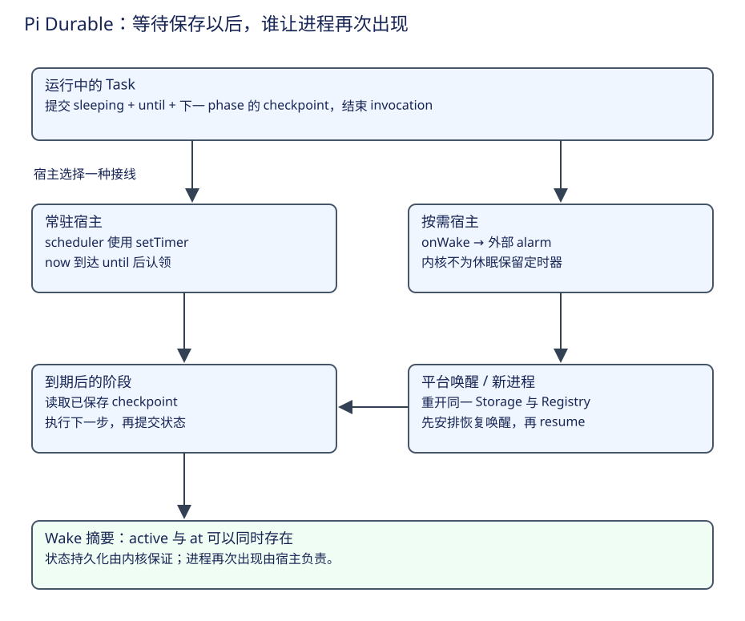

# Pi Durable：持久休眠、宿主唤醒与故障观测

前面的章节已经让 Task 保存工作位置。长期运行还需要回答一个问题：任务等待一分钟时，必须一直占着进程吗？如果平台回收了进程，谁在到期后把它重新启动？Durable 将“保存等待”交给内核，将“让进程再次出现”交给宿主。



主线依次是保存等待、安排唤醒、重开并认领、完成并观察。下面先用正常的定时工作走通这条链，再讨论反复崩溃、存储失败与追踪。

## 第一步：把等时间变成一条持久状态

假设 CSV 修复服务要求稍后再次查询一个验证结果。任务先保存下一次查询时刻及查询身份，结束当前阶段。下面按官方 Reminder 示例整理，省略输入类型、结果提交和 abort handler：

```ts
phases: {
  wait: (task, runtime, context) => runtime.sleepUntil(
    task.input.at, { phase: "check" }, context,
  ),
  check: async (task, runtime, context) => {
    // 查询所需业务资料来自 task.input 或保存的 checkpoint。
    // 实际查询以后，再提交自己的完成或下次等待状态。
  },
}
```

这是教学骨架，check 是案例命名。`sleepUntil` 在休眠状态存好后就返回，阶段随即结束；它不等到时间到达才返回。需要与 Document 等变化同批提交时，直接从 runtime.commit 回调返回 `{ status: "sleeping", until, checkpoint }`。[运行接口](https://github.com/earendil-works/pi/blob/2ec55d808d455b1a64a2bf7888198207a096120a/packages/durable/src/types.ts#L313)。

保存以后 Task 没有 invocation，直到 Harness 的 now 达到 until 才可继续。取消不必等到期；它按所有权关系收口。模型重试退避、provider 延后结果轮询和摘要重试也使用这一机制，业务资料仍放在各自 checkpoint 中。

## 第二步：让宿主安排下一次出现

在常驻 Node 进程里，调度器为最早的休眠安排定时器。`now` 提供时间，`setTimer` 提供计时，两者可由宿主注入；阶段内用于节流的 TaskRuntime.setTimer 只活在当前 invocation，不是持久睡眠。[宿主选项](https://github.com/earendil-works/pi/blob/2ec55d808d455b1a64a2bf7888198207a096120a/packages/durable/src/harness/types.ts#L608)。

按需宿主可以传入 onWake。此时内核不为持久休眠保留自己的计时器，而是报告一个摘要：

| Wake 字段 | 宿主怎样使用 |
|---|---|
| active | 存在能运行、正在运行或需要推进的工作；宿主可安排恢复兜底 |
| at | 最早的 sleeping 到期时刻；安排平台 alarm |

二者可以同时存在；其他任务正在运行时也可能有睡眠任务。它不要求整个 Session 同时进入一种状态。until 属于 Harness 的 now 时间域，重开同一存储的所有进程需要使用一致的时钟。[wake 的推导](https://github.com/earendil-works/pi/blob/2ec55d808d455b1a64a2bf7888198207a096120a/packages/durable/src/harness/scheduler.ts#L477)。

Cloudflare Durable Object 示例在构造时打开 SQLite 和 Harness，按 wake 设置 alarm，然后 resume；alarm 到达后再次安排兜底并调用 resume。onWake 是提交后的通知，所以宿主在调用可能启动工作的接口之前先安排恢复唤醒，避免“工作已经提交，进程却在设置 alarm 前消失”。示例中的 heartbeat 是该宿主的兜底策略，不是 Durable 固定的任务周期。[完整宿主接线](https://github.com/earendil-works/pi/blob/2ec55d808d455b1a64a2bf7888198207a096120a/packages/durable/test-workers/worker.ts#L43)。

## 第三步：重开后定位工作，并阻止崩溃循环

重新打开时，scheduler 读取活跃任务。遗留 running 的进程内认领已失效，改成 pending 并保留 checkpoint；sleeping 保留原时刻，到期后重新认领。关闭流程能够正常返回时，会把停止的任务写回 pending，这与进程突然死亡的遗留 running 有不同含义。

如果任务每次都在下一次状态提交前把进程弄崩，持续自动恢复会形成循环。内核在 open 时累计这种截断次数，任务提交新的状态后重新计数。`restartLimit` 默认 5；达到限制时暂时阻塞并报告 task_parked，wake 不再把它算作可运行工作，宿主可提供 `retryTask(id)` 让用户或运维明确重试。[重开计数](https://github.com/earendil-works/pi/blob/2ec55d808d455b1a64a2bf7888198207a096120a/packages/durable/src/harness/scheduler.ts#L374)。

这个计数不证明是哪项 Task 导致进程死亡：当时所有运行中的任务都可能被计数。`restart_limit`、缺定义、定义过旧和迁移失败都可表现为 blocked；它们是检查结果，不能画成持久 TaskState 的另一个终态。任务图展示原因，Registry 变化可以解除定义类阻塞，retryTask 用于重启限制。[检查契约](https://github.com/earendil-works/pi/blob/2ec55d808d455b1a64a2bf7888198207a096120a/packages/durable/src/harness/types.ts#L668)。

## 第四步：区分任务失败与整个存储会话失败

工具抛错一般变成这次工具的错误结果；Task 阶段违反契约会使该 Task faulted。存储无法继续则影响整个 Session：当前调用拒绝，后续调用和等待得到 SessionFailed，观察流以 session_failed 结束，Harness 自动关闭。宿主等待 closed 后重新打开，恢复仍以成功提交的记录为准。[存储守卫](https://github.com/earendil-works/pi/blob/2ec55d808d455b1a64a2bf7888198207a096120a/packages/durable/src/session/session.ts#L961)。

无效读取可以用 StorageRequestError 表达，只失败这次读取；commit 或 mintId 抛出任何错误仍导致 Session 失败。事务回调自身抛错则回滚本次草稿。把这些故障分清楚，宿主才能决定显示单任务失败、等待配置修复，还是重建整个运行句柄。

`onReport(error, info)` 提供分类与来源：session_failed、task_faulted、task_parked、迁移和定义问题、extension_error、host_error、listener_error 等。它服务于宿主诊断，不能把“没有 report”当作业务验证成功；业务完成仍需检查 Submission 与自己的结果事实。[报告类型](https://github.com/earendil-works/pi/blob/2ec55d808d455b1a64a2bf7888198207a096120a/packages/durable/src/types.ts#L164)。

## 用追踪连接一次接纳、多个阶段与重开

宿主可注入 telemetry 适配器，记录公开 submit 的接纳 span、每个 Task 阶段的 phase span，以及提交后的 Entry、Submission 和 checkpoint 事件。一个用户输入可以经历多次生成、工具和重开；持久记录中的可选 trace carrier 让新进程继续关联这项工作，不需要在模型文字里放追踪信息。[遥测 schema](https://github.com/earendil-works/pi/blob/2ec55d808d455b1a64a2bf7888198207a096120a/packages/durable/src/harness/telemetry.ts#L50)。

一次 phase span 不跨越持久等待和进程重启。多个排队输入合入一个 run 时，可通过 links 保留其他输入的关联；steer 接纳也关联正在运行的工作。模型调用收到当前 phase 的 telemetry，因而可以从接纳定位到任务阶段，再定位到 provider 请求。

正常属性保存身份和控制资料，不记录消息、参数或结果正文；失败 phase 的诊断消息会截取最多 500 字符，其中仍可能包含调用内容，部署时需要按实际数据管理。报告事件本身只含固定字段，不携带错误对象。追踪是定位线索，持久 Task 与业务结果仍承担事实判定。[阶段追踪与恢复执行点](https://github.com/earendil-works/pi/blob/2ec55d808d455b1a64a2bf7888198207a096120a/packages/durable/src/harness/scheduler.ts#L1711)。

## 存储组合与代码升级

SQLite 可通过 prefix 把多份 Pi 存储与宿主表放入一个数据库。不同 prefix 仍是不同 Storage/Session 边界，不会合并提交线或会话树。Cloudflare 适配器对同一个 storage 对象协调操作队列；宿主查询也需使用协调的适配器，直接绕过可能落入正在执行的事务。[命名空间 schema](https://github.com/earendil-works/pi/blob/2ec55d808d455b1a64a2bf7888198207a096120a/packages/durable/src/storage/sqlite/schema.ts#L54)。

持久 sleeping 需要 SQLite schema v2，打开时自动升级，旧版 1.3.0 及更早代码不能再打开升级后的数据库。JSONL 不需该表结构升级，但旧调度器不认识 sleeping。这里的版本约束决定真实回滚方案；代码可回退不表示数据可回退。[存储升级实现](https://github.com/earendil-works/pi/blob/2ec55d808d455b1a64a2bf7888198207a096120a/packages/durable/src/storage/sqlite/migrations.ts)。

至此，读者可以沿一次“等验证结果”的任务说明：checkpoint 保存查询位置，until 保存何时继续，宿主 alarm 提供再次运行的机会，Registry 提供代码，Storage 保留已提交事实。任何一层缺失，都不能单凭磁盘上有一份任务记录推定它会自行完成。
