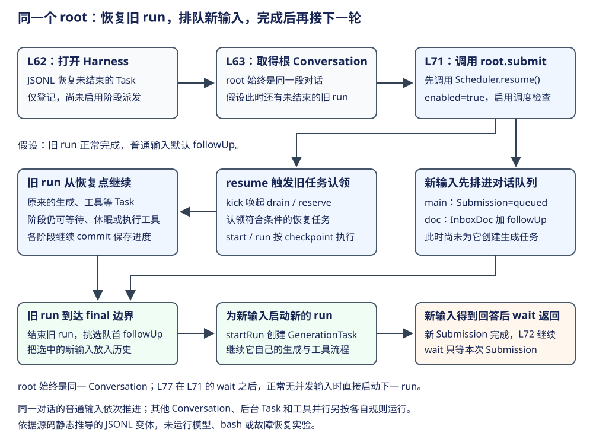

# Pi Durable：持久休眠、宿主唤醒与故障观测

前面的章节已经让 Task 保存工作位置。长期运行还需要回答一个问题：任务等待一分钟时，必须一直占着进程吗？如果平台回收了进程，谁在到期后把它重新启动？Durable 将“保存等待”交给内核，将“让进程再次出现”交给宿主。


主线依次是保存等待、安排唤醒、重开并认领、完成并观察。先从一次提交看清工作怎样启动，再用定时工作走通这条链，最后讨论反复崩溃、存储失败与追踪。

## 先看同一对话怎样恢复旧工作、接纳新输入 {#submit-start}

下面采用 26-coding-agent 的教学变体：把 L62 的 Storage 换成同一份已有未完成工作的 JSONL，其他入口沿用示例；假设根 Conversation 仍有活动 run，工作正常完成，L71 使用默认普通输入。这里的 root 是长期存在的根 Conversation 句柄，反复 root.submit 都提交到同一对话；它不是一轮 run 或单个 Task。[示例调用位置](https://github.com/earendil-works/pi/blob/2ec55d808d455b1a64a2bf7888198207a096120a/packages/durable/test/examples/26-coding-agent.ts#L62)、[root 返回 Conversation](https://github.com/earendil-works/pi/blob/2ec55d808d455b1a64a2bf7888198207a096120a/packages/durable/src/harness/harness.ts#L360)。



| 调用或交接 | 操作意图与当前效果 |
|---|---|
| L62 Harness.open | 读取 JSONL 已确认的 Task，恢复调度索引；遗留 running 改回 pending 并保留 checkpoint，此时不派发 phase handler |
| L63 harness.root | 取得同一个根 Conversation；不会仅因取得句柄就启动模型请求 |
| L71 root.submit 内的 resume | enabled=true，kick 触发 drain/reserve；已恢复且符合认领条件的旧任务可开始执行 |
| 同一次 submit 的接纳事务 | 提交时 root 仍有 live.run，则新 Submission=queued，内容进入 InboxDoc；默认是 followUp，此时还不为这份新输入创建 GenerationTask |
| 旧 run 正常到达 final 边界 | 从 InboxDoc 取出 followUp，默认一次一个；把输入放入历史、结束旧 run，再由 startRun 为选中的输入创建新的 GenerationTask |
| L71 的 .wait | 幂等 resume，等待这份新 Submission 结束；不是等待整个 Session 的历史任务全部完成 |

开始调度的外层入口是 root.submit，而实际 phase handler 由 Scheduler 的 kick → drain/reserve → start/run 链调用。Conversation.submit 转给 Submissions.submit，后者先调用 Harness 注入的 resume，再接纳输入；因此恢复旧任务与接纳新输入是两个动作。[转交入口](https://github.com/earendil-works/pi/blob/2ec55d808d455b1a64a2bf7888198207a096120a/packages/durable/src/harness/harness.ts#L116)、[resume 注入](https://github.com/earendil-works/pi/blob/2ec55d808d455b1a64a2bf7888198207a096120a/packages/durable/src/harness/harness.ts#L235)、[启用并接纳](https://github.com/earendil-works/pi/blob/2ec55d808d455b1a64a2bf7888198207a096120a/packages/durable/src/harness/submissions.ts#L76)、[调度执行点](https://github.com/earendil-works/pi/blob/2ec55d808d455b1a64a2bf7888198207a096120a/packages/durable/src/harness/scheduler.ts#L1437)。

### Harness 的四层驱动：事件、阶段与定时唤醒 {#scheduler-loops}

Harness 的整体推进可按职责分成四层：宿主提供运行机会，Scheduler 认领任务，一次任务执行逐阶段推进，阶段内部等待模型或工具。这里的“层”用于区分控制职责，不代表四个线程或四个常驻 while。下面先看完整接续，再展开领任务、阶段循环和定时器。


| 层次 | 这一层负责什么 | 谁触发下一步 | 暂停与结束 |
|---|---|---|---|
| 第一层：宿主唤起 | 让已有工作获得一次运行机会，接纳新输入或等待结果 | submit、wait、显式 resume；配置 onWake 时由宿主 alarm 再调用 resume | API 返回或登记结果 Promise；API 内没有另建任务轮询 |
| 第二层：任务调度 | 找出现在能执行的 Task，提交认领后启动 | kick 合并变化，queueMicrotask 调用 drain；dirty 变化时再检查一轮 | 无新变化就退出；任务提交、Registry 变化、到期或执行结束再次触发 |
| 第三层：单任务阶段推进 | 从当前 checkpoint 执行到下一阶段或持久等待 | run 的 while 等待 handler 完成，再由 step/decide 取得可继续的 current | running 可留在本次调用中继续；waiting、sleeping、终态等结束本次 invocation |
| 第四层：阶段内部工作 | 实际接收模型流、执行工具、处理进度和结果 | 模型事件使 for await 继续；工具回调更新进度；Promise 完成后恢复 await 后的代码 | 请求或工具完成后提交结果并返回 handler；这层没有统一的框架 while |

四层通过调用、异步完成和提交通知交接。JS 的事件循环负责执行微任务、I/O 完成与定时回调；Harness 没有再加一个固定周期的总 ticker 去逐层推动。[宿主装配](https://github.com/earendil-works/pi/blob/2ec55d808d455b1a64a2bf7888198207a096120a/packages/durable/src/harness/harness.ts#L201)、[调度触发](https://github.com/earendil-works/pi/blob/2ec55d808d455b1a64a2bf7888198207a096120a/packages/durable/src/harness/scheduler.ts#L1437)、[阶段推进](https://github.com/earendil-works/pi/blob/2ec55d808d455b1a64a2bf7888198207a096120a/packages/durable/src/harness/scheduler.ts#L1711)、[模型流与进度定时](https://github.com/earendil-works/pi/blob/2ec55d808d455b1a64a2bf7888198207a096120a/packages/durable/src/harness/generation.ts#L453)。

其中有两种跨层返回，决定了是否需要重新调度：准备好请求后，Task 仍为 running，原 run 直接继续 request；保存“等待工具”或“稍后再查询”后，原 run 结束，分别等依赖结束事件或到期回调重新认领，再创建一次 invocation。恢复位置来自 checkpoint，而不是保留旧调用栈。


Harness 构造时 new TaskScheduler 并注入同一个 Session、Storage 与 Registry；Scheduler 构造函数只保存依赖，open 再绑定提交观察者并恢复任务。此时 enabled=false，没有启动常驻消费循环。运行入口是 resume 调用 kick；kick 在调度启用且没有其他 drain 时，通过 queueMicrotask 安排 drain。[Scheduler 装配](https://github.com/earendil-works/pi/blob/2ec55d808d455b1a64a2bf7888198207a096120a/packages/durable/src/harness/harness.ts#L213)、[构造与打开](https://github.com/earendil-works/pi/blob/2ec55d808d455b1a64a2bf7888198207a096120a/packages/durable/src/harness/scheduler.ts#L347)、[运行入口](https://github.com/earendil-works/pi/blob/2ec55d808d455b1a64a2bf7888198207a096120a/packages/durable/src/harness/scheduler.ts#L423)。

#### 第二层怎样认领与等待依赖

外层 drain 消费的是“当前需要重新检查的任务集合”：while(dirty && enabled && !closing) 先清 dirty，再 await reserve 得到一批已认领任务，逐个 start。reserve 在 Session 事务中检查等待条件、到期时间、取消与定义，将可运行任务写为 running，并登记 invocation 防止重复认领。提交成功才把认领结果交回 drain。没有新变化时 dirty=false，外层检查结束；它不会一直空转读取存储。[外层循环](https://github.com/earendil-works/pi/blob/2ec55d808d455b1a64a2bf7888198207a096120a/packages/durable/src/harness/scheduler.ts#L1446)、[提交认领](https://github.com/earendil-works/pi/blob/2ec55d808d455b1a64a2bf7888198207a096120a/packages/durable/src/harness/scheduler.ts#L1466)。

没有事件时，这里没有一条阻塞等待的消费者线程。kick 是被调用才执行的普通函数，登记微任务后就返回；queueMicrotask 不创建新线程。drain、run 与这些回调在同一个 JS 执行线程上交叠推进：await reserve 只暂停这次 async 调用，等待期间 JS 线程可以执行其他回调；没有新变化时 dirty=false，drain 直接结束，下一次事件再 kick。它们的同步代码仍共用这个线程，async 本身不会把工作搬到后台线程。[登记微任务与退出循环](https://github.com/earendil-works/pi/blob/2ec55d808d455b1a64a2bf7888198207a096120a/packages/durable/src/harness/scheduler.ts#L1437)、[等待认领而非等待整件任务](https://github.com/earendil-works/pi/blob/2ec55d808d455b1a64a2bf7888198207a096120a/packages/durable/src/harness/scheduler.ts#L1450)、[独立启动异步执行](https://github.com/earendil-works/pi/blob/2ec55d808d455b1a64a2bf7888198207a096120a/packages/durable/src/harness/scheduler.ts#L1691)。


能并发 start，是因为认领之前已经排除了仍需等待的任务。waitingOn 只接收 B 的 TaskRecord 就能检查：B 的 state.on 已经保存了所等待任务的 ID，Scheduler 再用自己的 live 索引判断这些任务是否尚未终态。这里的 first=true 表示找到一个未结束的依赖就返回，足够判断本轮不能认领 B。它不表示只等待第一项依赖。[认领前检查依赖](https://github.com/earendil-works/pi/blob/2ec55d808d455b1a64a2bf7888198207a096120a/packages/durable/src/harness/scheduler.ts#L1494)、[等待集合](https://github.com/earendil-works/pi/blob/2ec55d808d455b1a64a2bf7888198207a096120a/packages/durable/src/harness/scheduler.ts#L1580)、[串行工具接续](https://github.com/earendil-works/pi/blob/2ec55d808d455b1a64a2bf7888198207a096120a/packages/durable/src/harness/generation.ts#L264)。

例如下面是 B 的教学记录节选，A、B、C 只是 Task ID 的示意，其他字段省略。B 想继续处理结果，需要 A、C 都结束；这里检查“是否结束”，不要求它们都成功。

```json
{
  "id": "B",
  "state": {
    "status": "waiting",
    "checkpoint": { "phase": "tools" },
    "on": ["A", "C"],
    "policy": "allSettled"
  }
}
```

| Scheduler 当前已提交的任务事实 | waitingOn(B, true) | 本次认领 |
|---|---|---|
| A、C 都未终态，仍在 live 中 | [A]，找到一个就够了 | 跳过 B |
| A 已终态，C 仍在 live 中 | [C] | 继续跳过 B |
| A、C 都已终态，都不在 live 中 | [] | B 通过依赖检查，继续检查到期等条件 |

B 提交 waiting 时，track 同时登记反向关系“谁在等待 A、C”（waiters 索引）。A 或 C 的终态提交发布后，track 从 live 移除它，并将等待它的 B 放回 runnable 候选集合；观察提交的代码再 kick，reserve 重新判断其余依赖。这样，B 暂时从本批候选中移除也不会被遗忘。[登记等待与唤回候选](https://github.com/earendil-works/pi/blob/2ec55d808d455b1a64a2bf7888198207a096120a/packages/durable/src/harness/scheduler.ts#L1004)、[提交变化后请求推进](https://github.com/earendil-works/pi/blob/2ec55d808d455b1a64a2bf7888198207a096120a/packages/durable/src/harness/scheduler.ts#L624)。

GenerationTask 等待本轮 ToolTask 就采用这类关系。工具配置要求顺序执行时，生成任务还会按次序创建工具任务，后面的调用尚未成为可执行 Task。业务需要的先后关系必须显式表达，不能依靠创建顺序或函数声明顺序推导。取消是 waitingOn 的另一分支：先等待所属的普通子工作退出，再执行父任务的取消处理，顺序从下往上收口。[生成任务保存工具等待](https://github.com/earendil-works/pi/blob/2ec55d808d455b1a64a2bf7888198207a096120a/packages/durable/src/harness/generation.ts#L673)、[取消时的所属工作检查](https://github.com/earendil-works/pi/blob/2ec55d808d455b1a64a2bf7888198207a096120a/packages/durable/src/harness/scheduler.ts#L1224)。


#### 第三层怎样逐阶段推进

start 以 void async 启动单个 invocation，调用 run 或取消清理；它返回 void，drain 不等待这件工作完成，所以不同 Task 可交叠执行。单任务从当前阶段继续推进的驱动就在 run 的 while(current !== undefined && !closing) 中：按 checkpoint.phase 选择 handler 并 await，结束后通过 Session 上的 step/decide 取得最新任务，进入下一次循环。任务进入持久 waiting/sleeping、终态或其他停止条件时，本次 invocation 结束；后续重新认领再建运行链。[异步启动](https://github.com/earendil-works/pi/blob/2ec55d808d455b1a64a2bf7888198207a096120a/packages/durable/src/harness/scheduler.ts#L1691)、[单任务阶段循环](https://github.com/earendil-works/pi/blob/2ec55d808d455b1a64a2bf7888198207a096120a/packages/durable/src/harness/scheduler.ts#L1711)。

新任务的起点由定义的 initial(input) 给出；恢复任务从持久 checkpoint 指向的位置继续。例如 GenerationTask 的初始阶段是 prepare。[创建时保存起点](https://github.com/earendil-works/pi/blob/2ec55d808d455b1a64a2bf7888198207a096120a/packages/durable/src/session/transaction.ts#L424)、[生成任务的初始阶段](https://github.com/earendil-works/pi/blob/2ec55d808d455b1a64a2bf7888198207a096120a/packages/durable/src/harness/generation.ts#L125)。

current 是本次 invocation 可继续执行的最新已提交 TaskRecord，不是阶段下标。phase handler 通过 runtime.commit 保存下一状态；step 从调度器已跟踪的提交结果取得当前仍为 running 的任务，下一次循环按 current.state.checkpoint.phase 查 phases 的同名 handler。phases 是按名称检索的映射，不按对象声明顺序遍历；任务也可回到已有阶段。没有提交出可继续的状态时，框架不会自动顺延到下一个属性。[取得最新 current](https://github.com/earendil-works/pi/blob/2ec55d808d455b1a64a2bf7888198207a096120a/packages/durable/src/harness/scheduler.ts#L1886)、[按 phase 名派发](https://github.com/earendil-works/pi/blob/2ec55d808d455b1a64a2bf7888198207a096120a/packages/durable/src/harness/scheduler.ts#L1721)。

正常完成不是“phases 已走到最后一项”的判断。业务阶段先提交 terminal，例如 answer 把最终回答和 completed outcome 同批保存，工具轮结束也显式结束本次 GenerationTask。提交发布后，terminal Task 从 live 索引移除。handler 返回时，run 调用 step；step 读取当前仍为 running 的任务，只有决定继续时才返回它，否则结束 invocation 并返回 undefined。这个返回值经 phase 包装传回，赋给 run 的 current，下一次 while 条件失败才退出。[回答时显式提交终态](https://github.com/earendil-works/pi/blob/2ec55d808d455b1a64a2bf7888198207a096120a/packages/durable/src/harness/generation.ts#L609)、[工具轮结束时提交终态](https://github.com/earendil-works/pi/blob/2ec55d808d455b1a64a2bf7888198207a096120a/packages/durable/src/harness/generation.ts#L735)、[移除终态索引](https://github.com/earendil-works/pi/blob/2ec55d808d455b1a64a2bf7888198207a096120a/packages/durable/src/harness/scheduler.ts#L1017)、[step 的判断与返回](https://github.com/earendil-works/pi/blob/2ec55d808d455b1a64a2bf7888198207a096120a/packages/durable/src/harness/scheduler.ts#L1892)、[赋回外层 current](https://github.com/earendil-works/pi/blob/2ec55d808d455b1a64a2bf7888198207a096120a/packages/durable/src/harness/scheduler.ts#L1721)。

undefined 是结束本次调用的控制返回值，不是写入 Task 的状态。waiting、sleeping 也使 step 返回 undefined，但 Task 的 checkpoint 和等待条件仍留在存储中，后续可以重新认领。若 handler 保持 running 且没有提交新的 checkpoint 就直接返回，框架会按“没有持久进展”报告任务故障，不会把它当作走完阶段表而正常完成。[无进展检查](https://github.com/earendil-works/pi/blob/2ec55d808d455b1a64a2bf7888198207a096120a/packages/durable/src/harness/scheduler.ts#L1829)。


“不再 running 就结束”指结束当前这次 run 调用，不等于业务任务一律完成。下表按该次调用停止后的持久状态区分后续；pending 的交接由 Scheduler 内部处理，普通 phase 的 Next 返回值不包含 pending。

| 停止后的状态 | 当前调用 | 这件 Task 接下来怎样处理 |
|---|---|---|
| waiting | 结束 | 等依赖终态提交，再由调度器认领并继续 checkpoint |
| sleeping | 结束 | 等 until 到期，再认领并继续 checkpoint |
| completing | 结束 | outcome 已决定，不再执行 phase；等所属普通工作退出后收口为 terminal |
| terminal | 结束 | 这件 Task 已永久结束，保留结果记录 |
| pending，例如定义替换时交出执行权 | 结束 | 留待重新认领，从已有 checkpoint 继续 |

running 也不保证继续：关闭、取消意图、未捕获错误或没有持久进展等检查仍可停止本次执行。只有仍为 running 且 decide 允许继续时，step 才返回 Task 给原 run。[状态契约](https://github.com/earendil-works/pi/blob/2ec55d808d455b1a64a2bf7888198207a096120a/packages/durable/src/types.ts#L600)、[停止检查与定义交接](https://github.com/earendil-works/pi/blob/2ec55d808d455b1a64a2bf7888198207a096120a/packages/durable/src/harness/scheduler.ts#L1806)。


| 当前 handler | 任务代码提交什么 | 随后执行什么 |
|---|---|---|
| GenerationTask.prepare | running，checkpoint.phase=request | 下一次循环执行 request |
| GenerationTask.retry | running，checkpoint.phase=prepare | 回到 prepare，重新准备请求 |
| 阶段保存 waiting / sleeping / 终态 | 本次 invocation 不再满足继续条件 | current 变为 undefined，本次循环结束 |

前两项分别对应[准备完成时提交 request](https://github.com/earendil-works/pi/blob/2ec55d808d455b1a64a2bf7888198207a096120a/packages/durable/src/harness/generation.ts#L206)和[重试后提交 prepare](https://github.com/earendil-works/pi/blob/2ec55d808d455b1a64a2bf7888198207a096120a/packages/durable/src/harness/generation.ts#L241)。

#### 主动入口与时间回调怎样唤起调度

resume 是幂等的启用与请求推进入口；重复调用不会再启动一套外层消费者。正常流程的外部入口是 submit、Submission.wait、waitForTask、waitForIdle，以及宿主显式 resume。启用之后，任务提交和依赖结束等直接触发 kick，不必每次从外部重新 resume。[submit / wait](https://github.com/earendil-works/pi/blob/2ec55d808d455b1a64a2bf7888198207a096120a/packages/durable/src/harness/submissions.ts#L76)、[任务与空闲等待](https://github.com/earendil-works/pi/blob/2ec55d808d455b1a64a2bf7888198207a096120a/packages/durable/src/harness/harness.ts#L329)。

submit、wait 这些主动入口顺手确保调度已经启用，但它们没有各自再建一套状态轮询。submit 接纳并提交输入后返回句柄；wait 读取一次状态，已结束就返回，否则登记一个 Promise 等待者。以后 Submission 结束的提交发布时，观察者 resolve 这个 Promise。持续执行由 Scheduler 承担，等待者只是接收结果。[提交后返回句柄](https://github.com/earendil-works/pi/blob/2ec55d808d455b1a64a2bf7888198207a096120a/packages/durable/src/harness/submissions.ts#L76)、[检查并登记等待](https://github.com/earendil-works/pi/blob/2ec55d808d455b1a64a2bf7888198207a096120a/packages/durable/src/harness/submissions.ts#L115)、[提交发布后兑现结果](https://github.com/earendil-works/pi/blob/2ec55d808d455b1a64a2bf7888198207a096120a/packages/durable/src/harness/submissions.ts#L145)。


正常认领和阶段接续不要求先设置延迟定时器。Task 提交发布时，观察者 kick，以 queueMicrotask 安排 drain；正在执行的 handler 完成后，原 run 等 step 返回就继续下一阶段；工具任务结束解除依赖时，再通过提交观察者 kick 认领等待者。这些动作没有固定毫秒间隔，实际仍需排到 Session 提交队列并等待各自 I/O 完成。queueMicrotask 是当前同步代码结束后安排执行的微任务，不是 setTimeout(..., 0)。[正常提交唤起](https://github.com/earendil-works/pi/blob/2ec55d808d455b1a64a2bf7888198207a096120a/packages/durable/src/harness/scheduler.ts#L695)、[微任务认领入口](https://github.com/earendil-works/pi/blob/2ec55d808d455b1a64a2bf7888198207a096120a/packages/durable/src/harness/scheduler.ts#L1437)、[原调用继续阶段](https://github.com/earendil-works/pi/blob/2ec55d808d455b1a64a2bf7888198207a096120a/packages/durable/src/harness/scheduler.ts#L1719)。

因此，没有 retry 也可能因为业务主动等待、deferred 查询而设置持久唤醒 timer；完全没有 sleeping Task 时，wake.at 为 undefined，armTimer 就不注册这一计时器。普通流式请求中的进度保存和空闲缓存回收仍可能各有 timer，但它们不构成周期性领取业务 Task 的驱动力。[没有期限就不计时](https://github.com/earendil-works/pi/blob/2ec55d808d455b1a64a2bf7888198207a096120a/packages/durable/src/harness/scheduler.ts#L1344)。


时间等待有实际定时器驱动。默认未配置 onWake 时，scheduleWake 通过微任务计算最早到期时刻，再交给 armTimer 注册回调；真正等待时间的是 timers.foreground(callback, at-now)，默认最终调用 setTimeout。到期回调先 wakeDue，把到期任务列为认领候选，再 kick 启动检查。kick 又会 scheduleWake，因此后续阶段再次保存 sleeping 时会重新计算并安排下次回调：这是一次次定时回调的接续，不需要一个常驻的 while 等时间，也不采用固定周期扫描。[计算下一时刻](https://github.com/earendil-works/pi/blob/2ec55d808d455b1a64a2bf7888198207a096120a/packages/durable/src/harness/scheduler.ts#L1316)、[注册并处理到期回调](https://github.com/earendil-works/pi/blob/2ec55d808d455b1a64a2bf7888198207a096120a/packages/durable/src/harness/scheduler.ts#L1344)、[默认计时实现](https://github.com/earendil-works/pi/blob/2ec55d808d455b1a64a2bf7888198207a096120a/packages/durable/src/timers.ts#L18)。

Scheduler 没有统一的默认 sleep 周期。任务代码给出绝对时刻 until，Scheduler 选择所有未来休眠中最早的那个，注册约 until-now 的延迟；没有未来期限就不设这个定时器。多久以后继续，由以下调用方分别决定。

| 等待场景 | 时间从哪里来 | 当前默认与可调整入口 |
|---|---|---|
| 自定义 Task 的持久等待 | 业务调用 sleepUntil(until, checkpoint, context)，或提交 sleeping/until | 没有统一默认；业务按自己的 now 时间域指定 until |
| 模型生成或摘要失败后的重试 | now + retryDelayMs(settings.retry, attempt) | 默认最多重试 3 次，依次等 2、4、8 秒；单次计算上限 60 秒。通过 HarnessSettings.retry 覆盖 |
| deferred 模型结果再次查询 | now + handle.pollAfterMs；另保证 pollAt 单调前进 | handle 未给间隔时默认 5 秒；由 provider 返回的 deferred handle 提供建议值 |
| 模型 partial 的进度保存 | 当前 invocation 的 runtime.setTimer(flush, interval) | partialIntervalMs 默认 100ms；这是进度节流，不使 Task 进入 sleeping |

重试延迟的计算是 min(baseDelayMs × 2^(attempt-1), maxAgentDelayMs)，默认 baseDelayMs=2000、maxAgentDelayMs=60000；默认只允许三次重试，因此正常使用默认策略时实际等待序列到 8 秒为止。poll 的 5 秒是该业务分支的兜底，不是 Scheduler 的周期。[统一 sleepUntil 接口](https://github.com/earendil-works/pi/blob/2ec55d808d455b1a64a2bf7888198207a096120a/packages/durable/src/types.ts#L330)、[选择最早未来期限](https://github.com/earendil-works/pi/blob/2ec55d808d455b1a64a2bf7888198207a096120a/packages/durable/src/harness/scheduler.ts#L477)、[重试与进度默认值](https://github.com/earendil-works/pi/blob/2ec55d808d455b1a64a2bf7888198207a096120a/packages/durable/src/harness/agent.ts#L20)、[重试延迟函数](https://github.com/earendil-works/pi/blob/2ec55d808d455b1a64a2bf7888198207a096120a/packages/ai/src/utils/retry.ts#L141)、[生成时提交等待](https://github.com/earendil-works/pi/blob/2ec55d808d455b1a64a2bf7888198207a096120a/packages/durable/src/harness/generation.ts#L559)、[poll 时刻计算](https://github.com/earendil-works/pi/blob/2ec55d808d455b1a64a2bf7888198207a096120a/packages/durable/src/harness/generation.ts#L510)。


配置 onWake 后，宿主用平台 alarm 承担到期唤醒，再调用 resume；内核不再为持久休眠保留自己的定时器。后文的宿主示例展开这一交接。

时间相关的机制还要按用途区分，不能将所有 setTimer 都理解成任务消费循环。

| 时间机制 | 等待期间保留什么 | 回调后做什么 |
|---|---|---|
| 持久休眠：重试退避、deferred 查询等 | Task 的 sleeping、until、checkpoint；本次 invocation 已退出 | 默认回调 wakeDue/kick，返回第二层重新认领；onWake 模式由宿主 alarm/resume 提供机会 |
| 当前阶段的进度节流：模型 partial、工具输出 | 当前 invocation 的 pending、timer、inFlight 等内存资料 | 保存进度 Document；有新进度时再延迟保存，不负责推进 checkpoint；执行结束清理定时器 |
| 空闲缓存到期 | Document 和上下文缓存的空闲时刻 | 回收内存并按需安排下一次；不领取业务任务 |

模型事件驱动接收，进度 timer 驱动采样保存，两者可以在同一个 request handler 内交叠；这不等于启动两次模型请求。[流式接收与 trailing 保存](https://github.com/earendil-works/pi/blob/2ec55d808d455b1a64a2bf7888198207a096120a/packages/durable/src/harness/generation.ts#L453)、[工具进度保存](https://github.com/earendil-works/pi/blob/2ec55d808d455b1a64a2bf7888198207a096120a/packages/durable/src/harness/tool.ts#L480)、[invocation 定时器的创建](https://github.com/earendil-works/pi/blob/2ec55d808d455b1a64a2bf7888198207a096120a/packages/durable/src/harness/scheduler.ts#L2290)与[结束清理](https://github.com/earendil-works/pi/blob/2ec55d808d455b1a64a2bf7888198207a096120a/packages/durable/src/harness/scheduler.ts#L2050)、[上下文缓存到期](https://github.com/earendil-works/pi/blob/2ec55d808d455b1a64a2bf7888198207a096120a/packages/durable/src/harness/scheduler.ts#L743)、[Document 缓存到期](https://github.com/earendil-works/pi/blob/2ec55d808d455b1a64a2bf7888198207a096120a/packages/durable/src/session/session.ts#L652)。

#### 提交通知怎样接回四层驱动

Session 是各层共用的提交通道。commitWith 把操作接到前一个 Promise 后面串行执行，持久化成功并采用新状态后再发布变化；它不按固定时钟凑批提交。Scheduler 的观察者只有看到 Task 变化才因此 kick；仅更新 LiveDoc partial 不会因此重新派发任务。Submission 结束则由另一个观察者兑现 wait 的 Promise。[Session 串行入口](https://github.com/earendil-works/pi/blob/2ec55d808d455b1a64a2bf7888198207a096120a/packages/durable/src/session/session.ts#L896)、[持久化后发布](https://github.com/earendil-works/pi/blob/2ec55d808d455b1a64a2bf7888198207a096120a/packages/durable/src/session/session.ts#L716)、[按 Task 变化唤起](https://github.com/earendil-works/pi/blob/2ec55d808d455b1a64a2bf7888198207a096120a/packages/durable/src/harness/scheduler.ts#L624)、[兑现输入结果](https://github.com/earendil-works/pi/blob/2ec55d808d455b1a64a2bf7888198207a096120a/packages/durable/src/harness/submissions.ts#L145)。

同一次“仍为 running、换到下一阶段”的提交，可以同时让原 run 继续，也通知外层有任务变化。它们不会重复启动同一任务：reserve 遇到已有 invocation 的 Task 会跳过；外层检查主要使新建任务、已解除依赖的任务等获得执行机会。[重复认领检查](https://github.com/earendil-works/pi/blob/2ec55d808d455b1a64a2bf7888198207a096120a/packages/durable/src/harness/scheduler.ts#L1488)。

取消传播、failFast 处理和等子工作结束后收口，由旁路的 scheduleReconcile 以微任务触发 reconcile，再经同一 Session 提交。它们也靠状态变化接续，不是另一套周期任务扫描。[状态收口旁路](https://github.com/earendil-works/pi/blob/2ec55d808d455b1a64a2bf7888198207a096120a/packages/durable/src/harness/scheduler.ts#L764)。


任务提交发布、Registry 变化、休眠到期和 invocation 结束等会再次 kick。draining 保证同一时刻只安排一个外层 drain；执行期间的新变化把 dirty 重新置 true，让当前循环再查一轮，或者在退出时重启检查。JSONL 的恢复和提交不改变这两层结构；它提供已确认的任务事实，不充当另一个常驻消费者。[任务变更触发](https://github.com/earendil-works/pi/blob/2ec55d808d455b1a64a2bf7888198207a096120a/packages/durable/src/harness/scheduler.ts#L624)、[kick 与退出检查](https://github.com/earendil-works/pi/blob/2ec55d808d455b1a64a2bf7888198207a096120a/packages/durable/src/harness/scheduler.ts#L1437)。

### 同一 Conversation 的新输入怎样排队

排队判断发生在接纳事务内：检查 live.run 是否存在；默认普通输入按 followUp 加入队列，只有 final 边界才挑选它。默认 followUpMode=one-at-a-time；改为 all 可将多份排队输入放入同一个后续 run。steer 则允许在工具后等边界进入当前 run，reject 会在忙时拒绝。[忙闲判断与入队](https://github.com/earendil-works/pi/blob/2ec55d808d455b1a64a2bf7888198207a096120a/packages/durable/src/harness/submissions.ts#L229)、[final 才取 followUp](https://github.com/earendil-works/pi/blob/2ec55d808d455b1a64a2bf7888198207a096120a/packages/durable/src/harness/inbox.ts#L70)、[默认模式](https://github.com/earendil-works/pi/blob/2ec55d808d455b1a64a2bf7888198207a096120a/packages/durable/src/harness/agent.ts#L79)、[正常回答时交接下一 run](https://github.com/earendil-works/pi/blob/2ec55d808d455b1a64a2bf7888198207a096120a/packages/durable/src/harness/generation.ts#L604)。

这里的顺序限制属于同一 Conversation 的普通输入。其他 Conversation 和后台 Task 不必等待这个队列；同一 run 内的工具也可按配置并行。只有后台工作仍未完成、但该 Conversation 已没有活动 run 时，普通新输入可以直接启动，不能用“Session 还有未完成 Task”替代 busy 判断。宿主只想继续已有工作而不增加输入时，可以显式 harness.resume。

L71 的嵌套 await 等价于先 await root.submit 取得句柄，再 await submission.wait；提交返回与任务执行异步推进。示例 L77 又调用 root.submit，但执行已经越过 L71 的 wait；正常且没有其他并发输入时，上一轮已结束，所以它直接启动新 run，不会仅因是第二次 submit 就排到队尾。只有提交时仍有活动 run 或已有排队项，才走入队逻辑。[等待实现](https://github.com/earendil-works/pi/blob/2ec55d808d455b1a64a2bf7888198207a096120a/packages/durable/src/harness/submissions.ts#L115)、[两次 submit 的实际顺序](https://github.com/earendil-works/pi/blob/2ec55d808d455b1a64a2bf7888198207a096120a/packages/durable/test/examples/26-coding-agent.ts#L71)。

JSONL 的本次入队会把 queued Submission 保存到 main，把队列内容作为 InboxDoc 变化写入 doc 文件，再由 main 确认整批；调度器认领旧任务时，任务状态另经 task 文件和 main 确认。只有输入在边界被采用时，才追加对应用户 Entry 并创建后续生成任务。[JSONL 提交顺序](documents.md#jsonl-confirmation)。这是按源码推导的 JSONL 教学变体，未运行模型、bash 或故障恢复实验。下面再看 sleeping 工作如何跨越时间与进程存活。

## 第一步：把等时间变成一条持久状态

假设 CSV 修复服务要求稍后再次查询一个验证结果。任务先保存下一次查询时刻及查询身份，结束当前阶段。下面按官方 Reminder 示例整理，省略输入类型、结果提交和 abort handler：

```ts
phases: {
  wait: (task, runtime, context) => runtime.sleepUntil(
    task.input.at, { phase: "check" }, context,
  ),
  check: async (task, runtime, context) => {
    // 查询所需业务资料来自 task.input 或保存的 checkpoint。
    // 实际查询以后，再提交自己的完成或下次等待状态。
  },
}
```

这是教学骨架，check 是案例命名。`sleepUntil` 在休眠状态存好后就返回，阶段随即结束；它不等到时间到达才返回。需要与 Document 等变化同批提交时，直接从 runtime.commit 回调返回 `{ status: "sleeping", until, checkpoint }`。[运行接口](https://github.com/earendil-works/pi/blob/2ec55d808d455b1a64a2bf7888198207a096120a/packages/durable/src/types.ts#L313)。

保存以后 Task 没有 invocation，直到 Harness 的 now 达到 until 才可继续。取消不必等到期；它按所有权关系收口。模型重试退避、provider 延后结果轮询和摘要重试也使用这一机制，业务资料仍放在各自 checkpoint 中。

## 第二步：让宿主安排下一次出现

在常驻 Node 进程里，调度器为最早的休眠安排定时器。`now` 提供时间，`setTimer` 提供计时，两者可由宿主注入；阶段内用于节流的 TaskRuntime.setTimer 只活在当前 invocation，不是持久睡眠。[宿主选项](https://github.com/earendil-works/pi/blob/2ec55d808d455b1a64a2bf7888198207a096120a/packages/durable/src/harness/types.ts#L608)。

按需宿主可以传入 onWake。此时内核不为持久休眠保留自己的计时器，而是报告一个摘要：

| Wake 字段 | 宿主怎样使用 |
|---|---|
| active | 存在能运行、正在运行或需要推进的工作；宿主可安排恢复兜底 |
| at | 最早的 sleeping 到期时刻；安排平台 alarm |

二者可以同时存在；其他任务正在运行时也可能有睡眠任务。它不要求整个 Session 同时进入一种状态。until 属于 Harness 的 now 时间域，重开同一存储的所有进程需要使用一致的时钟。[wake 的推导](https://github.com/earendil-works/pi/blob/2ec55d808d455b1a64a2bf7888198207a096120a/packages/durable/src/harness/scheduler.ts#L477)。

Cloudflare Durable Object 示例在构造时打开 SQLite 和 Harness，按 wake 设置 alarm，然后 resume；alarm 到达后再次安排兜底并调用 resume。onWake 是提交后的通知，所以宿主在调用可能启动工作的接口之前先安排恢复唤醒，避免“工作已经提交，进程却在设置 alarm 前消失”。示例中的 heartbeat 是该宿主的兜底策略，不是 Durable 固定的任务周期。[完整宿主接线](https://github.com/earendil-works/pi/blob/2ec55d808d455b1a64a2bf7888198207a096120a/packages/durable/test-workers/worker.ts#L43)。

## 第三步：重开后定位工作，并阻止崩溃循环

重新打开时，scheduler 读取活跃任务。遗留 running 的进程内认领已失效，改成 pending 并保留 checkpoint；sleeping 保留原时刻，到期后重新认领。关闭流程能够正常返回时，会把停止的任务写回 pending，这与进程突然死亡的遗留 running 有不同含义。

如果任务每次都在下一次状态提交前把进程弄崩，持续自动恢复会形成循环。内核在 open 时累计这种截断次数，任务提交新的状态后重新计数。`restartLimit` 默认 5；达到限制时暂时阻塞并报告 task_parked，wake 不再把它算作可运行工作，宿主可提供 `retryTask(id)` 让用户或运维明确重试。[重开计数](https://github.com/earendil-works/pi/blob/2ec55d808d455b1a64a2bf7888198207a096120a/packages/durable/src/harness/scheduler.ts#L374)。

这个计数不证明是哪项 Task 导致进程死亡：当时所有运行中的任务都可能被计数。`restart_limit`、缺定义、定义过旧和迁移失败都可表现为 blocked；它们是检查结果，不能画成持久 TaskState 的另一个终态。任务图展示原因，Registry 变化可以解除定义类阻塞，retryTask 用于重启限制。[检查契约](https://github.com/earendil-works/pi/blob/2ec55d808d455b1a64a2bf7888198207a096120a/packages/durable/src/harness/types.ts#L668)。

## 第四步：区分任务失败与整个存储会话失败

工具抛错一般变成这次工具的错误结果；Task 阶段违反契约会使该 Task faulted。存储无法继续则影响整个 Session：当前调用拒绝，后续调用和等待得到 SessionFailed，观察流以 session_failed 结束，Harness 自动关闭。宿主等待 closed 后重新打开，恢复仍以成功提交的记录为准。[存储守卫](https://github.com/earendil-works/pi/blob/2ec55d808d455b1a64a2bf7888198207a096120a/packages/durable/src/session/session.ts#L961)。

无效读取可以用 StorageRequestError 表达，只失败这次读取；commit 或 mintId 抛出任何错误仍导致 Session 失败。事务回调自身抛错则回滚本次草稿。把这些故障分清楚，宿主才能决定显示单任务失败、等待配置修复，还是重建整个运行句柄。

`onReport(error, info)` 提供分类与来源：session_failed、task_faulted、task_parked、迁移和定义问题、extension_error、host_error、listener_error 等。它服务于宿主诊断，不能把“没有 report”当作业务验证成功；业务完成仍需检查 Submission 与自己的结果事实。[报告类型](https://github.com/earendil-works/pi/blob/2ec55d808d455b1a64a2bf7888198207a096120a/packages/durable/src/types.ts#L164)。

## 用追踪连接一次接纳、多个阶段与重开

宿主可注入 telemetry 适配器，记录公开 submit 的接纳 span、每个 Task 阶段的 phase span，以及提交后的 Entry、Submission 和 checkpoint 事件。一个用户输入可以经历多次生成、工具和重开；持久记录中的可选 trace carrier 让新进程继续关联这项工作，不需要在模型文字里放追踪信息。[遥测 schema](https://github.com/earendil-works/pi/blob/2ec55d808d455b1a64a2bf7888198207a096120a/packages/durable/src/harness/telemetry.ts#L50)。

一次 phase span 不跨越持久等待和进程重启。多个排队输入合入一个 run 时，可通过 links 保留其他输入的关联；steer 接纳也关联正在运行的工作。模型调用收到当前 phase 的 telemetry，因而可以从接纳定位到任务阶段，再定位到 provider 请求。

正常属性保存身份和控制资料，不记录消息、参数或结果正文；失败 phase 的诊断消息会截取最多 500 字符，其中仍可能包含调用内容，部署时需要按实际数据管理。报告事件本身只含固定字段，不携带错误对象。追踪是定位线索，持久 Task 与业务结果仍承担事实判定。[阶段追踪与恢复执行点](https://github.com/earendil-works/pi/blob/2ec55d808d455b1a64a2bf7888198207a096120a/packages/durable/src/harness/scheduler.ts#L1711)。

## 存储组合与代码升级

SQLite 可通过 prefix 把多份 Pi 存储与宿主表放入一个数据库。不同 prefix 仍是不同 Storage/Session 边界，不会合并提交线或会话树。Cloudflare 适配器对同一个 storage 对象协调操作队列；宿主查询也需使用协调的适配器，直接绕过可能落入正在执行的事务。[命名空间 schema](https://github.com/earendil-works/pi/blob/2ec55d808d455b1a64a2bf7888198207a096120a/packages/durable/src/storage/sqlite/schema.ts#L54)。

持久 sleeping 需要 SQLite schema v2，打开时自动升级，旧版 1.3.0 及更早代码不能再打开升级后的数据库。JSONL 不需该表结构升级，但旧调度器不认识 sleeping。这里的版本约束决定真实回滚方案；代码可回退不表示数据可回退。[存储升级实现](https://github.com/earendil-works/pi/blob/2ec55d808d455b1a64a2bf7888198207a096120a/packages/durable/src/storage/sqlite/migrations.ts)。

至此，读者可以沿一次“等验证结果”的任务说明：checkpoint 保存查询位置，until 保存何时继续，宿主 alarm 提供再次运行的机会，Registry 提供代码，Storage 保留已提交事实。任何一层缺失，都不能单凭磁盘上有一份任务记录推定它会自行完成。
