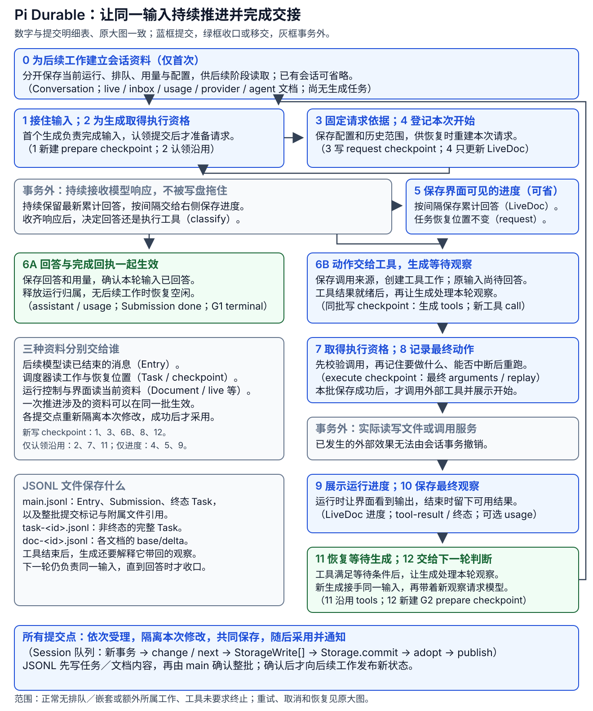

# Pi Durable 分册

Pi Durable 把进行中的模型与工具工作表示为持久 Task，用事务对齐历史、任务状态和可观察资料。本分册词典先给对象定位，架构章解释一次持久工作如何推进，执行章沿 CSV 修复任务串起五步；上下文章解释记录怎样分别提供给界面和模型；工具组合章深入脚本与嵌套工作；宿主章连接等待、唤醒和诊断。

## 一次运行的持久化总览 {#persistence-overview}

先沿实线看一份输入怎样持续被处理：接住工作并取得执行资格，固定请求依据，再根据模型响应选择直接回答或先执行工具；工具带回新观察后，交给新一轮模型继续判断。图中数字连接[逐项提交明细](loop.md#commit-trace)和[原尺寸大图](architecture.md#commit-map)：6A 确认回答，6B 到 12 是工具后继续；5 和 9 的展示进度可以省略或多次保存。回线只重新认领新任务，原输入的处理责任继续保留。图中标出了五个新写 checkpoint 的提交位置；它们在各操作前后的时点见[checkpoint 对照](loop.md#checkpoint-timing)。

要看“每个节点改什么、提交什么、写哪个 JSONL”，从[执行章的提交顺序表](loop.md#commit-trace)进入；要看同一次提交如何从 Draft 走到 Storage，读[架构章的事务链](architecture.md#回调怎样接到任务状态-再进入-storage)；文件与 SQLite 表的差异见[StorageWrite 映射](documents.md#storage-writes)。这张图采用 JSONL 作为文件示例，应用仍通过注入选择后端。

## 在共同架构中定位

先把本实现放到[共同职责地图](../../comparisons/common-model.md)，再沿下面的章节追到实际对象。这里对齐的是问题，具体类型和作用域仍按本分册解释。

| 共同职责 | 本实现中的定位 |
|---|---|
| 产品宿主 | 应用打开 Harness，Conversation 接纳 Submission。 |
| 工作推进 | GenerationTask/ToolTask 保存阶段，TaskScheduler 按 Registry 推进。 |
| 模型与动作 | 生成在事务外请求模型；工具 Task 先保存意图，再执行效果。 |
| 历史与请求 | Entry 保存贡献，ContextView 选择范围；Task 和 Document 另表述工作与视图。 |
| 扩展与控制 | 任务定义、hooks、Document 与接纳边界组织应用策略。 |

## 分册阅读

| 阅读顺序 | 要回答的问题 |
|---|---|
| [概念词典](glossary.md) | Entry、Task、Document、Submission 与运行句柄各指什么？ |
| [事务与 Task 状态机](architecture.md) | status 和 phase 有什么区别？提交与工具效果怎样分工？ |
| [一项任务怎样推进](loop.md) | 一份输入为什么对应多个 generation？工具结果怎样回到模型？ |
| [Document 与上下文](documents.md) | 当前状态、模型输入和摘要采用怎样协作？ |
| [工具组合与脚本恢复](tools.md) | 模型、程序和延迟工具怎样接入同一执行内核？ |
| [宿主、休眠与故障观测](hosting.md) | 没有常驻进程时谁唤醒任务，反复崩溃怎样收住？ |

建议对照 [AgentSession 循环](../pi/loop.md)阅读。两者都保留模型按观察选择动作的反馈机制，工作推进在进程与持久记录中的表示不同。模式层面的共同概念见[执行模式比较](../../comparisons/execution-modes.md)。
