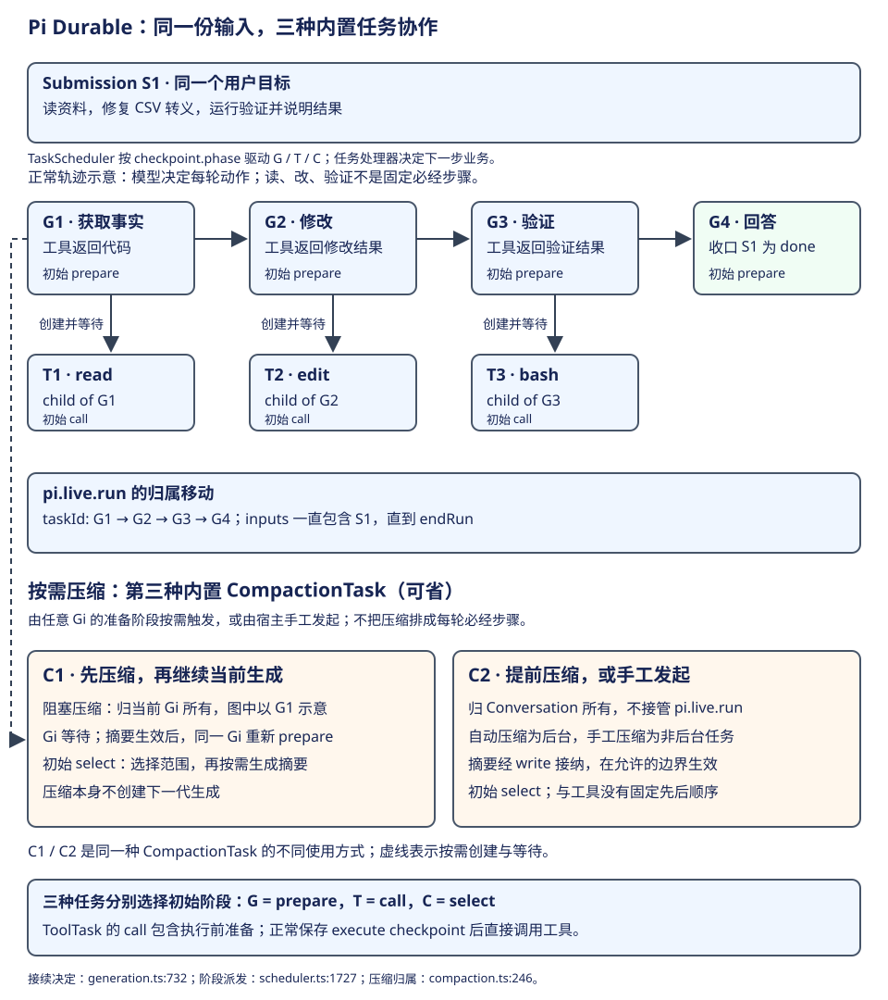
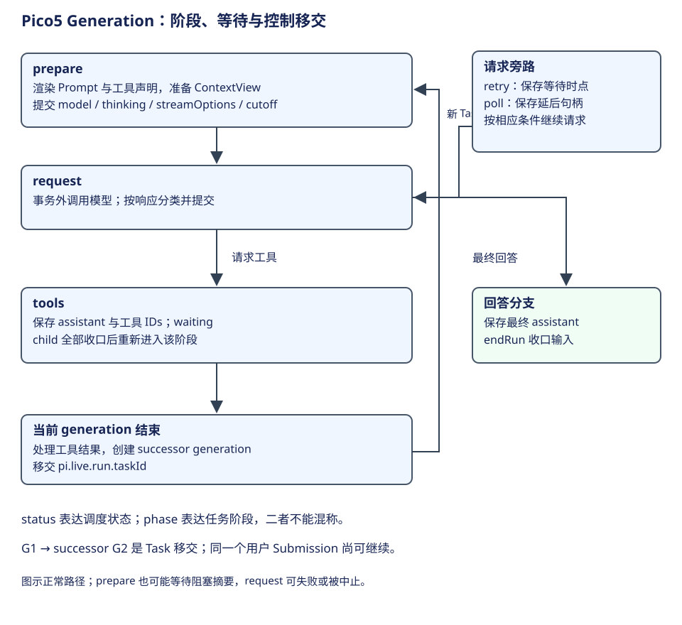

# Pi Durable：输入接纳、生成状态机与工具协作

Pi Durable 的用户工作经过 Submission 接纳，在 Conversation 中由一串生成和工具 Task 推进。理解正常流程后，再讨论恢复；否则容易只看到 checkpoint 与事务，却不知道它们服务于哪一项任务。




本章以同一 Submission 为线索走五步：接纳输入、准备请求、创建并等待工具、移交下一生成、收口输入。G1 到 G4 是教学轨迹里的生成任务 ID；一个 generation 结束时，用户输入仍可能由下一 generation 继续负责。

| 步骤 | 接到什么 | 交出什么 |
|---|---|---|
| 1. 接纳 | 用户 input 与 requestId | Submission、UserEntry、首个 generation |
| 2. 请求 | 当前历史和配置 | 保存 cutoff 的请求 checkpoint、assistant 响应 |
| 3. 工具 | assistant 的动作请求 | tool child、等待关系、结果 Entry |
| 4. 移交 | 完成的工具结果 | successor generation 和新的 run.taskId |
| 5. 收口 | 最终回答及边界处理 | Submission 的持久结果 |

## 第一步：接纳输入，建立持久身份

贯穿案例仍是“读取需求和 CSV 导出代码，修复字段转义，运行已有验证并说明结果”。应用把它作为 input submission 交给 Conversation.submit。Submissions 在 Session 的事务中检查当前是否忙、是否已有排队输入，以及 requestId 是否已接纳。

空闲且没有排队项时，事务追加 UserEntry、创建 status=placed 的 Submission、创建首个 generation，并把 Submission ID 放进 `pi.live.run.inputs`。输入接纳时已经有持久身份，后续不需要通过模型文字判断“这还是不是刚才那份工作”。忙时可按 whenBusy 选择 reject、steer 或 followUp；排队内容进入 InboxDoc，等对应边界放置。[接纳实现](https://github.com/earendil-works/pi/blob/2ec55d808d455b1a64a2bf7888198207a096120a/packages/durable/src/harness/submissions.ts#L192)。

| 输入进度 | 记录状态 | 含义 |
|---|---|---|
| 忙时接纳并等待 | queued | 尚未放入运行历史，由队列边界处理 |
| 正式放入本次工作 | placed | 已有 UserEntry，由 run 跟踪收口 |
| 最终回答或相应写入完成 | done | Submission 有持久收口结果 |
| 被取消、重置或其他未回答条件收口 | unanswered + reason | 本次接纳有终点，但没有正常回答 |

这些状态由输入接纳与收口程序更新。queued 输入可以进展为 placed 再 done，也可以在放置前被撤回；具体输入模式影响它在哪个运行边界被消费。

## 第二步：准备请求边界，取得模型响应



GenerationTask 的调度 status 与 checkpoint.phase 同时存在。下表只列主要阶段；prepare 内部还可能等待阻塞压缩，但它不改变用户任务目标。

| phase | 输入与主要动作 | 保存或等待什么 | 正常走向 |
|---|---|---|---|
| prepare | 解析 agent/settings、渲染 Prompt sections、准备工具声明与预算 | model、thinkingLevel、streamOptions、cutoff | request |
| request | 从 cutoff 重建上下文，运行 beforeRequest，请求模型 | 模型调用在事务外；完成后分类并提交 | 回答终态或 tools |
| tools | 等待该轮工具 Task，按串行配置派发剩余调用 | assistant、tools IDs、pending call IDs | 处理结果、移交 successor |
| retry | 等待保存的重试时点 | attempt、until | prepare |
| poll | 等待 provider 延后结果 | handle、pollAt、cutoff | 再分类响应 |

retry 与 poll 的“等时间”由 `status=sleeping` 保存，期间不占一个运行 invocation。到期后进入 checkpoint 指定的 retry 或 poll；若宿主提前唤醒且时刻还未到，阶段再次保存同一休眠。它与 tools 阶段的 `waiting` 不同：前者等时间，后者等任务结果。[重试与轮询阶段](https://github.com/earendil-works/pi/blob/2ec55d808d455b1a64a2bf7888198207a096120a/packages/durable/src/harness/generation.ts#L238)。

下面节选 provider 返回延后句柄后的提交。`pollAt` 是按 Harness 时钟计算的下一次查询时间，checkpoint 保存后续查询所需资料；提交后当前阶段即可返回：

```ts
const checkpoint = {
  phase: "poll", attempt, model: ref, cutoff, handle, pollAt,
  // 省略：此前压缩任务的可选引用。
} as const;
return { status: "sleeping", checkpoint, until: pollAt };
```

这段位于 runtime.commit 的回调中。重开后读取 until 和 handle，由 scheduler 判断到期，再交给 poll 阶段继续。[延后响应的提交](https://github.com/earendil-works/pi/blob/2ec55d808d455b1a64a2bf7888198207a096120a/packages/durable/src/harness/generation.ts#L510)。

cutoff 是这一请求包含的最新 Entry。prepare 完成后保存它，再从同一范围读取请求上下文。这让“模型这次依据哪段资料作判断”有明确边界。它不表示未来所有请求都使用相同历史；下一生成会准备新的范围。[checkpoint 字段与 prepare](https://github.com/earendil-works/pi/blob/2ec55d808d455b1a64a2bf7888198207a096120a/packages/durable/src/harness/generation.ts#L56)、[request 实际调用](https://github.com/earendil-works/pi/blob/2ec55d808d455b1a64a2bf7888198207a096120a/packages/durable/src/harness/generation.ts#L209)。

request 阶段读取 checkpoint.cutoff 所限定的上下文，再依次调用 beforeRequest，最后取得模型响应并分类。下面节选实际交接，省略 pi.live 进度更新、模型不可用处理和 stream options 的组装：

```ts
const view = await runtime.context(conversationId, context, { at: cutoff });
let messages = view.messages;
await runtime.hooks.each("beforeRequest", async (hook) => {
  const replaced = await hook({ messages }, runtime, context);
  if (replaced !== undefined) messages = replaced.messages;
});
// 省略：按 checkpoint 的配置组装 options。
const message = await streamResponse(runtime, model, messages, options, attempt, context);
const request = { attempt, compacted, model: ref, cutoff, messages: view.messages };
await classify(runtime, request, message, context);
```

classify 在下一步把响应分类为回答、工具轮次或相应旁路。[request 的实际入口](https://github.com/earendil-works/pi/blob/2ec55d808d455b1a64a2bf7888198207a096120a/packages/durable/src/harness/generation.ts#L209)。

## 第三步：把动作请求变为工具工作并等待

图中 G1—G4 是教学命名。实际模型可能用更多或更少轮次，也可能先补查测试。下面的重点是对象和数据怎样推进，并非假定固定步骤。

**G1 获取事实。** 模型读到用户要求和当前 Prompt，返回 assistant toolCall 要求读需求与代码。事务保存 assistant Entry，创建相应 tool child Task，并把 G1 设为 waiting/phase=tools。工具执行后保存结果；G1 在工具全部收口后重新进入 tools 阶段处理结果。

## 第四步：采用观察，将同一输入交给下一生成

**G2 作出修改。** G1 的工具轮次结束，程序创建 G2，并将 `pi.live.run.taskId` 从 G1 移到 G2；G1 自己成为 terminal/completed。G2 的上下文包含读工具结果，模型据此选择修改方式。若要求继续查文件，也会形成另一个工具轮次，后续动作由模型根据观察选择。

**G3 验证并可能调整。** 新生成读到修改结果，选择运行验证。工具给出失败时，下一生成可以据失败内容继续修改。它遵循同一个反馈循环；失败观察进入下一请求，由模型决定修复动作。

## 第五步：最终回答后收口 Submission

**G4 收口输入。** 模型产生正常最终回答。answer 路径保存 assistant Entry，在最终边界处理队列，并由 endRun 收口 run.inputs 中的 Submission。若存在 onYield 的继续要求，满足相应条件时也可以把同一 run 再交给 successor，此时继续由 successor 负责输入收口。[创建工具轮次](https://github.com/earendil-works/pi/blob/2ec55d808d455b1a64a2bf7888198207a096120a/packages/durable/src/harness/generation.ts#L624)、[工具后移交](https://github.com/earendil-works/pi/blob/2ec55d808d455b1a64a2bf7888198207a096120a/packages/durable/src/harness/generation.ts#L677)、[最终回答与继续钩子](https://github.com/earendil-works/pi/blob/2ec55d808d455b1a64a2bf7888198207a096120a/packages/durable/src/harness/generation.ts#L592)。

## 用工具等待时刻核对前面的五步

假设 G1 正在等待读工具，存储中有以下关系。代码块为字段节选的教学样例，ID 经过简化；不是可导入的完整记录：

```json
{
  "generation": {
    "id": "G1", "kind": "pi.generation",
    "state": {
      "status": "waiting",
      "checkpoint": { "phase": "tools", "assistant": "E2",
                      "tools": ["T1"], "pending": [] },
      "on": ["T1"], "policy": "allSettled"
    }
  },
  "tool": {
    "id": "T1", "kind": "pi.tool", "version": 2, "owner": "G1",
    "input": { "kind": "model", "assistant": "E2", "callId": "read-1" },
    "state": { "status": "running",
               "checkpoint": { "phase": "execute",
                               "arguments": { "path": "src/export.ts" },
                               "replay": "safe" } }
  },
  "pi.live": {
    "run": { "taskId": "G1", "inputs": ["S1"] },
    "tools": [{ "callId": "read-1", "name": "read",
                "taskId": "T1", "status": "running" }]
  }
}
```

generation 的 checkpoint 管理这一轮应等待谁；tool 的 checkpoint 管理具体效果的恢复；pi.live 管理会话当前归属与展示。它们可同批改变，各自服务于任务恢复、运行归属和展示。样例假设工具明确声明 replay=safe；未声明时源码默认 unsafe。

工具完成后，T1 有结果 outcome 和结果 Entry；G1 处理该轮后终止，pi.live.run.taskId 改为 G2。S1 仍在 run.inputs 中，直到最终收口。这个中间状态解释了为什么“一个生成已经完成”不能作为用户任务完成判定。

## 自然语言、结构化控制与动态选择

用户目标、Prompt sections、工具返回文本、摘要主要表达语义。Entry 的 model 贡献承载这些消息，ContextView 负责组织；模型产生 toolCall，再由程序转换成工具 Task。模型并不直接修改 Task status，调度器也不负责理解自然语言中的下一步计划。

Pi Durable 默认提供的是反馈循环。应用可用 Registry、任务定义、hooks 与 Document 构建额外规划流程，但内置 generation/tools 主链路没有固定的独立 Planner→Executor→Replanner。Task 持久化与 Plan & Execute 属于两个维度：前者回答工作怎样保存，后者回答决策怎样分工。

模型还可以选择 codemode，以一次工具调用提交脚本，在脚本内部串并行组织多次工具调用。外层仍是生成、动作、观察的反馈循环，局部计算改由程序表达。官方 Plan Mode 示例通过扩展切换只读工具与计划资料；这些是可组装策略，内核不会将自然语言计划自动升级为强制执行图。[工具组合](tools.md)继续解释这一层。

## 模型失败后，排队输入怎样继续

假设 S1 正在修复 CSV，用户又排入 S2“完成后解释测试覆盖”，这时模型请求因 model_error 结束。S1 的失败和 S2 的处理是两份决定：`settings.afterFailedRun` 默认为 keep，保留尚未消费的输入；continue 在失败收口后尝试按队列边界启动下一运行；withdraw 将排队输入收为 unanswered，reason 为 run_failed。缺少模型的 no_model 也走这项政策。[失败与队列交接](https://github.com/earendil-works/pi/blob/2ec55d808d455b1a64a2bf7888198207a096120a/packages/durable/src/harness/generation.ts#L411)。

因此，产品不能只观察一个 Task 失败就清空全部输入，也不能把留在队列中的 S2 当成已回答。应读取各 Submission 的终态；当前运行、队列和后续接纳按明确政策交接。

与 AgentSession 相比，两者都让工具结果参与下一次模型选择。差别在于 AgentSession 在同一进程内 loop 连续推进，Pi Durable 把每次生成、工具等待和控制移交写入记录。这个差异比“都叫 Agent loop”更能说明实现策略。[模式比较](../../comparisons/execution-modes.md)将两者放到同一任务中对照。

学习自检：G1 终止时 S1 为什么还未 done？cutoff 与 checkpoint.phase 各限定什么？工具结果如何影响模型，却不直接代替调度状态？能沿图回答这些问题，就能继续阅读 [Document 与上下文](documents.md)。
