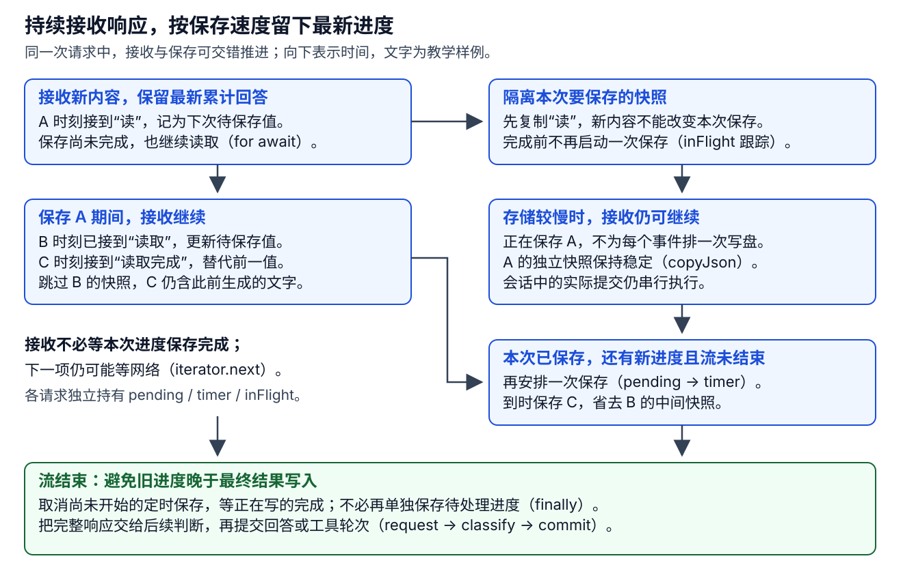

# Pi Durable：输入接纳、生成状态机与工具协作

Pi Durable 的用户工作经过 Submission 接纳，在 Conversation 中由一串生成和工具 Task 推进。理解正常流程后，再讨论恢复；否则容易只看到 checkpoint 与事务，却不知道它们服务于哪一项任务。


图中的三种内置任务都由 TaskScheduler 驱动，但业务接续由各自的处理器决定。调度器按已保存的 checkpoint.phase 调用处理器，没有统一必经的 prepare 阶段；任务创建时由自己的 initial 指定入口。ToolTask 的 call 已包含工具解析、参数准备和校验，正常保存 execute 意图后直接执行；execute handler 用于相应的恢复。[按阶段派发](https://github.com/earendil-works/pi/blob/2ec55d808d455b1a64a2bf7888198207a096120a/packages/durable/src/harness/scheduler.ts#L1727)、[工具初始入口与实际调用](https://github.com/earendil-works/pi/blob/2ec55d808d455b1a64a2bf7888198207a096120a/packages/durable/src/harness/tool.ts#L123)。

| 内置任务 | 首次进入 | 本次工作要完成什么 |
|---|---|---|
| GenerationTask | prepare | 组织模型请求，取得响应，需要动作时创建并等待工具 |
| ToolTask | call | 确认工具和最终参数，保存意图，执行并保存单次调用结果 |
| CompactionTask | select | 选择要概括的历史范围，按需生成并放置摘要 |

图中压缩是可选分支。阻塞压缩归当前生成所有，它完成后同一生成重新 prepare；自动后台与手工压缩归 Conversation 所有，摘要通过 write submission 接纳，不接管 run。自动压缩是后台任务，手工压缩是非后台任务。[三类内置任务](https://github.com/earendil-works/pi/blob/2ec55d808d455b1a64a2bf7888198207a096120a/packages/durable/src/harness/registry.ts#L10)、[压缩初始阶段](https://github.com/earendil-works/pi/blob/2ec55d808d455b1a64a2bf7888198207a096120a/packages/durable/src/harness/compaction.ts#L112)、[压缩的创建与归属](https://github.com/earendil-works/pi/blob/2ec55d808d455b1a64a2bf7888198207a096120a/packages/durable/src/harness/compaction.ts#L246)。

本章以同一 Submission 为线索走五步：接纳输入、准备请求、创建并等待工具、移交下一生成、收口输入。G1 到 G4 是教学轨迹里的生成任务 ID；一个 generation 结束时，用户输入仍可能由下一 generation 继续负责。

| 步骤 | 接到什么 | 交出什么 |
|---|---|---|
| 1. 接纳 | 用户 input 与 requestId | Submission、UserEntry、首个 generation |
| 2. 请求 | 当前历史和配置 | 保存 cutoff 的请求 checkpoint、assistant 响应 |
| 3. 工具 | assistant 的动作请求 | tool child、等待关系、结果 Entry |
| 4. 移交 | 完成的工具结果 | successor generation 和新的 run.taskId |
| 5. 收口 | 最终回答及边界处理 | Submission 的持久结果 |

## 一次运行的提交顺序 {#commit-trace}

把上面的工作链放回[持久化总览](index.md#persistence-overview)，就能按下表逐项核对原大图。这里限定首次建会话、单份输入、无排队／嵌套或额外所属工作、工具正常完成并继续的路径；编号是阅读位置，不是实际 seq。6A 与 6B 是两支，选择 6A 时本轮直接结束；工具分支到 12 后，新生成从 2 继续。

每行列出一次有变化的提交；认领可以批量处理多个任务，进度提交也可以省略。每个非空批次都会向 main.jsonl 追加 commit marker，包含本批完整记录或附属文件引用。`task-<id>.jsonl` 和 `doc-<id>.jsonl` 各按实际数字 ID 分文件，下表用 G1、T1 表示教学身份。

| 大图节点／提交点 | 为什么在此刻提交，谁据此继续 | JSONL 的内容去向 |
|---|---|---|
| 0 建会话，仅首次 | 为后续输入准备有持久身份的会话资料，分开保存运行、排队、用量与配置；尚未安排生成（Conversation 及 live、inbox、usage、provider、agent 文档） | main 保存会话与文档元数据／引用；各 doc 文件保存初始 base |
| 1 接纳空闲输入 | 接住这份工作，让首个生成负责完成，调用者可凭回执跟踪（UserEntry、Submission=placed、G1=pending/prepare；live.run 关联输入与任务） | main 保存输入与 Submission；G1 的 task 文件、LiveDoc 文件保存新值 |
| [2 认领 G1](#generation-claim) | 取得本次执行资格，提交成功后才准备请求，避免重复派发（G1 → running/prepare） | G1 的 task 文件保存完整记录，main 保存引用 |
| 3 固定请求依据 | 记住本次模型配置与历史范围，供恢复时重建请求；保存提示的变化（SystemEntry；request checkpoint 中的 model、thinkingLevel、streamOptions、attempt、cutoff） | main 保存新增 system；G1 的 task 文件保存请求恢复资料 |
| [4 登记生成已开始](#request-commits) | 让观察者知道本次尝试开始；重入时先保留旧进度对应的中断观察，再登记尝试（live.generation={attempt}；G1 状态不变） | LiveDoc 文件及 main 引用；有旧 partial 转历史时还写 assistant 和 UsageDoc |
| [5 保存生成进度，可省](#partial-sampling) | 让界面和重开后的会话看到最近保存的累计回答；可跳过中间快照（live.generation.message；不移动任务恢复位置，不追加最终 Entry） | LiveDoc 文件保存 base 或 delta，main 保存引用 |
| 6A 回答并完成输入 | 回答、用量与完成回执一起生效，调用者可取得已提交结果；无后续工作时回到空闲（assistant、Submission=done；清理 live；G1 → terminal/completed） | main 保存 assistant、Submission 和 G1 终态；更新 LiveDoc／UsageDoc 文件 |
| 6B 把动作交给工具 | 给模型动作安排执行者，保存调用来源与用量；生成等待观察，仍负责原输入（T1=pending/call；live.tools；G1 → waiting/tools） | main 保存 assistant；G1／T1 的 task 文件与 LiveDoc／UsageDoc 文件保存本批变化 |
| [7 认领 T1](#tool-intent) | 为工具取得本次执行资格，随后解析和校验实际调用（T1 → running/call） | T1 的 task 文件保存完整记录，main 保存引用 |
| [8 记住最终动作](#tool-intent) | 外部效果发生前，记住要做什么以及中断后能否重跑；保存成功才展示开始并调用工具（execute checkpoint：arguments、replay；live 槽位 running） | T1 的 task 文件、LiveDoc 文件及 main 引用 |
| [9 保存工具进度，可省](#tool-progress-result) | 让界面持续看到执行输出，此时还没有最终观察（LiveDoc 中 output/details/diagnostics；T1 保持 running/execute） | LiveDoc 文件及 main 引用 |
| [10 确认工具结束](#tool-progress-result) | 留下后续生成可消费的工具观察，同时确认动作结束；界面切到最终结果，有用量才累计（tool-result、终态及 EntryId；live 槽位 done） | main 保存结果 Entry 与 T1 终态；更新相关 doc 文件，T1 附属文件可回收 |
| 11 恢复等待生成 | 工具满足等待条件后，让 G1 重新取得执行资格，处理本轮观察（G1 → running/tools） | G1 的 task 文件保存完整记录，main 保存引用 |
| 12 交给下一轮模型判断 | 新生成接手同一输入，带着新观察准备请求；旧生成完成，原输入仍待回答（G1 → terminal；G2=pending/prepare；live.run.taskId 换到 G2，保留 inputs） | main 保存 G1 终态；G2 的 task 文件和 LiveDoc 文件保存新值；回到 2 |

模型请求发生在 4 之后，工具外部调用发生在 8 之后；流事件或工具回调先更新局部缓冲，再按政策进入 5 或 9。各阶段提交内部都走同一条[Transaction → Storage → adopt／publish](architecture.md#每次事务的候选从哪里来)链，不能把表中的多行理解成共用一个尚未提交的 Draft。后文按五步解释这些记录为何在这个时点一起改变。

### checkpoint 保存于哪个操作前后 {#checkpoint-timing}

checkpoint 保存下次执行的阶段和所需资料。一次 runtime.commit 可以同时保存消息、Task 和 Document；回调的返回值决定是否更新当前 Task。正常生成与工具路径有下列五个创建或推进 checkpoint 的位置。6B 同批保存两件任务的 checkpoint，12 创建新生成后会再次经过准备过程。

| 提交位置 | 先说明用途 | 在哪个操作之前／之后 | 保存的 checkpoint |
|---|---|---|---|
| 1 接纳输入 | 让首个生成记住从准备请求开始 | 输入被接纳时、首次执行 prepare 之前 | 新 G1 的 prepare；attempt=1 |
| 3 固定请求依据 | 记住模型配置和历史范围，让中断后能够重建请求 | prepare 的资料准备完成之后、request handler 和模型访问之前 | G1 的 request；含 model、cutoff 等 |
| 6B 把动作交给工具 | 让生成记住等待谁，并让工具知道从调用检查开始 | 模型完整响应已取得并被分类之后、工具认领与实际执行之前 | G1 改为 tools；新工具初始为 call，二者同批保存 |
| 8 记住最终动作 | 为中断恢复留下最终参数和重跑约定 | 参数及 beforeTool 校验之后、tool.execute 之前 | 工具从 call 改为 execute；含 arguments/replay |
| 12 交给下一轮判断 | 新生成接手同一输入，带着工具观察重新准备 | 工具结果已保存、G1 处理本轮观察之后；新 G2 执行 prepare 之前 | 新 G2 的 prepare；G1 保存结果并结束 |

新任务的初始 checkpoint 在创建事务中保存：tx.createTask 调用任务定义的 initial，并写入 pending 状态。上表 1 与 12 因而是同一种初始 prepare，属于不同生成任务。[创建任务执行点](https://github.com/earendil-works/pi/blob/2ec55d808d455b1a64a2bf7888198207a096120a/packages/durable/src/session/transaction.ts#L425)、[生成初始位置](https://github.com/earendil-works/pi/blob/2ec55d808d455b1a64a2bf7888198207a096120a/packages/durable/src/harness/generation.ts#L125)、[工具初始位置](https://github.com/earendil-works/pi/blob/2ec55d808d455b1a64a2bf7888198207a096120a/packages/durable/src/harness/tool.ts#L126)。其余三处分别见[请求前准备](https://github.com/earendil-works/pi/blob/2ec55d808d455b1a64a2bf7888198207a096120a/packages/durable/src/harness/generation.ts#L190)、[响应后的工具交接](https://github.com/earendil-works/pi/blob/2ec55d808d455b1a64a2bf7888198207a096120a/packages/durable/src/harness/generation.ts#L648)、[工具实际调用前](https://github.com/earendil-works/pi/blob/2ec55d808d455b1a64a2bf7888198207a096120a/packages/durable/src/harness/tool.ts#L166)。

一次 commit 的实际效果可以按回调返回值核对：

| 回调怎样返回 | 当前 Task 怎样保存 | 同批还可以保存什么 |
|---|---|---|
| 返回 undefined | 保持当前 Task 状态及 checkpoint | 已修改的 LiveDoc、用量或其他记录仍正常提交，例如生成进度 |
| 返回 running／waiting／sleeping 及 checkpoint | 保存指定状态与恢复资料 | 请求依据、等待关系、工具任务和相关文档 |
| 返回 terminal 及 outcome | 保存最终结果，当前 Task 不再携带 checkpoint | 最终回答、工具结果、Submission 与文档收口 |

因此，进度提交成功时也确实落盘，只是恢复仍从原 request／execute 阶段进入。实际分支是先执行 change(tx)，有返回状态才调用 #commitState；事务中已登记的其他变化随后统一交给 Session 持久化。[回调与状态更新](https://github.com/earendil-works/pi/blob/2ec55d808d455b1a64a2bf7888198207a096120a/packages/durable/src/harness/scheduler.ts#L2133)。

认领只是在确认“这一次由谁执行”：2、7、11 随完整 Task 保存原 checkpoint，并不新建或推进它（pending/waiting → running）。4、5、9 则只更新观察进度。6A 回答和 10 工具完成保存的是 outcome，原任务不再携带 checkpoint；12 也只有新 G2 需要初始 checkpoint。[认领时沿用](https://github.com/earendil-works/pi/blob/2ec55d808d455b1a64a2bf7888198207a096120a/packages/durable/src/harness/scheduler.ts#L1540)、[状态结构](https://github.com/earendil-works/pi/blob/2ec55d808d455b1a64a2bf7888198207a096120a/packages/durable/src/types.ts#L598)。

条件旁路会增加写入；下面列出它们的时点，仍按“先解释后续怎么继续，再对照字段”的顺序阅读。

| 触发场景 | checkpoint 在何时保存，用来继续什么 |
|---|---|
| 请求失败，可以重试 | 失败响应之后、退出当前执行去等待之前保存 retry；到期后、重新进入 prepare 之前再保存 prepare，并增加 attempt |
| 服务端工作尚未产出结果 | 收到延后凭据之后、休眠及下一次查询之前保存 poll；查询若仍延后，再保存新的查询时点，真正取结果后交分类处理 |
| 上下文必须先压缩 | 确定要压缩之后、等待压缩结果之前保存 prepare 和子任务引用；溢出触发时已经取得错误响应。压缩完成后从 prepare 重建请求 |
| 串行工具尚有未派发调用 | 前一工具完成之后、等待新工具之前更新 tools 中的任务与待处理调用列表；同时给新工具写初始 call |

这些分支分别见[重试等待与到期继续](https://github.com/earendil-works/pi/blob/2ec55d808d455b1a64a2bf7888198207a096120a/packages/durable/src/harness/generation.ts#L238)、[失败后的 retry](https://github.com/earendil-works/pi/blob/2ec55d808d455b1a64a2bf7888198207a096120a/packages/durable/src/harness/generation.ts#L568)、[延后查询](https://github.com/earendil-works/pi/blob/2ec55d808d455b1a64a2bf7888198207a096120a/packages/durable/src/harness/generation.ts#L517)、[压缩前等待](https://github.com/earendil-works/pi/blob/2ec55d808d455b1a64a2bf7888198207a096120a/packages/durable/src/harness/generation.ts#L183)、[溢出后的压缩等待](https://github.com/earendil-works/pi/blob/2ec55d808d455b1a64a2bf7888198207a096120a/packages/durable/src/harness/generation.ts#L548)、[串行工具派发](https://github.com/earendil-works/pi/blob/2ec55d808d455b1a64a2bf7888198207a096120a/packages/durable/src/harness/generation.ts#L269)。压缩任务自身还有选择范围、请求摘要和重试的恢复位置，不计入上面的正常主线五处，详见[摘要生成与采用](documents.md#第四步-生成摘要-并在允许边界放置)。

checkpoint.phase 指定重新进入的位置。工具 call handler 保存 execute 意图后，继续在同一个 handler 内调用工具；若此后中断，重开时才进入 execute handler 检查恢复条件。[意图与直接执行的相邻代码](https://github.com/earendil-works/pi/blob/2ec55d808d455b1a64a2bf7888198207a096120a/packages/durable/src/harness/tool.ts#L173)。

## 第一步：接纳输入，建立持久身份

贯穿案例仍是“读取需求和 CSV 导出代码，修复字段转义，运行已有验证并说明结果”。应用把它作为 input submission 交给 Conversation.submit。Submissions 在 Session 的事务中检查当前是否忙、是否已有排队输入，以及 requestId 是否已接纳。

若 Conversation 刚创建，Harness 的 conversationCreated 会在创建事务里先取得 LiveDoc、InboxDoc、UsageDoc、ProviderDoc，并创建 AgentDoc。这是表中 0：各文档得到自己的身份和初始值；已有 Conversation 不必为每次输入重建它们。[初次文档初始化](https://github.com/earendil-works/pi/blob/2ec55d808d455b1a64a2bf7888198207a096120a/packages/durable/src/harness/harness.ts#L410)。

空闲且没有排队项时，事务追加 UserEntry、创建 status=placed 的 Submission、创建首个 generation，并把 Submission ID 放进 `pi.live.run.inputs`。输入接纳时已经有持久身份，后续不需要通过模型文字判断“这还是不是刚才那份工作”。忙时可按 whenBusy 选择 reject、steer 或 followUp；排队内容进入 InboxDoc，等对应边界放置。[接纳实现](https://github.com/earendil-works/pi/blob/2ec55d808d455b1a64a2bf7888198207a096120a/packages/durable/src/harness/submissions.ts#L192)。

| 输入进度 | 记录状态 | 含义 |
|---|---|---|
| 忙时接纳并等待 | queued | 尚未放入运行历史，由队列边界处理 |
| 正式放入本次工作 | placed | 已有 UserEntry，由 run 跟踪收口 |
| 最终回答或相应写入完成 | done | Submission 有持久收口结果 |
| 被取消、重置或其他未回答条件收口 | unanswered + reason | 本次接纳有终点，但没有正常回答 |

这些状态由输入接纳与收口程序更新。queued 输入可以进展为 placed 再 done，也可以在放置前被撤回；具体输入模式影响它在哪个运行边界被消费。

### 接纳后先认领，再执行 prepare {#generation-claim}

表中 1 创建的是 pending/prepare 的 G1。TaskScheduler 的 #reserve 在同一 Session 队列内读取它，确认可运行后，将完整任务候选替换为 running，保留原 checkpoint。认领事务内会先注册本次 invocation，防止重复认领；提交成功后才构造 runtime 并调用 prepare handler。认领提交失败则移除这次注册；因此“已经创建任务”和“任务已经开始执行”跨过两次提交。[认领提交](https://github.com/earendil-works/pi/blob/2ec55d808d455b1a64a2bf7888198207a096120a/packages/durable/src/harness/scheduler.ts#L1470)、[进入阶段代码](https://github.com/earendil-works/pi/blob/2ec55d808d455b1a64a2bf7888198207a096120a/packages/durable/src/harness/scheduler.ts#L1711)。

接下来 prepare 在事务外组织系统提示与工具声明，再用表中 3 的提交追加有变化的 SystemEntry，并把本次请求所需字段连同 cutoff 存进 request checkpoint。到这里，请求参数已有恢复位置，模型调用还没有发生。[prepare 的提交](https://github.com/earendil-works/pi/blob/2ec55d808d455b1a64a2bf7888198207a096120a/packages/durable/src/harness/generation.ts#L190)。

## 第二步：准备请求边界，取得模型响应


生成工作先固定请求依据，再取得模型判断；需要动作时先等工具观察，再交给下一轮继续。请求失败可以等一段时间重试，服务端尚未返回结果则稍后查询。这些操作分别保存在 GenerationTask 的 checkpoint.phase 中；是否正在执行或等待，则由调度 status 表示。下表用操作目的连接这两层信息。

| 这一步要解决什么 | 保存什么，供谁采用 | 阶段对照 | 正常走向 |
|---|---|---|---|
| 固定本次请求依据 | 准备提示与工具声明，保存模型配置和历史范围，供请求及恢复重建（model、thinkingLevel、streamOptions、cutoff） | prepare | 请求模型 |
| 取得模型对当前资料的判断 | 从约定范围重建消息，经 beforeRequest 调整后在事务外请求；取得完整响应再分类提交 | request | 回答并收口，或交工具 |
| 等动作完成，取得新观察 | 记住本轮来源、工具身份与尚未派发的调用，供串行派发或恢复等待（assistant、tools、pending） | tools | 处理结果，移交新生成 |
| 暂缓下一次尝试 | 记住重试次数与下次时点，让调度器到期再安排（attempt、until） | retry | 重新准备请求 |
| 取回服务端已有工作的结果 | 记住取回凭据、下次查询时点与原请求范围，供后续查询采用（handle、pollAt、cutoff） | poll | 查询后再分类响应 |

重试与延后查询都要记住“何时能继续”，让当前执行返回，等待期间不占运行中的执行实例（invocation）。调度器到期后再按保存的阶段认领：重试重新准备请求，延后查询取回同一份服务端工作（status=sleeping，phase=retry/poll）。宿主若提前唤醒且时点未到，则继续等待；工具阶段则按依赖结果是否满足来恢复（status=waiting）。[重试与轮询阶段](https://github.com/earendil-works/pi/blob/2ec55d808d455b1a64a2bf7888198207a096120a/packages/durable/src/harness/generation.ts#L238)。

例如服务端已接受工作、但结果还未准备好，本地保存取回凭据与查询时点，后续查询同一份服务端工作。下面节选这次等待的提交：查询时间按 Harness 时钟计算（pollAt），其余资料供后续查询重建原请求范围。保存后当前执行即可返回。

```ts
const checkpoint = {
  phase: "poll", attempt, model: ref, cutoff, handle, pollAt,
  // 省略：此前压缩任务的可选引用。
} as const;
return { status: "sleeping", checkpoint, until: pollAt };
```

重开后，调度器仍能判断何时继续，并把取回凭据交给查询阶段（读取 until 与 handle，进入 poll）。上面的状态由 runtime.commit 回调交给调度器，在同一批中保存。[延后响应的提交](https://github.com/earendil-works/pi/blob/2ec55d808d455b1a64a2bf7888198207a096120a/packages/durable/src/harness/generation.ts#L510)。

cutoff 是这一请求包含的最新 Entry。prepare 完成后保存它，再从同一范围读取请求上下文。这让“模型这次依据哪段资料作判断”有明确边界。它不表示未来所有请求都使用相同历史；下一生成会准备新的范围。[checkpoint 字段与 prepare](https://github.com/earendil-works/pi/blob/2ec55d808d455b1a64a2bf7888198207a096120a/packages/durable/src/harness/generation.ts#L56)、[request 实际调用](https://github.com/earendil-works/pi/blob/2ec55d808d455b1a64a2bf7888198207a096120a/packages/durable/src/harness/generation.ts#L209)。

request 阶段读取 checkpoint.cutoff 所限定的上下文，再依次调用 beforeRequest，最后取得模型响应并分类。下面节选实际交接，省略 pi.live 进度更新、模型不可用处理和 stream options 的组装：

```ts
const view = await runtime.context(conversationId, context, { at: cutoff });
let messages = view.messages;
await runtime.hooks.each("beforeRequest", async (hook) => {
  const replaced = await hook({ messages }, runtime, context);
  if (replaced !== undefined) messages = replaced.messages;
});
// 省略：按 checkpoint 的配置组装 options。
const message = await streamResponse(runtime, model, messages, options, attempt, context);
const request = { attempt, compacted, model: ref, cutoff, messages: view.messages };
await classify(runtime, request, message, context);
```

classify 在下一步把响应分类为回答、工具轮次或相应旁路。[request 的实际入口](https://github.com/earendil-works/pi/blob/2ec55d808d455b1a64a2bf7888198207a096120a/packages/durable/src/harness/generation.ts#L209)。

### request 前后分别提交什么 {#request-commits}

回到 CSV 修复任务：请求依据已保存，现在先让观察者知道本次生成开始，再访问模型；这次登记没有新的模型文字，也不移动任务的恢复位置（request 开头写 live.generation={attempt}，回调返回 undefined；此前已保存 running/request 与 model、cutoff 等）。重入请求时，若此前保存过未完成回答，要先把它留下作为中断观察、累计用量，再登记本次尝试，避免旧进度被无声覆盖（convertPartial 写 stopReason=aborted 的 assistant）。[请求前的进度登记](https://github.com/earendil-works/pi/blob/2ec55d808d455b1a64a2bf7888198207a096120a/packages/durable/src/harness/generation.ts#L209)、[旧 partial 转历史](https://github.com/earendil-works/pi/blob/2ec55d808d455b1a64a2bf7888198207a096120a/packages/durable/src/harness/generation.ts#L434)。

模型响应返回后，request handler 继续 await classify；它仍处在本次 handler 的调用内。成功响应按下面两支提交：

| 响应分支 | 操作意图与同批生效的效果 | 任务状态对照 |
|---|---|---|
| 普通最终回答 | 让调用者取得有持久记录的回答，同时确认本轮输入已完成并释放运行归属；有边界后续工作时先按相应政策继续（appendAssistant 保存消息与用量，endRun 保存 done/answer 并清理 live） | terminal/completed，结果引用回答 Entry |
| 含工具调用 | 给模型动作安排执行者，留下调用来源与用量，让本轮生成等新观察；原输入仍由它负责（创建 tool child，生成视图改为工具 slots） | waiting，checkpoint.phase=tools，保存 assistant、tools、pending 和等待条件 |

next 由 [runtime.commit 包装函数](architecture.md#回调怎样接到任务状态-再进入-storage)交给 #commitState，再进入 Session 的 writes。因而请求结束的状态变化与消息一起持久化；普通回答可以直接保存终态，无需再造一个 request 之后的 checkpoint。若选用 JSONL，assistant 与 terminal Task 在 main.jsonl 中，waiting Task 在自己的 task 文件中，文档变化在各自 doc 文件中，并由同一 main commit marker 确认；这里不存在专门的 `model.jsonl`。[响应分类](https://github.com/earendil-works/pi/blob/2ec55d808d455b1a64a2bf7888198207a096120a/packages/durable/src/harness/generation.ts#L505)、[回答提交](https://github.com/earendil-works/pi/blob/2ec55d808d455b1a64a2bf7888198207a096120a/packages/durable/src/harness/generation.ts#L597)、[工具轮次提交](https://github.com/earendil-works/pi/blob/2ec55d808d455b1a64a2bf7888198207a096120a/packages/durable/src/harness/generation.ts#L648)。

### 流中保存的是累计进度，怎样采样 {#partial-sampling}



持续接收响应时，界面需要看到近期进度，但接收不应为每次写盘停下来。因此本地只保留最新累计回答，保存端按间隔复制一个独立快照，让新到内容不改变正在保存的值；每次只更新展示进度，任务仍停在原请求位置。源码对照：pi-ai 的 event.delta 是新增片段，event.partial 是 provider 持续修改的累计对象；streamResponse 将后者放入 pending，timer 到期后 flush 清空槽位、同步 copyJson，再提交到 LiveDoc.generation.message。回调返回 undefined，不追加最终 assistant Entry，也不更换当前 Task checkpoint。[事件协议](https://github.com/earendil-works/pi/blob/2ec55d808d455b1a64a2bf7888198207a096120a/packages/ai/src/types.ts#L790)、[flush 的复制与提交](https://github.com/earendil-works/pi/blob/2ec55d808d455b1a64a2bf7888198207a096120a/packages/durable/src/harness/generation.ts#L446)。

假设 A 时刻内容是“读”，B 是“读取”，C 是“读取完成”。保存 A 的过程中，生产者仍可更新 pending，B 随后被 C 替代；省略的是 B 时刻的一次持久快照，B 已生成的文字仍包含在 C 内。pending 是一个只保留最新值的槽位，不是必须逐条消费的 token 队列，也不会等保存 A 完成后才允许覆盖。

存储较慢时，只等当前这次保存完成，不把每个到达事件都排成一次提交；接收端仍可保留更新后的累计回答。当前保存结束后，如还有新进度且流未停止，才安排下一次保存（inFlight 跟踪本次保存的 Promise，finally 再安排 timer）。接收与等存储可交错，Session 的实际提交仍串行；这些缓冲和计时器只属于本次 streamResponse，另一轮请求有自己的实例。[事件接收与下一次 timer](https://github.com/earendil-works/pi/blob/2ec55d808d455b1a64a2bf7888198207a096120a/packages/durable/src/harness/generation.ts#L478)。

已经有计划中或进行中的保存时，接收端继续读下一项，不等待进度写入；下一项仍可能等网络。流结束则先停止未来保存、等已发出的保存完成，避免旧进度晚于最终结果写入；待保存槽位不必另存一次，完整响应随后进入回答或工具分支。代码中的交接是：for await 驱动接收；timer/flush 控制保存；外层 finally 设置 stopped、取消 timer 并 await inFlight，再由 classify 提交最终结果。[流结束的收尾](https://github.com/earendil-works/pi/blob/2ec55d808d455b1a64a2bf7888198207a096120a/packages/durable/src/harness/generation.ts#L483)。

## 第三步：把动作请求变为工具工作并等待

图中 G1—G4 是教学命名。实际模型可能用更多或更少轮次，也可能先补查测试。下面的重点是对象和数据怎样推进，并非假定固定步骤。

**G1 获取事实。** 模型读到用户要求和当前 Prompt，返回 assistant toolCall 要求读需求与代码。事务保存 assistant Entry，创建相应 tool child Task，并把 G1 设为 waiting/phase=tools。工具执行后保存结果；G1 在工具全部收口后重新进入 tools 阶段处理结果。

### 工具执行前：认领与意图 {#tool-intent}

模型已提出动作，现在要为它取得执行资格，并确定实际允许执行的调用。生成先记住要等哪些工具，再结束本次执行；调度器认领工具后，工具代码才沿保存的调用引用查定义、校验参数并运行 beforeTool。源码对照：T1 从 pending/call 认领为 running/call（表中 7），input 中的 assistant EntryId 与 callId 指向实际调用；G1 保持 waiting/tools。[工具输入与初始阶段](https://github.com/earendil-works/pi/blob/2ec55d808d455b1a64a2bf7888198207a096120a/packages/durable/src/harness/generation.ts#L331)、[call handler](https://github.com/earendil-works/pi/blob/2ec55d808d455b1a64a2bf7888198207a096120a/packages/durable/src/harness/tool.ts#L74)。

外部动作一旦发生，进程中断后可能无法判断是否已完成。因此执行前要记住最终动作及能否重跑，并在这批保存成功后才调用工具、让观察者看到开始（表中 8：execute checkpoint 保存 arguments/replay，live 槽位改为 running）。正常 call handler 随后直接 await run，由 run 调用 tool.execute；中断重开才使用 execute handler 检查恢复条件，详见[工具意图与 replay](architecture.md#工具阶段-先保存调用意图-再执行并提交结果)。[意图提交后的实际调用](https://github.com/earendil-works/pi/blob/2ec55d808d455b1a64a2bf7888198207a096120a/packages/durable/src/harness/tool.ts#L166)。

### 工具执行中与结束：进度和结果 {#tool-progress-result}

工具仍在执行时，先把持续输出交给界面观察，最终结果留待结束时确认。输出在事务外进入缓冲，再按政策取快照保存；这类提交更新展示，不移动任务恢复位置（表中 9：更新 LiveDoc 的 output/details/diagnostics，返回 undefined，T1 保持 running/execute）。它与模型进度采样一样，可以省去中间快照，此时还没有最终工具结果 Entry。[进度写入执行点](https://github.com/earendil-works/pi/blob/2ec55d808d455b1a64a2bf7888198207a096120a/packages/durable/src/harness/tool.ts#L502)。

工具结束时，要把本轮观察交给等待生成，并让“动作结束”和“结果可用”一起生效，界面也从运行进度切换到最终结果（表中 10）。对应 settle 同批追加 tool-result Entry、保存结果引用与 terminal outcome、把 live 槽位改为 done 并移除进度；结果有用量才累计。完成后还释放任务专属资料：退休 task-scope 文档；JSONL 将完整终态留在 main，允许回收不再需要的 task 附属文件。[工具结果同批提交](https://github.com/earendil-works/pi/blob/2ec55d808d455b1a64a2bf7888198207a096120a/packages/durable/src/harness/tool.ts#L653)、[终态退休任务文档](https://github.com/earendil-works/pi/blob/2ec55d808d455b1a64a2bf7888198207a096120a/packages/durable/src/session/transaction.ts#L805)。

此时只是 T1 完成，G1 仍停在 waiting/tools。scheduler 采用这次变化并检查等待条件，在表中 11 重新认领 G1，改为 running/tools；下一节才由 G1 处理观察并决定如何继续。

## 第四步：采用观察，将同一输入交给下一生成

**G2 作出修改。** 工具带回了新事实，需要让模型据此选择下一步，同时保持对原输入的处理责任。因此程序结束旧生成、创建新生成并移交运行归属（G1 terminal/completed；创建 G2，pi.live.run.taskId 换到 G2）。G2 的请求包含读工具结果，模型据此选择修改方式；也可能继续查文件，再形成一个工具轮次。

创建并移交下一轮生成的决定位于 GenerationTask 的 tools 收尾代码；TaskScheduler 随后认领新任务并按 checkpoint 调用处理器。这里对应表中 12：旧 G1 的终态、新 G2 的 pending/prepare 以及 LiveDoc 的运行归属在同一批生效。JSONL 因而同时写 main 中的旧任务终态、新任务的 task 文件和 LiveDoc 文件；G1 的附属文件可回收。输入 Submission 仍为 placed，G2 必须先被认领，再准备含新工具结果的请求。[创建并移交下一生成](https://github.com/earendil-works/pi/blob/2ec55d808d455b1a64a2bf7888198207a096120a/packages/durable/src/harness/generation.ts#L732)。

**G3 验证并可能调整。** 新生成读到修改结果，选择运行验证。工具给出失败时，下一生成可以据失败内容继续修改。它遵循同一个反馈循环；失败观察进入下一请求，由模型决定修复动作。

## 第五步：最终回答后收口 Submission

**G4 收口输入。** 模型产生正常最终回答。answer 路径保存 assistant Entry，在最终边界处理队列，并由 endRun 收口 run.inputs 中的 Submission。若存在 onYield 的继续要求，满足相应条件时也可以把同一 run 再交给 successor，此时继续由 successor 负责输入收口。[创建工具轮次](https://github.com/earendil-works/pi/blob/2ec55d808d455b1a64a2bf7888198207a096120a/packages/durable/src/harness/generation.ts#L624)、[工具后移交](https://github.com/earendil-works/pi/blob/2ec55d808d455b1a64a2bf7888198207a096120a/packages/durable/src/harness/generation.ts#L677)、[最终回答与继续钩子](https://github.com/earendil-works/pi/blob/2ec55d808d455b1a64a2bf7888198207a096120a/packages/durable/src/harness/generation.ts#L592)。

表中 6A 在这一刻把用户工作收口：appendAssistant 同批累计 UsageDoc，endRun 保存输入的 done/answer，并清理 live.run、generation 和工具视图；回调返回 G4 的 terminal/completed。没有额外所属工作的普通路径中，main.jsonl 保存回答 Entry、Submission 和任务终态，相关 doc 文件保存本批文档变化。观察者随后看到空闲，Submission.wait 才能消费已提交结果；有排队输入或继续要求时按前述边界建立下一工作。[模型用量与消息](https://github.com/earendil-works/pi/blob/2ec55d808d455b1a64a2bf7888198207a096120a/packages/durable/src/harness/generation.ts#L743)、[最终回答事务](https://github.com/earendil-works/pi/blob/2ec55d808d455b1a64a2bf7888198207a096120a/packages/durable/src/harness/generation.ts#L597)。

## 用工具等待时刻核对前面的五步

假设 G1 正在等待读工具，存储中有以下关系。代码块为字段节选的教学样例，ID 经过简化；不是可导入的完整记录：

```json
{
  "generation": {
    "id": "G1", "kind": "pi.generation",
    "state": {
      "status": "waiting",
      "checkpoint": { "phase": "tools", "assistant": "E2",
                      "tools": ["T1"], "pending": [] },
      "on": ["T1"], "policy": "allSettled"
    }
  },
  "tool": {
    "id": "T1", "kind": "pi.tool", "version": 2, "owner": "G1",
    "input": { "kind": "model", "assistant": "E2", "callId": "read-1" },
    "state": { "status": "running",
               "checkpoint": { "phase": "execute",
                               "arguments": { "path": "src/export.ts" },
                               "replay": "safe" } }
  },
  "pi.live": {
    "run": { "taskId": "G1", "inputs": ["S1"] },
    "tools": [{ "callId": "read-1", "name": "read",
                "taskId": "T1", "status": "running" }]
  }
}
```

generation 的 checkpoint 管理这一轮应等待谁；tool 的 checkpoint 管理具体效果的恢复；pi.live 管理会话当前归属与展示。它们可同批改变，各自服务于任务恢复、运行归属和展示。样例假设工具明确声明 replay=safe；未声明时源码默认 unsafe。

工具完成后，T1 有结果 outcome 和结果 Entry；G1 处理该轮后终止，pi.live.run.taskId 改为 G2。S1 仍在 run.inputs 中，直到最终收口。这个中间状态解释了为什么“一个生成已经完成”不能作为用户任务完成判定。

## 自然语言、结构化控制与动态选择

用户目标、Prompt sections、工具返回文本、摘要主要表达语义。Entry 的 model 贡献承载这些消息，ContextView 负责组织；模型产生 toolCall，再由程序转换成工具 Task。模型并不直接修改 Task status，调度器也不负责理解自然语言中的下一步计划。

Pi Durable 默认提供的是反馈循环。应用可用 Registry、任务定义、hooks 与 Document 构建额外规划流程，但内置 generation/tools 主链路没有固定的独立 Planner→Executor→Replanner。Task 持久化与 Plan & Execute 属于两个维度：前者回答工作怎样保存，后者回答决策怎样分工。

模型还可以选择 codemode，以一次工具调用提交脚本，在脚本内部串并行组织多次工具调用。外层仍是生成、动作、观察的反馈循环，局部计算改由程序表达。官方 Plan Mode 示例通过扩展切换只读工具与计划资料；这些是可组装策略，内核不会将自然语言计划自动升级为强制执行图。[工具组合](tools.md)继续解释这一层。

## 模型失败后，排队输入怎样继续

假设 S1 正在修复 CSV，用户又排入 S2“完成后解释测试覆盖”，这时模型请求因 model_error 结束。S1 的失败和 S2 的处理是两个决定：`settings.afterFailedRun` 默认为 keep，保留尚未消费的输入；continue 在失败收口后尝试按队列边界启动下一运行；withdraw 将排队输入收为 unanswered，reason 为 run_failed。缺少模型的 no_model 也走这项政策。[失败与队列交接](https://github.com/earendil-works/pi/blob/2ec55d808d455b1a64a2bf7888198207a096120a/packages/durable/src/harness/generation.ts#L411)。

因此，产品不能只观察一个 Task 失败就清空全部输入，也不能把留在队列中的 S2 当成已回答。应读取各 Submission 的终态；当前运行、队列和后续接纳按明确政策交接。

与 AgentSession 相比，两者都让工具结果参与下一次模型选择。差别在于 AgentSession 在同一进程内 loop 连续推进，Pi Durable 把每次生成、工具等待和控制移交写入记录。这个差异比“都叫 Agent loop”更能说明实现策略。[模式比较](../../comparisons/execution-modes.md)将两者放到同一任务中对照。

学习自检：G1 终止时 S1 为什么还未 done？cutoff 与 checkpoint.phase 各限定什么？工具结果如何影响模型，却不直接代替调度状态？能沿图回答这些问题，就能继续阅读 [Document 与上下文](documents.md)。
