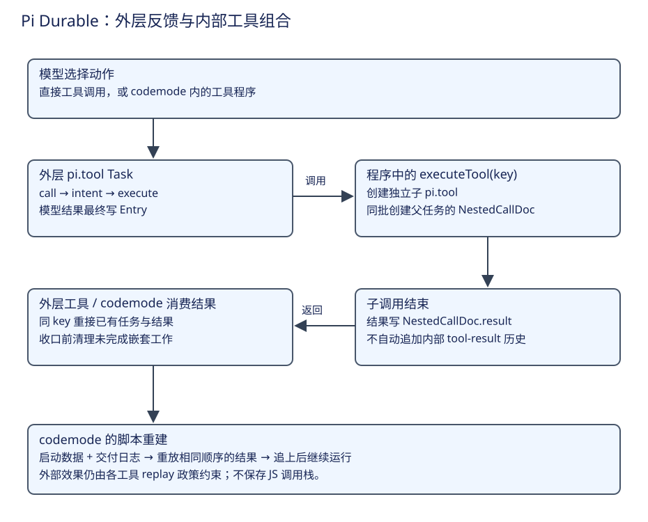
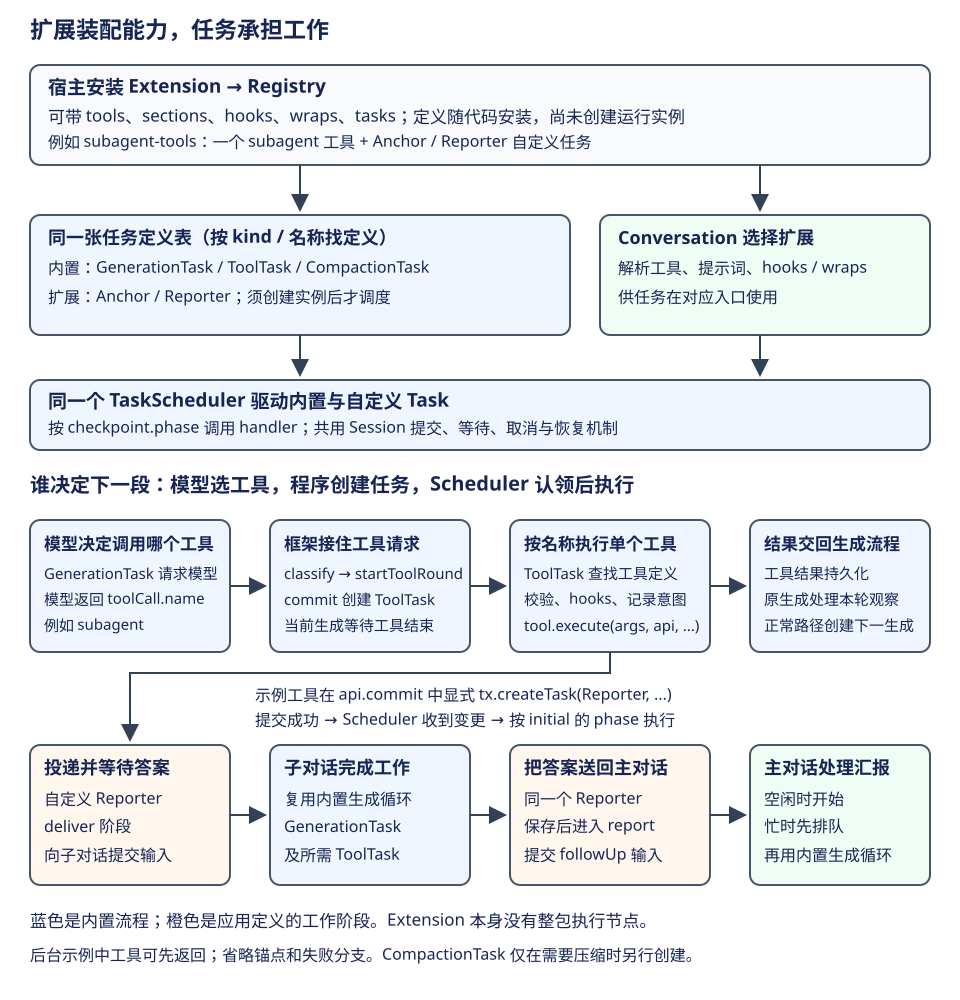

# Pi Durable：工具发现、嵌套调用与脚本恢复

一次 CSV 修复可能需要读取多个文件、归纳结果，再选择修改与验证。每个动作都由模型单独发起时，程序组织比较简单；若模型能写一段脚本完成批量读取和局部计算，就需要继续解释：脚本能调用哪些工具，中断后哪些调用已有结果，脚本本身怎样重建。



本章沿四次交接展开：从可用定义得到模型可见集合，将脚本里的调用接到工具内核，将结果交给正确消费者，最后用已有结果重建脚本。外层生成与工具反馈循环沿用[执行章](loop.md)，这里放大一次工具调用内部发生的工作。

## 先看 Extension 怎样接到内置任务

Extension 是宿主安装的一组能力，Task 是调度器推进的一件工作。Registry 保存定义，Harness 为自己的 Session 建立 TaskScheduler；内置和自定义 Task 都交给这个调度器执行。本文说的是 Durable 的 Extension；Pi AgentSession 扩展使用的 pi.registerTool / pi.on 是另一套接口，不能直接套用本节的装配方式。[Harness 装配](https://github.com/earendil-works/pi/blob/2ec55d808d455b1a64a2bf7888198207a096120a/packages/durable/src/harness/harness.ts#L213)。



先从最简单的 read 工具理解：扩展声明工具名称、参数和 execute；GenerationTask 向模型提供这份声明。模型决定调用 read 后，框架创建内置 ToolTask，由它校验参数、调用 read.execute、保存观察结果。read 自己不需要再定义 ReadTask；[CodingTools 的实际装配](https://github.com/earendil-works/pi/blob/2ec55d808d455b1a64a2bf7888198207a096120a/packages/durable/src/tools/index.ts#L33)就只提供工具。内置 GenerationTask、ToolTask、CompactionTask 已经实现模型交互、工具执行和历史压缩的常用流程；TaskScheduler 则承担这些任务共有的阶段派发、等待、取消和恢复。

扩展可以在不同位置参与这条主线：

| 扩展带来的内容 | 在什么时候起作用 | 是否需要额外 Task |
|---|---|---|
| tools | 模型选择动作后，ToolTask 调用工具的 execute | 普通工具无需新增 |
| sections | GenerationTask 准备请求时，补充系统提示词 | 无需新增 |
| hooks | 内置任务主动开放的位置，例如请求前、工具执行前、准备结束回答时 | 无需新增 |
| wraps | 解析该会话的工具或提示词时，包装已有定义，执行时采用包装结果 | 无需新增 |
| tasks | 宿主或工具创建实例后，执行自定义阶段流程 | 为独立生命周期的工作新增 |

### 能力展开以后，谁决定执行哪一个

Extension 把工具、提示词、hooks、wraps 和 Task 定义打包安装；Conversation 选择启用项以后，运行代码分别消费这些成员。工具按名称执行，提示词在准备请求时渲染，hooks 在对应入口调用，自定义 Task 按 checkpoint.phase 推进。

准备请求时，GenerationTask 通过 runtime.agent 获取本阶段解析的 Agent。resolveAgent 先选择 Conversation 启用的扩展，再分别合并工具与提示词、应用 wraps，最后按工具配置过滤出模型可见集合。GenerationTask 渲染有效的 sections（render 返回 undefined 可省略），并把工具声明送给模型；此时不会调用这些工具的 execute。模型之后只按工具名选择动作，hooks 则由任务在相应入口主动调用。[能力展开与过滤](https://github.com/earendil-works/pi/blob/2ec55d808d455b1a64a2bf7888198207a096120a/packages/durable/src/harness/agent.ts#L229)、[准备提示词与工具声明](https://github.com/earendil-works/pi/blob/2ec55d808d455b1a64a2bf7888198207a096120a/packages/durable/src/harness/generation.ts#L135)。

因此，自行实现 myTool 后放入自己的最小扩展，同样由 ToolTask 执行，不必加入 CodingTools 等现成扩展：

```ts
registry.install(defineExtension({ name: "my-tools", tools: [myTool] }));
```

这里省略 myTool 的定义。当前 Durable Registry 只有 install(extension) 这一安装接口，没有独立 registerTool(tool)；“不用现成扩展”可行，完全绕过扩展直接注册工具则不属于这套接口。工具自身执行路径相同，但原扩展若附带提示词、hooks 或 wraps，省去这些成员会改变整体行为。[Registry 安装接口](https://github.com/earendil-works/pi/blob/2ec55d808d455b1a64a2bf7888198207a096120a/packages/durable/src/harness/types.ts#L402)。

例如 Reviewer 扩展只有提示词和 GenerationTask.onYield hook：模型准备结束回答时，hook 可以要求再检查一遍。它继续使用内置生成循环，不需要实现 ReviewerTask。hooks 只有在任务代码调用对应入口时才执行，不会自动包围每一行代码。[扩展契约](https://github.com/earendil-works/pi/blob/2ec55d808d455b1a64a2bf7888198207a096120a/packages/durable/src/harness/types.ts#L370)、[Reviewer 示例](https://github.com/earendil-works/pi/blob/2ec55d808d455b1a64a2bf7888198207a096120a/packages/durable/test/examples/28-reviewer.ts#L33)。

### 一次工具调用怎样启动自定义工作

仓库的后台子 Agent 示例把这两层组合在一起。以下是示例的真实装配节选，省略各定义的实现：

```ts
const SubagentTools = defineExtension({
  name: "subagent-tools",
  tasks: [Anchor, Reporter],
  tools: [subagentTool],
});
registry.install(SubagentTools);
```

用户要求主 Agent 分出一个后台任务后，先由模型选择动作，再由代码落实为具体工作。下面沿有效工具调用的正常路径标明每次交接：

| 顺序与操作意图 | 谁判断或触发 | 代码与交接结果 |
|---|---|---|
| 1. 决定要启动子 Agent | 模型 | streamResponse 返回带 name=subagent 的 toolCall；GenerationTask.request 将响应交给 classify |
| 2. 把模型的工具请求变成可调度工作 | GenerationTask.classify / startToolRound | 检查 stopReason=toolUse 且存在调用；确认工具在已提供集合中后，commit 创建内置 ToolTask，同时将当前 GenerationTask 设为等待 |
| 3. 找到并运行这一个工具 | 内置 ToolTask.call | 按 call.name 从 agent.tools 找定义；参数校验、beforeTool 和执行意图提交通过后，调用 subagentTool.execute |
| 4. 决定需要哪些额外工作 | 扩展工具自己的业务代码 | 依据 action=spawn/send，在 api.commit 中显式 tx.createTask(Reporter, ...)；框架不会仅因扩展中注册了 Reporter 就创建它 |
| 5. 开始执行新建的 Reporter | Session 提交发布 + TaskScheduler | 新 Task 保存为 pending，checkpoint 来自 initial；提交成功后 Scheduler 观察 Task 变更，认领条件满足且调度启用时，从 deliver 阶段执行 |
| 6. 把后台结果送回主对话 | Reporter 自己的 deliver / report 阶段 | 向子对话提交输入并等待答案，子对话复用内置生成和工具循环；得到答案后先保存 report checkpoint，再向主对话提交 followUp，最后结束 Reporter |

执行交接落在展开后的成员上：模型选工具名，ToolTask 找到对应 execute；工具代码再按需要创建自定义 Task，Scheduler 认领这个实例。Extension 保留安装、会话启用与成员归属：resolveAgent 的结果仍含 extensions，hooks 按已启用扩展查找。宿主和 hook 也能显式创建 Task。[响应分派](https://github.com/earendil-works/pi/blob/2ec55d808d455b1a64a2bf7888198207a096120a/packages/durable/src/harness/generation.ts#L532)、[工具轮次提交](https://github.com/earendil-works/pi/blob/2ec55d808d455b1a64a2bf7888198207a096120a/packages/durable/src/harness/generation.ts#L648)、[实际执行工具](https://github.com/earendil-works/pi/blob/2ec55d808d455b1a64a2bf7888198207a096120a/packages/durable/src/harness/tool.ts#L427)。

提交成功怎样触发下一段，可以沿通用调用链核对：Session 发布提交结果 → Scheduler.#observe 跟踪 Task 变化并调用 #kick → #drain / #reserve 认领可执行任务 → #run 按 checkpoint.phase 调用 handler。采用 JSONL 后端时，创建 ToolTask 或 Reporter 的 commit 都先保存任务内容，再由 main 确认批次，之后才发布给 Scheduler；不会在 tx.createTask 尚未提交时执行新任务。[创建时保存 initial 与 pending](https://github.com/earendil-works/pi/blob/2ec55d808d455b1a64a2bf7888198207a096120a/packages/durable/src/session/transaction.ts#L424)、[提交观察](https://github.com/earendil-works/pi/blob/2ec55d808d455b1a64a2bf7888198207a096120a/packages/durable/src/harness/scheduler.ts#L624)、[调度认领](https://github.com/earendil-works/pi/blob/2ec55d808d455b1a64a2bf7888198207a096120a/packages/durable/src/harness/scheduler.ts#L1437)。

Reporter 是应用自定义的“投递并汇报”流程，模型与工具循环仍复用内置流程。示例将 Reporter 设为 conversation-owned background 工作，因此它可在原 ToolTask 和主对话本轮回答结束后继续运行；普通 task-owned 子工作则受 owner 生命周期约束。[工具创建后台任务](https://github.com/earendil-works/pi/blob/2ec55d808d455b1a64a2bf7888198207a096120a/packages/durable/test/examples/23-subagent-background.ts#L182)、[Reporter 两阶段](https://github.com/earendil-works/pi/blob/2ec55d808d455b1a64a2bf7888198207a096120a/packages/durable/test/examples/23-subagent-background.ts#L79)。这里依据源码解释，未运行该示例或真实模型。

### 安装定义、启用能力和创建实例是三个动作

Registry 始终保有三个内置 Task，扩展 tasks 追加到同一张按名称检索的定义表；重名会报错，扩展不能同名替换内置定义。安装只让调度器认识这种工作，真正开始要调用 tx.createTask 或 api.createTask。新实例从 initial 给出的 phase 执行；之后 Scheduler 按已保存的 kind 找定义、按 checkpoint.phase 找 handler。定义是运行代码，不会随 TaskRecord 序列化；重开宿主时仍须安装相应扩展，才能继续解析并执行保存的任务。[定义合并](https://github.com/earendil-works/pi/blob/2ec55d808d455b1a64a2bf7888198207a096120a/packages/durable/src/harness/registry.ts#L18)、[按阶段执行](https://github.com/earendil-works/pi/blob/2ec55d808d455b1a64a2bf7888198207a096120a/packages/durable/src/harness/scheduler.ts#L1727)。

Conversation 选择启用哪些扩展，用于解析它的工具、提示词、hooks 和 wraps；已安装的 tasks 则供所有会话按名称解析。移除某会话对扩展的选择，不等于卸载 Registry 中的 Task 定义。自定义 Task 也不会自动成为模型工具：需要额外提供工具作为入口，或者由宿主直接创建。子任务示例中的 Checkout 就由宿主创建，再创建并等待 Payment，无需模型参与。[会话能力解析](https://github.com/earendil-works/pi/blob/2ec55d808d455b1a64a2bf7888198207a096120a/packages/durable/src/harness/agent.ts#L229)、[宿主创建任务示例](https://github.com/earendil-works/pi/blob/2ec55d808d455b1a64a2bf7888198207a096120a/packages/durable/test/examples/24-child-tasks.ts)。

自定义 Task 使用同一套 runtime.commit 和 Session/Storage 提交机制。采用 JSONL 后端时，未结束任务的状态与 checkpoint 写入 task 文件，终态回执进入 main，文档修改进入 doc；创建子 Task 不会自动新增模型历史 Entry。自定义 Task 要把业务结果交给模型，需要明确追加历史、经工具交回结果，或像 Reporter 一样提交新输入。[统一持久化过程](documents.md#storage-writes)。

## 第一步：区分已启用、模型可见与程序可调用

Registry 装入扩展定义，Conversation 的 `pi.agent` 选择启用项。resolveAgent 再根据工具的 callers、deferred 与 modelTools 配置形成三个供不同调用方使用的集合：

| 集合 | 消费者 | 用途 |
|---|---|---|
| agent.tools | 生成请求和模型直接调用 | 本次向模型声明的工具 |
| agent.deferred | tool_search | 可向模型提供、但尚未加载的延迟工具 |
| agent.callable | executeTool 与 codemode | 程序可以发起的嵌套工具 |

`callers: ["model"]` 只供模型直接发起，`["tools"]` 只供工具内部调用，未指定时两种调用都允许。工具出现在集合中说明框架允许这一调用方式；实际资源权限仍由工具和执行环境受理。[集合解析](https://github.com/earendil-works/pi/blob/2ec55d808d455b1a64a2bf7888198207a096120a/packages/durable/src/harness/agent.ts#L222)。

延迟工具减少初始请求的声明量。模型调用 tool_search 后，工具按名称、说明和参数元数据检索，返回 `control.addTools`；工具轮次收口时更新 `pi.agent.modelTools.add`，下一请求才看到新增 schema。这个选择保存在该会话，压缩历史不会自动卸载已加载的工具。[发现工具实现](https://github.com/earendil-works/pi/blob/2ec55d808d455b1a64a2bf7888198207a096120a/packages/durable/src/tool-search/tool-search.ts#L57)。

## 第二步：让一次嵌套调用成为独立工作

模型先调用外层工具 collect_sources，这个工具的 execute 再读取实现文件和测试文件。两个 read 按 await 顺序执行；父子关系来自它们发生在 collect_sources 的执行内部，并通过该工具收到的 api 发起：

```ts
const collectSources = defineTool({
  name: "collect_sources",
  description: "读取导出实现与测试文件",
  parameters: Type.Object({}),
  replay: "safe",
  execute: async (_args, api, context) => {
    const implementation = await api.executeTool("read", {
      path: "src/export.ts",
    }, context, { key: "implementation" });
    const tests = await api.executeTool("read", {
      path: "test/export.test.ts",
    }, context, { key: "tests" });
    return {
      output: [{ type: "text", text: JSON.stringify({
        implementation: implementation.structuredOutput,
        tests: tests.structuredOutput,
      }) }],
      isError: implementation.isError || tests.isError,
    };
  },
});
```

模型历史里有一次 collect_sources 调用；它的 ToolTask 是父工作，内部两个 read 各有自己的子 ToolTask。父工具等第一个 read 返回后才发起第二个，最后把汇总结果交回模型。若模型直接先后调用两次 read，则对应两个模型调用层的工具，父工作也随之不同。

executeTool 创建自己的 `pi.tool` 子任务，owner 指向 collect_sources 的 Task，并在调用者的 task scope 下建立 `NestedCallDoc(key)`。同一事务还把子调用加入 `pi.live.nestedTools`，界面因此能看到局部层次。[嵌套调用接纳](https://github.com/earendil-works/pi/blob/2ec55d808d455b1a64a2bf7888198207a096120a/packages/durable/src/harness/tool.ts#L725)。

子调用仍走参数准备、校验、beforeTool、执行意图与 replay 检查；hooks 可以从 call.parent 得知上层调用。若 collect_sources 中途重跑，相同 key、名称和参数会找回此前的子任务；参数不同则报错。没有显式 key 时按调用位置编号，因此程序改动调用顺序也会影响重放契约。

子任务尚未完成时，executeTool 等待它；已完成时读取保存的结果。普通工具函数在 await 期间仍有 invocation，这一点与提交 `status=waiting` 后结束阶段的自定义 Task 不同。工具函数恢复时从函数开头重新执行，依靠 key 重接子调用。[执行与结果读取](https://github.com/earendil-works/pi/blob/2ec55d808d455b1a64a2bf7888198207a096120a/packages/durable/src/harness/tool.ts#L388)。

## 第三步：把结果交给模型或程序

模型直接发起的工具调用需要一条 tool-result Entry，下一次生成据此作决定。嵌套调用则把结果写到父任务的 NestedCallDoc，由外层工具或脚本消费；它不会为每个内部动作自动追加模型历史。

| 返回字段 | 消费者与含义 |
|---|---|
| output | 交给模型的文本或图片列表；替代旧接口的 content |
| structuredOutput | 程序消费的结果；声明 schema 时由内核校验 |
| details / diagnostics | 展示资料与具名诊断 |
| isError / durationMs / usage | 动作结果、尝试耗时与用量 |

没有 structuredOutputSchema 时，嵌套调用把有界 output 转成程序值：单段文本是字符串，单图是图片对象，多段是列表。声明 schema 的工具需要按契约提供结果；调用者同时检查 isError。NestedToolExecutionResult 不把模型专用 output 再作为另一份返回值。[结构化结果处理](https://github.com/earendil-works/pi/blob/2ec55d808d455b1a64a2bf7888198207a096120a/packages/durable/src/harness/tool.ts#L534)。

父调用收口前取消自己留下的未完成嵌套工作，保存外层结果，并清理下属展示槽。task scope 的结果文档随父任务终态退休；子任务仍保留小型终态回执。这样可重用的中间结果存在于需要它的生命周期内。[两类结果的提交](https://github.com/earendil-works/pi/blob/2ec55d808d455b1a64a2bf7888198207a096120a/packages/durable/src/harness/tool.ts#L635)。

## 第四步：用交付日志重建 codemode 脚本

这里的 **codemode 是一个扩展及其同名工具**。宿主通过 createCodemodeExtension 安装它，并提供 QuickJS 沙箱。模型选择 codemode 后，在 code 参数里提交 JavaScript；该工具启动沙箱运行脚本，脚本通过 tools.* 调用会话允许的工具。[扩展与工具定义](https://github.com/earendil-works/pi/blob/2ec55d808d455b1a64a2bf7888198207a096120a/packages/durable/src/codemode/codemode.ts#L231)。

例如模型把下面的 JavaScript 作为 codemode 的 code 内容提交，沙箱会并行发起两个嵌套 read：

```js
const [implementation, tests] = await Promise.all([
  tools.read({ path: "src/export.ts" }),
  tools.read({ path: "test/export.test.ts" }),
]);
console.log({ implementation, tests });
```

假设两个 read 已启动，测试文件先返回，脚本还在等实现文件，这时进程退出。磁盘上可以保留工具 Task 和测试结果，原 QuickJS 实例中的变量、Promise 与执行位置则随进程释放。恢复时需要让新的沙箱重新走到原来的等待点：先读取保存的启动数据，以相同源码、时钟、种子、工具清单和沙箱指纹启动脚本，再按日志顺序交回已有结果。嵌套 read 用 `c<VM call id>` 找回对应 Task；追上日志以后，脚本继续接收新结果。[启动资料与重放流程](https://github.com/earendil-works/pi/blob/2ec55d808d455b1a64a2bf7888198207a096120a/packages/durable/src/codemode/codemode.ts#L1)。

| 保存资料 | 解决的问题 |
|---|---|
| CodemodeRunDoc，task scope | 用哪份启动数据重建；是否已经决定最终结果 |
| CodemodeJournalDoc，task scope | 哪个调用的结果在什么时刻交给 VM，处理后又发出了多少调用 |
| NestedCallDoc，父工具 task scope | 各个工具调用对应谁、已有结果是什么 |
| CodemodeStoreDoc，conversation scope | 脚本通过 store 保存的资料；按 fork 点复制 |

例如脚本并行读两个文件，先收到测试文件，再收到实现文件。恢复重放保留这个交付顺序，即使新进程更早读到了另一份已存结果，也不能任意交换它们。调用计数与参数检查用于发现偏离；版本、沙箱指纹、期限或执行轨迹不相容时，以错误结果停止当前脚本。

脚本重建复用已保存的调用结果；中断时仍缺结果的工具按自身 replay 策略处理。codemode 每次交付结果还要保存日志与调用计数，因此一次脚本的成本包括模型请求、工具执行和这些日志提交。

## 把组合方式放回模型执行模式

默认生成仍是根据观察选择动作的反馈循环。codemode 把一轮中的局部串并行安排交给程序；Plan Mode 示例以扩展限制工具并保存计划；应用还可以用自定义 Task 定义 Planner、Executor 与检查步骤。三者可以组合，分别改变动作表达、产品权限或决策分工。[只读计划示例](https://github.com/earendil-works/pi/blob/2ec55d808d455b1a64a2bf7888198207a096120a/packages/durable/test/examples/27-plan-mode.ts)。

回到 CSV 案例，模型负责决定需要批量读取哪些资料，脚本组织读取，嵌套 Task 保存具体工作，最后外层结果成为下一请求的观察。读者应能据此解释：两个读取已经完成，为什么收集工具和用户 Submission 仍可能未结束；答案分别由父任务的收口和外层运行决定。
