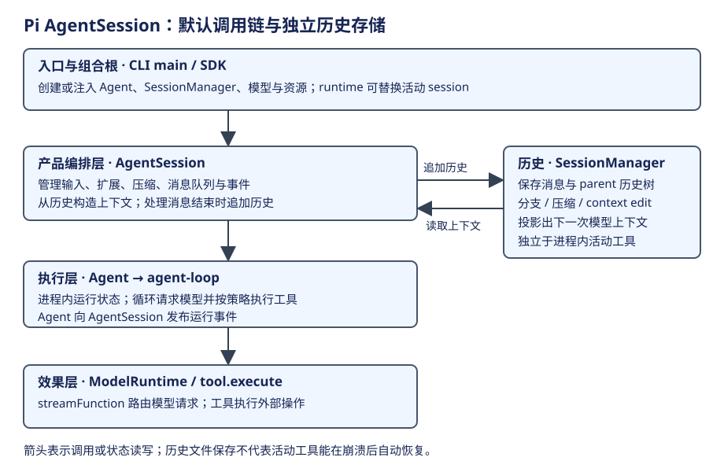
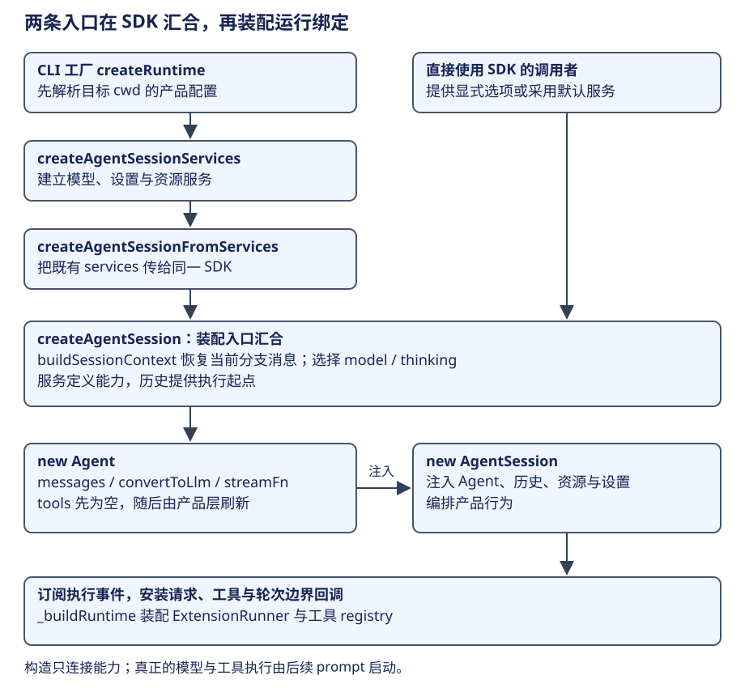
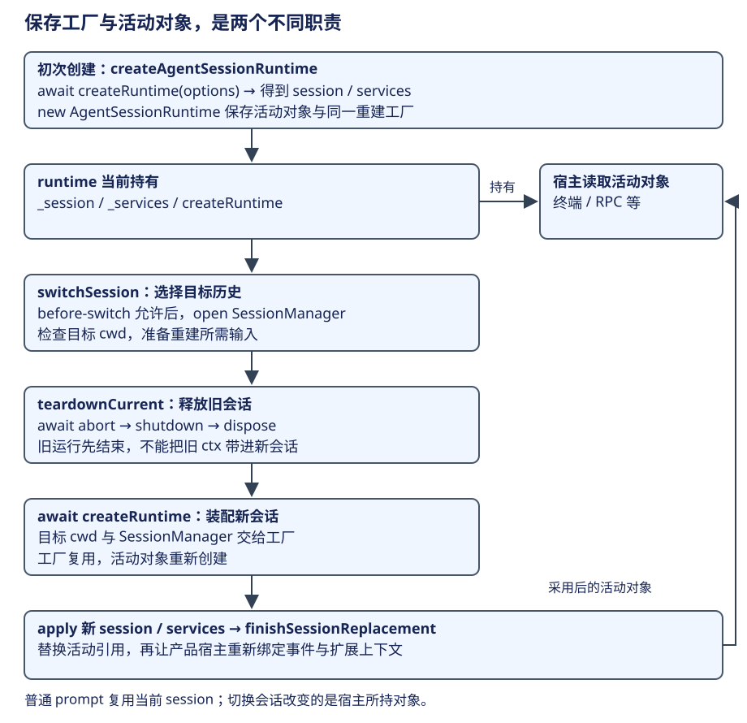

# AgentSession：层次、构造与生命周期

Pi 将交互产品的会话管理、模型执行循环和历史存储分开。学习它时，先回答一个问题：用户提交“读取需求，修改导出逻辑，再运行验证”，究竟哪个对象负责把这份任务推进下去？答案是 AgentSession 组织产品行为，Agent 驱动当前执行，SessionManager 记录过去；三者合作完成工作。



## 三个层次，三种“会话”含义

最外层是**交互产品**。终端、RPC 或 SDK 接受输入，处理用户看到的事件和会话切换。AgentSession 是这层向执行内核提供的门面：它知道扩展、技能、设置、当前工具集合，也知道何时需要压缩历史。

中间是**当前执行**。Agent 持有模型、消息、工具和输入队列，将它们交给 agent-loop。循环知道怎样请求模型、执行工具、把结果反馈给下一轮；它不负责发现终端配置或维护会话文件目录。一次用户任务可以跨多次模型响应，AgentSession 对象也可以跨多个用户任务复用。

旁边是**历史与投影**。SessionManager 管理会话条目、parent 关系和当前 leaf，并从这些记录构造下一次请求需要的上下文。它保存“过去说过什么、当前选了哪条历史”，没有保存“正在 await 哪个工具函数”的程序栈。

| 对象 | 谁构造或提供 | 持有的主要内容 | 生命周期与作用域 |
|---|---|---|---|
| AgentSessionRuntime | createAgentSessionRuntime 创建，产品宿主持有 | 当前 AgentSession、cwd 绑定的 services，以及重建会话所用的工厂 | 进程内；切换会话可替换活动实例 |
| AgentSession | SDK 或 services 组合根 | Agent、SessionManager、模型服务、设置、资源与扩展 runner | 产品会话实例；跨多次 prompt |
| Agent | SDK 组合，注入会话 | 当前消息、模型、工具、activeRun、steer/followUp 队列 | 进程内执行对象；activeRun 是其中一次运行 |
| SessionManager | SDK 默认创建，或调用方注入 | 历史条目树、leaf、持久文件与投影方法 | 文件可跨进程保留；管理句柄重建 |
| ModelRuntime | SDK 创建或复用注入对象 | 模型查找、认证、provider 请求能力 | 取决于组合根，不应假定为全局单例 |
| ResourceLoader / SettingsManager | SDK 创建或注入 | 资源定义、当前配置 | 可复用；加载不等于本次已执行 |

这张表也是阅读代码的定位表。看到 `SessionManager.appendMessage`，应回到历史层；看到 `Agent.prompt`，应进入执行层；看到 `before_agent_start`，则仍处于产品请求准备。相同的“session”词根不会消除它们的职责差别。

再区分两个容易混淆的创建入口：SDK 的 `createAgentSession` **装配一份会话**，下面一节展开它怎样把消息、模型和工具接起来；产品的 `createAgentSessionRuntime` **保存这份会话及重建工厂**，供宿主以后换会话使用。后者不负责再执行一套模型循环。

## 启动时为什么先读历史，再创建执行对象



SDK 的 `createAgentSession` 首先确定 cwd：显式参数优先，其次采用注入 SessionManager 的 cwd，最后才是进程 cwd。这个选择会影响资源和项目规则的解释范围，不能在下层随意重新取一次工作目录。

接着，它采用或创建 ModelRuntime、SettingsManager、SessionManager、ResourceLoader。默认 ResourceLoader 会加载资源。然后调用 `buildSessionContext`，读取当前历史分支，恢复消息和模型／thinking 选择；显式设置、历史选择与默认设置之间按源码优先级决策。这样创建出来的 Agent 才有正确的起点。

最后，SDK 创建 Agent，将执行所需的 model、转换函数、streamFunction 等能力接进去，再把 Agent 和各服务注入 AgentSession。**组合根的作用是决定对象如何协作，构造时还没有开始模型任务。** 这段顺序来自 [createAgentSession 的目录、服务与历史准备](https://github.com/earendil-works/pi/blob/f1b2e77f5b13b2a199b1052cb79c235451afe7d7/packages/coding-agent/src/core/sdk.ts#L191)，其关键执行路径就在下面。

下面是 `sdk.ts` 中 `createAgentSession` 的流程骨架，保留真实对象和调用顺序；省略模型选择细节、请求缓存和可选配置，不能独立运行。先看历史消息怎样交给 Agent，再看服务怎样交给 AgentSession：

```ts
const cwd = resolvePath(options.cwd ?? options.sessionManager?.getCwd() ?? process.cwd());
// agentDir 是用户级配置根，cwd 是项目工作目录，
// 两者承担不同作用域。
// 显式指定 agentDir 时，把认证文件与模型定义文件一起交给
// ModelRuntime。
const agentDir = options.agentDir ? resolvePath(options.agentDir) : getDefaultAgentDir();
const authPath = options.agentDir ? join(agentDir, "auth.json") : undefined;
const modelsPath = options.agentDir ? join(agentDir, "models.json") : undefined;
const modelRuntime = options.modelRuntime ?? (await ModelRuntime.create({ authPath, modelsPath }));
const settingsManager = options.settingsManager ?? SettingsManager.create(cwd, agentDir);
const sessionManager = options.sessionManager ?? SessionManager.create(cwd, getDefaultSessionDir(cwd, agentDir));
let resourceLoader = options.resourceLoader;
if (!resourceLoader) {
  resourceLoader = new DefaultResourceLoader({ cwd, agentDir, settingsManager });
  await resourceLoader.reload();
}
const existingSession = sessionManager.buildSessionContext();
// 省略：按显式选项、历史记录与设置选择 model 和 thinkingLevel。
// 此时只是确定恢复后的运行配置，还没有请求模型。
const agent = new Agent({
  // 初始 tools 为空；AgentSession 构造时 _buildRuntime
  // 会按资源与选择刷新工具集合。
  initialState: { systemPrompt: "", model, thinkingLevel, tools: [], messages: existingSession.messages },
  convertToLlm: convertToLlmWithBlockImages,
  streamFn: async (model, context, options) => {
    const requestOptions = buildRequestOptions(model, options);
    // 省略：启动 prompt cache 预热，
    // 避免把缓存维护混入本节的请求委托主线。
    return modelRuntime.streamSimple(model, context, requestOptions);
  },
  // 省略：provider 回调、context hook，以及 steering/followUp
  // 的队列消费设置。
});
// 省略：向历史记录初始 model/thinking 选择，
// 供后续重新打开会话时恢复。
const session = new AgentSession({
  agent, sessionManager, settingsManager, cwd, resourceLoader, modelRuntime,
  // 省略：工具选择、缓存服务与扩展 runner 的当前引用；
  // 它们用于后续绑定。
});
```

这段代码有两个不同的交接点。`new Agent` 把 `existingSession.messages` 作为执行起点，并把 `streamFn` 接到模型服务，说明执行对象从哪里取得资料、怎样发起请求；`new AgentSession` 再接收这个 Agent 和历史、资源、设置，说明产品编排者怎样协调它们。上面的两处构造分别可在 [SDK 中创建 Agent 的语句](https://github.com/earendil-works/pi/blob/f1b2e77f5b13b2a199b1052cb79c235451afe7d7/packages/coding-agent/src/core/sdk.ts#L411)与[向 AgentSession 注入协作对象的语句](https://github.com/earendil-works/pi/blob/f1b2e77f5b13b2a199b1052cb79c235451afe7d7/packages/coding-agent/src/core/sdk.ts#L461)核查。它们都没有调用 prompt，所以构造完成不意味着已经开始模型任务。

CLI 在这条路径前增加了一步：先按当前 cwd 创建 services，解析产品配置，再把 services 交给 SDK。`createAgentSessionFromServices` 的委托节选如下；省略模型与工具选择字段，保留服务来源：

```ts
return createAgentSession({
  cwd: options.services.cwd,
  agentDir: options.services.agentDir,
  modelRuntime: options.services.modelRuntime,
  settingsManager: options.services.settingsManager,
  resourceLoader: options.services.resourceLoader,
  sessionManager: options.sessionManager,
  // 省略：解析后的模型、thinking 与工具选项，
  // 以及用于生命周期通知的 session_start 事件。
});
```

因此 CLI 与直接使用 SDK 在装配入口上有差别，进入的执行内核仍是同一套 Agent。这里的委托来自 [createAgentSessionFromServices 将服务传入 SDK](https://github.com/earendil-works/pi/blob/f1b2e77f5b13b2a199b1052cb79c235451afe7d7/packages/coding-agent/src/core/agent-session-services.ts#L217)；CLI 对它的调用发生在 cwd 相关服务与会话选项已经解析之后。

CLI 的汇合路径还可以再向上看一层。下面节选 `main.ts` 中传给产品 runtime 的工厂，省略认证、信任选择和模型选项的展开；这个工厂在初次创建及以后换会话时复用：

```ts
const createRuntime: CreateAgentSessionRuntimeFactory = async ({
  cwd, agentDir, sessionManager, sessionStartEvent, projectTrustContext,
}) => {
  // 省略：按当前项目信任配置建立 runtimeSettingsManager。
  const services = await createAgentSessionServices({
    cwd, agentDir, settingsManager: runtimeSettingsManager,
    // 省略：扩展路径、项目资源、认证准备和诊断选项。
  });
  // 省略：根据 services 解析模型、thinking 与工具选项，得到
  // sessionOptions。
  const created = await createAgentSessionFromServices({
    services, sessionManager, sessionStartEvent,
    model: sessionOptions.model,
    thinkingLevel: sessionOptions.thinkingLevel,
    // 省略：scopedModels 和其余工具选择字段。
  });
  return { ...created, services, diagnostics };
};
const runtime = await createAgentSessionRuntime(createRuntime, {
  cwd: sessionManager.getCwd(), agentDir, sessionManager,
});
```

这样，CLI 先创建 cwd 相关服务，经 `createAgentSessionFromServices` 汇入 SDK；直接 SDK 调用者则自行提供或采用默认服务。工厂中的步骤决定装配，runtime 对象决定持有和替换，下一小节分别解释它们何时生效。[CLI 定义并调用会话重建工厂](https://github.com/earendil-works/pi/blob/f1b2e77f5b13b2a199b1052cb79c235451afe7d7/packages/coding-agent/src/main.ts#L732)可以核对这条入口路径。

### 构造时安装回调，运行时才调用

进入 `AgentSession` 构造函数后，还要把产品行为接到内核边界。下面节选构造函数的绑定段；省略隐藏声明等专门投影 hook：

```ts
// 执行事件接回产品处理器；
// 消息结束后由产品负责历史追加与扩展通知。
this._unsubscribeAgent = this.agent.subscribe(this._handleAgentEvent);
// 在真实工具调用前后接入扩展，构造时只安装函数，不执行工具。
this._installAgentToolHooks();
// 后续响应之前刷新投影、工具与 Prompt，为下一轮准备新的上下文。
this._installAgentNextTurnRefresh();
// 每次实际模型请求前采用 canonical projection，
// 可与轮次准备返回的视图不同。
this._installAgentRequestProjection();
// 把产品扩展的轮次继续要求接到 Agent.finishTurn，
// 仍由内核判断续跑。
this._installAgentBoundaryHooks();
// 省略：隐藏工具声明与强制 prompt 等专门投影 hook。
// 安装 hook 是连接回调；构造期间不会因此执行一次模型 turn。
this._buildRuntime({
  activeToolNames: this._initialActiveToolNames,
  includeAllExtensionTools: true,
});
// 没有显式初始工具选择时，从历史声明恢复已保存的选择。
if (this._initialActiveToolNames === undefined) this._restoreToolsFromTranscript();
```

上面的订阅和安装语句来自 [AgentSession 构造函数的运行绑定段](https://github.com/earendil-works/pi/blob/f1b2e77f5b13b2a199b1052cb79c235451afe7d7/packages/coding-agent/src/core/agent-session.ts#L511)。它们分别解决不同问题：订阅把执行事件交给产品和历史；tool hooks 在真实工具前后接入扩展；request projection 决定当次请求视图；boundary hook 决定轮次结束后的继续要求；`_buildRuntime` 装配当前扩展 runner。

看一个最小例子就能理解“安装”与“执行”的差别：`_installAgentToolHooks` 只赋值两个回调，并没有在构造期执行工具。

```ts
private _installAgentToolHooks(): void {
  // 构造时把产品处理函数交给 Agent，函数体此时尚未运行。
  this.agent.beforeToolCall = (context) => this._beforeToolCall(context);
  this.agent.afterToolCall = (context) => this._afterToolCall(context);
}
```

之后 agent-loop 准备一项真实工具调用，才会 await `beforeToolCall(context)`；工具执行完成后再调用 afterToolCall。回调怎样读取当前 runner，在[扩展绑定章](extensions.md#hook-分发与失败)继续展开；这里的安装实现可在 [AgentSession 为 Agent 设置工具回调](https://github.com/earendil-works/pi/blob/f1b2e77f5b13b2a199b1052cb79c235451afe7d7/packages/coding-agent/src/core/agent-session.ts#L652)核查。这样不必从一个安装函数追到所有插件，也能先看清层次。

如果程序重启，恢复的是历史和配置，再创建一个新的执行对象；如果用户开始新会话，产品 runtime 可以更换活动 AgentSession。两种动作都不同于在原工具函数的暂停位置继续执行。

### 产品宿主怎样持有和替换会话



AgentSessionRuntime 不是“比 AgentSession 更底层的 runtime”，而是产品宿主持有的活动会话管理者。它的初次创建路径如下，节选自 `createAgentSessionRuntime`：

```ts
assertSessionCwdExists(options.sessionManager, options.cwd);
// 工厂负责按目标 cwd 装配 session 和 services，
// 这里等待装配结果。
const result = await createRuntime(options);
return new AgentSessionRuntime(
  result.session,
  result.services,
  // 保存工厂，以后换会话仍使用同一套装配规则。
  createRuntime,
  result.diagnostics,
  result.modelFallbackMessage,
);
```

runtime 构造函数将这三项分别保存为 `_session`、`_services` 和 `createRuntime`。前两项是当前活动对象，后一项是重新构造它们的能力；它没有在这里新建模型循环。[创建产品 runtime 并保存工厂](https://github.com/earendil-works/pi/blob/f1b2e77f5b13b2a199b1052cb79c235451afe7d7/packages/coding-agent/src/core/agent-session-runtime.ts#L420)对应上面的路径，[runtime 构造函数保存协作对象](https://github.com/earendil-works/pi/blob/f1b2e77f5b13b2a199b1052cb79c235451afe7d7/packages/coding-agent/src/core/agent-session-runtime.ts#L83)说明所有权。

换会话的普通路径可以从 `switchSession` 的骨架看清，省略会话文件和开始事件的附加字段：

```ts
const beforeResult = await this.emitBeforeSwitch("resume", sessionPath);
if (beforeResult.cancelled) return beforeResult;
const sessionManager = SessionManager.open(sessionPath, undefined, options?.cwdOverride);
assertSessionCwdExists(sessionManager, this.cwd);
// teardownCurrent 内部：await session.abort()，发 shutdown，再
// dispose 旧 session。
await this.teardownCurrent("resume", sessionManager.getSessionFile());
this.apply(await this.createRuntime({
  cwd: sessionManager.getCwd(),
  agentDir: this.services.agentDir,
  sessionManager,
  // 省略：session_start(reason: "resume") 与项目信任上下文。
}));
await this.finishSessionReplacement(options?.withSession);
```

`apply` 替换活动 session 和 services，`finishSessionReplacement` 再让终端等宿主重新订阅新 session。普通 prompt 只启动当前 Agent 的运行，换会话则改变宿主所持的对象，两者的生命周期不同。[switchSession 的替换顺序](https://github.com/earendil-works/pi/blob/f1b2e77f5b13b2a199b1052cb79c235451afe7d7/packages/coding-agent/src/core/agent-session-runtime.ts#L196)、[停止旧实例与重新绑定宿主](https://github.com/earendil-works/pi/blob/f1b2e77f5b13b2a199b1052cb79c235451afe7d7/packages/coding-agent/src/core/agent-session-runtime.ts#L167)分别对应图中前后两段。

这条路径先释放旧会话，再创建新会话；不是两份活实例并存后原子切换。如果新工厂创建失败，错误交给宿主处理，不能据此假定旧会话仍可继续运行。

## 一个对象如何承接多次任务

以修改导出逻辑为例，第一份输入经过 AgentSession 的产品处理后进入 Agent。Agent 为这次运行创建 activeRun 和 AbortController；循环结束时释放运行状态。随后用户再提交“给这项修改补一段说明”，可以在同一个 AgentSession 和同一条历史上启动新的 activeRun。

如果第二份输入在第一份尚未结束时到达，产品需要选择 steer 或 followUp。它们进入队列，由循环在相应边界消费，不能再启动一份并行 `Agent.prompt`。Agent 的 `isStreaming` 表示整个活跃运行，其间也可能正在执行工具；不能把名字理解为“此刻一定正在接收模型 token”。[运行生命周期与 activeRun](https://github.com/earendil-works/pi/blob/f1b2e77f5b13b2a199b1052cb79c235451afe7d7/packages/agent/src/agent.ts#L507)。

在执行层，`runWithLifecycle` 为一次内核运行认领 `activeRun`，并在最后调用 `finishRun`。下面的节选保留认领与释放位置，省略初始显示状态和异常消息的构造：

```ts
if (this.activeRun) throw new Error("Agent is already processing.");
const abortController = new AbortController();
// 省略：创建完成 Promise 及 resolvePromise，供 waitForIdle
// 等调用者等待运行结束。
this.activeRun = { promise, resolve: resolvePromise, abortController };
this._state.isStreaming = true;
try {
  await executor(abortController.signal);
} catch (error) {
  await this.handleRunFailure(error, abortController.signal.aborted);
} finally {
  this.finishRun();
}
// finishRun() 清除流状态和待处理调用，兑现完成 Promise，再清空
// activeRun。
// 它在 executor 和 awaited 事件监听者结束后执行，不是在看到
// agent_end 时立即执行。
```

因此 activeRun 的终点是内核和 awaited 事件监听者均完成之后。产品层在一次内核运行结束后还可能继续调用 `Agent.continue()`，最终用 `agent_settled` 表达产品收口；完整代码在[循环章](loop.md)展开。不要用一个 `agent_end` 同时代表内核事件终点和整个产品 prompt 已完成。[状态释放](https://github.com/earendil-works/pi/blob/f1b2e77f5b13b2a199b1052cb79c235451afe7d7/packages/agent/src/agent.ts#L550)。

## 哪些状态交给哪一层

| 案例中的事实 | 放在哪里 | 原因 |
|---|---|---|
| 用户要求与模型读到的资料 | 消息与历史条目 | 后续响应需要理解语义 |
| 可调用哪些工具 | 当前工具集合及相应声明 | 请求可见性要与运行可执行集合对应 |
| 本次是否仍在运行、是否要求停止 | Agent activeRun / AbortController | 控制当前进程的执行 |
| 当前历史分支与压缩摘要 | SessionManager | 决定从哪段过去构造下一次上下文 |
| 资料来自哪个 skill、扩展如何介入 | ResourceLoader / ExtensionRunner / AgentSession | 属于产品装配和运行绑定 |

因此，Pi 的分层不是“一个大 Agent 里面再嵌几个小 Agent”。它将语义材料、执行控制和历史视图分开，让同一个循环能够被不同产品入口使用。代价是阅读时必须跟随对象边界：模型调用见[执行章](loop.md)，历史如何变成输入见[上下文章](context.md)，资源怎样绑定见[扩展章](extensions.md)。

读完本章，应能解释两个问题：为什么 SessionManager 不能代替 Agent；为什么恢复会话文件后仍需要重新构造模型与工具运行环境。能回答这两点，再深入循环就不容易把持久记录和活实例混在一起。
