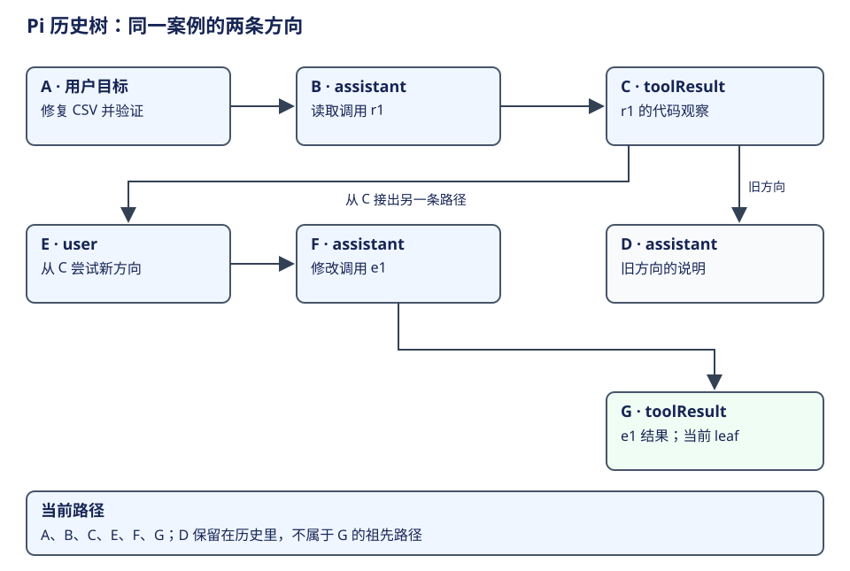
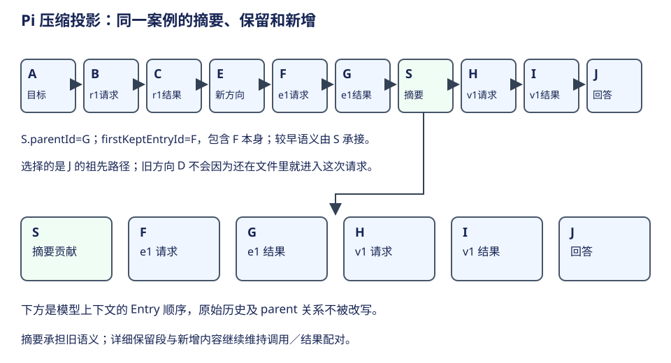

# AgentSession：历史树与模型上下文

Pi 保存一棵可以追加和分支的历史树，再从当前路径生成模型上下文。学习这套设计，要始终区分**保存的全部记录、当前分支、当前请求可见消息**；它们回答的是三个不同问题。



## 先用分支理解 parent 与 leaf

延续导出任务，假设 A 是用户要求，B 是模型读取代码，C 是模型选择的第一种修改方向。用户回到 B 重新尝试，形成 D 这一种新方向。文件里可以同时保存 A、B、C、D，但当前 leaf 若为 D，模型的逻辑历史是 A、B、D。

下面是省略消息具体内容的条目关系样例。字母是教学 ID，不是实际 ID 格式：

```json
[
  { "id": "A", "parentId": null, "type": "message" },
  { "id": "B", "parentId": "A", "type": "message" },
  { "id": "C", "parentId": "B", "type": "message" },
  { "id": "D", "parentId": "B", "type": "message" }
]
```

`parentId` 表达“这一条基于哪段过去”；leaf 表达“现在选中了哪一条路径”。文件先写 C、后写 D，不表示 D 的上下文必须包含 C。历史分支也不是 Git 分支或新进程，不能用仓库 branch 来解释会话树。[路径与投影入口](https://github.com/earendil-works/pi/blob/f1b2e77f5b13b2a199b1052cb79c235451afe7d7/packages/coding-agent/src/core/session-manager.ts#L476)。

这样保存的好处是，用户可以重新探索而不把旧方向擦掉。它要求读者按 ancestry 理解上下文，不能直接将 JSONL 文件全部行拼成模型消息。

## 历史不是纯粹的 user/assistant 数组

SessionManager 的条目除消息外，还记录模型选择、thinking、compaction、context_edit 和扩展自定义资料。不同记录的用途不同：消息贡献语义内容；配置条目恢复选择；压缩条目改变上下文视图；扩展可以保存自己的状态。

| 信息 | 保存目的 | 进入模型时怎样解释 |
|---|---|---|
| 用户请求、assistant、toolResult | 保存交互与观察 | 依据角色和内容成为消息 |
| 模型与 thinking 选择 | 恢复会话配置 | 用来确定运行选择，不应当作用户正文 |
| compaction | 保存摘要和保留边界 | 摘要 + 保留段 + 后续消息 |
| context_edit | 调整既有内容的可见投影 | 替换内容或移除目标贡献，原记录保留 |
| 扩展 custom 条目／消息 | 保存扩展状态或交互资料 | 存储条目与模型消息分别处理 |

“非结构化信息”并不意味着存储没有结构。Pi 用明确的角色、内容类型和条目关系承载自然语言；自然语言负责表达目标与事实，字段负责说明来源、顺序和用途。两者共同形成模型可理解的上下文。

## 压缩怎样改变下一次输入



当历史变长，模型不必每次读取全部旧内容。`buildContextEntries` 先取得当前 parent 路径，寻找路径上的最新 compaction，再组织摘要、从 firstKeptEntryId 开始的保留段，以及压缩条目以后的新增条目。`buildSessionProjection` 再将这些条目转换成消息，并应用 context_edit。

用一条正常路径举例：A-B 是早期讨论，C-D 是最近工具调用及结果；S 的摘要概括 A-B，指定 firstKept=C；E 是压缩后新要求。下一请求主要读到“摘要、C、D、E”，而原始 A-B 仍在历史里。摘要降低上下文负担，保留段让最近动作及结果保持细节，E 保证新要求没有被旧摘要覆盖。

```json
{
  "id": "S",
  "parentId": "D",
  "type": "compaction",
  "summary": "已确认导出功能的需求与实现位置……",
  "firstKeptEntryId": "C"
}
```

这里的 summary 与 firstKeptEntryId 是不同职责：前者是模型产生的语义浓缩，后者是程序解释的保留边界。**摘要文字写得好，并不能替代正确的覆盖区间。** 本例省略 compaction 的其他字段；实际条目和投影规则以源码为准。[保留区间算法](https://github.com/earendil-works/pi/blob/f1b2e77f5b13b2a199b1052cb79c235451afe7d7/packages/coding-agent/src/core/session-manager.ts#L499)、[context_edit 与消息投影](https://github.com/earendil-works/pi/blob/f1b2e77f5b13b2a199b1052cb79c235451afe7d7/packages/coding-agent/src/core/session-manager.ts#L519)。

对于 context_edit，可以将一段巨大工具输出投影为较短内容，或使目标不再贡献消息。实现保存原 sourceEntry 与投影 messages 的对应，因此“模型当前看见的内容”仍能追溯到历史来源。它和直接改写原文件记录有不同的可解释性。

## 请求还会做一次面向模型的转换

历史投影得到的 AgentMessage 还可能包含产品 custom 内容。进入 provider 前，loop 可以通过 transformContext 调整消息，随后 convertToLlm 转为模型兼容消息。当前工具集合也需要与 transcript 中的工具声明对齐；工具增删被表达为相应 system message 的变化。

因此，不能只检查磁盘历史就断言模型最终读到了什么。完整链路是：选择历史路径，应用压缩与编辑，得到会话消息，再做请求转换并交给模型。每一层都承担具体含义，而不是重复保存另一份“真实历史”。[请求转换](https://github.com/earendil-works/pi/blob/f1b2e77f5b13b2a199b1052cb79c235451afe7d7/packages/agent/src/agent-loop.ts#L381)、[工具声明对齐](https://github.com/earendil-works/pi/blob/f1b2e77f5b13b2a199b1052cb79c235451afe7d7/packages/agent/src/agent-loop.ts#L323)。

## 记录、显示与执行进度的区别

AgentSession 的 message_end 处理会先运行相应扩展、向监听者 emit，再为 user/assistant/toolResult 等调用 SessionManager.appendMessage。产品可以先看见一条结束事件，随后才完成相应历史追加。这与 Pico5 的“已提交状态再发布”有不同的顺序。[事件处理与持久化](https://github.com/earendil-works/pi/blob/f1b2e77f5b13b2a199b1052cb79c235451afe7d7/packages/coding-agent/src/core/agent-session.ts#L1103)。

重新打开会话可以重建上下文，不能据此保证继续原来正在执行的工具；工具对文件或 API 的效果也不会因历史切回 B 而自动撤回。Pi 的树为**对话探索与上下文重建**提供机制，外部世界仍由工具执行事实决定。

学习自检：当前 leaf 从 C 切到 D 后，哪些记录仍保存、哪些进入模型？compaction 为什么必须同时保存摘要和 firstKept？读到工具返回的自然语言后，模型怎样得到新的决策条件，而程序又怎样保持调用顺序？
