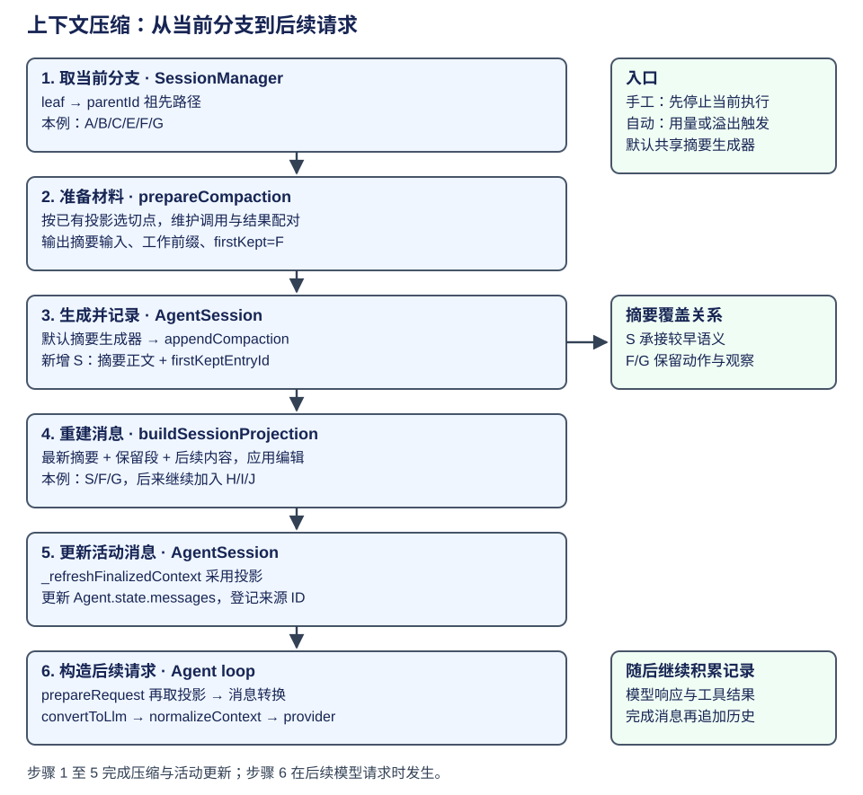

# AgentSession：会话记录、上下文压缩与请求构建

随着任务推进，读文件、改代码和运行验证的结果会不断进入对话。模型需要这些观察来判断下一步，但长记录会占用上下文窗口。Pi 用 **compaction（上下文压缩）** 把较早内容整理成摘要，保留近期细节，再据此构造后续请求。原始会话记录继续保存，读者可以回看过去或从较早位置尝试另一种方案。

这一过程由两个对象配合：SessionManager 管理会话记录及其分支，AgentSession 发起压缩并将整理后的消息交给 Agent。这里的“投影”指从已保存记录中选出当前需要的内容，转换成模型可读消息。先沿下面的六步走完一次压缩，再看内容编辑怎样参与同一流程。



| 步骤 | 做什么 | 交给下一步的资料 |
|---|---|---|
| 1. 取当前分支 | 从当前 leaf 沿 parentId 回溯 | 本次工作的历史路径 |
| 2. 准备压缩材料 | 根据已有投影选择切点 | 待总结消息、工作前缀、旧摘要、保留起点 |
| 3. 生成并记录摘要 | 生成摘要，追加 CompactionEntry | 摘要正文与 firstKeptEntryId |
| 4. 重建模型上下文 | 选摘要、近期保留段及新增消息，解释内容编辑 | 带来源对应的 SessionProjection.messages |
| 5. 更新活动消息 | AgentSession 采用投影 | Agent.state.messages |
| 6. 构造后续请求 | 请求边界重新读取投影，转换模型协议 | provider 接受的消息与工具声明 |

手工压缩从 AgentSession.compact 进入，先停止当前执行；自动压缩由上下文用量或溢出检查触发。两条入口都会准备压缩材料，默认路径复用摘要生成器。本章沿默认手工路径解释步骤 1 至 5，步骤 6 在下一次模型请求时发生。[压缩入口与共享路径](https://github.com/earendil-works/pi/blob/f1b2e77f5b13b2a199b1052cb79c235451afe7d7/packages/coding-agent/src/core/agent-session.ts#L2747)。

## 第一步：取出本次工作的会话记录

沿用上一章的 CSV 修复任务。模型读过代码后，先提出一种方案；用户又回到读取结果处，要求尝试另一种方向。Pi 为每条记录保存 ID 和 parentId，用 leaf 表示当前进度。这样，同一份会话文件能保存多个方向，而本次请求只沿当前方向取资料。

| 资料 | 回答的问题 | Pi 中的表示 |
|---|---|---|
| 全部会话记录 | 发生过哪些交互和配置变化？ | SessionEntry、内存索引与持久文件 |
| 当前分支 | 本次工作基于哪段过去？ | 当前 leaf 的祖先路径 |
| 当前模型上下文 | 本次请求采用哪些内容？ | 压缩与编辑后的 SessionProjection.messages |

下面使用教学 ID A到G，省略时间等字段。r1 和 e1 是工具调用的独立 ID，分别将动作与结果关联起来。

| Entry | parentId | 内容 | 对任务的意义 |
|---|---|---|---|
| A | null | user：修复 CSV 转义并验证 | 用户目标 |
| B | A | assistant：read 调用 r1 | 请求读取 |
| C | B | toolResult：r1 的代码结果 | 读取观察 |
| D | C | assistant：第一种方案的说明 | 旧方向 |
| E | C | user：尝试另一种实现方向 | 新方向 |
| F | E | assistant：edit 调用 e1 | 新方向的修改请求 |
| G | F | toolResult：e1 已完成修改 | 修改观察 |


leaf=D 时，路径为 A/B/C/D；从 C 接出 E 并推进到 G 后，路径变为 A/B/C/E/F/G。D 仍在会话文件里。决定本次取哪些记录的是 parent 关系，文件的追加顺序用于保存记录。[当前路径与记录选择](https://github.com/earendil-works/pi/blob/f1b2e77f5b13b2a199b1052cb79c235451afe7d7/packages/coding-agent/src/core/session-manager.ts#L476)。

`buildSessionPath` 沿 parentId 回溯，再把顺序翻转。下面节选回溯段，省略 leaf 查找与默认选择；index 是 Entry ID 到记录的索引：

```ts
const path: SessionEntry[] = [];
let current: SessionEntry | undefined = leaf;
while (current) {
  path.push(current);
  current = current.parentId ? index.get(current.parentId) : undefined;
}
path.reverse();
return path;
```

以 G 为 leaf，先取得 G/F/E/C/B/A，翻转后得到 A/B/C/E/F/G。这份路径随后进入 prepareCompaction，确定其中哪些内容要总结、哪些继续保留。[回溯执行点](https://github.com/earendil-works/pi/blob/f1b2e77f5b13b2a199b1052cb79c235451afe7d7/packages/coding-agent/src/core/session-manager.ts#L408)。

## 第二步：选择摘要材料与保留起点

已经取到了当前路径，但摘要生成器还需要一份明确的输入：旧内容放在哪里，近期细节从哪里开始保留，当前工作有没有被切成两段。prepareCompaction 先按已有压缩和编辑计算消息投影，再由 findProjectedCutPoint 按保留预算选择切点。

在这个例子中，假定切点选到 F。这是教学假设，没有实测 token 预算。F 包含 edit 调用 e1，G 是对应结果；从 F 开始保留，模型能同时看到动作与观察。默认切点选择会维护调用配对，普通 toolResult 不直接作为切点。

| 准备结果 | 在本例中承担什么作用 |
|---|---|
| firstKeptEntryId | 指向 F，F/G 继续以细节进入后续上下文 |
| messagesToSummarize | 本例为 A/B/C 的消息，放入较早目标与读取观察 |
| turnPrefixMessages | 本例为 E 的消息，补充 F 所在工作的前半段 |
| previousSummary | 已有摘要的语义起点，用于再次压缩 |
| fileOps、tokensBefore、settings | 为摘要提供文件操作资料，并保留用量与配置信息 |

下面按 prepareCompaction 的顺序整理流程骨架，省略旧摘要定位、文件操作提取及无内容可压缩时的返回：

```ts
const projection = buildSessionProjection(pathEntries);
const projectedEntries = projection.entries;
// 省略：找已有有效摘要，得到 previousSummary 及 boundaryStart。
const boundaryEnd = projectedEntries.length;
const cutPoint = findProjectedCutPoint(
  projectedEntries, boundaryStart, boundaryEnd, settings.keepRecentTokens,
);
const firstKeptEntry = projectedEntries[cutPoint.firstKeptEntryIndex]?.sourceEntry;
if (!firstKeptEntry?.id) return undefined;
const firstKeptEntryId = firstKeptEntry.id;
const historyEnd = cutPoint.isSplitTurn ? cutPoint.turnStartIndex : cutPoint.firstKeptEntryIndex;
const messagesToSummarize = projectedEntries
  .slice(boundaryStart, historyEnd)
  .flatMap(getMessagesFromProjectedEntryForCompaction);
const turnPrefixMessages = cutPoint.isSplitTurn
  ? projectedEntries.slice(cutPoint.turnStartIndex, cutPoint.firstKeptEntryIndex)
      .flatMap(getMessagesFromProjectedEntryForCompaction)
  : [];
// 省略：同时返回 previousSummary、tokensBefore、fileOps 和
// settings。
```

这里先选切点，再同时产出摘要输入与保留起点。若切开了当前用户工作，turnPrefixMessages 让摘要仍能交代“为什么在做这项修改”。摘要生成器因此既能概括较早观察，也能为保留段接上任务目标。[切点选择](https://github.com/earendil-works/pi/blob/f1b2e77f5b13b2a199b1052cb79c235451afe7d7/packages/coding-agent/src/core/compaction/compaction.ts#L802)、[准备摘要输入与保留边界](https://github.com/earendil-works/pi/blob/f1b2e77f5b13b2a199b1052cb79c235451afe7d7/packages/coding-agent/src/core/compaction/compaction.ts#L880)。

## 第三步：生成摘要并追加压缩记录

有了 preparation，AgentSession 将它交给默认摘要生成器。生成成功后，产品保存摘要正文、保留起点及用量，追加一条 CompactionEntry。扩展可以在 session_before_compact 处取消压缩或提供自己的结果；下面沿默认生成路径继续。

这段骨架从取分支开始，因此前两行对应刚讲过的步骤 1、2；本节关注生成、追加和刷新：

```ts
const pathEntries = this.sessionManager.getBranch();
const preparation = prepareCompaction(pathEntries, settings);
// 省略：preparation 不存在时具名报错；
// 扩展可以提供自己的摘要结果。
const result = await this._runDefaultCompaction(
  preparation, model, customInstructions,
  this._compactionAbortController.signal, "manual",
);
// 省略：采用 result 的 summary、firstKeptEntryId、
// tokensBefore、details、usage。
if (this._compactionAbortController.signal.aborted) throw new Error("Compaction cancelled");
this.sessionManager.appendCompaction(
  summary, firstKeptEntryId, tokensBefore, details, fromExtension, usage,
);
this._refreshFinalizedContext();
```

摘要正文保存“较早发生了什么”，firstKeptEntryId 保存“近期细节从哪里继续”。假设生成的记录为 S，S.parentId=G、firstKeptEntryId=F。主流程先停在追加 S 的这一刻，当前 leaf=S。

| Entry | parentId | 内容 |
|---|---|---|
| S | G | compaction：早期目标、读取观察与当前方向的摘要；firstKept=F |

此时会话保存了 A/B/C/E/F/G/S 这条路径，以及另一方向的 D。压缩改变后续模型采用的内容，原记录继续保留。请求 token 量会减少，会话文件仍可增长。[准备压缩输入](https://github.com/earendil-works/pi/blob/f1b2e77f5b13b2a199b1052cb79c235451afe7d7/packages/coding-agent/src/core/agent-session.ts#L2777)、[生成、追加并刷新结果](https://github.com/earendil-works/pi/blob/f1b2e77f5b13b2a199b1052cb79c235451afe7d7/packages/coding-agent/src/core/agent-session.ts#L2828)。

## 第四步：用摘要和保留段重建模型上下文

S 已经写入历史。现在需要把它的覆盖范围解释为消息，这正是步骤 3 末尾刷新时调用的 SessionManager 投影逻辑。该逻辑先选当前路径上的最新压缩记录，再选保留段，最后把记录转换成消息。

### 4.1 按覆盖关系选择记录

buildContextEntries 在 leaf=S 的当前路径上找到压缩记录 S，结果顺序为：

```text
S, F, G
```

S 贡献摘要，F/G 是 S 之前要继续保留的细节。A/B/C/E 的相关语义由摘要承接。D 属于另一方向，当前路径没有选中它。

下面节选覆盖范围的算法，省略摘要索引缺失时的防御性返回。此时扫描 leaf=S 的祖先路径 A/B/C/E/F/G/S，取路径的规则与第一步相同：

```ts
const path = buildSessionPath(entries, leafId, byId);
let compaction: CompactionEntry | null = null;
for (const entry of path) {
  if (entry.type === "compaction") compaction = entry;
}
if (!compaction) return path;
const compactionIdx = path.findIndex((entry) => entry.id === compaction.id);
// 省略：找不到摘要索引时返回原 path；
// 正常路径按摘要覆盖范围选取。
const contextEntries: SessionEntry[] = [compaction];
let foundFirstKept = false;
for (let i = 0; i < compactionIdx; i++) {
  const entry = path[i];
  if (entry.id === compaction.firstKeptEntryId) foundFirstKept = true;
  if (foundFirstKept && !(entry.type === "message" && entry.message.role === "system")) {
    contextEntries.push(entry);
  }
}
contextEntries.push(...path.slice(compactionIdx + 1));
return contextEntries;
```

循环到 F 时就把 foundFirstKept 设为 true，因此 F 自身也进入保留段。旧 system 消息在这里过滤，最新 CompactionEntry 可携带 systemMessage，供新的上下文采用。[保留区间算法](https://github.com/earendil-works/pi/blob/f1b2e77f5b13b2a199b1052cb79c235451afe7d7/packages/coding-agent/src/core/session-manager.ts#L499)、[摘要选择与保留段](https://github.com/earendil-works/pi/blob/f1b2e77f5b13b2a199b1052cb79c235451afe7d7/packages/coding-agent/src/core/session-manager.ts#L481)。

### 4.2 将选中记录转换成消息

选出的 Entry 还包含配置和结构记录，模型要收到的是消息。sessionEntryToContextMessages 负责解释每类记录：普通 message 提供原消息，compaction 提供摘要消息，模型选择和 thinking 等配置记录可以不贡献正文。

下面节选普通消息与摘要路径，省略旧文件兼容、custom_message 和 branch_summary 的展开：

```ts
if (entry.type === "message") {
  const message = entry.message;
  // 省略：兼容旧文件里缺失的 content；
  // 普通消息保留原角色与调用身份。
  return [message];
}
// 省略：custom_message 转为扩展消息，branch_summary
// 转为分支摘要消息。
if (entry.type === "compaction") {
  const summary = createCompactionSummaryMessage(entry.summary, entry.tokensBefore, entry.timestamp);
  return entry.systemMessage ? [entry.systemMessage, summary] : [summary];
}
// 配置或结构条目可以不贡献模型正文；条目数不等于消息数。
return [];
```

这样，S 变为产品角色 compactionSummary，F/G 贡献普通消息。branch_summary 和 custom_message 也有各自的转换；一条 Entry 可以贡献零条或多条消息。[条目到消息的转换](https://github.com/earendil-works/pi/blob/f1b2e77f5b13b2a199b1052cb79c235451afe7d7/packages/coding-agent/src/core/session-manager.ts#L439)。

buildSessionProjection 将这些贡献汇总，同时保留每条消息对应的 sourceEntry。它也在这一步应用 context_edit 内容编辑，具体例子放在主流程之后：

```ts
const contextEntries = buildContextEntries(entries, leafId, byId);
const edits = new Map<string, ContextEditEntry>();
for (const entry of contextEntries) {
  if (entry.type === "context_edit") edits.set(entry.targetId, entry);
}
const projectedEntries = contextEntries.map((sourceEntry, index) => ({
  sourceEntry,
  messages: sourceEntry.type === "compaction" && index > 0
    ? []
    : projectContextEntry(sourceEntry, edits.get(sourceEntry.id)),
}));
return {
  entries: projectedEntries,
  messages: projectedEntries.flatMap((entry) => entry.messages),
  // 省略：沿当前历史路径恢复的 thinkingLevel 和 model。
};
```

这里的 entries 用来追踪来源，messages 用于执行，model/thinking 选择从当前路径另行恢复。投影把自然语言正文与程序可追踪的来源关联起来；下一步 AgentSession 就可以采用这份消息。[投影输出](https://github.com/earendil-works/pi/blob/f1b2e77f5b13b2a199b1052cb79c235451afe7d7/packages/coding-agent/src/core/session-manager.ts#L548)。

## 第五步：将投影更新到活动 Agent

AgentSession._refreshFinalizedContext 读取刚才的投影，把消息来源登记到 _entryIdsByMessage，再将 projection.messages 赋给 Agent.state.messages。步骤 3 的代码在 appendCompaction 之后调用它，使当前进程立即采用新上下文。

这个方法可以直接节选：

```ts
private _refreshFinalizedContext(): void {
  const projection = this.sessionManager.buildSessionProjection();
  for (const entry of projection.entries) {
    for (const message of entry.messages) this._entryIdsByMessage.set(message, entry.sourceEntry.id);
  }
  this.agent.state.messages = projection.messages;
}
```

刚追加 S 时，活动消息由完整旧对话换为“摘要 S 的消息、F/G”。记录来源映射仍可定位原条目。手工和自动压缩追加 CompactionEntry 后都会走这条刷新路径。[活动消息采用](https://github.com/earendil-works/pi/blob/f1b2e77f5b13b2a199b1052cb79c235451afe7d7/packages/coding-agent/src/core/agent-session.ts#L938)、[压缩后的刷新调用](https://github.com/earendil-works/pi/blob/f1b2e77f5b13b2a199b1052cb79c235451afe7d7/packages/coding-agent/src/core/agent-session.ts#L2847)。

## 第六步：在后续请求边界转换模型协议

活动消息已经更新，下一次请求仍要取得最新历史和当前工具。AgentSession 在构造时安装 prepareRequest 回调，每次发模型请求前重新读取投影，形成 canonicalContext，再交给已有的请求准备回调进一步调整。

下面整理具体模型的普通路径，省略失败响应记录处理和 virtual model 路由：

```ts
const previousPrepareRequest = this.agent.prepareRequest;
this.agent.prepareRequest = async (request, signal) => {
  // 省略：读取并清除上一份失败响应记录，
  // 避免后续请求沿用旧失败状态。
  const projection = this.sessionManager.buildSessionProjection();
  const canonicalContext = {
    ...request.context,
    messages: projection.messages,
    tools: this.agent.state.tools.slice(),
  };
  const previous = await previousPrepareRequest?.({
    ...request, context: canonicalContext,
    model: this.agent.state.model, thinkingLevel: this.agent.state.thinkingLevel,
  }, signal);
  const context = previous?.context ?? canonicalContext;
  const model = previous?.model ?? this.agent.state.model;
  const thinkingLevel = previous?.thinkingLevel ?? this.agent.state.thinkingLevel;
  if (!isVirtualModel(model)) return { ...previous, context, model, thinkingLevel };
  // 省略：虚拟模型先解析到具体模型，
  // 再按实际模型重新检查请求上下文。
};
```

这一步采用当前 projection.messages 和 Agent 的可执行工具集合。因而即使循环启动时复制过消息数组，后续请求也能读到已追加的摘要、编辑和观察。[每次请求的投影入口](https://github.com/earendil-works/pi/blob/f1b2e77f5b13b2a199b1052cb79c235451afe7d7/packages/coding-agent/src/core/agent-session.ts#L787)。

随后执行循环按 transformContext、convertToLlm、normalizeContext 的顺序组织请求。convertToLlm 把产品消息转换为模型接受的角色；摘要分支如下，省略其他产品角色：

```ts
case "compactionSummary":
  return {
    role: "user",
    content: [{ type: "text" as const,
      text: COMPACTION_SUMMARY_PREFIX + m.summary + COMPACTION_SUMMARY_SUFFIX }],
    timestamp: m.timestamp,
  };
case "system":
case "user":
case "assistant":
case "toolResult":
  return m;
```

因此 S 先贡献 compactionSummary，再成为带摘要说明的 user 消息。F/G 等普通消息保留各自角色。normalizeContext 组织 transcript，provider 再按具体模型编码；这些转换在[一次输入的请求阶段](loop.md)已有完整代码路径。[产品消息转换](https://github.com/earendil-works/pi/blob/f1b2e77f5b13b2a199b1052cb79c235451afe7d7/packages/coding-agent/src/core/messages.ts#L148)、[摘要角色转换](https://github.com/earendil-works/pi/blob/f1b2e77f5b13b2a199b1052cb79c235451afe7d7/packages/coding-agent/src/core/messages.ts#L176)、[请求变换顺序](https://github.com/earendil-works/pi/blob/f1b2e77f5b13b2a199b1052cb79c235451afe7d7/packages/agent/src/agent-loop.ts#L381)、[transcript 规范化](https://github.com/earendil-works/pi/blob/f1b2e77f5b13b2a199b1052cb79c235451afe7d7/packages/ai/src/utils/transcript.ts#L30)。

## 压缩完成后，新增观察怎样接上同一请求流程

六步已经把摘要 S 和 F/G 的细节接入后续请求。任务继续推进，模型发出验证调用 H，工具返回 I，模型给出回答 J。这里才从刚压缩完成的 leaf=S 推进到 leaf=J。

| 新 Entry | parentId | 内容 |
|---|---|---|
| H | S | assistant：验证调用 v1 |
| I | H | toolResult：v1 的验证结果 |
| J | I | assistant：最终说明 |

此时完整路径为 A/B/C/E/F/G/S/H/I/J。再次按第四步计算，S 是当前路径上的最新摘要，F/G 是保留细节，H/I/J 是摘要之后的新增内容，消息视图于是扩展为 S/F/G/H/I/J。


这些新增消息在 message_end 时保存，后续 prepareRequest 重新读取投影。第五步说明压缩后的即时刷新，第六步说明每次请求的采用，两处共同让正在推进的任务读到当前内容。下一次需要压缩时，程序再次从第一步取当前分支。

下面的图把持续追加记录与消息采用放在一起。


## 贯穿步骤 2、4 的内容编辑：context_edit

压缩用摘要承接较早历史。近期保留段也可能有很长的工具输出，例如 G 包含几千行修改日志，但后续只需知道改了哪里。context_edit 用一条新的记录指定目标和替换正文，投影时采用较短内容，原始记录可供回看。


在前例 J 后追加 K，指向 G。下面是教学数据，省略时间等字段：

```json
{
  "id": "K", "parentId": "J", "type": "context_edit",
  "targetId": "G",
  "replacement": {
    "content": [{ "type": "text", "text": "已修改 src/export.ts 的字段转义；逗号、引号与换行分别处理。" }]
  }
}
```

追加后 leaf=K，当前路径包含这条编辑。若显式查询 leaf=J，K 尚不在它的祖先路径内。投影按 ContextEntry 顺序收集编辑，同一目标采用最后出现的一份；G 的 content 被替换，调用身份和其他字段沿用。

| 位置 | 追加 K 后的结果 |
|---|---|
| 原始 G | 保留完整工具结果 |
| 编辑记录 K | 保存 targetId=G 与 replacement |
| G 的消息贡献 | 采用 replacement.content，sourceEntry.id 仍为 G |
| K 的消息贡献 | 不生成普通消息，sourceEntry.id 为 K |
| 本例模型内容 | 摘要、F、G 的短内容、H、I、J |

第四步的 projectContextEntry 应用这些编辑：没有编辑时采用原贡献，replacement=null 时移除目标的消息贡献，可编辑消息则替换 content。assistant/toolResult 的字符串 replacement 会规范化为 text block 数组。图中的示例已经使用数组形态。[编辑投影](https://github.com/earendil-works/pi/blob/f1b2e77f5b13b2a199b1052cb79c235451afe7d7/packages/coding-agent/src/core/session-manager.ts#L519)、[编辑接纳](https://github.com/earendil-works/pi/blob/f1b2e77f5b13b2a199b1052cb79c235451afe7d7/packages/coding-agent/src/core/session-manager.ts#L1360)、[replacement 规范化](https://github.com/earendil-works/pi/blob/f1b2e77f5b13b2a199b1052cb79c235451afe7d7/packages/coding-agent/src/core/session-manager.ts#L1381)。

内容编辑与主流程有两个交点。第四步应用编辑，决定后续请求看到的正文；第二步也先计算投影，因此下一次压缩会从编辑后的有效内容准备摘要材料。已经被摘要覆盖的旧条目若被编辑，原摘要文字仍需单独处理。编辑目标应先在当前上下文范围内定位，再判断它是否还有消息贡献。

## 会话分支与工作区文件的关系

本章按 parent 关系选择对话资料，工具则操作实际工作区。假设旧方向已经修改文件，后来用户回到 C 另试方案：模型上下文改用新分支，文件仍保留已发生的修改。新方向再次读取文件，会得到此刻的真实内容。

| 操作 | 对话资料 | 工作区文件 |
|---|---|---|
| 旧方向执行修改 | 保存调用及结果 | 文件已变化 |
| 切回较早位置 | 当前路径排除旧方向记录 | 文件保持当前内容 |
| 新方向再次读取 | 新观察进入当前分支 | 读取实际内容 |

当前模型和 thinking 选择是运行配置，可从配置条目恢复；正在 await 的工具则属于进程内执行。重新打开会话时，产品读取历史和配置，再构造运行对象。分支、压缩与请求视图的横向比较见[上下文比较](../../comparisons/context-compaction.md)，进行中的工作如何恢复见[状态与恢复](../../comparisons/state-recovery.md)。

完整消息在 message_end 处理时先通知扩展与监听者，再追加历史。界面上的流片段、已结束消息和已保存记录处于各自的时间点。[消息事件与记录顺序](https://github.com/earendil-works/pi/blob/f1b2e77f5b13b2a199b1052cb79c235451afe7d7/packages/coding-agent/src/core/agent-session.ts#L1103)。

## 沿同一例子检查六步是否接上

**问题一。** leaf=J，S.firstKept=F。第四步会采用哪些详细消息，D 在哪里？

解答：采用摘要 S、保留 F/G、后续 H/I/J。D 仍在会话记录中，当前分支没有选中它；A/B/C/E 的相关语义由摘要承接。

**问题二。** 第二步为什么从 F 保留，而不直接从 G 开始？

解答：F 是 e1 的动作请求，G 是结果。保留二者才能解释动作与观察；默认切点选择维护这份配对。

**问题三。** K 把 G 的正文变短后，第五步、第六步分别还要做什么？

解答：原始 G 保留。第五步由 AgentSession 采用投影，第六步在新请求边界读取并转换消息；已经发出的请求保持原输入。

**问题四。** 把 leaf 改为 D，还会使用 S 吗？

解答：第一步得到 D 的祖先路径，第四步在该路径上寻找压缩记录。S 不在这条路径里，因此本例不会采用它。
