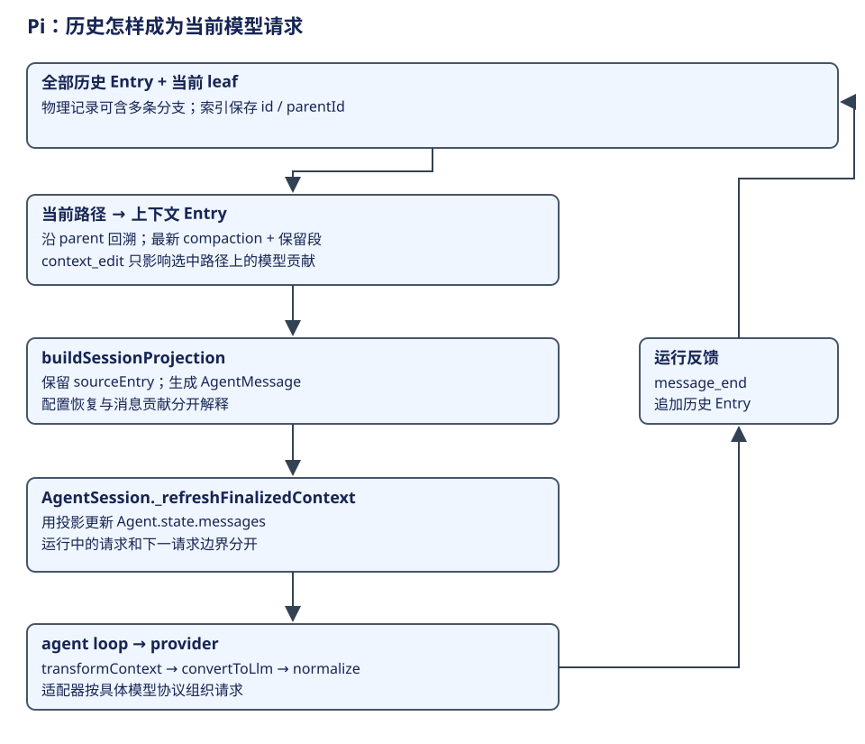
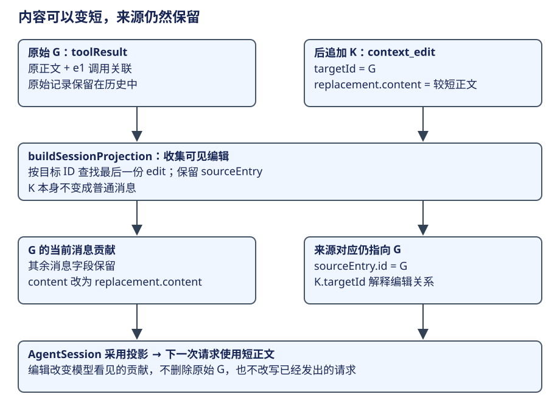

# AgentSession：历史树与模型上下文

Pi 的上下文设计解决一个经常同时出现的需求：**保存探索过程，又只把当前工作需要的资料发给模型**。一份数组很适合表示当次消息，却不能同时表达全部分支、摘要覆盖、可见内容编辑和运行配置。SessionManager 保存历史与关系，AgentSession 将选中历史投影为活动消息，Agent loop 再组织具体模型请求。

本章先用一份可以逐条演算的历史理解设计，再追到源码。目标是读者能回答：现在保存了什么、下一请求看见什么、谁让新视图生效。共同职责先见[共同架构](../../comparisons/common-model.md)；本章中的类型和方法来自 Pi 的实际实现。



## 1. 先分清三份资料

继续 CSV 修复任务。读取代码会得到长文本，修改和验证会产生工具结果，用户还可能回到较早位置换一种方案。如果直接让同一个 messages 数组同时承担保存、分支和请求输入三个职责，删除旧消息会丢失探索记录，保留全部消息又会混入已放弃的方向。

| 资料 | 回答的问题 | Pi 中的表示 |
|---|---|---|
| 全部历史 | 发生过哪些交互、配置与结构操作？ | SessionEntry 记录、内存索引与持久文件 |
| 当前逻辑路径 | 这次工作基于哪一段过去？ | 当前 leaf 沿 parentId 回溯的祖先路径 |
| 当前模型视图 | 本次需要哪些语义贡献？ | 压缩与编辑后的 SessionProjection.messages，随后形成请求 |

历史中一条 toolResult 有程序字段，也可以包含任意代码和自然语言输出。前者说明它对应哪次动作，后者给模型提供观察。保存结构和开放语义不是互斥关系；正是结构让程序能选择正确的语义范围。

还有两项资料不宜混进这三列：当前模型和 thinking 选择是运行配置，正在执行的调用栈是活动控制。配置条目可以帮助恢复选择，历史消息却不会保存一个尚未返回的 JavaScript Promise。

## 2. 从完整小例子理解 parent 与 leaf

先不做压缩。下面的字母是教学 ID，内容为节选，不是可直接导入的完整 Session 文件。每个条目都写明 parent，工具动作使用独立 call ID。

| Entry | parentId | 内容 | 对任务的意义 |
|---|---|---|---|
| A | null | user：修复 CSV 转义并验证 | 用户目标 |
| B | A | assistant：read 调用 r1 | 模型请求读取 |
| C | B | toolResult：r1 的代码结果 | 读取观察 |
| D | C | assistant：第一种方案的说明 | 已保存的旧方向 |
| E | C | user：尝试另一种实现方向 | 从 C 接出的新方向 |
| F | E | assistant：edit 调用 e1 | 新方向里的修改请求 |
| G | F | toolResult：e1 已完成修改 | 修改观察 |

当 leaf=D，当前路径是 A、B、C、D。后来从 C 接出 E 并推进到 G，leaf=G，当前路径变成 A、B、C、E、F、G。D 仍然保存在同一历史中，但已经不属于这次工作的祖先。


图与上表使用同一组 ID，r1/e1 的工具调用与结果分别成对。程序先沿 parentId 选择路径，再按消息类型解释条目。文件写入顺序只说明追加顺序，不能代替祖先关系。例如 D 比 E 先写入，不意味着 E 必须把 D 交给模型。[路径与上下文 Entry 选择](https://github.com/earendil-works/pi/blob/f1b2e77f5b13b2a199b1052cb79c235451afe7d7/packages/coding-agent/src/core/session-manager.ts#L476)。

这一步对应 `buildSessionPath` 的回溯段。下面是源码节选，前面的 leaf 查找与默认选择省略；`index` 是 Entry ID 到记录的索引：

```ts
const path: SessionEntry[] = [];
let current: SessionEntry | undefined = leaf;
while (current) {
  path.push(current);
  current = current.parentId ? index.get(current.parentId) : undefined;
}
path.reverse();
return path;
```

以 G 为 leaf，回溯先得到 G/F/E/C/B/A，reverse 后才是正文使用的 A/B/C/E/F/G。D 从未经过这个 parent 链，所以无需再靠“较新或较旧”的规则排除它。[回溯执行点](https://github.com/earendil-works/pi/blob/f1b2e77f5b13b2a199b1052cb79c235451afe7d7/packages/coding-agent/src/core/session-manager.ts#L408)。

### 当前路径如何变成消息

message 条目通常贡献一条消息；custom_message 可以贡献扩展消息；模型选择、thinking、普通 custom 状态等条目不必贡献自然语言正文。branch_summary 和 compaction 有自己的转换。所以“沿路径拿到条目”以后，还要做一次**条目到消息贡献**的解释。

`sessionEntryToContextMessages` 是这一步的实际转换函数。下面保留正常 message 和摘要路径，省略旧文件空内容兼容、custom_message 与 branch_summary 的展开：

```ts
if (entry.type === "message") {
  const message = entry.message;
  // 省略：兼容旧文件里缺失的 content；
  // 普通消息保留原角色与调用身份。
  return [message];
}
// 省略：custom_message 转为扩展消息，branch_summary
// 转为分支摘要消息。
if (entry.type === "compaction") {
  const summary = createCompactionSummaryMessage(entry.summary, entry.tokensBefore, entry.timestamp);
  return entry.systemMessage ? [entry.systemMessage, summary] : [summary];
}
// 配置或结构条目可以不贡献模型正文；条目数不等于消息数。
return [];
```

这解释了为什么记录数量不等于模型消息数量：一个结构条目可能没有贡献，也可能在需要时贡献摘要及 system 资料。[条目转换](https://github.com/earendil-works/pi/blob/f1b2e77f5b13b2a199b1052cb79c235451afe7d7/packages/coding-agent/src/core/session-manager.ts#L439)。

## 3. 压缩的重点是摘要加覆盖关系

现在假设历史已长，运行仍需保留最近的修改细节。追加摘要 S，令 S.parentId=G、firstKeptEntryId=F。再有验证调用 H、结果 I 和回答 J：

| Entry | parentId | 内容 |
|---|---|---|
| S | G | compaction：早期目标、读取结果与当前方向的摘要；firstKept=F |
| H | S | assistant：验证调用 v1 |
| I | H | toolResult：v1 的验证结果 |
| J | I | assistant：最终说明 |

当前完整路径为 A、B、C、E、F、G、S、H、I、J。buildContextEntries 找到这条路径上的最新 compaction S，然后得到以下上下文 Entry 顺序：

```text
S, F, G, H, I, J
```

这是路径 ID 的顺序示例，不是字符流程图。规则可以逐段解释：

1. S 提供摘要；较老的 A、B、C、E 不再以全部细节重复进入当前视图。
2. F 是 firstKeptEntryId，**F 自身包含在保留段中**；F 到 S 之前的 G 也保留。
3. S 以后的 H、I、J 是新内容，照常参与当前视图。
4. D 不在当前路径，既不进入保留段，也不因物理文件里存在而参与这个请求。


图和表使用同一组 Entry；上方是历史路径，下方是这次上下文 Entry 顺序。摘要文字解释已经获得的语义，firstKeptEntryId 解释详细资料的边界。两者必须配合；一段总结写得再好，也不能告诉程序应该保留哪次调用及其反馈。[保留区间算法](https://github.com/earendil-works/pi/blob/f1b2e77f5b13b2a199b1052cb79c235451afe7d7/packages/coding-agent/src/core/session-manager.ts#L499)。

将演算对照 `buildContextEntries` 的节选，最重要的是扫描范围始终为 `path`。这里省略了 compaction 索引不存在时的防御性返回，保留区间的判断则完整保留：

```ts
const path = buildSessionPath(entries, leafId, byId);
let compaction: CompactionEntry | null = null;
for (const entry of path) {
  if (entry.type === "compaction") compaction = entry;
}
if (!compaction) return path;
const compactionIdx = path.findIndex((entry) => entry.id === compaction.id);
// 省略：找不到摘要索引时返回原 path；
// 正常路径按摘要覆盖范围选取。
const contextEntries: SessionEntry[] = [compaction];
let foundFirstKept = false;
for (let i = 0; i < compactionIdx; i++) {
  const entry = path[i];
  if (entry.id === compaction.firstKeptEntryId) foundFirstKept = true;
  if (foundFirstKept && !(entry.type === "message" && entry.message.role === "system")) {
    contextEntries.push(entry);
  }
}
contextEntries.push(...path.slice(compactionIdx + 1));
return contextEntries;
```

在 F 那一次迭代就把 `foundFirstKept` 设为 true，所以 F 包含在结果中。保留段的旧 system 消息另被过滤；最新 compaction 可携带它自己的 systemMessage，因此不会简单重复旧请求的 system 声明。[摘要选择与保留段](https://github.com/earendil-works/pi/blob/f1b2e77f5b13b2a199b1052cb79c235451afe7d7/packages/coding-agent/src/core/session-manager.ts#L481)。

### 工具调用与结果为什么不能随便切开

F 是 edit 调用 e1，G 是 e1 的结果。默认压缩准备选择合适的消息切点，不直接把普通 toolResult 当作切点。若只保留 G，模型得到一个没有对应动作请求的结果，语义与 provider 配对都可能不完整；从 F 保留则同时留下动作和观察。

当前实现的 prepareCompaction 使用**已经投影过的消息**计算切点。findProjectedCutPoint 按有效消息和保留预算选择范围，再记录 firstKeptEntryId。这里的预算决定要保留多少近期细节，却不能取消调用配对的要求。

下面按 `prepareCompaction` 的原顺序展示准备结果怎样形成，省略没有可压缩内容时的返回、旧摘要定位和文件操作提取。它不请求模型，而是先确定“哪些资料供摘要、哪些细节继续保留”：

```ts
const projection = buildSessionProjection(pathEntries);
const projectedEntries = projection.entries;
// 省略：找已有有效摘要，得到 previousSummary 及 boundaryStart。
const boundaryEnd = projectedEntries.length;
const cutPoint = findProjectedCutPoint(
  projectedEntries, boundaryStart, boundaryEnd, settings.keepRecentTokens,
);
const firstKeptEntry = projectedEntries[cutPoint.firstKeptEntryIndex]?.sourceEntry;
if (!firstKeptEntry?.id) return undefined;
const firstKeptEntryId = firstKeptEntry.id;
const historyEnd = cutPoint.isSplitTurn ? cutPoint.turnStartIndex : cutPoint.firstKeptEntryIndex;
const messagesToSummarize = projectedEntries
  .slice(boundaryStart, historyEnd)
  .flatMap(getMessagesFromProjectedEntryForCompaction);
const turnPrefixMessages = cutPoint.isSplitTurn
  ? projectedEntries.slice(cutPoint.turnStartIndex, cutPoint.firstKeptEntryIndex)
      .flatMap(getMessagesFromProjectedEntryForCompaction)
  : [];
// 省略：同时返回 previousSummary、tokensBefore、fileOps 和
// settings。
```

在前面的演算里，我们假定切点选到 F，而没有实测 token 预算。这个假设足以解释准备结果：firstKeptEntryId 指向 F，F/G 等近期细节继续保留；需要总结的旧资料进入 messagesToSummarize，切开同一用户工作的前缀则进入 turnPrefixMessages。摘要输入与保留起点是成套产出，不能各自随意选取。[findProjectedCutPoint 从投影选择有效切点](https://github.com/earendil-works/pi/blob/f1b2e77f5b13b2a199b1052cb79c235451afe7d7/packages/coding-agent/src/core/compaction/compaction.ts#L802)负责选择位置，[prepareCompaction 构造摘要输入与保留边界](https://github.com/earendil-works/pi/blob/f1b2e77f5b13b2a199b1052cb79c235451afe7d7/packages/coding-agent/src/core/compaction/compaction.ts#L880)对应上面的代码。

F 位于 E 启动的用户工作中间。为了让保留段仍能理解原目标，准备结果另有 turnPrefixMessages：先前历史与被切开工作前缀分别供摘要生成使用，再结合已有摘要和文件操作资料。读者不需要先掌握所有压缩分支，但必须知道摘要也要保留“当前为什么做这个动作”的必要语义。

压缩完成后，旧 Entry 仍然保留；模型输入变短并不意味着历史文件同步变小。存储体积、恢复读取量与本次请求 token 量，是不同的工程问题。

产品还要把准备结果交给摘要生成器，并让结果生效。下面按手工压缩的默认路径整理，省略扩展接管与事件通知；自动压缩也采用共享的默认摘要生成器：

```ts
const pathEntries = this.sessionManager.getBranch();
const preparation = prepareCompaction(pathEntries, settings);
// 省略：preparation 不存在时具名报错；
// 扩展可以提供自己的摘要结果。
const result = await this._runDefaultCompaction(
  preparation, model, customInstructions,
  this._compactionAbortController.signal, "manual",
);
// 省略：采用 result 的 summary、firstKeptEntryId、
// tokensBefore、details、usage。
if (this._compactionAbortController.signal.aborted) throw new Error("Compaction cancelled");
this.sessionManager.appendCompaction(
  summary, firstKeptEntryId, tokensBefore, details, fromExtension, usage,
);
this._refreshFinalizedContext();
```

只有摘要生成完成并追加 CompactionEntry，新的覆盖关系才进入历史；随后刷新活动视图，让下一请求采用。图中的 S 正是这份生成结果和覆盖边界的记录，不是“删掉旧消息”这个动作。[AgentSession 准备压缩输入](https://github.com/earendil-works/pi/blob/f1b2e77f5b13b2a199b1052cb79c235451afe7d7/packages/coding-agent/src/core/agent-session.ts#L2777)、[生成、追加并刷新压缩结果](https://github.com/earendil-works/pi/blob/f1b2e77f5b13b2a199b1052cb79c235451afe7d7/packages/coding-agent/src/core/agent-session.ts#L2828)是这段产品路径的依据。

## 4. context_edit：改变可见贡献，保留来源



压缩后仍可能有一份很长的工具结果。假设 G 的原文含几千行修改日志，但后续只需知道改了哪里、结果如何。Pi 可以追加一个 context_edit K，指向 G：

```json
{
  "id": "K", "parentId": "J", "type": "context_edit",
  "targetId": "G",
  "replacement": {
    "content": [{ "type": "text", "text": "已修改 src/export.ts 的字段转义；逗号、引号与换行分别处理。" }]
  }
}
```

示例省略时间等字段。追加 K 后，本例当前 leaf 变为 K；如果仍显式查询 leaf=J，K 不在其祖先路径中，编辑不会参与那份投影。现在以 K 为当前路径，投影扫描可见的编辑记录，随后给目标 G 生成替换后的消息贡献。G 的原始 Entry 不会被这条编辑覆写，e1 调用与结果的关联仍由其消息字段表达。

| 位置 | 变化前 | 变化后 |
|---|---|---|
| 原始 G | 原始工具结果与调用关系 | 仍保留原记录 |
| K | 不存在 | 保存目标与 replacement |
| G 的当前消息贡献 | 完整结果正文 | 较短的 replacement 内容 |
| 当前 Entry 投影 | S、F、G、H、I、J | 还包含 K 的来源；K 本身不生成普通消息 |
| 当前消息语义 | 摘要、F、G、H、I、J | 摘要、F、G 的短内容、H、I、J |

具体对应是：G 的替换消息仍绑定 sourceEntry.id=G；K 的 sourceEntry.id=K，但 K 自己不贡献普通消息。编辑原因通过 K.targetId=G 的关系追溯，投影不会把 G 消息的原始来源改成 K，也没有在本例另造一个 editSource 字段。

buildSessionProjection 保留 sourceEntry 与 messages 的对应，因此可以同时回答“模型看见什么”和“它来自哪个历史记录”。`replacement=null` 则让目标不再贡献消息；它不是删除磁盘上的原始行。[编辑投影](https://github.com/earendil-works/pi/blob/f1b2e77f5b13b2a199b1052cb79c235451afe7d7/packages/coding-agent/src/core/session-manager.ts#L519)、[编辑接纳](https://github.com/earendil-works/pi/blob/f1b2e77f5b13b2a199b1052cb79c235451afe7d7/packages/coding-agent/src/core/session-manager.ts#L1360)。

下面节选 `buildSessionProjection` 的编辑收集与输出段，省略 model/thinking 的恢复。注意：按 ContextEntry 顺序写入 Map，同一目标后出现的编辑会覆盖前一份；输出的 `sourceEntry` 仍是被投影的原条目：

```ts
const contextEntries = buildContextEntries(entries, leafId, byId);
const edits = new Map<string, ContextEditEntry>();
for (const entry of contextEntries) {
  if (entry.type === "context_edit") edits.set(entry.targetId, entry);
}
const projectedEntries = contextEntries.map((sourceEntry, index) => ({
  sourceEntry,
  messages: sourceEntry.type === "compaction" && index > 0
    ? []
    : projectContextEntry(sourceEntry, edits.get(sourceEntry.id)),
}));
return {
  entries: projectedEntries,
  messages: projectedEntries.flatMap((entry) => entry.messages),
  // 省略：沿当前历史路径恢复的 thinkingLevel 和 model。
};
```

`projectContextEntry` 内部先调用刚才的条目转换：没有 edit 原样返回，`replacement === null` 返回 `[]`，可编辑消息则保留其他字段、替换 content。对 assistant/toolResult，字符串 replacement 会规范化为 text block 数组；上面的 G 样例已采用这个数组形态。压缩覆盖与内容编辑在两次不同转换里发生。[投影输出](https://github.com/earendil-works/pi/blob/f1b2e77f5b13b2a199b1052cb79c235451afe7d7/packages/coding-agent/src/core/session-manager.ts#L548)、[replacement 规范化](https://github.com/earendil-works/pi/blob/f1b2e77f5b13b2a199b1052cb79c235451afe7d7/packages/coding-agent/src/core/session-manager.ts#L1381)。

这种编辑是路径内的可见贡献变化，和“重新总结全部历史”不同。已经被最新摘要取代、没有详细保留的旧条目，不会因为后来编辑了原条目就自动改写摘要文字。要理解它的效果，应先确定当前上下文 Entry 范围，再判断目标是否还有贡献。

## 5. 投影怎样真正影响下次请求

SessionManager 产生 projection 还不是请求已经发出。AgentSession 的 `_refreshFinalizedContext` 从 SessionManager 读取投影，为消息保存来源对应，再把 projection.messages 赋给 Agent.state.messages。手工及自动压缩在追加 CompactionEntry 后都进入这条刷新路径。

这个方法本身很短，可以直接看源码。除了采用消息，它也登记消息对象到来源 Entry 的对应：

```ts
private _refreshFinalizedContext(): void {
  const projection = this.sessionManager.buildSessionProjection();
  for (const entry of projection.entries) {
    for (const message of entry.messages) this._entryIdsByMessage.set(message, entry.sourceEntry.id);
  }
  this.agent.state.messages = projection.messages;
}
```

因此，链路已经闭合：**追加历史结构 → 生成新投影 → 采用为 Agent 活动消息 → 下一请求读取**。这一步让持久历史和进程内循环使用一致的选中语义，而不是等到重启才让摘要生效。[投影采用](https://github.com/earendil-works/pi/blob/f1b2e77f5b13b2a199b1052cb79c235451afe7d7/packages/coding-agent/src/core/agent-session.ts#L938)、[手工压缩后的刷新](https://github.com/earendil-works/pi/blob/f1b2e77f5b13b2a199b1052cb79c235451afe7d7/packages/coding-agent/src/core/agent-session.ts#L2847)。

当前请求也有自己的准备入口。构造时 `_installAgentRequestProjection` 接到 `Agent.prepareRequest`；每次模型请求前，它再次从历史产生 canonicalContext。下面按源码整理具体模型的普通路径，省略失败响应记录和 virtual model 路由：

```ts
const previousPrepareRequest = this.agent.prepareRequest;
this.agent.prepareRequest = async (request, signal) => {
  // 省略：读取并清除上一份失败响应记录，
  // 避免后续请求沿用旧失败状态。
  const projection = this.sessionManager.buildSessionProjection();
  const canonicalContext = {
    ...request.context,
    messages: projection.messages,
    tools: this.agent.state.tools.slice(),
  };
  const previous = await previousPrepareRequest?.({
    ...request, context: canonicalContext,
    model: this.agent.state.model, thinkingLevel: this.agent.state.thinkingLevel,
  }, signal);
  const context = previous?.context ?? canonicalContext;
  const model = previous?.model ?? this.agent.state.model;
  const thinkingLevel = previous?.thinkingLevel ?? this.agent.state.thinkingLevel;
  if (!isVirtualModel(model)) return { ...previous, context, model, thinkingLevel };
  // 省略：虚拟模型先解析到具体模型，
  // 再按实际模型重新检查请求上下文。
};
```

这是“活动状态”和“当次请求”的第二次交接：messages 来自当前历史投影，tools 是可执行实现集合，已有 prepareRequest 可以进一步调整本次请求。随后内核才做下文的消息转换。不能把循环启动时复制过的 messages 数组理解成整个任务期间不再变化的最终请求。[每次请求的投影入口](https://github.com/earendil-works/pi/blob/f1b2e77f5b13b2a199b1052cb79c235451afe7d7/packages/coding-agent/src/core/agent-session.ts#L787)。

### 活动消息与 provider 请求仍有一层距离

产品消息可以有 compactionSummary、branchSummary、custom 等角色。默认 convertToLlm 把这些内容转换为模型协议接受的消息；摘要在这一转换中成为带摘要说明的用户角色消息，而不是简单把一个 SessionEntry JSON 发给模型。Agent loop 还可以先运行 transformContext，再转换及 normalize 请求。

| 边界 | 输入 | 输出 |
|---|---|---|
| 历史选择 | 全部 Entry、leaf、parent、结构记录 | 当前 ContextEntry 范围 |
| 语义投影 | ContextEntry 与可见编辑 | 带来源对应的 AgentMessage |
| 活动采用 | projection.messages | Agent 当前消息 |
| 请求变换 | 当前消息、请求选择与 hook | 本次转换输入 |
| 模型适配 | 模型兼容消息与工具声明 | provider 实际协议请求 |

不同模型对 system 与工具定义有不同协议要求。normalizeContext 负责将相应资料组织成 transcript，provider 再按自己的契约编码。不要把“历史里的几条 message”直接当作完整网络请求；也不要把 provider 转换再次称作历史压缩。[产品消息转换](https://github.com/earendil-works/pi/blob/f1b2e77f5b13b2a199b1052cb79c235451afe7d7/packages/coding-agent/src/core/messages.ts#L148)、[请求变换顺序](https://github.com/earendil-works/pi/blob/f1b2e77f5b13b2a199b1052cb79c235451afe7d7/packages/agent/src/agent-loop.ts#L381)、[transcript 规范化](https://github.com/earendil-works/pi/blob/f1b2e77f5b13b2a199b1052cb79c235451afe7d7/packages/ai/src/utils/transcript.ts#L30)。

最后一次消息角色转换可以直接对照 `convertToLlm` 的摘要分支。下面节选 switch 中的 compactionSummary 与普通消息路径，省略其他产品角色：

```ts
case "compactionSummary":
  return {
    role: "user",
    content: [{ type: "text" as const,
      text: COMPACTION_SUMMARY_PREFIX + m.summary + COMPACTION_SUMMARY_SUFFIX }],
    timestamp: m.timestamp,
  };
case "system":
case "user":
case "assistant":
case "toolResult":
  return m;
```

因此 Entry S 先贡献产品角色 compactionSummary，再在模型适配时成为带摘要说明的 user 消息；F/G 等普通模型消息则保留角色。摘要结构不会直接作为一个 SessionEntry JSON 发给 provider。上面的角色交接来自 [convertToLlm 的摘要与普通消息转换](https://github.com/earendil-works/pi/blob/f1b2e77f5b13b2a199b1052cb79c235451afe7d7/packages/coding-agent/src/core/messages.ts#L176)。

更新采用影响后续请求材料，不会回头改变已经发出的模型请求。输入介入和后续工作需要进入合适的循环边界，见[一次输入](loop.md)。

## 6. 树解决对话探索，不提供外部回滚

假设旧方向真的执行了一次工具修改，然后用户回到 C 重新尝试。对话路径可以排除旧方向的记录，但文件已经变化，除非另有工具操作把它恢复。新方向若再次读取文件，得到的是外部世界当前内容。

| 操作 | 对话资料 | 工作区文件 |
|---|---|---|
| 旧方向执行修改 | 保存调用及修改结果 | 文件已变化 |
| 历史切回较早节点 | 当前路径不再包含旧方向 | 不因此回滚文件 |
| 新方向读取文件 | 新观察进入当前路径 | 读取实际当前内容 |

这不是分支机制的例外，而是历史与效果两个职责的直接结果。历史树适合保留探索路线，工具执行负责现实动作；把两者等同，才会错误地认为会话分支像数据库事务一样撤回效果。

message_end 的事件处理还会先通知扩展与监听者，再执行对应历史追加。因此界面显示、消息投影和历史持久顺序也需要分别判断。[结束事件与记录](https://github.com/earendil-works/pi/blob/f1b2e77f5b13b2a199b1052cb79c235451afe7d7/packages/coding-agent/src/core/agent-session.ts#L1103)。

## 7. 把 Pi 放回共同架构

Pi 的独有组织是历史树和结构条目。共同问题仍然是：保存观察，选择当前语义，准备下一请求，再用新的工具结果继续工作。DeepSeek 用 event/surface，LangGraph 用 state/channels，Pico5 还分开表达持久工作及会话视图；它们可以有相近职责，却不必拥有相同结构。

比较时分开问三个问题：分支怎样寻址，模型视图怎样计算，进行中的工作怎样保存。历史树清楚回答了前两类问题；不能单凭“可以重新打开文件”就给它补上任意活工具的恢复语义。[上下文比较](../../comparisons/context-compaction.md)、[状态与恢复](../../comparisons/state-recovery.md)。

## 8. 演算与参考解答

**问题一。** 表中 leaf=J，S.firstKept=F。哪些详细消息属于当前视图，D 在哪里？

解答：最新摘要 S、保留 F/G、后续 H/I/J。D 仍在历史中，不在 J 的祖先路径；A/B/C/E 的相关语义由摘要承接，不再以原消息细节重复进入这个视图。

**问题二。** 为什么默认选择 F 作为保留起点比直接从 G 开始更合理？

解答：F 包含 e1 的动作请求，G 是它的结果；保留二者才能解释动作与观察。默认切点选择不会直接把普通 toolResult 当作起点。firstKept 不是任意挑一个较新 ID 就可以。

**问题三。** K 把 G 的正文变短，原始 G 是否删除，下一请求会立即自动读到磁盘变化吗？

解答：原始 G 保留，K 改变投影贡献。还需要 AgentSession 采用投影，随后循环准备新请求；磁盘、活动消息和已发送请求不是同一对象。

**问题四。** 把当前 leaf 改为旧方向 D，是否一定继续使用 S？

解答：不一定。先重新取得 D 的 parent 路径，再找该路径上的最新 compaction；S 不在 D 的祖先里，就不会因它是文件中较新记录而自动被采用。

能逐条演算这些关系，再去读源码，才是在学习实现；如果只背“摘要加最近消息”，遇到分支、编辑与活动采用时仍会丢失层次。
