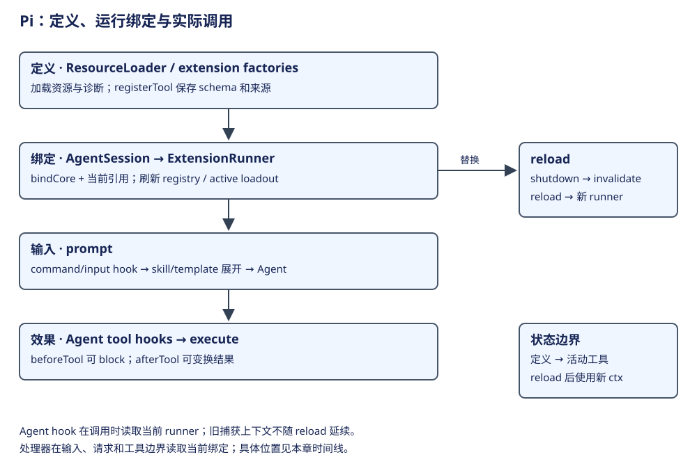
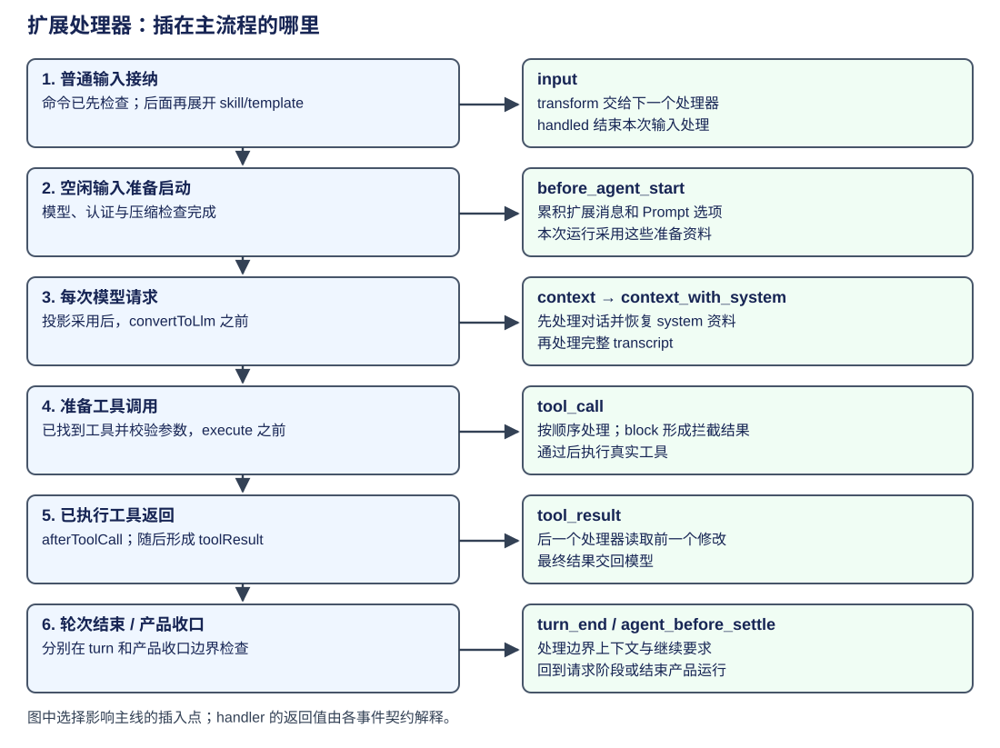
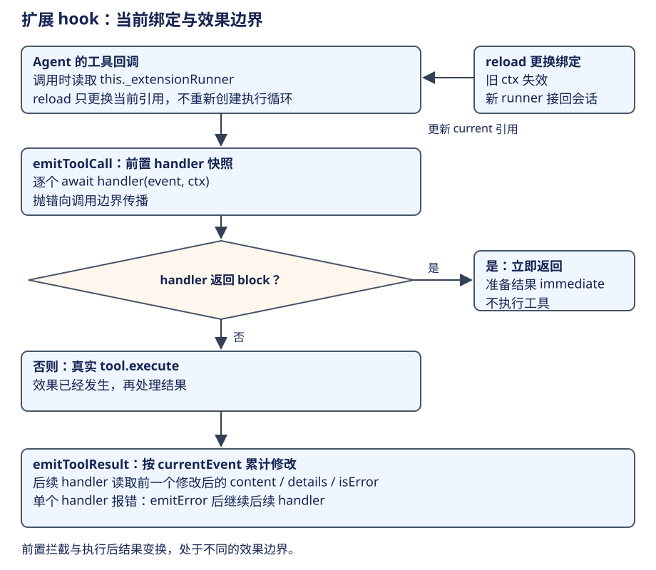
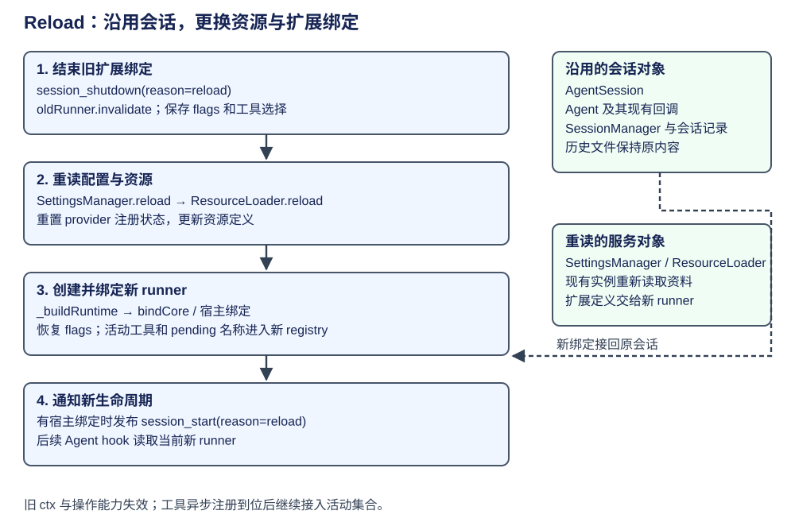

# AgentSession：资源、扩展与运行绑定

上一章解释了模型每次请求会拿到哪些消息。本章继续看程序怎样加入新的能力：例如加载一份 CSV 技能说明、注册一个专用验证工具，或在工具执行前检查调用。Pi 用 ResourceLoader 读取资源，用 ExtensionRunner 保存和分发扩展处理器，再由 AgentSession 把它们接到现有输入与执行流程。

扩展是一段在加载时运行的代码，可以注册工具、命令和事件处理器；skill 是任务知识，prompt template 是输入文本模板。它们从同一资源层进入，却分别在不同阶段发挥作用。下面先沿加载、绑定、激活、调用走一遍，再说明修改资源后怎样 reload。



| 步骤 | 当前位置 | 输出怎样被后续使用 |
|---|---|---|
| 1. 加载与注册 | ResourceLoader、extension factory | 工具、命令、handler 定义；skill 和模板内容 |
| 2. 绑定当前会话 | AgentSession._buildRuntime、bindCore | runner 能读取当前状态、调用当前会话操作 |
| 3. 选择本次工具 | _setActiveTools | 活动工具集合与对应 Prompt |
| 4. 在流程中调用 | 输入、请求、工具及收口边界 | 处理器结果交回原流程，决定后续动作 |
| 5. 修改资源后 reload | 当前 AgentSession | 更新资源与 runner，继续沿用会话和历史 |

入口 createAgentSession 采用注入的 ResourceLoader，或创建默认实现；前面的[构造章](architecture.md)已经解释对象从哪里来。这里从加载结果进入扩展内部。AgentSession._buildRuntime 是本章的扩展装配方法，产品宿主持有的 AgentSessionRuntime 则负责整份会话的切换。

## 第一步：加载资料并登记扩展定义

ResourceLoader 先发现启用的资源路径，运行扩展工厂，并保存 skill、模板等内容。DefaultResourceLoader 的 reload 分类采用加载结果，下面省略路径发现、信任筛选和诊断的展开：

```ts
const extensionsResult = await this.loadFinalExtensionSet(extensionPaths, preTrustExtensions);
this.extensionsResult = this.extensionsOverride
  ? this.extensionsOverride(extensionsResult)
  : extensionsResult;
this.applyExtensionSourceInfo(this.extensionsResult.extensions, metadataByPath);
// 省略：合并启用的 skill 路径，得到 skillPaths。
this.lastSkillPaths = skillPaths;
this.updateSkillsFromPaths(skillPaths, metadataByPath);
// 省略：合并启用的 prompt 路径，得到 promptPaths。
this.lastPromptPaths = promptPaths;
this.updatePromptsFromPaths(promptPaths, metadataByPath);
```

扩展定义交给下一步的 ExtensionRunner；skill 和模板在 prompt 输入阶段展开。这些集合保留各自来源，便于诊断重名和判断一份资料从哪里进入请求。[分类采用加载结果](https://github.com/earendil-works/pi/blob/f1b2e77f5b13b2a199b1052cb79c235451afe7d7/packages/coding-agent/src/core/resource-loader.ts#L585)。

扩展工厂调用 registerTool 时，loader 校验参数 schema，然后保存定义和 sourceInfo，并通知刷新工具 registry。下面节选实际注册方法，省略无效 schema 的错误文案：

```ts
registerTool(tool: ToolDefinition): void {
  assertActive();
  // 省略：检查 parameters 是对象 schema；
  // 无效定义在注册阶段报错。
  extension.tools.set(tool.name, {
    definition: tool,
    sourceInfo: extension.sourceInfo,
  });
  runtime.refreshTools();
}
```

例如专用 CSV 验证工具在这里进入可用定义集合。它要先被当前会话选中，模型才能在相应请求中发现它；模型发出调用后才会执行。[注册执行点](https://github.com/earendil-works/pi/blob/f1b2e77f5b13b2a199b1052cb79c235451afe7d7/packages/coding-agent/src/core/extensions/loader.ts#L289)。

## 第二步：让定义能操作当前会话

定义已加载，处理器还需要知道当前模型是什么、怎样发消息、怎样写扩展状态。AgentSession 创建 ExtensionRunner，设置当前引用，再将这些操作绑定回自己。下面节选 _buildRuntime 的装配段，省略默认工具名选择：

```ts
this._extensionRunner = new ExtensionRunner(
  extensionsResult.extensions,
  extensionsResult.runtime,
  this._cwd,
  this.sessionManager,
  new ModelRegistry(this._modelRuntime),
);
if (this._extensionRunnerRef) this._extensionRunnerRef.current = this._extensionRunner;
this._bindExtensionCore(this._extensionRunner);
this._applyExtensionBindings(this._extensionRunner);
// 省略：优先采用显式 activeToolNames，否则采用默认内置工具名。
this._refreshToolRegistry({
  activeToolNames: baseActiveToolNames,
  includeAllExtensionTools: options.includeAllExtensionTools,
});
```

runner 与当前 cwd、SessionManager、模型服务关联，随后通过 _bindExtensionCore 取得会话动作和状态读取。_applyExtensionBindings 接入宿主提供的 UI 等能力，_refreshToolRegistry 汇总工具定义。[运行装配](https://github.com/earendil-works/pi/blob/f1b2e77f5b13b2a199b1052cb79c235451afe7d7/packages/coding-agent/src/core/agent-session.ts#L3637)。

bindCore 的两个参数分别提供动作和状态读取。以下节选能说明扩展怎样回到原会话，省略其他消息、模型、会话操作和通知：

```ts
runner.bindCore({
  sendMessage: (message, options) => {
    // 扩展发消息时，调用当前 AgentSession 的消息入口；
    // sendCustomMessage 负责接纳 custom 消息。
    this.sendCustomMessage(message, options).catch((err) => {
      // 省略：runner.emitError 记录 send_message 失败，不把
      // Promise 丢掉。
    });
  },
  appendEntry: (customType, data) => {
    // 扩展状态写入仍由当前 SessionManager 管理，
    // 不另建历史文件。
    const entryId = this.sessionManager.appendCustomEntry(customType, data);
    const entry = this.sessionManager.getEntry(entryId);
    if (entry) this._emit({ type: "entry_appended", entry });
  },
  setActiveTools: (toolNames) => this.setActiveToolsByName(toolNames),
  // 省略：其他消息、模型和会话操作。
}, {
  getModel: () => this.model,
  isIdle: () => this.isIdle,
  getSignal: () => this.agent.signal,
  // 省略：其他运行状态读取与停止操作。
});
```

处理器用 ctx 读取当前状态，用扩展 API 发消息、保存 custom Entry 或更改活动工具；这些操作通过回调进入 AgentSession 和 SessionManager。ctx 是指向当前绑定的句柄，reload 时旧绑定会失效。第五步会说明这一生命周期。[会话动作与状态绑定](https://github.com/earendil-works/pi/blob/f1b2e77f5b13b2a199b1052cb79c235451afe7d7/packages/coding-agent/src/core/agent-session.ts#L3386)。

## 第三步：选出本次模型可用的工具

工具 registry 提供可用定义，active loadout 表示当前选中的工具集合。AgentSession._setActiveTools 采用集合，清除已经注册的 pending 名称，并同步 System Prompt：

```ts
private _setActiveTools(toolNames: string[]): void {
  const tools = this._applyToolLoadout(toolNames);
  for (const tool of tools) this._pendingToolNames.delete(tool.name);
  this._rebuildSystemPrompt(tools.map((tool) => tool.name));
}
```

CSV 验证工具被激活后，其真实实现进入 Agent 的工具集合。下一次请求准备再将工具声明与这个集合对齐，模型由名称、说明和参数 schema 发现它。[采用工具集合与重建 Prompt](https://github.com/earendil-works/pi/blob/f1b2e77f5b13b2a199b1052cb79c235451afe7d7/packages/coding-agent/src/core/agent-session.ts#L1527)，请求中的声明变化见[执行章](loop.md)。

## 第四步：把 hook 放回输入与执行流程

hook 是程序在某个位置调用扩展处理器的入口。位置决定扩展能改什么：输入阶段可以处理用户文本，请求阶段可以组织消息，工具执行前可以拦截调用，执行后可以调整反馈。先看它们在同一条时间线上的插入点。



| 主流程位置 | 处理器入口 | 返回结果怎样影响该步骤 |
|---|---|---|
| 普通输入接纳后、skill/template 展开前 | input | transform 的文本交给后续 handler；handled 结束这份输入的处理 |
| 空闲输入启动运行前 | before_agent_start | 累积扩展消息和 System Prompt 选项，供本次运行采用 |
| 每次模型请求的消息转换前 | context、context_with_system | 按顺序调整请求消息；前者处理对话并恢复 system 资料，后者处理完整 transcript |
| 工具参数校验后、execute 前 | tool_call | block 形成拦截结果，正常通过才执行工具 |
| 已执行工具的结果处理阶段 | tool_result | 逐个采用内容、details、isError 等结果修改 |
| 响应和工具结果完成，finishTurn 决策时 | turn_end | 提交边界编辑，将继续要求交给内核；随后发布内核 turn_end 通知 |
| 内核结束，产品准备收口时 | agent_before_settle | 提交边界编辑，决定产品是否通过 Agent.continue 开始新运行 |

这些入口都按扩展及 handler 的顺序分发，结果采用规则由事件契约决定。input 的 transform 会传给下一处理器，handled 会提前结束；tool_call 在 block 处返回；tool_result 累计修改结果。学习时先定位插入位置，再看该入口是否接管、变换或只通知。[输入分发](https://github.com/earendil-works/pi/blob/f1b2e77f5b13b2a199b1052cb79c235451afe7d7/packages/coding-agent/src/core/extensions/runner.ts#L1520)、[启动前资料](https://github.com/earendil-works/pi/blob/f1b2e77f5b13b2a199b1052cb79c235451afe7d7/packages/coding-agent/src/core/extensions/runner.ts#L1420)、[请求消息变换](https://github.com/earendil-works/pi/blob/f1b2e77f5b13b2a199b1052cb79c235451afe7d7/packages/coding-agent/src/core/extensions/runner.ts#L1294)。两个收口入口的具体交接见[执行章第五步](loop.md#第五步-根据反馈决定继续或收口)。

### 工具调用前后的两个插入点

沿 CSV 验证工具继续：模型已经发出 toolCall，程序已经找到真实工具并校验参数。此时 Agent.beforeToolCall 进入 AgentSession，读取当前 runner 并发布 tool_call；通过后才调用 execute。工具完成后，afterToolCall 再进入 tool_result，结果随后组成模型看到的 toolResult。



下面保留安装和调用的交接点，省略父调用身份字段及异常文案。AgentSession 构造时为 Agent 安装回调，每次调用再读取当前 runner：

```ts
// 构造时 _installAgentToolHooks() 只安装回调，不触发工具调用。
this.agent.beforeToolCall = (context) => this._beforeToolCall(context);
this.agent.afterToolCall = (context) => this._afterToolCall(context);

// 真正调用 _beforeToolCall 时，再读取当前 runner，避免捕获
// reload 前的旧实例。
const runner = this._extensionRunner;
if (!runner.hasHandlers("tool_call")) return undefined;
return await runner.emitToolCall({
  type: "tool_call", toolName: toolCall.name, toolCallId: toolCall.id,
  // 省略：嵌套调用附上 parentToolCallId，
  // 让扩展知道它属于哪个父工具。
  input: args as Record<string, unknown>,
});
```

这份动态引用让同一 Agent 在 reload 后使用新 runner。具体参数校验、immediate 结果和 execute 的顺序见[执行章的工具阶段](loop.md)。[调用时取得当前 runner](https://github.com/earendil-works/pi/blob/f1b2e77f5b13b2a199b1052cb79c235451afe7d7/packages/coding-agent/src/core/agent-session.ts#L652)。

<details>
<summary>阅读分发器：顺序、提前返回与结果采用</summary>

emitToolCall 的遍历可以直接节选：

```ts
const ctx = this.createContext();
let result: ToolCallEventResult | undefined;
for (const { handlers } of snapshotEventHandlers(this.extensions, "tool_call")) {
  for (const handler of handlers) {
    const handlerResult = await handler(event, ctx);
    if (handlerResult) {
      result = handlerResult as ToolCallEventResult;
      if (result.block) return result;
    }
  }
}
return result;
```

tool_call 处理器异常会传播到调用边界，由工具准备阶段形成错误结果。emitToolResult 则把修改累计到 currentEvent，后一个处理器读到前一个处理后的结果；单个结果处理器异常时记录 extension error，再处理后续 handler。[调用前分发](https://github.com/earendil-works/pi/blob/f1b2e77f5b13b2a199b1052cb79c235451afe7d7/packages/coding-agent/src/core/extensions/runner.ts#L1242)、[结果分发](https://github.com/earendil-works/pi/blob/f1b2e77f5b13b2a199b1052cb79c235451afe7d7/packages/coding-agent/src/core/extensions/runner.ts#L1183)。

结果处理器修改 content 却没有同步提供 structuredContent 时，runner 删除旧 structuredContent，使返回的文本和结构化内容保持一致。

</details>

## 第五步：reload 更新资源，沿用当前会话

修改扩展或资源后，reload 会重新加载配置和定义，创建新的 ExtensionRunner，再绑定回当前 AgentSession。Agent、SessionManager 和已有对话继续沿用；旧 runner 的 ctx 与操作能力失效，后续调用取得新绑定。这是 reload 的整体作用。



| 对象或资料 | reload 如何处理 |
|---|---|
| AgentSession、Agent、SessionManager | 沿用现有实例与会话记录 |
| SettingsManager、ResourceLoader | 现有对象重新加载配置和资源 |
| ExtensionRunner、扩展定义与操作绑定 | 旧 runner 失效，新 runner 采用重载结果并绑定当前会话 |
| flags、active tool 名称 | 保存选择并用于新装配；尚未注册的工具名保留为 pending |
| 默认工具配置 | 将设置中新加入的默认工具纳入当前集合；已移除的仍可保持激活 |
| provider 注册状态 | resetApiProviders 后随资源重新建立 |
| 宿主生命周期 | 旧 runner 收到 session_shutdown；有宿主绑定时，新 runner 收到 session_start |

因此读 reload 源码时可以围绕“旧绑定失效、资料重读、新绑定接入”三个动作定位。下面保留这段顺序，省略默认工具差异计算和末尾生命周期通知：

```ts
const oldRunner = this._extensionRunner;
const previousFlagValues = oldRunner.getFlagValues();
await emitSessionShutdownEvent(oldRunner, { type: "session_shutdown", reason: "reload" });
oldRunner.invalidate();
// 省略：记下旧默认工具选择，重载后才能识别设置新增的默认工具。
await this.settingsManager.reload();
this.syncQueueModesFromSettings();
resetApiProviders();
await this._resourceLoader.reload();
// 省略：比较前后设置，得到本次新增的默认工具名
// addedDefaultTools。
for (const name of this.getActiveToolNames()) this._pendingToolNames.add(name);
this._buildRuntime({
  activeToolNames: [...this.getActiveToolNames(), ...addedDefaultTools],
  flagValues: previousFlagValues,
  includeAllExtensionTools: true,
});
// 省略：新 runner 重新绑定宿主，并在有运行绑定时发布
// session_start(reason: "reload")。
```

_buildRuntime 将先前 flags 写入新的扩展 runtime，并重建工具 registry。需要异步注册的工具先以 pending 名称保留，注册到位后再接入活动集合。有宿主绑定时，末尾发布 session_start(reason=reload)，并继续从扩展发现资源。此前在会话中关闭的工具保持关闭，除非新设置把它新增为默认项。[reload 完整顺序](https://github.com/earendil-works/pi/blob/f1b2e77f5b13b2a199b1052cb79c235451afe7d7/packages/coding-agent/src/core/agent-session.ts#L3660)、[重载后的装配](https://github.com/earendil-works/pi/blob/f1b2e77f5b13b2a199b1052cb79c235451afe7d7/packages/coding-agent/src/core/agent-session.ts#L3661)。

下一章沿这套机制看两个具体能力：MCP 扩展接入外部工具，codemode 让模型用脚本组合工具调用。它们都从定义注册进入当前会话，再在刚才标出的执行位置产生调用与反馈。
